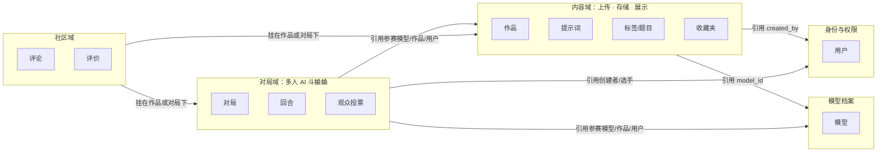
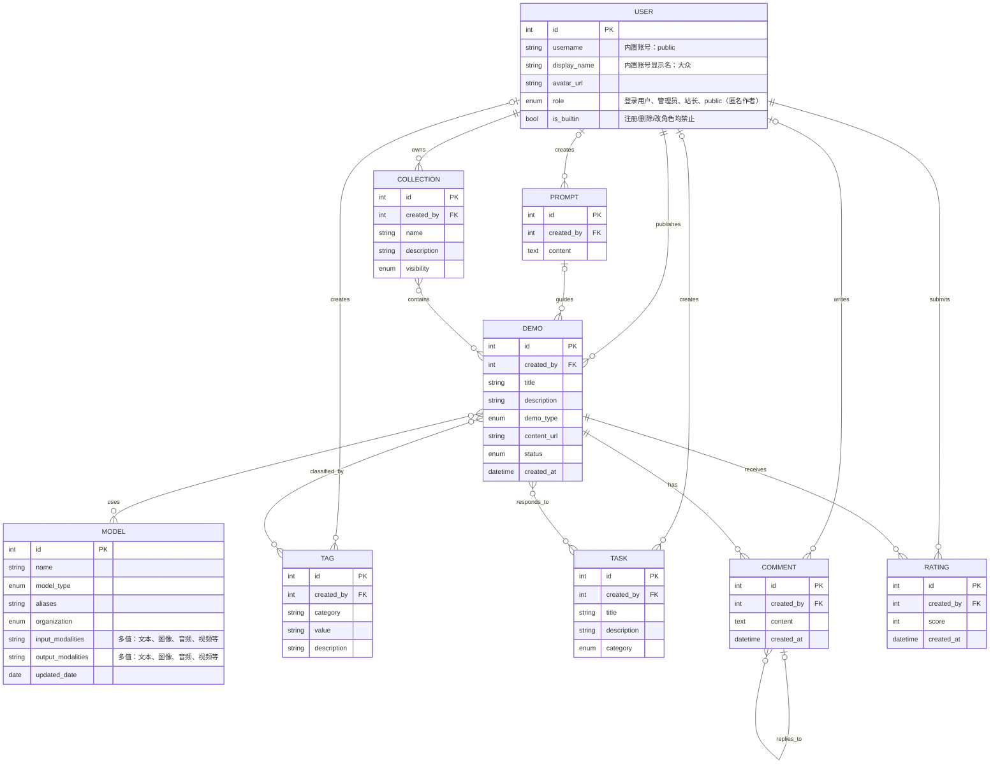
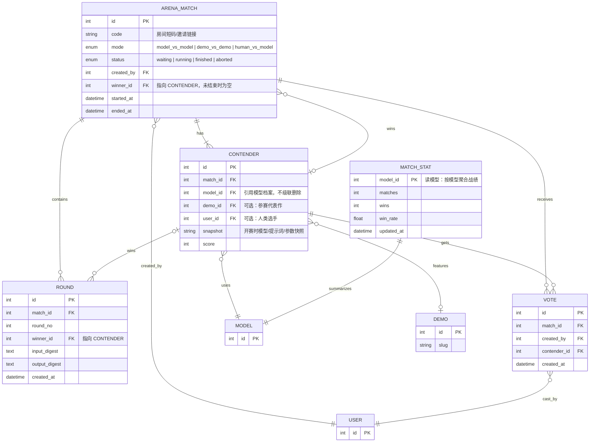

# Demo 站领域模型

## 一、业务面划分（限界上下文）

上传、存储、展示是同一件事的三个阶段，合起来是**内容域**；多人 AI 斗蛐蛐是**对局域**，两者生命周期、并发特征和读写模式都不同，应分开建模。

划分规则：

- 一个业务面 = 一个限界上下文，有自己的聚合根和状态机，**不共用同一张业务表**。
- 跨域只引用对方聚合的 ID，不直接写对方的表；需要对方数据时读接口或订阅领域事件。
- `用户`、`模型` 是共享主数据，所有域共用同一份，避免各域复制一份导致对不上。
- 业务面内部可以随意细化；业务面之间只保留少量稳定契约。

抽象层级建议：

| 层级 | 回答的问题 | 本文件对应 |
|---|---|---|
| 业务面（限界上下文） | 谁负责这块业务、边界在哪 | 第一节目的上下文图 |
| 聚合 | 哪些数据必须一起变、事务边界在哪 | 内容域的 `DEMO`、对局域的 `ARENA_MATCH` |
| 实体/值对象 | 字段、类型、约束 | 两张 ER 图 |

上传、存储、展示**不需要再拆成三个业务面**：它们是内容域内部的三个阶段，拆开只会多出跨服务事务。真正值得复用的是底层的“文件存储/转码/预览”技术能力，它可以作为共享基础设施同时服务内容域和对局域（例如回放、截图），但不构成业务实体。

## 二、内容域数据模型（上传 / 存储 / 展示）

### 域内规则

- `created_by` 指向 `USER.id`，是判断 UGC 归属的唯一依据；`DEMO`、`TAG`、`TASK`、`PROMPT`、`COMMENT`、`RATING`、`COLLECTION` 均为 UGC 实体，创建后即记录创建者。
- `MODEL` 是管理员维护的策展数据，不属于 UGC，故不设 `created_by`。
- 访客不作为持久化数据实体；`USER.role` 表示登录用户、管理员、站长或内置 `public`。
- `USER` 预置一个内置账号 `public`（展示名「大众」）：不能登录、不能删除、不能改角色，仅作为匿名内容的创建者。
- 所有匿名上传的作品都归属 `public`，因此 `DEMO.created_by` 始终有值，不再为空。
- `PROMPT` 按内容去重复用，`created_by` 记录首次创建该提示词的用户。
- 匿名作品公开展示时作者显示为「大众」，不暴露真实上传来源。

### 内置用户

| 字段 | 值 | 说明 |
|---|---|---|
| `username` | `public` | 固定账号，不允许被注册占用 |
| `display_name` | `大众` | 前台展示的匿名作者名 |
| `role` | `public` | 仅用于归属匿名内容，不具备登录与管理权限 |

## 三、对局域数据模型（多人 AI 斗蛐蛐）

对局是**短生命周期、高并发、强实时**的，和内容域的“长生命周期、重审核、重展示”完全不同，因此单独一套模型：

对局域规则：

- `ARENA_MATCH` 是聚合根；`CONTENDER`、`ROUND`、`VOTE` 只在同一对局内保持一致，不跨对局共享。
- 房间的在线状态（谁在房里、连接是否在线）是**运行时状态**，放内存或实时通道即可，不落库；只有对局结果固化。`code` 只是对局的邀请标识。
- `snapshot` 保存开赛时的模型名、提示词和参数。模型档案后续改名、合并、退役，都不影响历史对局复盘。
- `MATCH_STAT` 是事件投影出的读模型，不是真相源；真相永远是 `ARENA_MATCH` + `ROUND`。
- `winner_id` 在 `finished` 前为空，避免“先写赢家再补结果”的半成品状态。
- 同一观众对同一对局只计一票（`match_id + created_by` 唯一）。
- `MATCH_STAT` 只统计能确定模型的参赛方；作品对作品且模型未知时不进榜。

## 四、跨域衔接原则

| 场景 | 正确做法 |
|---|---|
| 对局要展示模型能力 | 引用 `MODEL.id`，开赛时写 `snapshot`；不把模型属性复制进 `CONTENDER` |
| 对局引用作品 | `CONTENDER.demo_id` 引用内容域；作品删除时置空，历史对局靠 `snapshot` 仍可复盘 |
| 对局产物要进作品库 | 对局域发 `MatchFinished` 事件，由内容域创建新的 `DEMO`；对局域**不直接写内容表** |
| 首页要“今日胜率榜” | 读 `MATCH_STAT` 投影；不要在对局请求里实时扫全量 `ROUND` |
| 评论/评分要挂到对局 | 社区域用 `target_type + target_id` 统一挂载，不为对局复制一套评论表 |
| 对局内身份（房主/选手/观众） | 只是对局内角色，不新增全局 `USER.role`；全局角色仍只有用户/管理员/站长/public |
| 分库还是同库 | 现阶段同库、按域分模块即可；预留 outbox 事件表，等对局并发或发布节奏独立后再拆服务 |

**不要做的事**：

- 往 `DEMO` 上加 `battle_count`、`win_rate`、`opponent_id` 之类的字段。
- 让对局表用数据库级联删除直接删作品或模型。
- 把房间的在线成员、心跳、每条消息都持久化。
- 为斗蛐蛐另建一套用户表或模型表。

