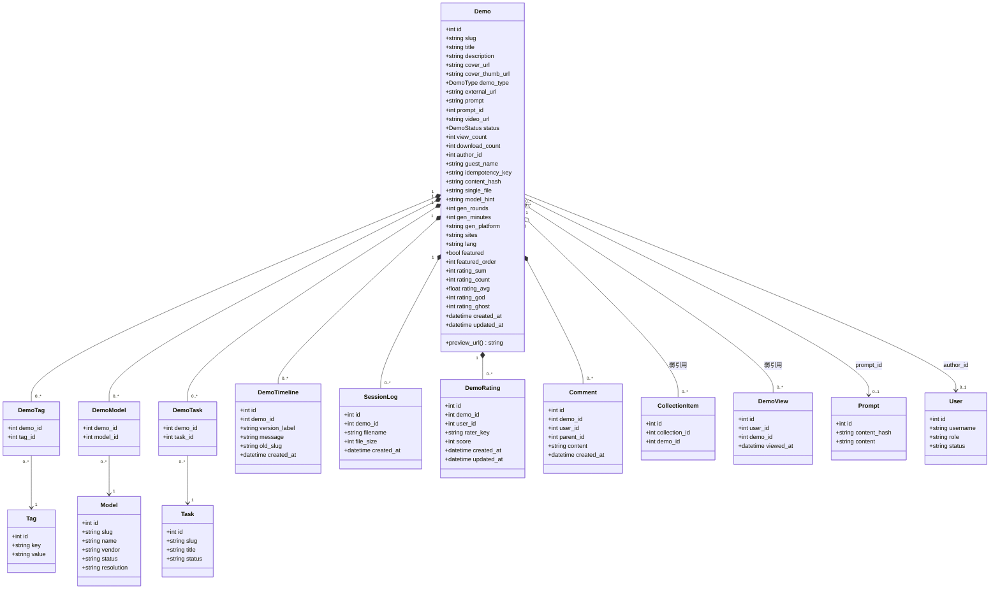
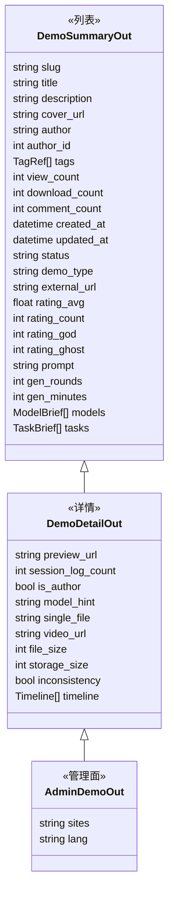
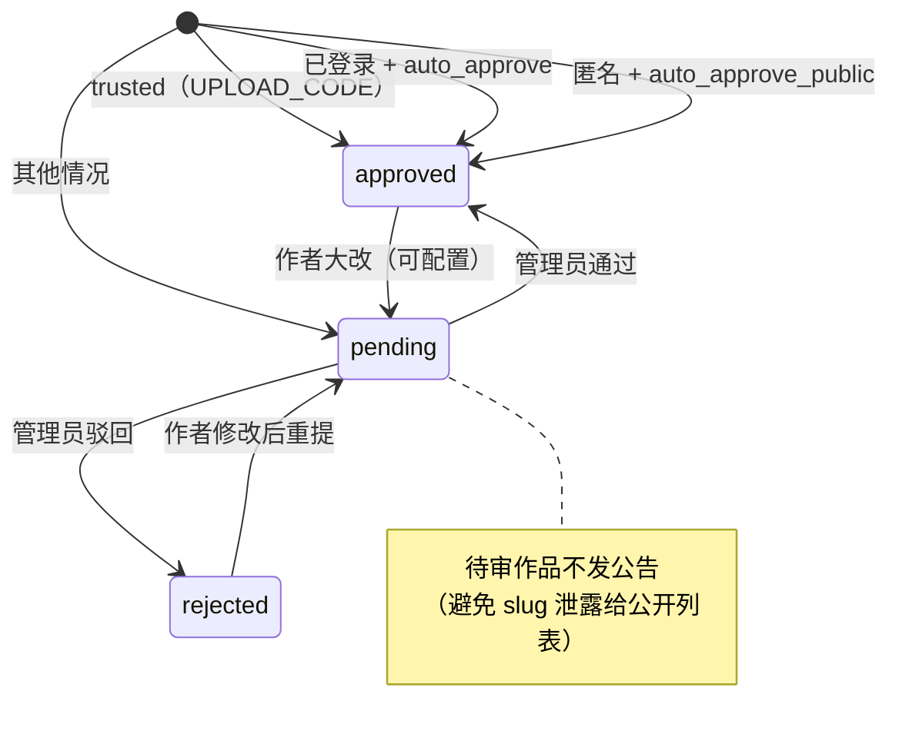
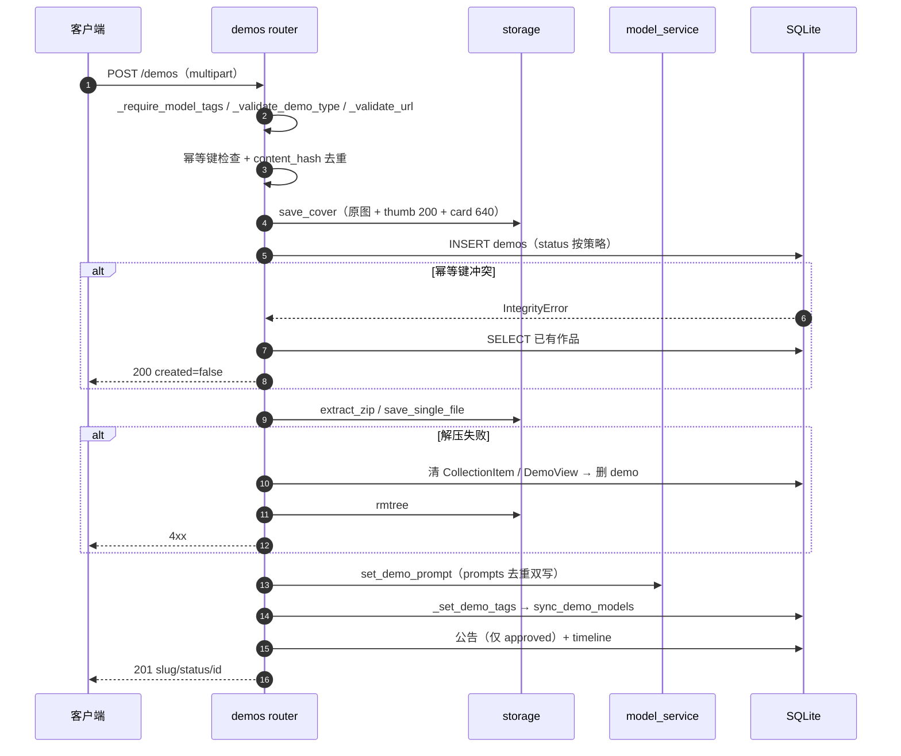
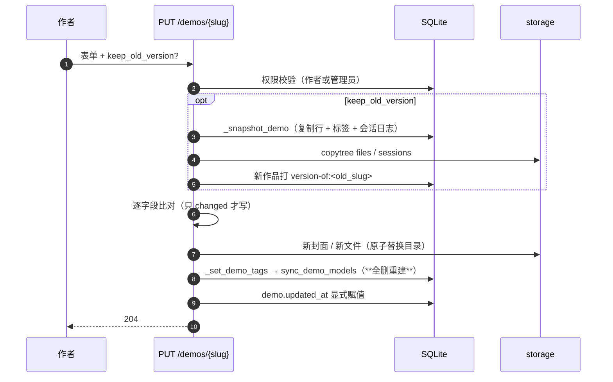
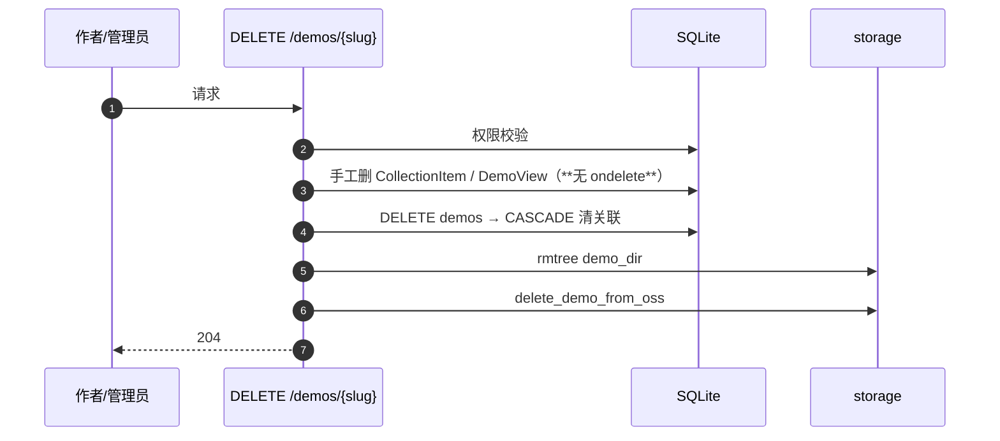

# Demo 域类图与数据结构

**适用范围**：本文描述**旧栈（`main`，FastAPI + Vue）**的 Demo 域现状，用于迁移对照。目标模型见 [Demo域设计.md](./Demo域设计.md)。

配套：`模型域设计.md`（模型关联部分）、`ORM现状与演进.md`（全库基线）。

本文只描述 **Demo 域**：它是什么、和谁关联、怎么写、怎么读、哪里会坏。

## 一、聚合与边界

`Demo` 是**聚合根**。它的生命周期由自己决定，附属实体随它存亡：

```text
Demo（聚合根）
├── 强归属（CASCADE，随作品删除）
│   ├── DemoTag      标签关联
│   ├── DemoModel    模型关联
│   ├── DemoTask     题目关联
│   ├── DemoTimeline 版本时间线
│   ├── SessionLog   会话日志记录（文件在存储层）
│   ├── DemoRating   评分
│   └── Comment      评论（写已下线，只读历史）
├── 弱引用（不级联，需手工清理）
│   ├── CollectionItem  收藏条目
│   └── DemoView        浏览历史
└── 可空引用（SET NULL / 无外键）
    ├── Prompt                 通过 prompt_id
    ├── TagValueSuggestion     通过 demo_id
    └── EntitySuggestion       通过 demo_id
```

**注释**：`DemoTag` / `DemoModel` / `DemoTask` 都是「关联表」，但**三者的写入语义完全不同**——这正是模型域要修的地方（见第六节）。

## 二、类图（实体层）



### 枚举（都是 String，无 DB 约束）

| 字段 | 值 | 语义 |
|---|---|---|
| `status` | `pending` / `approved` / `rejected` | 审核状态；只有 `approved` 进公开列表 |
| `demo_type` | `web` / `zip` / `link` / `image` | 决定预览、下载、校验规则 |
| `single_file` | `html` / `svg` / `null` | 仅 `web` 有意义；单文件 vs zip |
| `sites` | `deep` / `astra` / `deep,astra` | 可见域，逗号分隔 |
| `lang` | `zh` / `en` | 内容语言（astra 策展池要求 en） |

## 三、数据结构：三层响应



**关键机制**：`serialize_demo()` 总是返回全量字段（含 `sites` / `lang`），靠 Pydantic 按 schema 自动剥离未声明字段。所以**公开接口不会泄露策展字段**，但序列化函数本身知道它们。

### 写入载荷（`POST /demos` multipart）

| 字段 | 必填 | 说明 |
|---|---|---|
| `title` | ✅ | ≤200 |
| `tags` | ✅ | JSON 数组；**必须含至少一个 `model:` 键** |
| `demo_type` | ✅ | web / zip / link / image |
| `description` | | |
| `prompt` | | 第一轮提示词 |
| `external_url` | link 必填 | 校验协议 + 禁内网 |
| `video_url` | | 只存链接 |
| `cover` | | 图片；image 类型可省（图即作品） |
| `file` | web/zip/image 必填 | zip / .html / .svg / 图片 |
| `video_url` | | |

`POST /demos/from-url` 用 JSON：`zip_url` + 可选 `cover_url`，服务端下载后走同一套创建流程。

## 四、状态机

### 4.1 审核状态



判定优先级（`_create_demo_record`）：

```text
trusted                → approved
已登录                 → auto_approve ? approved : pending
匿名                   → (auto_approve || auto_approve_public) ? approved : pending
```

### 4.2 类型 × 能力矩阵

| demo_type | 文件要求 | `preview_url` | 下载行为 | `single_file` |
|---|---|---|---|---|
| `web` | zip 含 index.html，或单个 .html/.svg | **有** | 打包 zip | `html` / `svg` / null |
| `zip` | 任意 zip | 无 | 原 zip | null |
| `link` | 无文件 | 无 | **400 拒绝** | null |
| `image` | 图片（可作封面） | 无 | 展示大图 | null |

`preview_url` 生成规则（`serialize_demo`）：

```text
version = content_hash[:12] 或 created_at 时间戳
path    = /preview/{slug}/v{version}/index.{html|svg}
        → 拼 settings.preview_base_url（跨源沙箱域）
```

**版本 key 只随内容变**：`updated_at` 故意没有 `onupdate`，否则浏览/评分都会换 URL（2026-09-03 事故）。

## 五、时序

### 5.1 创建



### 5.2 编辑（含快照）



### 5.3 读取（preload 旁路）

`serialize_demo` 有两条路径，靠私有属性区分：

```python
pre_models = getattr(demo, "_pre_models", None)
model_rows = pre_models if pre_models is not None else [m for m in demo.models ...]
```

| 私有属性 | 预加载者 | 未预加载时的兜底 |
|---|---|---|
| `_pre_author` | `preload_demo_relations` | `demo.author` 懒加载 |
| `_pre_tags` | 同上 | `demo.tag_associations` |
| `_pre_comment_count` | 同上（论坛口径） | 实时 `SUM(ForumTopic.reply_count)` |
| `_pre_session_log_count` | 同上 | `COUNT(SessionLog)` |
| `_pre_models` / `_pre_tasks` | 同上 | 懒加载 + 过滤 deprecated |

列表接口必须预加载，否则每件作品触发 5~6 条 SQL（N+1）。

### 5.4 删除



`_purge_demo_references` 存在的原因写在代码里：`CollectionItem` / `DemoView` 建表时没写 `ondelete`，而 SQLite 开着 `PRAGMA foreign_keys=ON`，作品只要被收藏或浏览过，删除就会 `FOREIGN KEY constraint failed`（2026-09 生产 500）。

## 六、存储布局

```text
{STORAGE_DIR}/
├── demos/{slug}/
│   ├── files/            ← zip 解压 / 单文件（URL: /preview/{slug}/...）
│   └── sessions/         ← 会话日志（OSS 优先，本地兜底）
└── media/
    ├── covers/{hash}.webp        ← 原图（≤1280）
    │   ├── {hash}-thumb.webp     ← 200，列表
    │   └── {hash}-card.webp      ← 640，卡片/hero
    └── avatars/{user_id}-{hash}.webp
```

**封面三档**不是可选优化：`demo.cover_url` 存原图，`cover_thumb_url` 存 200 档；列表只加载小图，原图留给详情与 hero，省的是带宽。

**原子替换**：`_atomic_replace_dir` 先把新目录 rename 成目标，失败时把旧目录放回去——绝不出现「作品还在、文件没了」。

## 七、与模型域的接缝

Demo 域里有**三处双写**，只有第 2 处是模型域要解决的：

| # | 双写 | 事实源 | 本次是否处理 |
|---|---|---|---|
| 1 | `demos.prompt` ↔ `demos.prompt_id` | 两者都写，`prompts` 去重 | ❌ 保留（agent 契约在用） |
| 2 | `demo_tags(model:x)` ↔ `demo_models` | **现在是标签**，目标是 `demo_models` | ✅ T1–T6 |
| 3 | 标签 `rounds` ↔ 列 `gen_rounds` | 列是「可计算的那一份」 | ❌ 保留 |

模型域在 Demo 侧**只加两样东西**：

```sql
ALTER TABLE demo_models ADD COLUMN provider_id  INTEGER REFERENCES providers(id);
ALTER TABLE demo_models ADD COLUMN serving_note TEXT NOT NULL DEFAULT '';
```

`demos` 表本身**一列不动**。

## 八、六个已知问题

| # | 问题 | 影响 | 归属 |
|---|---|---|---|
| 1 | `demos` 34 列混合五种关注点 | schema 演进互相牵制 | 独立议题 |
| 2 | 编辑走「全删重建」标签与关联 | 并发编辑互相清空；provider 无法提前上线 | **T2 修** |
| 3 | `image` 类型是后加的，`demo_type` 注释只写 web/zip/link | 新人易漏分支 | 文档修正 |
| 4 | `inconsistency`（DB 有行、无文件）靠读时探测 | 每次详情打一次磁盘 | 观察 |
| 5 | `comment_count` 口径已改成论坛回复数，但 `comments` 表还在 | 两套数据并存 | 清理项 |
| 6 | 删除需手工清 `CollectionItem` / `DemoView` | 忘写就 500 | 建表补 `ondelete` 才能根治 |

## 九、如果要动，先动哪里

按风险/收益排序：

1. **`demo_models` 差集写入**（T2）—— 修 bug，且是 provider 的前置
2. **补 `ondelete`**（问题 6）—— 需要重建表，SQLite 要给已有表加外键只能重建；可放到 T6 一起做
3. **拆 `demos` 列**（问题 1）—— 收益最低、风险最高，不建议现在动

第 3 条尤其要克制：拆表会让 34 个字段的读写路径全部重排，而现有 309 个测试里大量用例直接构造 `Demo(...)`，改动面会远超预期。
