# Demo 域细化建模 v1.0

**适用范围**：本文是 Demo 域的目标模型。DDL 基于 SQLite；`dev` 为 Go + 新前端，落库时需按新栈 ORM 复核。§2.2 的取舍（模型归属挂 Demo 级）与技术栈无关。

本文是 Demo 域的**目标模型**（细化到字段级），与现状的差异和迁移路径另见 §11。

- 命名保留：**`Demo`** 继续作为逻辑作品的名字，不改成 Work
- 社区外置：讨论交给 Discourse 类系统，本系统只保留关联键，不为帖子建模
- 模型域衔接：沿用 [`模型域设计.md`](./模型域设计.md)；§2.2 说明唯一一处冲突与取舍

## 0. 决策摘要

| 决策 | 结论 |
|---|---|
| 逻辑作品名 | **`Demo`**（保留） |
| 版本载体 | **`DemoRevision`**：不可变内容快照，编辑产生新版本，不复制整行 |
| 内容存储 | **内容寻址**：`Blob`（sha256 命名）+ `DemoRevisionFile`（清单） |
| 发布渠道 | **`DemoChannel`**：渠道、可见性、语言、精选位，与审核状态正交 |
| 审核 | **`Demo.moderation_state`** 全局一次；渠道只管「在不在该渠道露」 |
| 生命周期 | **`Demo.lifecycle_state`**：draft / published / archived / removed |
| 统计 | **`DemoStat`** 独立表，可重建，不作为权威 |
| 评分 | **`DemoRating`** 只增不改（撤销是 delete），聚合进 `DemoStat` |
| 模型关联 | **保留在 `Demo` 级**（见 §2.2 的取舍说明） |
| 删除 | **软删除**（`deleted_at` + tombstone），物理清理走 GC |
| 社区 | **`DemoExternalThread`** 只存外链标识，不复制帖子 |

## 1. 为什么现在改

现状的问题不是「列太多」，而是**四种生命周期压在一个实体里**：

| 生命周期 | 现在在哪 | 冲突表现 |
|---|---|---|
| 内容（会被编辑） | `demos.*` | 与「运行记录」同表 |
| 运行（不可变证据） | `demos.prompt` / `gen_*` / `model_hint` | 编辑会覆盖证据 |
| 发布（渠道/可见性） | `demos.status` + `demos.sites` | 两个正交维度压成一维 |
| 版本 | 复制整行 + `version-of` 标签 | 旧版本进作品库、计数虚高（标签从未被读取过滤） |

## 2. 领域边界

### 2.1 聚合

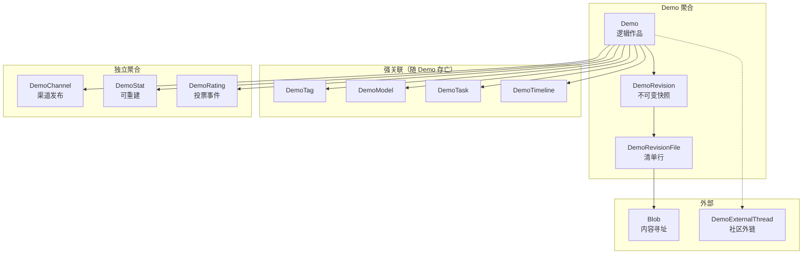

要点：

- **`DemoRevision` 属于聚合内部**：它的生命周期被 `Demo` 完全拥有，删除作品时一起走
- **`DemoChannel` / `DemoStat` / `DemoRating` 是独立聚合**：各自的事务边界，可以独立重建或清理
- **`Blob` 不属于任何聚合**：它是共享的存储层，靠引用关系存活

### 2.2 必须现在决定的冲突：模型关联挂在哪一层

模型域设计（v1.0 §3.3）把 `demo_models` 定为「作品 ↔ 模型」的唯一事实源，并加了 `provider_id`。但引入 `DemoRevision` 后，一个更「正确」的位置是**版本**——因为一次生成运行对应一个版本。

两种做法：

| 方案 | 结构 | 优点 | 代价 |
|---|---|---|---|
| **A（采用）** | `demo_models(demo_id, model_id, provider_id)` 保持现状层 | 不动模型域设计；列表/模型页查询不用改；实现简单 | 一个 Demo 跨版本换模型时，历史版本归谁说不清 |
| B | `demo_revision_models(revision_id, model_id, provider_id)` | 每个版本都有准确归属，证据链完整 | 模型域设计要改；「某模型的所有作品」多一层 JOIN |

**采用 A**，理由：

1. 现实语料里「同一作品换模型」是极少数；换模型更接近「另一件作品」
2. 真要表达换模型，用「新 Demo + `version-of`」即可，语义清晰
3. 避免同时大改两个域，降低交叉风险

**代价要写进不变量**：`Demo` 的模型归属代表「当前版本由谁生成」，历史版本的模型归属**不提供**。`DemoRevision` 只保留 `prompt_id` 与运行元数据（轮数/耗时/平台）。

如果将来这条不能满足，再走 B——那时 `demo_models` 已经有 `provider_id`，迁移只需加一列 `revision_id` 并回填。

## 3. 实体设计（字段级）

### 3.1 `Demo`（逻辑作品）

| 字段 | 类型 | 空 | 默认 | 说明 |
|---|---|---|---|---|
| `id` | INTEGER PK | 否 | 自增 | |
| `slug` | TEXT(128) | 否 | — | **唯一且永久**；改名留历史见 §3.10 |
| `title` | TEXT(200) | 否 | — | 展示用；同时快照进 revision |
| `description` | TEXT | 否 | `''` | 可编辑 |
| `cover_url` | TEXT(500) | 否 | `''` | 当前版本封面（便于列表直读） |
| `cover_thumb_url` | TEXT(500) | 否 | `''` | 200 档小图 |
| `author_id` | INTEGER FK→users | 是 | NULL | NULL = 匿名 |
| `guest_name` | TEXT(64) | 是 | NULL | 匿名展示名 |
| `current_revision_id` | INTEGER FK→demo_revisions | 是 | NULL | 建库时可能还没有版本 |
| `moderation_state` | TEXT(16) | 否 | `pending` | `pending` / `approved` / `rejected` |
| `lifecycle_state` | TEXT(16) | 否 | `draft` | `draft` / `published` / `archived` / `removed` |
| `idempotency_key` | TEXT(128) | 是 | NULL | 唯一，agent 重试去重 |
| `created_at` | DATETIME | 否 | utcnow | |
| `updated_at` | DATETIME | 否 | utcnow | **无 onupdate**，仅内容变更时显式赋值 |
| `deleted_at` | DATETIME | 是 | NULL | 软删除时间 |
| `delete_reason` | TEXT(200) | 否 | `''` | 删除/下架理由 |

**不再放在 `Demo` 上的字段**（迁移到 revision 或 channel）：

| 原字段 | 去向 |
|---|---|
| `demo_type` `single_file` `external_url` | → `DemoRevision`（内容属性） |
| `prompt` `prompt_id` `video_url` | → `DemoRevision` |
| `model_hint` `gen_rounds` `gen_minutes` `gen_platform` | → `DemoRevision`（运行证据） |
| `content_hash` | → `DemoRevision.manifest_hash` |
| `status` | 拆成 `moderation_state` + `lifecycle_state` |
| `sites` `lang` `featured` `featured_order` | → `DemoChannel` |
| `view_count` `download_count` `rating_*` | → `DemoStat` |

**为什么 `title` 两边都有**：`Demo.title` 是最新标题（列表直读，避免 JOIN）；`DemoRevision.title` 是该版本的标题（历史页正确渲染）。改标题不产生新版本——它只更新 `Demo.title`，`updated_at` 显式赋值。

### 3.2 `DemoRevision`（不可变内容快照）

| 字段 | 类型 | 空 | 默认 | 说明 |
|---|---|---|---|---|
| `id` | INTEGER PK | 否 | 自增 | |
| `demo_id` | INTEGER FK→demos | 否 | — | CASCADE |
| `rev_no` | INTEGER | 否 | — | 1 起连续；`UNIQUE(demo_id, rev_no)` |
| `title` | TEXT(200) | 否 | — | 该版本的标题快照 |
| `description` | TEXT | 否 | `''` | |
| `cover_url` | TEXT(500) | 否 | `''` | |
| `demo_type` | TEXT(16) | 否 | `web` | `web` / `zip` / `link` / `image` |
| `single_file` | TEXT(8) | 是 | NULL | `html` / `svg` |
| `external_url` | TEXT(2000) | 是 | NULL | link 类型 |
| `entry_path` | TEXT(500) | 否 | `''` | 入口文件，如 `index.html` |
| `manifest_hash` | TEXT(64) | 否 | — | 清单哈希（**预览版本号来源**） |
| `file_count` | INTEGER | 否 | 0 | |
| `total_bytes` | INTEGER | 否 | 0 | |
| `prompt` | TEXT | 否 | `''` | 第一轮提示词原文 |
| `prompt_id` | INTEGER FK→prompts | 是 | NULL | 规范化去重实体 |
| `video_url` | TEXT(2000) | 是 | NULL | |
| `model_hint` | TEXT(500) | 否 | `''` | 兜底型号依据 |
| `gen_rounds` | INTEGER | 是 | NULL | |
| `gen_minutes` | INTEGER | 是 | NULL | |
| `gen_platform` | TEXT(32) | 是 | NULL | |
| `source` | TEXT(16) | 否 | `upload` | `upload` / `url_import` / `rollback` |
| `created_by` | INTEGER FK→users | 是 | NULL | |
| `created_at` | DATETIME | 否 | utcnow | |

**不可变**：任何字段写入后不再修改。要改内容 → 新增一条 revision。

`manifest_hash` 计算：

```text
canonical = 按 path 升序的 "path\0blob_sha256\n" 拼接
manifest_hash = sha256(canonical)
```

与 zip 如何打包无关——同样内容重新打包，`manifest_hash` 不变，预览 URL 也不变。

### 3.3 `DemoRevisionFile`（清单）

| 字段 | 类型 | 空 | 说明 |
|---|---|---|---|
| `id` | INTEGER PK | 否 | |
| `revision_id` | INTEGER FK→demo_revisions | 否 | CASCADE |
| `path` | TEXT(500) | 否 | 相对路径，正斜杠 |
| `blob_hash` | TEXT(64) | 否 | FK→blobs.sha256 |
| `size` | INTEGER | 否 | |
| `mime` | TEXT(128) | 否 | |

```text
UNIQUE (revision_id, path)
INDEX  (blob_hash)   -- GC 反查
```

### 3.4 `Blob`（内容寻址）

| 字段 | 类型 | 空 | 说明 |
|---|---|---|---|
| `sha256` | TEXT(64) PK | 否 | 内容哈希 |
| `size` | INTEGER | 否 | 字节数 |
| `mime` | TEXT(128) | 否 | |
| `storage_key` | TEXT(500) | 否 | 物理位置，如 `blobs/ab/cd/abcd…` |
| `backend` | TEXT(16) | 否 | `local` / `oss` |
| `created_at` | DATETIME | 否 | |
| `last_ref_at` | DATETIME | 否 | GC 用：最近一次被引用 |

**不可变**：同一 sha256 永远同一内容。上传时若已存在则**只加引用，不重复写**。

### 3.5 `DemoChannel`（渠道发布）

| 字段 | 类型 | 空 | 默认 | 说明 |
|---|---|---|---|---|
| `id` | INTEGER PK | 否 | 自增 | |
| `demo_id` | INTEGER FK→demos | 否 | — | CASCADE |
| `channel` | TEXT(32) | 否 | — | `deep` / `astra` / 未来渠道 |
| `visibility` | TEXT(16) | 否 | `listed` | `listed` / `unlisted` / `hidden` |
| `lang` | TEXT(8) | 否 | `zh` | 该渠道的语言标记 |
| `featured` | INTEGER | 否 | 0 | 精选位 |
| `featured_order` | INTEGER | 是 | NULL | 1 起连续 |
| `published_at` | DATETIME | 是 | NULL | |
| `curated_by` | INTEGER FK→users | 是 | NULL | 策展人 |
| `created_at` / `updated_at` | DATETIME | 否 | utcnow | |

```text
UNIQUE (demo_id, channel)
INDEX  (channel, visibility, featured_order)
```

**渠道与可见性正交**：

- 作品可以在 `deep` 上 `listed`，同时在 `astra` 上不存在（无行）
- `astra` 要求 `lang='en'`，这是**渠道规则**，由发布时校验，不是全局字段
- 首页精选 = `featured=1` + `visibility='listed'`

### 3.6 `DemoStat`（可重建聚合）

| 字段 | 类型 | 空 | 默认 | 说明 |
|---|---|---|---|---|
| `demo_id` | INTEGER PK FK→demos | 否 | — | CASCADE |
| `view_count` | INTEGER | 否 | 0 | |
| `download_count` | INTEGER | 否 | 0 | |
| `rating_sum` | INTEGER | 否 | 0 | 票分总和 |
| `rating_count` | INTEGER | 否 | 0 | |
| `rating_avg` | REAL | 否 | 0 | 冗余：sum/count |
| `rating_god` | INTEGER | 否 | 0 | 5 分票数 |
| `rating_ghost` | INTEGER | 否 | 0 | 1 分票数 |
| `updated_at` | DATETIME | 否 | utcnow | |

**不作为权威**：任何时候都可以从 `DemoRating` 与事件流水重建。提供 `scripts/rebuild_demo_stats.py`。

### 3.7 `DemoRating`（投票事件）

| 字段 | 类型 | 空 | 说明 |
|---|---|---|---|
| `id` | INTEGER PK | 否 | |
| `demo_id` | INTEGER FK→demos | 否 | CASCADE |
| `user_id` | INTEGER FK→users | 是 | 登录用户 |
| `rater_key` | TEXT(128) | 否 | 匿名指纹 `sha256(device|ip|salt)` |
| `score` | INTEGER | 否 | 1–5 |
| `created_at` / `updated_at` | DATETIME | 否 | |

```text
UNIQUE (demo_id, rater_key)
```

**只增不改**：改评分是 UPDATE `score`（同一人一票）；撤销是 DELETE。计数由 `DemoStat` 维护，可重建。

### 3.8 关联表

**`DemoTag`**：`(demo_id, tag_id)` 复合主键，不变。

**`DemoModel`**：模型域设计的落点。

| 字段 | 类型 | 说明 |
|---|---|---|
| `demo_id` | INTEGER FK | PK 之一 |
| `model_id` | INTEGER FK→models | PK 之一 |
| `provider_id` | INTEGER FK→providers | **可空 = 来源未标注** |
| `serving_note` | TEXT(100) | `fp8` / `free tier` |
| `source` | TEXT(16) | `api` / `legacy_tag` / `migration` / `attribution` / `merge` |
| `created_at` | DATETIME | |

**`DemoTask`**：`(demo_id, task_id)`，不变。

**`DemoTimeline`**：只记「事件」不记「版本」——版本由 revision 表达。

| 字段 | 类型 | 说明 |
|---|---|---|
| `id` | INTEGER PK | |
| `demo_id` | INTEGER FK | CASCADE |
| `kind` | TEXT(16) | `create` / `approve` / `reject` / `archive` / `restore` / `slug_change` / `merge` |
| `message` | TEXT(500) | |
| `actor_id` | INTEGER FK→users | 可空 = 系统 |
| `created_at` | DATETIME | |

### 3.9 `DemoExternalThread`（社区外链）

| 字段 | 类型 | 说明 |
|---|---|---|
| `demo_id` | INTEGER PK FK→demos | CASCADE |
| `provider` | TEXT(32) | `discourse` / `mastodon` / … |
| `host` | TEXT(200) | 实例域名 |
| `topic_id` | TEXT(64) | 外部 ID |
| `url` | TEXT(500) | |
| `post_count` | INTEGER | 缓存的回复数（用于作品卡显示） |
| `synced_at` | DATETIME | |

```text
UNIQUE (provider, host, topic_id)
```

**只存关联键与缓存计数**，不复制帖子内容。`comment_count` 从「查 `ForumTopic`」改为「读 `post_count`」，由同步任务更新。

### 3.10 `DemoSlugHistory`（slug 永久性）

| 字段 | 类型 | 说明 |
|---|---|---|
| `slug` | TEXT(128) PK | 旧 slug |
| `demo_id` | INTEGER FK→demos | |
| `created_at` | DATETIME | |

访问旧 slug → 301 到当前 slug。这样 `slug` 可以唯一且永久，同时支持改名。

## 4. 全景类图

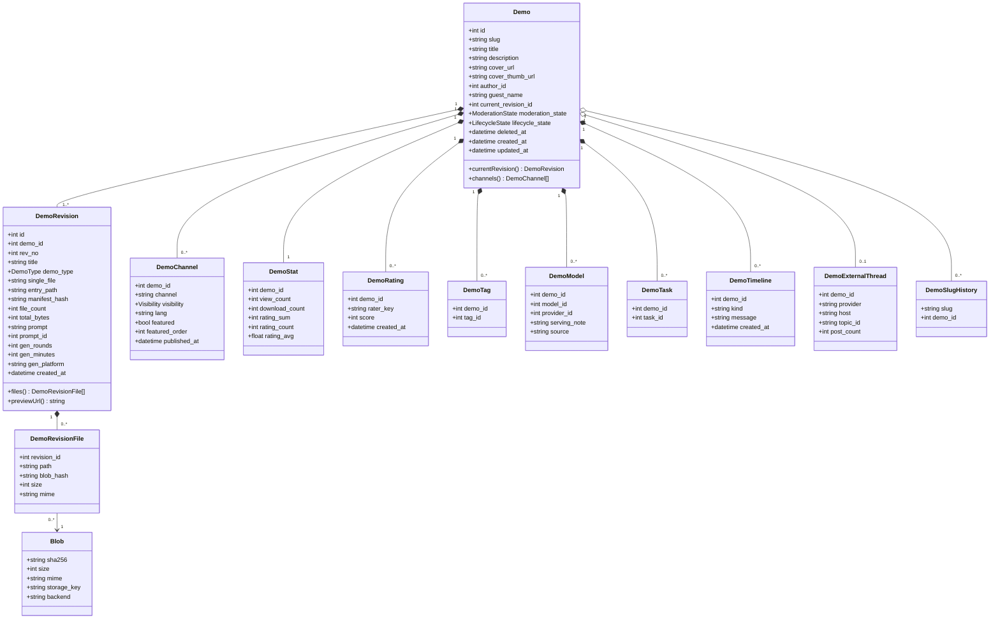

## 5. ER 图

### 5.1 作品与版本

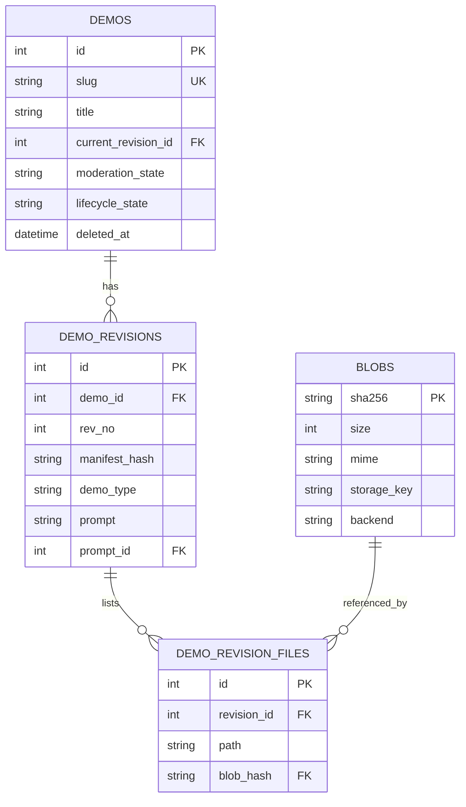

### 5.2 发布与统计

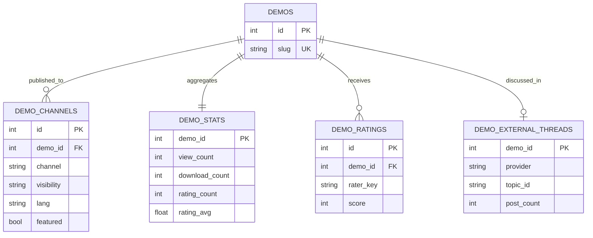

### 5.3 与模型域/标签/题目的接缝

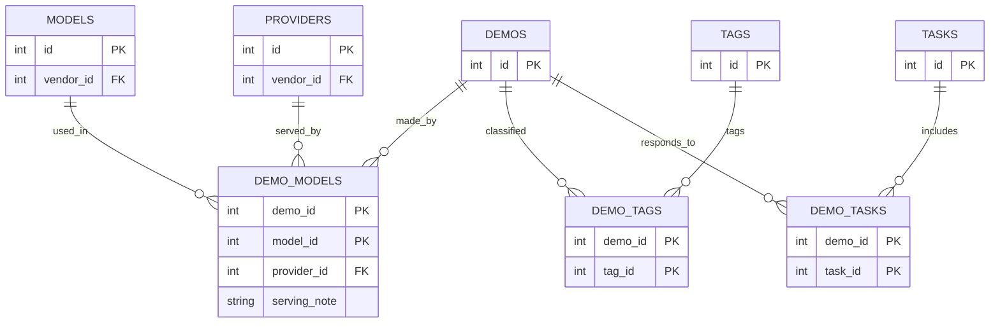

## 6. 状态机

### 6.1 审核状态（全局一次）

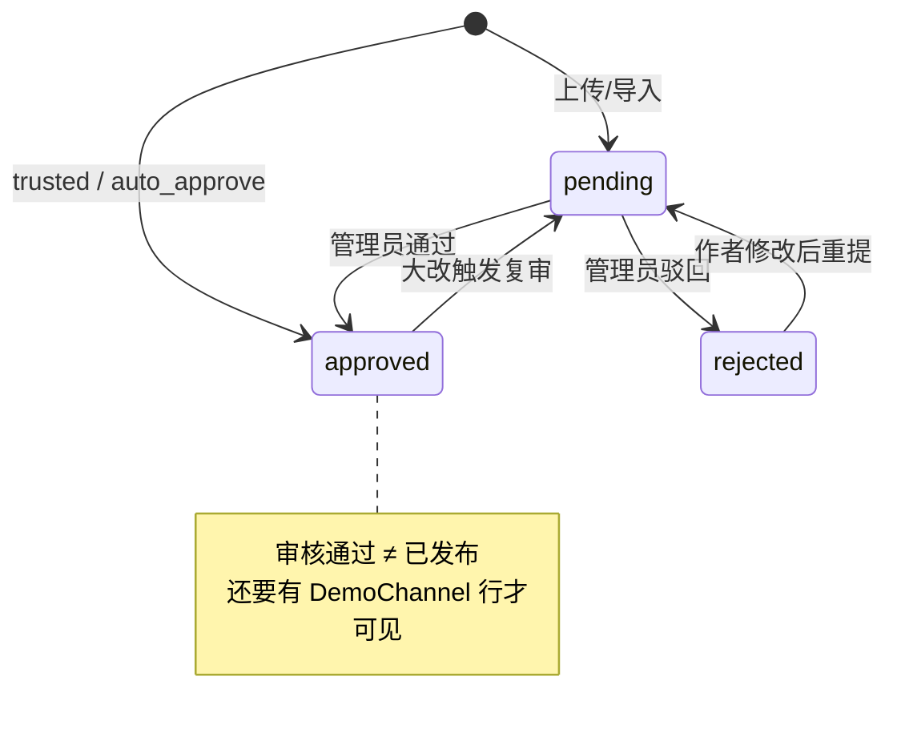

### 6.2 生命周期

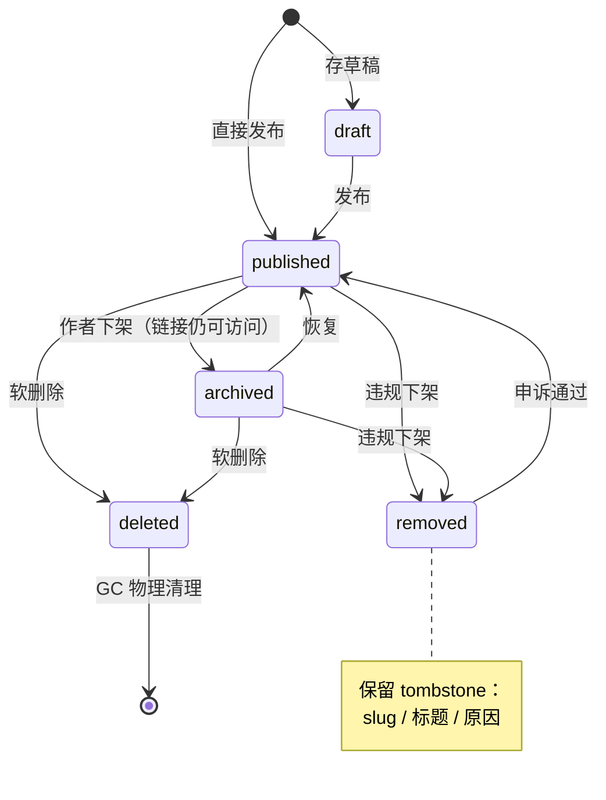

### 6.3 版本

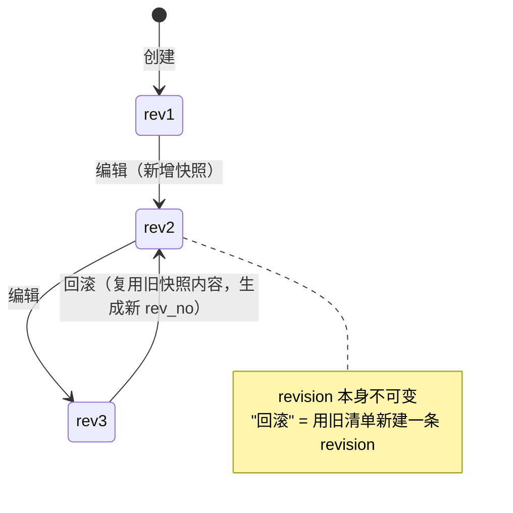

**回滚不删除历史**：`rev4.source='rollback'`，内容指向 `rev2` 的清单（同一批 blob，零拷贝）。

## 7. 时序

### 7.1 创建作品

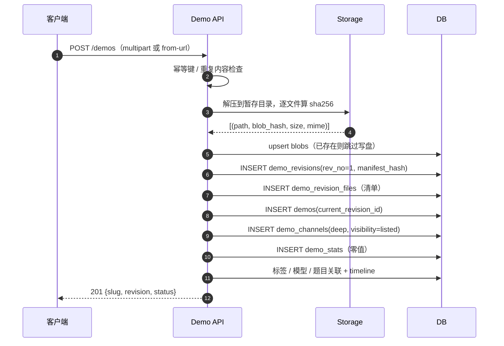

### 7.2 编辑（产生新版本）

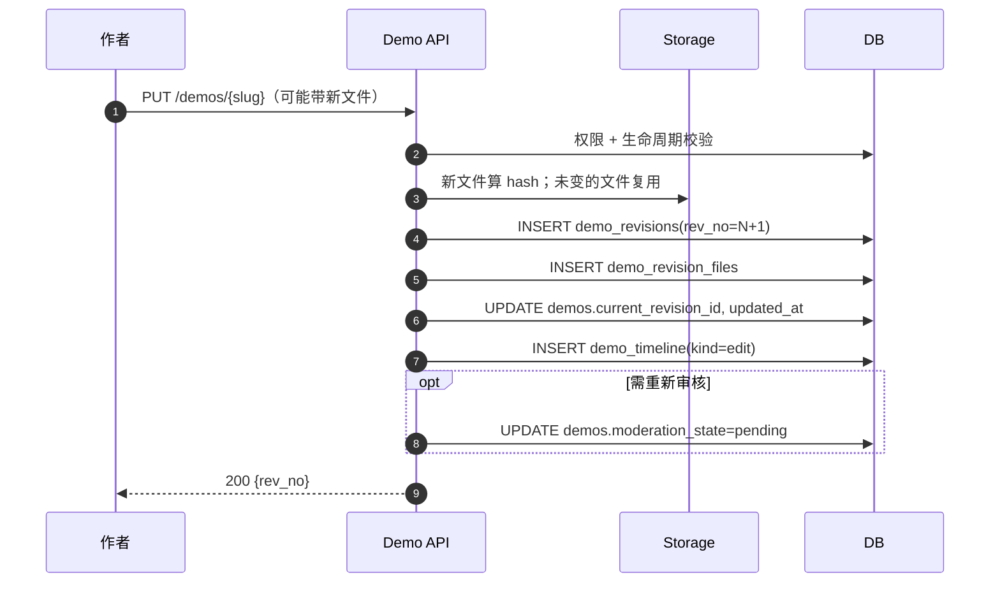

**零拷贝**：只改一个 `style.css` 时，其余文件的 `blob_hash` 不变，不写新 blob。

### 7.3 回滚

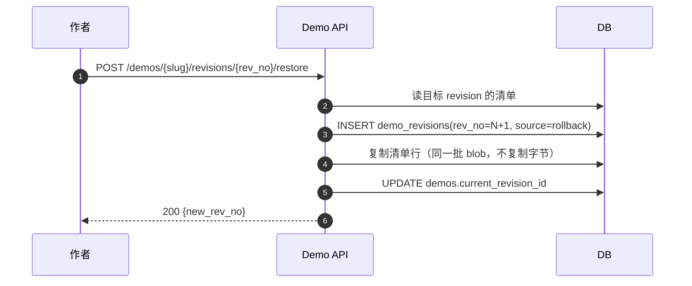

### 7.4 渠道发布（含 astra 策展）

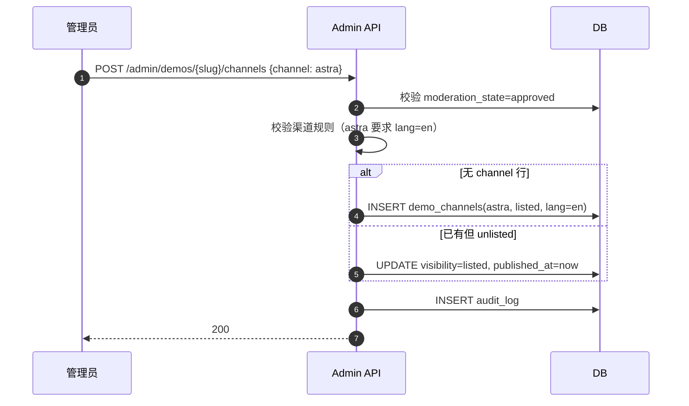

### 7.5 预览服务（内容寻址的解析）

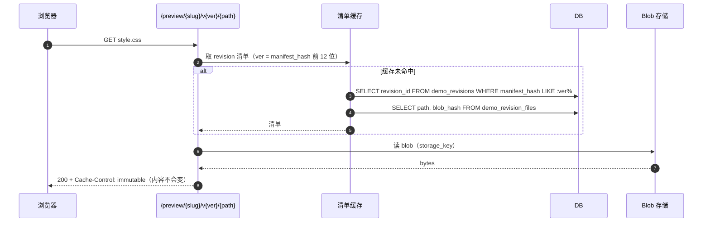

**`immutable` 是内容寻址带来的真实收益**：URL 里的 `v{manifest_hash}` 永久对应同一份字节，CDN 可以永不回源。

### 7.6 删除与 GC

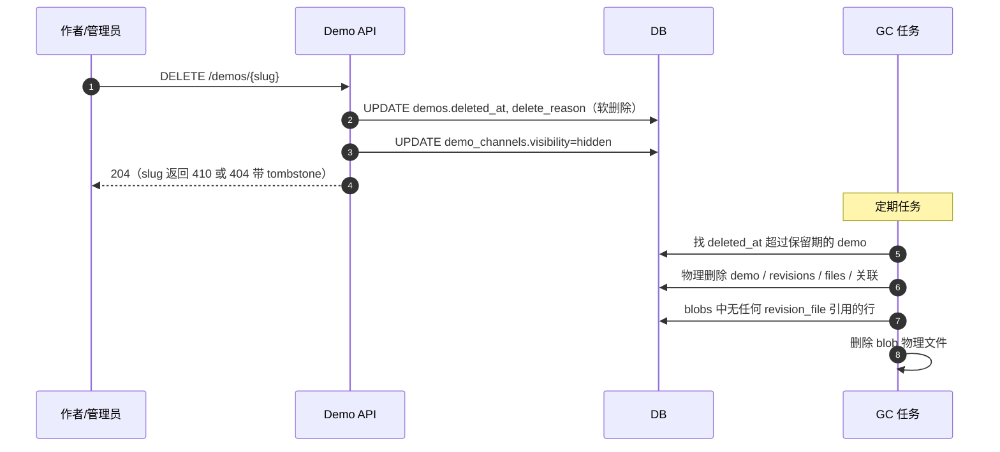

**可恢复**：软删除期间 `restore` 即可；只有过了保留期才真正消失。

## 8. 存储布局

```text
{STORAGE_DIR}/
├── blobs/
│   └── ab/cd/abcdef0123456789…      ← 内容块，无扩展名（mime 在 DB）
├── demos/{slug}/                     ← 过渡期物化（硬链接，见 §11）
│   └── files/index.html -> ../../blobs/ab/cd/…
└── media/
    ├── covers/{hash}.webp
    │   ├── {hash}-thumb.webp
    │   └── {hash}-card.webp
    └── avatars/
```

**硬链接过渡**：现有 `_serve_preview` 按路径直读文件，硬链接能让它一行不改；等清单缓存稳定后，再去掉物化目录。

## 9. 不变量

1. `DemoRevision` 一旦创建，任何字段不得 UPDATE（除后续追加的可空审计列）。
2. `Demo.current_revision_id` 必须指向属于该 demo 的 revision。
3. 每个 `Demo` 至少一条 revision（除建库瞬间）。
4. `rev_no` 在同一 demo 内从 1 连续递增，不跳号不复用。
5. `manifest_hash` 只由清单内容决定，与打包方式无关。
6. `DemoRevisionFile.blob_hash` 必须存在于 `Blob`。
7. `Blob` 不可变：同 sha256 永远同内容；写盘前必须校验。
8. `DemoChannel.(demo_id, channel)` 唯一；`visibility='listed'` 要求 `moderation_state='approved'`。
9. `DemoStat` 可随时从 `DemoRating` 重建；不得作为唯一数据源。
10. `Demo.slug` 永久唯一；改名写入 `DemoSlugHistory` 并 301。
11. 软删除的 `Demo` 不出现在任何公开查询；物理删除只由 GC 执行。
12. `Demo` 的模型归属代表当前版本；历史版本的模型归属不提供（见 §2.2）。

## 10. 与模型域的衔接

| 模型域设计 | Demo 域落点 |
|---|---|
| `demo_models` 唯一事实源 | 保持不变，挂在 `Demo` 级 |
| `provider_id` 可空 | `DemoModel.provider_id` |
| 标签退场 T1–T6 | 不受本文影响；`DemoTag` 结构不变 |
| `vendors` / `providers` | `DemoModel.provider_id` → `providers.id` |
| 第三方基准 | 与 Demo 无直接关系（按模型聚合） |

**唯一交叉点**：`DemoModel` 的写入由 `DemoModelWriter` 统一负责（模型域 T2），Demo 域不新增第二条写入路径。

## 11. 迁移路线（expand → contract）

现状与目标差距较大，但**可以分五步，每步独立可发布**。

| 步 | 变更 | 读路径 | 写路径 | 回滚 |
|---|---|---|---|---|
| **D1** | 建新表（revisions / files / blobs / channels / stats / slug_history / external_threads），不写入 | 不变 | 不变 | 删表 |
| **D2** | 回填：现有 demo 各生成一条 `rev_no=1`；文件算 hash 入 blobs；`sites`→channels；`rating_*`/`view_count`→stats | 不变 | 双写（新+旧） | 删新表数据 |
| **D3** | 读路径切到新表（列表 JOIN revision、详情读 revision、预览按 manifest_hash） | 新 | 双写 | 切回旧列 |
| **D4** | 写路径切到新表（编辑产生 revision，不再 `copytree`；`keep_old_version` 语义变成「打 tag 指向旧 rev」） | 新 | 新 | 保留旧列一个周期 |
| **D5** | 退场旧列（`demos.demo_type` / `prompt` / `sites` / `rating_*` 等） | 新 | 新 | 需备份 |

**D2 的双写期最长**——这一步同时承载「新表可用」和「旧列仍权威」，是所有切换的安全垫。

### 关键风险

| 风险 | 缓解 |
|---|---|
| 回填时文件算 hash 耗时长 | 分批 + 断点续跑；只算一次，落 `blobs` |
| 双写不一致 | 校验脚本比对 revision 清单与磁盘；差异进报告 |
| 预览 URL 变化导致 CDN 回源 | `manifest_hash` 与旧 `content_hash` 不同 → 接受一次性回源，安排在低峰 |
| 旧客户端读不到新字段 | D3 前保持响应结构不变（新增字段只增不改） |

## 12. 明确不做

- **不改 `Demo` 这个名字**（`Work` 只是早期讨论代号）
- **不在本系统为帖子建模**：社区外置，只留 `DemoExternalThread`
- **不把模型关联移到 revision**（§2.2 方案 A）
- **不拆 `DemoTag` / `DemoTask`**：结构已足够
- **不做多语言内容表**：`lang` 仍是渠道属性；真要做 i18n 内容另立设计
- **不做实时协同编辑**：版本是提交式的，不是 CRDT

## 13. 待定

1. 软删除保留期（默认建议 30 天）
2. `astra` 渠道是否允许 `unlisted`（现在只有 `listed` / 不存在）
3. 回填是否顺带把历史 `version-of` 快照合并成 revision（可能减少作品库噪音）
4. `Blob` 是否引入引用计数列（现在靠 `DemoRevisionFile` 反查，量大时再引入）
