# Demo 域细化建模 v1.8

**本版变更（v1.8，2026-11-04）：发布端点落地，时间线补 `publish` 一种事件。** 迁移 [`0012_timeline_publish_kind.sql`](../db/migrations/0012_timeline_publish_kind.sql) 把 `demo_timeline.ck_timeline_kind` 的取值加一个 `publish`。理由：§6.1 明写「审核通过 ≠ 已发布」，而这个区别在时间线上原本**没有落点**——把发布记成 `approve` 会让「审过了」与「发出去了」再也分不开，而那正是两个动作被拆成两个端点（`demo.review` / `demo.publish`）的理由。**§3.11 的 `kind` 那一行同步**；正文其余部分未动。

**本版变更（v1.7，2026-11-03）：把 §9 里三条「出错时静默」的不变量落成触发器，并把渠道提成主数据。** 三件事：① 迁移 [`0009_demo_domain_invariants.sql`](../db/migrations/0009_demo_domain_invariants.sql) 给 §9 的 **#1**（revision 不可变）、**#2**（`current_revision_id` 必须属于本 demo）、**#10**（`listed` 要求 `approved`，含反向）加触发器，**§9 那三条同步标注「已由触发器兜住」**；② 迁移 [`0010_channels_master.sql`](../db/migrations/0010_channels_master.sql) 新建 `channels` 主数据表，`demo_channels.channel` 从自由文本改成外键（**§3.5 那一行同步**）；③ 补 **§3.11 `DemoTimeline`**（此前建了表、§7 有写入点，但没有实体描述），并写清 **§3.7 `rater_key` 的生成口径**（此前只写了匿名口径，登录用户怎么算没定义）。**#3 不做数据库约束**（投稿事务天然两阶段），已记进 `docs/已知松点.md`。

**本版变更（v1.6，2026-11-03）：补上两条缺失的外键。** `demos.current_revision_id → demo_revisions` 与 `demo_revisions.demo_id → demos` 一直只有字段表里的「FK」标注、没有实际约束（`db/schema/80-late-fk.sql` 的头部还拿这一对当「跨域存在环、只能集中添加」的例子，但集中添加那一轮漏了）。迁移 [`0006_demo_revision_fk.sql`](../db/migrations/0006_demo_revision_fk.sql) 补上：`demo_id` 是 `ON DELETE CASCADE`（版本属于作品），`current_revision_id` 是 `ON DELETE SET NULL`（指针不是拥有者）。**§3.1 字段表那一行同步**；正文其余部分未动。

**本版变更（v1.5，2026-10-30）：§13 待定第 1 条结案。** 「软删除保留期」不再是待定项——生命周期 **L1 = A**、治理域 §9.2 已写死 **30 天**，本域 §13 的「默认建议 30 天」随之改成定案口径。**本版只改这一处**，正文（表结构 / 状态机 / 不变量）一律未动。

**本版变更（v1.4，2026-10-30）**：接 [`数据生命周期设计.md`](./数据生命周期设计.md) **v1.1**（台账 **G20**）——把**擦除**接进本域。三件事：① `demos` 加 **`erased_at`**，`demo_revisions` 加 **`deleted_at` + `erased_at`**；② **13 个内容列放宽 `NOT NULL` / 去掉 `DEFAULT ''`**（不放开，擦除写 `NULL` 会被数据库直接拒），依据 `数据生命周期 §11.1 B`；③ §6.4 / §7.6 / §9 补擦除与「行永久保留、只回收派生物」的口径（原文 §7.6 写「物理删除 demo / revisions / files」，与台账 G19 Q11「软删行永久保留」冲突，本版改正）。§0 摘要同步。

**本版变更（v1.3，2026-10-28）**：**DDL 方言统一为 PostgreSQL 18**（台账 **C2**）——本文原为全 SQLite 方言（`INTEGER` / `TEXT(n)` / `DATETIME`），本版把 **§3.x 字段表 · §4 类图 · §5 ER** 三处的类型逐列换成 PG 类型（`bigint` / `int` / `text` / `timestamptz` / `boolean` / `numeric(3,2)`），类型映射见 **§0.1**。**无结构变化**：列名、约束、主键语义、注释文字一律未改。

**本版变更（v1.2，2026-10-28）**：落地台账 **G18**「Demo 完全抽象为 Demo 站的作品本身；模型生成的内容 / 功能下放到 revision」。**§2.2 由方案 A 改采方案 B**（`demo_revision_models`）：模型 / 平台 / 平台配置 / 技能 / MCP 全部挂 revision 层，demo 层同名表改**视图**；§3.2 新增 **§3.2.1「revision 的生成条件关联表」**（5 张表 + 四条规则）；§3.8 / §4 / §5 的关联节点与边随之改到 `DemoRevision`；§9 撤销「历史版本模型归属不提供」那一条不变量；§11 回填口径改为「回填到各自的 `current_revision_id`」。目标态定义、其余决策编号与 §11 步骤顺序未改动。

**同日修订（v1.2 内，对齐 G18 已定细节）**：`gen_platform` 按 G18 全面退场——§0 运行元数据行、§3.1 去向表、§3.2 字段表、§4 类图、§6.5 可更正白名单共 5 处同步（白名单由 4 列减为 3 列；平台证据改由 `demo_revision_platforms` 表达）；`mcp_servers` 的口径由「待确认」改为引用《标签域数据结构设计》§3.6.1（v1.8）。版本号不变。

**同日修订（v1.2 内，审计修正 10 处）**：① `demo_models` 视图列集补齐为权威的 5 列——§4 类图补 `serving_note` / `source`，§5.3 ER 补 `provider_id` / `serving_note` / `source` 并去掉视图上的 `PK`（依据《模型域设计》§3.3 的 `CREATE VIEW demo_models`）；② §5.3 `DEMO_REVISION_MODELS` 补 `source`；③ §14.2 归宿表的 `platform` / `plugin`·`preset` / `skills` 三行由 demo 级视图改为 revision 级真表；④ 两处引用改指——`《模型域设计》§3.8` → **§11.1**、`《标签域数据结构设计》§3.6` → **§3.6.1**（含上段那处）；⑤ §2.1 把两个 `VIEW` 移入新子图「派生视图（不存数据）」，边改虚线并补要点一条；⑥ §6.4 与 §6.5 对调，节号不再倒序；⑦ §5.3 `DEMO_TASKS`（同为视图，G7）一并去掉 `PK`。版本号不变。

**本版变更（v1.1，2026-10-28）**：按台账 **G16**「设计文档正文只放目标态，过渡态下沉」，把过渡期结构、现状 → 目标对照与旧栈实现细节下沉到文末新增的 **§14 过渡期与退役（非目标态）**。目标态定义（表 / 列 / 约束 / 不变量）、决策编号、跨文档引用与 §11 迁移路线顺序均未改动，正文其余内容只调整位置。

**适用范围**：本文是 Demo 域的目标模型。**DDL 方言 = PostgreSQL 18**（C2；统一约定见 [DDL约定.md](./DDL约定.md)，§0.1 只留指针）；`dev` 为 Go + 新前端，落库时需按新栈 ORM 复核。§2.2 的取舍（**生成条件挂 revision**）与技术栈无关。

本文是 Demo 域的**目标模型**（细化到字段级），与现状的差异和迁移路径另见 §11。

- 命名保留：**`Demo`** 继续作为逻辑作品的名字，不改成 Work
- 社区外置：讨论交给 Discourse 类系统，本系统只保留关联键，不为帖子建模
- 模型域衔接：沿用 [`模型域设计.md`](./模型域设计.md)；§2.2 说明唯一一处冲突与取舍

## 0. 决策摘要

| 决策 | 结论 |
|---|---|
| 逻辑作品名 | **`Demo`**（保留） |
| 版本载体 | **`DemoRevision`**：不可变内容快照，编辑产生新版本，不复制整行 |
| 运行元数据 | **可更正**（`gen_rounds` / `gen_minutes` / `model_hint`，作者本人，留痕）；内容列仍不可变（§6.5） |
| 内容存储 | **内容寻址**：`Blob`（sha256 命名）+ `DemoRevisionFile`（清单） |
| 发布渠道 | **`DemoChannel`**：渠道、可见性、语言、精选位，与审核状态正交 |
| 审核 | **`Demo.moderation_state`** 全局一次；渠道只管「在不在该渠道露」 |
| 生命周期 | **`Demo.lifecycle_state`**：draft / published / archived / removed |
| 统计 | **`DemoStat`** 独立表，可重建，不作为权威 |
| 评分 | **`DemoRating`** 只增不改（撤销是 delete），聚合进 `DemoStat` |
| 模型关联 | **挂 `DemoRevision`**（方案 B，见 §2.2 / §3.2.1）；demo 层 `demo_models` 是视图 |
| 删除 | **软删除**（`deleted_at` + tombstone，30 天内可恢复）；**擦除**（`erased_at`，内容列清成 `NULL`、行永久保留）；派生物（目录 / OSS / blob）走 GC |
| 社区 | **`DemoExternalThread`** 只存外链标识，不复制帖子 |

### 0.1 DDL 方言与类型映射（C2）

**已抽出为全仓统一约定**：[`DDL约定.md`](./DDL约定.md)。方言、语义 → 类型映射、字段表写法、图与 DDL 的关系、索引/约束命名都在那一份里；**本域无偏差**，不再重复。

从旧栈 SQLite 迁入时的「原类型 → 现类型」逐条对照见该文 **附录 A**（含「现状字段清单里的 `Integer` / `String(n)` 是 SQLAlchemy 类型名、不要按对照表修正」的说明）。

## 1. 为什么现在改

现状的问题不是「列太多」，而是**四种生命周期压在一个实体里**：

| 生命周期 | 现在在哪 | 冲突表现 |
|---|---|---|
| 内容（会被编辑） | `demos.*` | 与「运行记录」同表 |
| 运行（不可变证据） | `demos.prompt` / `gen_*` / `model_hint` | 编辑会覆盖证据 |
| 发布（渠道/可见性） | `demos.status` + `demos.sites` | 两个正交维度压成一维 |
| 版本 | 复制整行 + `version-of` 标签 | 旧版本进作品库、计数虚高（标签从未被读取过滤） |

## 2. 领域边界

### 2.1 聚合

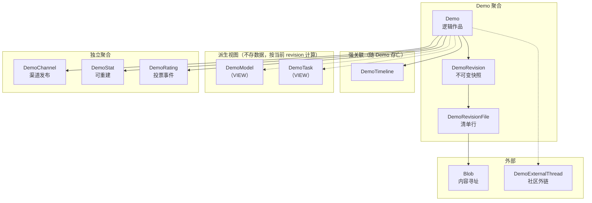

要点：

- **`DemoRevision` 属于聚合内部**：它的生命周期被 `Demo` 完全拥有，删除作品时一起走
- **`DemoModel` / `DemoTask` 是派生视图、不是表**（G18 / G7）：不存数据、没有独立生命周期，按 `current_revision_id` 计算，因此单列一个子图、不与「强关联」混放
- **`DemoChannel` / `DemoStat` / `DemoRating` 是独立聚合**：各自的事务边界，可以独立重建或清理
- **`Blob` 不属于任何聚合**：它是共享的存储层，靠引用关系存活

### 2.2 生成条件挂在哪一层：revision（方案 B，G18）

模型域设计（v1.0 §3.3）把 `demo_models` 定为「作品 ↔ 模型」的唯一事实源，并加了 `provider_id`。引入 `DemoRevision` 后，更「正确」的位置是**版本**——因为一次生成运行对应一个版本。

两种做法：

| 方案 | 结构 | 优点 | 代价 |
|---|---|---|---|
| A（放弃） | `demo_models(demo_id, model_id, provider_id)` 挂在 demo 层 | 不动模型域设计；列表/模型页查询不用改；实现简单 | **一个 Demo 跨版本换模型时，历史版本归谁说不清**——等于把历史归属永久丢失 |
| **B（采用）** | `demo_revision_models(revision_id, model_id, provider_id)` 挂在 revision 层 | 每个版本都有准确归属，证据链完整；历史可追溯 | 模型域读路径多一层 JOIN；demo 层要派生「当前」 |

**采用 B**（台账 **G18**，2026-10-28）。判据是用户给出的总原则：

> **「Demo 完全抽象为 Demo 站的作品本身；模型生成的内容 / 功能下放到 revision。」**

理由：

1. **「更新 demo 时用了新模型」是真实场景**，不是极少数。方案 A 的取舍自己也写明了代价「一个 Demo 跨版本换模型时历史版本归谁说不清」——当时判断它可接受，用户给出反例后该判断不成立。
2. **生成条件与运行元数据同类**：`model` / `platform` / `platform_config` / `skill` / `mcp` 和 `prompt` / `gen_rounds` / `gen_minutes` 一样，都回答「这一次生成用了什么 / 怎么生成的」；同一类事实放两个层，会出现两套归属规则。
3. **demo 层要的只是派生值**：demo 层只回答「当前版本用了什么」，那是 `demos ⋈ demo_revisions(current) ⋈ demo_revision_*` 的结果——与 **G7** 把 `DemoTask` 由表改视图同构。
4. **迁移成本已在原设计里预留**：`demo_models` 已有 `provider_id`，改成 revision 级只需加一列 `revision_id` 并回填到各自的 `current_revision_id`（§11 D2）。原方案 A 的「将来这条不能满足再走 B」只是提前到本版执行。

**代价**：「某模型的所有作品」多一层 JOIN，demo 层读路径改为读视图。可接受——读路径 SQL 形状不变、只是基表换成视图，模型域 / 标签域不用重写。

**历史归属怎么表达**：`Demo` 层面的「模型归属」代表**当前版本**（纯派生，不加冗余列）；历史版本的模型归属由各自的 revision 关联行提供，**可追溯**（不变量 §9 #12）。

五个维度的关联表与四条规则见 §3.2.1；demo 层同名表改视图的写法见 §3.8。

## 3. 实体设计（字段级）

### 3.1 `Demo`（逻辑作品）

| 字段 | 类型 | 空 | 默认 | 说明 |
|---|---|---|---|---|
| `id` | bigint PK | 否 | 自增 | |
| `slug` | text | 否 | — | **唯一且永久**；改名留历史见 §3.10（≤128 字符） |
| `title` | text | **是** | NULL | 展示用；同时快照进 revision（≤200 字符）。**内容列：擦除置 `NULL`** |
| `description` | text | **是** | NULL | 可编辑。**内容列** |
| `cover_url` | text | **是** | NULL | 当前版本封面（便于列表直读；≤500 字符）。**内容列** |
| `cover_thumb_url` | text | **是** | NULL | 200 档小图（≤500 字符）。**内容列** |
| `cover_inline` | bytea | **是** | NULL | ≤32 KiB 的内联封面（生命周期 §8.3）；超过就走 OSS。**内容列**，擦除置 NULL |
| `author_id` | bigint FK→users | 是 | NULL | NULL = 匿名 |
| `guest_name` | text | 是 | NULL | 匿名展示名（≤64 字符） |
| `current_revision_id` | bigint FK→demo_revisions（`ON DELETE SET NULL`） | 是 | NULL | 建库时可能还没有版本；版本被删时指针自动置空（见 `db/migrations/0006_demo_revision_fk.sql`） |
| `moderation_state` | text | 否 | `pending` | `pending` / `approved` / `rejected`（≤16 字符） |
| `lifecycle_state` | text | 否 | `draft` | `draft` / `published` / `archived` / `removed`（≤16 字符） |
| `idempotency_key` | text | 是 | NULL | 唯一，agent 重试去重（≤128 字符） |
| `created_at` | timestamptz | 否 | `now()` | |
| `updated_at` | timestamptz | 否 | `now()` | **无 onupdate**，仅内容变更时显式赋值 |
| `deleted_at` | timestamptz | 是 | NULL | 软删除时间（可恢复，30 天窗口） |
| `erased_at` | timestamptz | 是 | NULL | **擦除时间**（内容列已清空、不可恢复；非空必然蕴含 `deleted_at` 非空） |
| `delete_reason` | text | 否 | `''` | 删除/下架理由（≤200 字符；治理列，**擦除不动**——这是口径豁免：它记的是「为什么删」，不是作品正文；生命周期 §9.2 的「审计不存内容原文」针对的是标题/正文/文件） |

这两列都是受限枚举，取值集合与迁移矩阵在 `标准对象 §ST-4` / `标准对象 §ST-5`，本节只落可执行的约束——建表时随列一起加，别只写在注释里：

```sql
CHECK (moderation_state IN ('pending', 'approved', 'rejected'))
CHECK (lifecycle_state  IN ('draft', 'published', 'archived', 'removed'))
```

**这些关注点不在 `Demo` 上**（各自的家如下；左侧沿用旧栈列名，便于对照迁移）：

| 关注点 | 家 |
|---|---|
| `demo_type` `single_file` `external_url` | → `DemoRevision`（内容属性） |
| `prompt` `prompt_id` `video_url` | → `DemoRevision` |
| `model_hint` `gen_rounds` `gen_minutes` | → `DemoRevision`（运行证据） |
| `gen_platform` | **退场**（平台证据改由 `demo_revision_platforms` 表达，G18） |
| `content_hash` | → `DemoRevision.manifest_hash` |
| `status` | 拆成 `moderation_state` + `lifecycle_state` |
| `sites` `lang` `featured` `featured_order` | → `DemoChannel` |
| `view_count` `download_count` `rating_*` | → `DemoStat` |

**为什么 `title` 两边都有**：`Demo.title` 是最新标题（列表直读，避免 JOIN）；`DemoRevision.title` 是该版本的标题（历史页正确渲染）。改标题不产生新版本——它只更新 `Demo.title`，`updated_at` 显式赋值。

**落地状态（2026-11-05）——时间字段为什么都夹了一层 `GREATEST`**

`ck_demos_time_order` 是 `updated_at >= created_at`（`deleted_at`、`erased_at` 同理递进）。它是真判据，但写点用的是 `now()`——那是**事务开始时间**，不是语句真正跑的时刻。库所在机器的时钟被 NTP 往回拨之后，相邻两条语句里后一条的 `now()` 可能比前一条刚写下的 `created_at` 还早，于是「更新自己刚写的行」撞约束：对外表现是审核接口偶发 503，而 `writeReviewError` 的 default 分支当时不写日志，日志里一行都没有。

修法不是放宽约束，而是**给写点加天花板**：八处写 `demos.updated_at` / `deleted_at` 的语句统一取 `GREATEST(now(), created_at)`。时钟正常时它等于 `now()`（没有任何行为变化），时钟回拨时它顶在 `created_at` 上——宁可少记几秒，也不让一条合法操作变成 503。

- 约束本身一个字节没动，仍然是判据；夹的是**写进去的值**。
- 不选「在数据库上加夹紧触发器」：它会静默改写所有写点（包括将来的），而本仓的风格是「能在写点说清的就别藏在触发器里」。
- 也不选「只把机器时钟修好」：CI 与生产上任何一次 NTP 回拨都会重现，代码不该依赖时钟单调。
- 回归测试钉住三条路径：裁决、软删、恢复（`clock_integration_test.go`，把行的时间戳推到未来十分钟，之后任何 `now()` 都必然小于它）。

### 3.2 `DemoRevision`（不可变内容快照）

| 字段 | 类型 | 空 | 默认 | 说明 |
|---|---|---|---|---|
| `id` | bigint PK | 否 | 自增 | |
| `demo_id` | bigint FK→demos | 否 | — | CASCADE |
| `rev_no` | int | 否 | — | 1 起连续；`UNIQUE(demo_id, rev_no)` |
| `title` | text | **是** | NULL | 该版本的标题快照（≤200 字符）。**内容列** |
| `description` | text | **是** | NULL | **内容列** |
| `cover_url` | text | **是** | NULL | （≤500 字符）。**内容列** |
| `cover_inline` | bytea | **是** | NULL | ≤32 KiB 内联封面快照。**内容列** |
| `demo_type` | text | 否 | `web` | `web` / `zip` / `link` / `image`（≤16 字符） |
| `single_file` | text | 是 | NULL | `html` / `svg`（≤8 字符） |
| `external_url` | text | 是 | NULL | link 类型（≤2000 字符） |
| `entry_path` | text | **是** | NULL | 入口文件，如 `index.html`（≤500 字符）。**内容列** |
| `manifest_hash` | text | **是** | NULL | 清单哈希（**预览版本号来源**；≤64 字符）。**内容列** |
| `file_count` | bigint | **是** | NULL | **内容列**：擦除后是「不可知」，不是 0 |
| `total_bytes` | bigint | **是** | NULL | 同上 |
| `prompt` | text | **是** | NULL | 第一轮提示词原文。**内容列** |
| `prompt_id` | bigint FK→prompts | 是 | NULL | 规范化去重实体。**内容列**：擦除时与 `prompt` 一起置 `NULL`（断链，`prompts` 行本身不动） |
| `video_url` | text | 是 | NULL | （≤2000 字符）。**内容列**，擦除时置 `NULL` |
| `model_hint` | text | **是** | NULL | 兜底型号依据；**可更正**（§6.5）（≤500 字符）。**内容列** |
| `gen_rounds` | int | 是 | NULL | **可更正**（§6.5） |
| `gen_minutes` | int | 是 | NULL | **可更正**（§6.5） |
| `source` | text | 否 | `upload` | `upload` / `url_import` / `rollback`（≤16 字符） |
| `created_by` | bigint FK→users | 是 | NULL | |
| `created_at` | timestamptz | 否 | `now()` | |
| `deleted_at` | timestamptz | 是 | NULL | 软删（平时跟着 `demos` 判定；两列是为「单个版本被单独处理」留口） |
| `erased_at` | timestamptz | 是 | NULL | 擦除；擦除时与 `deleted_at` **一起写** |

**不可变**：任何字段写入后不再修改。要改内容 → 新增一条 revision。**例外只有生命周期两列**（`deleted_at` / `erased_at`）：它们由系统写，不属于「内容」。

**为什么内容列必须可空、且不能带 `DEFAULT ''`**：擦除要把它们写成 `NULL`（[`数据生命周期设计.md`](./数据生命周期设计.md) §6.2）。若列是 `NOT NULL DEFAULT ''`，写 `NULL` 被拒、写 `''` 又让「已擦除」与「刚建的空行」在数据上完全一样——验收 SQL 分不出来，§6.4 的 404 也就无从判定。规则见 [`DDL约定.md`](./DDL约定.md) §7。

`manifest_hash` 计算：

```text
canonical = 按 path 升序的 "path\0blob_sha256\n" 拼接
manifest_hash = sha256(canonical)
```

与 zip 如何打包无关——同样内容重新打包，`manifest_hash` 不变，预览 URL 也不变。

#### 3.2.1 revision 的生成条件关联表（G18）

「这一版用了什么模型 / 平台 / 平台配置 / 技能 / MCP」是 **revision 级事实**，由 5 张关联表表达。**表定义在模型域 / 标签域，本域只引用关系，不重复 DDL**：

| # | 关联表 | 关联到 | 定义方 | demo 层派生（视图） |
|---|---|---|---|---|
| 1 | `demo_revision_models` | `models` / `providers` | 模型域 | `demo_models` |
| 2 | `demo_revision_platforms` | `platforms` | 标签域 | `demo_platforms` |
| 3 | `demo_revision_platform_configs` | `platform_configs` | 标签域 | `demo_platform_configs` |
| 4 | `demo_revision_skills` | `skills` | 标签域 | `demo_skills` |
| 5 | `demo_revision_mcp_servers` | `mcp_servers` | 标签域 | —（MCP 无 demo 级表） |

> `mcp_servers` 的实体定义见《标签域数据结构设计》**§3.6.1（v1.8）**（跨平台：`id` / `slug` / `name` / `description` / `transport` / `endpoint` / `vendor_id?` / `status`）。本表只引用关系，不重复 DDL。

**四条规则**：

1. **多值**：每个维度都可多条——「多个模型接力完成」是常态；同一件作品可同时用多个平台 / 配置 / 技能。`demo_revision_models` 的 PK = `(revision_id, model_id)`：同一模型经不同 provider 用过**算一条**，`provider_id` 只是属性（可空）。
2. **每版只记本版**：数据模型层**不做继承 / 追加**。新增 revision 时由**前端自动预填**上一版的数据——「追加」是 UI 行为，不是数据模型行为（G18）。
3. **「当前」= `Demo.current_revision_id`**：demo 层的「当前版本用了什么」是**纯派生值**，不加冗余列。`?model=` 筛选、`model_counts` 计数、平台归属全部按当前 revision 算，回滚后跟着回滚——与 **G7**（题目归属按当前 revision）同构。
4. **demo 层同名表改为视图**：`demo_models` / `demo_platforms` / `demo_platform_configs` / `demo_skills` **保留表名，但由表改为视图**（`demos ⋈ demo_revisions(current) ⋈ demo_revision_*`），由各自拥有域定义；本域只依赖视图形状，读路径 SQL 不用重写。

`platform` 维度取代 `DemoRevision.gen_platform` `text` 列（G18：该列退场）。

### 3.3 `DemoRevisionFile`（清单）

| 字段 | 类型 | 空 | 说明 |
|---|---|---|---|
| `id` | bigint PK | 否 | |
| `revision_id` | bigint FK→demo_revisions | 否 | CASCADE |
| `path` | text | 否 | 相对路径，正斜杠（≤500 字符） |
| `blob_hash` | text | 否 | FK→blobs.sha256（≤64 字符） |
| `size` | bigint | 否 | |
| `mime` | text | 否 | （≤128 字符） |

```text
UNIQUE (revision_id, path)
INDEX  (blob_hash)   -- GC 反查
```

### 3.4 `Blob`（内容寻址）

| 字段 | 类型 | 空 | 说明 |
|---|---|---|---|
| `sha256` | text PK | 否 | 内容哈希（≤64 字符） |
| `size` | bigint | 否 | 字节数 |
| `mime` | text | 否 | （≤128 字符） |
| `storage_key` | text | 否 | 物理位置，如 `blobs/ab/cd/abcd…`（≤500 字符） |
| `backend` | text | 否 | `local` / `oss`（≤16 字符） |
| `created_at` | timestamptz | 否 | |
| `last_ref_at` | timestamptz | 否 | GC 用：最近一次被引用 |

**不可变**：同一 sha256 永远同一内容。上传时若已存在则**只加引用，不重复写**。

### 3.5 `DemoChannel`（渠道发布）

| 字段 | 类型 | 空 | 默认 | 说明 |
|---|---|---|---|---|
| `id` | bigint PK | 否 | 自增 | |
| `demo_id` | bigint FK→demos | 否 | — | CASCADE |
| `channel` | text FK→channels | 否 | — | `deep` / `astra` / 未来渠道。**取值来自 `channels` 主数据表**（迁移 0010），不是自由文本 —— 加一种渠道是加一行，打错字会被外键拒 |
| `visibility` | text | 否 | `listed` | `listed` / `unlisted` / `hidden`（≤16 字符） |
| `lang` | text | 否 | `zh` | 该渠道的语言标记（≤8 字符） |
| `featured` | boolean | 否 | `false` | 精选位 |
| `featured_order` | int | 是 | NULL | 1 起连续 |
| `published_at` | timestamptz | 是 | NULL | |
| `curated_by` | bigint FK→users | 是 | NULL | 策展人 |
| `created_at` / `updated_at` | timestamptz | 否 | `now()` | |

```text
-- 取值域：标准对象 §EN-1
CHECK  (visibility IN ('listed', 'unlisted', 'hidden'))
UNIQUE (demo_id, channel)
INDEX  (channel, visibility, featured_order)
```

**渠道与可见性正交**：

- 作品可以在 `deep` 上 `listed`，同时在 `astra` 上不存在（无行）
- `astra` 要求 `lang='en'`，这是**渠道规则**，由发布时校验，不是全局字段。校验点在 `backend/internal/domain/demo/publish.go` 的 `channelRequiredLang`（`Publish` 里判，不只在发布表单里判）——只在浏览器里挡的校验等于没有，`curl` 一次就能绕过去
- 首页精选 = `featured=true` + `visibility='listed'`

**预览与下载的可见性口径**（实现约定，不是新增字段）：

| 入口 | 放行条件 | 读哪个版本 | 谁能绕过 |
| --- | --- | --- | --- |
| 列表 | `published_revision_id IS NOT NULL` + `lifecycle_state=published` + 渠道有 `listed` | 对外版本 | 无 |
| 详情 `/demos/{slug}` | 同列表，但渠道接受 `listed` **或** `unlisted` | 对外版本 | 无 |
| 预览 `/preview/{slug}` | 与详情同一条谓词 | 访客读对外版本，作者与审核员读当前版本 | 作者本人、持 `demo.review` 的审核员 |
| 下载 `/download/{slug}` | 与详情同一条谓词 | 对外版本 | **无**（草稿不该存在于任何下载路径） |

**「对外版本」是 `demos.published_revision_id`，不是审核态**（迁移 0014）：

- 审核态描述**当前版本**（`current_revision_id`）——作者改稿就退回 `pending`；
- 对外内容由 `published_revision_id` 决定——它只在审核通过那一刻切到当前版本。

两者分开，才能做到「改稿期间线上照常服务」。合并成一个谓词（`moderation_state=approved`）会把「作者在改」变成「作品下线」：列表消失、详情 404、下载 404，而作者只是修了个错别字。

三条推论，都是实现里必须守的：

1. **渠道能不能上架看的是有没有对外版本**，不是审核态——`trg_demo_channel_listed_requires_approved` 因此改判 `published_revision_id IS NOT NULL`。
2. **发布不会把未审的新版推上线**：`PublishDemo` 用 `published_revision_id = COALESCE(published_revision_id, current_revision_id)`，复审期间点发布不会顺带放行最新一版。
3. **驳回不动对外版本**：作者改坏的第二版被驳回，线上仍是上一版（`TestIntegrationReviewRejectKeepsPublishedRevision` 钉住）。

**列表与其余三处必须分开写**：`listed` 与 `unlisted` 的差别只体现在列表上（`unlisted` 的定义就是「不上列表、知道地址能看」）。把四行合成「列表 / 详情同一条件」会让 `unlisted` 要么全站不可见、要么直接出现在列表里——前者违反标准对象 §EN-1，后者等于没有这个档位。

`unlisted` 的定义是「不上列表，但知道地址就能看」，所以它可以预览、可以下载，只是不出现在列表里；`hidden` 三个入口都拒。绕过渠道判定只对作者与审核员成立——他们看的是「还没对外」的东西，把渠道判定套上去等于让他们看不见自己正在审的作品。

### 3.6 `DemoStat`（可重建聚合）

| 字段 | 类型 | 空 | 默认 | 说明 |
|---|---|---|---|---|
| `demo_id` | bigint PK FK→demos | 否 | — | CASCADE |
| `view_count` | bigint | 否 | 0 | |
| `download_count` | bigint | 否 | 0 | |
| `rating_sum` | bigint | 否 | 0 | 票分总和 |
| `rating_count` | bigint | 否 | 0 | |
| `rating_avg` | numeric(3,2) | 否 | 0 | 冗余：sum/count |
| `rating_god` | bigint | 否 | 0 | 5 分票数 |
| `rating_ghost` | bigint | 否 | 0 | 1 分票数 |
| `updated_at` | timestamptz | 否 | `now()` | |

**不作为权威**：任何时候都可以从 `DemoRating` 与事件流水重建。提供 `scripts/rebuild_demo_stats.py`。

### 3.7 `DemoRating`（投票事件）

| 字段 | 类型 | 空 | 说明 |
|---|---|---|---|
| `id` | bigint PK | 否 | |
| `demo_id` | bigint FK→demos | 否 | CASCADE |
| `user_id` | bigint FK→users | 是 | 登录用户 |
| `rater_key` | text | 否 | 去重键（≤128 字符）。**登录用户 = `user:<users.id>`；匿名 = `anon:` + `HMAC(ip | ua)`**（密钥 `RATER_SECRET`）。两种状态用不同前缀，所以同一个人登录后投的是另一票 —— 这是有意的：匿名票不该因为后来登录就变成「同一个人投过」。清理与合并留给运营脚本，不在本期。 |
| `score` | int | 否 | 1–5 |
| `created_at` / `updated_at` | timestamptz | 否 | |

```text
UNIQUE (demo_id, rater_key)
```

**只增不改**：改评分是 UPDATE `score`（同一人一票）；撤销是 DELETE。计数由 `DemoStat` 维护，可重建。

### 3.8 关联表

**Demo ↔ 分类的关联表由标签域拥有**（`demo_classifications`），本域不重复定义。

**生成条件（模型 / 平台 / 平台配置 / 技能 / MCP）的真表在 revision 层**：5 张 `demo_revision_*` 见 §3.2.1，表定义在模型域 / 标签域，本域只引用关系。demo 层同名表**保留表名但由表改为视图**（G18）：

```text
demo_models           = demos ⋈ demo_revisions(current) ⋈ demo_revision_models
demo_platforms        = demos ⋈ demo_revisions(current) ⋈ demo_revision_platforms
demo_platform_configs = demos ⋈ demo_revisions(current) ⋈ demo_revision_platform_configs
demo_skills           = demos ⋈ demo_revisions(current) ⋈ demo_revision_skills
```

> `demo_mcp_servers` **不需要**：MCP 从来没有 demo 级表，只有 revision 级 → 无 demo 层视图。`mcp_servers` 实体定义见《标签域数据结构设计》§3.6.1（v1.8）。

**`DemoRevisionModel`（revision 级真表，模型域设计的落点）**：字段定义以模型域为准，此处列出是为说明主键与多值语义。

| 字段 | 类型 | 说明 |
|---|---|---|
| `revision_id` | bigint FK→demo_revisions | PK 之一（CASCADE） |
| `model_id` | bigint FK→models | PK 之一 |
| `provider_id` | bigint FK→providers | **可空 = 来源未标注**；同一模型经不同 provider 用过算一条 |
| `serving_note` | text | `fp8` / `free tier`（≤100 字符） |
| `source` | text | `api` / `legacy_tag` / `migration` / `attribution` / `merge`（≤16 字符） |
| `created_at` | timestamptz | |

**`DemoModel`（demo 层）**：**不再是表，改为视图**（G18）——定义 = `demos ⋈ demo_revisions(current) ⋈ demo_revision_models`，只按当前 revision 派生，供列表 / 模型页读路径沿用。

**`DemoTask`**：**不再是表，改为视图**（G7）。定义 = `demos ⋈ demo_revisions(当前) ⋈ task_prompts`，只按当前 revision 派生；详见《实体域数据结构设计》§1.3 / §3.6。

**`DemoTimeline`**：只记「事件」不记「版本」——版本由 revision 表达。

| 字段 | 类型 | 说明 |
|---|---|---|
| `id` | bigint PK | |
| `demo_id` | bigint FK | CASCADE |
| `kind` | text | `create` / `approve` / `reject` / `publish` / `edit` / `rollback` / `archive` / `restore` / `slug_change` / `merge`（≤16 字符） |
| `message` | text | （≤500 字符） |
| `actor_id` | bigint FK→users | 可空 = 系统 |
| `created_at` | timestamptz | |

### 3.9 `DemoExternalThread`（社区外链）

| 字段 | 类型 | 说明 |
|---|---|---|
| `demo_id` | bigint PK FK→demos | CASCADE |
| `provider` | text | `discourse` / `mastodon` / …（≤32 字符） |
| `host` | text | 实例域名（≤200 字符） |
| `topic_id` | text | 外部 ID（≤64 字符） |
| `url` | text | （≤500 字符） |
| `post_count` | bigint | 缓存的回复数（用于作品卡显示） |
| `synced_at` | timestamptz | |

```text
UNIQUE (provider, host, topic_id)
```

**只存关联键与缓存计数**，不复制帖子内容。`comment_count` 从「查 `ForumTopic`」改为「读 `post_count`」，由同步任务更新。

### 3.10 `DemoSlugHistory`（slug 永久性）

| 字段 | 类型 | 说明 |
|---|---|---|
| `slug` | text PK | 旧 slug（≤128 字符） |
| `demo_id` | bigint FK→demos | |
| `created_at` | timestamptz | |

访问旧 slug → 301 到当前 slug。这样 `slug` 可以唯一且永久，同时支持改名。

### 3.11 `DemoTimeline`（作品时间线）

`db/schema/30-demo.sql` 里建了这张表，§7 的流程里也有写入点，但此前没有单列实体 —— 补在这里。

| 字段 | 类型 | 空 | 说明 |
|---|---|---|---|
| `id` | bigint PK | 否 | |
| `demo_id` | bigint FK→demos | 否 | CASCADE |
| `kind` | text | 否 | `create` / `approve` / `reject` / `publish` / `edit` / `rollback` / `archive` / `restore` / `slug_change` / `merge` |
| `message` | text | 是 | 一句话说明（≤500 字符） |
| `actor_id` | bigint FK→users | 是 | 触发者；系统行为为 NULL |
| `created_at` | timestamptz | 否 | |

**落地状态（2026-11-08）——读取端点只给作者**

`GET /api/v1/demos/{slug}/timeline` 按倒序返回最近 100 条，带 `kind` / `at` /
`message` / `actorName`。可见性判据只有两条（D1 的裁决）：

| 谁能读 | 说明 |
|---|---|
| 作者本人 | 哪怕作品已下架或已软删——那是他自己的账本 |
| 其他人 | 一律 **404**，不是 403。403 会承认「这个 slug 存在，只是你没权限」 |
| 已擦除的作品 | 连作者也不给：与详情、预览同一口径 |

审核员也读不到：他们判依据的是内容与理由（`review_reason`），不是别人作品的动作史；
多一个出口就多一处要维护的可见性判定。墓碑页同样不显示。

`actorName` 走 `users → accounts.sub → profiles` 取显示名；账号被删时为空——那是事实，
不要用「系统」掩盖。前端只在 `DemoDetail.isAuthor` 为真时挂这个区块，
所以访客连请求都不会发（否则每次看别人的作品都多一个必然 404 的请求）。

**它写给人看，不承担审计**：审计在治理域的 `audit_log`（谁、改了什么、改前改后）。时间线只保留「这个作品发生过什么」这条叙事，所以：

- **不是事实源**：删掉它不影响任何判定。
- **只记录对外可见的动作**：审核通过与驳回、归档与恢复、改名、合并。内部字段级改动不进时间线。
- **`actor_id` 可空**：系统自动行为（如到期归档）没有操作人。

**值域里现在有写入点的只有七个**：`approve` / `reject` / `publish` / `edit` / `rollback` / `archive` / `restore`。
其余三个是**预留值**——`ck_timeline_kind` 里留着，代码里没有写入点：

- `create`：投稿落的是 `pending`，按上面「只记录对外可见的动作」不进时间线。将来只有「管理员直接发布」这类通道才用得上。
- `slug_change` / `merge`：这两个动作本身还没实现，值先占位，免得实现时再改一次 CHECK（0014 就是这么把 `publish` / `edit` / `rollback` 补进来的）。

值域的事实源是 `db/migrations/0014_published_revision.sql` 的 `ck_timeline_kind`；这张表和上面 §3.8 的字段说明都只是它的副本。

## 4. 全景类图

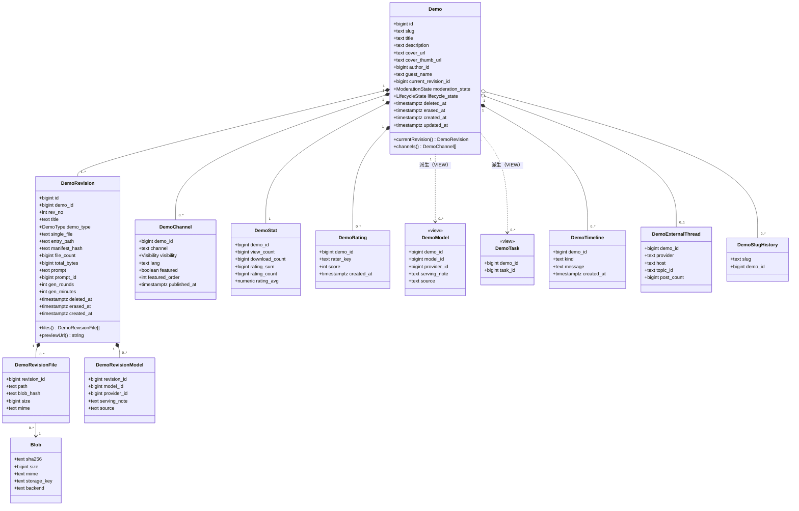

## 5. ER 图

### 5.1 作品与版本

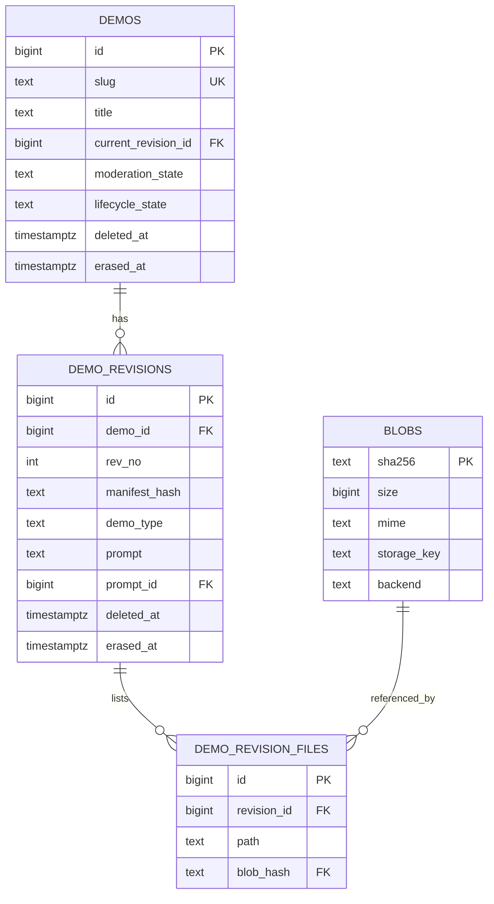

### 5.2 发布与统计

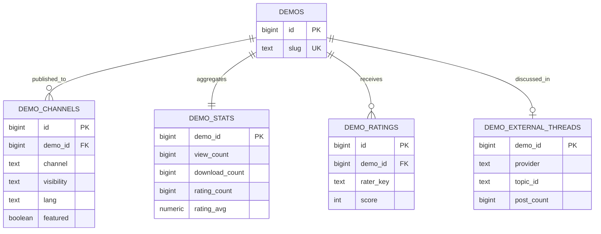

**落地状态（2026-11-05）——计数**

- 浏览去重靠迁移 `0015_demo_views.sql` 建的表 `demo_views(demo_id, viewer_key, viewed_on)`
  主键三列，`ON CONFLICT DO NOTHING RETURNING` 决定「今天算不算过一次」。
  这张表不在上面的 ER 图里——图是设计态，表是落地态，以迁移为准。
- 浏览的写入是**独立端点** `POST /api/v1/demos/{slug}/view`，不是详情 GET 的副作用。
  详情页在挂载时调它一次。理由：GET 加副作用会让爬虫、`<link rel=prefetch>`、
  以及任何 `curl` 都变成一次浏览，「浏览数」随即失去意义。
- `viewer_key` 与评分同口径：登录 `user:<accounts.id>`、匿名 `anon:` + HMAC(IP)。
  **只存哈希、不存 IP**，所以这张表即使泄露也不含个人信息。
- 详情响应里的 `viewCount` / `downloadCount` 来自 `demo_stats`，**只在作品对外可见时填**；
  墓碑与未发布恒为 0（不然墓碑页会暴露「这件作品以前有多少人看过」）。
- 下载的 `Range` 支持靠 `io.ReadSeeker` 类型断言（`storage.Local.Get` 返回 `*os.File`），
  **没有扩 `storage.Store` 接口**。分段请求**不计下载数**——一次「下载」的判据是拿到完整文件。

**落地状态（2026-11-09）——「我的作品」是作者视角的唯一出口**

- 端点 `GET /api/v1/me/demos`（`listMyDemos`）。它是作者唯一能看到自己
  「草稿 / 待审 / 被驳回 / 已发布 / 已下架 / 已软删」的地方：公开列表只含已上架，
  审核队列只列 `pending` 且仅审核员可见。少这一个出口，作者被驳回一次就只能靠记住 URL 回来。
- 判据只有两条：`author_id = 当前用户` 与 `erased_at IS NULL`。
  **不是** `deleted_at IS NULL`——软删的作品必须列出来，否则作者找不到「恢复」。
- **软删不改 `lifecycle_state`**，所以不能靠生命周期列判断「这一件是不是被我删了」。
  响应里另给两列：`deletedAt`（作者软删的时刻）与 `purgeAfter`
  （内容真正被清掉的时刻，来自 `gc_queue`；一个作品可能有多条清理行，取最早的那个）。
  恢复窗口在删除那一刻定型，这里只读它，不按当前配置现算。
- 排序 `updated_at DESC, id DESC`：按「最近动过」排，作者刚改的那件在最上面；
  并列用 id 兜底，翻页不抖。字段刻意不含简介 / 分类 / 浏览数——列表只回答
  「哪一件、什么状态、什么时候动过」，多取要 join 三张表。
- 未登录 401（与 `/me` 一致，不 403）：403 会承认「这个端点对你有意义」。
- **筛选给的是三个正交维度，不是「状态桶」**（2026-11-09 补）：`lifecycle`
  （draft / published / archived / removed）、`moderation`（pending / approved / rejected）、
  `deleted`（true / false），互不排斥、可任意叠加。界面上的「待审核」其实是
  `lifecycle=draft&moderation=pending` 这个组合——组合留在前端，接口不替界面决定口径，
  否则每加一个界面说法就要改一次契约。取值拼错一律 400：安静返回空列表会让作者
  以为自己的作品没了，而「筛选后为空」与「条件不合法」必须是两件事。

**落地状态（2026-11-07）——评分**

- 端点：`PUT /api/v1/demos/{slug}/rating`（`{score}` 1–5）与
  `DELETE /api/v1/demos/{slug}/rating`（撤销）。**不是**详情 GET 的副作用，
  与浏览计数同一理由：GET 有副作用的话，缓存、预取、爬虫都会变成一次表态。
- 去重键 `demo_ratings.rater_key` 与浏览计数**同一套口径**
  （`identity.Service.ViewerKey`：登录 `user:<accounts.id>`、匿名 `anon:` + HMAC(IP)）。
  两处各算各的，同一个人就会在「看过」和「打过分」里变成两个人。只存哈希，不存 IP。
- **一人一票，改分是 UPDATE**（`ON CONFLICT ON CONSTRAINT uq_rating_per_rater DO UPDATE`）。
  所以 `PUT` 而不是 `POST`：请求重发多少次结果一样，重试不用担心刷票。
- **匿名可评**（`rate-anon`）。民间成果展的作品大多是给外人看的；要求先注册才能
  说一句「这个不错」，等于把最轻的一次表态推到最重的门槛后面。代价是同一出口 IP
  的多人共用一票（与松点第 39 条同一口径）。
- **作者可以给自己打分**（`rate-self`）。不拦：这件事在页面上是看得见的（作者名与
  分数都在），影响面只有自己的作品；加一条「不能给自己投票」会连带把「作者参与
  自己的作品合集」这类正当操作也拦住。
- **汇总从 `demo_ratings` 重算**（`RefreshDemoRatingStats`），不做增量。改分与撤销
  都会让总和减少，增量写法要记住旧分；重算只有一条路径，错了再跑一次就能恢复。
  两步在**同一事务**里，但**不是同一条语句**——数据修改型 CTE 互相看不见对方的写入，
  合成一条会让统计永远落后一票（这个坑在浏览计数里已经踩过一次）。
- 详情响应带 `rating{average, count, mine}`：没有票时 `average=0, count=0`、
  `mine=null`（不是 404，也不是 null 对象）。墓碑页照样带——「它当初 4.5 分」是事实。
- `demo_ratings.score` 的 `ck_rating_time` 也做了时间夹紧
  （`updated_at = GREATEST(now(), created_at)`），与 `demos` 的时间列同一处置。
- **评分不产生新版本**（DEMO-019）：`demo_ratings` 是独立表，天然满足。

### 5.3 与模型域 / 题目的接缝

> 作品↔分类的关联表（`demo_classifications`）由**标签域**拥有；生成条件的真表在 revision 级（模型域 / 标签域拥有），demo 层同名表是视图（§3.2.1 / §3.8）。本图只画模型维度，其余四张见 §5.4。

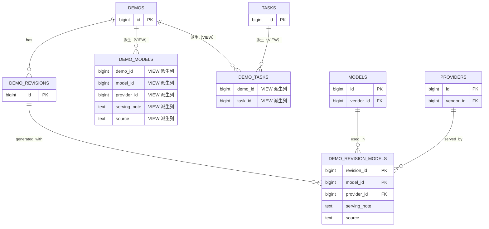

### 5.4 revision 的生成条件（余下四张，G18）

`platform` / `platform_config` / `skill` / `mcp` 与 `model` 同构：**真表在 revision 级**，目标侧实体（`platforms` / `platform_configs` / `skills` / `mcp_servers`）由标签域拥有、不在本图内；demo 层同名表是视图（§3.8）。

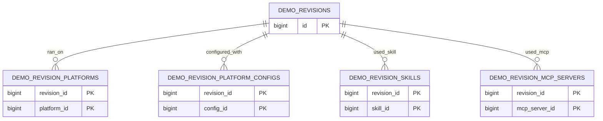

## 6. 状态机

### 6.1 审核状态（全局一次）

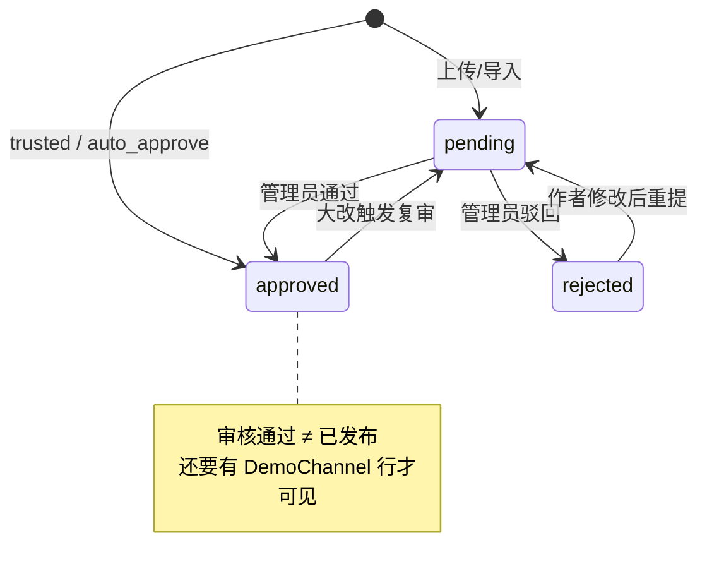

### 6.2 生命周期

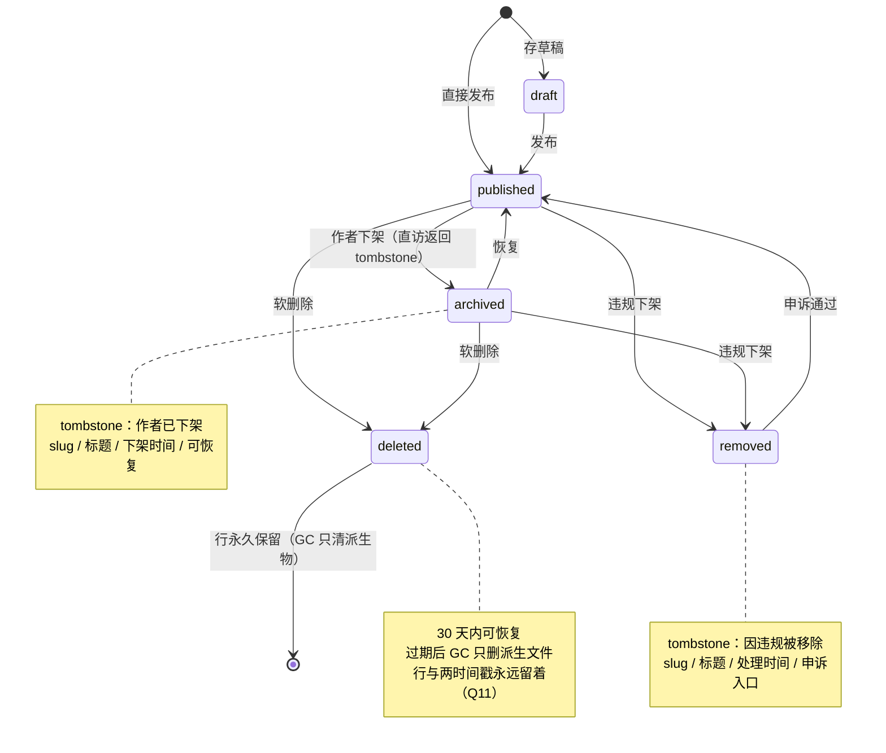

### 6.3 版本

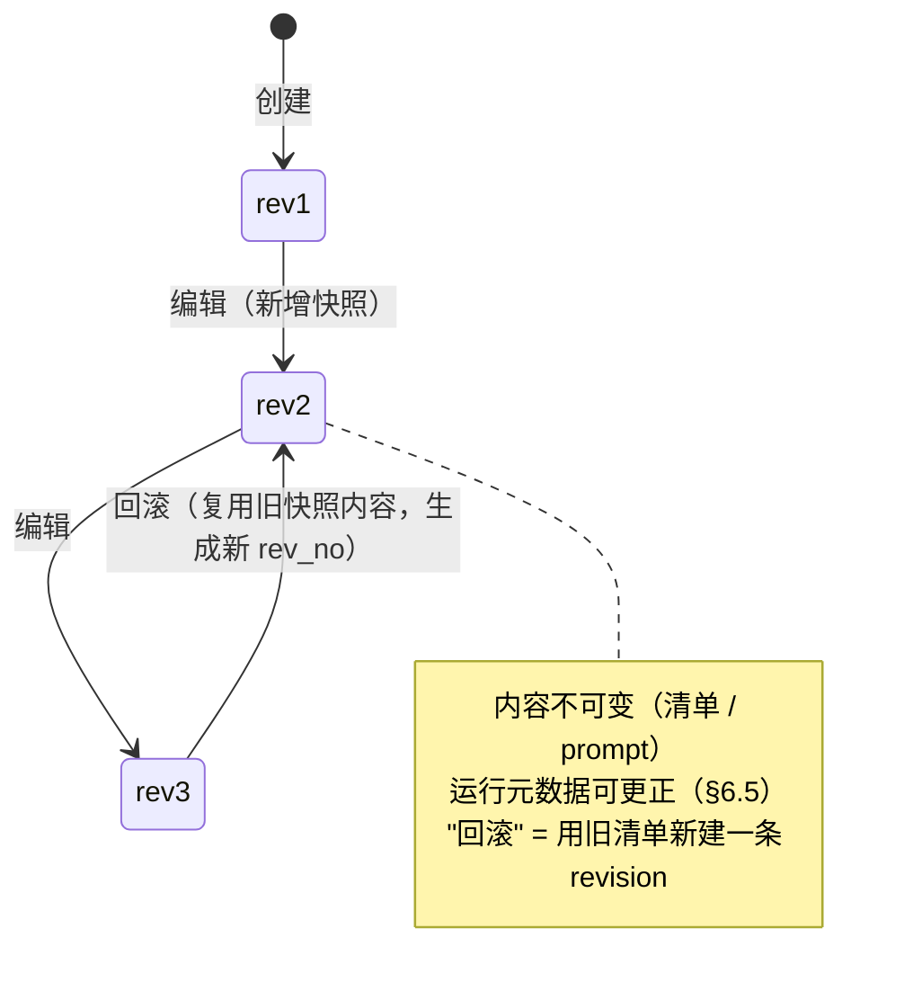

**回滚不删除历史**：`rev4.source='rollback'`，内容指向 `rev2` 的清单（同一批 blob，零拷贝）。

### 6.4 下架与 tombstone（决议 G1，2026-10-28）

**本节修订 §6.2 原「作者下架（链接仍可访问）」的表述**：`archived` 与 `removed` 都**不再提供内容**，按 slug 直访返回 **HTTP 200 + tombstone 页**。

| 状态 | 触发 | 响应 | tombstone 内容 | 可执行动作 |
|---|---|---|---|---|
| `archived` | 作者主动下架 | 200 | slug / 标题 / 下架时间 / 「作者已下架该作品」 | 「查看作者其它作品」「返回列表」；作者本人另有「恢复发布」 |
| `removed` | 平台违规处置 | 200 | slug / 标题 / 处理时间 / 「该作品因违规被移除」/ 依据条款 | 「提交申诉」「查看社区规范」 |
| `pending` / `rejected` / `draft` | 未公开 | **404** | — | 作者本人与管理员走**带权限读路径**（不套公开谓词） |
| `deleted`（软删） | 作者/管理员删除 | 404 | — | 30 天内作者可恢复；管理员仍可查 |
| **已擦除**（`erased_at` 非空） | 作者申请数据删除 | **404** | — | 内容列已 `NULL`，**不可恢复**；行仍在（Q11） |
| GC 之后（派生物已删） | 派生物真删 | 404 | — | **行仍在**；目录 / OSS / blob 已不在，恢复只得空壳（409，治理域 §9.2） |

**tombstone 页一律不出**：作品内容、预览 iframe、下载、评分、评论/讨论入口、会话日志、时间线。

**列表 / 计数**只算公开可见：`moderation_state='approved' AND lifecycle_state='published' AND deleted_at IS NULL` + 渠道 `visibility='listed'`（谓词定义见《实体域数据结构设计》§5.0，决议 G1）。

**渠道的 `visibility` 不是第五个可见性档位**：它是**列表过滤**，只决定「这件作品要不要出现在某个渠道的列表里」。可见性档位只有《标准对象》§ST-2 的四档（公开 / 墓碑 / 仅作者 / 无人），由 `deleted_at` / `erased_at` / 公开谓词决定。恢复软删时渠道行**原样保留**——把渠道当档位会得出「恢复后要不要恢复渠道」这种没有答案的问题。

**为什么两类 tombstone 必须不同**：`archived` 是作者自主行为（可恢复、无申诉），`removed` 是平台处置（有申诉、有条款依据）。合成一个页面会让用户既不知道能不能申诉，也不知道作品会不会回来。

### 6.5 运行元数据的更正（G11，2026-10-28）

**规则：内容不可变，运行元数据可更正。**

| 列 | 可更正？ | 谁能改 |
|---|---|---|
| `manifest_hash` / `file_count` / `total_bytes` / `entry_path` / `demo_type` / `single_file` / `external_url` | ❌ 内容 | 改 = 新 revision |
| `title` / `description` / `cover_url` / `prompt` / `prompt_id`（版本快照） | ❌ 内容 | 改 = 新 revision |
| **`gen_rounds` / `gen_minutes` / `model_hint`** | ✅ **运行元数据** | 作者本人（管理端亦可） |

**为什么**：`gen_rounds` / `gen_minutes` 是「这一次生成跑了多少轮 / 多久」的**录入记录**，`model_hint`（兜底型号依据）同理，都不是内容本身。用户填错了，让它去新建一个「内容完全相同的 revision」是错的（版本号语义被污染）；而只让管理员改库则是漏设计——用户连自己填错的数字都改不了。

**平台维度同理**（同属录入事实），但它已由 `demo_revision_platforms` 关联表表达（G18），不在本节的列白名单内。

**约束**：

- 只允许改这 3 列的**白名单**，其余列一律拒绝（应用层校验；DB 层可选 trigger 兜底）；
- 每次更正写 `audit_log(action='update', entity_type='demo_revision', before, after)`；
- 更正**不触发重新审核**（不改内容，也不改可见性）；
- 更正后 `demos.updated_at` 显式赋值（列表排序依赖它）。

## 7. 时序

### 7.1 创建作品

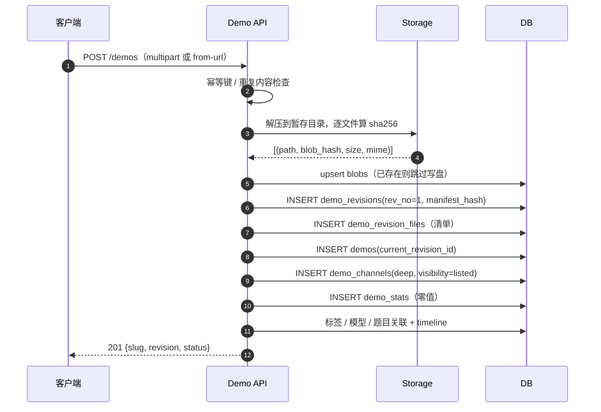

#### 落地状态（2026-11-06）——幂等键与审核态读出

- **幂等键已经真的接了**：`POST /api/v1/demos` 认一个可选的 `Idempotency-Key` 头（≤128 字符）。命中已有键时**不新建、不占待审配额、连包都不解压**，直接回 **200** 与第一次那份回执（`slug` / `revNo` / 当前审核态），而不是 201——201 的语义是「又建了一条」。
- **键在作者范围内唯一**（迁移 `0016_idempotency_per_author.sql`）。基线是 `UNIQUE (idempotency_key)`，全库一把钥匙：两个作者的脚本都用了 `"1"` 这种键时，第二个人拿到的不是重放而是别人的 slug。键是「这次调用」的标识，调用有主体，所以键空间按主体切分；改成复合唯一也让「报一个键就知道有没有人用过」不再成立。
- **审核态对作者可见**：`DemoDetail.moderationState` 是 `pending|approved|rejected`。**作者看的是真实值**，访客恒为 `approved`——访客能看到详情的前提是「有对外版本」（`published_revision_id`），那一版的内容本来就是审过的；对他回 `pending` 只会让人以为作品没审完就上线了。字段与 `lifecycleState` 正交：一个说「审没审过」，一个说「在不在架上」。
- **非法 UTF-8 回 400，不是 503**：标题 / 简介 / 类型 / 幂等键 / 模型标识都先过 `utf8.ValidString`。不挡的话这些字节会被送进 PG（22021），再落到 `writeDemoError` 的 default 变成「服务暂时不可用」——输入问题被说成我们这边坏了。真栈上第一次撞到它，是 Windows 的 curl 按 GBK 把中文标题发了出来。
- **429 带 `Retry-After`**：待审配额满时回 `Retry-After: 3600`。这是**建议的复查间隔，不是承诺**（审核速度取决于人），所以文案与常量名（`PendingRetryHint`）都写着提示。

### 7.2 编辑（产生新版本）

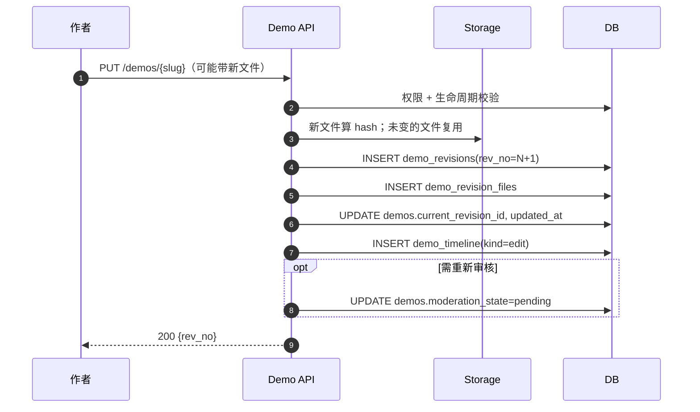

**零拷贝**：只改一个 `style.css` 时，其余文件的 `blob_hash` 不变，不写新 blob。

**落地状态（迁移 0014 之后、PR 零拷贝）**：投稿写盘已经走这条路。

- 内容寻址：`blobs.storage_key = blobs/{sha256 前两位}/{sha256}`，两级目录是为了避免单目录堆几十万文件
- 清单：`demo_revision_files(revision_id, path, blob_hash, size, mime)`，`path` 统一 `/` 分隔、写入口归一化（读路径不再判第二遍）
- **源包也是清单里的一行**（`source.zip`）——「下载原件」因此不需要第二套寻址；单文件作品没有额外的包，原件就是 `index.svg` 本身
- 已存在就不再写盘：判据是**数据库里有这一行**，不是先 `Stat` 存储。库里有的存储里应该有；反之是上次写坏的孤儿，不该被当成命中

两条实现上的取舍：

1. **不再写 `demos/{slug}/r{n}/`**。旧布局里「文件属于哪个版本」藏在路径里，两个版本哪怕 99% 相同也共享零字节；切过去之后同一份 `index.html` 被两个版本引用时磁盘上只有一份。
2. **补偿失败时不再删对象**。一份字节可能被多个版本引用（甚至跨作品），按 slug 删文件会把别人的作品弄坏。补偿只清库行，孤儿 blob 留给 GC 扫 `blobs.last_ref_at`。

**读路径两条**：清单优先（`demo_revision_files` → `blobs.storage_key`），没有清单行的旧版本回退到 `demos/{slug}/r{n}/{rel}`。迁移不搬历史数据——搬运要读全量文件、算哈希、失败还得回滚，而旧数据的读路径本来就能工作；等作者下次改稿就自然落到新路上。

**更新流程的落地状态（`PUT /api/v1/demos/{slug}`）**：

- 版本号用 `NextRevisionNo`（`MAX(rev_no)+1`）在事务里取，不是应用层「读最大值再加一」——两个并发更新会拿到同一个号，撞 `uq_revision_rev_no` 变成 500
- 只改文字（不带 `package`）时清单**整表复制**（`CopyRevisionFiles`），所有 `blob_hash` 不变，一个新字节也不写
- 换文件时新包的条目走和投稿同一条 `uploadBlobs`，旧文件那些 `blob_hash` 仍然被旧版本引用，跨版本去重成立
- `current_revision_id` 指向新版、`moderation_state` 回到 `pending`，但 **`published_revision_id` 不动**——复审期间线上仍然是上一个通过的版本，这就是「审核不等于下线」
- 换类型必须同时换包（不带包改 `demoType` → 400）：一个 zip 不可能变成单个 HTML，允许它只会产生一条自相矛盾的版本
- `removed` 的作品不可更新（409），作者自己 `archived` 的可以——他要重新上架走的就是这条路
- 非作者一律 **404**（不是 403）：403 会承认「这个 slug 存在」
- 审核通过时 `SetPublishedRevision` 除了切指针，还把 `demos.title` / `demos.description` 同步成该版本的值——列表读的是 `demos` 上的这两列，不同步就会出现「改了标题、审也过了、列表里还是老标题」


### 7.3 回滚

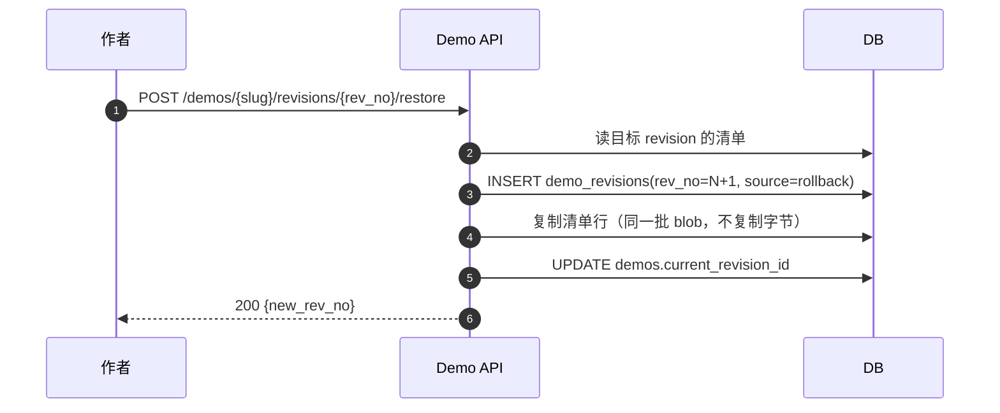

**落地状态（2026-11-05）**

- `POST /api/v1/demos/{slug}/revisions/{revNo}/restore` 与 `GET /api/v1/demos/{slug}/revisions` 已实现，端点在契约里。
- **回滚是「追加」不是「撤销」**：新版本 `source='rollback'`，清单整表复制目标版本（同一批 blob，零字节写入），版本号 = 当前最大值 + 1。历史一行不删，所以它失败安全——新版本没建出来的话，原来的对外版本一个字节都没动。
- **回滚不等于上线**：`current_revision_id` 指到新版本、`moderation_state` 打回 `pending`，**对外内容仍是 `published_revision_id` 那一版**。回滚不会让作品重新上线，也不会让线上内容立刻变回旧版。
- 拒绝的四种情况：作品不存在/不是作者/已删已擦（404）、被平台移除（409）、目标版本被擦除或删除（404）、目标版本就是当前版本（400）。
- 版本列表按 `rev_no` 倒序，`isCurrent` / `isPublished` 由两个指针直接比出来（`COALESCE(r.id = d.current_revision_id, false)`——`r.id = NULL` 的结果是 NULL 而不是 false，直接扫进 Go 的 `bool` 会报 `cannot scan NULL into *bool`）。
- 列表与回滚都只对作者与持 `demo.review` 的审核员开放；**对外可见的内容永远由 `published_revision_id` 决定**，访客不需要版本列表。

**顺带修掉的一条漏洞**：预览端点原先只看「有没有对外版本」，不看请求里的版本号——作者改稿期间，匿名访客猜 `/preview/{slug}/v{当前版本}/` 就能看到还没过审的内容。现在显式版本号只对作者与审核员放行，非作者只能读对外版本。

### 7.4 渠道发布（含 astra 策展）

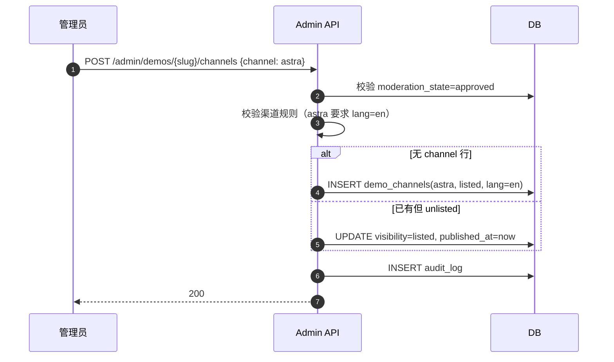

**落地状态（2026-11-09）——渠道的读与写都齐了**

写侧是 `POST` / `DELETE /admin/demos/{slug}/channels`；读侧补 `GET /admin/demos/{slug}/channels`
（只给 `demo.publish`）。三个「空」必须分开回答，否则界面只能猜：

| 情况 | 回答 | 为什么不是别的 |
|---|---|---|
| 作品不存在 / 已擦除 | `404` | 与公开读口径一致：不泄露存在性 |
| 作品存在但没有渠道 | `200` + `items: []` | 「一条都没有」是答案，不是错误 |
| 没有 `demo.publish` | `403` | 与写侧同一权限键——看得见写不了是没有意义的状态 |

**为什么不塞进详情**：详情是公开读的出口，字段面讲的是「读者看到的这一件作品」；
渠道是运营视角。混在一起要么让公开字段变胖，要么要按角色裁剪同一份 schema。

界面上它是 `web/src/features/admin/channel-panel.tsx`，挂在「刚通过 · 待发布」卡片发布成功之后——
发布成功才有渠道行，管理员发完主站就能顺手挂第二个渠道。**撤下不做二次确认**：撤下只删一条渠道行，
再点一次「上架」就回来，给它加确认框只会训练人无脑点确定；真正的破坏性动作是删作品，那里要点两次。

**落地状态（2026-11-09）——渠道上架与撤下**

松点 26 结案：以前 `publishDemo` 的 WHERE 里有 `lifecycle_state IN ('draft','archived')`，
作品一旦变成 `published`，第二个渠道就永远发不出去——而本文档里那句「换渠道请走上架端点」
指向的端点并不存在。现在补上两个：

| 端点 | 做什么 | 关键判据 |
|---|---|---|
| `POST /admin/demos/{slug}/channels` | 追加渠道 / 改某渠道可见性 | 必须已有对外版本（否则 409）；内容 `approved`（否则 409）；渠道已登记且启用（否则 400）；`astra` 只收 `lang=en` |
| `DELETE /admin/demos/{slug}/channels/{channel}` | 从某渠道撤下 | 作品可以仍有别的渠道；**仍是 `published` 却只剩这一个渠道 → 409** |

- **同渠道重复 POST 不新增行**：返回 200 且 `created=false`，改的是可见性 / 语言。
- **最后一个渠道不给撤**：`published` 却没有渠道行，会得到「状态说对外、列表里查不到」的作品。
  想彻底撤下走下架（`archiveDemo`），那条路径有墓碑与恢复。
- 两个动作都进时间线（上架 / 撤下用 `publish` / `archive`）与 `audit_log`（`attach` / `detach`）——
  与首次发布同一套叙事，不新造动作键。
- 状态判定的字面量收进了 `approvedContent` / `publishedLifecycle` 两个函数，
  渠道「已登记且启用」收进 `activeChannel`：发布与上架两条路径共用，副本数从 4 降到 0
  （`check-single-source` 的棘轮也跟着下拨）。

### 7.5 预览服务（版本化路径）

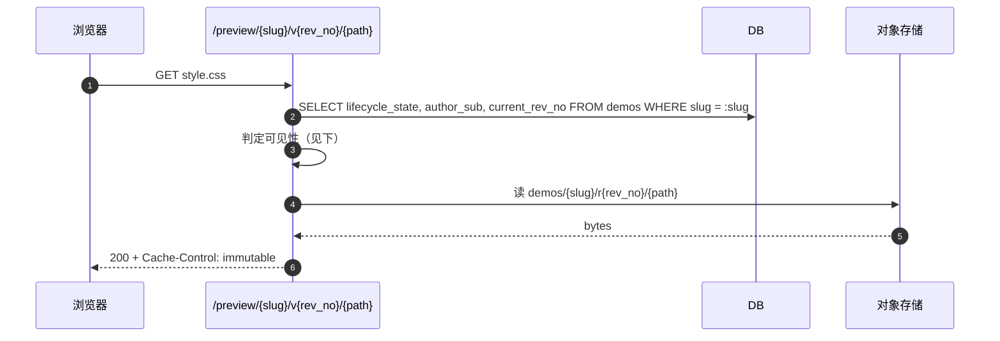

**地址里的 `v{n}` 是 `demo_revisions.rev_no`，不是行 id、也不是 manifest 前缀。**
这样定有两个理由：

1. `rev_no` 在作品内唯一且自 1 递增，天然是「第几版」的人话；
2. 版本不可变（不变量 #1，`trg_demo_revisions_immutable`），所以
   `v{rev_no}` 与内容寻址一样永久对应同一份字节——CDN 可以永不回源，
   但不需要每次请求都去解析 manifest 前缀，也没有前缀碰撞问题。

`/preview/{slug}/{path}` 不带版本的形式是「当前版本」别名（解析
`demos.current_revision_id` → `rev_no`），它**会变**，所以只能短缓存。

**可见性**：`published` 对所有人可见；其余状态（draft / pending / archived /
removed）只有**作者本人**或持有 `demo.review` 权限的角色能看。
`erased_at` 或 `deleted_at` 非空一律 404。判定顺序是先状态后文件——
不先判定就返回 404 会把「这个 slug 存不存在」泄露出去。

### 落地状态（2026-11-10）——类型决定收哪些形态

在此以前 `demo_types` 只是一个标签：作者选「压缩包作品」投一个 `.html` 也能过，因为
校验只看文件、不看作者声明的类型。「能投」与「投对了」是两件事，而没有任何一处把它们对上。

现在由数据表 `demo_type_formats` 决定「这个类型收哪些形态」，投稿时服务端**按真实内容
检测格式**再与类型比对（判在解压之后、落库之前，不能听作者说）：

| 类型 | 允许的形态 | 判据 |
| --- | --- | --- |
| `web` | `single:html` / `single:svg` / `zip:html` | 单文件按扩展名；zip 里没有 `.wasm`+`.pck` |
| `zip` | `zip:html` | 同上 |
| `godot` | `zip:godot` | zip 里同时有脚本（`.wasm` / `.asm.js`）与资源包（`.pck`） |
| `image` / `link` | **空** | 还没有上传路径 |

空清单的含义是「界面上不可选」，不是「任意都收」——把它当「任意」会让界面给出一个
必然失败的选择。类型与形态的词汇在 `backend/internal/domain/demo/shapes.go`（代码），
「谁收什么」在数据库（数据）：加一种形态改代码，加一个类型只加一行数据。

检测只看扩展名、不看字节：判错形态的代价是作者拿到一句可读的提示，而猜内容的代价是
「上传成功、打开白屏」。拒绝时的文案必须能教会对方怎么办，例如
「「网页作品」不收这种文件（检测到 zip:godot）；它可以收：single:html、single:svg、zip:html」。

**顺带修掉一条会静默失败的不变量**：零拷贝的「已存在」判据原来只看 `blobs` 表有没有
这一行。换存储根（测试里每轮一个临时目录、而库共用）或从只备份了数据库的快照恢复之后，
行全在、对象全没，于是后续每次上传都跳过写盘，预览与下载永远 404，错误却只是
「对象不存在」。现在命中行时会多一次 `Stat`：对象不在就照常写一遍把它补回来。
**入口文件**：地址里不带文件名时（`/preview/{slug}/`、`/preview/{slug}/v{n}/`），
入口取**这一版** `demo_revisions.entry_path`，不是硬编码的 `index.html`。

| 提交形态 | `entry_path` | 说明 |
|---|---|---|
| 单文件 | 原文件名，如 `index.svg` | 上传一张 SVG 就是这种；`single_file` 记类型 |
| zip 包 | 恒为 `index.html` | `submit` 只认根目录 `index.html`/`index.htm`，否则 400 |

形态由 `backend/internal/domain/demo/shapes.go` 一处决定（`singleFileKinds` /
`stagedName` / `isRootIndex`），投稿校验与预览都从它取值，读侧**不再自己推导**。
门禁 `check-single-source` 把这些文件名的字面量登记成一类判定：除该文件外出现即红。

**不带文件名时一律 302，不直接回字节**：跳到
`/preview/{slug}/v{n}/{entry_path}`。这样「猜入口」这个动作在代码里消失了——
入口只从这一版的 `entry_path` 取一次，结果直接摆在地址里；带版本号的落点永久不变，
可以给 `immutable` 长缓存，而 302 本身给 `no-store`（目标随改稿变化）。

写死 `index.html` 的代价是「投稿成功、预览页 404」——2026-11-08 的真实事故：
用户上传一张 SVG，打开预览就是 `404 page not found`，而库里一切正常。
路径带版本号时读的是那一版的入口（不是当前版）：作者在 `/preview/{slug}/v{n}/`
里看的就是第 n 版，用当前版的入口会读错文件。回归用例是
`TestIntegrationSubmitShapeMatrix`（形态矩阵，数据源就是 `SubmitShapes()`）：
新增一种格式只改 `shapes.go`，矩阵自动多一行。

**失败分支一律是给人看的 HTML**（`backend/internal/httpapi/preview_error.go`）：
12 个出口（10 个 404、1 个 500「这一版缺少入口文件」、1 个 502「读取失败」）统一走
`previewError`，返回 `text/html; charset=utf-8` + `no-store` + 同一套 `sandbox` CSP。
理由是这条响应会渲染在详情页的 `<iframe>` 里，而 iframe 是跨源的、前端**读不到**
它内部的状态，兜底只能在服务端做——以前这里是 `404 page not found` 一行英文。

页面**不插值任何请求内容**（slug、路径都不进页面），所以注入面为零；状态码保持原语义：
`entry_path` 为空是数据坏了，给 500 而不是 404——404 会让作者以为作品被删了。
文件缺失仍走 404（`storage.ErrNotFound` 的既有语义），不为「看起来统一」改码。
`HEAD` 与 GET 同码、无 body。

**同源渲染的隔离**：作品 HTML 跑在不透明源里，靠两道独立机制：

| 机制 | 在哪生效 |
|---|---|
| iframe 的 `sandbox` 属性（不给 `allow-same-origin`） | 站内嵌预览 |
| 响应的 `Content-Security-Policy: sandbox allow-scripts allow-forms allow-popups allow-modals allow-pointer-lock` | **直接在新标签页打开预览地址** |

第二条不是第一条的备份，是唯一在「直接访问」这条路径上生效的那一条。
代价是作品页里 `localStorage` 会抛异常、读不到同源其它作品的存储——
这正是 [`多人联机方案调研.md`](多人联机方案调研.md) 第 146 行记录的预览源共享问题，
也是把预览最终挪到 `{slug}.preview.deepdemos.top` 的动机。

### 7.5.1 相关作品（内容信号，2026-11-08 落地）

`GET /api/v1/demos/{slug}/related?limit=6` 给出「和这件作品像的另外几件」。
**它不读流量**：`demo_views` 是新表、迁移不搬旧浏览，共同浏览在任何新站点上都会稀得
像随机数；而分类、模型、作者这三样信号在线上 1400 件作品回填后会自然变好。

| 信号 | 权重 | 为什么 |
|---|---|---|
| 共用分类 | 3 | 作者打的分类是他对「这是什么」最直接的声明 |
| 共用模型 | 2 | 同模型的作品不一定像，但「用了同一个模型」是有意义的邻居 |
| 同一作者 | 1 | 兜底：风格连续性强，且不需要任何人工数据 |

得分 0 的作品**不返回**，哪怕结果为空——相关区空着比塞三件无关作品更诚实，后者会让读者
学会忽略这个区块。源作品与候选作品都必须公开可见（与详情同一份判据，走
`demo_public_demos` 视图）；源作品不可见时回 404 而不是空数组，否则这个端点会变成
「这个 slug 存不存在」的探针。

### 7.6 删除与 GC

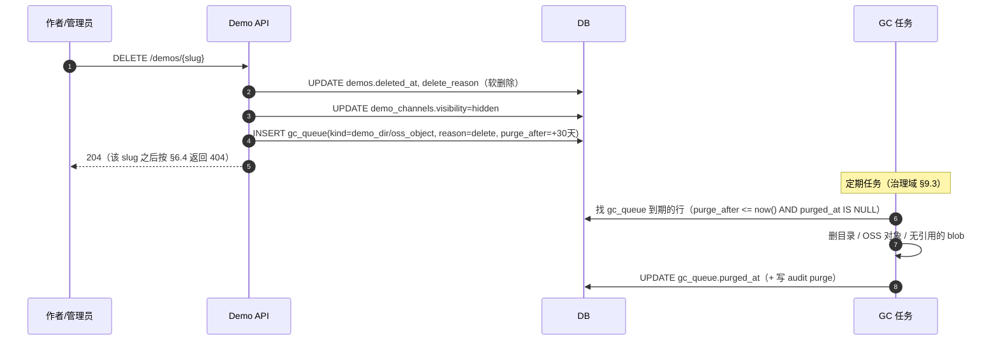

**可恢复**：30 天内 `restore` 即可（清 `deleted_at`、恢复渠道可见性、GC 出队）。

**过期之后行仍然在**（台账 G19 **Q11 = A**）：GC **只清派生物，不删 `demos` / `demo_revisions` / `demo_revision_files` 的行**。所以：

- 不存在「物理删除 demo」这一步——原文这里写过「物理删除 demo / revisions / files / 关联」，与 Q11 冲突，v1.4 已改。
- 恢复接口在派生物已删时返回 **409**（行还在、东西没了），不是 404。
- 擦除走 `数据生命周期 §7.5`：一个事务里 `UPDATE ... SET erased_at, deleted_at, <内容列>=NULL` + 入队 `reason='erase'`（`purge_after=now()`），**不等 30 天窗口**。

## 8. 存储布局

```text
{STORAGE_DIR}/
├── blobs/
│   └── ab/cd/abcdef0123456789…      ← 内容块，无扩展名（mime 在 DB）
└── media/
    ├── covers/{hash}.webp
    │   ├── {hash}-thumb.webp
    │   └── {hash}-card.webp
    └── avatars/
```

## 9. 不变量

1. `DemoRevision` 一旦创建，任何字段不得 UPDATE（除后续追加的可空审计列）。✅ **触发器 `trg_demo_revisions_immutable` 兜住**（迁移 0009）：除 `deleted_at` 与那次擦除写入，整行的 `to_jsonb` 相减必须为空。
2. `Demo.current_revision_id` 必须指向属于该 demo 的 revision。✅ **触发器 `trg_demos_guard` 兜住**（迁移 0009）。
3. 每个 `Demo` 至少一条 revision（除建库瞬间）。⚠️ **不做数据库约束**：投稿事务天然两阶段（先 `INSERT demos` 再 `INSERT demo_revisions`），非延迟约束会让第一步就失败；做成 `DEFERRABLE INITIALLY DEFERRED` 又把「必须一个事务」变成硬约束，挡死「先存草稿、稍后补内容」。见 [`已知松点.md`](./已知松点.md)。
4. `rev_no` 在同一 demo 内从 1 连续递增，不跳号不复用。
5. `manifest_hash` 只由清单内容决定，与打包方式无关。⬜ **语义，库里管不了**（哈希怎么算出来的，数据库看不见）。
6. `DemoRevisionFile.blob_hash` 必须存在于 `Blob`。
7. **`erased_at` 非空 ⟹ `deleted_at` 非空，且全部内容列为 `NULL`**：`demos` 侧 `title` / `description` / `cover_url` / `cover_thumb_url` / `guest_name`；revision 侧 `title` / `description` / `cover_url` / `entry_path` / `manifest_hash` / `file_count` / `total_bytes` / `prompt` / `model_hint` / `single_file` / `external_url` / `video_url` / `prompt_id`。**逐列清单以 [`数据生命周期设计.md`](./数据生命周期设计.md) §6.2 为准**（本行只是投影），验收 SQL 见其附录 A.2。
8. **内容行永不物理删除**（Q11）：`demos` / `demo_revisions` 不做 `DELETE`，只有 GC 删派生物。**唯一例外是 `demo_revision_files`**：它是清单子行（没有任何 id 指向它），擦除时按《数据生命周期设计》§6.3 的顺序「先入队 → 再清字段 → 最后删子行」整行删除；留着的副作用是永久记着「他传过 12 个 3 MB 的 png」。
9. `Blob` 不可变：同 sha256 永远同内容；写盘前必须校验。
10. `DemoChannel.(demo_id, channel)` 唯一；`visibility='listed'` 要求 `moderation_state='approved'`。✅ **唯一性靠 `uq_channel`，跨表那条靠两个触发器**（迁移 0009）：写渠道时校验父作品已审核，作品退回审核状态时校验没有上架中的渠道。
11. `DemoStat` 可随时从 `DemoRating` 重建；不得作为唯一数据源。⬜ **语义，库里管不了**。
12. `Demo.slug` 永久唯一；改名写入 `DemoSlugHistory` 并 301。
13. 软删除的 `Demo` 不出现在任何公开查询。⬜ **查询口径**（靠 `ListPublishedDemos` 的 WHERE），不塞进 schema；**行永不物理删除**（台账 G19 Q11）——GC 只清派生物（目录 / OSS 对象 / 无引用 blob），擦除只清内容字段。已擦除的 `Demo` 与 revision 一律按 404（§6.4）。
14. 生成条件（模型 / 平台 / 平台配置 / 技能 / MCP）是 **revision 级事实**：每个 revision 的关联行只描述该版本；**历史版本可追溯**。demo 层只提供「当前版本」（`current_revision_id`）的派生值，不得作为独立事实源（见 §2.2 / §3.2.1）。

## 10. 与模型域的衔接

| 模型域设计 | Demo 域落点 |
|---|---|
| `demo_models` 唯一事实源 | **改为 revision 级 `demo_revision_models`**（G18）；demo 层 `demo_models` 是视图（§3.2.1 / §3.8） |
| `provider_id` 可空 | `DemoRevisionModel.provider_id`（同一模型经不同 provider 用过算一条） |
| 标签退场（`T1–T6` = M8） | 不受本文影响；过渡期口径与归宿见 **§14**（台账 G4；《标签域数据结构设计》§9.2 / §6.5 阶段④） |
| `vendors` / `providers` | `DemoRevisionModel.provider_id` → `providers.id` |
| 第三方基准 | 与 Demo 无直接关系（按模型聚合） |

**唯一交叉点**：`DemoRevisionModel` 的写入由 `DemoModelWriter` 统一负责（模型域 T2），Demo 域不新增第二条写入路径。

**与论坛外置的衔接（G12）**：Demo 域**不新建** `external_events`（webhook 收件箱 → 论坛外置）与 `external_identities`（身份映射 → 身份域）。`DemoExternalThread` 与标签域 `external_threads` 是**同一张表的两份定义**——G5 已定以标签域为准，Demo 域侧如何收敛见 **B1（待拍板）**。

**落地状态（2026-11-05）——模型声明 / 作者 / 发布时间**

详情页要求的九项里，这三项此前是「有值没人读」或「空表」，现在补上了：

| 项 | 来源 | 谁看得见 |
|---|---|---|
| 模型声明 | `demo_revision_models` → `models`（`slug` / `name` / `vendor`） | 访客看**已发布版本**的声明；作者看**当前版本**的声明 |
| 作者 | `demos.author_id` → `users` → `accounts` → `profiles`（`display_name` 优先，空则 `username`） | 所有人 |
| 发布时间 | `min(demo_channels.published_at)`，只算 `listed` / `unlisted` 渠道 | 所有人；未发布为 `null` |

三条都是**只读派生**，没有新增写入路径：

1. **目录端点** `GET /api/v1/models` 只返回 `status = 'active'` 的模型，按名字排序。为什么必须有这个端点：投稿表单要让作者挑模型，而模型是主数据——前端写死一份列表，新增一个模型就得发一次前端版本，写死的那份迟早与库里不一致。候选 / 未验证 / 已退役的模型不出现在里面（它们不该被作者当事实声明）。
2. **声明进版本，不进 demo**：投稿与更新都接收重复的 `modelSlugs` 表单字段，解析成 id 写进**这一版**的 `demo_revision_models`，与建版本同一个事务（声明写失败 = 这次投稿失败，不允许「作品建好了、声明丢了」）。任何一个 slug 不存在或未启用都回 400 并点出是哪个——**不能静默丢掉**，否则作者以为声明了两个、库里只有一个而他不知道。没有条数上限：多少由主数据与作品事实决定。
3. **改稿不动线上**：`modelsOf` 按版本读——访客用 `published_revision_id`，作者用 `current_revision_id`。这正是 §3.2.1 版本分离在详情上的体现：作者把模型换掉、作品在审核中，线上仍是旧声明。回滚会 `CopyRevisionModels` 把声明一起带回那一版，否则「回到上一版」会顺手抹掉「这个作品用了哪些模型」。
4. **墓碑与已删除不披露**：模型声明和标题一样属于内容，`archived` / `removed` 的墓碑页不给；`deleted` 对外本来就是 404。

**字段名为什么带 slugs**：调用方手里只有 `models.slug`（`GET /api/v1/models` 返回的就是它），
数字 id 是实现细节。曾经叫 `modelIds` 却收 slug，每个接入方都要去翻一遍文档确认自己没传错。
同一个理由把 `DemoDetail.author` 的 schema 从 `ModelAuthor` 改成 `DemoAuthor`——它跟模型域
没有任何关系，同前缀只会让人以为它是「模型的作者」。

主数据来源与它的边界：`db/seeds/0002-dev-models.sql` 提供 6 个 DeepSeek 模型（全 `status='active'`、`resolution='exact'`），`cmd/migrate -mode seed` 与 CI 各跑一次。**`models` 是外部目录表，它的权威不在本仓库**——生产正式导入与日常维护还没有工具，见《已知松点》第 44 条。

**落地状态（2026-11-06）——可见性判据收进视图，发布时间改口径**

第五轮 review 指出：发布时间取的是 `min(published_at)` **所有**渠道，把 `hidden` 也算了进去。
`hidden` 的语义是「内部预览，对外不可见」，而「先发 `hidden` 确认、再上 `listed`」正是这个可见性
存在的理由——按旧口径，这件作品在详情页上的发布时间会比真正对外那天早几个月。

它怎么来的值得记一笔：`check-single-source` 报「可见性副本从 5 涨到 6」，为了让它绿，
那条过滤被**删掉**了。门禁只数文本、不判语义，删掉之后它当然绿了。

现在的做法是给判据一个唯一定义处：

| 项 | 现在 | 为什么 |
|---|---|---|
| 定义处 | 视图 `demo_visible_channels`（迁移 0017） | 判据只写一次，调用处只问「这个 demo 在不在视图里」 |
| 调用处 | `demos.sql` 四处问视图（三处 `has_visible_channel`、一处发布时间） | 不再各写一遍 `visibility IN (…)` |
| 另有 | `demos.sql:42` 与 `:63` 的 `visibility = 'listed'` 两处 | 它们问的是「上不上列表」，不是「对外可见」：`unlisted` 可直链但不上列表，所以不能问同一个视图。这两处是「上列表」判据的定义处 |
| 副本变化 | `visibility-sql` 5 → 2（剩下两处问的是「上列表」，不是「对外可见」） | 棘轮往下拨，而不是开口子 |
| 为什么不是函数 | 视图能被 `EXISTS` / join 直接用，语义上也确实是一张表的子集 | — |

发布时间因此变成「**对外可见渠道**里最早的那一次」。未发布仍是 `null`，前端回退到 `created_at`（这条回退没变）。


**落地状态（2026-11-06）——分类挂在作品上，模型挂在版本上**

这两件事看起来是同一种「给作品打标签」，落点却刻意不同：

| | 分类 | 模型声明 |
|---|---|---|
| 表 | `demo_classifications`（无 `revision_id`） | `demo_revision_models`（有） |
| 改稿时 | **不随版本变**，一次写入、所有版本共享 | 每个新版本是一份完整声明 |
| 为什么 | 「这是个游戏」是作品的属性，换技术实现不该让它重算 | 「这一版用了什么模型」本来就是一版一个答案 |
| 清空语义 | 不传 = **不改**（multipart 里「没传」与「传空」无法区分） | 不传 = 这一版不声明 |

分类的「整体替换但不传即不改」是**明知不对称而为之**：若按整体替换处理，一个还没加分类控件的旧编辑页（任何只改标题的脚本也一样）会把作者打的分类顺手清空，而作者从页面上看不出这件事发生过。代价是「清空分类」暂无路径，记在 `docs/已知松点.md` 第 48 条。

**落地状态（2026-11-06）——模型对象的字段面，以及 `status` 不再是个常量**

契约里的 `Model` 早先只有 `slug / name / vendor`，而 `GET /api/v1/models` 又写死
`WHERE status = 'active'`。两件事叠在一起的结果是：契约里那个 `status` 字段
（如果它存在的话）永远等于同一个值，等于没给。

现在：

| 字段 | 来源 | 为什么给 |
|---|---|---|
| `status` | `models.status` 列 | 目录页要区分「可用 / 候选 / 未核实 / 已退役」。默认**返回全部状态**，表单那边自己传 `?status=active`——筛选责任交给调用方，接口不替它决定看什么 |
| `resolution` | `models.resolution` 列 | `exact` 与 `family` 的可信度不同；作者说不清具体型号时会落到 `unknown` / `guess`，前端据此决定要不要标「未核实」 |
| `mergedIntoSlug` | `models.merged_into_id` join 回 `models.slug` | 已退役的模型要指出它并到了谁。给 slug 而不是替调用方解析过去：作者当初声明的就是这一个 |
| `source` | **派生**：有 `model_external_refs` 行 → `models.dev`，否则 `manual` | `models` 表没有这一列。「有没有被上游目录认领过」本来就是 refs 表的事实，多加一列等于给同一件事两个出处 |
| `aliases` | `model_aliases` | 同一个模型在别处的写法（旧站实测：同一个 DeepSeek V4 Flash 有五种写法）。它是**解析入口**，所以 `alias` 是单列主键 |
| `description` | `models.description` | 人工说明，没有时为空串 |

**详情里的 `models` 用同一个 `Model` schema**（早先它是精简的 `ModelRef`）。同一份数据
在目录页与详情页长得不一样，前端就得写两套渲染——那是这类不一致最容易藏的地方。

**落地状态（2026-11-06）——作者可以自由填模型名，解析不到就建候选项**

`modelSlugs` 早先只认 `models.slug`，而且要求目标 `status='active'`。这条规矩与
真实用法是冲突的：作者在投稿框里打的是「DeepSeek V4 Flash」这种人话，而灰测模型
（旧站 142 种模型写法里的大多数）上游根本还没收录。结果只有两种——声明不了，
或者从目录里瞎选一个。两种都让作品页上的信息变成假的。

现在：

- **指称可以是 slug / 展示名 / 别名**，大小写不敏感，由 `resolveModelRefs` 一条 SQL
  统一解析（`rank`：slug 0、alias 1、name 2；同 rank 按 id 取小的，保证同一份输入
  两次解析命中同一条）。
- **解析不到就建一行 `status='candidate'`**，并把作者这次的写法记成别名。不留 400、
  也不静默丢掉：前者把平台没收录变成作者的错，后者让作者以为声明了而详情页少一个。
- **候选项因此可以被声明**。早先「候选一律 400」的判据（`ResolveModelSlugs` 里的
  `AND status = 'active'`）与「让作者自己填」自相矛盾——作者刚建的那条立刻不能用。
- **已合并的模型沿 `merged_into_id` 走一跳**，返回归宿 id。作者手里可能还留着旧名字，
  报「模型不存在」既不准确也没帮助。只走一跳：多级链在库里没出现过。
- **厂商留空**。按模型域 §4.6.3 的规则，拿不到证据就不建 vendor，避免造出
  「Bothub」这种假厂商；界面显示「厂商未标注」。
- **脏名字靠人工归并消化**（`docs/已知松点.md` 第 50 条）：三种写法就是三个候选项，
  归并是改指针（`entity.merge`），作品不用动。归并端点尚未实现。

`model_specs`（参数规格）与 `model_catalog_items`（上游目录快照）仍然空着，本期不接：
规格的面比字段面大得多（context / 价格 / 模态…），先有真实数据再谈。

**词表来源**：迁移 `0018_classification_seed.sql`，93 行（3 个维度 + genre 顶层 13 + genre 子级 18 + technique 5 + subject 56），由旧站 `GET /api/v1/tags/tag-keys`（10 个键 / 356 个值）归并而成——`type` 与 `game` 里混着类型词与具体作品，前者归 `genre`、后者归 `subject`；`demo`(204)/`html`(43)/`svg`(25)/`slides`(0) 与 `ppt`(0) 是垃圾桶值，剔掉。slug 保留旧站英文原文，label 换中文：这样旧链接与新链接指向同一项。

**可见性判据的第二张视图**：`demo_listed_channels`（迁移 0019）只含 `visibility = 'listed'`。它与 0017 的 `demo_visible_channels` 不是重复——后者回答「对外可见吗」（`listed` 与 `unlisted` 都是），前者回答「上列表吗」（`unlisted` 可直链但不在列表里）。分类目录上的「游戏 · 230 件」必须与点进去的列表条数一致，所以计数也问这张视图，而不是再抄一遍 `visibility = 'listed'`（`check-single-source` 抓到过那一处）。


## 11. 迁移路线（expand → contract）（= **M12**，建议待确认）

现状与目标差距较大，但**可以分五步，每步独立可发布**。

| 步 | 变更 | 读路径 | 写路径 | 回滚 |
|---|---|---|---|---|
| **D1** | 建新表（revisions / files / blobs / channels / stats / slug_history）——**不含 `external_threads`**（G12：归标签域；Demo 域只保留读侧投影 `DemoExternalThread`），不写入 | 不变 | 不变 | 删表 |
| **D2** | 回填：现有 demo 各生成一条 `rev_no=1`；文件算 hash 入 blobs；`sites`→channels；`rating_*`/`view_count`→stats；**生成条件（模型 / 平台 / 平台配置 / 技能 / MCP）由 demo 级行搬到 5 张 `demo_revision_*` 表，`revision_id` = 各自的 `current_revision_id`**（G18） | 不变 | 双写（新+旧） | 删新表数据 |
| **D3** | 读路径切到新表（列表 JOIN revision、详情读 revision、预览按 manifest_hash） | 新 | 双写 | 切回旧列 |
| **D4** | 写路径切到新表（编辑产生 revision，不再 `copytree`；`keep_old_version` 语义变成「打 tag 指向旧 rev」） | 新 | 新 | 保留旧列一个周期 |
| **D5** | 退场旧列（`demos.demo_type` / `prompt` / `sites` / `rating_*` 等） | 新 | 新 | 需备份 |

**D2 的双写期最长**——这一步同时承载「新表可用」和「旧列仍权威」，是所有切换的安全垫。

### 关键风险

| 风险 | 缓解 |
|---|---|
| 回填时文件算 hash 耗时长 | 分批 + 断点续跑；只算一次，落 `blobs` |
| 双写不一致 | 校验脚本比对 revision 清单与磁盘；差异进报告 |
| 预览 URL 变化导致 CDN 回源 | `manifest_hash` 与旧 `content_hash` 不同 → 接受一次性回源，安排在低峰 |
| 旧客户端读不到新字段 | D3 前保持响应结构不变（新增字段只增不改） |

## 12. 明确不做

- **不改 `Demo` 这个名字**（`Work` 只是早期讨论代号）
- **不在本系统为帖子建模**：社区外置，只留 `DemoExternalThread`
- **不做多语言内容表**：`lang` 仍是渠道属性；真要做 i18n 内容另立设计
- **不做实时协同编辑**：版本是提交式的，不是 CRDT

## 13. 待定

1. ~~软删除保留期~~（**已定：30 天**，治理域 §9.2 与生命周期 L1 = A，2026-10-30）
2. `astra` 渠道是否允许 `unlisted`（现在只有 `listed` / 不存在）
3. `Blob` 是否引入引用计数列（现在靠 `DemoRevisionFile` 反查，量大时再引入）

**已定（G15，2026-10-28）**：历史 `version-of` 快照**合并成原作的一个 revision**，**不再引入 `demos.version_of_id`**（`version-of` 只有 2 条引用、其中 1 条已断链 `lofi-studio-32d3fa31`）。Demo 域从此是**作品版本链的唯一事实源**；「A 是 B 的二创 / 衍生」这类跨作品关系若将来需要，另立引用表，不复用 `version_of`。

## 14. 过渡期与退役（非目标态）

> 本节的**一切内容都不是目标态**，只为迁移期实现与 review 提供上下文（台账 **G16**：设计文档正文只放目标态，过渡态下沉）。
> 类别标记：**①** 过渡期才存在的结构 · **②** 现状 → 目标对照 · **③** 旧栈实现细节 · **④** 一次性留痕物。

### 14.1 目标图里移除的过渡对象：`DemoTag`（①，原 §2.1 聚合图 / §4 全景类图 / §5.3 ER 图）

`DemoTag` 只在过渡期存在，已从三张目标图中移除，以免读者把它当成目标模型的一部分：

| 目标图 | 移除的内容 |
|---|---|
| §2.1 聚合图 | 强关联子图里的 `DT["DemoTag"]` 节点与 `D --> DT` 边 |
| §4 全景类图 | `class DemoTag { +int demo_id; +int tag_id }` 与 `Demo "1" *-- "0..*" DemoTag` |
| §5.3 ER 图 | `DEMO_TAGS` 实体块、`DEMOS \|\|--o{ DEMO_TAGS : classified`、`TAGS \|\|--o{ DEMO_TAGS : tags`；`TAGS` 实体块因再无其它引用一并移除（`DEMO_TASKS` 是视图，保留） |

**过渡期图**（①；合并原 §4 的 `DemoTag` 类与 §5.3 的 `TAGS` 实体——它们在目标图里的位置已删除）：

> **本图的属性类型刻意保留旧栈的 SQLite / Java 风格**（`+int` / `+string`）：它画的是**旧栈实体**（`demo_tags` / `tags`）的实际形状，不是目标态。**不要**按 §0.1 的 PG 映射表去改——改了反而失真。（v1.3 的 C2 转换刻意跳过本图。）

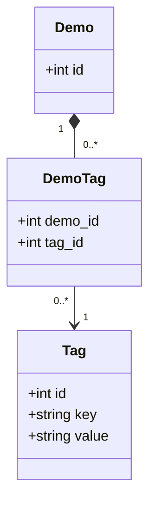

### 14.2 `DemoTag` 的过渡期定义与归宿（①，原 §3.8）

**过渡期定义**（原文）：`DemoTag`：`(demo_id, tag_id)` 复合主键，不变。

**归宿**：`tags` 表的 12 个键各有落点，`DemoTag` 因此拆解为 **4 组关联表**（`demo_classifications` + revision 级的平台 / 配置 / 技能三表）**+ `demos` 的列 + revision 的运行元数据**：

| 旧键 | 去向 | 归属域 |
|---|---|---|
| `author` | `demos.author_id` 列 | Demo 域 |
| `version-of` | 由 `DemoRevision` 取代，**不迁移**（G15） | Demo 域 |
| `rounds` / `time` | `demo_revisions.gen_rounds` / `gen_minutes`（运行元数据） | Demo 域 |
| `type` / `category` / `game` | `demo_classifications` | 标签域 |
| `platform` | `demo_revision_platforms`（demo 层 `demo_platforms` 是视图） | 标签域 |
| `plugin` / `preset` | `demo_revision_platform_configs`（demo 层 `demo_platform_configs` 是视图） | 标签域 |
| `skills` | `demo_revision_skills`（demo 层 `demo_skills` 是视图） | 标签域 |
| `model` | 按《模型域设计》**§11.1** 的 M8 / A6 单独退场 | 模型域 |

**终态**：`DemoTag` 随 `tags` + `tag_keys` 一起删除——先退 `key='model'` 的行，其余随标签域切完读写路径、观察 2 周后删表（台账 **G4**；《标签域数据结构设计》**§6.5 阶段④** 的 `DROP TABLE demo_tags; DROP TABLE tags; DROP TABLE tag_keys;`，删表前逐键确认该节的前置条件表）。

### 14.3 `DemoTask` 的旧栈实现（③，原 §3.8）

旧栈它是真表（`models.py` 的 `DemoTask`），双写导致「改 prompt 后 `demo_tasks` 没跟着变」的矛盾。目标态为**视图**（G7），见 §3.8 与《实体域数据结构设计》§1.3 / §3.6。

### 14.4 预览目录的硬链接物化（① ③，原 §8）

存储布局里的过渡条目（原文）：

```text
├── demos/{slug}/                     ← 过渡期物化（硬链接，见 §11）
│   └── files/index.html -> ../../blobs/ab/cd/…
```

**硬链接过渡**（原文）：现有 `_serve_preview` 按路径直读文件，硬链接能让它一行不改；等清单缓存稳定后，再去掉物化目录。

### 14.5 标签退场与本文的关系（① ②，原 §10 衔接表）

**原文**：「标签退场 T1–T6 ｜ 不受本文影响；`DemoTag` 结构在 T6 前不变，最终随 G4 删表（标签域 §9.2）」。

§10 衔接表该行已改为指向本节；决策编号 **G4** 与跨文档引用《标签域数据结构设计》§9.2 / §6.5 阶段④ 不变。

### 14.6 「不拆 `DemoTag` / `DemoTask`」的原文（①，原 §12 明确不做）

**原文**：「不拆 `DemoTag` / `DemoTask`：`DemoTask` 已由表改为**视图**（G7）；`DemoTag` 保留现有结构，删表计划见标签域 G4」。分两段读：

- **过渡期**：`DemoTag` 结构不变，它仍是这一阶段的**打标写入面**（`?tag=` 兼容层与上传打标都走它）。
- **终态**：`DemoTag` 随 `tags` + `tag_keys` 删除（标签域 §6.5 阶段④ + G4，见 §14.2）；`DemoTask` 作为**视图**保留，属目标态（G7，见 §3.8）。
