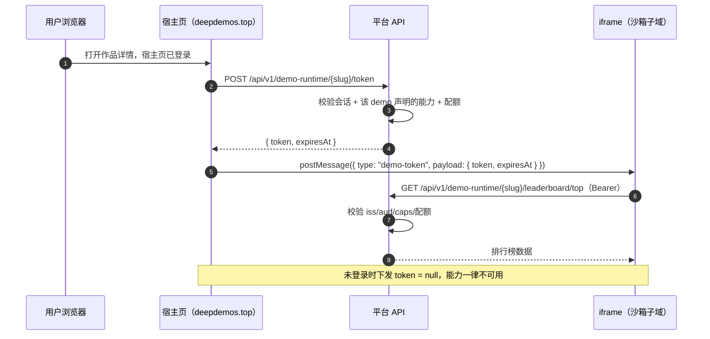
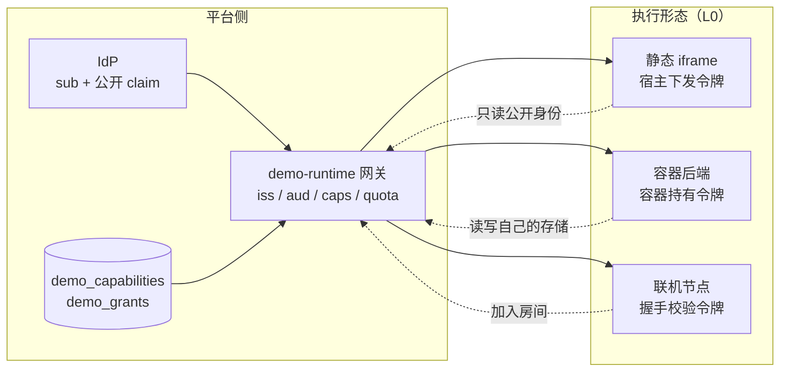

# Demo 运行能力契约 v0.1（前瞻设计 · 不在 P0）

> **状态：前瞻设计，未排期，不实现。**
> 本文件回答一个未来的问题：用户的 demo 会从「静态网页」长成「小游戏」「带后端」「多人联机」，平台如何在**不改架构**的前提下把能力一个个发下去。
> 它不是当前阶段的施工单——当前的施工单在 [`设计决策台账`](设计决策台账.md)。本文件只在有人要动 demo 运行形态时被翻开。

版本：**v0.1 · 前瞻（2026-10-30）**
适用范围：UGC demo（用户上传、运行在平台上）与平台之间的能力边界。
不适用范围：主站前后端自身的 API（那是 `api/openapi.yaml` 的事）、IdP 与下游（Discourse）之间的 OIDC（那是 [`身份服务模型设计`](身份服务模型设计.md) §7 的事）。

---

## 0 这份文档为什么存在

一句话：**UGC 代码是攻击者可以完全控制的代码**。任何给它的能力都必须显式授予、按 demo 隔离、可度量、可撤销。

三个反对做法（都见过，都别做）：

| 反对做法 | 为什么会坏 |
| --- | --- |
| 给每个 demo 注册一个 OIDC client | 动态注册 = 钓鱼工厂。任何人注册一个 client、把 `redirect_uri` 指向自己的页面，就能做出「看起来完全正常的登录流程」 |
| 让 UGC 用主站 cookie 认证 | 主站会话要暴露给一堆用户可控的页面，只能靠 `SameSite=None` + CORS credentials，等于拆掉同源策略 |
| 先给小游戏开个后门接口 | 第二次出现「demo 想多要一点」时，就得再开一个后门。三个后门之后没人记得边界在哪 |

本文件给的是**第四种**：一套能力契约，加能力 = 插一行目录 + 写一个端点，不改变任何既有 demo。

---

## 1 三层拆分

demo 的「形态」和「能力」是两件不同的事，必须拆开，否则每加一种形态就得重写一遍授权。

| 层 | 回答的问题 | 现在 | 将来 |
| --- | --- | --- | --- |
| **L0 执行形态** | 代码跑在哪 | 静态 iframe + 沙箱子域 | WASM、每 demo 一个容器、Edge Function |
| **L1 能力** | 能调平台什么 | `identity.read` | `leaderboard.*`、`storage.*`、`net.proxy`、`realtime` |
| **L2 配额与门槛** | 能给多少、要不要审核 | 读身份免审 | 写数据限频、调外网必须人审 |

三条正交规则：

1. **换执行形态不动能力定义**：静态页和容器后端看到的 `caps` 是同一套字符串。
2. **加能力不动 iframe 协议**：UGC 侧永远是「一个令牌 + 一个 SDK」。
3. **调配额不动代码**：配额在目录表与授予表里，改数据不改部署。

---

## 2 令牌契约

### 2.1 为什么不是 OIDC

OIDC 解决的是「**跨信任域**的第三方登录」，它的 client 是外部实体，所以需要注册、重定向白名单、用户同意屏。而 UGC demo 不是第三方——它是**我们平台上的代码**，跑在我们的沙箱子域里，身份由宿主页注入。

用 OIDC 会引入三个不需要的东西：client 注册（钓鱼面）、`redirect_uri`（开放重定向面）、端到端用户同意（用户根本不知道自己在给谁授权）。所以这里走**平台内部令牌**：格式可以借鉴 JWT，语义完全是内部的。

### 2.2 令牌结构

```json
{
  "iss": "https://id.deepdemos.top",
  "aud": "demo:snake-2048",
  "sub": "0190f3a2-7c4d-7b1e-9f2a-1c3d5e7f9a0b",
  "caps": ["identity.read", "leaderboard.read", "leaderboard.write"],
  "quota": { "leaderboard.write": "6/min" },
  "iat": 1761000000,
  "exp": 1761003600
}
```

| Claim | 含义 | 谁校验 |
| --- | --- | --- |
| `iss` | 签发者，恒为 IdP 的 issuer | 网关 |
| `aud` | **必须是 `demo:{slug}`**，精确匹配路径里的 slug | 网关 |
| `sub` | 账号的 `sub`（不是 profile id，不是 demo 内 id） | 业务端点 |
| `caps` | 被授予的能力 key 数组，**没列出来的就是没授予** | 网关 |
| `quota` | 该能力的具体配额（可覆盖目录表默认值） | 限流中间件 |
| `exp` | 到期时刻，短有效期 | 网关 |

### 2.3 四条规矩

1. **只授予、不继承**：`caps` 是白名单，不是「默认全开再减」。缺 key → `403 capability_not_granted`。
2. **短有效期（建议 60 分钟）**：宿主页持有会话，随时可重签。撤销一个能力最迟一小时内全网生效，**不需要黑名单**。
3. **`aud` 精确匹配**：A demo 的令牌调 B demo 的端点 → `403 wrong_audience`。一个 demo 被攻破不会横向污染。
4. **签发权在平台**：demo 只能在清单里**声明**需要什么，能不能拿到由平台按 `needs_review` 与配额决定。

### 2.4 签发时序



---

## 3 能力目录表

### 3.1 为什么是表而不是枚举

治理域的审计动作在 v1.8 已经踩过一次：`CHECK (action IN (...))` 加值的代价是 `ALTER TABLE` 取 `ACCESS EXCLUSIVE` 并全表校验。同一个原则用在这里——**可枚举的东西都建目录表**，加能力 = `INSERT` 一行。

### 3.2 DDL

```sql
-- 能力目录：一个 key 一行，平台自持，不对 UGC 开放写
CREATE TABLE demo_capabilities (
    key            text PRIMARY KEY,              -- '<resource>.<action>'
    summary        text NOT NULL,                 -- 中文一句话，前端与文档直接读
    kind           text NOT NULL CHECK (kind IN ('read', 'write', 'net', 'realtime')),
    needs_review   boolean NOT NULL DEFAULT false, -- 开这个能力要不要人工审核
    quota_default  jsonb NOT NULL DEFAULT '{}'::jsonb,
    is_active      boolean NOT NULL DEFAULT true,  -- 退役用 false，禁删行
    doc_url        text,
    created_at     timestamptz NOT NULL DEFAULT now()
);

-- 每个 demo 被授予的能力（needs_review 的能力必须走这张表）
CREATE TABLE demo_grants (
    demo_id     bigint NOT NULL REFERENCES demos (id),
    capability  text   NOT NULL REFERENCES demo_capabilities (key),
    granted_at  timestamptz NOT NULL DEFAULT now(),
    granted_by  bigint REFERENCES accounts (id),
    revoked_at  timestamptz,
    PRIMARY KEY (demo_id, capability)
);
```

`demo_grants` 在 Step 1 用不上（`identity.read` 免审，声明即授予），它随第一个需要审核的能力一起进场——**先建表不建行**比以后补表便宜，但也不要现在写授予 UI。

### 3.3 种子（Step 1 只有一行）

```sql
INSERT INTO demo_capabilities (key, summary, kind, needs_review, quota_default, doc_url) VALUES
    ('identity.read', '读取当前访客的公开身份（sub／用户名／昵称／头像）', 'read',  false, '{}'::jsonb,      '/docs/Demo运行能力契约.md#4'),
    ('leaderboard.read',  '读取本 demo 的排行榜',                        'read',  false, '{}'::jsonb,      '/docs/Demo运行能力契约.md#4'),
    ('leaderboard.write', '向本 demo 的排行榜提交成绩',                   'write', false, '{"per_minute": 6, "per_day": 200}'::jsonb, '/docs/Demo运行能力契约.md#4'),
    ('storage.read',      '读取本 demo 自己的数据存储',                   'read',  false, '{}'::jsonb,      NULL),
    ('storage.write',     '写入本 demo 自己的数据存储',                   'write', false, '{"per_minute": 60}'::jsonb, NULL),
    ('net.proxy',         '通过平台代理请求外部 URL',                     'net',   true,  '{"per_minute": 30}'::jsonb, NULL),
    ('realtime',          '建立多人联机通道',                              'realtime', true, '{"max_connections": 20}'::jsonb, NULL);
```

注意 `net.proxy` 与 `realtime` 的 `needs_review = true`：**能给平台打开外网出口、能占用长连接的，必须人审**。`net.proxy` 否则就是一台免费代理 / SSRF 跳板；`realtime` 否则是一条免费的长连接矿。

---

## 4 端点与网关

### 4.1 统一前缀

```
/api/v1/demo-runtime/{slug}/{capability}/{...}
```

示例：

```
GET  /api/v1/demo-runtime/snake-2048/token
GET  /api/v1/demo-runtime/snake-2048/leaderboard/top?limit=20
POST /api/v1/demo-runtime/snake-2048/leaderboard/scores
```

**能力 key 直接映射成路径段**：`leaderboard.write` → `/leaderboard/scores` 的写动作。路径结构里的能力段与 `caps` 用同一套词，不另造别名。

### 4.2 网关只做四件事

1. 解析 `Authorization: Bearer`。
2. 校验 `iss` / `exp` / `aud == "demo:" + slug`。
3. 检查所需能力在 `caps` 里。
4. 把 `sub` 与 `demo_id` 注入 `ctx`，业务端点**不许自己解析令牌**。

失败一律用固定四码，不泄露内部细节：

| 情况 | 状态码 | `code` |
| --- | --- | --- |
| 没带令牌 / 令牌格式坏 | 401 | `missing_token` |
| `aud` 不是这个 demo | 403 | `wrong_audience` |
| `caps` 里没有这个能力 | 403 | `capability_not_granted` |
| 超出配额 | 429 | `quota_exceeded` |

### 4.3 令牌端点

`POST /api/v1/demo-runtime/{slug}/token` 由**宿主页**调用（不是 iframe），凭主站会话认证：

- 输入：`slug`；可选 `caps` 子集（宿主可按场景少给）。
- 输出：`{ token, expiresAt }`，未登录时 `token: null`。
- 平台侧决定实际授予：`demo` 清单声明的能力 ∩ 已授予（`demo_grants` 或免审）∩ `is_active`。

---

## 5 UGC 侧接口

UGC 作者只面对一个极小的对象，不要暴露七种消息类型。

```js
// 宿主页注入到 iframe，全平台唯一入口
window.DemoSDK = {
  identity(): { loggedIn: boolean, sub?: string, username?: string, displayName?: string, avatarUrl?: string },
  onToken(cb: (token: string | null, expiresAt: number | null) => void): void,
  fetch(path: string, init?: RequestInit): Promise<Response>   // 自动带 Bearer、自动拼 /demo-runtime/{slug}
};
```

消息协议（宿主 ↔ iframe，两个方向各一条）：

```js
// 宿主 → iframe：令牌下发（加载完成时一次；登录态变化时再发）
{ type: 'demo-token', payload: { token: '<jwt>', expiresAt: 1761003600 } }

// iframe → 宿主：请求重发（例如令牌过期）
{ type: 'demo-token-request', payload: {} }
```

三条硬规矩：

- 宿主**必须**用精确 `targetOrigin`（沙箱子域的 origin），禁止 `'*'`。
- `payload` 里**只放令牌与公开资料**，永不放 email、session id、主站 cookie 值。
- iframe 侧收到的令牌**不得**再传给第三方域名。

---

## 6 三种执行形态如何接入

| 形态 | L0 执行环境 | 令牌在谁手里 | 新增什么 |
| --- | --- | --- | --- |
| 静态网页（本期） | iframe + `{slug}.sandbox.deepdemos.top` | 宿主 `postMessage` 下发到 iframe | 只加能力 |
| 需要自己的后端 | 每 demo 一个容器 / Edge Function | **容器持有，永不下发浏览器** | `storage.*`、容器编排 |
| 多人联机 | 容器 + WebSocket | 握手时校验同一令牌 | `realtime`、连接配额 |



三种形态共用**同一套能力 key、同一个签名密钥、同一套配额表**。变的只有「令牌递给谁」——这就是「新形态不破坏旧 demo」的具体含义。

---

## 7 配额与限流

配额分两层，都按 `(demo_id, capability)` 计：

| 层 | 位置 | 作用 |
| --- | --- | --- |
| 静态默认 | `demo_capabilities.quota_default` | 进令牌的 `quota` claim，业务端点据此限流 |
| 单 demo 覆盖 | `demo_grants` 之外的一张扩展表（Step 2 引入） | 给个别 demo 放宽/收紧 |

计数落地建议与旧栈一致，**不引 Redis**：用 `demo_usage (demo_id, capability, window_start, count)` 按分钟窗口 upsert，超阈值拒绝即可。真到扛不住再上 Redis——和治理域 #11 权限缓存是同一个判断。

---

## 8 安全边界

八条，缺一不可：

1. **IdP 登录页永远不可被嵌**：`Content-Security-Policy: frame-ancestors 'none'` + `X-Frame-Options: DENY`。
2. **禁止动态客户端注册**，`clients` 只有手工插入的行。
3. **UGC 域与 `id.`、主站不同 origin，cookie host-only**，谁也读不到谁的会话。
4. **沙箱子域每 demo 一个**（`{slug}.sandbox.deepdemos.top`），demo 之间不同源，一个 demo 的 XSS 横向不到另一个 demo。
5. **令牌不下发给其他 demo**（`aud` 校验），也不下发给第三方域名。
6. **`caps` 只减不增**：宿主可以少给，不能把没被授予的能力塞进令牌。
7. **审核门槛在目录表里**（`needs_review`），不靠人记。
8. **`net.proxy` 默认关闭**，开启后仍限制协议（禁 `file:`、`gopher:`）、禁内网网段（RFC1918 / 链路本地）、禁跟随重定向到内网。

---

## 9 落地三步

**Step 1（本期不做，未来第一刀）**：只做 `identity.read`。

- 建 `demo_capabilities`（含 7 行种子）+ `demo_grants`（空表）。
- 实现 `POST /{slug}/token` 与网关四校验。
- 宿主页注入 `window.DemoSDK`，UGC 侧能读公开身份。
- 验收：一个静态 demo 能显示「欢迎 alice」，且**没有任何方式**拿到 token 之外的东西。

**Step 2**：`leaderboard.read` / `leaderboard.write` + `demo_scores` 表 + 限流。这一步之后「小游戏排行榜」才成立。

**Step 3**：真要后端/联机时再上 `storage.*` / `net.proxy` / `realtime`，并同步设计沙箱容器编排。

**不许跳步**：Step 1 没有落地时不要写 `net.proxy` 的实现——没有令牌校验的代理等于开放重定向 + SSRF。

---

## 10 与既有设计的关系

| 文档 | 关系 |
| --- | --- |
| [`身份服务模型设计`](身份服务模型设计.md) | 提供 `sub` 与公开 claim（§7）；**本文件的令牌不是 OIDC**，不复用 `clients` / `consents` / `external_links` |
| [`Demo域设计`](Demo域设计.md) | 提供 `demos` / `demo_revisions` / 状态机；`slug` 是 `aud` 的取值来源；`demo_scores` 若落地属 Demo 域扩展 |
| [`治理域设计`](治理域设计.md) | 提供目录表范式（§8.3 审计动作）与审计接入契约（§16）；能力授予/撤销若要审计，动作名形如 `demo.grant` |
| [`数据生命周期设计`](数据生命周期设计.md) | demo 被删除/擦除时，`demo_grants` 与 `demo_scores` 随派生物清理，不参与「行永久保留」 |
| 上传管道 / 沙箱预览隔离（**未设计**） | 本文件依赖它提供 `{slug}.sandbox.deepdemos.top` 的 origin 语义；在那个域设计定稿前，本文件不施工 |

---

## 11 不变量

1. 令牌里的 `aud` 只可能等于一个 demo 的 slug。
2. 令牌里出现的每个能力 key 都必须在 `demo_capabilities` 且有对应实现，否则签发失败（不是「签出来再说」）。
3. `caps` 为空的令牌不签发。
4. 未登录时只下发 `token: null`，绝不下发「游客令牌」——游客不需要身份。
5. `demo_grants` 里 `revoked_at` 非空的行不再进入新令牌（旧令牌靠 60 分钟过期自然失效）。
6. 任何能力都不允许跨 demo 读别人的数据。
7. 客户端传来的 `sub` **一律忽略**，身份只来自令牌。
8. UGC 页面永远拿不到 `access_token`（能调主站业务 API 的那种）。
9. `net.proxy` 不得访问内网网段与元数据端点（`169.254.169.254`）。
10. 删除 demo 时，其 `demo_grants` 立即失效（不必等令牌过期，网关每次签令牌都查）。

---

## 12 风险

| # | 风险 | 后果 | 缓解 |
| --- | --- | --- | --- |
| 1 | 允许任意 redirect_uri 或动态注册 | 钓鱼 + 令牌被换走 | 本设计根本不给 UGC 走 OIDC，宿主注入令牌 |
| 2 | 沙箱子域与主站同源 | XSS 读会话 | 每 demo 一个子域 + host-only cookie |
| 3 | 客户端分数不可信 | 排行榜被刷 | 只做娱乐性排行，范围/频率/最高分三限；真防作弊需服务端跑逻辑 |
| 4 | `net.proxy` 成 SSRF 跳板 | 打内网 | 默认关闭 + 人审 + 网段黑名单 + 禁重定向到内网 |
| 5 | 配额过严导致正经 demo 不可用 | 体验差 | 免审能力给宽配额，需要收紧时改数据不改代码 |
| 6 | 沙箱域迟迟不设计 | 本文件无法施工 | 本文件明确标「未排期」，不做半成品实现 |

---

## 13 待拍板

| # | 问题 | 我的倾向 |
| --- | --- | --- |
| C1 | 令牌有效期 60 分钟是否合适 | 是；宿主重签成本极低 |
| C2 | 是否允许宿主按场景「少给」能力 | 允许，只减不增 |
| C3 | `demo_scores` 归属 Demo 域还是本文件 | 归 Demo 域（它有 `demo_id` 与作品生命周期） |
| C4 | 排行榜是否需要「匿名玩家可上榜」 | 不需要；未登录不上榜，避免刷榜与冒名 |
| C5 | 能力授予的审计动作名 | `demo.grant` / `demo.revoke`，随治理域 §16 接入 |
| C6 | `demo_usage` 计数表还是 Redis | 先表；与治理域 #11 同一判断 |

---

## 附录 A 能力 key 命名规范

- 形如 `<resource>.<action>`，全小写，点分。
- `resource` 允许两级（`leaderboard.entry`），最多两级。
- `action` 取 `read` / `write` / `list` / `delete` 等动词，不复用 HTTP 方法名。
- **禁用**平台内部实现词：`db`、`sql`、`table`、`internal`、`admin`。
- 一个 key 一旦发布**不改名**；语义变化就加新 key、把旧 key `is_active = false`。
- 反例：`get_user_info`（不是点分）、`user:*`（通配不是能力）。

## 附录 B 与 OIDC 的对照

| 维度 | OIDC（IdP ↔ Discourse） | 本契约（宿主 ↔ UGC demo） |
| --- | --- | --- |
| 对方是什么 | 第三方应用 | 我们自己平台上的代码 |
| 信任关系 | 需要注册与白名单 | 平台内，无需注册 |
| 凭据 | `code` → `id_token` + `access_token` | 平台内部 JWT，只有 `caps` |
| 用户是否知情 | 有同意屏 | 不需要（不是授权给第三方） |
| 撤销 | 需要 `revoked_at` + 会话撤销 | 短有效期 + 重签，天然失效 |

## 附录 C 变更记录

| 版本 | 日期 | 变更 |
| --- | --- | --- |
| v0.1 | 2026-10-30 | 首版：三层拆分、令牌契约、能力目录表、端点与网关、三形态接入、落地三步。状态为前瞻设计，未排期。 |
