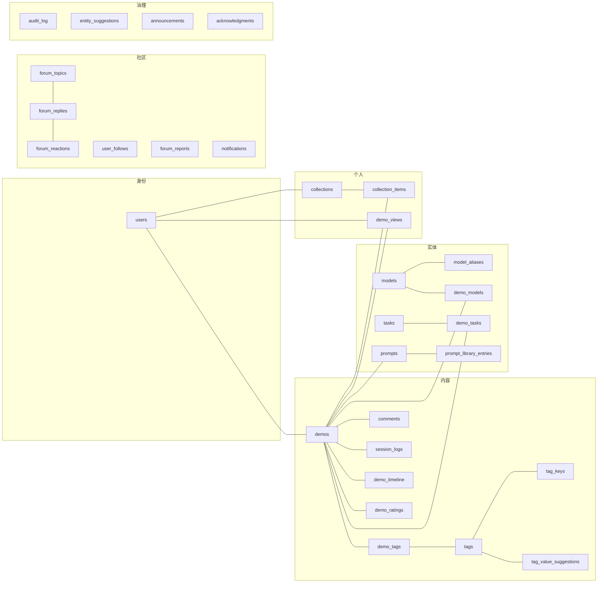

# ORM 现状与演进基线

**适用范围**：本文是**旧栈（`main`，FastAPI + SQLAlchemy）**的 ORM 快照与演进基线。`dev` 已迁移至 Go，表结构仅作迁移参考。

本文是**现有 ORM 的完整快照**，以及在它之上叠加《模型域设计 v1.0》的演进计划。

- 快照来源：`backend/app/models.py`（`org/main` @ `57ee489`），AST 解析，非手抄
- 设计基线：[`模型域设计.md`](./模型域设计.md) v1.0
- 编排基线：[`模型域-roadmap.md`](./模型域-roadmap.md)

**核心原则：不重写。以下所有变更是增量叠加，模型域设计原样保留。**

## 一、全景

ORM 里 **32 张表**；另有 **1 张不在 ORM 里的表**（`prompt_fts`，FTS5 虚拟表，由 `prompt_library_service` 用裸 SQL 建）。

按业务域分组：

| 域 | 表 | 数量 |
|---|---|---|
| 身份 | `users` | 1 |
| 内容 | `demos` `demo_tags` `tags` `tag_keys` `tag_value_suggestions` `comments` `session_logs` `demo_timeline` `demo_ratings` | 9 |
| 实体 | `models` `model_aliases` `tasks` `demo_models` `demo_tasks` `prompts` `prompt_library_entries` | 7 |
| 社区 | `forum_topics` `forum_replies` `forum_reactions` `user_follows` `forum_reports` `notifications` | 6 |
| 个人 | `collections` `collection_items` `demo_views` | 3 |
| 治理 | `audit_log` `entity_suggestions` `announcements` `acknowledgments` | 4 |
| 平台 | `settings` `visit_daily` | 2 |



## 二、关系（11 组）

| 关系 | 基数 | 载体 |
|---|---|---|
| 用户 ↔ 作品 | 1:N | `demos.author_id`（可空 = 匿名，配 `guest_name`） |
| 用户 ↔ 评论 | 1:N | `comments.user_id`（可空） |
| 评论自引用 | 1:N | `comments.parent_id`（楼中楼） |
| 作品 ↔ 标签 | M:N | `demo_tags` |
| 标签自引用 | 1:N | `tags.parent_id`（层级） |
| 作品 ↔ 模型 | M:N | `demo_models` |
| 作品 ↔ 题目 | M:N | `demo_tasks` |
| 作品 ↔ 提示词 | N:1 | `demos.prompt_id` |
| 模型自引用 | N:1 | `models.merged_into_id`（合并归宿） |
| 题目自引用 | N:1 | `tasks.merged_into_id` |
| 用户 ↔ 用户 | M:N | `user_follows` |

**注意两类引用不是 FK**：

- `announcements.demo_slug`、`forum_topics.demo_slug`、`notifications.demo_slug` —— 用 slug 而非 demo_id
- `forum_reactions.target_id` / `forum_reports.target_id` / `entity_suggestions.ref_id` —— 多态目标，`target_type` 决定指向哪张表

这是**有意为之**（跨表多态 + slug 稳定性），但意味着**没有数据库级完整性保证**，删作品时必须靠代码清理。

## 三、逐表清单

格式：`列名 类型 [pk|unique|index|fk]`

### 3.1 身份

**`users`**（16 列）
`id Integer [pk]` · `username String [unique,index]` · `password_hash` · `role` · `status` · `bio` · `trust_level Integer` · `need_review Boolean` · `github_bound Boolean` · `display_name` · `avatar_url` · `history_enabled Boolean` · `reputation Integer` · `received_likes Integer` · `received_thanks Integer` · `created_at DateTime`

> `role`: user/admin；`status`: active/suspended/banned/deleted；`trust_level`: 0 需审核。

### 3.2 内容

**`demos`**（34 列）—— 全库最重的表
`id [pk]` · `slug [unique,index]` · `title` · `description Text` · `cover_url` · `cover_thumb_url` · `demo_type [index]` · `external_url` · `prompt Text` · `video_url` · `status [index]` · `view_count` · `download_count` · `author_id [fk,index]` · `guest_name [index]` · `idempotency_key [unique,index]` · `content_hash [index]` · `single_file` · `prompt_id [fk,index]` · `model_hint` · `gen_rounds` · `gen_minutes` · `gen_platform` · `sites [index]` · `lang` · `featured Boolean` · `featured_order` · `rating_sum` · `rating_count` · `rating_avg Float` · `rating_god` · `rating_ghost` · `created_at` · `updated_at`

**`tags`**（7 列）
`id [pk]` · `key [index]` · `value [index]` · `description` · `group` · `parent_id [fk,index]` · `status [index]`
约束：`UNIQUE(key, value)`

**`tag_keys`**（6 列）
`key [pk]` · `mode`（fixed/open/int）· `label` · `description` · `sort` · `tier`

**`tag_value_suggestions`**（11 列）
`id [pk]` · `key [index]` · `value` · `description` · `group` · `status [index]` · `demo_id [fk]` · `created_by [fk]` · `created_at` · `reviewed_by [fk]` · `reviewed_at`

**`demo_tags`**（2 列）
`demo_id [fk,pk]` · `tag_id [fk,pk]`

**`comments`**（6 列）
`id [pk]` · `demo_id [fk,index]` · `user_id [fk]` · `parent_id [fk,index]` · `content Text` · `created_at`
> 写端点已 410（迁移到论坛），仅 `GET` 保留历史数据。

**`session_logs`**（5 列）
`id [pk]` · `demo_id [fk,index]` · `filename` · `file_size` · `created_at`

**`demo_timeline`**（6 列）
`id [pk]` · `demo_id [fk,index]` · `version_label` · `message` · `old_slug` · `created_at`

**`demo_ratings`**（7 列）
`id [pk]` · `demo_id [fk,index]` · `user_id [fk,index]` · `rater_key` · `score Integer` · `created_at` · `updated_at`
约束：`UNIQUE(demo_id, rater_key)`

### 3.3 实体

**`models`**（10 列）
`id [pk]` · `slug [unique,index]` · `name [unique]` · `vendor` · `status [index]` · `resolution [index]` · `merged_into_id [fk]` · `description` · `created_at` · `updated_at`

**`model_aliases`**（2 列）
`alias [pk]` · `model_id [fk,index]`

**`tasks`**（10 列）
`id [pk]` · `slug [unique,index]` · `title` · `description Text` · `category` · `status [index]` · `merged_into_id [fk]` · `created_by [fk]` · `created_at` · `updated_at`

**`demo_models`**（2 列）
`demo_id [fk,pk]` · `model_id [fk,pk]`
索引：`ix_demo_models_model_id`

**`demo_tasks`**（2 列）
`demo_id [fk,pk]` · `task_id [fk,pk]`
索引：`ix_demo_tasks_task_id`

**`prompts`**（4 列）
`id [pk]` · `content_hash [unique,index]` · `content Text` · `created_at`

**`prompt_library_entries`**（9 列）
`id [pk]` · `prompt_id [fk,index]` · `scope [index]` · `status [index]` · `title` · `category` · `source_url` · `created_by [fk]` · `created_at`
约束：`UNIQUE(prompt_id, scope)`

**`prompt_fts`**（不在 ORM）—— FTS5 trigram 虚拟表，`rowid` 对齐 `prompts.id`，由服务层裸 SQL 维护。

### 3.4 社区

**`forum_topics`**（16 列）
`id [pk]` · `title` · `content Text` · `author_id [fk,index]` · `demo_slug [index]` · `category [index]` · `tags`（JSON 串）· `pinned` · `sticky` · `locked` · `solved` · `status [index]` · `reply_count` · `view_count` · `created_at` · `updated_at`

**`forum_replies`**（8 列）
`id [pk]` · `topic_id [fk,index]` · `author_id [fk,index]` · `content Text` · `status [index]` · `parent_id [fk,index]` · `source_comment_id [index]` · `created_at`

**`forum_reactions`**（6 列）
`id [pk]` · `user_id [fk,index]` · `target_type [index]` · `target_id [index]` · `reaction_type [index]` · `created_at`
约束：`UNIQUE(user_id, target_type, target_id, reaction_type)`

**`user_follows`**（4 列）
`id [pk]` · `follower_id [fk,index]` · `following_id [fk,index]` · `created_at`
约束：`UNIQUE(follower_id, following_id)`

**`forum_reports`**（7 列）
`id [pk]` · `target_type [index]` · `target_id [index]` · `reporter_id [fk]` · `reason` · `status [index]` · `created_at`

**`notifications`**（9 列）
`id [pk]` · `user_id [fk,index]` · `type [index]` · `actor_id [fk]` · `demo_slug` · `topic_id Integer` · `reply_id Integer` · `read Boolean` · `created_at`

> `topic_id` / `reply_id` 无 FK，`demo_slug` 也是字符串——通知是「弱引用」，避免被引对象删除时级联。

### 3.5 个人

**`collections`**（8 列）
`id [pk]` · `owner_id [fk,index]` · `title` · `description` · `visibility [index]` · `is_default Boolean` · `created_at` · `updated_at`

**`collection_items`**（4 列）
`id [pk]` · `collection_id [fk,index]` · `demo_id [fk,index]` · `created_at`
约束：`UNIQUE(collection_id, demo_id)`

**`demo_views`**（4 列）
`id [pk]` · `user_id [fk,index]` · `demo_id [fk,index]` · `viewed_at [index]`
约束：`UNIQUE(user_id, demo_id)`

### 3.6 治理

**`audit_log`**（10 列）
`id [pk]` · `actor_type` · `actor_id [fk,index]` · `action [index]` · `entity_type` · `entity_id Integer` · `before Text`（JSON）· `after Text`（JSON）· `reason` · `created_at [index]`
索引：`ix_audit_entity(entity_type, entity_id)`

**`entity_suggestions`**（12 列）
`id [pk]` · `kind [index]` · `payload Text`（JSON）· `confidence Float` · `source` · `status [index]` · `demo_id [fk]` · `ref_id Integer`（多态，非 FK）· `created_by [fk]` · `reviewed_by [fk]` · `created_at` · `reviewed_at`

**`announcements`**（13 列）
`id [pk]` · `type [index]` · `title` · `content Text` · `demo_slug [index]` · `pinned` · `status [index]` · `category [index]` · `published_at` · `expires_at` · `topic_id [fk,index]` · `created_by [fk]` · `created_at`

**`acknowledgments`**（9 列）
`id [pk]` · `kind [index]` · `name` · `amount Integer` · `message` · `show_amount Boolean` · `sort` · `active Boolean` · `created_at`

### 3.7 平台

**`settings`**（2 列）
`key [pk]` · `value`

**`visit_daily`**（3 列）
`date [pk]` · `count Integer` · `ips Text`

## 四、ORM 层面的五个结构性问题

| # | 问题 | 证据 | 影响 |
|---|---|---|---|
| 1 | **`demos` 34 列混合五种关注点** | 身份 3 + 内容 8 + 素材 3 + 统计 9 + 策展 4 + 时间 2 | 任何读路径都拉全表；schema 演进互相牵制 |
| 2 | **三处双写** | `prompt`↔`prompt_id`；`demo_tags(model:x)`↔`demo_models`；标签 `rounds`↔列 `gen_rounds` | 任一路径漏写就分叉（模型域设计要解决第 2 处） |
| 3 | **`prompt_fts` 不在 ORM 里** | 裸 SQL 建于 `prompt_library_service.ensure_prompt_search_index` | 契约层/迁移层看不见它；重建库时容易漏 |
| 4 | **枚举全是 String，无 DB 约束** | `status` / `demo_type` / `role` / `kind` 等 | 校验只在 service；脏数据只能靠审计脚本发现 |
| 5 | **多态引用无 FK** | `forum_reactions.target_id`、`entity_suggestions.ref_id`、`*.demo_slug` | 删作品/删帖需手工清理，漏了就是孤儿 |

第 2、3 条与模型域直接相关；1、4、5 属独立技术债。

## 五、叠加模型域设计

### 5.1 净变更

| 动作 | 数量 | 表 |
|---|---|---|
| **新增** | 11 | `vendors` `providers` `model_specs` `model_catalog_items` `model_external_refs` `model_spec_fields` `model_source_sync` `benchmarks` `benchmark_versions` `benchmark_metrics` `benchmark_scores` |
| **加列** | 2 | `demo_models`（+4 列）、`models`（+1 列） |
| **退场** | 1 | `tags` / `demo_tags` 中 `key='model'` 的行（归档后删） |
| **不动** | 29 | 其余全部 |

最终：**32 → 43 张表**（+`prompt_fts` 仍不在 ORM）。

### 5.2 具体变更

```sql
-- 事实源收敛
ALTER TABLE demo_models ADD COLUMN provider_id  INTEGER REFERENCES providers(id);
ALTER TABLE demo_models ADD COLUMN serving_note TEXT NOT NULL DEFAULT '';
ALTER TABLE demo_models ADD COLUMN source       TEXT NOT NULL DEFAULT 'unknown';
ALTER TABLE demo_models ADD COLUMN created_at   DATETIME;
CREATE INDEX ix_demo_models_provider ON demo_models (provider_id);

-- 厂商实体化
ALTER TABLE models ADD COLUMN vendor_id INTEGER REFERENCES vendors(id);
CREATE INDEX ix_models_vendor ON models (vendor_id);
```

新增 11 张表的完整 DDL 见 `模型域设计.md` §6.1。

### 5.3 与现有实体的衔接

| 新表 | 指向 | 删除行为 |
|---|---|---|
| `model_specs` | `models.id` | CASCADE |
| `model_external_refs` | `models.id` | CASCADE |
| `model_spec_fields` | `models.id` | CASCADE |
| `providers` | `vendors.id` | 不级联（`vendor_id` 可空） |
| `demo_models.provider_id` | `providers.id` | 可空，不级联 |
| `benchmark_scores` | `models.id` | **SET NULL**（模型删了分还在，可考古） |

### 5.4 退场路径（不破坏任何现有读）

```text
demo_tags(key=model) ──投影──> demo_models
      │                          │
      └─ S5 冻结写入             └─ 唯一事实源
      └─ S6 归档到 model_tag_archive 后删除
```

`tags` / `demo_tags` 表**结构不变**，只是 `key='model'` 的行退场；其他标签键完全不受影响。

## 六、迭代顺序（六步，每步独立可发布）

| 步 | 名称 | 变更 | 依赖 | 回滚 |
|---|---|---|---|---|
| **T1** | 契约与审计 | 无结构变更：审计脚本 + 双读打点 | — | 无需 |
| **T2** | 事实源收敛 | `demo_models` +4 列；新增 `DemoModelWriter` | T1 | 关投影开关 + 回滚代码 |
| **T3** | 厂商与服务方 | 新增 `vendors` / `providers` / `model_specs` / 4 张同步表；`models` +`vendor_id` | T1 | 删表 |
| **T4** | provider 维度 | 启用 `demo_models.provider_id` 写入与展示 | **T2**、T3 | 停写、读回落「未标注」 |
| **T5** | 第三方基准 | 新增 4 张基准表 | T3 | 删表 |
| **T6** | 标签退场 | 冻结投影 → 归档 → 删除 `key='model'` 行 | T2 稳定一周期 | 从归档表恢复 |

**硬约束（不能调换）**

1. T4 必须晚于 T2 —— 旧的全删重建写入会抹掉 `provider_id`
2. T3/T5 必须晚于 T1 —— 否则按模型聚合会撞上「只有标签、没有实体」的作品
3. T6 必须晚于 T4 一个发布周期 —— 否则 `?tag=model:x` 旧链接失效

对应 GitHub milestone：T1→M3、T2→M4、T3→M5、T4→M6、T5→M7、T6→M8。

## 七、每步的验收 SQL

```sql
-- T2 后：孤儿链接
SELECT dm.demo_id, dm.model_id FROM demo_models dm
LEFT JOIN demos d ON d.id = dm.demo_id
LEFT JOIN models m ON m.id = dm.model_id
WHERE d.id IS NULL OR m.id IS NULL;

-- T3 后：未归并的 vendor 文本
SELECT m.vendor, COUNT(*) FROM models m
LEFT JOIN vendors v ON v.id = m.vendor_id
WHERE v.id IS NULL AND m.vendor <> ''
GROUP BY m.vendor;

-- T4 后：provider 指向已隐藏的服务方
SELECT dm.demo_id, dm.model_id, p.slug FROM demo_models dm
JOIN providers p ON p.id = dm.provider_id
WHERE p.status <> 'active';

-- T6 后：残留 model 标签
SELECT COUNT(*) FROM tags WHERE key = 'model';
```

## 八、明确不做

- **不重写后端语言**：Go 重写会让本文全部工作作废（31 个 ORM 实体、309 个测试、刚建的契约快照）
- **不换 ORM**：SQLAlchemy 2.x 的 `Mapped[]` 声明已够用
- **不拆表**：`demos` 的 34 列本次不动（拆表属独立议题，与模型域无耦合）
- **不改主键**：`demo_models` / `demo_tasks` 保持复合主键
- **不引入 Alembic**：沿用现有 `create_all` + 版本化迁移脚本，等 T6 后再评估

## 九、与前后端重写提议的关系

如果团队坚持 React + Go 全量重写：

| 本文档的产出 | 重写后的命运 |
|---|---|
| 32 张表的业务语义 | 可复用（领域知识） |
| 11 张新表的设计（DDL 已就绪） | **需按 Go 的 ORM 重新推导** |
| T1–T6 的迁移顺序与硬约束 | **仍然成立**（约束来自数据语义，与语言无关） |
| 契约快照（PR #18） | 作废（FastAPI 自动生成 OpenAPI 是 Python 特有优势） |
| 309 + 354 个测试 | 作废 |

**结论：领域设计与迁移顺序是资产，技术栈是负债。重写会丢掉资产、保留负债。**
