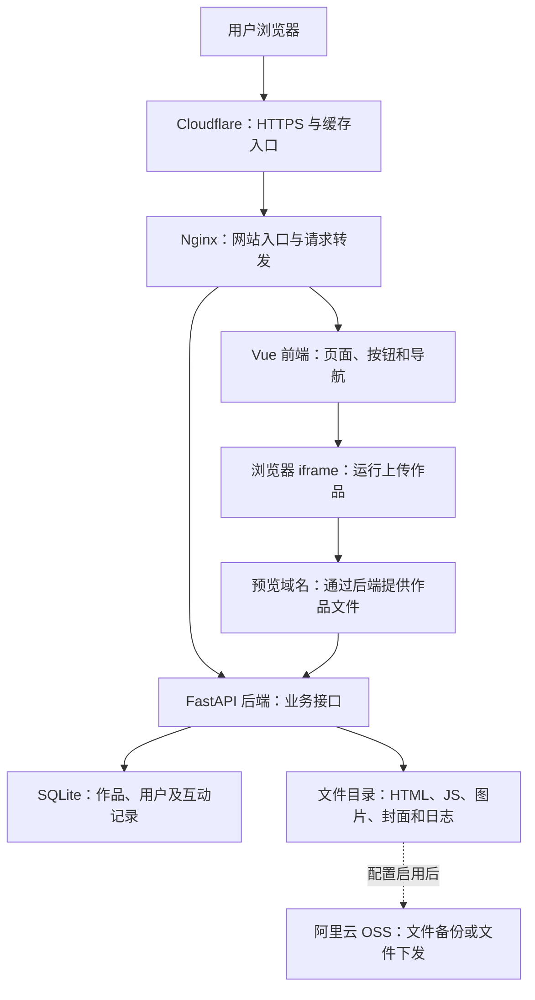

# DeepDemos：现站架构与可测试能力

日期：2026-10-10  
面向站长的架构说明与选题地图，不是冻结的计分合同。依据本轮只读查看的本地源码、部署配置及少量公开接口；没有修改业务代码或运行参赛模型。

## 1. 先认识这个网站

DeepDemos 是作品库、作品文件托管、用户社区与管理后台的组合。用户上传已经生成的网页或作品包，站点保存、分类、展示这些内容，让其他人在浏览器里体验。

网站主体用 Vue 展示页面，FastAPI 处理业务，SQLite 保存记录，独立文件目录保存作品与封面。后端按功能分模块，部署配置中仍是一个后端应用，并非每个模块各有一台服务器。

DSH 是之后让参赛模型开发网站的外部工具，不是当前站点浏览作品必须经过的环节。模型库保存模型名称、归属和作品关系；本站不会因为访客打开一件作品，就自动重新调用模型生成它。

## 2. 架构图



图中 Vue 程序实际由浏览器执行；Nginx 下发其构建后的 JS/CSS/HTML。iframe 也是浏览器里的一个区域，不是服务器启动的虚拟机。

Cloudflare 的存在由本轮公开响应头确认。Nginx、两个容器、SQLite 和文件卷的关系由仓库部署配置确认；没有登录服务器核对当前镜像、环境变量、OSS 开关或所有部署细节。

| 部分 | 当前技术/配置 | 它负责什么 | 对应源码 |
|---|---|---|---|
| 页面 | Vue 3、TypeScript、Vite、Vue Router、Pinia | 作品库、详情、上传、论坛、账户和后台界面 | [前端目录](../../frontend/src/)、[路由表](../../frontend/src/router/routes.ts) |
| 业务接口 | Python FastAPI、SQLAlchemy | 查询、登录、权限、上传、互动和治理 | [入口](../../backend/app/main.py)、[接口模块](../../backend/app/routers/) |
| 数据库 | 默认与 Compose 配置均为 SQLite；代码配置 WAL 等选项 | 保存结构化业务记录 | [数据库连接](../../backend/app/database.py)、[表定义](../../backend/app/models.py) |
| 文件 | 本地 storage 目录；可选 OSS | 保存作品资源、封面、下载包、会话日志 | [文件处理](../../backend/app/services/storage.py)、[OSS 配置](../../backend/app/config.py) |
| 网站入口 | Nginx | 静态前端、API/预览/媒体转发、域名入口与缓存策略 | [Nginx 配置](../../frontend/nginx.conf) |
| 部署 | Docker Compose | 启动 frontend/nginx 与 backend 两个服务，持久化数据库和文件 | [部署配置](../../docker-compose.yml) |

目前配置没有使用 Redis 或独立 Celery 队列。部分缓存、限流、访问计数和同步任务在应用进程内运行；后端 Dockerfile 配置一个 Uvicorn worker。增加实例时，需处理这些进程内状态，不只是增加容器数量。

## 3. 数据库和作品文件各存什么

一件作品可以同时有一条数据库记录和很多文件。

```text
数据库中的作品记录
  slug、标题、简介、作者、审核状态、标签关系
  提示词、模型/题目关系、浏览/下载计数、封面路径等

作品文件目录（示意）
  storage/demos/<slug>/files/
    index.html
    scripts/main.js
    styles.css
    images/...
  storage/demos/<slug>/sessions/...

媒体目录（示意）
  storage/media/covers/...
```

启用 OSS 后，文件与日志的实际存储/下发位置随配置变化；目录示意不代表所有日志都同时留在本地。

因此，列表里看得到作品，不能单独证明文件还在；文件还在，也不能单独证明作者、标签或收藏关系正确。重启与恢复要一起检查数据库和文件。Docker 卷用于保留数据，本身不等同于完整备份。

本轮源码有 31 个模型表定义，可按业务理解：

| 业务组 | 主要记录 | 关系的含义 |
|---|---|---|
| 作品与分类 | demos、tags、demo_tags、tag_keys | 一件作品可有多个标签，同一标签可对应多个作品 |
| 账号与个人内容 | users、collections、collection_items、demo_views、user_follows | 谁登录、谁收藏了什么、谁关注谁、看过什么 |
| 社区与互动 | demo_ratings、forum_topics、forum_replies、forum_reactions、notifications | 评分、作品讨论、回复、反应与通知 |
| 生成信息 | session_logs、demo_timeline、prompts | 会话日志、更新记录和提示词 |
| 模型与题目 | models、model_aliases、tasks、demo_models、demo_tasks | 作品属于哪些模型、哪些题目；名称与别名如何对应 |
| 管理与统计 | settings、audit_log、entity_suggestions、visit_daily 等 | 站点设置、审核建议、管理留痕、访问统计 |

这些记录是 UGC 内容与业务元数据；保存生成日志和模型归属不自动证明 AI 生成过程真实无误。

## 4. 三个动作怎样经过整个系统

### 搜索作品

用户输入关键词 → Vue 发请求 → `/api/v1/demos` 接口按规则查库 → 返回作品、总数与分页信息 → Vue 显示结果。

当前源码的搜索涉及标题、简介和标签；标签筛选为同键多个值 OR、跨键 AND，还支持模型、题目等过滤。这些是现站行为，不等同于 P1 v0.1 的精简规则。考题可以取其中一部分，但必须把公开规则另行写清楚。

### 打开并操作作品

详情页取得作品信息与预览地址 → iframe 请求作品入口 → FastAPI 提供 HTML/SVG 与子资源 → 作品 JS 在浏览器中运行。

主站预览地址可配置为 `demo.deepdemos.top`，Nginx 已有对应的预览专用入口。前端根据实际 URL 是否与主站不同源决定是否开放 `allow-same-origin`：跨源预览可使用该来源的 localStorage，同源或 srcdoc 则收紧权限。

同一预览域上的不同作品并不因此自动获得各自独立的 localStorage。当前结构的目标是主站与作品来源分离；每作品存储隔离是另一项需要明确设计的要求。

当前还有键盘焦点提示、Pointer Lock 放行、独立播放页和站内覆盖式全屏。点击预览后键盘交给作品，退出控件应可用。iframe 触发 load 事件不能单独证明游戏正确运行，需实际操作。

预览响应会处理 HTML 的 base 路径，资源 URL 带内容版本；更新文件与普通浏览应该分别检查：更新后能看到新内容，普通浏览不应无故改变内容版本。

### 作者上传并发布

提交表单 → 后端校验身份、文件与内容 → 保存数据库记录和作品资源 → 处理标签、时间线、审核状态及相关通知 → 按公开规则出现在作品库。

数据库事务和磁盘文件是两个存储系统，测试需覆盖其中一步失败后的处理。坏 ZIP 更新后原作品是否还在、重复提交是否多出一件作品、失败后是否留下半成品，都是有价值的工程问题。

当前支持 web、zip、link 三类；web 可含单 HTML/SVG 或多文件网页包，zip 主要用于文件包下载，link 指向外部地址，不能要求三类全部以内嵌网页方式运行。也存在匿名上传通道，不能把现站所有上传都描述成必须注册；P2 是否只考登录作者需明确写在题目里。

## 5. 可以测试哪些能力

下表是选题方向，不意味着本轮已执行这些测试。

| 可测试模块 | 一个能看懂的测试场景 | 检查什么能力 | 适合安排 |
|---|---|---|---|
| 列表、搜索、筛选、排序与分页 | 搜索固定词，再加标签，核对作品及总数；空结果可继续操作 | 查询逻辑、API 契约、页面状态 | P1 核心 |
| 详情与作品预览 | 单 HTML 和多文件作品均打开；完成一次键盘操作 | 文件托管、路径/MIME、浏览器集成与焦点 | P1 核心 |
| 持久化与启动 | 导入后重启，作品记录和资源仍可访问；第二次导入不重复 | 真后端、数据持久化、可交付性 | P1 核心；幂等导入属于评测补充 |
| 注册、登录与作者权限 | A 作者更新自己的作品成功，B 作者直接调接口修改失败 | 身份、会话、服务端授权 | P2 |
| 上传、更新、下载与旧版本 | 上传后换访客查看；坏包更新失败，原作品仍可运行 | 文件与数据库一致性、失败处理、版本行为 | P2；旧版本可另设扩展 |
| 组合筛选与需求升级 | 同时选两个模型再加游戏类别；旧搜索和预览仍正常 | 规则理解、已有工程修改、回归控制 | P3 |
| 收藏、历史、评分与排行榜 | 收藏夹公开/私有权限正确；修改评分后统计与榜单对应 | 多用户关系、聚合统计、去重和权限 | 后续业务关 |
| 论坛、作品讨论、关注与通知 | 回复作品讨论后目标用户收到通知；重复动作与删除计数正确 | 跨模块联动、事件处理与数据一致性 | 后续业务关 |
| 提示词、日志、模型与题目关联 | 同提示词的作品匹配正确；模型别名合并后关系不丢 | 数据关系、内容呈现与治理 | 后续专题 |
| 后台审核与管理 | 待审作品在公开列表/详情/预览不可见；审核后按规则出现 | 状态变化、角色边界、审计与公开范围 | 后续治理关 |
| 文件与访问边界 | 在受控副本提交越界路径、超限 ZIP、非法请求，得到规定错误且旧数据完整 | 输入校验、文件隔离、资源限制 | 公开列明后加入相应关卡 |
| 多站展示范围 | astra 展示指定策展池，列表、详情、预览和统计一致收敛 | Host 分流、共享后端的数据可见范围 | 可选扩展，首轮不必考 |
| 真实规模与稳定性 | 固定数据量/并发下混合浏览、预览和上传，观察延迟与错误 | 查询效率、内存、SQLite 写入与缓存 | 独立规模专题 |
| 部署、升级、恢复与交接 | 在干净副本启动；迁移保留原数据；恢复数据库与作品文件 | 运维、演进、诊断和交接 | 独立工程专题 |

例如，身份测试必须直接调用后端接口验证拒绝，而不只看前端有没有隐藏按钮。持久化不能只看当前页的内存状态。模型从零实现时可以选择自己的内部技术栈；验收关注公开行为与交付协议，而不要求长出与本站完全相同的 31 张表。

## 6. 机器测什么，人看什么

| 方法 | 合适的内容 | 证据 |
|---|---|---|
| 接口与数据检查 | 命中结果、计数、错误码、权限、幂等和持久化 | 请求/响应、数据与文件状态 |
| 浏览器任务检查 | 搜索按钮、上传流程、预览、键盘、存档、返回状态和手机端可操作性 | 实际动作、截图、录屏与任务结果 |
| 人工审美与体验 | 布局、配色、字体、信息重点、使用感受 | 同内容与视口的画面、试玩点评 |

前端功能可以机械验收；前端审美继续由人判断。截图好看、API 全绿和游戏能操作分别证明不同的事情，视频可以把这些证据串成同一条用户旅程。

## 7. 当前工程已有的测试资产

本轮看到 39 个后端 `test_*.py` 文件、25 个前端 `.test.ts` 文件。这是文件数量，不是用例数量或通过成绩。

- 后端已有接口、评分、论坛、收藏/历史、治理、文件处理、权限、统计持久化与多站范围等用例。`conftest.py` 在导入应用前配置临时 SQLite 和 storage，并关闭 OSS，避免用到真实库。
- 前端使用 Vitest，包含筛选、登录流程、布局、加载更多、图片、浏览历史和预览全屏等测试；配置主要运行在 Node 环境，不等于真实浏览器端到端试玩。
- 本轮没有启动应用、执行现有测试或压测生产站点。存在源码/用例不代表当前已通过，也不证明全部部署到线上。

已有用例可帮助组织者提炼规则；从零评测仍需要独立验收器。选手不读取本站业务源码，现站测试中依赖内部函数或特定数据库结构的部分不能直接拿去要求所有实现遵守。

## 8. 本轮公开观察与需要分清的地方

2026-10-10 的少量公开 GET 检查：

- [健康接口](https://deepdemos.top/api/v1/health) 返回 HTTP 200，公开状态为 `status=ok`、`db=ok`。
- [站点信息接口](https://deepdemos.top/api/v1/meta/site-info) 返回 1130 条当前公开作品，web 1060、zip 23、link 47；响应头 Server 为 Cloudflare。这是当时公开口径，不是数据库中所有状态记录的总数。
- 作品列表一次只读抽查的 total 同为 1130。没有调用上传、评分、管理等写入接口，未读服务器密钥或私有数据库。

原始评测样本仍沿用 2026-10-07 已保存的快照与哈希，不能让不断变化的线上数量替代冻结输入。

需要区分：

1. **现站规则与考题规则。** 现站已支持复杂筛选、匿名上传等；P1/P2 是选出的精简题目，公开范围未冻结，不能混用两套预期。
2. **当前代码与旧文档。** README 部分说明已过时：组合标签是同键 OR、跨键 AND；旧评论写接口已返回 410，作品新讨论走论坛；健康检查、审计和多项文件保护在当前代码已有实现。
3. **站内评分与评测成绩。** 作品评分和综合热度榜是 UGC 业务；之后给新模型的工程验收、费用和人工体验报告另行记录。
4. **源码与线上版本。** 当前源码增加 astra 只读展示站与管理模块；本轮不宣告所有新增功能已上线。OSS 模式和预览域的实际配置也未通过服务器登录确认。
5. **数据与作品运行环境。** 下载内容可以有原始缺陷或外部依赖。已有启动检查记录用于归因，不能把素材本身的失败算成站点实现失败。

## 9. 预算有限时先抓哪一块

每个新模型先围绕固定版本的 P1 完成一条前后端闭环：导入真实内容 → 搜索/筛选 → 打开并操作作品 → 重启后再访问。

这已经覆盖页面、接口、数据库、文件和浏览器集成。身份上传、社区治理、规模与恢复按独立阶段逐步加，具体范围与预算在发题前确定。P1 结果只描述这部分任务，不能提前宣称测试完整站点的全部生产能力。

先把这张架构与测试地图看懂，再从中选择首次发题的用户旅程；当前无需改动网站代码。
