# 实体域 UML 图集 v2.7

**适用范围**：本文是 [`实体域数据结构设计.md`](./实体域数据结构设计.md) v2.6 的**图形化补充**。只画图，不重复 DDL 与文字论证。所有图基于 v2.6 的三级层次（Task → Prompt → Demo）+ 提案层（Proposal），且 Demo 一侧按《Demo域设计》v1.0 的目标模型落图（`Demo` / `DemoRevision` / `DemoStat` / `DemoChannel`）。

**状态：草案，待真实数据验证**。数据结构设计 §10.1 是一份 **① ~ ⑩ 的待取数清单**（10 条，靠推理定不了、必须从线上库取数；节首写明「这是什么 / 为什么必须线上取数 / 与台账的区别」）。本文的图反映的是**结构**，不受这些参数影响；但 §20（题目名去重）的具体判定结果会随白名单调整而变。**注意与 [`设计决策台账.md`](./设计决策台账.md) 区分**：台账记**已拍板**的决策（G 编号），§10.1 记**还没数据、还拍不了**的问题（① ~ ⑩）。

**v2.7 变更（2026-10-28，镜像台账 G18：生成条件下放 revision）**：**`demo_models` 由表改视图**（= 当前 revision 的模型投影，权威定义见《模型域设计》**v1.2 §3.3**），事实源改为 `demo_revision_models`。**只改图与表的口径，不新画图**：

| # | 动作 | 内容 | 落在哪张图 / 表 |
|---|---|---|---|
| 1 | **加实体 + 边** | 新增 `DemoRevisionModel`（`PK (revision_id, model_id)`）与 `DemoModel`（`<<view>>`）；ER 里 `DEMO_REVISION_MODELS` 走**实线真表**、`DEMO_MODELS` 走**虚线派生（VIEW）** | §1 全景类图、§4 ER 图（+ 约束标注 + 视图 DDL） |
| 2 | **口径** | `model_counts` 明确「**按当前 revision**」——`demo_models` 是视图，天然如此 | §11 的 CTE 表与口径段、§12 组件图 |
| 3 | **索引** | `demo_models` **无索引（视图）** → 改记 `ix_demo_revision_models_model` / `ix_demo_revision_models_provider` | §14 部署图（部署要点）、§4 约束标注 |
| 4 | **视图节点** | 部署图里 `demo_models` 从「表」节点（`T7`）改为 **`VIEW` 节点**（`V2`），并新增 `demo_revision_models` 表节点（`T13`）与索引节点（`I2`） | §14 部署图 |
| 5 | **同步** | 图目录 3 行（1 / 4 / 14）+ §15 对应表 2 行（1 / 4 与 12）+ §16 阅读顺序第 1 条 | 头部、§15、§16 |

**同日修订（2026-10-28，只读审计后的 12 处修正；版本号不变）**：① §19 `new_platform` 必填表按 **G17** 改为 `slug` / `name` / `is_harness` / `forms[]`（可选删 `kind`）；② `gen_platform` **两处图内属性**（§1 `DemoRevision`、§4 `DEMO_REVISIONS`）+ 两处正文枚举 + 一处 v2.2 沿革行按 **G18** 清理；③ 视图实体 `DEMO_MODELS` / `DEMO_TASKS` **去掉 `PK` 标记**（视图无 PK）；④ 图例「表 / 视图的分界」补 `demo_models`（并注明同款派生的另三个）；⑤ §7 时序把 `INSERT demos + revision` **移到 `UPDATE demo_revisions` 之前**（同一事务，rev 先建后更）；⑥ §8 的 `r.prompt != ''` → **`r.prompt_id IS NOT NULL`**（含过渡节里的处方句）；⑦ §4 ER 补 `MODELS` 属性块 + 约束标注一行（原本只画边、渲染成空盒子）。

**v2.6 变更（2026-10-28，台账 G16 收尾）**：三项，**只搬位置 / 只做授权修正**：

| # | 动作 | 内容 | 原位置 | 类 |
|---|---|---|---|---|
| 1 | **下沉** | `new_tag_value`（**仅存量**）与 `report`（作废）两行 + 留值说明（`dedupe_key` 表 2 行、`execute` 表 2 行） | §18 / §19 | ①④ |
| 2 | **下沉** | 「`prompt` 和 `prompt_id` 双写（过渡期）」关键点第 3 条 | §7 | ① |
| 3 | **修正**（授权） | 过期版本引用：`数据结构设计 v2.3` → **v2.5**（适用范围 2 处、本版说明 1 处） | 头部 | — |

**计数自洽**：`dedupe_key` 表由 13 行 → **11 行覆盖 12 个目标 kind**；`execute` 表由 14 行 → **12 个目标分支**；两处计数说明已同步改写（12 个目标 + 2 个存量 = 14 个 kind）。`CHECK` 里两个存量值**未删**。

**v2.5 变更（2026-10-28，台账 G16 第二轮「文本级」下沉）**：继续把正文（§1–§21）里**成块**的 ②③ 内容下沉到文末「过渡期与现状（非目标态）」，**只搬位置、不改图内容**：

| 动作 | 内容 | 原位置 | 类 |
|---|---|---|---|
| **下沉** | 「与旧栈的对比」表 + `EntitySuggestion` python 片段 + 两条「为什么需要」的旧栈对照 | §17 | ②③ |
| **下沉** | `covered` 的旧实现（`cluster_service.py:52`）与「v2.2 的两处修正」（旧口径） | §8 | ③ |
| **下沉** | 「这张图对应旧栈的 KB-16 教训」段 | §19 | ③ |

正文原位各留**一行指针**；**mermaid 图一字未动**（含图内 Note）。

**v2.4 变更（2026-10-28，台账 G16「正文只放目标态，过渡态下沉」）**：**只搬位置、不改图内容**（例外见下）。

| 动作 | 内容 | 原位置 | 为什么算过渡 / 迁移 |
|---|---|---|---|
| **下沉** | 流程图：提案迁移（§6.8） | §22 | **迁移过程图**——一次性搬存量建议进 `proposals` + `proposal_refs`，只在迁移期存在 |
| **移出**（目标图例外） | `Tag` 类 + `Proposal ..> Tag : 产物 new_tag_value（仅存量）` | §21 类图 | `Tag` = 旧 `tags` 表，按 **G4** 终将删除；`new_tag_value` 是**仅存量兼容**的 kind（**G9**）。目标图只留目标对象，过渡对象改画在文末「过渡期图」 |

**留在正文的目标态**：§1–§21 全部（类图 / 数据流图 Level 0·1 / ER / 状态机 / 时序 / 组件图 / 活动图 / 部署图 / 索引），其中 **§21 类图已不含 `Tag`**。

**本版说明**：台账现有 **G1–G18**（G13 迁移阶段命名统一、G14 新栈保留 agent 通道、G15 `version_of_id` 判给 revision、G16 本分层原则、**G17 `platform` 改「形态小表 + `is_harness`」、G18 生成条件下放 revision**）；本文正文引用一律用 G 编号。数据结构设计现为 **v2.6**（两份文档已按 G16 / G18 同步）。

**v2.3 相对 v2.2 的变化（2026-10-28）**：

| # | 变化 | 落在哪张图 |
|---|---|---|
| 1 | **`proposal_refs` 删 `tag_id` 列**（台账 **G4**：`tags` / `tag_keys` / `demo_tags` 终将删除，外键会被打断）。`ck_proposal_refs_exactly_one` 从 4 项减到 3 项（demo / task / model） | §4 ER 图、§21 类图 |
| 2 | **`proposals.kind` 从 10 个扩到 14 个**（台账 **G9**）：新增 `new_classification` / `new_platform` / `new_platform_config` / `new_skill`；`new_tag_value` 转为「**仅存量兼容**：新写入不再产生」 | §18、§19、§21 |
| 3 | **payload「接口给全 + 审核兜底」**（台账 **G10**）：提交端给全字段、`CHECK` 只强制必填子集；**缺运营必填字段（`platform_id` / `vendor_id`）时审核界面不允许批准** | §18、§19 |
| 4 | **§6.8 迁移脚本三处变化**：① `entity_suggestions` 的 `alias → model_alias`；② payload **缺键回填**（从 `ref_id` / `demo_id` 补齐 `model_id` / `task_id` / `demo_id`）；③ **新增 `proposal_refs` 迁移**（旧 `demo_id` / `ref_id` 两列 → 新 `subject` / `target` / `source`）。`tag_value_suggestions` 的分流只有 **4 个分支**（只有 `mode='fixed'` 的 6 个键可能有行） | 新增 §22 |
| 5 | **§5.4 补齐三个 CTE**（`counts` / `model_counts` / `task_counts`），口径 = **公开可见谓词 + 当前 revision**（G1 / G7） | §11、§12 |
| 6 | **§10.1 取数清单编号** `D-a ~ D-j` → **① ~ ⑩**（条目本身仍是 10 条），并加节首三段说明（这是什么 / 为什么必须线上取数 / 与台账的区别） | 本文开头的 §10.1 引用 |
| 7 | **决策编号**：正文一律用**台账 G 编号**（台账现有 **G1–G12**）；「决议 Dn」只出现在数据结构设计 §11 的映射表里 | 全文 |

**v2.2 相对 v2.1 的变化（2026-10-28：整体按 Demo 域目标模型重推）**：

| # | 变化 | 落在哪张图 |
|---|---|---|
| 1 | **`prompt_id` 进 revision**：`demos.prompt_id` → `demo_revisions.prompt_id`（经 `demos.current_revision_id` 关联）；`demos.prompt` → `demo_revisions.prompt`。`DEMOS` 与 `PROMPTS` **不再直连**，中间插 `DEMO_REVISIONS` | §1 类图、§4 ER 图、§7 上传、§8 簇成题、§10 改 prompt 换题、§13 挂题决策、§21 类图 |
| 2 | **`status` 拆两列**：`demos.status` → `moderation_state` + `lifecycle_state`；公开可见性改为**公开可见谓词**（数据结构设计 §5.0），含 `demo_channels.visibility='listed'` 渠道条件与 `archived` / `removed` 两类 **tombstone** 分档 | 图例、§4 ER 图、§8 簇成题、§12 组件图 |
| 3 | **`demo_tasks` 是 VIEW**：`demos ⋈ demo_revisions(当前) ⋈ task_prompts`，只按当前 revision 派生 | §4 ER 图（标注 VIEW）、§8 簇成题、§10、§14 部署图 |
| 4 | **运行证据与统计分家**：`gen_rounds` / `gen_minutes` / `gen_platform` / `demo_type` → `demo_revisions.*`；`rating_avg` / `rating_count` → `demo_stats.*`（**`gen_platform` 已于 v2.6 按 G18 退场**：平台归属改走 revision 级 `demo_revision_platforms`） | §1 类图、§3 数据流图、§4 ER 图、§12 组件图 |
| 5 | **决策编号收敛**：正文的「决议 Dn」已集中到 [`设计决策台账.md`](./设计决策台账.md)（D1→**G6** / D2→**G7** / D3→**G1** / D4→**G2**）。本图集一律用**台账编号** | 全文 |

**图例（`<公开可见谓词>`）**：本文多处用 `<公开可见谓词>` 指代「公开可见」的判定，展开见下节「图例：公开可见谓词与 tombstone」。

**v2.1 相对 v1.0 的变化**：新增 §17–§21 五张图（提案状态机 / 提交 / 审核 / 题目名去重 / 提案与产物类图）；§1 类图与 §4 ER 图补上 `title_key` / `title_norm` / `proposals` / `proposal_refs`；§5 Task 状态机去掉 `candidate`。

**图目录**：

| # | 图 | 类型 | 回答什么问题 | 位置 |
|---|---|---|---|---|
| 1 | 全景类图 | classDiagram | 有哪些实体、什么属性、什么关系（v2.7：含 `DemoRevisionModel` 与 `DemoModel` `<<view>>`） | 正文 |
| 2 | 数据流图（Level 0） | flowchart | 数据从哪来、到哪去 | 正文 |
| 3 | 数据流图（Level 1） | flowchart | 每个处理过程内部怎么流 | 正文 |
| 4 | ER 图（完整） | erDiagram | 表结构 + 外键 + 基数（v2.7：`DEMO_REVISION_MODELS` 实线真表 / `DEMO_MODELS` 虚线视图，G18） | 正文 |
| 5 | 状态机：Task | stateDiagram | 题目的一生 | 正文 |
| 6 | 状态机：Prompt | stateDiagram | 提示词的一生 | 正文 |
| 7 | 时序：上传作品 | sequenceDiagram | 从上传到入库 | 正文 |
| 8 | 时序：从 prompt 簇成题 | sequenceDiagram | 聚类 → 建题 → 归类 | 正文 |
| 9 | 时序：合并题目 | sequenceDiagram | 两条边怎么迁 | 正文 |
| 10 | 时序：改 prompt 换题 | sequenceDiagram | 视图的自动效果 | 正文 |
| 11 | 时序：提示词搜索 | sequenceDiagram | pg_trgm 怎么走 | 正文 |
| 12 | 组件图 | flowchart | 谁依赖谁（v2.7：含 `VIEW demo_models`） | 正文 |
| 13 | 活动图：挂题决策 | flowchart | 挂题时的判断链 | 正文 |
| 14 | 部署图 | flowchart | 表 / 视图落在哪个库 | 正文 |
| 15 | 图与文档的对应 | — | 索引 | 正文 |
| 16 | 三张图串起来看 | flowchart | 阅读顺序 | 正文 |
| 17 | 状态机：Proposal | stateDiagram | 提案的一生（5 态） | 正文 |
| 18 | 时序：提交提案 | sequenceDiagram | `dedupe_key` 怎么算 | 正文 |
| 19 | 时序：审核提案 | sequenceDiagram | 执行失败怎么回滚 | 正文 |
| 20 | 时序：题目名去重 | sequenceDiagram | 硬约束 + 软提示 | 正文 |
| 21 | 类图：提案与产物 | classDiagram | 入口与出口（**已按 G16 移出 `Tag`**） | 正文 |

**过渡期与现状（非目标态）**——按 **G16** 下沉 / 移出，图号沿用原编号：

| # | 图 | 类型 | 原位置 |
|---|---|---|---|
| 22 | 流程图：提案迁移（§6.8） | flowchart | 原 §22 |
| T1 | 类图：`new_tag_value` 的存量产物（过渡期） | classDiagram | 原 §21（`Tag` 类 + 产物边） |

---

## 图例：公开可见谓词与 tombstone

### `<公开可见谓词>`（列表 / 计数 / 榜单）

```sql
d.moderation_state = 'approved'
AND d.lifecycle_state = 'published'
AND d.deleted_at IS NULL
AND EXISTS (SELECT 1 FROM demo_channels c
            WHERE c.demo_id = d.id AND c.channel = :channel AND c.visibility = 'listed')
```

- 前 3 条来自 `demos`；第 4 条是 **Demo 域渠道可见性**（`demo_channels.visibility='listed'`），`:channel` 取 `deep`（主站）/ `astra`（只读橱窗），由请求 Host 判定。
- **单渠道场景可省略第 4 条**（只有 `deep` 一个渠道时 `visibility` 恒为 `listed`）。本文的图在只讲实体域内部关系时用 `<公开可见谓词>` 指代，不逐处展开渠道条件。
- **图内写法**：mermaid 图里的文字标签写作 **公开可见谓词**（不带尖括号，避免被当成 HTML 标签）；散文里写作 `<公开可见谓词>`。两者同义。
- 出处：台账 **G1**（数据结构设计 §5.0「全站唯一口径」）。v2.1 图里的 `d.status = 'approved'` 一律换成这个谓词。

### 详情 / 链条（按 slug 直访）的分档

| 状态 | 响应 | 内容 |
|---|---|---|
| `approved` + `published` + 未删除 | 200 | 正常详情 |
| `lifecycle_state='archived'`（作者下架） | **200 + tombstone** | 只出 slug / 标题 / 下架时间 / 「作者已下架」说明；**不出内容、预览、下载、评论、会话日志** |
| `lifecycle_state='removed'`（违规下架） | **200 + tombstone** | 只出 slug / 标题 / 处理时间 / 「因违规被移除」说明 + 申诉入口；**不出内容、预览、下载、评论、会话日志** |
| 其它（`pending` / `rejected` / `draft` / 已删除） | 404 | 作者本人与管理员走**带权限读路径**，不受本谓词约束 |

**两类 tombstone 必须内容不同**：`archived` 是作者自主下架（可恢复），`removed` 是平台违规处置（有申诉入口），文案与可执行动作都不同。

**为什么用 tombstone 而不是 404**：下架是明确的产品动作，旧链接继续给完整内容会让下架失效；但直接 404 会让分享链接与搜索结果变成死链，所以用 tombstone 页承接（台账 G1 修订了《Demo域设计》§6.2 的原表述）。

### 状态枚举的落点

| 枚举 | 列 | 值 |
|---|---|---|
| `ModerationState` | `demos.moderation_state` | `pending` / `approved` / `rejected` |
| `LifecycleState` | `demos.lifecycle_state` | `draft` / `published` / `archived` / `removed` |
| `Visibility` | `demo_channels.visibility` | `listed` / `unlisted` / `hidden` |
| `DemoType` | `demo_revisions.demo_type` | `web` / `zip` / `link` / `image` |

### 表 / 视图的分界

| 名字 | 形态 | 说明 |
|---|---|---|
| `demos` / `demo_revisions` / `demo_stats` / `demo_channels` | TABLE | Demo 域目标模型（《Demo域设计》v1.0） |
| `demo_tasks` | **VIEW** | 派生：`demos ⋈ demo_revisions(当前) ⋈ task_prompts`，只读；写操作走 `task_prompts` |
| `demo_models` | **VIEW** | 派生：`demos ⋈ demo_revision_models(当前 revision)`，只读、**无索引、无 PK**；写操作走 `demo_revision_models`（台账 **G18**） |

同款派生的还有 `demo_platforms` / `demo_platform_configs` / `demo_skills`（**G18**，定义见《标签域数据结构设计》§3.5）——它们属标签域侧，本文只在 §4 / §12 / §14 画 `demo_models` 这一条（模型域是接缝最密的一侧）。

---

## 1. 全景类图

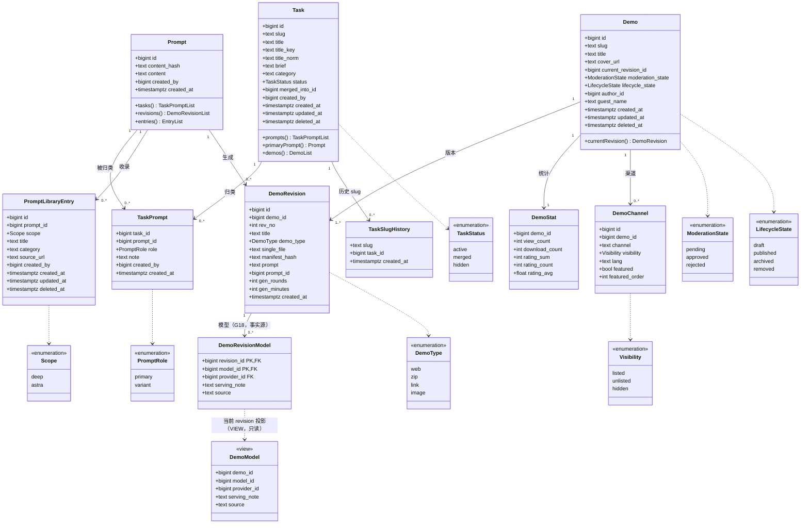

**读图要点**：

| 关系 | 基数 | 含义 |
|---|---|---|
| `Task → TaskPrompt` | 1 : 0..* | 一道题可以归类多条 prompt |
| `Prompt → TaskPrompt` | 1 : 0..* | 一条 prompt 可以被归到多道题 |
| `Prompt → DemoRevision` | 1 : 0..* | 一条 prompt 可以生成多个版本快照（经 `demo_revisions.prompt_id`） |
| `Demo → DemoRevision` | 1 : 1..* | 一件作品至少一个版本；revision 不可变，改内容 = 新增一条 |
| `Demo → DemoStat` | 1 : 1 | 统计行可重建，不作为权威 |
| `Demo → DemoChannel` | 1 : 0..* | 渠道与可见性正交，也与审核状态正交 |
| `Prompt → PromptLibraryEntry` | 1 : 0..* | 一条 prompt 在每个视区最多一条收录 |
| `Task → TaskSlugHistory` | 1 : 0..* | 一道题可以有多个历史 slug |
| `DemoRevision → DemoRevisionModel` | 1 : 0..* | **G18**：模型的归属跟着版本走（`PK (revision_id, model_id)`）；`models`（模型域）本图不展开 |
| `DemoRevisionModel ⇢ DemoModel` | — | **`DemoModel` 是 `<<view>>`**（`demo_models`）：由 `demos ⋈ demo_revisions(当前) ⋈ demo_revision_models` 派生，**只读、无索引、不写**；虚线表示派生而非外键 |

**注意 `DemoRevision → Prompt` 是 `0..*` 而不是 `1..*`**：`demo_revisions.prompt_id` 可空，现状 61.5% 的作品无 prompt。

**`DEMOS` 与 `PROMPTS` 不再直连**：v2.1 的 `Prompt "1" --> "0..*" Demo : 生成` 已删除，中间是 `Demo → DemoRevision → Prompt`（台账 **G6**）。于是「作品属于哪道题」多一跳：

```
Demo → 当前 DemoRevision → Prompt → TaskPrompt → Task
```

**`Demo` 只保留 `current_revision_id`**：`prompt` / `prompt_id` / `demo_type` / `gen_rounds` / `gen_minutes` 都不在 `Demo` 上，而在 `DemoRevision`；`rating_avg` / `rating_count` 在 `DemoStat`；`sites` / `lang` / `featured` 在 `DemoChannel`（台账 **G6**）。

---

## 2. 数据流图（Level 0：上下文图）

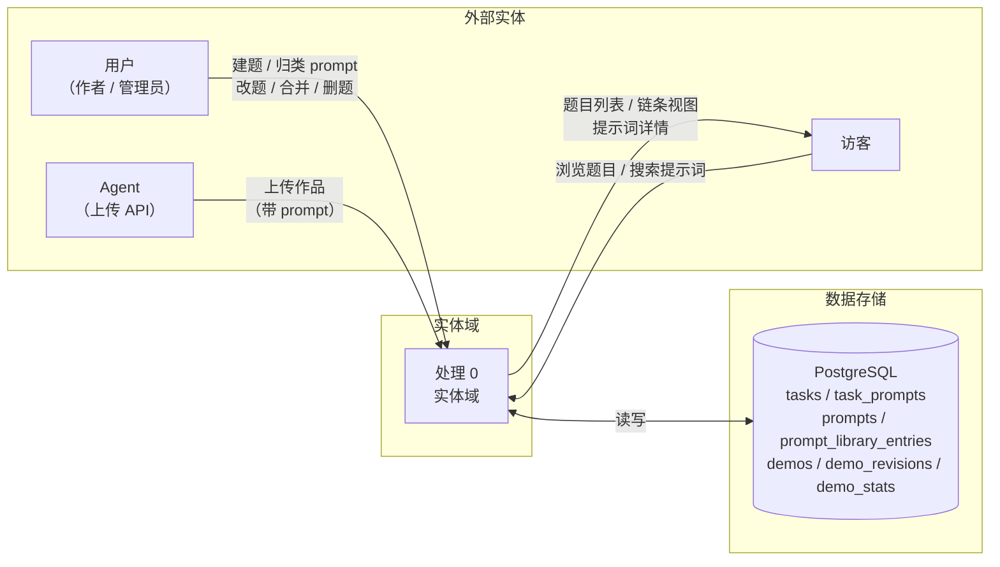

**Level 0 只画「谁和系统交互」**，不画内部处理。

---

## 3. 数据流图（Level 1：主要处理）

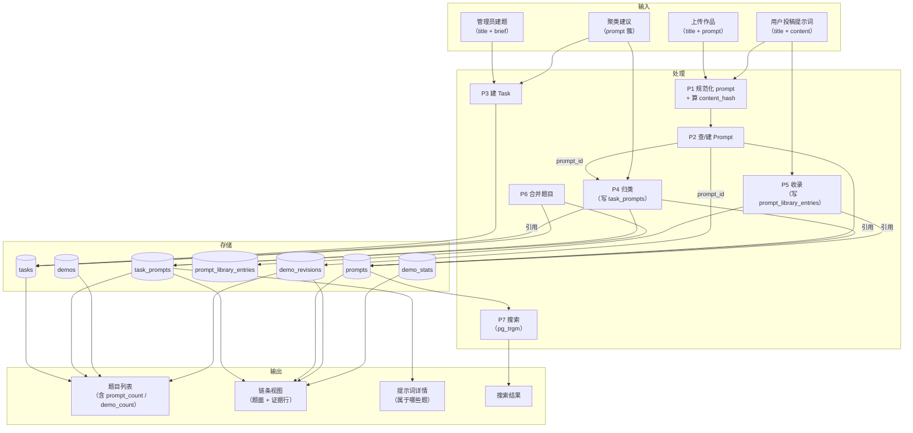

**关键数据流**：

| 流 | 从 | 到 | 携带什么 |
|---|---|---|---|
| F1 | 上传作品 | P1 | `title` + `prompt` 原文 |
| F2 | P1 | P2 | 规范化后的 `content` + `content_hash` |
| F3 | P2 | P4 | `prompt_id` |
| F4 | 聚类建议 | P3 + P4 | 一组 `prompt_id` + 建议题名 |
| F5 | P4 | `task_prompts` | `(task_id, prompt_id, role, note)` |
| F6 | P5 | `prompt_library_entries` | `(prompt_id, scope, title, ...)` |
| F7 | P2 | `demo_revisions` | `prompt_id`（写在**当前 revision** 上，`demos` 侧只有 `current_revision_id`） |

**O1 / O2 的 `demo_count` 与证据行都按 `<公开可见谓词>` 过滤**（v2.1 写的是 `d.status = 'approved'`）：

- 作品行：`demos d JOIN demo_revisions r ON r.id = d.current_revision_id`
- `demo_type` / `gen_rounds` / `gen_minutes` 取 `r.*`；`rating_avg` / `rating_count` 取 `demo_stats s`（`LEFT JOIN s ON s.demo_id = d.id`）
- 渠道条件（`demo_channels.visibility='listed'`）见「图例：公开可见谓词与 tombstone」

---

## 4. ER 图（完整）

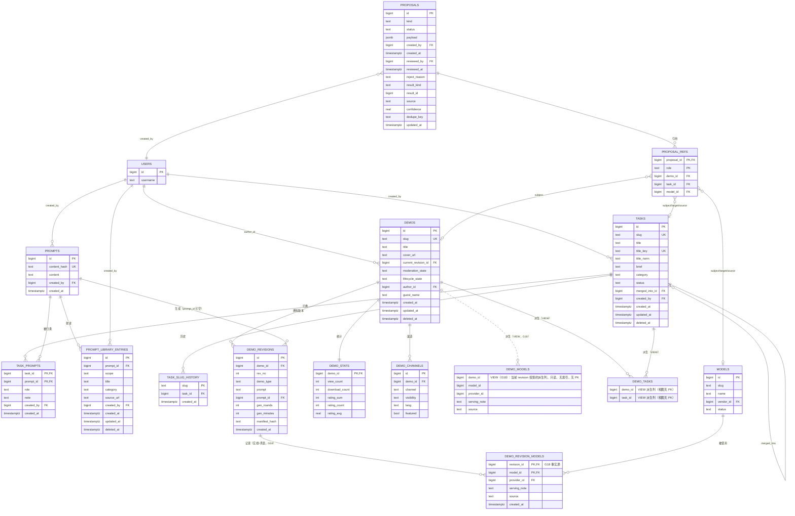

**约束标注**：

| 表 | 约束 |
|---|---|
| `tasks` | `UNIQUE (slug) WHERE deleted_at IS NULL`；`UNIQUE (title_key) WHERE deleted_at IS NULL AND status='active'` |
| `task_prompts` | `PK (task_id, prompt_id)`；`UNIQUE (task_id) WHERE role='primary'` |
| `prompts` | `UNIQUE (content_hash)` |
| `prompt_library_entries` | `UNIQUE (prompt_id, scope)` |
| `task_slug_history` | `PK (slug)` |
| `demos` | `UNIQUE (slug)`；`current_revision_id` → `demo_revisions(id)`；**没有 `status` 列**——公开可见性由 `<公开可见谓词>` 表达（图例） |
| `demo_revisions` | `UNIQUE (demo_id, rev_no)`；**不可变**（写入后不 UPDATE）；`prompt_id` 可空 |
| `demo_stats` | `PK (demo_id)`；**可重建**，不作为权威 |
| `demo_channels` | `UNIQUE (demo_id, channel)`；`INDEX (channel, visibility, featured_order)`；`visibility='listed'` 要求 `moderation_state='approved'` |
| `demo_tasks` | **VIEW（只读）**，无约束：见下 |
| `demo_revision_models` | `PK (revision_id, model_id)`（同一模型经不同 provider **算一条**，`provider_id` 只是属性）；`INDEX (model_id)` / `INDEX (provider_id)`；`serving_note` ≤100 字符；`source` 默认 `unknown`（台账 **G18**，定义见《模型域设计》§3.3） |
| `demo_models` | **VIEW（只读）**，无约束、**无索引**：`demos ⋈ demo_revision_models(当前 revision)`，见下（台账 **G18**） |
| `proposals` | `UNIQUE (kind, dedupe_key) WHERE status='pending' AND dedupe_key IS NOT NULL`；`kind` **14 值**（含 4 个 v2.3 新增的「半开放实体」kind），`new_tag_value` 仅存量兼容 |
| `proposal_refs` | `PK (proposal_id, role)`；`CHECK` 每行只指向一种实体——**3 项**：demo / task / model（v2.3 按台账 **G4** 删掉 `tag_id`） |
| `models` | **模型域拥有**，本图只画连边所需的身份列（`id` / `slug` / `name` / `vendor_id` / `status`）；完整定义见《模型域设计》§3.2。`vendor_id` → 共享 `vendors`（**G10**），`vendor` 文本只是过渡期展示缓存 |

**`demo_tasks` 视图定义**（v2.2：经**当前** revision 派生，台账 **G7**）：

```sql
CREATE VIEW demo_tasks AS
SELECT d.id AS demo_id, tp.task_id
FROM demos d
JOIN demo_revisions r ON r.id = d.current_revision_id
JOIN task_prompts tp ON tp.prompt_id = r.prompt_id
WHERE r.prompt_id IS NOT NULL;
```

**`demo_models` 视图定义**（v2.7：由**表改视图**，台账 **G18**；权威定义见《模型域设计》v1.2 §3.3）：

```sql
CREATE VIEW demo_models AS
SELECT d.id AS demo_id, rm.model_id, rm.provider_id, rm.serving_note, rm.source
  FROM demos d
  JOIN demo_revision_models rm ON rm.revision_id = d.current_revision_id;
```

- **只读**：写入一律走 `demo_revision_models`（模型域的 `DemoModelWriter`）；迁移时先 `DROP TABLE demo_models` 再建视图。
- **「当前」就是 `demos.current_revision_id`**：回滚后筛选与计数**跟着回滚**——与 `demo_tasks`（G7）同构。

**`DEMOS` 与 `PROMPTS` 之间没有边**：`prompt` / `prompt_id` / `demo_type` / `gen_rounds` / `gen_minutes` 都在 `DEMO_REVISIONS`；`rating_avg` / `rating_count` 在 `DEMO_STATS`（台账 **G6**）。路径是 `DEMOS → DEMO_REVISIONS → PROMPTS`。

**公开可见谓词不进 ER 图**：它是查询条件，不是列也不是约束。本图集里凡出现 `<公开可见谓词>` 处，展开见「图例：公开可见谓词与 tombstone」。

---

## 5. 状态机：Task

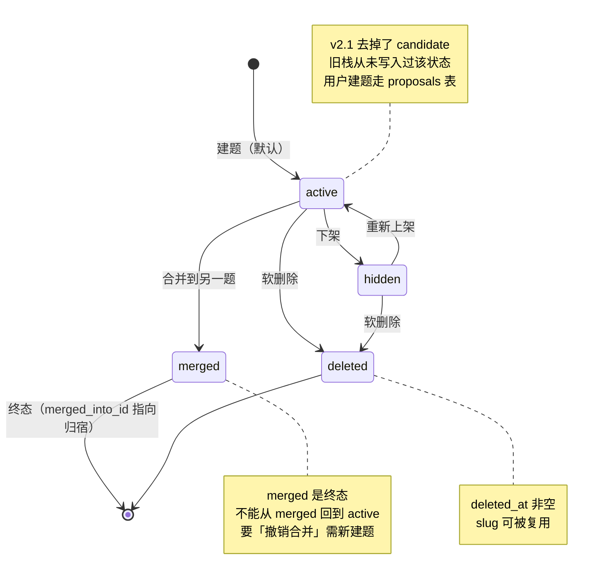

**状态转移的守卫条件**：

| 转移 | 守卫 |
|---|---|
| `hidden → active`（重新上架） | 无（管理员权限即可） |
| `active → merged` | `target.status = 'active'`；不成环；`source` 未 merged |
| `* → deleted` | 无 `task_prompts`；无反向 `merged_into`；无 pending 提案（`proposal_refs.task_id`） |

**v2.2 修正**：本表在 v2.1 里仍留着 `candidate`（v2.1 已把该状态从上面的状态机删掉，`target.status IN ('active','candidate')` 是遗留口径），v2.2 一并清掉；`pending 建议` 也按 v2.1 的提案表口径改成 `pending 提案`。

---

## 6. 状态机：Prompt

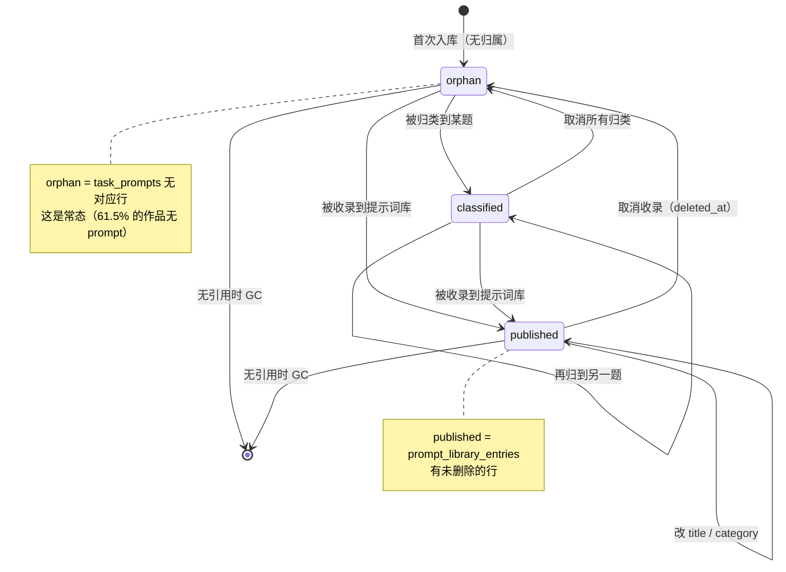

**注意**：`Prompt` 的「状态」不是列，而是**由关联推导**：

| 状态 | 判定 |
|---|---|
| `orphan` | `NOT EXISTS (SELECT 1 FROM task_prompts WHERE prompt_id = p.id)` |
| `classified` | `EXISTS (SELECT 1 FROM task_prompts WHERE prompt_id = p.id)` |
| `published` | `EXISTS (SELECT 1 FROM prompt_library_entries WHERE prompt_id = p.id AND deleted_at IS NULL)` |

**为什么不用状态列**：`Prompt` 的正文不可变，状态完全由关联决定。加状态列会引入双写不一致。

---

## 7. 时序：上传作品

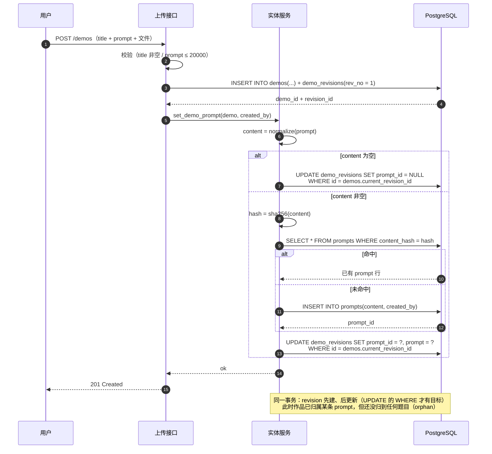

**关键点**：

1. **上传不自动归类**。当前 revision 有了 `prompt_id`，但 `task_prompts` 还没写 → 作品不属于任何题目
2. **归类是独立操作**（管理员或聚类建议触发）
3. **`prompt` / `prompt_id` 的过渡期双写**见「过渡期与现状（非目标态）· 原 §7」。
4. **`prompt_id` 写在 revision 上**：`demos` 只有 `current_revision_id`；改 prompt = 新增 revision（见 §10）

---

## 8. 时序：从 prompt 簇成题

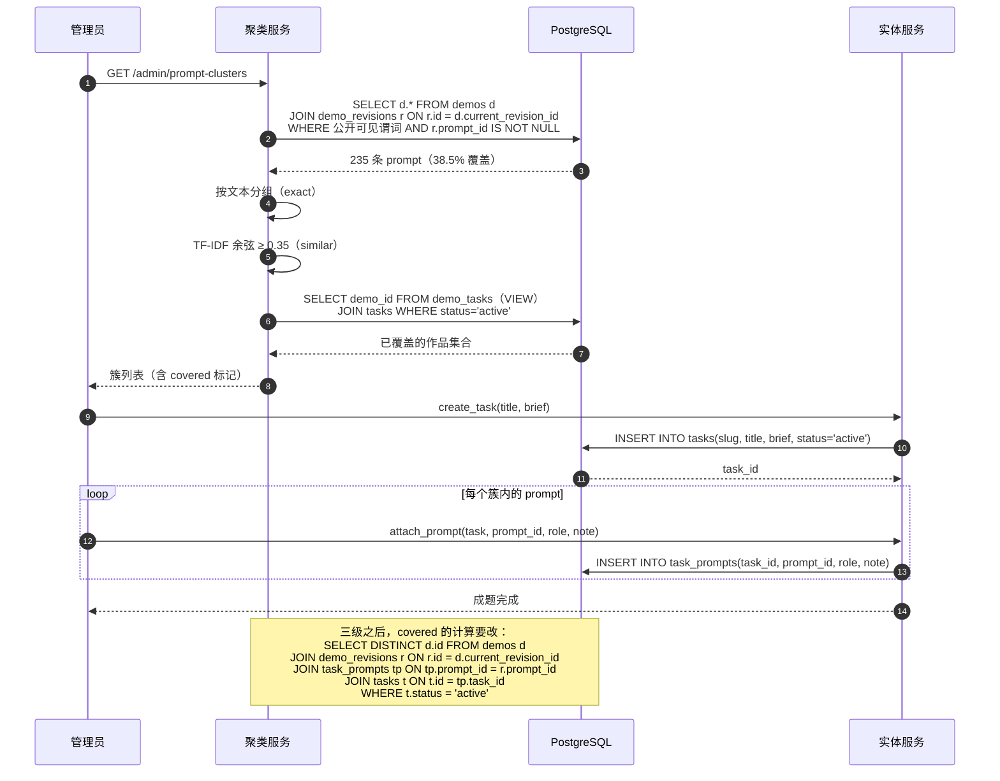

**`covered` 的旧实现与 v2.2 的两处修正**见「过渡期与现状（非目标态）· 原 §8」。

---

## 9. 时序：合并题目

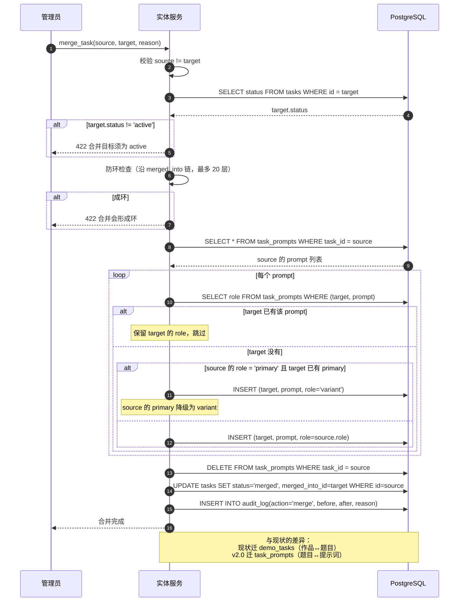

**primary 冲突的处理**：

| 情况 | 处理 |
|---|---|
| target 无 primary，source 有 | source 的 primary 直接迁过去 |
| target 有 primary，source 无 | 无冲突 |
| target 有 primary，source 也有 | source 的降级为 variant |

---

## 10. 时序：改 prompt 换题（视图的自动效果）

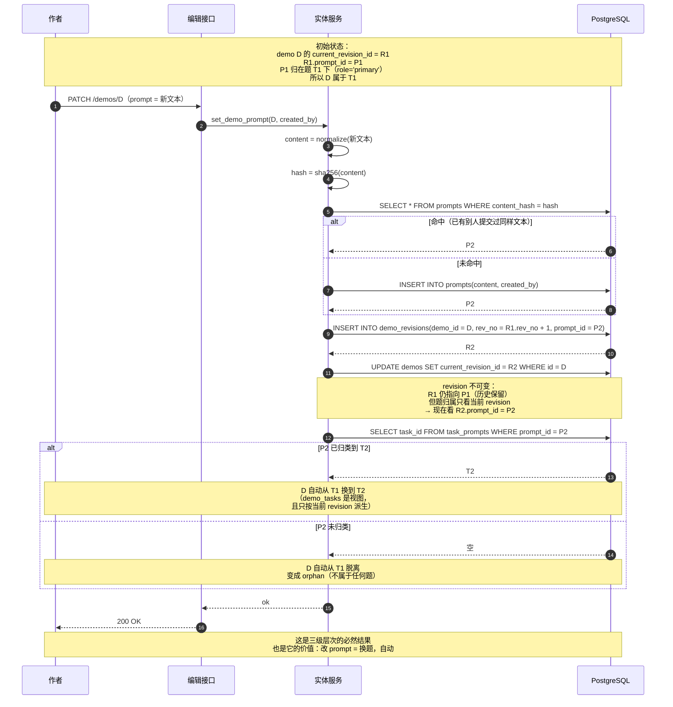

**这个副作用需要 UI 提示**：

> 「修改提示词会改变作品所属的题目。当前属于《T1》，改后将属于《T2》/ 不属于任何题目。」

**v2.2 修正**：v2.1 的图写的是 `UPDATE demos SET prompt_id = P2`。v2.2 起 `prompt_id` 在 revision 上、且 revision **不可变**，所以「改 prompt」= **新增一条 revision + 切 `current_revision_id`**（台账 **G6**）；而 `demo_tasks` 只按**当前** revision 派生，旧 revision 的历史题归属**不提供**（台账 **G7**）。

---

## 11. 时序：提示词搜索

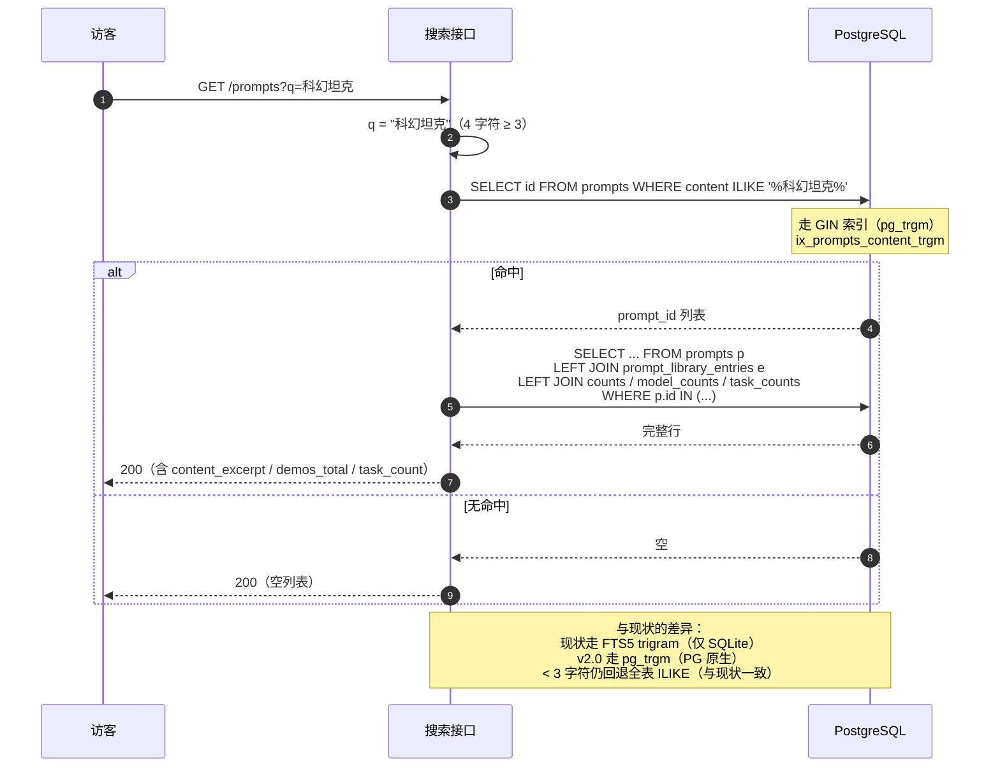

**为什么 `< 3` 字符不走索引**：`pg_trgm` 的 trigram 是 3 字符窗口，`< 3` 字符无法生成 trigram。这与现状 FTS5 的行为一致。

**v2.3 补齐：三个 CTE 的定义与口径**（数据结构设计 §5.4 补了定义——原来只用了别名）：

| CTE | 数什么 | 口径 |
|---|---|---|
| `counts` | `demos_total` + `first_demo_id` | `demos ⋈ demo_revisions(当前)`，`r.prompt_id IS NOT NULL`，**按 `<公开可见谓词>` 过滤**，`GROUP BY r.prompt_id` |
| `model_counts` | `models_total` | 同上再 `JOIN demo_models dm ON dm.demo_id = d.id`，`count(DISTINCT dm.model_id)`；`demo_models` 是**视图（当前 revision 投影）**，所以天然**按当前 revision**（台账 **G18**） |
| `task_counts` | `task_count` | `task_prompts ⋈ tasks`，`t.status='active' AND t.deleted_at IS NULL` |

**口径统一为「公开可见谓词 + 当前 revision」**（台账 **G1** / **G7** / **G18**）：`demos_total` / `models_total` 只数**公开可见**的作品、且只数**当前 revision** 指向这条 prompt 的作品；`models_total` 再经 `demo_models` **视图**取模型（同一模型的多个 provider 算一个——底表 `demo_revision_models` 的 PK 是 `(revision_id, model_id)`）。否则会出现「提示词列表显示 10 件、点进去只有 7 件可见」的老问题（现状 `tag_dict` / `explore` / `site_info` 三处口径不一致）。

---

## 12. 组件图

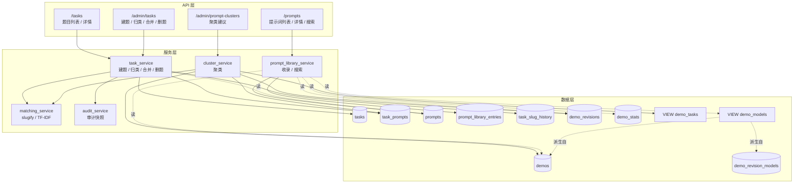

**依赖方向**：

| 从 | 到 | 为什么 |
|---|---|---|
| `task_service` | `matching_service` | slugify |
| `task_service` | `audit_service` | 每次写都记审计 |
| `cluster_service` | `matching_service` | TF-IDF 向量化 |
| `cluster_service` | `task_prompts` + `demos` + `demo_revisions` | 算 `covered`（`demo_tasks` 视图，经当前 revision） |
| `prompt_library_service` | `demos` + `demo_revisions` + `demo_stats` + **`demo_models`（视图）** | 算三个 CTE（`counts` / `model_counts` / `task_counts`），口径 = **公开可见谓词 + 当前 revision**（图例；台账 G1/G7/**G18**）。`model_counts` 经 `demo_models` 视图取模型，**天然按当前 revision** |

**注意**：`task_service` 和 `prompt_library_service` **互不依赖**。它们通过 `prompts` 表间接关联。

---

## 13. 活动图：挂题决策

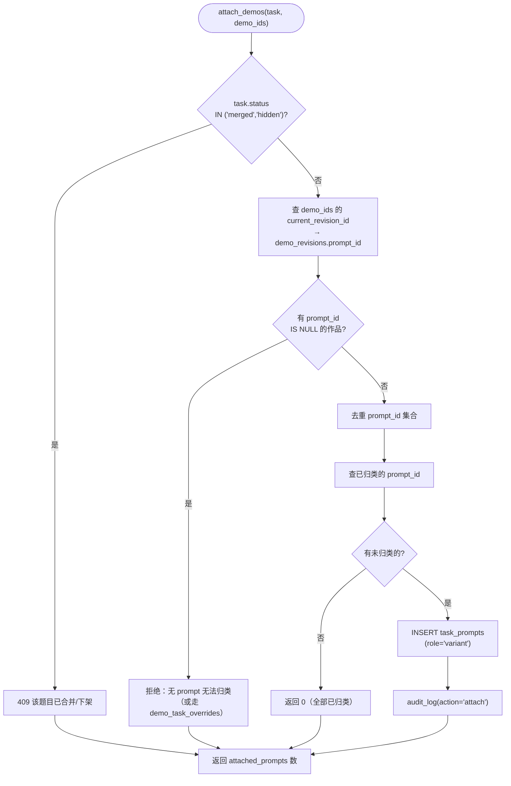

**关键判断**：

| 判断 | 位置 | 后果 |
|---|---|---|
| `task.status` | 最前 | 已合并/下架的题不能再挂 |
| `demo_revisions.prompt_id IS NULL`（经 `current_revision_id`） | 中间 | 无 prompt 的作品无法归类 |
| 已归类 | 中间 | 幂等，不重复写 |

**为什么「无 prompt 的作品」要拒绝**：

三级层次的前提是「作品通过 prompt 归属题目」。无 prompt 的作品无法建立这个链路。

**v2.2 修正（渲染问题，非语法问题）**：终点节点原为体育场形 `DONE(["返回 attached_prompts 数"])`。这个写法**语法合法**，在 mermaid 10.9.1 下渲染正常；但在 **mermaid 11.17.2** 下会抛 `InvalidCharacterError`（库内部对含中文的体育场节点调用 `btoa`）。为不依赖 mermaid 版本，v2.2 把终点改成矩形 `DONE["…"]`（起点 `START(["…"])` 是纯 ASCII，不受影响，保持原形）。若站点锁定 mermaid 10.x，可自行改回体育场形。

**兜底方案**（§4.4 已提）：加 `demo_task_overrides` 表，允许直接挂。但推荐先不加。

---

## 14. 部署图

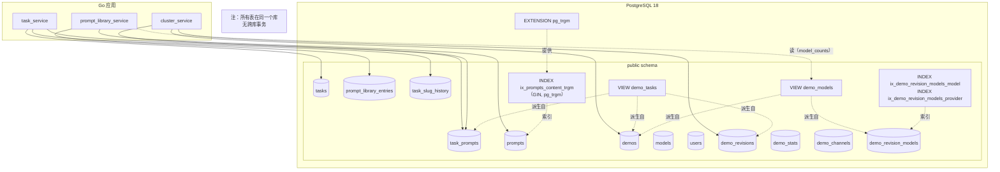

**部署要点**：

| 项 | 值 |
|---|---|
| 数据库 | PostgreSQL 18 |
| 扩展 | `pg_trgm`（提示词搜索） |
| 视图 | `demo_tasks`（**VIEW**，只读）：`demos ⋈ demo_revisions(当前) ⋈ task_prompts`；**`demo_models`（VIEW，只读）**：`demos ⋈ demo_revision_models(当前)`（G18）——两者定义见 §4 |
| 表 | `demos` / `demo_revisions` / `demo_stats` / `demo_channels`（Demo 域目标模型）+ **`demo_revision_models`**（G18 的模型事实源，模型域拥有） |
| 索引 | `ix_prompts_content_trgm`（GIN）；**`ix_demo_revision_models_model` / `ix_demo_revision_models_provider`**——`demo_models` 是视图，**无索引**（G18） |
| 跨库 | 无 |

**v2.2 修正（渲染问题）**：原图的 `Note over PG: 所有表在同一个库…` 是 sequenceDiagram 语法，放在 flowchart 里**渲染不出来**（用真实 mermaid 解析器复核时报 `got 'NODE_STRING'`）。v2.2 改成普通节点 `NOTE["注：…"]`。

---

## 15. 图与文档的对应

| 图 | 对应文档章节 |
|---|---|
| 1 全景类图 | §3 目标数据模型 + 《模型域设计》v1.2 §3.3（`demo_revision_models` / `demo_models` 视图，G18） |
| 2 数据流图 Level 0 | §2 领域边界 |
| 3 数据流图 Level 1 | §4 写入契约 + §5 读取契约 |
| 4 ER 图 | §3 目标数据模型 + §5.0 公开可见谓词 + §7 不变量 + 《模型域设计》v1.2 §3.3（`demo_revision_models` / `demo_models` 视图，G18） |
| 5 状态机 Task | §3.1 + §4.6 |
| 6 状态机 Prompt | §3.3 + §3.4 |
| 7 时序 上传作品 | §4.7 |
| 8 时序 簇成题 | §4.2 + §6.2 |
| 9 时序 合并题目 | §4.5 |
| 10 时序 改 prompt 换题 | §3.6 + §9 风险 #2 |
| 11 时序 提示词搜索 | §5.6 |
| 12 组件图 | §8 与模型域的接缝 + §5.4（`model_counts` 按当前 revision，G18） |
| 13 活动图 挂题决策 | §4.4 |
| 14 部署图 | §6 迁移路线 |
| 17 状态机 Proposal | §3.10 + §4.10 |
| 18 时序 提交提案 | §4.9 |
| 19 时序 审核提案 | §4.10 |
| 20 时序 题目名去重 | §3.8 + §3.9 + §4.9 |
| 21 类图 提案与产物 | §3.10 + §3.11 |
| 22 流程图 提案迁移 | §6.8 + §3.10 + §3.11（**已按 G16 下沉到文末**） |
| T1 类图 `new_tag_value` 存量产物（过渡期） | §3.10 + §3.11（**原 §21，已按 G16 移出**） |

---

## 16. 三张图串起来看

如果只看三张图，建议按这个顺序：

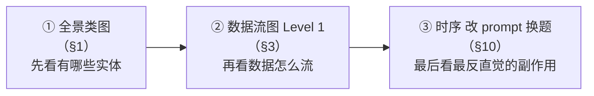

**为什么这个顺序**：

1. **全景类图**回答「有什么」——`Task` / `TaskPrompt` / `Prompt` / `Demo` / `DemoRevision` 五个实体；`Demo` 与 `Prompt` 之间隔着 `DemoRevision`（不再直连）。**v2.7 增补（G18）**：`DemoRevision → DemoRevisionModel`（模型跟着版本走，事实源），`DemoModel`（`demo_models`）是它的 `<<view>>` 当前版本投影。
2. **数据流图**回答「怎么动」——上传 → 规范化 → 查/建 prompt → 归类
3. **改 prompt 换题**回答「最反直觉的地方」——改一条 prompt，新增一条 revision，作品自动换题

**如果只看一张图**：看 §10 的时序图。它把三级层次的核心机制（视图派生 + revision 不可变）和最大副作用（自动换题）都画出来了。

**如果关心「用户怎么建题」**：看 §18（提交提案）+ §20（题目名去重）。这两张图解释了为什么提案不写 `tasks.status='candidate'`。

---

## 17. 状态机：Proposal

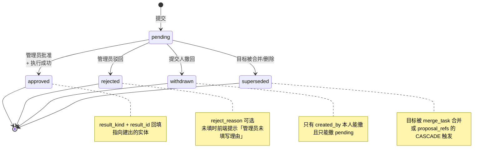

**与旧栈的对比**（对照表 + `EntitySuggestion` 片段）、**为什么需要 `withdrawn`**、**为什么需要 `superseded`** 见「过渡期与现状（非目标态）· 原 §17」。

新模型里这是显式的状态跃迁。

---

## 18. 时序：提交提案

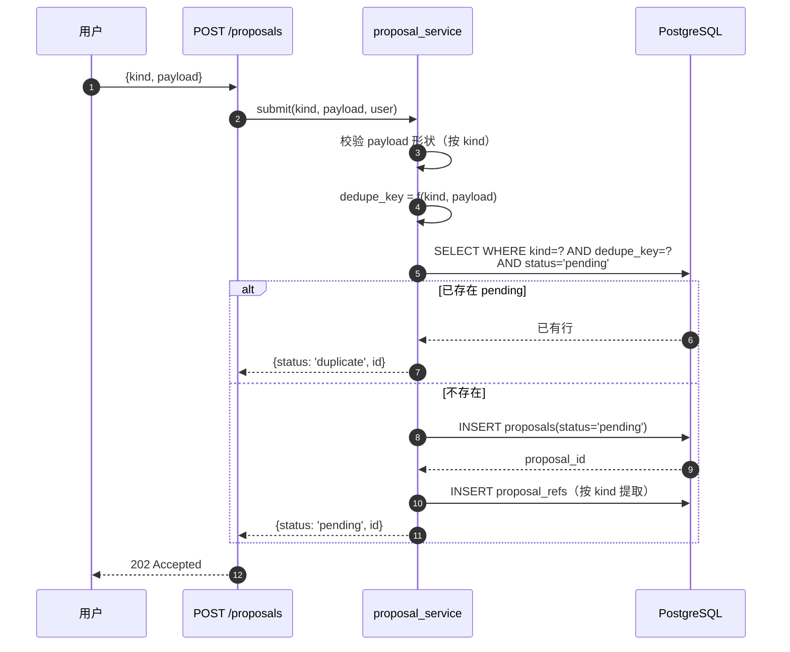

**`dedupe_key` 的算法**（应用层算，DB 只保证 pending 内唯一）：

| kind | `dedupe_key` |
|---|---|
| `new_task` | `title_key(title)` |
| `new_prompt` | `content_hash` |
| `new_model` | `normalize(name)` |
| `new_classification` | `dimension:slug` |
| `new_platform` | `normalize(slug)` |
| `new_platform_config` | `kind:slug`（跨平台重名由审核时指定 platform 区分） |
| `new_skill` | `normalize(slug)` |
| `task_match` | `task_id:demo_id` |
| `model_alias` | `model_id:normalize(alias)` |
| `merge_task` / `merge_model` | `source_id>target_id` |
| `retag_demo` | `demo_id:add` |

**kind 是 14 个**（台账 **G9**）：上表 **11 行覆盖 12 个目标 kind**（`merge_task` / `merge_model` 共用一行）；另 **2 个存量 kind**（`new_tag_value` / `report`）的 `dedupe_key` 与留值理由见「过渡期与现状（非目标态）· 存量 / 作废 kind」。v2.3 新增的 4 个是「半开放实体」提案——`new_classification` / `new_platform` / `new_platform_config` / `new_skill`；「半开放」= **用户不能内联创建（打标时 422），但可以提案**，管理员审核通过后才建行。

**payload「接口给全 + 审核兜底」**（台账 **G10**）：提交端提供**完整表单**（`slug` / `name` / `kind` / `vendor_id` / `url` / `description` …），而 `ck_proposals_payload` **只强制必填子集**（4 个新 kind 的必填/可选见 §19 的表）。厂商由用户在表单里**选择**已有厂商（下拉），**不设 `new_vendor` kind**。

**为什么 `new_task` 用 `title_key` 而不是 `lower(title)`**：见 §20。

---

## 19. 时序：审核提案

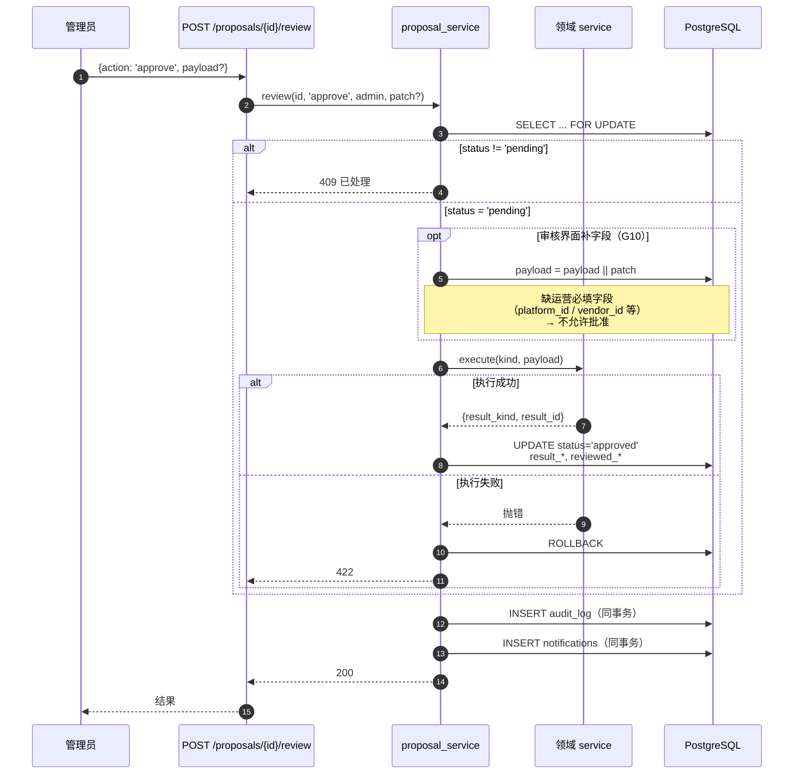

**这张图对应的旧栈 KB-16 背景**见「过渡期与现状（非目标态）· 原 §19」。

**`execute` 的 12 个目标分支抽象不掉**（另 2 个存量分支——`new_tag_value` / `report`——见「过渡期与现状（非目标态）· 存量 / 作废 kind」）：

| kind | 执行 |
|---|---|
| `new_task` | `create_task(status='active')` + 若有 `subject` demo 则 `attach_demos` |
| `new_prompt` | `publish_prompt` |
| `new_model` | `get_or_create_model` + 若已存在则 `alias_add` |
| `new_classification` | `classification_service.ensure_value`（v2.3 新增，G9） |
| `new_platform` | `platform_service.ensure`（v2.3 新增，G9） |
| `new_platform_config` | `platform_config_service.ensure`（v2.3 新增，G9） |
| `new_skill` | `skill_service.ensure`（v2.3 新增，G9） |
| `task_match` | `attach_demos` |
| `model_alias` | `alias_add` |
| `merge_task` | `merge_task` + 相关 pending 置 `superseded` |
| `merge_model` | `merge_model` |
| `retag_demo` | `refine_service.apply_retag` |

**4 个新 kind 的 payload 必填 / 可选**（台账 **G10**，与数据结构设计 §3.10 的字段表一致）：

| kind | 必填（`CHECK` 强制） | 可选（表单可填，审核可补） |
|---|---|---|
| `new_classification` | `dimension`, `slug` | `label`, `description` |
| `new_platform` | `slug`, `name`, `is_harness`（boolean）, `forms[]`（**非空**数组，取值 `cli` / `tui` / `gui` / `web` / `ide` / `other`） | `vendor_id`, `url`, `description`, `aliases` |
| `new_platform_config` | `kind`, `slug`, `name` | `platform_id` / `platform_slug`, `url`, `description` |
| `new_skill` | `slug`, `name` | `spec`, `url`, `description` |

**审核兜底（G10）**：审核界面必须能补可选字段；**缺运营必填字段（`platform_id` / `vendor_id` 等）时不允许批准**——否则会落库一条「只有名字」的空实体，详情页全空。这就是上面时序图里 `opt 审核界面补字段` 那一步的意义。

---

## 20. 时序：题目名去重

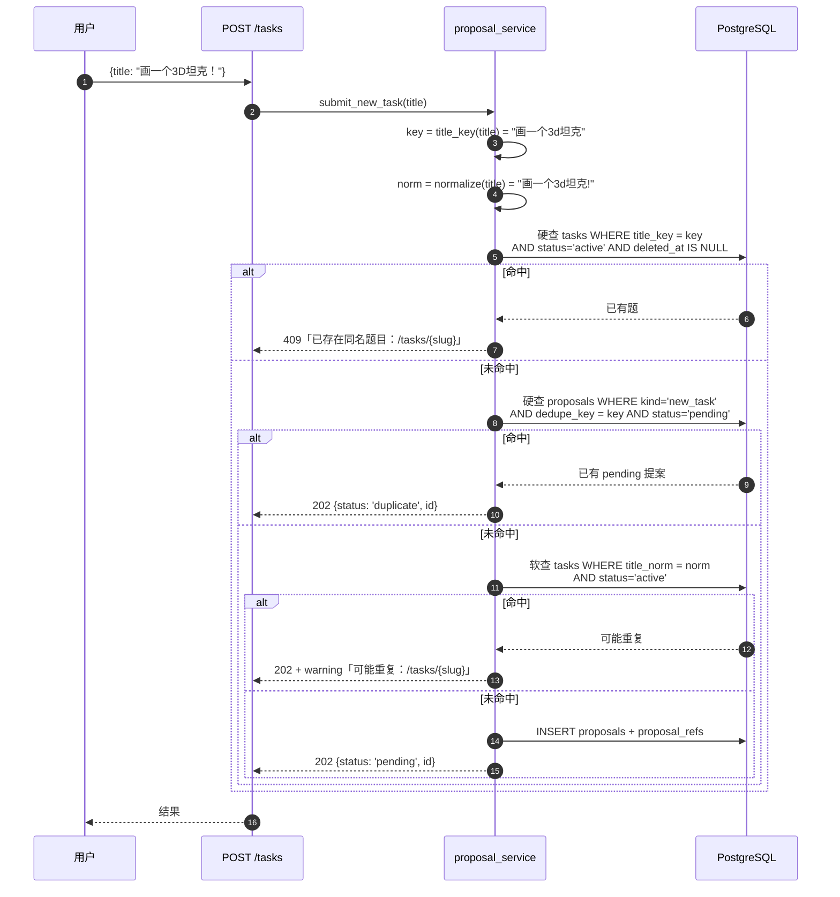

**两级去重的分工**：

| 层 | 键 | 函数 | 误判后果 | 漏判后果 |
|---|---|---|---|---|
| 硬约束 | `title_key` | 保守（只删装饰标点） | 静默丢弃合法提案 | 收件箱堆重复 |
| 软提示 | `title_norm` | 激进（`normalize`） | 用户看到多余警告 | 无 |

**为什么硬约束必须保守**：误判会让用户「以为提交成功，实际没进队列」，且用户不知道、也不会重提。漏判只是管理员多合并一次。

**`title_key` 的实测效果**（44 个用例）：

| 输入 | `title_key` | 与基准同？ |
|---|---|---|
| `画一个3D坦克` | `画一个3d坦克` | 基准 |
| `画一个3D坦克！` | `画一个3d坦克` | ✅ 同 |
| `《画一个3D坦克》` | `画一个3d坦克` | ✅ 同 |
| `画一个3D坦克…` | `画一个3d坦克` | ✅ 同 |
| `画一个３Ｄ坦克` | `画一个3d坦克` | ✅ 同 |
| `用 C++ 写排序` | `用c++写排序` | — |
| `用 C# 写排序` | `用c#写排序` | ✅ 不同（正确） |
| `GPT-4o 画图` | `gpt-4o画图` | — |
| `GPT 4o 画图` | `gpt4o画图` | ✅ 不同（漏判，可接受） |

---

## 21. 类图：提案与产物

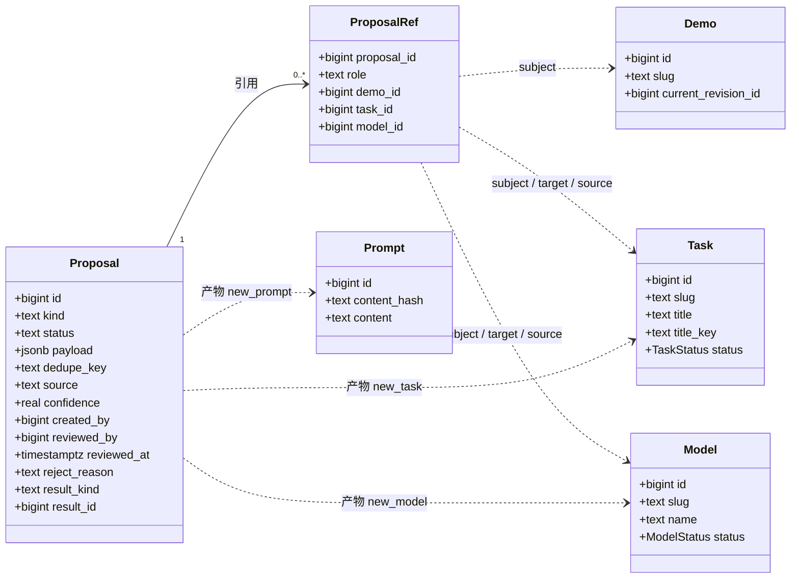

**读图要点**：

| 关系 | 含义 |
|---|---|
| `Proposal → ProposalRef` | 1 : 0..*（独立出题无引用） |
| `ProposalRef → Demo/Task/Model` | 每行只指向一种（`CHECK` 保证，**3 项**；v2.3 按台账 **G4** 删掉 `tag_id`） |
| `Proposal → 产物` | 通过 `result_kind` + `result_id` 弱引用（不是 FK） |

**为什么 `result_id` 不是 FK**：产物类型由 `result_kind` 决定，一个列无法同时 FK 到四张表。这是多态引用的固有代价，用 `result_kind` 做判别列。

**为什么 `ProposalRef` 是 FK 而 `result_id` 不是**：

| | `ProposalRef` | `result_id` |
|---|---|---|
| 方向 | 提案 → 输入（目标实体） | 提案 → 输出（产物） |
| 生命周期 | 目标删除 → 提案作废（CASCADE） | 产物删除 → 提案保留（历史记录） |
| 需要 FK | ✅ | ❌ |

**v2.2 修正（渲染问题）**：原图的 `Proposal ..> Task : "result: new_task"` 里引号会让 classDiagram 解析失败（真实 mermaid 解析器报 `got 'LABEL'`）。v2.2 去掉引号与冒号，改为 `: 产物 new_task`。另：`Demo` 的属性从 `+bigint prompt_id` 改成 `+bigint current_revision_id`（映射第 1 项）。

**v2.3 变更（本节）**：

1. **`ProposalRef` 删 `+bigint tag_id`**，并删掉 `ProposalRef ..> Tag : subject` 这条边（台账 **G4**：`tags` / `tag_keys` / `demo_tags` 终将删除，外键会被打断）。**v2.4 起 `Tag` 类也按 G16 从本图移出**（它是过渡对象）——存量的 `new_tag_value` 产物关系改画在文末「过渡期图：`new_tag_value` 的存量产物」。
2. **`Proposal.kind` 是 14 值**（台账 **G9**），逐条执行见 §19 的 `execute` 表。4 个新 kind 的产物表（`classifications` / `platforms` / `platform_configs` / `skills`）属于**标签域**，不在本图集展开。

---

## 过渡期与现状（非目标态）

> **本节按台账 G16 收纳**：正文只放**目标态**；下列内容只在过渡期存在、或只在旧栈成立，故从正文下沉 / 移出。每条注明**原位置**；图号**沿用原编号、未重编**。

### 原 §22 · 流程图：提案迁移（§6.8）


```mermaid
flowchart TB
    subgraph PRE["硬前置（§6.2 阶段①）"]
        P1["classifications / platforms /<br/>platform_configs / skills 已建"]
        P2["new_* 四个 kind 的<br/>payload CHECK 已生效"]
    end

    subgraph ES["① entity_suggestions → proposals"]
        E1["ALTER proposals<br/>ADD _src_suggestion_id（迁移暂存列）"]
        E2["kind 映射：<br/>alias → model_alias<br/>（其余同名直通）"]
        E3["payload 缺键回填：<br/>model_id / task_id ← ref_id<br/>demo_id ← demo_id"]
        E4["INSERT proposals(..., _src_suggestion_id = e.id)<br/>WHERE kind != 'report'"]
    end

    subgraph REFS["② 关联对象 → proposal_refs（v2.3 新增这一步）"]
        R1["new_task / retag_demo / task_match<br/>demo_id → role='subject'"]
        R2["task_match<br/>task_id → role='target'"]
        R3["alias<br/>model_id → role='subject'"]
        R4["merge_model<br/>source_id → 'source'<br/>target_id → 'target'"]
    end

    subgraph TVS["③ tag_value_suggestions 分流（只有 4 个分支）"]
        T1["type / category<br/>→ new_classification"]
        T2["plugin / preset<br/>→ new_platform_config"]
        T3["skills → new_skill"]
        T4["model → new_model"]
        T5["game / platform（open）<br/>rounds / time（int）<br/>不可能有行 → 不写丢弃分支"]
    end

    subgraph POST["④ 收尾"]
        F1["DROP _src_suggestion_id"]
        F2["Go 脚本按新 kind 重算 dedupe_key"]
        F3["校验 pending 内无重复 dedupe_key<br/>→ 建唯一索引"]
        F4["抽查 task_match 有两条 refs<br/>（subject=demo + target=task）"]
    end

    P1 --> E1
    P2 --> E1
    E1 --> E2
    E2 --> E3
    E3 --> E4
    E4 --> R1
    E4 --> R2
    E4 --> R3
    E4 --> R4
    R4 --> F1
    P1 --> T1
    T1 --> F2
    T2 --> F2
    T3 --> F2
    T4 --> F2
    F1 --> F2
    F2 --> F3
    F3 --> F4
```

**v2.3 的三处变化**（v2.2 的图集里根本没有这张图——迁移只由 §15 指向数据结构设计 §6）：

| # | 变化 | 为什么 |
|---|---|---|
| 1 | `entity_suggestions` 的 kind 映射 **`alias` → `model_alias`** | 旧名 `alias` 不在新 `CHECK` 里，原样搬会撞 `ck_proposals`。**预期 0 行**（生产无创建点），是防御性映射 |
| 2 | **payload 缺键回填**：从行上的 `ref_id` / `demo_id` 补齐 `model_id` / `task_id` / `demo_id` | 旧栈 `_execute` 对这三个键都写了回退（`or s.ref_id` / `or s.demo_id`），说明历史行可能缺键；而新的 `payload CHECK` **不接受回退** → 必须在迁移时补齐 |
| 3 | **新增 `proposal_refs` 迁移**（旧栈 `demo_id` / `ref_id` 两列 → 新显式 `role`） | 漏掉这步 = 迁移后「提案指向哪件作品 / 哪个模型」全丢。旧栈这两列**不是 FK**、按 kind 决定指向哪张表 |

**`proposal_refs` 的映射表**（`proposal_id` 由 `_src_suggestion_id` 关联回新提案）：

| 旧 kind | 旧列 | 新 `role` | 新列 |
|---|---|---|---|
| `new_task` / `retag_demo` / `task_match` | `demo_id` | `subject` | `demo_id` |
| `task_match` | `payload.task_id` 或 `ref_id` | `target` | `task_id` |
| `alias`（→ `model_alias`） | `payload.model_id` 或 `ref_id` | `subject` | `model_id` |
| `merge_model` | `payload.source_id` | `source` | `model_id` |
| `merge_model` | `payload.target_id` | `target` | `model_id` |

**`tag_value_suggestions` 只分流 4 个分支**（台账 **G9**）：只有 `mode='fixed'` 的 6 个键可能有行——`model` / `plugin` / `type` / `skills` / `preset` / `category`。`game` / `platform` 是 `open`、`rounds` / `time` 是 `int`，提交端点对非 `fixed` 键直接 422，且表与该校验由**同一 commit** 引入（不存在「校验之前的老数据」），所以**不写丢弃分支**。`new_platform` kind 仍保留（新系统里用户可直接提交提案），但**没有迁移来源**。

**收尾**：`_src_suggestion_id` 是迁移专用暂存列，用完即 `DROP`；`dedupe_key` 由 Go 脚本按新 kind 重算（算法见 §18）；`platform_id` / `vendor_id` 这类运营字段**留空**，由管理员在审核界面补（台账 **G10**，见 §19）。

**取数依赖**：数据结构设计 §10.1 的 **③ / ④ / ⑤** 决定「全量迁移还是只迁高频 kind」与「存量按旧 key 分流是否要先人工复核」——预期 ③ 只见 5 种 kind、④ 只见 6 个 `fixed` 键。

### 过渡期图：`new_tag_value` 的存量产物（从 §21 移出）

> **原位置**：§21 类图（`Tag` 类 + `Proposal ..> Tag` 产物边）。`Tag` 就是旧 `tags` 表——按 **G4** 终将删除；`new_tag_value` 是**仅存量兼容**的 kind（**G9**：新写入不再产生）。所以这条产物关系**只在过渡期成立**，目标态类图 §21 已不含 `Tag`。

```mermaid
classDiagram
    direction LR

    class Proposal {
        +bigint id
        +text kind
        +text result_kind
        +bigint result_id
    }

    class Tag {
        +bigint id
        +text key
        +text value
    }

    Proposal ..> Tag : 产物 new_tag_value（仅存量）
```

---

### 原 §17 · 与旧栈的对比（Proposal 状态）【原 §17 · 类②③】

**与旧栈的对比**：

| 态 | 旧栈 `EntitySuggestion` | 新模型 |
|---|---|---|
| `pending` | ✅ | ✅ |
| `approved` | ✅ | ✅ |
| `rejected` | ✅ | ✅ |
| `withdrawn` | ❌ | ✅ 新增 |
| `superseded` | ❌（靠 `merge_task` 手工扫） | ✅ 新增 |

**为什么需要 `withdrawn`**：旧栈用户提了就不能撤，只能等管理员处理。

**为什么需要 `superseded`**：旧栈靠 `task_service.py:275` 在合并时手工扫一遍 pending 建议：

```python
EntitySuggestion.kind.in_(("task_match", "merge_task", "new_task")),
```

### 原 §8 · `covered` 的旧实现与 v2.2 修正【原 §8 · 类③】

**注意最后一条 Note**：这是 review 时发现的遗漏——`cluster_service.py:52` 的 `covered` 计算依赖 `demo_tasks`，三级之后要改。

**v2.2 的两处修正**：

1. 首行「取候选 prompt」的 `WHERE status='approved' AND prompt != ''` 是旧口径：`status` 列已拆成 `moderation_state` + `lifecycle_state`，`prompt` 已迁到 `demo_revisions`。改成 `WHERE 公开可见谓词 AND r.prompt_id IS NOT NULL`（谓词展开见「图例」；台账 **G1**；**v2.7 起用 `prompt_id` 而不是即将退场的 `prompt` 列**）。
2. `covered` 的 JOIN 多一跳 `demo_revisions`（`demo_tasks` 现在是视图，见 §4）。

### 原 §19 · KB-16 的旧栈背景【原 §19 · 类③】

**这张图对应旧栈的 KB-16 教训**：旧实现内部各自 `commit`，中断就会留下「实体已建、建议仍 pending」的假象，再点一次批准会重复建实体。

### 存量 / 作废 kind：`new_tag_value` 与 `report`（从 §18 / §19 移出）【原 §18 / §19 · 类①④】

**目标态不受影响**：两者的值**保留在** `proposals.kind` 的 `CHECK` 与 `ck_proposals_payload` 的分支里——DDL 是目标态，**不删值**。这里收的是它们的 `dedupe_key`、执行分支与留值理由（与《数据结构设计》§12.10 的处理一致）。

**§18 `dedupe_key` 表移出的两行**：

| kind | `dedupe_key` |
|---|---|
| `new_tag_value`（**仅存量**） | `key:value` |
| `report` | `target_type:target_id:created_by` |

**§18 的留值说明**（原文）：`new_tag_value` 保留在 `CHECK` 里但**仅存量兼容**：新写入不再产生它（台账 **G9**；`tag_value_suggestions` 的存量按 §22 分流到 4 个新 kind）。

**§19 `execute` 表移出的两行**：

| kind | 执行 |
|---|---|
| `new_tag_value`（**仅存量**） | `tag_service.ensure_value` + 可选挂 demo |
| `report` | 改目标状态（论坛外置后作废） |

### 原 §7 · `prompt` / `prompt_id` 的过渡期双写【原 §7 · 类①】

3. **`prompt` 和 `prompt_id` 双写**（过渡期）——双写发生在 `demo_revisions` 上（列从 `demos.prompt` 迁过来，台账 **G6**）

（上条原为 §7「关键点」的第 3 条；该列表在正文只留一行指针。）

---

## 附录：图的取舍说明

### 为什么没有画「对象图」

对象图（Object Diagram）是类图的实例化，用于展示某一时刻的具体对象。本文的场景是**设计**而非**调试**，对象图的价值不大。

### 为什么没有画「通信图」

通信图（Communication Diagram）与时序图等价，只是强调对象间的链接而非时间顺序。时序图更直观。

### 为什么没有画「包图」

包图（Package Diagram）用于展示代码组织。本文只做数据结构，不涉及代码结构。

### 为什么状态机只有两张

`Task` 和 `Prompt` 有状态。`TaskPrompt` 和 `PromptLibraryEntry` 没有状态机：

- `TaskPrompt` 的 `role` 是二值枚举，不是状态机
- `PromptLibraryEntry` 的 `deleted_at` 是布尔，不是状态机

### 为什么数据流图分两层

Level 0（上下文图）只画「谁和系统交互」，用于快速理解边界。Level 1 画内部处理，用于理解数据流。再往下（Level 2）会细到每个函数，超出数据结构设计的范围。
