# 实体域 UML 图集 v1.0

**适用范围**：本文是 [`实体域数据结构设计.md`](./实体域数据结构设计.md) v2.0 的**图形化补充**。只画图，不重复 DDL 与文字论证。所有图基于 v2.0 的三级层次（Task → Prompt → Demo）。

**图目录**：

| # | 图 | 类型 | 回答什么问题 |
|---|---|---|---|
| 1 | 全景类图 | classDiagram | 有哪些实体、什么属性、什么关系 |
| 2 | 数据流图（Level 0） | flowchart | 数据从哪来、到哪去 |
| 3 | 数据流图（Level 1） | flowchart | 每个处理过程内部怎么流 |
| 4 | ER 图（完整） | erDiagram | 表结构 + 外键 + 基数 |
| 5 | 状态机：Task | stateDiagram | 题目的一生 |
| 6 | 状态机：Prompt | stateDiagram | 提示词的一生 |
| 7 | 时序：上传作品 | sequenceDiagram | 从上传到入库 |
| 8 | 时序：从 prompt 簇成题 | sequenceDiagram | 聚类 → 建题 → 归类 |
| 9 | 时序：合并题目 | sequenceDiagram | 两条边怎么迁 |
| 10 | 时序：改 prompt 换题 | sequenceDiagram | 视图的自动效果 |
| 11 | 时序：提示词搜索 | sequenceDiagram | pg_trgm 怎么走 |
| 12 | 组件图 | flowchart | 谁依赖谁 |
| 13 | 活动图：挂题决策 | flowchart | 挂题时的判断链 |
| 14 | 部署图 | flowchart | 表落在哪个库 |

---

## 1. 全景类图

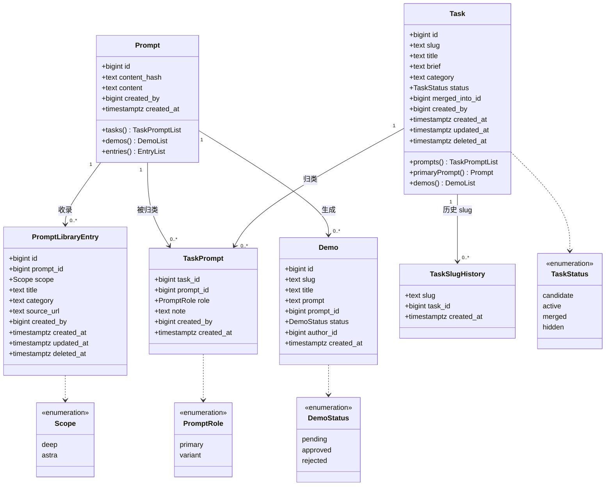

**读图要点**：

| 关系 | 基数 | 含义 |
|---|---|---|
| `Task → TaskPrompt` | 1 : 0..* | 一道题可以归类多条 prompt |
| `Prompt → TaskPrompt` | 1 : 0..* | 一条 prompt 可以被归到多道题 |
| `Prompt → Demo` | 1 : 0..* | 一条 prompt 可以生成多件作品 |
| `Prompt → PromptLibraryEntry` | 1 : 0..* | 一条 prompt 在每个视区最多一条收录 |
| `Task → TaskSlugHistory` | 1 : 0..* | 一道题可以有多个历史 slug |

**注意 `Demo → Prompt` 是 `0..*` 而不是 `1..*`**：`demos.prompt_id` 可空，61.5% 的作品无 prompt。

---

## 2. 数据流图（Level 0：上下文图）

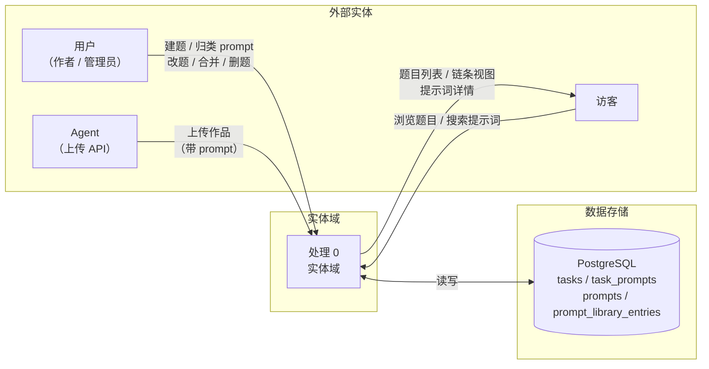

**Level 0 只画「谁和系统交互」**，不画内部处理。

---

## 3. 数据流图（Level 1：主要处理）

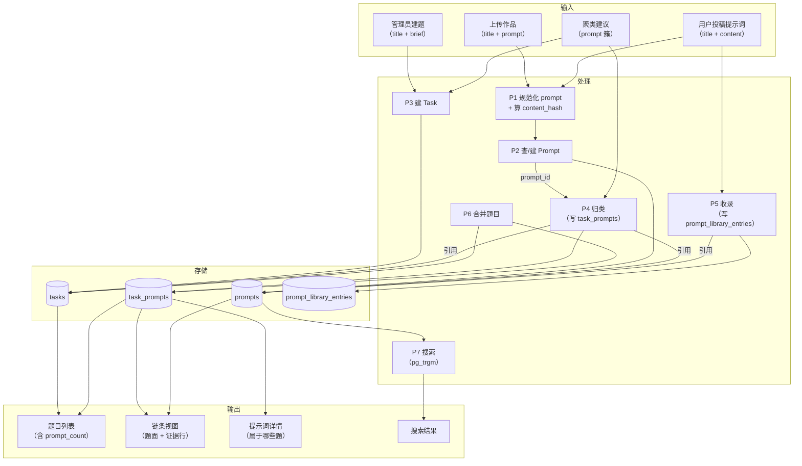

**关键数据流**：

| 流 | 从 | 到 | 携带什么 |
|---|---|---|---|
| F1 | 上传作品 | P1 | `title` + `prompt` 原文 |
| F2 | P1 | P2 | 规范化后的 `content` + `content_hash` |
| F3 | P2 | P4 | `prompt_id` |
| F4 | 聚类建议 | P3 + P4 | 一组 `prompt_id` + 建议题名 |
| F5 | P4 | `task_prompts` | `(task_id, prompt_id, role, note)` |
| F6 | P5 | `prompt_library_entries` | `(prompt_id, scope, title, ...)` |

---

## 4. ER 图（完整）

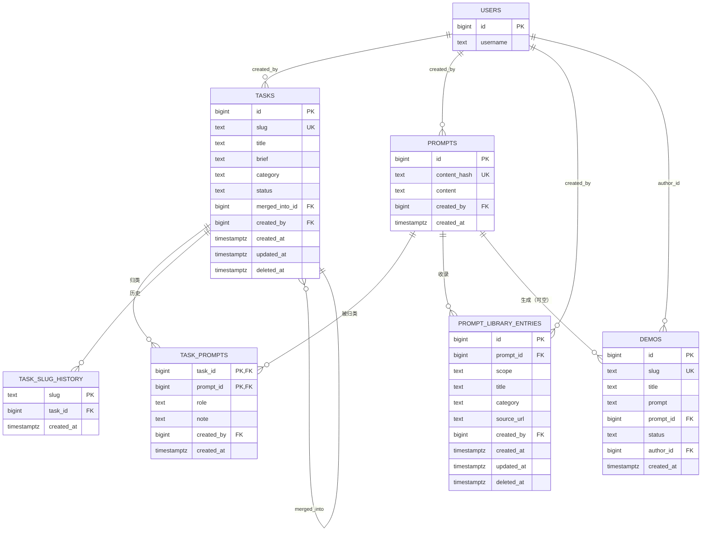

**约束标注**：

| 表 | 约束 |
|---|---|
| `tasks` | `UNIQUE (slug) WHERE deleted_at IS NULL` |
| `task_prompts` | `PK (task_id, prompt_id)`；`UNIQUE (task_id) WHERE role='primary'` |
| `prompts` | `UNIQUE (content_hash)` |
| `prompt_library_entries` | `UNIQUE (prompt_id, scope)` |
| `task_slug_history` | `PK (slug)` |

---

## 5. 状态机：Task

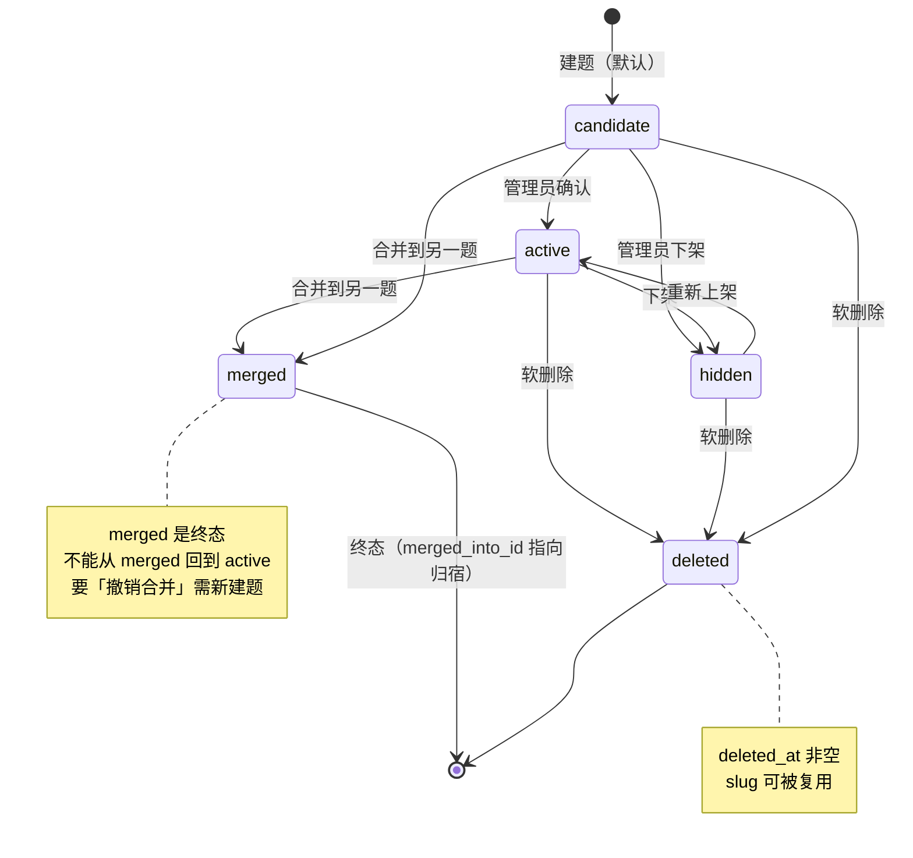

**状态转移的守卫条件**：

| 转移 | 守卫 |
|---|---|
| `candidate → active` | 无（管理员权限即可） |
| `active → merged` | `target.status IN ('active', 'candidate')`；不成环；`source` 未 merged |
| `* → deleted` | 无 `task_prompts`；无反向 `merged_into`；无 pending 建议 |

---

## 6. 状态机：Prompt

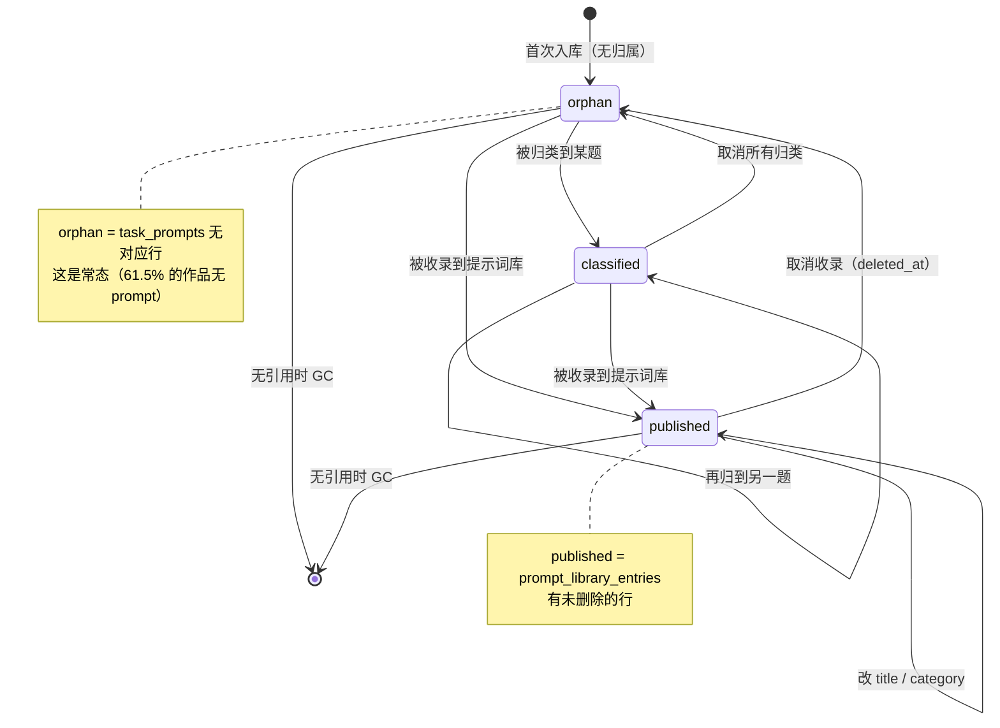

**注意**：`Prompt` 的「状态」不是列，而是**由关联推导**：

| 状态 | 判定 |
|---|---|
| `orphan` | `NOT EXISTS (SELECT 1 FROM task_prompts WHERE prompt_id = p.id)` |
| `classified` | `EXISTS (SELECT 1 FROM task_prompts WHERE prompt_id = p.id)` |
| `published` | `EXISTS (SELECT 1 FROM prompt_library_entries WHERE prompt_id = p.id AND deleted_at IS NULL)` |

**为什么不用状态列**：`Prompt` 的正文不可变，状态完全由关联决定。加状态列会引入双写不一致。

---

## 7. 时序：上传作品

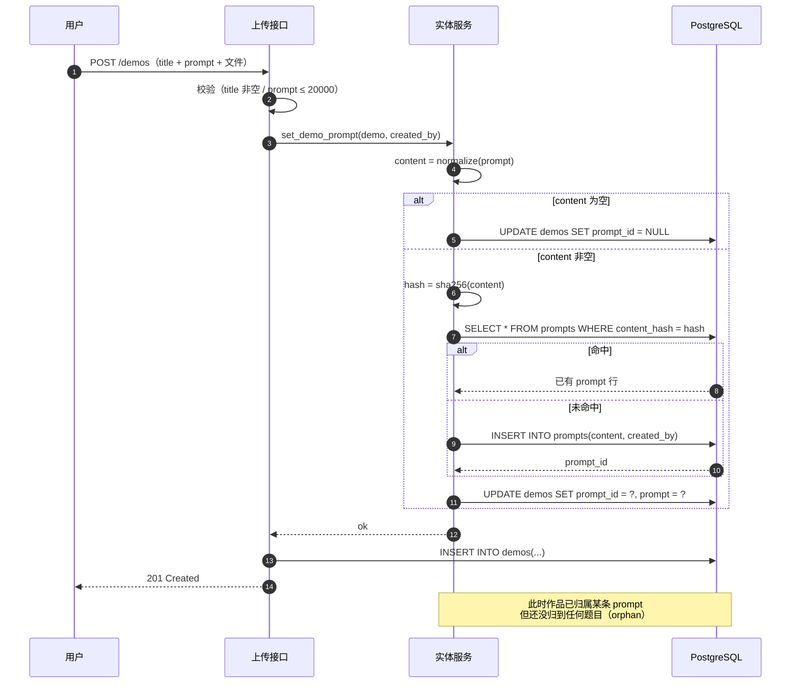

**关键点**：

1. **上传不自动归类**。作品有了 `prompt_id`，但 `task_prompts` 还没写 → 作品不属于任何题目
2. **归类是独立操作**（管理员或聚类建议触发）
3. **`prompt` 和 `prompt_id` 双写**（过渡期）

---

## 8. 时序：从 prompt 簇成题

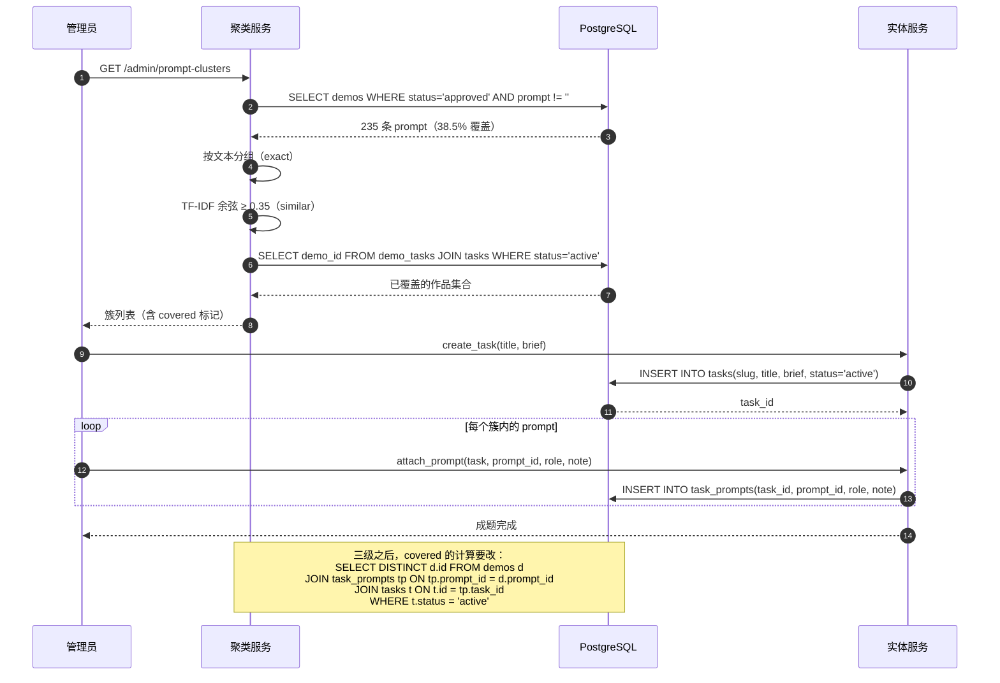

**注意最后一条 Note**：这是 review 时发现的遗漏——`cluster_service.py:52` 的 `covered` 计算依赖 `demo_tasks`，三级之后要改。

---

## 9. 时序：合并题目

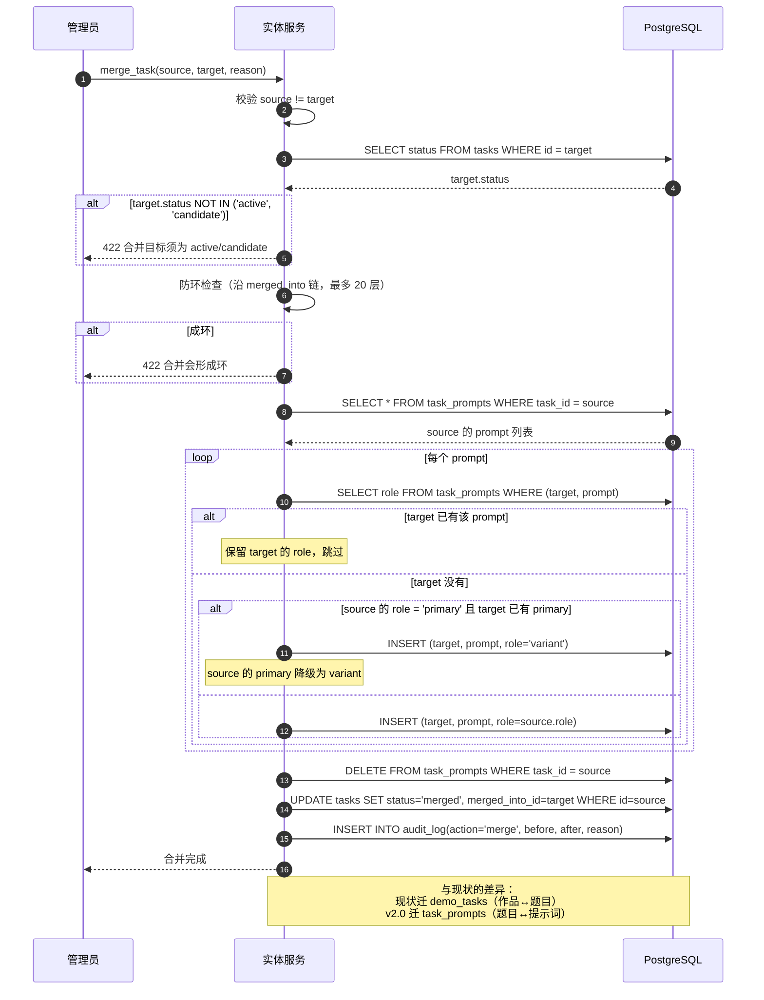

**primary 冲突的处理**：

| 情况 | 处理 |
|---|---|
| target 无 primary，source 有 | source 的 primary 直接迁过去 |
| target 有 primary，source 无 | 无冲突 |
| target 有 primary，source 也有 | source 的降级为 variant |

---

## 10. 时序：改 prompt 换题（视图的自动效果）

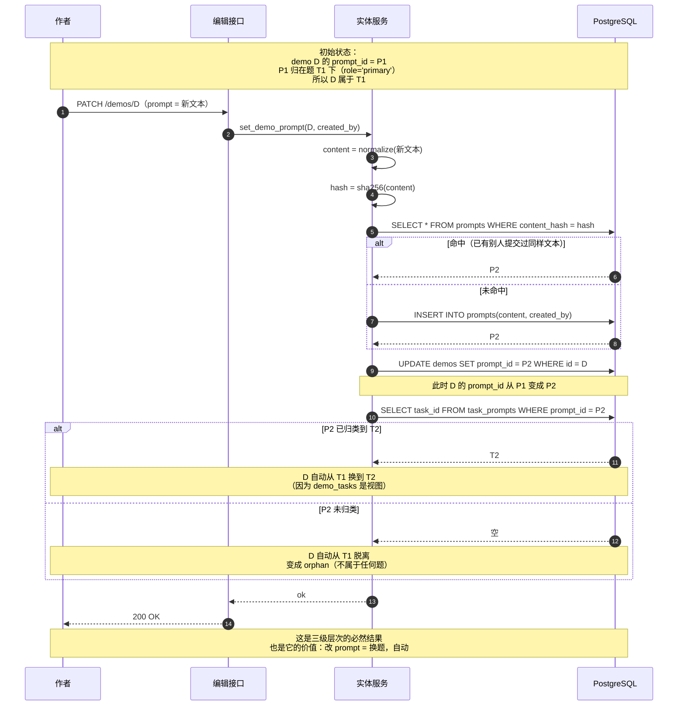

**这个副作用需要 UI 提示**：

> 「修改提示词会改变作品所属的题目。当前属于《T1》，改后将属于《T2》/ 不属于任何题目。」

---

## 11. 时序：提示词搜索

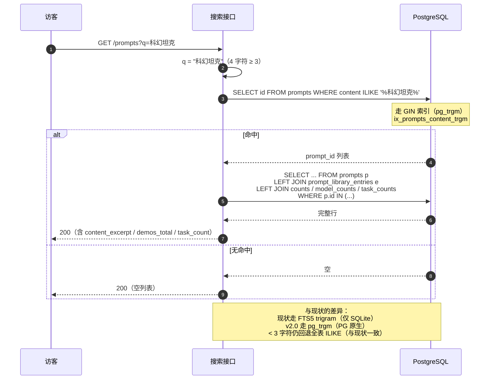

**为什么 `< 3` 字符不走索引**：`pg_trgm` 的 trigram 是 3 字符窗口，`< 3` 字符无法生成 trigram。这与现状 FTS5 的行为一致。

---

## 12. 组件图

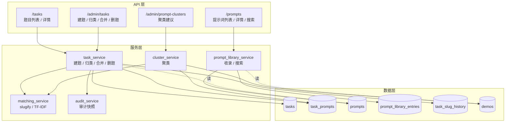

**依赖方向**：

| 从 | 到 | 为什么 |
|---|---|---|
| `task_service` | `matching_service` | slugify |
| `task_service` | `audit_service` | 每次写都记审计 |
| `cluster_service` | `matching_service` | TF-IDF 向量化 |
| `cluster_service` | `task_prompts` | 算 `covered` |
| `prompt_library_service` | `demos` | 算 `demos_total` |

**注意**：`task_service` 和 `prompt_library_service` **互不依赖**。它们通过 `prompts` 表间接关联。

---

## 13. 活动图：挂题决策

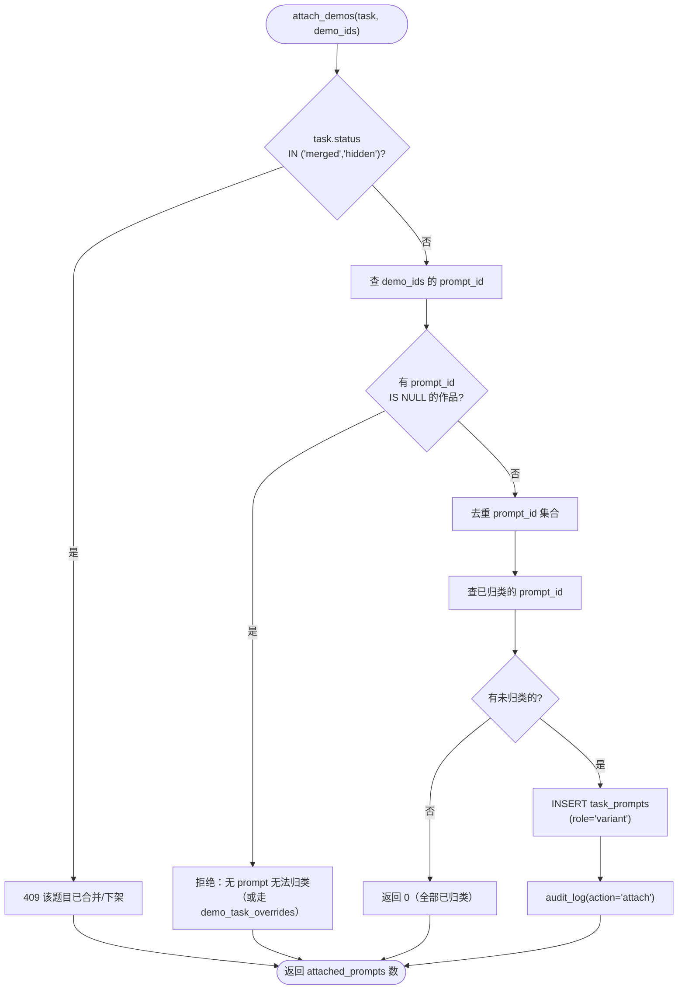

**关键判断**：

| 判断 | 位置 | 后果 |
|---|---|---|
| `task.status` | 最前 | 已合并/下架的题不能再挂 |
| `prompt_id IS NULL` | 中间 | 无 prompt 的作品无法归类 |
| 已归类 | 中间 | 幂等，不重复写 |

**为什么「无 prompt 的作品」要拒绝**：

三级层次的前提是「作品通过 prompt 归属题目」。无 prompt 的作品无法建立这个链路。

**兜底方案**（§4.4 已提）：加 `demo_task_overrides` 表，允许直接挂。但推荐先不加。

---

## 14. 部署图

```mermaid
flowchart TB
    subgraph PG["PostgreSQL 18"]
        subgraph SCHEMA["public schema"]
            T1[("tasks")]
            T2[("task_prompts")]
            T3[("prompts")]
            T4[("prompt_library_entries")]
            T5[("task_slug_history")]
            T6[("demos")]
            T7[("demo_models")]
            T8[("models")]
            T9[("users")]
            V1["VIEW demo_tasks"]
            I1["INDEX ix_prompts_content_trgm<br/>（GIN, pg_trgm）"]
        end
        EXT["EXTENSION pg_trgm"]
    end

    subgraph APP["Go 应用"]
        A1["task_service"]
        A2["prompt_library_service"]
        A3["cluster_service"]
    end

    A1 --> T1
    A1 --> T2
    A1 --> T5
    A2 --> T3
    A2 --> T4
    A3 --> T2
    A3 --> T6

    V1 -.->|"派生自"| T2
    V1 -.->|"派生自"| T6
    I1 -.->|"索引"| T3
    EXT -.->|"提供"| I1

    Note over PG: 所有表在同一个库<br/>无跨库事务
```

**部署要点**：

| 项 | 值 |
|---|---|
| 数据库 | PostgreSQL 18 |
| 扩展 | `pg_trgm`（提示词搜索） |
| 视图 | `demo_tasks`（派生，只读） |
| 索引 | `ix_prompts_content_trgm`（GIN） |
| 跨库 | 无 |

---

## 15. 图与文档的对应

| 图 | 对应文档章节 |
|---|---|
| 1 全景类图 | §3 目标数据模型 |
| 2 数据流图 Level 0 | §2 领域边界 |
| 3 数据流图 Level 1 | §4 写入契约 + §5 读取契约 |
| 4 ER 图 | §3 目标数据模型 + §7 不变量 |
| 5 状态机 Task | §3.1 + §4.6 |
| 6 状态机 Prompt | §3.3 + §3.4 |
| 7 时序 上传作品 | §4.7 |
| 8 时序 簇成题 | §4.2 + §6.2 |
| 9 时序 合并题目 | §4.5 |
| 10 时序 改 prompt 换题 | §3.6 + §9 风险 #2 |
| 11 时序 提示词搜索 | §5.6 |
| 12 组件图 | §8 与模型域的接缝 |
| 13 活动图 挂题决策 | §4.4 |
| 14 部署图 | §6 迁移路线 |

---

## 16. 三张图串起来看

如果只看三张图，建议按这个顺序：

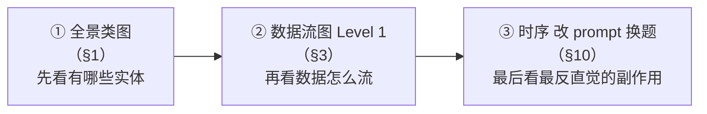

**为什么这个顺序**：

1. **全景类图**回答「有什么」——`Task` / `TaskPrompt` / `Prompt` / `Demo` 四个实体，三条边
2. **数据流图**回答「怎么动」——上传 → 规范化 → 查/建 prompt → 归类
3. **改 prompt 换题**回答「最反直觉的地方」——改一条 prompt，作品自动换题

**如果只看一张图**：看 §10 的时序图。它把三级层次的核心机制（视图派生）和最大副作用（自动换题）都画出来了。

---

## 附录：图的取舍说明

### 为什么没有画「对象图」

对象图（Object Diagram）是类图的实例化，用于展示某一时刻的具体对象。本文的场景是**设计**而非**调试**，对象图的价值不大。

### 为什么没有画「通信图」

通信图（Communication Diagram）与时序图等价，只是强调对象间的链接而非时间顺序。时序图更直观。

### 为什么没有画「包图」

包图（Package Diagram）用于展示代码组织。本文只做数据结构，不涉及代码结构。

### 为什么状态机只有两张

`Task` 和 `Prompt` 有状态。`TaskPrompt` 和 `PromptLibraryEntry` 没有状态机：

- `TaskPrompt` 的 `role` 是二值枚举，不是状态机
- `PromptLibraryEntry` 的 `deleted_at` 是布尔，不是状态机

### 为什么数据流图分两层

Level 0（上下文图）只画「谁和系统交互」，用于快速理解边界。Level 1 画内部处理，用于理解数据流。再往下（Level 2）会细到每个函数，超出数据结构设计的范围。
