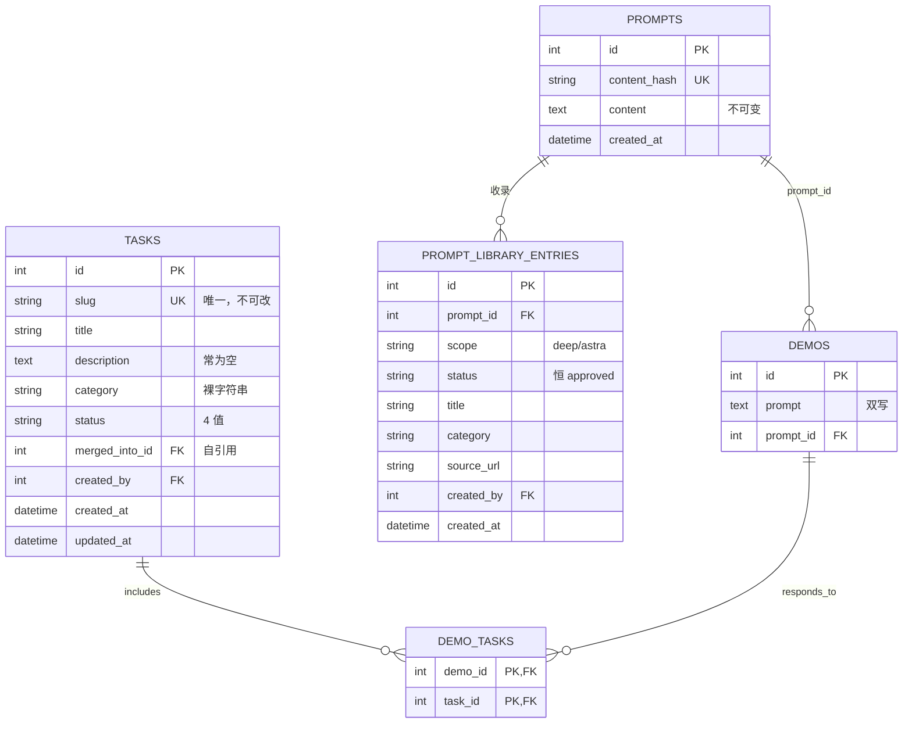
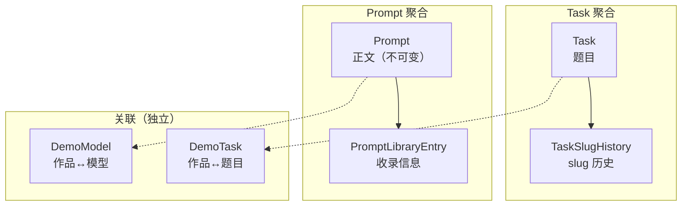
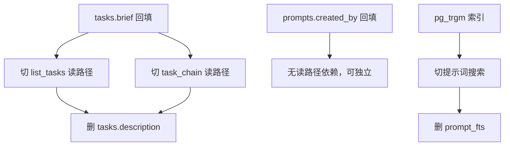

# 实体域数据结构设计 v1.0

**适用范围**：本文只做**数据结构设计**——表、列、类型、约束、索引、外键、状态枚举、派生字段的事实源、迁移顺序。不含产品形态、UI、代码结构。

**实体域的范围**：从标签体系「毕业」出来的一等实体，以及它们与作品的关联表。

| 表 | 列数 | 归属 |
|---|---|---|
| `models` | 10 | 已在 [`模型域设计.md`](./模型域设计.md) 处理 |
| `model_aliases` | 2 | 同上 |
| `demo_models` | 2 | 同上（目标模型扩到 6 列） |
| **`tasks`** | **10** | **本文** |
| **`demo_tasks`** | **2** | **本文** |
| **`prompts`** | **4** | **本文** |
| **`prompt_library_entries`** | **9** | **本文** |
| **`prompt_fts`** | 虚拟表 | **本文** |

**前置**：模型域已定稿，本文不重复。本文只处理 `tasks` / `demo_tasks` / `prompts` / `prompt_library_entries` / `prompt_fts` 五张表。

---

## 0. 决策摘要

| 决策 | 结论 |
|---|---|
| `Task` 的 slug | **加 `TaskSlugHistory`**，slug 可改，旧 slug 301 |
| `Task.category` | **保留裸字符串**，不加 FK（理由见 §3.2） |
| `Task` 删除 | **改软删除**（`deleted_at`），物理删除只走 GC |
| `Task` 的题面 | **显式化**：`brief` 列 + `brief_source` 枚举，不再靠 `prompt_excerpts` 寄生 |
| `DemoTask` | **扩到 5 列**：加 `source` / `attached_by` / `created_at` |
| `Prompt` | **加 `created_by`**；`content` 保持不可变 |
| `PromptLibraryEntry.status` | **删掉**（当前只有 `approved` 一个值，是死列） |
| `PromptLibraryEntry` | **加 `updated_at`** + 软删除 |
| `demos.prompt` 双写 | **保留到迁移完成**，之后 `prompt` 列降级为「快照」 |
| `prompt_fts` | **废弃**，改用 PG `pg_trgm` + GIN（见 §6.5） |

---

## 1. 现状诊断

### 1.1 五张表的实际构成



### 1.2 九个结构性问题

#### 问题 1：`Task.slug` 不可改，且纯中文标题得到 `task-N`

`_slugify_unique`（`task_service.py:28`）用 `matching_service.slugify`，后者**剔除所有非 ASCII**：

```python
s = re.sub(r"[^a-z0-9-]+", "-", s)  # 非 ASCII（含中文）一律剔除，不留进 URL
```

后果：

| 标题 | slug |
|---|---|
| `仿真题` | `task` → `task-1` → `task-2` … |
| `做一个科幻坦克` | `zuo-yi-ge-ke-huan-tan-ke`（拼音？不，是空）→ `task-N` |
| `Build a tank` | `build-a-tank` |

**纯中文标题全部退化成 `task-N`**。而 `update_task` 只改 `title` / `description` / `category` / `status`，**没有改 slug 的入口**。所以 `task-1` 永久是 `task-1`。

`matching_service.slugify` 的注释自己承认了这点：「纯中文题面会得到 `task-N` 形式的 ASCII 兜底 slug（后续可给管理端改 slug 入口）」——**这个入口从未实现**。

#### 问题 2：`Task` 的题面寄生在作品上

`Task.description` 常为空（`create_task` 默认 `""`，从 prompt 簇「成题」时也不填）。列表页靠 `prompt_excerpts`（`task_service.py:323`）从挂载作品里取第一条 prompt：

```python
rows = (
    db.query(DemoTask.task_id, Demo.prompt)
    .join(Demo, Demo.id == DemoTask.demo_id)
    .filter(DemoTask.task_id.in_(ids), Demo.status == "approved", Demo.prompt != "")
    .order_by(DemoTask.task_id.asc(), Demo.id.asc())
    .all()
)
```

`task_chain` 的「基准题面」也是从作品算的（出现次数最多的 `prompt_id`）：

```python
canonical_id = max(counts, key=lambda k: (counts[k], -k)) if counts else None
```

**问题**：题面是 Task 的核心属性，却存在作品上。后果：

1. 挂载的作品全被删 → 题面消失
2. 挂载的作品 prompt 被改 → 题面跟着变
3. 列表页要 JOIN 才能显示题面（N 次查询或一次大 JOIN）

#### 问题 3：`Task.category` 是裸字符串

注释写「对齐 category 标签值」，但：

- 无 FK 到 `tags`
- 无 CHECK 约束
- 无校验（`create_task` / `update_task` 直接赋值）

后果：`category` 可以填任意字符串，与 `tags(key='category')` 的词表脱钩。

#### 问题 4：`Task` 物理删除

`delete_task`（`task_service.py:57`）是 `db.delete(task)`，物理删除。虽然有 3 道前置检查（零挂载 / 无反向 merged_into / 无 pending 建议），但：

- 删了就没了，`audit_log` 里只有 `before` 快照
- 如果将来有「恢复误删」需求，只能从 `audit_log` 手工重建

#### 问题 5：`DemoTask` 只有 2 列

对比 `DemoModel`（模型域目标 6 列：`demo_id` / `model_id` / `provider_id` / `serving_note` / `source` / `created_at`），`DemoTask` 只有 `(demo_id, task_id)`。

缺失：

| 缺什么 | 后果 |
|---|---|
| `source` | 不知道是「上传时挂的」还是「管理员批量挂的」还是「合并迁过来的」 |
| `attached_by` | 不知道谁挂的（只能查 `audit_log`） |
| `created_at` | 不知道什么时候挂的 |

#### 问题 6：`Prompt` 无 `created_by`

`prompts` 4 列，没有 `created_by`。第一个提交某段正文的人**不可追溯**。

`prompt_library_entries.created_by` 是「收录人」，不是「正文首次提交人」。两者可能不同：

- 用户 A 上传作品，正文 X 首次入库（`prompts` 行，无 `created_by`）
- 用户 B 后来投稿同一段正文 X，审核通过 → `prompt_library_entries.created_by = B`

**A 的贡献完全不可见。**

#### 问题 7：`PromptLibraryEntry.status` 是死列

`publish_prompt`（`prompt_library_service.py:278`）硬编码：

```python
entry = PromptLibraryEntry(prompt_id=prompt.id, scope=scope, status="approved", ...)
```

全仓只有这一处写入，值恒为 `approved`。读取处（`:318`）也过滤 `status == "approved"`。

**这个列没有任何状态机，是死列。**

#### 问题 8：`PromptLibraryEntry` 无 `updated_at`、无删除

- 改了 `title` / `category` / `source_url` 不知道什么时候改的
- 收录后**不能撤**（无删除接口）

#### 问题 9：`prompt_fts` 绑死 SQLite

`ensure_prompt_search_index`（`prompt_library_service.py:56`）：

```python
if connection.dialect.name != "sqlite":
    return False
if not connection.exec_driver_sql("SELECT sqlite_compileoption_used('ENABLE_FTS5')").scalar():
    return False
```

非 SQLite 直接返回 `False`，查询回退全表 `LIKE`。而且：

- `< 3` 字符查询不走 FTS（中文二字词常见）
- 候选集 `> 10000` 也回退 LIKE
- 依赖两个 `settings` 标记键（`prompt_backfill_links_done` / `prompt_fts_ready`）

**Go + PostgreSQL 侧没有 FTS5**，这套机制整体作废。

---

## 2. 领域边界

### 2.1 三个聚合



### 2.2 边界原则

| 原则 | 说明 |
|---|---|
| **Task 不拥有 Prompt** | 题面是 Task 自己的属性（`brief`），不是「挂载作品的 prompt」 |
| **Prompt 正文不可变** | 改正文 = 新 `content_hash` = 新行。这是内容寻址的基础 |
| **收录信息与正文分离** | `PromptLibraryEntry` 是「谁在什么视区收录了这段正文」，正文本身共享 |
| **关联表带元数据** | `DemoTask` / `DemoModel` 都要能回答「谁、何时、为什么挂的」 |

---

## 3. 目标数据模型

### 3.1 `Task`（题目）

```sql
CREATE TABLE tasks (
    id              bigint      GENERATED ALWAYS AS IDENTITY PRIMARY KEY,
    slug            text        NOT NULL,
    title           text        NOT NULL,
    brief           text        NOT NULL DEFAULT '',   -- 题面（显式化，不再寄生）
    brief_source    text        NOT NULL DEFAULT 'none'
                                CHECK (brief_source IN ('none', 'author', 'prompt', 'imported')),
    brief_prompt_id bigint      REFERENCES prompts(id) ON DELETE SET NULL,  -- brief_source='prompt' 时指向来源
    category        text,                              -- 裸字符串，见 §3.2
    status          text        NOT NULL DEFAULT 'candidate'
                                CHECK (status IN ('candidate', 'active', 'merged', 'hidden')),
    merged_into_id  bigint      REFERENCES tasks(id) ON DELETE SET NULL,
    created_by      bigint      REFERENCES users(id) ON DELETE SET NULL,
    created_at      timestamptz NOT NULL DEFAULT now(),
    updated_at      timestamptz NOT NULL DEFAULT now(),
    deleted_at      timestamptz
);
CREATE UNIQUE INDEX uq_tasks_slug ON tasks (slug) WHERE deleted_at IS NULL;
CREATE INDEX ix_tasks_status ON tasks (status) WHERE deleted_at IS NULL;
CREATE INDEX ix_tasks_merged_into ON tasks (merged_into_id) WHERE merged_into_id IS NOT NULL;
```

**与现状的差异**：

| 列 | 现状 | 目标 | 理由 |
|---|---|---|---|
| `slug` | `UNIQUE` 全局 | `UNIQUE ... WHERE deleted_at IS NULL` | 软删除后 slug 可复用 |
| `description` | `Text` | **改名 `brief`** | 「description」与作品的 `description` 混淆；`brief` 明确是「题面」 |
| `brief_source` | 无 | **新增** | 区分「作者写的」/「从 prompt 回落的」/「导入的」 |
| `brief_prompt_id` | 无 | **新增** | `brief_source='prompt'` 时指向来源 prompt，用于判定 `same_prompt`（§5.3） |
| `deleted_at` | 无 | **新增** | 软删除（问题 4） |
| `updated_at` | `onupdate=utcnow` | 保留 | — |

**`brief_source` 的取值语义**：

| 值 | 含义 | 谁写 |
|---|---|---|
| `none` | 无题面 | 默认 |
| `author` | 作者/管理员手写 | `create_task` / `update_task` |
| `prompt` | 从挂载作品的 prompt 回落 | 迁移脚本 / 首次挂载时自动填 |
| `imported` | 从外部导入（如 benchmark 数据集） | 导入脚本 |

**为什么 `brief` 要显式化**（问题 2）：

现状 `task_chain` 返回：

```python
"brief": (task.description or "").strip() or canonical_text,
"brief_source": "description" if (task.description or "").strip() else ("prompt" if canonical_text else ""),
```

这个逻辑**每次读都要算**，且依赖「挂载作品还在」。改成列之后：

- 读：直接读 `brief` + `brief_source`
- 写：`create_task` 时若 `brief` 为空，从挂载作品取第一条 prompt 填入，`brief_source='prompt'`
- 迁移：一次性回填所有 `brief` 为空的 active 题目

### 3.2 `Task.category` 为什么保留裸字符串

**三个选项**：

| 方案 | 优点 | 缺点 |
|---|---|---|
| **A. 裸字符串（现状）** | 零迁移成本 | 与 `tags` 词表脱钩，可填任意值 |
| B. FK 到 `tags(id)` | 强一致 | `tags` 是 `(key, value)` 复合唯一，FK 要指向 `id`，但业务语义是 `(key='category', value=X)`，多一层 JOIN |
| C. FK 到新建的 `task_categories` 表 | 语义清晰 | 多一张表，且与 `tags(key='category')` 重复 |

**推荐 A**，理由：

1. `Task.category` 的实际用途只有**列表页筛选**（`list_tasks` 的 `category` 参数），不做聚合、不做 JOIN
2. `tags(key='category')` 是**作品的分类**，`Task.category` 是**题目的分类**，两者语义不同（一个作品可以属于多个 category 标签，一个题目只有一个 category）
3. 加 FK 会让「从 prompt 簇成题」时多一次校验查询，而簇成题是批量操作

**但要加约束**：`CHECK (category IS NULL OR length(category) <= 64)`，与 `TaskCreateIn` 的 `max_length=64` 对齐。

### 3.3 `TaskSlugHistory`（slug 历史）

```sql
CREATE TABLE task_slug_history (
    slug       text        PRIMARY KEY,
    task_id    bigint      NOT NULL REFERENCES tasks(id) ON DELETE CASCADE,
    created_at timestamptz NOT NULL DEFAULT now()
);
CREATE INDEX ix_task_slug_history_task ON task_slug_history (task_id);
```

**为什么需要**（问题 1）：

现状 `task-1` 永久是 `task-1`，因为：

1. `slugify` 剔除中文 → 纯中文标题得到 `task-N`
2. `update_task` 没有改 slug 的入口

**目标**：

- 加 `update_task_slug` 能力（管理端）
- 改 slug 时把旧 slug 写入 `task_slug_history`
- 访问旧 slug → 301 到新 slug

**与 `DemoSlugHistory` 的一致性**：[`Demo域设计.md`](./Demo域设计.md) §3.10 已有 `DemoSlugHistory`，结构相同（`slug` PK + `demo_id` FK）。这里对齐。

**slug 生成策略的修订**：

| 场景 | 现状 | 目标 |
|---|---|---|
| 纯 ASCII 标题 | `build-a-tank` | 不变 |
| 纯中文标题 | `task-1` | **`task-{id}`**（用真实 id，不用自增计数器） |
| 中英混合 | 只留英文部分 | 不变 |

**为什么用 `task-{id}` 而不是 `task-{counter}`**：

现状 `_slugify_unique` 用「查重 + 递增」：

```python
i = 1
while db.query(Task.id).filter(Task.slug == slug).first() is not None:
    i += 1
    slug = f"{base}-{i}"
```

这是**先查后插**，并发下会撞唯一约束。改成 `task-{id}` 需要先 `INSERT` 拿到 id 再 `UPDATE slug`，或者用 `INSERT ... RETURNING id` 后在同一事务里改。

**更简单的方案**：slug 允许为空，展示时回落 `task-{id}`。但这样 URL 不稳定（`/tasks/` + 空）。

**推荐**：`INSERT` 时 slug 用 `task-{uuid8}`（8 位随机），拿到 id 后如果标题能生成 ASCII slug 就改。这样：

- 无并发问题（uuid8 碰撞概率可忽略）
- 纯中文标题的 slug 是 `task-a1b2c3d4`，比 `task-1` 好（不泄露总量）

### 3.4 `DemoTask`（作品↔题目）

```sql
CREATE TABLE demo_tasks (
    demo_id    bigint      NOT NULL REFERENCES demos(id) ON DELETE CASCADE,
    task_id    bigint      NOT NULL REFERENCES tasks(id) ON DELETE CASCADE,
    source     text        NOT NULL DEFAULT 'manual'
                           CHECK (source IN ('upload', 'manual', 'cluster', 'merge', 'migration')),
    attached_by bigint     REFERENCES users(id) ON DELETE SET NULL,
    created_at timestamptz NOT NULL DEFAULT now(),
    PRIMARY KEY (demo_id, task_id)
);
CREATE INDEX ix_demo_tasks_task ON demo_tasks (task_id);
```

**与现状的差异**（问题 5）：

| 列 | 现状 | 目标 |
|---|---|---|
| `source` | 无 | **新增**，5 值 |
| `attached_by` | 无 | **新增** |
| `created_at` | 无 | **新增** |

**`source` 的取值语义**：

| 值 | 含义 | 写入点 |
|---|---|---|
| `upload` | 上传作品时挂的 | `demos.py` 上传流程 |
| `manual` | 管理员手工挂的 | `attach_demos` |
| `cluster` | 从 prompt 簇「成题」时批量挂的 | `attach_demos`（带 `source='cluster'`） |
| `merge` | 题目合并时迁过来的 | `merge_task` |
| `migration` | 迁移脚本写的 | 一次性 |

**为什么 `source` 重要**：

现状 `attach_demos` 的审计只记「挂载 N 个作品」，不记来源。后果：

- 无法区分「用户上传时挂的」和「管理员批量挂的」
- 无法回答「这个题目下有多少作品是用户主动挂的」（这是题目质量的信号）

**与 `DemoModel` 的一致性**：模型域已给 `demo_models` 加 `source`（`api` / `legacy_tag` / `migration` / `attribution` / `merge`）。这里对齐，但取值不同（因为挂题的场景不同）。

### 3.5 `Prompt`（正文，不可变）

```sql
CREATE TABLE prompts (
    id           bigint      GENERATED ALWAYS AS IDENTITY PRIMARY KEY,
    content_hash text        NOT NULL UNIQUE,          -- sha256(规范化后的 content)
    content      text        NOT NULL,
    created_by   bigint      REFERENCES users(id) ON DELETE SET NULL,  -- 首次提交人
    created_at   timestamptz NOT NULL DEFAULT now()
);
```

**与现状的差异**（问题 6）：

| 列 | 现状 | 目标 |
|---|---|---|
| `created_by` | 无 | **新增** |

**为什么加 `created_by`**：

`prompts` 是内容寻址的（`content_hash` 唯一），第一个提交某段正文的人应该被记录。现状只有 `prompt_library_entries.created_by`（收录人），两者不同。

**`content` 保持不可变**：

- 改正文 = 新 `content_hash` = 新行
- 旧行保留（可能被其他作品引用）
- 这是内容寻址的基础，不能改

**`content_hash` 的计算口径**（必须与现状一致）：

```python
def normalize_content(content: str) -> str:
    return content.replace("\r\n", "\n").strip()

def content_hash(content: str) -> str:
    return hashlib.sha256(content.encode("utf-8")).hexdigest()
```

**注意**：只规范换行和首尾空白，**保留大小写和内文空白**。这与 `matching_service.normalize`（NFKC + 小写 + 去分隔符）不同——后者用于匹配，前者用于去重。

### 3.6 `PromptLibraryEntry`（收录信息）

```sql
CREATE TABLE prompt_library_entries (
    id          bigint      GENERATED ALWAYS AS IDENTITY PRIMARY KEY,
    prompt_id   bigint      NOT NULL REFERENCES prompts(id) ON DELETE CASCADE,
    scope       text        NOT NULL DEFAULT 'deep'
                            CHECK (scope IN ('deep', 'astra')),
    title       text        NOT NULL,
    category    text,
    source_url  text,
    created_by  bigint      REFERENCES users(id) ON DELETE SET NULL,
    created_at  timestamptz NOT NULL DEFAULT now(),
    updated_at  timestamptz NOT NULL DEFAULT now(),
    deleted_at  timestamptz,
    UNIQUE (prompt_id, scope)
);
CREATE INDEX ix_ple_scope ON prompt_library_entries (scope) WHERE deleted_at IS NULL;
```

**与现状的差异**：

| 列 | 现状 | 目标 | 理由 |
|---|---|---|---|
| `status` | 有，恒 `approved` | **删除** | 死列（问题 7） |
| `updated_at` | 无 | **新增** | 改 title 要知道时间（问题 8） |
| `deleted_at` | 无 | **新增** | 收录后要能撤（问题 8） |

**为什么删 `status`**：

全仓只有一处写入（`publish_prompt` 硬编码 `approved`），一处读取（过滤 `approved`）。没有状态机，没有其他值。

**如果将来需要「下架收录」**：用 `deleted_at`，不用 `status`。理由：`status` 会引入「pending / approved / rejected / hidden」四值状态机，而实际需求只是「在不在架上」——一个 `deleted_at` 就够。

**`scope` 的语义**：

| 值 | 含义 |
|---|---|
| `deep` | 主站视区 |
| `astra` | astra 橱窗视区 |

**注意**：`scope` 在 `prompt_library_entries` 上，不在 `prompts` 上。同一段正文可以在两个视区各有一条收录记录（`UNIQUE (prompt_id, scope)`）。

### 3.7 `demos.prompt` 双写的处置

**现状**：`demos` 有两列

```python
prompt: Mapped[str] = mapped_column(Text, default="", nullable=False)  # 第一轮提示词
prompt_id: Mapped[int | None] = mapped_column(ForeignKey("prompts.id"), nullable=True, index=True)
```

`set_demo_prompt`（`model_service.py:320`）双写：规范化 → 算 hash → 查/建 `prompts` 行 → 回填 `prompt_id`。

**目标**：

| 阶段 | `demos.prompt` | `demos.prompt_id` | 读路径 |
|---|---|---|---|
| 现状 | 权威 | 派生 | 读 `prompt` |
| 过渡 | 快照 | 权威 | 读 `prompt_id` → JOIN `prompts` |
| 终态 | **删除** | 权威 | 同上 |

**为什么保留 `prompt` 列到过渡期**：

1. `serialize_demo` 直接读 `demo.prompt`（`serializers.py:220`），改成 JOIN 会影响所有列表接口
2. `cluster_service` 的语料构建读 `Demo.prompt`（`:60`）
3. `inspect_service` 的「缺提示词」检查读 `Demo.prompt`（`:112`）

**过渡期的双写规则**：

- 写：`prompt` 和 `prompt_id` 同时写（现状已如此）
- 读：优先 `prompt_id`，`prompt_id IS NULL` 时回落 `prompt`（现状 `same_prompt` 已如此，`:646-653`）
- 一致性检查：定期跑 SQL 找 `prompt_id IS NOT NULL AND prompt != (SELECT content FROM prompts WHERE id = prompt_id)`

**终态删除 `prompt` 列的前置条件**：

1. 所有读路径改成 JOIN
2. 一致性检查连续 30 天为 0
3. `prompt_id` 的 `NOT NULL` 约束能加上（即所有作品都有 prompt 或明确为空）

---

## 4. 写入契约

### 4.1 建题

```text
create_task(title, brief, category, status, created_by)
  ├─ slug = slugify(title) or "task-{uuid8}"
  ├─ brief_source = 'author' if brief else 'none'
  ├─ INSERT tasks
  └─ audit_log(action='create', entity_type='task')
```

**与现状的差异**：

| 项 | 现状 | 目标 |
|---|---|---|
| slug 兜底 | `task-{counter}`（先查后插） | `task-{uuid8}`（无并发问题） |
| `brief` | 无此列，写 `description` | 写 `brief` + `brief_source` |

### 4.2 改题

```text
update_task(task, fields, reason)
  ├─ 若改 slug → INSERT task_slug_history(旧 slug)
  ├─ 若改 brief → brief_source = 'author'
  ├─ UPDATE tasks SET ..., updated_at = now()
  └─ audit_log(action='update', before, after, reason)
```

**新增能力**：改 slug（现状没有）。

### 4.3 挂题

```text
attach_demos(task, demo_ids, source, attached_by)
  ├─ 拒绝 status IN ('merged', 'hidden')
  ├─ 去重（现状已修）
  ├─ 一次 IN 查有效 demo_id（现状已修）
  ├─ 一次查已挂集合（现状已修）
  ├─ INSERT demo_tasks(source, attached_by, created_at)
  └─ audit_log(action='attach', after={attached: N, source})
```

**与现状的差异**：多写 `source` / `attached_by` / `created_at`。

### 4.4 合并题目

```text
merge_task(source, target, reason)
  ├─ 拒绝 source == target
  ├─ 拒绝 target.status NOT IN ('active', 'candidate')
  ├─ 拒绝 source 已 merged
  ├─ 防环（现状已有，最多 20 层）
  ├─ 迁 demo_tasks：source → target，source='merge'
  ├─ source.status = 'merged', source.merged_into_id = target.id
  └─ audit_log(action='merge', before, after, reason)
```

**与现状的差异**：迁移时写 `source='merge'`。

### 4.5 删题

```text
delete_task(task)
  ├─ 拒绝有挂载（走 merge / hidden）
  ├─ 拒绝有反向 merged_into
  ├─ 拒绝有 pending 建议指向它
  ├─ UPDATE tasks SET deleted_at = now()      ← 改软删除
  └─ audit_log(action='delete', before)
```

**与现状的差异**：`db.delete(task)` → `deleted_at = now()`。

### 4.6 写提示词

```text
set_demo_prompt(demo, created_by)
  ├─ content = normalize(demo.prompt)
  ├─ 若空 → demo.prompt_id = NULL
  ├─ hash = sha256(content)
  ├─ 查 prompts WHERE content_hash = hash
  │   ├─ 命中 → 复用
  │   └─ 未命中 → INSERT prompts(content, created_by)
  ├─ demo.prompt_id = prompt.id
  └─ demo.prompt = content（双写，过渡期）
```

**与现状的差异**：`INSERT prompts` 时写 `created_by`。

### 4.7 收录提示词

```text
publish_prompt(payload, created_by)
  ├─ validate（title ≤200 / content ≤20000 / category ≤64 / source_url ≤2048）
  ├─ scope ∈ ('deep', 'astra')
  ├─ prompt = get_or_create_prompt(content)
  ├─ 查 prompt_library_entries WHERE (prompt_id, scope)
  │   ├─ 命中 → 返回已有（不覆盖 title / source_url）
  │   └─ 未命中 → INSERT
  └─ 无 audit_log（现状也没有）
```

**与现状的差异**：不写 `status`（列已删）。

---

## 5. 读取契约

### 5.1 题目列表

```sql
-- 现状：题面靠 prompt_excerpts 从作品取
-- 目标：直接读 brief
SELECT t.id, t.slug, t.title, t.brief, t.brief_source, t.category, t.status,
       COUNT(dt.demo_id) AS demo_count
FROM tasks t
LEFT JOIN demo_tasks dt ON dt.task_id = t.id
WHERE t.status = 'active' AND t.deleted_at IS NULL
GROUP BY t.id
ORDER BY demo_count DESC, t.id ASC;
```

**收益**：去掉 `prompt_excerpts` 的额外查询（现状每页一次）。

### 5.2 题目详情（含对比）

```sql
-- 按模型分组（现状 task_compare 的逻辑，不变）
SELECT m.id, m.slug, m.name, m.vendor, m.status,
       COUNT(DISTINCT d.id) AS demo_count,
       AVG(CASE WHEN d.rating_count > 0 THEN d.rating_avg END) AS avg_rating,
       AVG(d.gen_rounds) AS avg_rounds,
       AVG(d.gen_minutes) AS avg_minutes
FROM models m
JOIN demo_models dm ON dm.model_id = m.id
JOIN demos d ON d.id = dm.demo_id
JOIN demo_tasks dt ON dt.demo_id = d.id
WHERE dt.task_id = :task_id
  AND d.status = 'approved'
  AND m.status != 'deprecated'
GROUP BY m.id;
```

**不变**。模型域已定稿。

### 5.3 链条视图

```sql
-- 现状：基准题面从作品算（出现次数最多的 prompt_id）
-- 目标：直接读 task.brief
SELECT d.slug, d.title, d.cover_url, d.demo_type,
       d.prompt_id, d.gen_rounds, d.gen_minutes,
       d.rating_avg, d.rating_count
FROM demos d
JOIN demo_tasks dt ON dt.demo_id = d.id
WHERE dt.task_id = :task_id AND d.status = 'approved'
ORDER BY d.rating_avg DESC, d.rating_count DESC, d.id DESC
LIMIT 100;
```

**收益**：去掉「算 canonical_id」的额外查询。

**注意**：`brief_source='prompt'` 时，`brief` 是从某条 prompt 回落的。要判断「这件作品是否用了同一段题面」，需要知道**回落到哪条 prompt**。所以 `tasks` 有 `brief_prompt_id` 列（§3.1 已含）。

**`same_prompt` 的判定**（不变）：

```text
same_prompt = (d.prompt_id == task.brief_prompt_id)  -- 若 brief_source='prompt'
            = NULL                                     -- 若 d.prompt_id IS NULL
```

### 5.4 提示词列表

```sql
-- 现状：_summary_query 的复杂 JOIN
-- 目标：结构不变，但去掉 status 过滤
SELECT p.id,
       COALESCE(e.title, first_demo.title) AS title,
       p.content,
       COALESCE(e.category, demo_category) AS category,
       e.source_url,
       CASE WHEN e.id IS NOT NULL THEN 'contributed' ELSE 'demo' END AS source,
       COALESCE(e.created_at, first_demo.created_at, p.created_at) AS created_at,
       COALESCE(counts.demos_total, 0) AS demos_total,
       COALESCE(model_counts.models_total, 0) AS models_total
FROM prompts p
LEFT JOIN prompt_library_entries e
       ON e.prompt_id = p.id AND e.scope = :scope AND e.deleted_at IS NULL
LEFT JOIN counts ON counts.prompt_id = p.id
LEFT JOIN first_demo ON first_demo.id = counts.first_demo_id
LEFT JOIN model_counts ON model_counts.prompt_id = p.id
WHERE e.id IS NOT NULL OR counts.demos_total > 0;
```

**与现状的差异**：`e.status = 'approved'` → `e.deleted_at IS NULL`。

### 5.5 提示词搜索

**现状**：SQLite FTS5 trigram + 回退 LIKE。

**目标**：PostgreSQL `pg_trgm` + GIN。

```sql
CREATE EXTENSION IF NOT EXISTS pg_trgm;
CREATE INDEX ix_prompts_content_trgm ON prompts USING gin (content gin_trgm_ops);
```

查询：

```sql
SELECT id FROM prompts WHERE content ILIKE '%' || :q || '%';
```

**为什么 `pg_trgm` 而不是 PG 全文检索（`tsvector`）**：

| 方案 | 中文支持 | 子串匹配 | 排序 |
|---|---|---|---|
| `tsvector` + `zhparser` | 需装扩展 | ❌ 只能词匹配 | ✅ 有 rank |
| **`pg_trgm`** | ✅ 天然支持（按 3-gram） | ✅ | ❌ 无 rank |

**理由**：

1. 现状的 FTS5 trigram 就是 3-gram 子串匹配，`pg_trgm` 语义一致
2. 中文分词（`zhparser` / `pg_jieba`）需要额外装扩展，且分词结果不稳定
3. 提示词搜索的实际需求是「找包含某段文字的提示词」，不是「按相关度排序」

**`< 3` 字符查询**：`pg_trgm` 对 `< 3` 字符的查询不走索引（与 FTS5 一致），回退全表 `ILIKE`。这是可接受的——中文二字词查询本来就少。

**`> 10000` 候选集**：`pg_trgm` 没有这个限制（GIN 索引直接返回 bitmap），不需要回退逻辑。

**废弃的机制**：

| 现状 | 目标 |
|---|---|
| `prompt_fts` 虚拟表 | 删除 |
| `settings.prompt_fts_ready` | 删除 |
| `settings.prompt_backfill_links_done` | 删除（迁移完成后） |
| `ensure_prompt_search_index` | 删除 |
| `sync_prompt_search_index` | 删除 |
| `_fts_candidate_ids` | 删除 |

---

## 6. 迁移路线

### 6.1 阶段划分


### 6.2 阶段 ①：加列

```sql
-- tasks
ALTER TABLE tasks ADD COLUMN brief text NOT NULL DEFAULT '';
ALTER TABLE tasks ADD COLUMN brief_source text NOT NULL DEFAULT 'none';
ALTER TABLE tasks ADD COLUMN brief_prompt_id bigint REFERENCES prompts(id) ON DELETE SET NULL;
ALTER TABLE tasks ADD COLUMN deleted_at timestamptz;

-- demo_tasks
ALTER TABLE demo_tasks ADD COLUMN source text NOT NULL DEFAULT 'migration';
ALTER TABLE demo_tasks ADD COLUMN attached_by bigint REFERENCES users(id) ON DELETE SET NULL;
ALTER TABLE demo_tasks ADD COLUMN created_at timestamptz NOT NULL DEFAULT now();

-- prompts
ALTER TABLE prompts ADD COLUMN created_by bigint REFERENCES users(id) ON DELETE SET NULL;

-- prompt_library_entries
ALTER TABLE prompt_library_entries ADD COLUMN updated_at timestamptz NOT NULL DEFAULT now();
ALTER TABLE prompt_library_entries ADD COLUMN deleted_at timestamptz;

-- 新表
CREATE TABLE task_slug_history (...);
```

**注意**：`demo_tasks.source` 的默认值用 `'migration'`，因为存量行都是迁移来的。

### 6.3 阶段 ②：回填

```sql
-- 回填 tasks.brief（从挂载作品取第一条 prompt）
UPDATE tasks t
SET brief = sub.prompt,
    brief_source = 'prompt',
    brief_prompt_id = sub.prompt_id
FROM (
    SELECT DISTINCT ON (dt.task_id)
           dt.task_id, d.prompt, d.prompt_id
    FROM demo_tasks dt
    JOIN demos d ON d.id = dt.demo_id
    WHERE d.status = 'approved' AND d.prompt != ''
    ORDER BY dt.task_id, d.id ASC
) sub
WHERE t.id = sub.task_id
  AND t.description = ''
  AND t.brief = '';

-- 回填 tasks.brief（有 description 的）
UPDATE tasks
SET brief = description, brief_source = 'author'
WHERE description != '' AND brief = '';

-- 回填 prompts.created_by（从最早引用它的作品作者）
UPDATE prompts p
SET created_by = sub.author_id
FROM (
    SELECT DISTINCT ON (prompt_id) prompt_id, author_id
    FROM demos
    WHERE prompt_id IS NOT NULL
    ORDER BY prompt_id, created_at ASC
) sub
WHERE p.id = sub.prompt_id AND p.created_by IS NULL;
```

### 6.4 阶段 ③：切读路径

| 读路径 | 现状 | 目标 |
|---|---|---|
| `list_tasks` 的题面 | `prompt_excerpts` | `t.brief` |
| `task_chain` 的基准题面 | 算 `canonical_id` | `t.brief` + `t.brief_prompt_id` |
| `task_detail` 的 `brief_source` | 现算 | `t.brief_source` |
| 提示词搜索 | FTS5 / LIKE | `pg_trgm` |

### 6.5 阶段 ④：删旧列

**前置条件**（全部满足才执行）：

| 条件 | 检查方式 |
|---|---|
| `tasks.description` 无读点 | grep 全仓 |
| `prompt_library_entries.status` 无读点 | grep 全仓 |
| `prompt_fts` 无读点 | grep 全仓 |
| `demos.prompt` 一致性检查连续 30 天为 0 | 定时 SQL |

```sql
ALTER TABLE tasks DROP COLUMN description;
ALTER TABLE prompt_library_entries DROP COLUMN status;
DROP TABLE prompt_fts;
-- demos.prompt 的删除单独评估（见 §3.7）
```

### 6.6 迁移顺序的依赖



**关键**：`tasks.description` 的删除必须等 `list_tasks` 和 `task_chain` 都切完。

---

## 7. 不变量

| # | 不变量 | 检查 SQL |
|---|---|---|
| 1 | `tasks.slug` 在未删除行中唯一 | `SELECT slug, COUNT(*) FROM tasks WHERE deleted_at IS NULL GROUP BY slug HAVING COUNT(*) > 1` |
| 2 | `tasks.merged_into_id` 不成环 | 递归 CTE 检查 |
| 3 | `tasks.merged_into_id` 指向的题目 `status != 'merged'` | `SELECT t.id FROM tasks t JOIN tasks m ON m.id = t.merged_into_id WHERE m.status = 'merged'` |
| 4 | `brief_source = 'prompt'` 时 `brief_prompt_id IS NOT NULL` | `SELECT id FROM tasks WHERE brief_source = 'prompt' AND brief_prompt_id IS NULL` |
| 5 | `prompts.content_hash` 与 `content` 一致 | `SELECT id FROM prompts WHERE content_hash != encode(sha256(content::bytea), 'hex')` |
| 6 | `demo_tasks` 的 `task_id` 指向的题目未删除 | `SELECT dt.* FROM demo_tasks dt JOIN tasks t ON t.id = dt.task_id WHERE t.deleted_at IS NOT NULL` |
| 7 | `prompt_library_entries` 的 `(prompt_id, scope)` 唯一 | 唯一约束保证 |
| 8 | `demos.prompt_id` 与 `demos.prompt` 一致（过渡期） | `SELECT d.id FROM demos d JOIN prompts p ON p.id = d.prompt_id WHERE d.prompt != p.content` |

---

## 8. 与模型域的接缝

### 8.1 两张关联表的对齐

| 维度 | `demo_models`（模型域已定） | `demo_tasks`（本文） |
|---|---|---|
| 主键 | `(demo_id, model_id)` | `(demo_id, task_id)` |
| `source` | `api` / `legacy_tag` / `migration` / `attribution` / `merge` | `upload` / `manual` / `cluster` / `merge` / `migration` |
| `created_at` | ✅ | ✅（新增） |
| 额外列 | `provider_id` / `serving_note` | `attached_by` |
| 反向索引 | `ix_demo_models_model_id` | `ix_demo_tasks_task` |

**为什么 `source` 取值不同**：

- `demo_models` 的 `source` 回答「模型归属是怎么确定的」（API 探测 / 旧标签 / 迁移 / 归属工作台 / 合并）
- `demo_tasks` 的 `source` 回答「挂题是怎么发生的」（上传 / 手工 / 簇成题 / 合并 / 迁移）

两者语义不同，不强行统一。

### 8.2 `Task` 与 `Model` 的结构对比

| 维度 | `models` | `tasks` |
|---|---|---|
| `slug` | `UNIQUE` | `UNIQUE WHERE deleted_at IS NULL` |
| `name` / `title` | `name UNIQUE` | `title`（不唯一） |
| `status` | 4 值（`candidate` / `active` / `unverified` / `deprecated`） | 4 值（`candidate` / `active` / `merged` / `hidden`） |
| `merged_into_id` | ✅ | ✅ |
| `resolution` | ✅（断言强度） | ❌（题目不需要） |
| `deleted_at` | ❌（用 `deprecated`） | ✅（新增） |
| slug 历史 | ❌（用 `model_aliases`） | ✅（新增 `task_slug_history`） |

**为什么 `models` 用 `deprecated` 而 `tasks` 用 `deleted_at`**：

- 模型退役后仍要能被引用（历史作品用过它），所以用 `status='deprecated'` 保留行
- 题目删除后不该再被引用（`demo_tasks` 有 FK），所以用 `deleted_at` 软删除

**为什么 `models` 用 `model_aliases` 而 `tasks` 用 `task_slug_history`**：

- 模型的别名是**多个名字指向同一实体**（`dsv4` / `deepseek-v4` / `V4`），语义是「同义词」
- 题目的 slug 历史是**一个名字的历史版本**（`task-1` → `build-a-tank`），语义是「重定向」

两者不同，不强行统一。

---

## 9. 风险

| # | 风险 | 影响 | 缓解 |
|---|---|---|---|
| 1 | `tasks.brief` 回填时挂载作品已删 | 题面为空 | 回填后人工补；`brief_source='none'` 的题目进巡检 |
| 2 | `prompts.created_by` 回填不准 | 贡献归属错 | 用「最早引用它的作品作者」近似，标注为推断值 |
| 3 | `pg_trgm` 索引体积 | 磁盘 | 提示词正文平均 ~2KB，10 万条约 200MB 索引，可接受 |
| 4 | `pg_trgm` 对 `< 3` 字符不走索引 | 慢查询 | 与现状一致（FTS5 也这样），可接受 |
| 5 | `task_slug_history` 的 slug 冲突 | 301 指向错人 | `slug` 是 PK，插入时冲突即拒绝 |
| 6 | `demo_tasks.source` 默认 `migration` | 存量行来源不准 | 一次性脚本按 `audit_log` 回填更准的值 |
| 7 | `demos.prompt` 删除时机 | 读路径遗漏 | 前置条件检查 + 灰度 |
| 8 | `Task.category` 裸字符串 | 词表脱钩 | 加 `CHECK (length <= 64)`；巡检报告异常值 |

---

## 10. 待拍板

| # | 问题 | 选项 | 推荐 |
|---|---|---|---|
| 1 | `Task.slug` 是否可改 | **可改 + 历史表** / 不可改 | 可改 |
| 2 | 纯中文标题的 slug | **`task-{uuid8}`** / `task-{id}` / 保留 `task-{counter}` | `task-{uuid8}` |
| 3 | `Task.category` | **裸字符串 + CHECK** / FK 到 tags / 新建表 | 裸字符串 |
| 4 | `Task` 删除 | **软删除** / 物理删除 | 软删除 |
| 5 | `Task.brief` 是否显式化 | **是** / 保持寄生 | 是 |
| 6 | `DemoTask` 是否加元数据 | **加 3 列** / 保持 2 列 | 加 |
| 7 | `Prompt.created_by` | **加** / 不加 | 加 |
| 8 | `PromptLibraryEntry.status` | **删** / 保留 / 启用状态机 | 删 |
| 9 | `PromptLibraryEntry` 软删除 | **加** / 不加 | 加 |
| 10 | `demos.prompt` 何时删 | **过渡期后** / 立即删 / 永不删 | 过渡期后 |
| 11 | 提示词搜索 | **`pg_trgm`** / `tsvector` + `zhparser` / 保持 LIKE | `pg_trgm` |
| 12 | `prompt_fts` 与两个 settings 键 | **删** / 保留 | 删 |

---

## 附录 A：现状字段清单（逐列）

### `tasks`（10 列）

| 列 | 类型 | 约束 | 读写点 | 判定 |
|---|---|---|---|---|
| `id` | Integer | PK | 多处 | 核心 |
| `slug` | String(128) | unique, index | 12 处 | 核心，**不可改** |
| `title` | String(200) | — | 多处 | 核心 |
| `description` | Text | — | 6 处 | **常为空，题面寄生** |
| `category` | String(64) | nullable | 6 处 | **裸字符串** |
| `status` | String(16) | index | 多处 | 核心 |
| `merged_into_id` | Integer | FK self | 5 处 | 核心 |
| `created_by` | Integer | FK users SET NULL | 2 处 | 核心 |
| `created_at` | DateTime | — | 3 处 | 核心 |
| `updated_at` | DateTime | onupdate | 1 处 | 核心 |

### `demo_tasks`（2 列）

| 列 | 类型 | 约束 | 判定 |
|---|---|---|---|
| `demo_id` | Integer | PK, FK CASCADE | 核心 |
| `task_id` | Integer | PK, FK CASCADE | 核心 |

**索引**：`ix_demo_tasks_task_id`

### `prompts`（4 列）

| 列 | 类型 | 约束 | 判定 |
|---|---|---|---|
| `id` | Integer | PK | 核心 |
| `content_hash` | String(64) | unique, index | 核心 |
| `content` | Text | — | 核心，**不可变** |
| `created_at` | DateTime | — | 核心 |

**无 `created_by`** → 首次提交人不可追溯。

### `prompt_library_entries`（9 列）

| 列 | 类型 | 约束 | 判定 |
|---|---|---|---|
| `id` | Integer | PK | 核心 |
| `prompt_id` | Integer | FK, index | 核心 |
| `scope` | String(16) | index | 核心（`deep` / `astra`） |
| `status` | String(16) | index | **死列**（恒 `approved`） |
| `title` | String(200) | — | 核心 |
| `category` | String(64) | nullable | 核心 |
| `source_url` | String(2048) | nullable | 核心 |
| `created_by` | Integer | FK users SET NULL | 核心 |
| `created_at` | DateTime | — | 核心 |

**约束**：`UNIQUE (prompt_id, scope)`

### `prompt_fts`（虚拟表）

| 列 | 类型 | 说明 |
|---|---|---|
| `rowid` | — | 对齐 `prompts.id` |
| `content` | — | trigram 分词 |

**不在 ORM**，由 `prompt_library_service` 裸 SQL 维护。

## 附录 B：调研来源

| 事实 | 来源 |
|---|---|
| `tasks` 10 列 / `demo_tasks` 2 列 / `prompts` 4 列 / `prompt_library_entries` 9 列 | `main:backend/app/models.py` |
| `slugify` 剔除所有非 ASCII | `main:backend/app/services/matching_service.py` `slugify` |
| `_slugify_unique` 先查后插 | `main:backend/app/services/task_service.py:28` |
| `update_task` 无改 slug 入口 | `main:backend/app/services/task_service.py:93` |
| `prompt_excerpts` 从作品取题面 | `main:backend/app/services/task_service.py:323` |
| `task_chain` 的 `canonical_id` 从作品算 | `main:backend/app/services/task_service.py:620` |
| `delete_task` 是物理删除 | `main:backend/app/services/task_service.py:57` |
| `attach_demos` 已修去重与 N+1 | `main:backend/app/services/task_service.py:120` |
| `merge_task` 有防环（20 层） | `main:backend/app/services/task_service.py:198` |
| `publish_prompt` 硬编码 `status="approved"` | `main:backend/app/services/prompt_library_service.py:278` |
| `prompt_fts` 仅 SQLite | `main:backend/app/services/prompt_library_service.py:56` |
| `< 3` 字符不走 FTS | `main:backend/app/services/prompt_library_service.py:78` |
| 候选集 `> 10000` 回退 LIKE | 同上 |
| `set_demo_prompt` 双写 | `main:backend/app/services/model_service.py:320` |
| `normalize_content` 只规范换行和首尾空白 | `main:backend/app/services/prompt_library_service.py:26` |
| `VALID_SCOPES = ('deep', 'astra')` | `main:backend/app/services/scope.py` |
| `Prompt` 无删除接口 | `prompt_fts` 注释：「Prompt 正文不可变且无删除接口」 |
