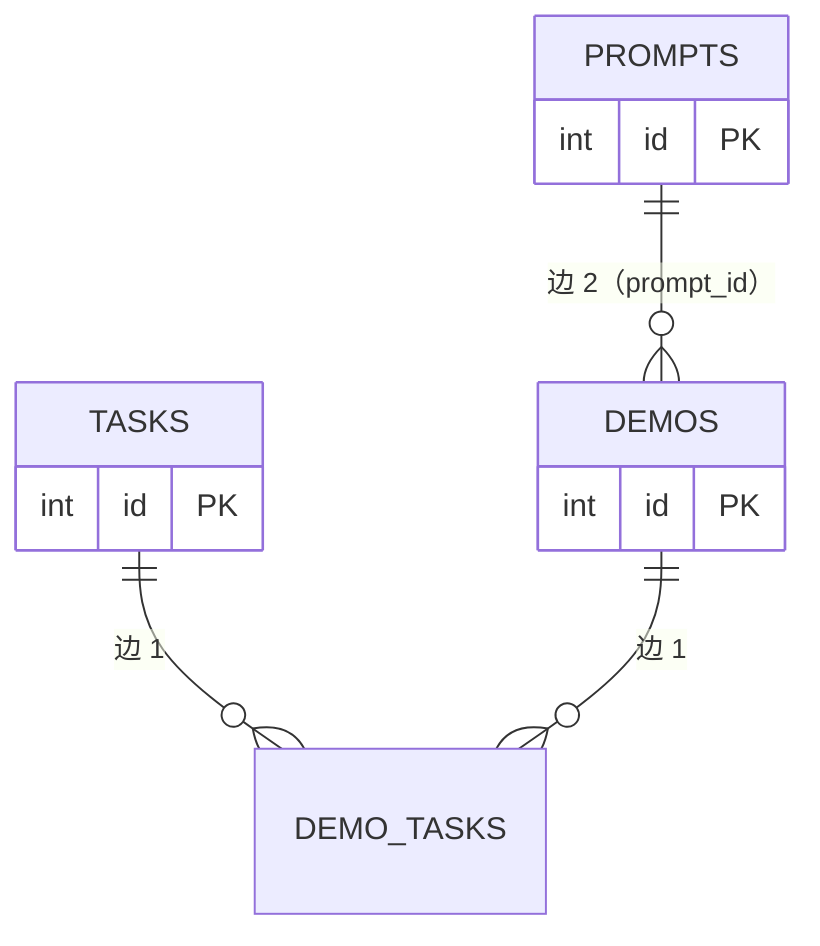
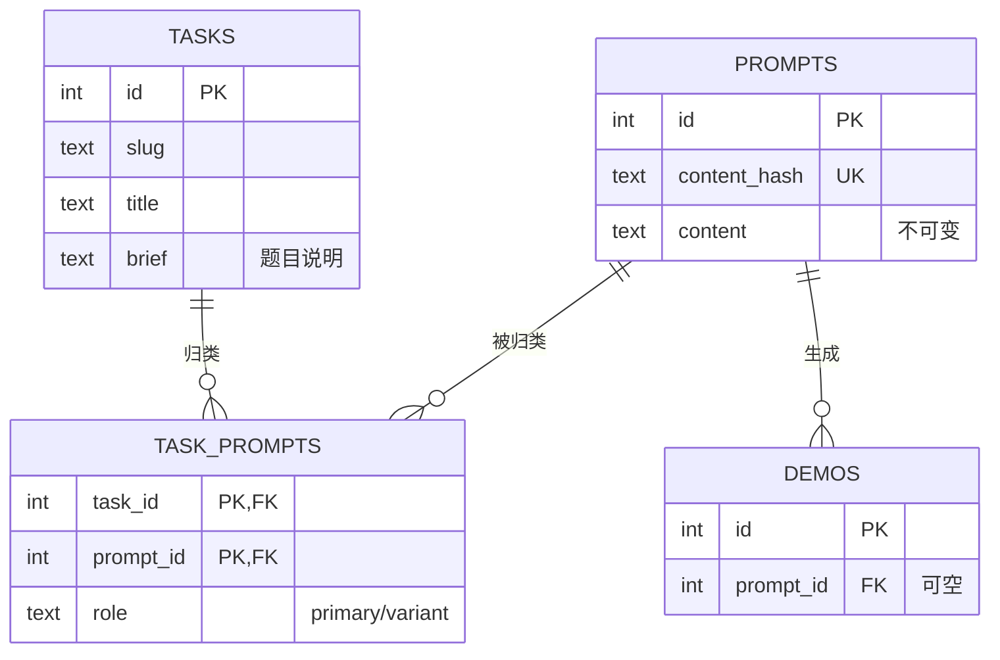
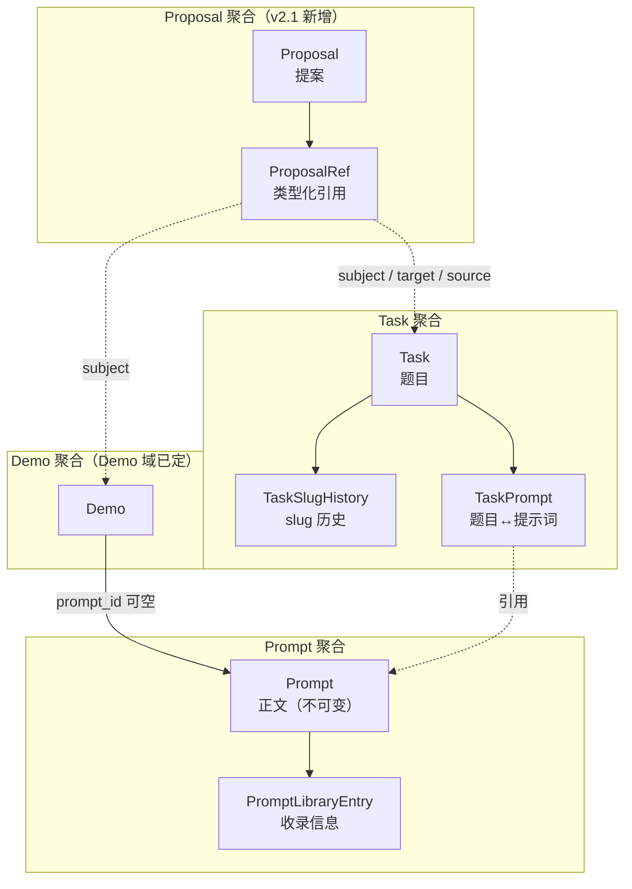
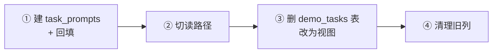
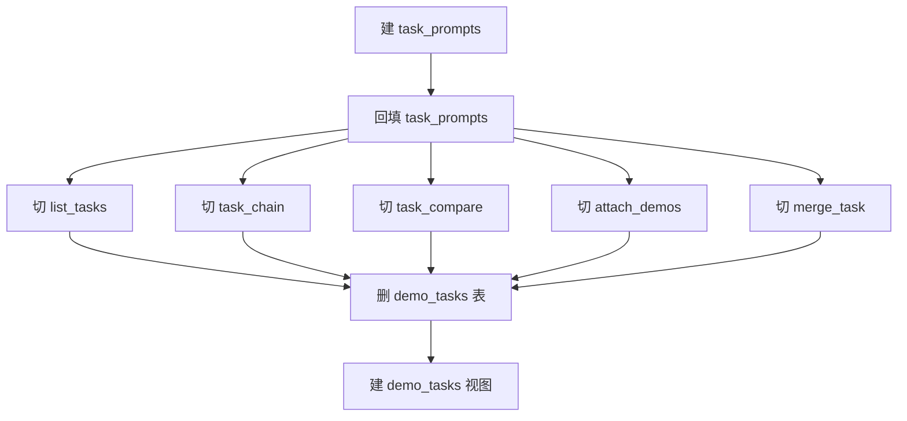
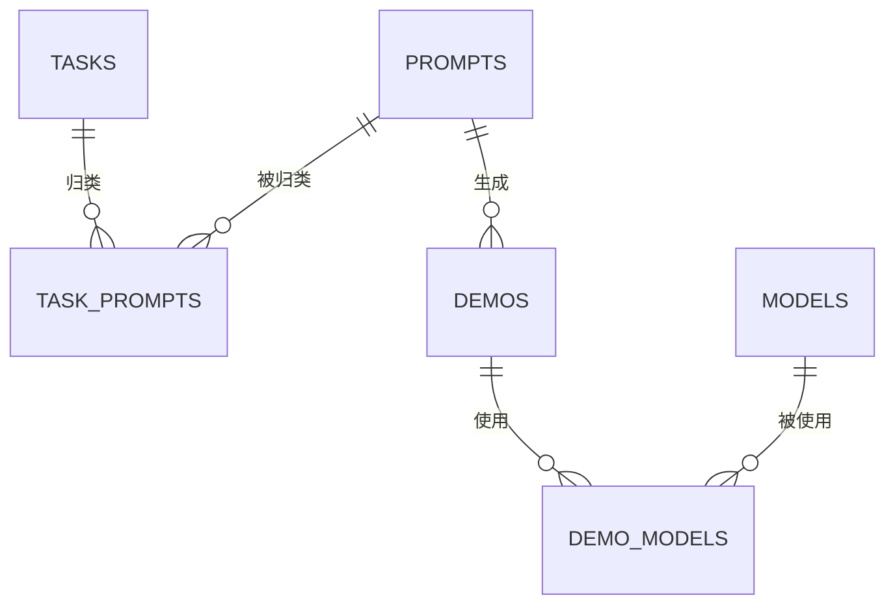

# 实体域数据结构设计 v2.1

**适用范围**：本文只做**数据结构设计**——表、列、类型、约束、索引、外键、状态枚举、派生字段的事实源、迁移顺序。不含产品形态、UI、代码结构。

**状态：草案，待真实数据验证**。§10 的 24 条待拍板里，有 3 条**必须拿到线上数据才能定**（见 §10.1）。在此之前，本文的 DDL 视为「结构已定、参数待调」——表、列、约束、索引的**形状**可以照此实施，但 `title_key` 的白名单、回填冲突处理、提案抽象的收益评估需要数据支撑。

**v2.1 的核心修订**：v2.0 只设计了「题目 / 提示词 / 作品」三个实体，**没有设计「用户怎么建题」**。v2.1 补上提案层：

- 新增 `proposals` + `proposal_refs`（统一 10 种提案，替代旧栈 6 套待审机制）
- 新增 `tasks.title_key` / `tasks.title_norm`（题目名去重，替代旧栈三层精确匹配）
- 明确 `tasks.status` 去掉 `candidate`（旧栈从未写入过，是死状态）

**v2.0 的核心修订**：v1.0 把 `Task` 和 `Prompt` 当成两个平行的实体，都挂在 `Demo` 上。这是错的。**实际结构是三级层次**：

```
Task（题目：相似的 prompt 归为一题）
  └─ Prompt（提示词：一题下的具体问法）
       └─ Demo（作品：用某条 prompt 生成的结果）
```

**v1.0 的问题**：`demo_tasks` 和 `demos.prompt_id` 是两条独立的边，`Task` 和 `Prompt` 之间没有关系。后果：

- 无法回答「这道题下有哪些 prompt」
- 无法回答「这条 prompt 属于哪道题」
- `task_chain` 的「基准题面」要从作品反推（出现次数最多的 `prompt_id`）
- `prompt_excerpts` 要从作品取第一条 prompt 当题面

**v2.0 的修订**：`Task` 直接关联 `Prompt`（`task_prompts`），`Prompt` 关联 `Demo`（`demos.prompt_id`）。`demo_tasks` 从「作品↔题目」降级为**派生视图**（不再是一张表）。

---

## 0. 决策摘要

| 决策 | 结论 |
|---|---|
| 层次 | **Task → Prompt → Demo** 三级 |
| `Task` ↔ `Prompt` | **`task_prompts` 关联表**（一题多 prompt） |
| `Prompt` ↔ `Demo` | **`demos.prompt_id`**（一条 prompt 多件作品） |
| `demo_tasks` | **删除**，改为视图（`demo → prompt → task`） |
| `Task.brief` | **保留**，但语义改为「题目说明」，不再是「题面」 |
| `Task.brief_prompt_id` | **删除**（题面由 `task_prompts` 表达） |
| `Prompt` 的归属 | **可无归属**（`task_prompts` 无对应行 = 未归类） |
| `Prompt` 的正文 | **不可变**（内容寻址） |
| `Task.slug` | **可改 + 历史表** |
| `Task` 删除 | **软删除** |
| `Task.status` | **`active` / `merged` / `hidden`**（去掉死状态 `candidate`） |
| 提示词搜索 | **`pg_trgm` + GIN** |
| 用户建题入口 | **`proposals` 提案表**（不写 `tasks.status='candidate'`） |
| 提案抽象 | **单表 + JSONB + `proposal_refs` 类型化引用** |
| 题目名去重 | **`title_key` 存储列 + 保守函数**（不用 `lower`，不用 `normalize`） |
| `demos` / `forum_*` 的 `status` | **不纳入提案表**（副作用原则） |
| `models.status='candidate'` | **保留**（有副作用：占 slug） |

---

## 1. 为什么是三级而不是两级

### 1.1 现状的两条独立边



**两条边互不知道对方存在**。后果：

| 问题 | 现状能否回答 |
|---|---|
| 这道题下有哪些 prompt？ | ❌ 要 `task → demo_tasks → demos → prompt_id` 绕一圈，且去重后不知道哪条是「主」prompt |
| 这条 prompt 属于哪道题？ | ❌ 要 `prompt → demos → demo_tasks → task` 绕一圈，且一件作品可能挂多题 |
| 这道题的题面是什么？ | ❌ 从作品反推（`prompt_excerpts` / `canonical_id`） |
| 同一道题下，不同 prompt 的模型表现对比？ | ❌ 无法表达「prompt 是变量」 |

### 1.2 三级层次



**三级的好处**：

| 问题 | 三级能否回答 |
|---|---|
| 这道题下有哪些 prompt？ | ✅ `SELECT * FROM task_prompts WHERE task_id = ?` |
| 这条 prompt 属于哪道题？ | ✅ `SELECT * FROM task_prompts WHERE prompt_id = ?` |
| 这道题的题面是什么？ | ✅ `task_prompts WHERE role='primary'` → `prompts.content` |
| 同一道题下，不同 prompt 的模型表现对比？ | ✅ 按 `prompt_id` 分组 |
| 这件作品属于哪道题？ | ✅ `demo → prompt_id → task_prompts → task`（视图） |

### 1.3 为什么 `demo_tasks` 要删

现状 `demo_tasks` 是「作品↔题目」的直接边。三级之后，这条边是**派生的**：

```
demo.prompt_id → task_prompts.prompt_id → task_prompts.task_id
```

**保留 `demo_tasks` 的问题**：

1. **双写不一致**：挂题时写 `demo_tasks`，改 prompt 时 `prompt_id` 变了但 `demo_tasks` 没变 → 两处矛盾
2. **语义重复**：一件作品挂题 A，但它的 prompt 归在题 B 下 → 到底属于哪题？
3. **合并题目时要迁两条边**：`merge_task` 现在迁 `demo_tasks`，三级后要迁 `task_prompts`

**删除后的替代**：

```sql
CREATE VIEW demo_tasks AS
SELECT d.id AS demo_id, tp.task_id
FROM demos d
JOIN task_prompts tp ON tp.prompt_id = d.prompt_id
WHERE d.prompt_id IS NOT NULL;
```

**注意**：视图是只读的。所有写操作走 `task_prompts`。

### 1.4 但 `demo` 和 `prompt` 不是强绑定

用户明确说：「demo 和 提示词 也不是 强绑定的关系」。

**证据**（源码）：

| 事实 | 来源 |
|---|---|
| 提示词覆盖率 38.5% | `cluster_service.py` 注释：「站内已有 235 条真实提示词（线上实测 38.5% 覆盖）」 |
| `demos.prompt` 默认 `""` | `models.py:130` |
| `demos.prompt_id` 可空 | `models.py:145` |
| `inspect_service` 有「缺第一轮提示词」检查 | `inspect_service.py:22` |
| `same_prompt` 端点对空 prompt 直接返回空 | `demos.py:637-639` |

**所以 `demos.prompt_id` 必须可空**，且：

- 无 prompt 的作品**不属于任何题目**（视图里不出现）
- 无 prompt 的作品**不能参与 benchmark 对比**（`task_compare` 要过滤）

**这与「三级层次」不矛盾**：层次是「有 prompt 时的结构」，不是「所有作品都必须有 prompt」。

---

## 2. 领域边界

### 2.1 四个聚合



### 2.2 边界原则

| 原则 | 说明 |
|---|---|
| **Task 拥有「归类」** | `task_prompts` 属于 Task 聚合，Task 删除时级联 |
| **Prompt 正文不可变** | 改正文 = 新 `content_hash` = 新行 |
| **Prompt 可无归属** | `task_prompts` 无对应行 = 未归类，这是常态（61.5% 的作品无 prompt） |
| **Demo 不拥有 Prompt** | `demos.prompt_id` 是弱引用（可空、可改） |
| **收录信息与正文分离** | `PromptLibraryEntry` 是「谁在什么视区收录了这段正文」 |
| **提案不是实体** | `Proposal` 是短命数据（pending 几天就处理完），产物才是长期资产 |
| **提案不占 slug** | 提案没有 slug、没有归类、没有作品；批准后才建 `tasks` 行 |
| **副作用原则** | 审核期间已对外产生副作用的实体（`demos` / `forum_topics` / `forum_replies`）用 `status` 列，不用提案表 |

---

## 3. 目标数据模型

### 3.1 `Task`（题目）

```sql
CREATE TABLE tasks (
    id             bigint      GENERATED ALWAYS AS IDENTITY PRIMARY KEY,
    slug           text        NOT NULL,
    title          text        NOT NULL,
    title_key      text        NOT NULL DEFAULT '',   -- 去重键（§3.8）
    title_norm     text        NOT NULL DEFAULT '',   -- 软提示键（§3.9）
    brief          text        NOT NULL DEFAULT '',   -- 题目说明（人写的，不是题面）
    category       text,
    status         text        NOT NULL DEFAULT 'active'
                               CHECK (status IN ('active', 'merged', 'hidden')),
    merged_into_id bigint      REFERENCES tasks(id) ON DELETE SET NULL,
    created_by     bigint      REFERENCES users(id) ON DELETE SET NULL,
    created_at     timestamptz NOT NULL DEFAULT now(),
    updated_at     timestamptz NOT NULL DEFAULT now(),
    deleted_at     timestamptz
);
CREATE UNIQUE INDEX uq_tasks_slug ON tasks (slug) WHERE deleted_at IS NULL;
CREATE UNIQUE INDEX uq_tasks_title_key ON tasks (title_key)
    WHERE deleted_at IS NULL AND status = 'active';
CREATE INDEX ix_tasks_title_norm ON tasks (title_norm)
    WHERE deleted_at IS NULL AND status = 'active';
CREATE INDEX ix_tasks_status ON tasks (status) WHERE deleted_at IS NULL;
CREATE INDEX ix_tasks_merged_into ON tasks (merged_into_id) WHERE merged_into_id IS NOT NULL;
```

**与 v1.0 的差异**：

| 列 | v1.0 | v2.0 | 理由 |
|---|---|---|---|
| `brief` | 题面（从 prompt 回落） | **题目说明**（人写的） | 题面由 `task_prompts` 表达，`brief` 只放「这道题考什么」 |
| `brief_source` | 4 值枚举 | **删除** | 不再需要区分来源 |
| `brief_prompt_id` | 指向来源 prompt | **删除** | 由 `task_prompts.role='primary'` 表达 |

**与 v2.0 的差异**：

| 列 | v2.0 | v2.1 | 理由 |
|---|---|---|---|
| `status` | `candidate` / `active` / `merged` / `hidden` | **去掉 `candidate`** | 旧栈从未写入过（`create_task` 三个调用点全是 `active`），是死状态 |
| `status` 默认值 | `'candidate'` | **`'active'`** | 同上 |
| `title_key` | 无 | **新增** | 题目名去重（§3.8） |
| `title_norm` | 无 | **新增** | 软提示（§3.9） |

**为什么去掉 `candidate`**：

`create_task` 全仓只有 3 个调用点，**没有任何路径写 `candidate`**：

```python
# admin_entities.py:257
task_service.create_task(db, ..., status=body.status)   # TaskCreateIn 默认 "active"

# suggestion_service.py:189
task_service.create_task(db, ..., status="active")      # 硬编码

# task_service.py:53  定义本身
```

而读它的两处：

- `task_candidates()`（`task_service.py:296`）—— **零调用点**，只有定义
- `suggestion_service.py:366` 管理面板 `"candidate": count(Task.status=='candidate')` —— 恒 0

**用户建题走 `proposals` 表，不写 `tasks.status='candidate'`**（§3.10）。理由：提案不是题——没有 slug、没有归类、没有作品，只是「我认为该有这么一道题」的一句话。

**`brief` 的新语义**：

| 场景 | `brief` 内容 |
|---|---|
| 管理员手工建题 | 「测试模型的空间推理能力」 |
| 从 prompt 簇成题 | 空（题面就是 prompt 本身） |
| 导入 benchmark | 数据集里的题目描述 |

**为什么 `brief` 不删**：

`brief` 回答「这道题考什么」，`prompt` 回答「具体怎么问」。两者不同：

- 题：「空间推理」
- prompt：「画一个 3D 的坦克，要求有透视」

一个题可以有多条 prompt（不同问法），但只有一个 `brief`。

### 3.2 `TaskPrompt`（题目↔提示词）

```sql
CREATE TABLE task_prompts (
    task_id    bigint      NOT NULL REFERENCES tasks(id) ON DELETE CASCADE,
    prompt_id  bigint      NOT NULL REFERENCES prompts(id) ON DELETE CASCADE,
    role       text        NOT NULL DEFAULT 'variant'
                           CHECK (role IN ('primary', 'variant')),
    note       text        NOT NULL DEFAULT '',   -- 「这个变体改了什么」
    created_by bigint      REFERENCES users(id) ON DELETE SET NULL,
    created_at timestamptz NOT NULL DEFAULT now(),
    PRIMARY KEY (task_id, prompt_id)
);
CREATE INDEX ix_task_prompts_prompt ON task_prompts (prompt_id);
CREATE UNIQUE INDEX uq_task_prompts_primary ON task_prompts (task_id)
    WHERE role = 'primary';
```

**`role` 的语义**：

| 值 | 含义 | 约束 |
|---|---|---|
| `primary` | 主题面（这道题的标准问法） | 每题**最多一个**（partial unique index） |
| `variant` | 变体（同一道题的不同问法） | 不限 |

**为什么需要 `role`**：

现状 `task_chain` 的「基准题面」是「出现次数最多的 `prompt_id`」（`task_service.py:620`）：

```python
canonical_id = max(counts, key=lambda k: (counts[k], -k)) if counts else None
```

这是**统计推断**，不是**显式声明**。后果：

- 新增一件作品可能改变「基准题面」
- 两件作品并列时取 id 小的，语义不明

**改成 `role='primary'` 后**：显式声明，稳定。

**`note` 的用途**：

变体 prompt 需要说明「改了什么」：

| prompt | note |
|---|---|
| 「画一个 3D 坦克」 | （primary，note 空） |
| 「画一个 3D 坦克，要求有透视」 | 「加了透视要求」 |
| 「画一个 3D 坦克，用 CSS 实现」 | 「限定技术栈」 |

**为什么 `note` 在关联表上而不是 `prompts` 上**：

同一条 prompt 在题 A 下是「加了透视要求」，在题 B 下可能是「限定技术栈」。`note` 是**归类时的注解**，属于关联。

### 3.3 `Prompt`（正文，不可变）

```sql
CREATE TABLE prompts (
    id           bigint      GENERATED ALWAYS AS IDENTITY PRIMARY KEY,
    content_hash text        NOT NULL UNIQUE,          -- sha256(规范化后的 content)
    content      text        NOT NULL,
    created_by   bigint      REFERENCES users(id) ON DELETE SET NULL,
    created_at   timestamptz NOT NULL DEFAULT now()
);
```

**与 v1.0 相同**。`content` 不可变，`created_by` 是首次提交人。

**`content_hash` 的计算口径**（必须与现状一致）：

```python
def normalize_content(content: str) -> str:
    return content.replace("\r\n", "\n").strip()

def content_hash(content: str) -> str:
    return hashlib.sha256(content.encode("utf-8")).hexdigest()
```

**注意**：只规范换行和首尾空白，**保留大小写和内文空白**。这与 `matching_service.normalize`（NFKC + 小写 + 去分隔符）不同——后者用于匹配，前者用于去重。

### 3.4 `PromptLibraryEntry`（收录信息）

```sql
CREATE TABLE prompt_library_entries (
    id          bigint      GENERATED ALWAYS AS IDENTITY PRIMARY KEY,
    prompt_id   bigint      NOT NULL REFERENCES prompts(id) ON DELETE CASCADE,
    scope       text        NOT NULL DEFAULT 'deep'
                            CHECK (scope IN ('deep', 'astra')),
    title       text        NOT NULL,
    category    text,
    source_url  text,
    created_by  bigint      REFERENCES users(id) ON DELETE SET NULL,
    created_at  timestamptz NOT NULL DEFAULT now(),
    updated_at  timestamptz NOT NULL DEFAULT now(),
    deleted_at  timestamptz,
    UNIQUE (prompt_id, scope)
);
CREATE INDEX ix_ple_scope ON prompt_library_entries (scope) WHERE deleted_at IS NULL;
```

**与 v1.0 相同**：删 `status`（死列），加 `updated_at` / `deleted_at`。

### 3.5 `demos.prompt_id`（弱引用）

**不变**，但语义明确：

| 情况 | `prompt_id` | 含义 |
|---|---|---|
| 有 prompt | 非空 | 作品由这条 prompt 生成 |
| 无 prompt | NULL | 作品无提示词（61.5% 的情况） |
| prompt 被改 | 指向新行 | 旧行保留（可能被其他作品引用） |

**`demos.prompt` 双写的处置**（与 v1.0 相同）：

| 阶段 | `demos.prompt` | `demos.prompt_id` | 读路径 |
|---|---|---|---|
| 现状 | 权威 | 派生 | 读 `prompt` |
| 过渡 | 快照 | 权威 | 读 `prompt_id` → JOIN `prompts` |
| 终态 | **删除** | 权威 | 同上 |

### 3.6 `demo_tasks` 视图

```sql
CREATE VIEW demo_tasks AS
SELECT d.id AS demo_id, tp.task_id
FROM demos d
JOIN task_prompts tp ON tp.prompt_id = d.prompt_id
WHERE d.prompt_id IS NOT NULL;
```

**注意**：

1. 视图是**只读**的，所有写操作走 `task_prompts`
2. 一件作品可能出现在多个 `task_id` 下（如果它的 prompt 被归到多个题）
3. 无 prompt 的作品**不出现在视图里**

**为什么用视图而不是物化视图**：

- 数据量小（作品数 × 平均归类数）
- 实时性要求高（挂题后立刻要能看到）
- 物化视图需要刷新机制，增加复杂度

### 3.7 `TaskSlugHistory`（slug 历史）

```sql
CREATE TABLE task_slug_history (
    slug       text        PRIMARY KEY,
    task_id    bigint      NOT NULL REFERENCES tasks(id) ON DELETE CASCADE,
    created_at timestamptz NOT NULL DEFAULT now()
);
CREATE INDEX ix_task_slug_history_task ON task_slug_history (task_id);
```

**与 v1.0 相同**。对齐 `DemoSlugHistory`（`Demo域设计.md` §3.10）。

### 3.8 `tasks.title_key`（题目名去重键）

**列定义见 §3.1**（`title_key text NOT NULL DEFAULT ''`）。索引：

```sql
CREATE UNIQUE INDEX uq_tasks_title_key ON tasks (title_key)
    WHERE deleted_at IS NULL AND status = 'active';
```

**为什么需要这一列**：

现状三层去重**全部是精确相等**，中文用户加个标点就能绕过：

```python
# tasks.py:79 —— 第一层：与 active 题逐字同名
exists = db.query(Task).filter(Task.title == title, Task.status == "active").first()

# tasks.py:87-100 —— 第二层：与自己的 pending 提案逐字同名
if isinstance(data, dict) and (data.get("title") or "").strip() == title:

# suggestion_service.py:69-73 —— 第三层：因 ref_id/demo_id 全 NULL 被迫关闭
suggestion_service.create(..., dedupe=False)
```

`画一个3D坦克` 与 `画一个3D坦克！` 三层全过。

**为什么不用 `lower(title)`**：

`lower` 只统一大小写，`画一个3D坦克！` 与 `画一个3D坦克` 仍然不同。中文用户最常用的句末标点（`！。？；《》「」——~`）一个都不覆盖。

**为什么不用 `matching_service.normalize`**：

`normalize` 的设计目标是**模型别名匹配**，它刻意吃掉 `-` `.` 这些在模型名里无意义的字符。这个设计对模型名是对的，对题目名是**错的**——会产生误判：

```python
normalize("GPT-4o 画图")   # → 'gpt4o画图'
normalize("GPT 4o 画图")   # → 'gpt4o画图'   ← 碰撞
normalize("GPT-3.5 画图")  # → 'gpt35画图'
normalize("GPT 35 画图")   # → 'gpt35画图'   ← 碰撞
```

而且它的分隔符集是硬编码的 `[\s_\-./\\()（）·:：,，、]+`，**漏掉 `！。？；《》「」——~`**。实测 16 个变体，10 个判为不同：

| 输入 | `normalize` 后 | 与基准同？ |
|---|---|---|
| `画一个3D坦克` | `画一个3d坦克` | 基准 |
| `画一个3D坦克！` | `画一个3d坦克!` | ❌ |
| `画一个3D坦克。` | `画一个3d坦克。` | ❌ |
| `画一个3D坦克？` | `画一个3d坦克?` | ❌ |
| `画一个3D坦克；` | `画一个3d坦克;` | ❌ |
| `《画一个3D坦克》` | `《画一个3d坦克》` | ❌ |
| `「画一个3D坦克」` | `「画一个3d坦克」` | ❌ |
| `画一个3D坦克——` | `画一个3d坦克——` | ❌ |
| `画一个3D坦克~` | `画一个3d坦克~` | ❌ |
| `画一个3D坦克!!!` | `画一个3d坦克!!!` | ❌ |
| `画一个3D坦克…` | `画一个3d坦克` | ✅ |
| `画一个3D坦克...` | `画一个3d坦克` | ✅ |

**注意**：`C++` 和 `C#` 在 `normalize` 下**不会**碰撞（`+` `#` 不在 `_SEP_RE` 里）：

```python
normalize("用 C++ 写一个排序")  # → '用c++写一个排序'
normalize("用 C# 写一个排序")   # → '用c#写一个排序'   ← 不同，正确
```

真正的碰撞来自 `-` `.` 被吃掉（`GPT-4o` = `GPT 4o`）。

**判据：误判比漏判严重得多**

| | 漏判（false negative） | 误判（false positive） |
|---|---|---|
| 表现 | 收件箱堆两条重复题 | 合法提案被静默丢弃 |
| 用户感知 | 无（管理员合并即可） | **以为提交成功，实际没进队列** |
| 可恢复 | ✅ 管理员合并 | ❌ 用户不知道，也不会重提 |
| 严重度 | 低 | **高** |

所以去重键的设计原则是：**宁可漏判，不可误判。**

`normalize` 是激进函数（吃掉 `-` `.`）→ 会误判 → **不能用**。
`lower` 是保守函数（只统一大小写）→ 会漏判 → **不够用**。

需要的是**中间档**：只吃掉「装饰性标点」，保留「语义符号」。

**`title_key` 的规格**：

```text
title_key(s):
  1. NFKC 归一（全角→半角，兼容字符→标准字符）
  2. 逐字符过滤：
     - Unicode 类别 Z*（分隔符）、C*（控制符/格式符）→ 删
     - Unicode 类别 P*（标点）、S*（符号）→ 删，除非在白名单
     - 其余（字母、数字、CJK）→ 保留
  3. 折叠连续点：`\.{2,}` → 删（`...` / `。。。` 归一后都是 `...`）
  4. casefold()（比 lower 更彻底，处理 ß→ss 等）
```

**第 3 步为什么必要**：`.` 在白名单里（`v1.0` 要保留），但省略号 `...` 是装饰性的。用「连续 2 个以上点整体删」区分两者：`v1.0` 只有一个点，保留；`...` 有两个以上，删。

**语义符号白名单**（必须显式枚举，不能靠 Unicode 类别）：

```text
. - _ + # / \ @ $ % ^ & * = |
```

**为什么不能靠 Unicode 类别 P\***：`+` 是 `Sm`（数学符号），`#` 是 `Po`，`-` 是 `Pd`。按类别删会把 `C++` `C#` `GPT-4o` 全毁掉。

**实测效果**（44 个用例全部通过，下表节选）：

| 输入 | `title_key` | 判定 |
|---|---|---|
| `画一个3D坦克` | `画一个3d坦克` | 基准 |
| `画一个 3D 坦克` | `画一个3d坦克` | ✅ 同 |
| `画一个3D坦克！` | `画一个3d坦克` | ✅ 同 |
| `画一个3D坦克。` | `画一个3d坦克` | ✅ 同 |
| `画一个3D坦克？` | `画一个3d坦克` | ✅ 同 |
| `画一个3D坦克；` | `画一个3d坦克` | ✅ 同 |
| `《画一个3D坦克》` | `画一个3d坦克` | ✅ 同 |
| `「画一个3D坦克」` | `画一个3d坦克` | ✅ 同 |
| `画一个3D坦克…` | `画一个3d坦克` | ✅ 同 |
| `画一个3D坦克——` | `画一个3d坦克` | ✅ 同 |
| `画一个3D坦克~` | `画一个3d坦克` | ✅ 同 |
| `画一个３Ｄ坦克`（全角） | `画一个3d坦克` | ✅ 同 |
| `画一个3D坦克!!!` | `画一个3d坦克` | ✅ 同 |
| `画一个3D坦克...` | `画一个3d坦克` | ✅ 同 |
| `画一个3D坦克★☆→` | `画一个3d坦克` | ✅ 同 |
| `画一个3D坦克①` | `画一个3d坦克1` | ✅ 不同（NFKC 把 ① 拆成 1，符号有语义） |
| `畫一個3D坦克`（繁体） | `畫一個3d坦克` | ✅ 不同（不做繁简转换） |
| `画一个三D坦克` | `画一个三d坦克` | ✅ 不同（不做数字汉字转换） |
| `画一个3D坦克@#$%^&*` | `画一个3d坦克@#$%^&*` | ✅ 不同（白名单符号保留） |

**技术符号必须保留**（全部判为不同，正确）：

| A | B | `title_key(A)` | `title_key(B)` |
|---|---|---|---|
| `用 C++ 写排序` | `用 C# 写排序` | `用c++写排序` | `用c#写排序` |
| `GPT-4o 画图` | `GPT 4o 画图` | `gpt-4o画图` | `gpt4o画图` |
| `GPT-3.5 画图` | `GPT-35 画图` | `gpt-3.5画图` | `gpt-35画图` |
| `v1.0 版本` | `v10 版本` | `v1.0版本` | `v10版本` |
| `a-b` | `ab` | `a-b` | `ab` |
| `a_b` | `ab` | `a_b` | `ab` |
| `x@y` | `xy` | `x@y` | `xy` |
| `a/b` | `ab` | `a/b` | `ab` |

**最后四行是刻意的取舍**：`GPT-4o` 和 `GPT 4o` 判为不同，代价是管理员多合并一次；换来的是 `C++` 和 `C#` 不会被误判。

**`title_key` 是派生列，必须满足**：

| 要求 | 说明 |
|---|---|
| **写入时算，读取时不重算** | 否则改函数会静默改变「谁是重复」 |
| **回填用同一份实现** | Go 侧和迁移脚本必须逐字节一致 |
| **函数变更 = 数据迁移** | 改 `title_key` 逻辑要重算全表 + 重建索引 |
| **不可为空** | `NOT NULL DEFAULT ''`，空串是合法键（空标题已被 `CHECK` 挡住） |

**为什么必须是存储列而不是表达式索引**：

`normalize` / `title_key` 是自定义函数，SQL 里调不到。`lower(title)` 可以建函数索引，但自定义逻辑不行：

```sql
-- 可行
CREATE UNIQUE INDEX ON tasks (lower(title));
-- 不可行（PG 没有这个函数）
CREATE UNIQUE INDEX ON tasks (title_key(title));
```

### 3.9 `tasks.title_norm`（软提示键）

**列定义见 §3.1**（`title_norm text NOT NULL DEFAULT ''`）。索引：

```sql
CREATE INDEX ix_tasks_title_norm ON tasks (title_norm)
    WHERE deleted_at IS NULL AND status = 'active';
```

**只用于提示，不用于约束**。存 `normalize(title)` 的结果（激进函数）。

**两级去重**：

```text
submit(title):
  ├─ key = title_key(title)
  ├─ 硬查：SELECT ... WHERE title_key = key AND status = 'pending'
  │   └─ 命中 → 409「已有相同题目在审核中」
  ├─ 软查：SELECT ... WHERE title_norm = normalize(title) AND status = 'active'
  │   └─ 命中 → 202 + warning「可能重复：/tasks/xxx，确认要提吗？」
  └─ INSERT
```

**软提示的误判无害**（用户看到警告，自己决定），所以可以用激进函数。硬约束的误判有害（静默丢弃），所以必须用保守函数。

### 3.10 `Proposal`（提案）

```sql
CREATE TABLE proposals (
    id            bigint      GENERATED ALWAYS AS IDENTITY PRIMARY KEY,
    kind          text        NOT NULL CHECK (kind IN (
                      'new_task', 'new_prompt', 'new_model', 'new_tag_value',
                      'task_match', 'model_alias', 'merge_task', 'merge_model',
                      'retag_demo', 'report'
                  )),
    status        text        NOT NULL DEFAULT 'pending'
                              CHECK (status IN ('pending', 'approved', 'rejected',
                                                'withdrawn', 'superseded')),
    payload       jsonb       NOT NULL,

    -- 提交
    created_by    bigint      REFERENCES users(id) ON DELETE SET NULL,
    created_at    timestamptz NOT NULL DEFAULT now(),

    -- 审核
    reviewed_by   bigint      REFERENCES users(id) ON DELETE SET NULL,
    reviewed_at   timestamptz,
    reject_reason text,

    -- 执行结果：让「提案 → 产物」可追溯
    result_kind   text,
    result_id     bigint,

    -- 机器来源
    source        text        NOT NULL DEFAULT 'user'
                              CHECK (source IN ('user', 'admin', 'ai',
                                                'inferred', 'external', 'imported')),
    confidence    real        CHECK (confidence IS NULL
                                     OR (confidence >= 0 AND confidence <= 1)),

    -- 去重：应用层算，DB 只保证 pending 内唯一
    dedupe_key    text,
    updated_at    timestamptz NOT NULL DEFAULT now(),

    CONSTRAINT ck_proposals_payload CHECK (
        (kind = 'new_task'      AND payload ? 'title')
     OR (kind = 'new_prompt'    AND payload ? 'title' AND payload ? 'content')
     OR (kind = 'new_model'     AND payload ? 'name')
     OR (kind = 'new_tag_value' AND payload ? 'key' AND payload ? 'value')
     OR (kind = 'task_match'    AND payload ? 'task_id' AND payload ? 'demo_id')
     OR (kind = 'model_alias'   AND payload ? 'model_id' AND payload ? 'alias')
     OR (kind IN ('merge_task', 'merge_model')
                                AND payload ? 'source_id' AND payload ? 'target_id')
     OR (kind = 'retag_demo'    AND payload ? 'demo_id' AND payload ? 'add')
     OR (kind = 'report'        AND payload ? 'target_type' AND payload ? 'target_id')
    ),

    CONSTRAINT ck_proposals_review CHECK (
        (status = 'pending' AND reviewed_by IS NULL AND reviewed_at IS NULL)
     OR (status IN ('approved', 'rejected') AND reviewed_at IS NOT NULL)
     OR (status IN ('withdrawn', 'superseded'))
    )
);

CREATE UNIQUE INDEX uq_proposals_pending_dedupe ON proposals (kind, dedupe_key)
    WHERE status = 'pending' AND dedupe_key IS NOT NULL;
CREATE INDEX ix_proposals_inbox  ON proposals (created_at DESC) WHERE status = 'pending';
CREATE INDEX ix_proposals_author ON proposals (created_by, created_at DESC);
CREATE INDEX ix_proposals_kind   ON proposals (kind, status);
```

**为什么是单表 + JSONB 而不是 10 张类型化表**：

提案是**短命数据**（pending 几天就处理完），不是长期资产。为它拆 10 张表，收益不抵成本。真正需要类型化的是**批准后的产物**，那些表已经有 FK 了。

**`dedupe_key` 是这次抽象的核心**。旧栈三种去重键各不相同，而且 `new_task` 因为三个键全 NULL 被迫 `dedupe=False`：

```python
# suggestion_service.py:69-73
dup = db.query(EntitySuggestion).filter(
    EntitySuggestion.kind == kind,
    EntitySuggestion.ref_id == ref_id,
    EntitySuggestion.demo_id == demo_id,
    EntitySuggestion.status == "pending",
).first()
```

改成应用层算 `dedupe_key`：

| kind | `dedupe_key` |
|---|---|
| `new_task` | `title_key(title)` |
| `new_prompt` | `content_hash` |
| `new_model` | `normalize(name)` |
| `new_tag_value` | `key \|\| ':' \|\| value` |
| `task_match` | `task_id \|\| ':' \|\| demo_id` |
| `model_alias` | `model_id \|\| ':' \|\| normalize(alias)` |
| `merge_task` / `merge_model` | `source_id \|\| '>' \|\| target_id` |
| `retag_demo` | `demo_id \|\| ':' \|\| add` |
| `report` | `target_type \|\| ':' \|\| target_id \|\| ':' \|\| created_by` |

这样 `dedupe=False` 这个逃生舱可以删掉。

**`reject_reason` 可选**（用户裁决）：不强制。但 `status='rejected'` 时前端应提示「管理员未填写理由」。

**`result_kind` + `result_id` 解决什么**：

旧栈只能从 `payload` JSON 里翻 `prompt_id`：

```python
# suggestion_service.py:210
s.payload = json.dumps({**payload, "prompt_id": entry.prompt_id}, ensure_ascii=False)
```

新模型里这是显式列，可索引、可 JOIN。

### 3.11 `ProposalRef`（提案引用）

```sql
CREATE TABLE proposal_refs (
    proposal_id bigint NOT NULL REFERENCES proposals(id) ON DELETE CASCADE,
    role        text   NOT NULL CHECK (role IN ('subject', 'target', 'source')),
    demo_id     bigint REFERENCES demos(id)  ON DELETE CASCADE,
    task_id     bigint REFERENCES tasks(id)  ON DELETE CASCADE,
    model_id    bigint REFERENCES models(id) ON DELETE CASCADE,
    tag_id      bigint REFERENCES tags(id)   ON DELETE CASCADE,
    PRIMARY KEY (proposal_id, role),
    CONSTRAINT ck_proposal_refs_exactly_one CHECK (
        (demo_id IS NOT NULL)::int + (task_id IS NOT NULL)::int
      + (model_id IS NOT NULL)::int + (tag_id IS NOT NULL)::int = 1
    )
);
CREATE INDEX ix_proposal_refs_demo  ON proposal_refs (demo_id)  WHERE demo_id  IS NOT NULL;
CREATE INDEX ix_proposal_refs_task  ON proposal_refs (task_id)  WHERE task_id  IS NOT NULL;
CREATE INDEX ix_proposal_refs_model ON proposal_refs (model_id) WHERE model_id IS NOT NULL;
```

**用户裁决：要**。

**解决什么**：`payload` 里的 `demo_id` / `task_id` **不是 FK**。后果：

| 场景 | 无 `proposal_refs` | 有 `proposal_refs` |
|---|---|---|
| 目标 demo 被删 | 批准时 404（fail-closed） | CASCADE 自动消失 |
| 目标 task 被合并 | 需要 `superseded` 手工扫 | CASCADE 自动消失 |
| 目标 model 被删 | 批准时 404 | CASCADE 自动消失 |

**`role` 的语义**：

| 值 | 含义 | 例 |
|---|---|---|
| `subject` | 提案的主体（要改的东西） | `retag_demo` 的 demo |
| `target` | 提案的目标（合并到哪） | `merge_task` 的 target |
| `source` | 提案的来源（从哪合并） | `merge_task` 的 source |

**`ck_proposal_refs_exactly_one` 的作用**：一行只能指向一种实体。用 `::int` 把 boolean 转成 0/1 再求和，避免 `CHECK` 里写四个 `IS NOT NULL` 的复杂布尔组合。

**写入契约**：每次写提案要写两处（`proposals` + `proposal_refs`），必须在同一事务里。

**`payload` 与 `proposal_refs` 的关系**：`payload` 仍是权威（执行时读它），`proposal_refs` 只是**引用完整性守卫**。两者不一致时以 `payload` 为准，但 `proposal_refs` 的 CASCADE 会先删掉提案，所以不会出现「payload 指向已删实体」的情况。

---

## 4. 写入契约

### 4.1 建题

```text
create_task(title, brief, category, status, created_by)
  ├─ slug = slugify(title) or "task-{uuid8}"
  ├─ INSERT tasks
  └─ audit_log(action='create', entity_type='task')
```

**与 v1.0 的差异**：不写 `brief_source`（列已删）。

### 4.2 归类提示词

```text
attach_prompt(task, prompt_id, role, note, created_by)
  ├─ 拒绝 task.status IN ('merged', 'hidden')
  ├─ 若 role='primary' 且已有 primary → 拒绝（或降级旧的为 variant）
  ├─ INSERT task_prompts(task_id, prompt_id, role, note, created_by)
  └─ audit_log(action='attach_prompt', after={prompt_id, role})
```

**这是 v2.0 新增的核心写操作**。现状没有——现状只能「挂作品」，不能「挂 prompt」。

**`role='primary'` 冲突的处理**：

| 策略 | 说明 |
|---|---|
| **A. 拒绝** | 报错「已有主题面，请先降级」 |
| B. 自动降级 | 旧的 primary 改成 variant，新的成 primary |

**推荐 A**（显式），理由：自动降级会让「谁是主题面」变得不可预测。

### 4.3 取消归类

```text
detach_prompt(task, prompt_id)
  ├─ DELETE task_prompts WHERE (task_id, prompt_id)
  └─ audit_log(action='detach_prompt')
```

**注意**：取消归类**不影响** `demos.prompt_id`。作品仍然由那条 prompt 生成，只是不再属于这道题。

### 4.4 挂作品（语义变化）

**现状**：`attach_demos(task, demo_ids)` 直接写 `demo_tasks`。

**v2.0**：挂作品 = **把作品的 prompt 归类到题目**。

```text
attach_demos(task, demo_ids, role, note, created_by)
  ├─ 拒绝 task.status IN ('merged', 'hidden')
  ├─ 查 demo_ids 的 prompt_id
  ├─ 拒绝 prompt_id IS NULL 的作品（无 prompt 无法归类）
  ├─ 对每个不同的 prompt_id：
  │   ├─ 若已归类 → 跳过
  │   └─ 若未归类 → INSERT task_prompts(role='variant')
  └─ audit_log(action='attach', after={attached_demos: N, attached_prompts: M})
```

**关键差异**：

| | 现状 | v2.1 |
|---|---|---|
| 挂 3 件作品，它们用同一条 prompt | 写 3 行 `demo_tasks` | 写 **1 行** `task_prompts` |
| 挂 3 件作品，它们用 3 条不同 prompt | 写 3 行 `demo_tasks` | 写 **3 行** `task_prompts` |
| 挂一件无 prompt 的作品 | 写 1 行 `demo_tasks` | **拒绝** |

**为什么拒绝无 prompt 的作品**：

三级层次的前提是「作品通过 prompt 归属题目」。无 prompt 的作品无法建立这个链路。

**但要有兜底**：如果用户确实想把无 prompt 的作品挂到某题下，怎么办？

**方案**：允许「直接挂作品」作为例外，写一张 `demo_task_overrides` 表：

```sql
CREATE TABLE demo_task_overrides (
    demo_id    bigint      NOT NULL REFERENCES demos(id) ON DELETE CASCADE,
    task_id    bigint      NOT NULL REFERENCES tasks(id) ON DELETE CASCADE,
    reason     text        NOT NULL DEFAULT '',
    created_by bigint      REFERENCES users(id) ON DELETE SET NULL,
    created_at timestamptz NOT NULL DEFAULT now(),
    PRIMARY KEY (demo_id, task_id)
);
```

视图改为：

```sql
CREATE VIEW demo_tasks AS
SELECT d.id AS demo_id, tp.task_id
FROM demos d
JOIN task_prompts tp ON tp.prompt_id = d.prompt_id
WHERE d.prompt_id IS NOT NULL
UNION
SELECT demo_id, task_id FROM demo_task_overrides;
```

**推荐**：先不加 `demo_task_overrides`，等实际需求出现再加。理由：61.5% 的作品无 prompt，如果允许直接挂，三级层次就退化成两级了。

### 4.5 合并题目

```text
merge_task(source, target, reason)
  ├─ 拒绝 source == target
  ├─ 拒绝 target.status != 'active'
  ├─ 拒绝 source 已 merged
  ├─ 防环（最多 20 层）
  ├─ 迁 task_prompts：source → target
  │   ├─ 若 target 已有 primary 且 source 也有 primary
  │   │   └─ source 的 primary 降级为 variant
  │   └─ 若 prompt_id 冲突（两边都有）→ 保留 target 的 role
  ├─ source.status = 'merged', source.merged_into_id = target.id
  ├─ 相关 pending 提案置 superseded（§4.12）
  └─ audit_log(action='merge', before, after, reason)
```

**与现状的差异**：

| | 现状 | v2.1 |
|---|---|---|
| 迁什么 | `demo_tasks`（作品↔题目） | `task_prompts`（题目↔提示词） |
| 冲突处理 | 作品已在 target 下则跳过 | prompt 已在 target 下则保留 target 的 role |
| primary 冲突 | 无此概念 | source 的 primary 降级为 variant |
| pending 提案 | 手工扫 `EntitySuggestion` | 显式置 `superseded`（§4.12） |

### 4.6 删题

```text
delete_task(task)
  ├─ 拒绝有 task_prompts（走 merge / hidden）
  ├─ 拒绝有反向 merged_into
  ├─ 拒绝有 pending 提案指向它（proposal_refs.task_id = task.id）
  ├─ UPDATE tasks SET deleted_at = now()
  └─ audit_log(action='delete', before)
```

**与现状的差异**：检查条件从「有 `demo_tasks`」改成「有 `task_prompts`」；「有 pending 建议」从扫 `EntitySuggestion` 改成查 `proposal_refs`。

### 4.7 写提示词

```text
set_demo_prompt(demo, created_by)
  ├─ content = normalize(demo.prompt)
  ├─ 若空 → demo.prompt_id = NULL
  ├─ hash = sha256(content)
  ├─ 查 prompts WHERE content_hash = hash
  │   ├─ 命中 → 复用
  │   └─ 未命中 → INSERT prompts(content, created_by)
  ├─ demo.prompt_id = prompt.id
  └─ demo.prompt = content（双写，过渡期）
```

**与 v1.0 相同**。

**注意**：改 prompt 会**自动改变作品归属的题目**（因为 `demo_tasks` 是视图）。这是三级层次的必然结果，也是它的价值——「改 prompt = 换题」是自动的。

### 4.8 收录提示词

```text
publish_prompt(payload, created_by)
  ├─ validate（title ≤200 / content ≤20000 / category ≤64 / source_url ≤2048）
  ├─ scope ∈ ('deep', 'astra')
  ├─ prompt = get_or_create_prompt(content)
  ├─ 查 prompt_library_entries WHERE (prompt_id, scope)
  │   ├─ 命中 → 返回已有（不覆盖 title / source_url）
  │   └─ 未命中 → INSERT
  └─ 无 audit_log（现状也没有）
```

**与 v1.0 相同**。

### 4.9 提交提案

```text
submit_proposal(kind, payload, created_by, source='user')
  ├─ 校验 payload 形状（按 kind 的 CHECK，应用层先挡一次给出友好错误）
  ├─ dedupe_key = f(kind, payload)          -- 见 §3.10 的表
  ├─ 查 proposals WHERE kind=? AND dedupe_key=? AND status='pending'
  │   ├─ 命中 → 返回 {status: 'duplicate', id}（不新建）
  │   └─ 未命中 → 继续
  ├─ INSERT proposals(status='pending', payload, dedupe_key, source, confidence)
  ├─ INSERT proposal_refs（按 kind 提取 subject/target/source）
  └─ 同一事务提交
```

**`new_task` 的两级去重**（见 §3.8 / §3.9）：

```text
submit_new_task(title, brief, category, created_by)
  ├─ key = title_key(title)
  ├─ 硬查 tasks WHERE title_key = key AND status='active' AND deleted_at IS NULL
  │   └─ 命中 → 409「已存在同名题目：/tasks/{slug}」
  ├─ 硬查 proposals WHERE kind='new_task' AND dedupe_key = key AND status='pending'
  │   └─ 命中 → 202 {status: 'duplicate', id}（幂等返回）
  ├─ 软查 tasks WHERE title_norm = normalize(title) AND status='active'
  │   └─ 命中 → 202 + warning「可能重复：/tasks/{slug}」
  └─ INSERT proposals + proposal_refs
```

**`new_task` 的 `proposal_refs`**：

| 场景 | `role` | 指向 |
|---|---|---|
| 独立出题（`POST /tasks`） | 无 | 无引用 |
| 上传时提议新题 | `subject` | 该 demo |

**注意**：`subject` 指向 demo 时，demo 被删 → 提案 CASCADE 消失。这是正确的——作品没了，为它提的题也没意义。

### 4.10 审核提案

```text
review_proposal(proposal_id, action, actor_id)
  ├─ SELECT ... FOR UPDATE
  ├─ 拒绝 status != 'pending'（409）
  ├─ action = 'reject'
  │   ├─ UPDATE status='rejected', reviewed_by, reviewed_at, reject_reason
  │   └─ INSERT notifications(type='proposal_result')
  ├─ action = 'approve'
  │   ├─ execute(kind, payload) → {result_kind, result_id}
  │   │   ├─ 失败 → 整体 ROLLBACK，返回 422
  │   │   └─ 成功 → 继续
  │   ├─ UPDATE status='approved', result_kind, result_id, reviewed_by, reviewed_at
  │   └─ INSERT notifications(type='proposal_result')
  ├─ INSERT audit_log(action='review', entity_type='proposal')
  └─ 同一事务提交
```

**`execute` 的 8 个分支**（这部分抽象不掉）：

| kind | 执行 |
|---|---|
| `new_task` | `create_task(status='active')` + 若有 `subject` demo 则 `attach_demos` |
| `new_prompt` | `publish_prompt` |
| `new_model` | `get_or_create_model` + 若已存在则 `alias_add` |
| `new_tag_value` | `tag_service.ensure_value` + 可选挂 demo |
| `task_match` | `attach_demos` |
| `model_alias` | `alias_add` |
| `merge_task` | `merge_task` + 把相关 pending 提案置 `superseded` |
| `merge_model` | `merge_model` |
| `retag_demo` | `refine_service.apply_retag` |
| `report` | 改目标状态（论坛外置后此 kind 作废） |

**KB-16 教训**：所有内部 service 调用必须传 `commit=False`，实体变更与「提案状态 + 审核审计」在同一事务里提交。旧实现内部各自 `commit`，中断就会留下「实体已建、建议仍 pending」的假象，再点一次批准会重复建实体。

### 4.11 撤回提案

```text
withdraw_proposal(proposal_id, actor_id)
  ├─ 拒绝 created_by != actor_id（403）
  ├─ 拒绝 status != 'pending'（409）
  ├─ UPDATE status='withdrawn'
  └─ INSERT audit_log(action='review', reason='提交人撤回')
```

**旧栈完全没有这个能力**——用户提了就不能撤，只能等管理员处理。

### 4.12 目标合并时的 `superseded`

```text
merge_task(source, target)
  ├─ UPDATE proposals SET status='superseded'
  │   WHERE kind IN ('task_match', 'merge_task', 'new_task')
  │     AND status='pending'
  │     AND id IN (SELECT proposal_id FROM proposal_refs
  │                 WHERE task_id IN (source.id, target.id))
  ├─ 执行合并（迁移 task_prompts / demos.prompt_id）
  └─ 同一事务提交
```

**旧栈的等价逻辑**（`task_service.py:275`）：

```python
EntitySuggestion.kind.in_(("task_match", "merge_task", "new_task")),
```

新模型里这个扫描变成显式的状态跃迁，而不是「合并时顺手清一下」。

**有了 `proposal_refs` 后，这个扫描可以省掉**——`ON DELETE CASCADE` 会在 source 被物理删除时自动清。但 `merge_task` 是软删（`status='merged'`），不触发 CASCADE，所以仍需显式 `superseded`。

---

## 5. 读取契约

### 5.1 题目列表

```sql
SELECT t.id, t.slug, t.title, t.brief, t.category, t.status,
       COUNT(DISTINCT tp.prompt_id) AS prompt_count,
       COUNT(DISTINCT d.id) AS demo_count
FROM tasks t
LEFT JOIN task_prompts tp ON tp.task_id = t.id
LEFT JOIN demos d ON d.prompt_id = tp.prompt_id AND d.status = 'approved'
WHERE t.status = 'active' AND t.deleted_at IS NULL
GROUP BY t.id
ORDER BY demo_count DESC, t.id ASC;
```

**收益**：

- 去掉 `prompt_excerpts` 的额外查询（现状每页一次）
- 新增 `prompt_count`（这道题有几种问法）

### 5.2 题目详情（含对比）

```sql
-- 按模型分组（现状 task_compare 的逻辑，但 JOIN 路径变了）
SELECT m.id, m.slug, m.name, m.vendor, m.status,
       COUNT(DISTINCT d.id) AS demo_count,
       AVG(CASE WHEN d.rating_count > 0 THEN d.rating_avg END) AS avg_rating,
       AVG(d.gen_rounds) AS avg_rounds,
       AVG(d.gen_minutes) AS avg_minutes
FROM models m
JOIN demo_models dm ON dm.model_id = m.id
JOIN demos d ON d.id = dm.demo_id
JOIN task_prompts tp ON tp.prompt_id = d.prompt_id
WHERE tp.task_id = :task_id
  AND d.status = 'approved'
  AND m.status != 'deprecated'
GROUP BY m.id;
```

**与现状的差异**：`JOIN demo_tasks` → `JOIN task_prompts ON tp.prompt_id = d.prompt_id`。

### 5.3 链条视图

```sql
-- 题面：从 task_prompts 取 primary
SELECT p.id, p.content
FROM task_prompts tp
JOIN prompts p ON p.id = tp.prompt_id
WHERE tp.task_id = :task_id AND tp.role = 'primary';

-- 证据行：每件作品 + 它的 prompt 是否等于主题面
SELECT d.slug, d.title, d.cover_url, d.demo_type,
       d.prompt_id, d.gen_rounds, d.gen_minutes,
       d.rating_avg, d.rating_count,
       (d.prompt_id = :primary_prompt_id) AS same_prompt
FROM demos d
JOIN task_prompts tp ON tp.prompt_id = d.prompt_id
WHERE tp.task_id = :task_id AND d.status = 'approved'
ORDER BY d.rating_avg DESC, d.rating_count DESC, d.id DESC
LIMIT 100;
```

**收益**：

- 题面直接读 `task_prompts.role='primary'`，不再统计推断
- `same_prompt` 直接比较 `prompt_id`，不再需要 `brief_prompt_id`

### 5.4 提示词列表

```sql
SELECT p.id,
       COALESCE(e.title, first_demo.title) AS title,
       p.content,
       COALESCE(e.category, demo_category) AS category,
       e.source_url,
       CASE WHEN e.id IS NOT NULL THEN 'contributed' ELSE 'demo' END AS source,
       COALESCE(e.created_at, first_demo.created_at, p.created_at) AS created_at,
       COALESCE(counts.demos_total, 0) AS demos_total,
       COALESCE(model_counts.models_total, 0) AS models_total,
       COALESCE(task_counts.task_count, 0) AS task_count
FROM prompts p
LEFT JOIN prompt_library_entries e
       ON e.prompt_id = p.id AND e.scope = :scope AND e.deleted_at IS NULL
LEFT JOIN counts ON counts.prompt_id = p.id
LEFT JOIN first_demo ON first_demo.id = counts.first_demo_id
LEFT JOIN model_counts ON model_counts.prompt_id = p.id
LEFT JOIN task_counts ON task_counts.prompt_id = p.id
WHERE e.id IS NOT NULL OR counts.demos_total > 0;
```

**新增 `task_count`**：这条 prompt 被归到几道题。

### 5.5 提示词详情（新增：属于哪些题）

```sql
SELECT t.id, t.slug, t.title, tp.role, tp.note
FROM task_prompts tp
JOIN tasks t ON t.id = tp.task_id
WHERE tp.prompt_id = :prompt_id
  AND t.status = 'active' AND t.deleted_at IS NULL;
```

**这是 v2.0 新增的读路径**。现状无法回答「这条 prompt 属于哪道题」。

### 5.6 提示词搜索

```sql
CREATE EXTENSION IF NOT EXISTS pg_trgm;
CREATE INDEX ix_prompts_content_trgm ON prompts USING gin (content gin_trgm_ops);
```

查询：

```sql
SELECT id FROM prompts WHERE content ILIKE '%' || :q || '%';
```

**与 v1.0 相同**。废弃 `prompt_fts` 与两个 settings 键。

### 5.7 我的提案

```sql
SELECT id, kind, status, payload, reject_reason,
       reviewed_at, result_kind, result_id, created_at
FROM proposals
WHERE created_by = :user_id
ORDER BY created_at DESC
LIMIT 50 OFFSET :offset;
```

**索引**：`ix_proposals_author (created_by, created_at DESC)`。

**旧栈完全没有这个查询**——`EntitySuggestion.created_by == user.id` 全仓只出现在两处，**都是去重查询，不是列表**：

- `prompts.py:57`
- `tasks.py:89`

用户提交后只能看到一句「已提交，进入审核队列」，然后就没有然后了。

### 5.8 收件箱（管理员）

```sql
SELECT kind, count(*) AS pending
FROM proposals
WHERE status = 'pending'
  AND (confidence IS NULL OR confidence >= 0.60)
GROUP BY kind;
```

**`confidence >= 0.60` 的口径**：对齐旧栈 `REVIEW = 0.60`（`suggestion_service.py:36`）。低于此值的只入库不骚扰，管理员显式带 `min_confidence` 才看得到。

**注意**：`demos.status='pending'` / `forum_topics.status='reviewing'` / `forum_replies.status='reviewing'` **不纳入这个查询**（用户裁决：不纳入）。它们各自有独立的管理端点。

---

## 6. 迁移路线

### 6.1 阶段划分



**关键**：`demo_tasks` 的删除必须等所有读路径切完。

### 6.2 阶段 ①：建表 + 回填

```sql
-- 建表
CREATE TABLE task_prompts (...);
CREATE TABLE task_slug_history (...);

-- 回填：从 demo_tasks + demos.prompt_id 推导
INSERT INTO task_prompts (task_id, prompt_id, role, created_at)
SELECT DISTINCT dt.task_id, d.prompt_id, 'variant', MIN(d.created_at)
FROM demo_tasks dt
JOIN demos d ON d.id = dt.demo_id
WHERE d.prompt_id IS NOT NULL
GROUP BY dt.task_id, d.prompt_id;

-- 回填 primary：每题取作品数最多的 prompt
WITH ranked AS (
    SELECT tp.task_id, tp.prompt_id,
           COUNT(d.id) AS demo_count,
           ROW_NUMBER() OVER (PARTITION BY tp.task_id ORDER BY COUNT(d.id) DESC, tp.prompt_id ASC) AS rn
    FROM task_prompts tp
    LEFT JOIN demos d ON d.prompt_id = tp.prompt_id AND d.status = 'approved'
    GROUP BY tp.task_id, tp.prompt_id
)
UPDATE task_prompts tp
SET role = 'primary'
FROM ranked r
WHERE tp.task_id = r.task_id AND tp.prompt_id = r.prompt_id AND r.rn = 1;
```

**注意**：回填的 `primary` 是**统计推断**（作品数最多的），与现状 `canonical_id` 的口径一致。回填后需要人工复核。

### 6.3 阶段 ②：切读路径

| 读路径 | 现状 | 目标 |
|---|---|---|
| `list_tasks` 的题面 | `prompt_excerpts` | `task_prompts WHERE role='primary'` |
| `task_chain` 的基准题面 | 算 `canonical_id` | `task_prompts WHERE role='primary'` |
| `task_compare` | `JOIN demo_tasks` | `JOIN task_prompts ON tp.prompt_id = d.prompt_id` |
| `attach_demos` | 写 `demo_tasks` | 写 `task_prompts` |
| `merge_task` | 迁 `demo_tasks` | 迁 `task_prompts` |
| `delete_task` | 查 `demo_tasks` | 查 `task_prompts` |

### 6.4 阶段 ③：删 `demo_tasks` 表，改为视图

```sql
-- 前置：所有读路径已切完
DROP TABLE demo_tasks;
CREATE VIEW demo_tasks AS
SELECT d.id AS demo_id, tp.task_id
FROM demos d
JOIN task_prompts tp ON tp.prompt_id = d.prompt_id
WHERE d.prompt_id IS NOT NULL;
```

**注意**：视图名与旧表名相同，这样旧代码（如果还有）不会立刻报错，但会变成只读。

### 6.5 阶段 ④：清理旧列

```sql
-- tasks
ALTER TABLE tasks DROP COLUMN description;   -- 已改名 brief
-- prompt_library_entries
ALTER TABLE prompt_library_entries DROP COLUMN status;
-- prompts 搜索
DROP TABLE prompt_fts;
-- demos.prompt（单独评估，见 §3.5）
```

### 6.6 迁移顺序的依赖



### 6.7 阶段 ⑤：`title_key` 回填

```sql
-- 1. 加列（可空）
ALTER TABLE tasks ADD COLUMN title_key text;
ALTER TABLE tasks ADD COLUMN title_norm text;

-- 2. 回填（Go 脚本，逐行算 title_key / title_norm）
--    必须与运行时共用同一份实现

-- 3. 校验无冲突
SELECT title_key, count(*) FROM tasks
WHERE deleted_at IS NULL AND status = 'active'
GROUP BY title_key HAVING count(*) > 1;

-- 4. 有冲突 → 先合并重复题（走 merge_task），再建索引
--    这一步大概率有冲突：旧栈三层全精确匹配，重复题一定存在

-- 5. 建索引 + 设 NOT NULL
CREATE UNIQUE INDEX uq_tasks_title_key ON tasks (title_key)
    WHERE deleted_at IS NULL AND status = 'active';
CREATE INDEX ix_tasks_title_norm ON tasks (title_norm)
    WHERE deleted_at IS NULL AND status = 'active';
ALTER TABLE tasks ALTER COLUMN title_key SET NOT NULL;
ALTER TABLE tasks ALTER COLUMN title_norm SET NOT NULL;
```

**为什么第 4 步大概率有冲突**：旧栈三层去重全是精确相等（`tasks.py:79` / `tasks.py:87-100` / `dedupe=False`），`画一个3D坦克` 与 `画一个3D坦克！` 三层全过。线上一定存在这类重复题。

**回填脚本与运行时必须共用同一份实现**：`title_key` 是派生列，函数变更 = 数据迁移。Go 侧应有一个 `internal/entity/titlekey` 包，迁移脚本 import 它，而不是重写一遍。

### 6.8 阶段 ⑥：建 `proposals` 表

```sql
-- 1. 建表（§3.10 / §3.11）
CREATE TABLE proposals (...);
CREATE TABLE proposal_refs (...);

-- 2. 迁移存量 entity_suggestions
INSERT INTO proposals (kind, status, payload, created_by, created_at,
                       reviewed_by, reviewed_at, source, confidence, dedupe_key)
SELECT kind,
       CASE status WHEN 'pending' THEN 'pending'
                   WHEN 'approved' THEN 'approved'
                   ELSE 'rejected' END,
       payload::jsonb,
       created_by, created_at, reviewed_by, reviewed_at,
       source, confidence,
       NULL   -- dedupe_key 由 Go 脚本按 kind 重算
FROM entity_suggestions;

-- 3. 迁移 tag_value_suggestions
INSERT INTO proposals (kind, status, payload, created_by, created_at,
                       reviewed_by, reviewed_at, source, dedupe_key)
SELECT 'new_tag_value',
       CASE status WHEN 'pending' THEN 'pending'
                   WHEN 'approved' THEN 'approved'
                   ELSE 'rejected' END,
       jsonb_build_object('key', key, 'value', value,
                          'description', description, 'group', "group"),
       created_by, created_at, reviewed_by, reviewed_at, 'user',
       key || ':' || value
FROM tag_value_suggestions;

-- 4. 回填 proposal_refs（按 kind 从 payload 提取）
-- 5. 回填 dedupe_key（Go 脚本）
-- 6. 校验 pending 内无重复 dedupe_key
-- 7. 建唯一索引
```

**`forum_reports` 不迁移**：论坛外置后此表作废（`report` kind 保留在 CHECK 里但不再写入）。

**`demos.status` / `forum_topics.status` / `forum_replies.status` 不迁移**（用户裁决：不纳入）。

---

## 7. 不变量

| # | 不变量 | 检查 SQL |
|---|---|---|
| 1 | `tasks.slug` 在未删除行中唯一 | `SELECT slug, COUNT(*) FROM tasks WHERE deleted_at IS NULL GROUP BY slug HAVING COUNT(*) > 1` |
| 2 | `tasks.merged_into_id` 不成环 | 递归 CTE |
| 3 | 每题最多一个 `primary` | partial unique index 保证 |
| 4 | `task_prompts` 的 `task_id` 指向的题目未删除 | `SELECT tp.* FROM task_prompts tp JOIN tasks t ON t.id = tp.task_id WHERE t.deleted_at IS NOT NULL` |
| 5 | `prompts.content_hash` 与 `content` 一致 | `SELECT id FROM prompts WHERE content_hash != encode(sha256(content::bytea), 'hex')` |
| 6 | `prompt_library_entries` 的 `(prompt_id, scope)` 唯一 | 唯一约束保证 |
| 7 | `demos.prompt_id` 与 `demos.prompt` 一致（过渡期） | `SELECT d.id FROM demos d JOIN prompts p ON p.id = d.prompt_id WHERE d.prompt != p.content` |
| 8 | 视图 `demo_tasks` 的行数 ≤ 旧表行数 | 迁移后对比 |
| 9 | `tasks.title_key` 在未删除的 active 行中唯一 | `SELECT title_key, COUNT(*) FROM tasks WHERE deleted_at IS NULL AND status='active' GROUP BY title_key HAVING COUNT(*) > 1` |
| 10 | `tasks.title_key` 与 `title` 一致（派生列） | `SELECT id FROM tasks WHERE title_key != title_key_fn(title)`（需 Go 侧提供函数） |
| 11 | `proposals` 的 `dedupe_key` 在 pending 内唯一 | partial unique index 保证 |
| 12 | `proposals` 的 `status` 与审核字段自洽 | `ck_proposals_review` 保证 |
| 13 | `proposal_refs` 每行只指向一种实体 | `ck_proposal_refs_exactly_one` 保证 |
| 14 | `proposals.payload` 与 `proposal_refs` 一致 | `SELECT p.id FROM proposals p LEFT JOIN proposal_refs r ON r.proposal_id = p.id WHERE p.kind='task_match' AND (r.task_id IS NULL OR r.task_id::text != p.payload->>'task_id')` |

**第 10 条是派生列的通病**：`title_key` 由应用层算，DB 无法保证一致。缓解手段：

- 写入路径统一走一个函数（Go 侧 `titlekey.Of(s)`）
- 迁移脚本复用同一份实现
- 定期跑检查 SQL，发现不一致就重算

**第 14 条是 `proposal_refs` 的代价**：`payload` 和 `proposal_refs` 是两份数据，必须同事务写。不一致时以 `payload` 为准（执行时读它），但 `proposal_refs` 的 CASCADE 会先删掉提案，所以不会出现「payload 指向已删实体」的情况。

---

## 8. 与模型域的接缝

### 8.1 三级层次与模型的关系



**关键**：模型挂在 `Demo` 上，不在 `Prompt` 上。

**为什么**：

- 同一件作品可能用多个模型（`demo_models` 是多对多）
- 同一条 prompt 交给不同模型 → 产生不同作品 → 每件作品各自记录模型

**benchmark 对比的正确口径**：

```sql
-- 同一道题下，不同模型的表现
SELECT m.name, COUNT(DISTINCT d.id) AS demo_count, AVG(d.rating_avg) AS avg_rating
FROM models m
JOIN demo_models dm ON dm.model_id = m.id
JOIN demos d ON d.id = dm.demo_id
JOIN task_prompts tp ON tp.prompt_id = d.prompt_id
WHERE tp.task_id = :task_id
GROUP BY m.id;
```

**注意**：这个查询**不区分 prompt**。如果要「同一道题、同一条 prompt、不同模型」，加 `AND tp.role = 'primary'`。

### 8.2 `task_prompts` 与 `demo_models` 的对比

| 维度 | `demo_models` | `task_prompts` |
|---|---|---|
| 主键 | `(demo_id, model_id)` | `(task_id, prompt_id)` |
| 方向 | 作品 → 模型 | 题目 → 提示词 |
| `source` | `api` / `legacy_tag` / `migration` / `attribution` / `merge` | 无（用 `role` 代替） |
| 额外列 | `provider_id` / `serving_note` | `role` / `note` |
| 反向索引 | `ix_demo_models_model_id` | `ix_task_prompts_prompt` |

**为什么 `task_prompts` 没有 `source`**：

`demo_models.source` 回答「模型归属怎么确定的」（API 探测 / 旧标签 / 迁移 / 归属工作台 / 合并）。`task_prompts` 的归类来源只有两种（手工 / 从作品推导），用 `role` 和 `note` 表达更直接。

---

## 9. 风险

| # | 风险 | 影响 | 缓解 |
|---|---|---|---|
| 1 | 回填的 `primary` 是统计推断 | 可能选错主题面 | 回填后人工复核；提供「改 primary」入口 |
| 2 | 改 prompt 自动换题 | 用户困惑 | UI 提示「改提示词会改变所属题目」 |
| 3 | 无 prompt 的作品无法挂题 | 61.5% 的作品受影响 | 先不加 `demo_task_overrides`，等需求出现 |
| 4 | `demo_tasks` 视图性能 | 复杂查询变慢 | 数据量小，可接受；必要时加物化视图 |
| 5 | 一条 prompt 归到多题 | 语义模糊 | 允许（这是特性，不是 bug）；`task_count` 展示 |
| 6 | `merge_task` 的 primary 冲突 | 合并后主题面不确定 | source 的 primary 降级为 variant |
| 7 | `pg_trgm` 索引体积 | 磁盘 | 估算 10 万条约 200MB |
| 8 | `demos.prompt` 删除时机 | 读路径遗漏 | 前置条件检查 + 灰度 |
| 9 | `title_key` 函数变更 | 静默改变「谁是重复」 | 函数变更 = 数据迁移；回填脚本与 Go 侧共用同一份实现 |
| 10 | `title_key` 回填时发现重复 | 唯一索引建不上 | 先合并重复题，再建索引（§6.7） |
| 11 | `proposal_refs` 与 `payload` 不一致 | 执行时读到已删实体 | 同事务写；`proposal_refs` 的 CASCADE 先删提案 |
| 12 | `merge_task` 是软删，不触发 CASCADE | pending 提案指向已合并的题 | 显式置 `superseded`（§4.12） |
| 13 | `title_key` 的 NFKC 把 `①` 拆成 `1` | 极少数标题被判同 | 接受（漏判无害） |

---

## 10. 待拍板

| # | 问题 | 选项 | 推荐 |
|---|---|---|---|
| 1 | 层次结构 | **Task → Prompt → Demo** / 保持两条独立边 | 三级 |
| 2 | `demo_tasks` | **删表改视图** / 保留表 + 双写 | 删表改视图 |
| 3 | `task_prompts.role` | **primary + variant** / 无 role | 有 role |
| 4 | `primary` 冲突 | **拒绝** / 自动降级 | 拒绝 |
| 5 | 无 prompt 的作品能否挂题 | **不能** / 加 `demo_task_overrides` | 不能（先） |
| 6 | 一条 prompt 能否归到多题 | **能** / 不能 | 能 |
| 7 | `Task.brief` 语义 | **题目说明** / 题面 | 题目说明 |
| 8 | `Task.slug` 是否可改 | **可改 + 历史表** / 不可改 | 可改 |
| 9 | 纯中文标题的 slug | **`task-{uuid8}`** / `task-{id}` | `task-{uuid8}` |
| 10 | `Task` 删除 | **软删除** / 物理删除 | 软删除 |
| 11 | `Prompt.created_by` | **加** / 不加 | 加 |
| 12 | `PromptLibraryEntry.status` | **删** / 保留 | 删 |
| 13 | 提示词搜索 | **`pg_trgm`** / `tsvector` + `zhparser` | `pg_trgm` |
| 14 | `demos.prompt` 何时删 | **过渡期后** / 立即删 | 过渡期后 |
| 15 | 用户建题入口 | **`proposals` 提案表** / `tasks.status='candidate'` | 提案表 |
| 16 | 提案抽象层次 | **单表 + JSONB + `proposal_refs`** / 10 张类型化表 / 纯 JSONB | 单表 + JSONB + refs |
| 17 | `proposal_refs` | **要** / 不要 | **要**（已裁决） |
| 18 | `reject_reason` | **可选** / 强制 | **可选**（已裁决） |
| 19 | `demos` / `forum_*` 的 `status` 纳入提案表 | **不纳入** / 纳入 | **不纳入**（已裁决） |
| 20 | `models.status='candidate'` 改提案 | **不改** / 改 | **不改**（已裁决） |
| 21 | 题目名去重键 | **`title_key` 存储列** / `lower(title)` / `normalize(title)` | `title_key` |
| 22 | `title_key` 的语义符号白名单 | **`. - _ + # / \ @ $ % ^ & * = \|`** / 只留字母数字 | 白名单 |
| 23 | `title_norm` 软提示 | **要** / 不要 | 要 |
| 24 | `GPT-4o` vs `GPT 4o` 判为不同 | **接受** / 判同 | 接受（漏判无害） |

### 10.1 需要真实数据才能定的三条

以下三条**无法靠推理定**，必须拿到线上数据。在此之前按「推荐」列实施，但保留调整空间。

| # | 待定项 | 需要什么数据 | 取数 SQL | 影响 |
|---|---|---|---|---|
| 22 | `title_key` 白名单里 `-` `.` 要不要保留 | 线上 `tasks.title` 里含 `-` `.` 的比例，以及去掉后产生的碰撞数 | `SELECT title FROM tasks WHERE deleted_at IS NULL` 全量导出，跑两版 `title_key` 对比 | 保留 → `GPT-4o` ≠ `GPT 4o`（漏判）；去掉 → `a-b` = `ab`（误判） |
| 10.2 | `title_key` 回填冲突数 | 现有重复题有多少 | `SELECT title_key, count(*) FROM tasks WHERE deleted_at IS NULL AND status='active' GROUP BY 1 HAVING count(*) > 1` | 冲突多 → 回填前要先批量合并；冲突少 → 手工处理 |
| 16 | 提案抽象是否值得 | `entity_suggestions` 各 kind 的实际量 | `SELECT kind, status, count(*) FROM entity_suggestions GROUP BY 1,2 ORDER BY 3 DESC` | 若 `retag_demo` 占 90%，则「10 种 kind 共用一张表」的收益主要来自它一个 |

**取数前提**：`main` 分支的 `backend/data/` 已在本地清理中删除，本地无线上数据副本。需从线上库导出，或从备份恢复。

**为什么这三条不能靠推理**：

- 第 22 条：`-` `.` 在题目名里的实际分布是经验问题，不是逻辑问题
- 第 10.2 条：旧栈三层全精确匹配，重复题**一定存在**，但数量未知
- 第 16 条：抽象收益取决于 kind 分布，而分布是运营事实

**在拿到数据之前，本文的哪些部分可以直接实施**：

| 部分 | 可否直接实施 | 说明 |
|---|---|---|
| §3.1–§3.7（Task / TaskPrompt / Prompt / PromptLibraryEntry / demo_tasks 视图 / TaskSlugHistory） | ✅ 可以 | 结构已定，与数据无关 |
| §3.8–§3.9（`title_key` / `title_norm`） | ⚠️ 列可以加，白名单待定 | 先按推荐白名单实施，拿到数据后调整 = 重算全表 |
| §3.10–§3.11（`proposals` / `proposal_refs`） | ⚠️ 结构可以建，收益待评估 | 若 kind 分布极不均衡，可考虑只迁移高频 kind |
| §4 / §5（写入 / 读取契约） | ✅ 可以 | 与数据无关 |
| §6.7（`title_key` 回填） | ❌ 必须先取数 | 冲突数决定回填策略 |
| §6.8（`proposals` 迁移） | ⚠️ 需先看 kind 分布 | 决定是否全量迁移 |

---

## 附录 A：现状字段清单（逐列）

### `tasks`（10 列）

| 列 | 类型 | 约束 | 读写点 | 判定 |
|---|---|---|---|---|
| `id` | Integer | PK | 多处 | 核心 |
| `slug` | String(128) | unique, index | 12 处 | 核心，**不可改** |
| `title` | String(200) | — | 多处 | 核心 |
| `description` | Text | — | 6 处 | **常为空，题面寄生** |
| `category` | String(64) | nullable | 6 处 | **裸字符串** |
| `status` | String(16) | index | 多处 | 核心（`candidate` 是死状态） |
| `merged_into_id` | Integer | FK self | 5 处 | 核心 |
| `created_by` | Integer | FK users SET NULL | 2 处 | 核心 |
| `created_at` | DateTime | — | 3 处 | 核心 |
| `updated_at` | DateTime | onupdate | 1 处 | 核心 |

### `demo_tasks`（2 列）

| 列 | 类型 | 约束 | 判定 |
|---|---|---|---|
| `demo_id` | Integer | PK, FK CASCADE | 核心 |
| `task_id` | Integer | PK, FK CASCADE | 核心 |

**索引**：`ix_demo_tasks_task_id`

### `prompts`（4 列）

| 列 | 类型 | 约束 | 判定 |
|---|---|---|---|
| `id` | Integer | PK | 核心 |
| `content_hash` | String(64) | unique, index | 核心 |
| `content` | Text | — | 核心，**不可变** |
| `created_at` | DateTime | — | 核心 |

**无 `created_by`** → 首次提交人不可追溯。

### `prompt_library_entries`（9 列）

| 列 | 类型 | 约束 | 判定 |
|---|---|---|---|
| `id` | Integer | PK | 核心 |
| `prompt_id` | Integer | FK, index | 核心 |
| `scope` | String(16) | index | 核心（`deep` / `astra`） |
| `status` | String(16) | index | **死列**（恒 `approved`） |
| `title` | String(200) | — | 核心 |
| `category` | String(64) | nullable | 核心 |
| `source_url` | String(2048) | nullable | 核心 |
| `created_by` | Integer | FK users SET NULL | 核心 |
| `created_at` | DateTime | — | 核心 |

**约束**：`UNIQUE (prompt_id, scope)`

### `prompt_fts`（虚拟表）

| 列 | 类型 | 说明 |
|---|---|---|
| `rowid` | — | 对齐 `prompts.id` |
| `content` | — | trigram 分词 |

**不在 ORM**，由 `prompt_library_service` 裸 SQL 维护。

## 附录 B：调研来源

| 事实 | 来源 |
|---|---|
| `tasks` 10 列 / `demo_tasks` 2 列 / `prompts` 4 列 / `prompt_library_entries` 9 列 | `main:backend/app/models.py` |
| 提示词覆盖率 38.5% | `cluster_service.py` 注释 |
| `demos.prompt` 默认 `""` | `models.py:130` |
| `demos.prompt_id` 可空 | `models.py:145` |
| `inspect_service` 有「缺第一轮提示词」检查 | `inspect_service.py:22` |
| `same_prompt` 对空 prompt 返回空 | `demos.py:637-639` |
| `task_chain` 的 `canonical_id` 从作品算 | `task_service.py:620` |
| `prompt_excerpts` 从作品取题面 | `task_service.py:323` |
| `attach_demos` 写 `demo_tasks` | `task_service.py:120` |
| `merge_task` 迁 `demo_tasks` | `task_service.py:198` |
| `delete_task` 查 `demo_tasks` | `task_service.py:57` |
| `slugify` 剔除所有非 ASCII | `matching_service.py` `slugify` |
| `_slugify_unique` 先查后插 | `task_service.py:28` |
| `update_task` 无改 slug 入口 | `task_service.py:93` |
| `publish_prompt` 硬编码 `status="approved"` | `prompt_library_service.py:278` |
| `prompt_fts` 仅 SQLite | `prompt_library_service.py:56` |
| `set_demo_prompt` 双写 | `model_service.py:320` |
| `normalize_content` 只规范换行和首尾空白 | `prompt_library_service.py:26` |
| `VALID_SCOPES = ('deep', 'astra')` | `scope.py` |
| `cluster_service` 按 prompt 文本分组 | `cluster_service.py:105` |
| `tasks.py:79` 第一层去重是精确相等 | `routers/tasks.py:79` |
| `tasks.py:87-100` 第二层去重是精确相等 | `routers/tasks.py:87-100` |
| `suggestion_service.create` 的 `dedupe=False` 逃生舱 | `suggestion_service.py:69-73` |
| `normalize` 的分隔符集漏掉 `！。？；《》「」——~` | `matching_service.py:21` |
| `normalize` 吃掉 `-` `.`（`GPT-4o` = `GPT 4o`） | `matching_service.py:26-29` |
| `create_task` 三个调用点全写 `active` | `admin_entities.py:257` / `suggestion_service.py:189` |
| `task_candidates()` 零调用点 | `task_service.py:296` |
| `EntitySuggestion.created_by` 只用于去重，无列表查询 | `prompts.py:57` / `tasks.py:89` |
| `SUGGESTION_KINDS` 8 值 | `models.py:579` |
| `TagValueSuggestion` 独立一套审核 | `models.py:98` / `tags.py:229` |
| `ForumReport` 独立一套审核 | `models.py:397` / `forum.py:558` |
| `forum_topics` / `forum_replies` 用 `status='reviewing'` | `forum.py:420` / `forum.py:448` |
| `demos.status='pending'` 用 status 列 | `models.py:135` |
| `_execute` 的 8 个分支无一行通用 | `suggestion_service.py:151-246` |
| KB-16：内部 service 必须 `commit=False` | `suggestion_service.py:151` |
| `merge_task` 手工扫 pending 建议 | `task_service.py:275` |
| `publish_prompt` 把 `prompt_id` 塞回 payload | `suggestion_service.py:210` |