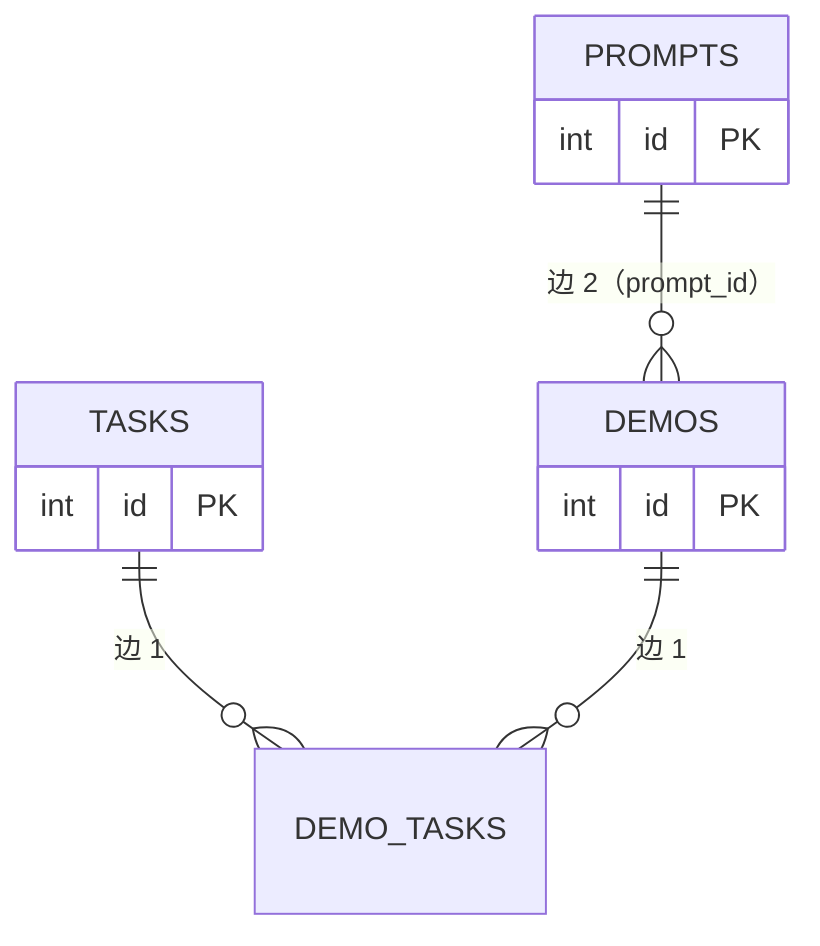
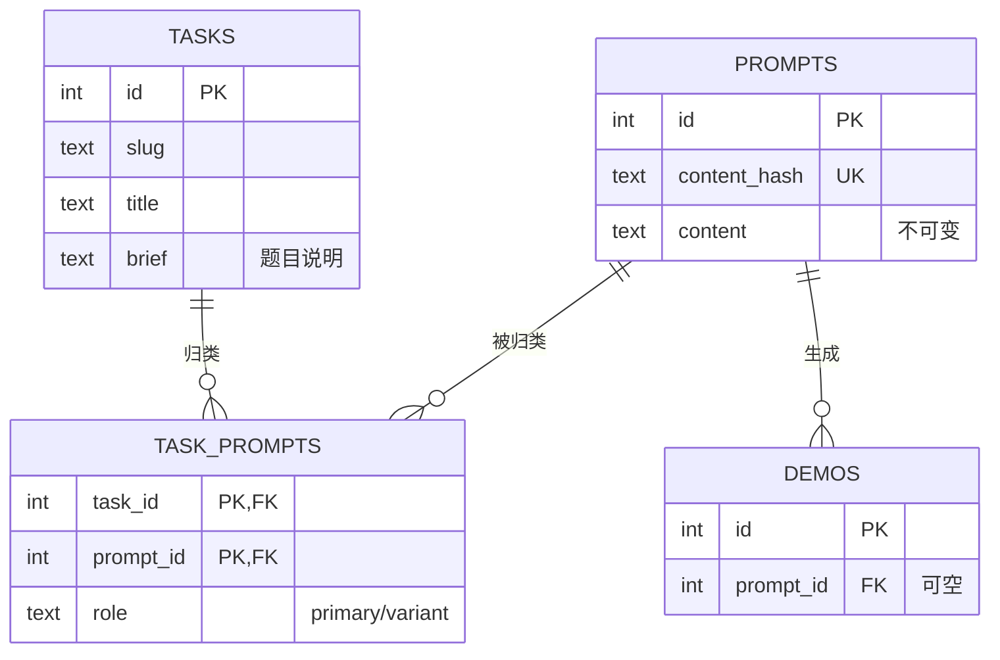
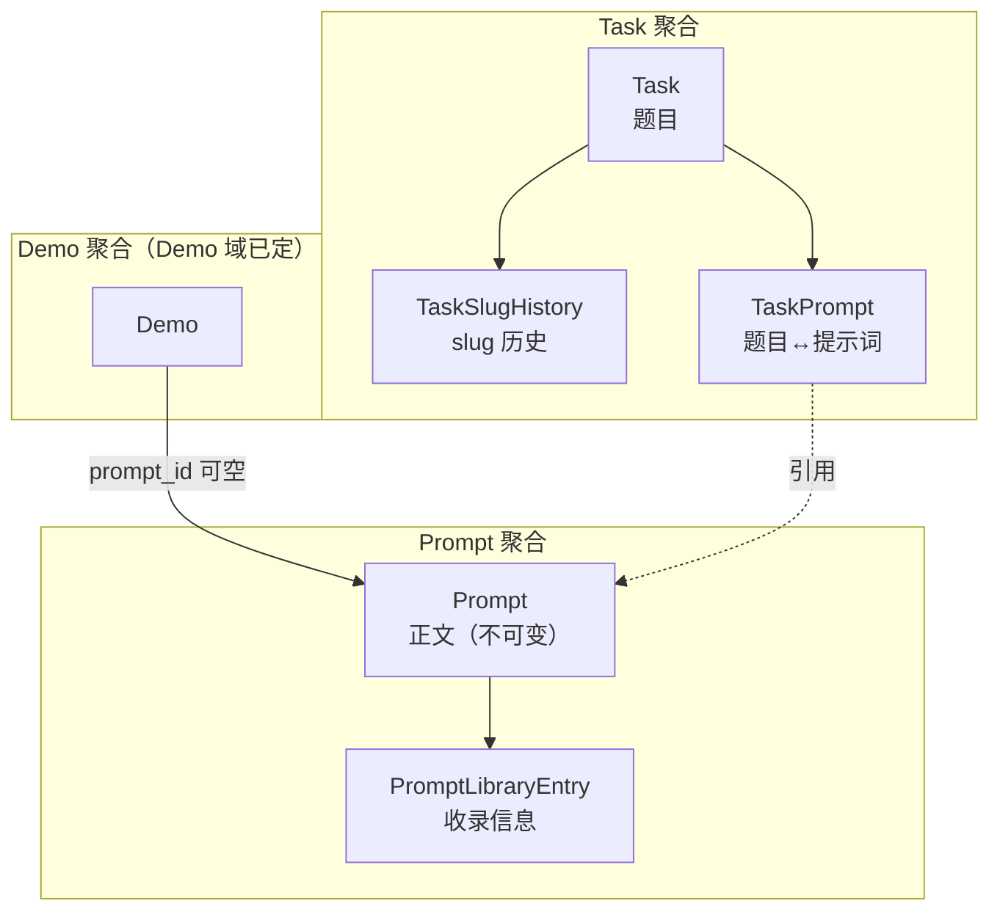
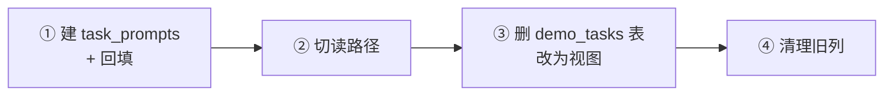
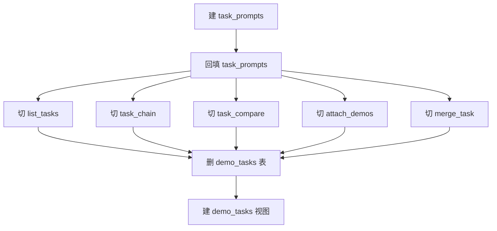
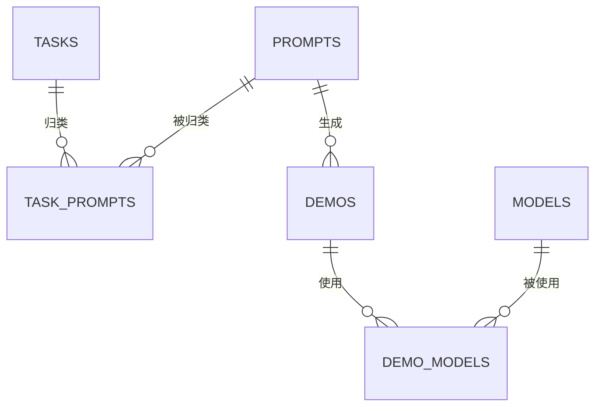

# 实体域数据结构设计 v2.0

**适用范围**：本文只做**数据结构设计**——表、列、类型、约束、索引、外键、状态枚举、派生字段的事实源、迁移顺序。不含产品形态、UI、代码结构。

**v2.0 的核心修订**：v1.0 把 `Task` 和 `Prompt` 当成两个平行的实体，都挂在 `Demo` 上。这是错的。**实际结构是三级层次**：

```
Task（题目：相似的 prompt 归为一题）
  └─ Prompt（提示词：一题下的具体问法）
       └─ Demo（作品：用某条 prompt 生成的结果）
```

**v1.0 的问题**：`demo_tasks` 和 `demos.prompt_id` 是两条独立的边，`Task` 和 `Prompt` 之间没有关系。后果：

- 无法回答「这道题下有哪些 prompt」
- 无法回答「这条 prompt 属于哪道题」
- `task_chain` 的「基准题面」要从作品反推（出现次数最多的 `prompt_id`）
- `prompt_excerpts` 要从作品取第一条 prompt 当题面

**v2.0 的修订**：`Task` 直接关联 `Prompt`（`task_prompts`），`Prompt` 关联 `Demo`（`demos.prompt_id`）。`demo_tasks` 从「作品↔题目」降级为**派生视图**（不再是一张表）。

---

## 0. 决策摘要

| 决策 | 结论 |
|---|---|
| 层次 | **Task → Prompt → Demo** 三级 |
| `Task` ↔ `Prompt` | **`task_prompts` 关联表**（一题多 prompt） |
| `Prompt` ↔ `Demo` | **`demos.prompt_id`**（一条 prompt 多件作品） |
| `demo_tasks` | **删除**，改为视图（`demo → prompt → task`） |
| `Task.brief` | **保留**，但语义改为「题目说明」，不再是「题面」 |
| `Task.brief_prompt_id` | **删除**（题面由 `task_prompts` 表达） |
| `Prompt` 的归属 | **可无归属**（`task_prompts` 无对应行 = 未归类） |
| `Prompt` 的正文 | **不可变**（内容寻址） |
| `Task.slug` | **可改 + 历史表** |
| `Task` 删除 | **软删除** |
| 提示词搜索 | **`pg_trgm` + GIN** |

---

## 1. 为什么是三级而不是两级

### 1.1 现状的两条独立边



**两条边互不知道对方存在**。后果：

| 问题 | 现状能否回答 |
|---|---|
| 这道题下有哪些 prompt？ | ❌ 要 `task → demo_tasks → demos → prompt_id` 绕一圈，且去重后不知道哪条是「主」prompt |
| 这条 prompt 属于哪道题？ | ❌ 要 `prompt → demos → demo_tasks → task` 绕一圈，且一件作品可能挂多题 |
| 这道题的题面是什么？ | ❌ 从作品反推（`prompt_excerpts` / `canonical_id`） |
| 同一道题下，不同 prompt 的模型表现对比？ | ❌ 无法表达「prompt 是变量」 |

### 1.2 三级层次



**三级的好处**：

| 问题 | 三级能否回答 |
|---|---|
| 这道题下有哪些 prompt？ | ✅ `SELECT * FROM task_prompts WHERE task_id = ?` |
| 这条 prompt 属于哪道题？ | ✅ `SELECT * FROM task_prompts WHERE prompt_id = ?` |
| 这道题的题面是什么？ | ✅ `task_prompts WHERE role='primary'` → `prompts.content` |
| 同一道题下，不同 prompt 的模型表现对比？ | ✅ 按 `prompt_id` 分组 |
| 这件作品属于哪道题？ | ✅ `demo → prompt_id → task_prompts → task`（视图） |

### 1.3 为什么 `demo_tasks` 要删

现状 `demo_tasks` 是「作品↔题目」的直接边。三级之后，这条边是**派生的**：

```
demo.prompt_id → task_prompts.prompt_id → task_prompts.task_id
```

**保留 `demo_tasks` 的问题**：

1. **双写不一致**：挂题时写 `demo_tasks`，改 prompt 时 `prompt_id` 变了但 `demo_tasks` 没变 → 两处矛盾
2. **语义重复**：一件作品挂题 A，但它的 prompt 归在题 B 下 → 到底属于哪题？
3. **合并题目时要迁两条边**：`merge_task` 现在迁 `demo_tasks`，三级后要迁 `task_prompts`

**删除后的替代**：

```sql
CREATE VIEW demo_tasks AS
SELECT d.id AS demo_id, tp.task_id
FROM demos d
JOIN task_prompts tp ON tp.prompt_id = d.prompt_id
WHERE d.prompt_id IS NOT NULL;
```

**注意**：视图是只读的。所有写操作走 `task_prompts`。

### 1.4 但 `demo` 和 `prompt` 不是强绑定

用户明确说：「demo 和 提示词 也不是 强绑定的关系」。

**证据**（源码）：

| 事实 | 来源 |
|---|---|
| 提示词覆盖率 38.5% | `cluster_service.py` 注释：「站内已有 235 条真实提示词（线上实测 38.5% 覆盖）」 |
| `demos.prompt` 默认 `""` | `models.py:130` |
| `demos.prompt_id` 可空 | `models.py:145` |
| `inspect_service` 有「缺第一轮提示词」检查 | `inspect_service.py:22` |
| `same_prompt` 端点对空 prompt 直接返回空 | `demos.py:637-639` |

**所以 `demos.prompt_id` 必须可空**，且：

- 无 prompt 的作品**不属于任何题目**（视图里不出现）
- 无 prompt 的作品**不能参与 benchmark 对比**（`task_compare` 要过滤）

**这与「三级层次」不矛盾**：层次是「有 prompt 时的结构」，不是「所有作品都必须有 prompt」。

---

## 2. 领域边界

### 2.1 三个聚合



### 2.2 边界原则

| 原则 | 说明 |
|---|---|
| **Task 拥有「归类」** | `task_prompts` 属于 Task 聚合，Task 删除时级联 |
| **Prompt 正文不可变** | 改正文 = 新 `content_hash` = 新行 |
| **Prompt 可无归属** | `task_prompts` 无对应行 = 未归类，这是常态（61.5% 的作品无 prompt） |
| **Demo 不拥有 Prompt** | `demos.prompt_id` 是弱引用（可空、可改） |
| **收录信息与正文分离** | `PromptLibraryEntry` 是「谁在什么视区收录了这段正文」 |

---

## 3. 目标数据模型

### 3.1 `Task`（题目）

```sql
CREATE TABLE tasks (
    id             bigint      GENERATED ALWAYS AS IDENTITY PRIMARY KEY,
    slug           text        NOT NULL,
    title          text        NOT NULL,
    brief          text        NOT NULL DEFAULT '',   -- 题目说明（人写的，不是题面）
    category       text,
    status         text        NOT NULL DEFAULT 'candidate'
                               CHECK (status IN ('candidate', 'active', 'merged', 'hidden')),
    merged_into_id bigint      REFERENCES tasks(id) ON DELETE SET NULL,
    created_by     bigint      REFERENCES users(id) ON DELETE SET NULL,
    created_at     timestamptz NOT NULL DEFAULT now(),
    updated_at     timestamptz NOT NULL DEFAULT now(),
    deleted_at     timestamptz
);
CREATE UNIQUE INDEX uq_tasks_slug ON tasks (slug) WHERE deleted_at IS NULL;
CREATE INDEX ix_tasks_status ON tasks (status) WHERE deleted_at IS NULL;
CREATE INDEX ix_tasks_merged_into ON tasks (merged_into_id) WHERE merged_into_id IS NOT NULL;
```

**与 v1.0 的差异**：

| 列 | v1.0 | v2.0 | 理由 |
|---|---|---|---|
| `brief` | 题面（从 prompt 回落） | **题目说明**（人写的） | 题面由 `task_prompts` 表达，`brief` 只放「这道题考什么」 |
| `brief_source` | 4 值枚举 | **删除** | 不再需要区分来源 |
| `brief_prompt_id` | 指向来源 prompt | **删除** | 由 `task_prompts.role='primary'` 表达 |

**`brief` 的新语义**：

| 场景 | `brief` 内容 |
|---|---|
| 管理员手工建题 | 「测试模型的空间推理能力」 |
| 从 prompt 簇成题 | 空（题面就是 prompt 本身） |
| 导入 benchmark | 数据集里的题目描述 |

**为什么 `brief` 不删**：

`brief` 回答「这道题考什么」，`prompt` 回答「具体怎么问」。两者不同：

- 题：「空间推理」
- prompt：「画一个 3D 的坦克，要求有透视」

一个题可以有多条 prompt（不同问法），但只有一个 `brief`。

### 3.2 `TaskPrompt`（题目↔提示词）

```sql
CREATE TABLE task_prompts (
    task_id    bigint      NOT NULL REFERENCES tasks(id) ON DELETE CASCADE,
    prompt_id  bigint      NOT NULL REFERENCES prompts(id) ON DELETE CASCADE,
    role       text        NOT NULL DEFAULT 'variant'
                           CHECK (role IN ('primary', 'variant')),
    note       text        NOT NULL DEFAULT '',   -- 「这个变体改了什么」
    created_by bigint      REFERENCES users(id) ON DELETE SET NULL,
    created_at timestamptz NOT NULL DEFAULT now(),
    PRIMARY KEY (task_id, prompt_id)
);
CREATE INDEX ix_task_prompts_prompt ON task_prompts (prompt_id);
CREATE UNIQUE INDEX uq_task_prompts_primary ON task_prompts (task_id)
    WHERE role = 'primary';
```

**`role` 的语义**：

| 值 | 含义 | 约束 |
|---|---|---|
| `primary` | 主题面（这道题的标准问法） | 每题**最多一个**（partial unique index） |
| `variant` | 变体（同一道题的不同问法） | 不限 |

**为什么需要 `role`**：

现状 `task_chain` 的「基准题面」是「出现次数最多的 `prompt_id`」（`task_service.py:620`）：

```python
canonical_id = max(counts, key=lambda k: (counts[k], -k)) if counts else None
```

这是**统计推断**，不是**显式声明**。后果：

- 新增一件作品可能改变「基准题面」
- 两件作品并列时取 id 小的，语义不明

**改成 `role='primary'` 后**：显式声明，稳定。

**`note` 的用途**：

变体 prompt 需要说明「改了什么」：

| prompt | note |
|---|---|
| 「画一个 3D 坦克」 | （primary，note 空） |
| 「画一个 3D 坦克，要求有透视」 | 「加了透视要求」 |
| 「画一个 3D 坦克，用 CSS 实现」 | 「限定技术栈」 |

**为什么 `note` 在关联表上而不是 `prompts` 上**：

同一条 prompt 在题 A 下是「加了透视要求」，在题 B 下可能是「限定技术栈」。`note` 是**归类时的注解**，属于关联。

### 3.3 `Prompt`（正文，不可变）

```sql
CREATE TABLE prompts (
    id           bigint      GENERATED ALWAYS AS IDENTITY PRIMARY KEY,
    content_hash text        NOT NULL UNIQUE,          -- sha256(规范化后的 content)
    content      text        NOT NULL,
    created_by   bigint      REFERENCES users(id) ON DELETE SET NULL,
    created_at   timestamptz NOT NULL DEFAULT now()
);
```

**与 v1.0 相同**。`content` 不可变，`created_by` 是首次提交人。

**`content_hash` 的计算口径**（必须与现状一致）：

```python
def normalize_content(content: str) -> str:
    return content.replace("\r\n", "\n").strip()

def content_hash(content: str) -> str:
    return hashlib.sha256(content.encode("utf-8")).hexdigest()
```

**注意**：只规范换行和首尾空白，**保留大小写和内文空白**。这与 `matching_service.normalize`（NFKC + 小写 + 去分隔符）不同——后者用于匹配，前者用于去重。

### 3.4 `PromptLibraryEntry`（收录信息）

```sql
CREATE TABLE prompt_library_entries (
    id          bigint      GENERATED ALWAYS AS IDENTITY PRIMARY KEY,
    prompt_id   bigint      NOT NULL REFERENCES prompts(id) ON DELETE CASCADE,
    scope       text        NOT NULL DEFAULT 'deep'
                            CHECK (scope IN ('deep', 'astra')),
    title       text        NOT NULL,
    category    text,
    source_url  text,
    created_by  bigint      REFERENCES users(id) ON DELETE SET NULL,
    created_at  timestamptz NOT NULL DEFAULT now(),
    updated_at  timestamptz NOT NULL DEFAULT now(),
    deleted_at  timestamptz,
    UNIQUE (prompt_id, scope)
);
CREATE INDEX ix_ple_scope ON prompt_library_entries (scope) WHERE deleted_at IS NULL;
```

**与 v1.0 相同**：删 `status`（死列），加 `updated_at` / `deleted_at`。

### 3.5 `demos.prompt_id`（弱引用）

**不变**，但语义明确：

| 情况 | `prompt_id` | 含义 |
|---|---|---|
| 有 prompt | 非空 | 作品由这条 prompt 生成 |
| 无 prompt | NULL | 作品无提示词（61.5% 的情况） |
| prompt 被改 | 指向新行 | 旧行保留（可能被其他作品引用） |

**`demos.prompt` 双写的处置**（与 v1.0 相同）：

| 阶段 | `demos.prompt` | `demos.prompt_id` | 读路径 |
|---|---|---|---|
| 现状 | 权威 | 派生 | 读 `prompt` |
| 过渡 | 快照 | 权威 | 读 `prompt_id` → JOIN `prompts` |
| 终态 | **删除** | 权威 | 同上 |

### 3.6 `demo_tasks` 视图

```sql
CREATE VIEW demo_tasks AS
SELECT d.id AS demo_id, tp.task_id
FROM demos d
JOIN task_prompts tp ON tp.prompt_id = d.prompt_id
WHERE d.prompt_id IS NOT NULL;
```

**注意**：

1. 视图是**只读**的，所有写操作走 `task_prompts`
2. 一件作品可能出现在多个 `task_id` 下（如果它的 prompt 被归到多个题）
3. 无 prompt 的作品**不出现在视图里**

**为什么用视图而不是物化视图**：

- 数据量小（作品数 × 平均归类数）
- 实时性要求高（挂题后立刻要能看到）
- 物化视图需要刷新机制，增加复杂度

### 3.7 `TaskSlugHistory`（slug 历史）

```sql
CREATE TABLE task_slug_history (
    slug       text        PRIMARY KEY,
    task_id    bigint      NOT NULL REFERENCES tasks(id) ON DELETE CASCADE,
    created_at timestamptz NOT NULL DEFAULT now()
);
CREATE INDEX ix_task_slug_history_task ON task_slug_history (task_id);
```

**与 v1.0 相同**。对齐 `DemoSlugHistory`（`Demo域设计.md` §3.10）。

---

## 4. 写入契约

### 4.1 建题

```text
create_task(title, brief, category, status, created_by)
  ├─ slug = slugify(title) or "task-{uuid8}"
  ├─ INSERT tasks
  └─ audit_log(action='create', entity_type='task')
```

**与 v1.0 的差异**：不写 `brief_source`（列已删）。

### 4.2 归类提示词

```text
attach_prompt(task, prompt_id, role, note, created_by)
  ├─ 拒绝 task.status IN ('merged', 'hidden')
  ├─ 若 role='primary' 且已有 primary → 拒绝（或降级旧的为 variant）
  ├─ INSERT task_prompts(task_id, prompt_id, role, note, created_by)
  └─ audit_log(action='attach_prompt', after={prompt_id, role})
```

**这是 v2.0 新增的核心写操作**。现状没有——现状只能「挂作品」，不能「挂 prompt」。

**`role='primary'` 冲突的处理**：

| 策略 | 说明 |
|---|---|
| **A. 拒绝** | 报错「已有主题面，请先降级」 |
| B. 自动降级 | 旧的 primary 改成 variant，新的成 primary |

**推荐 A**（显式），理由：自动降级会让「谁是主题面」变得不可预测。

### 4.3 取消归类

```text
detach_prompt(task, prompt_id)
  ├─ DELETE task_prompts WHERE (task_id, prompt_id)
  └─ audit_log(action='detach_prompt')
```

**注意**：取消归类**不影响** `demos.prompt_id`。作品仍然由那条 prompt 生成，只是不再属于这道题。

### 4.4 挂作品（语义变化）

**现状**：`attach_demos(task, demo_ids)` 直接写 `demo_tasks`。

**v2.0**：挂作品 = **把作品的 prompt 归类到题目**。

```text
attach_demos(task, demo_ids, role, note, created_by)
  ├─ 拒绝 task.status IN ('merged', 'hidden')
  ├─ 查 demo_ids 的 prompt_id
  ├─ 拒绝 prompt_id IS NULL 的作品（无 prompt 无法归类）
  ├─ 对每个不同的 prompt_id：
  │   ├─ 若已归类 → 跳过
  │   └─ 若未归类 → INSERT task_prompts(role='variant')
  └─ audit_log(action='attach', after={attached_demos: N, attached_prompts: M})
```

**关键差异**：

| | 现状 | v2.0 |
|---|---|---|
| 挂 3 件作品，它们用同一条 prompt | 写 3 行 `demo_tasks` | 写 **1 行** `task_prompts` |
| 挂 3 件作品，它们用 3 条不同 prompt | 写 3 行 `demo_tasks` | 写 **3 行** `task_prompts` |
| 挂一件无 prompt 的作品 | 写 1 行 `demo_tasks` | **拒绝** |

**为什么拒绝无 prompt 的作品**：

三级层次的前提是「作品通过 prompt 归属题目」。无 prompt 的作品无法建立这个链路。

**但要有兜底**：如果用户确实想把无 prompt 的作品挂到某题下，怎么办？

**方案**：允许「直接挂作品」作为例外，写一张 `demo_task_overrides` 表：

```sql
CREATE TABLE demo_task_overrides (
    demo_id    bigint      NOT NULL REFERENCES demos(id) ON DELETE CASCADE,
    task_id    bigint      NOT NULL REFERENCES tasks(id) ON DELETE CASCADE,
    reason     text        NOT NULL DEFAULT '',
    created_by bigint      REFERENCES users(id) ON DELETE SET NULL,
    created_at timestamptz NOT NULL DEFAULT now(),
    PRIMARY KEY (demo_id, task_id)
);
```

视图改为：

```sql
CREATE VIEW demo_tasks AS
SELECT d.id AS demo_id, tp.task_id
FROM demos d
JOIN task_prompts tp ON tp.prompt_id = d.prompt_id
WHERE d.prompt_id IS NOT NULL
UNION
SELECT demo_id, task_id FROM demo_task_overrides;
```

**推荐**：先不加 `demo_task_overrides`，等实际需求出现再加。理由：61.5% 的作品无 prompt，如果允许直接挂，三级层次就退化成两级了。

### 4.5 合并题目

```text
merge_task(source, target, reason)
  ├─ 拒绝 source == target
  ├─ 拒绝 target.status NOT IN ('active', 'candidate')
  ├─ 拒绝 source 已 merged
  ├─ 防环（最多 20 层）
  ├─ 迁 task_prompts：source → target
  │   ├─ 若 target 已有 primary 且 source 也有 primary
  │   │   └─ source 的 primary 降级为 variant
  │   └─ 若 prompt_id 冲突（两边都有）→ 保留 target 的 role
  ├─ source.status = 'merged', source.merged_into_id = target.id
  └─ audit_log(action='merge', before, after, reason)
```

**与现状的差异**：

| | 现状 | v2.0 |
|---|---|---|
| 迁什么 | `demo_tasks`（作品↔题目） | `task_prompts`（题目↔提示词） |
| 冲突处理 | 作品已在 target 下则跳过 | prompt 已在 target 下则保留 target 的 role |
| primary 冲突 | 无此概念 | source 的 primary 降级为 variant |

### 4.6 删题

```text
delete_task(task)
  ├─ 拒绝有 task_prompts（走 merge / hidden）
  ├─ 拒绝有反向 merged_into
  ├─ 拒绝有 pending 建议指向它
  ├─ UPDATE tasks SET deleted_at = now()
  └─ audit_log(action='delete', before)
```

**与现状的差异**：检查条件从「有 `demo_tasks`」改成「有 `task_prompts`」。

### 4.7 写提示词

```text
set_demo_prompt(demo, created_by)
  ├─ content = normalize(demo.prompt)
  ├─ 若空 → demo.prompt_id = NULL
  ├─ hash = sha256(content)
  ├─ 查 prompts WHERE content_hash = hash
  │   ├─ 命中 → 复用
  │   └─ 未命中 → INSERT prompts(content, created_by)
  ├─ demo.prompt_id = prompt.id
  └─ demo.prompt = content（双写，过渡期）
```

**与 v1.0 相同**。

**注意**：改 prompt 会**自动改变作品归属的题目**（因为 `demo_tasks` 是视图）。这是三级层次的必然结果，也是它的价值——「改 prompt = 换题」是自动的。

### 4.8 收录提示词

```text
publish_prompt(payload, created_by)
  ├─ validate（title ≤200 / content ≤20000 / category ≤64 / source_url ≤2048）
  ├─ scope ∈ ('deep', 'astra')
  ├─ prompt = get_or_create_prompt(content)
  ├─ 查 prompt_library_entries WHERE (prompt_id, scope)
  │   ├─ 命中 → 返回已有（不覆盖 title / source_url）
  │   └─ 未命中 → INSERT
  └─ 无 audit_log（现状也没有）
```

**与 v1.0 相同**。

---

## 5. 读取契约

### 5.1 题目列表

```sql
SELECT t.id, t.slug, t.title, t.brief, t.category, t.status,
       COUNT(DISTINCT tp.prompt_id) AS prompt_count,
       COUNT(DISTINCT d.id) AS demo_count
FROM tasks t
LEFT JOIN task_prompts tp ON tp.task_id = t.id
LEFT JOIN demos d ON d.prompt_id = tp.prompt_id AND d.status = 'approved'
WHERE t.status = 'active' AND t.deleted_at IS NULL
GROUP BY t.id
ORDER BY demo_count DESC, t.id ASC;
```

**收益**：

- 去掉 `prompt_excerpts` 的额外查询（现状每页一次）
- 新增 `prompt_count`（这道题有几种问法）

### 5.2 题目详情（含对比）

```sql
-- 按模型分组（现状 task_compare 的逻辑，但 JOIN 路径变了）
SELECT m.id, m.slug, m.name, m.vendor, m.status,
       COUNT(DISTINCT d.id) AS demo_count,
       AVG(CASE WHEN d.rating_count > 0 THEN d.rating_avg END) AS avg_rating,
       AVG(d.gen_rounds) AS avg_rounds,
       AVG(d.gen_minutes) AS avg_minutes
FROM models m
JOIN demo_models dm ON dm.model_id = m.id
JOIN demos d ON d.id = dm.demo_id
JOIN task_prompts tp ON tp.prompt_id = d.prompt_id
WHERE tp.task_id = :task_id
  AND d.status = 'approved'
  AND m.status != 'deprecated'
GROUP BY m.id;
```

**与现状的差异**：`JOIN demo_tasks` → `JOIN task_prompts ON tp.prompt_id = d.prompt_id`。

### 5.3 链条视图

```sql
-- 题面：从 task_prompts 取 primary
SELECT p.id, p.content
FROM task_prompts tp
JOIN prompts p ON p.id = tp.prompt_id
WHERE tp.task_id = :task_id AND tp.role = 'primary';

-- 证据行：每件作品 + 它的 prompt 是否等于主题面
SELECT d.slug, d.title, d.cover_url, d.demo_type,
       d.prompt_id, d.gen_rounds, d.gen_minutes,
       d.rating_avg, d.rating_count,
       (d.prompt_id = :primary_prompt_id) AS same_prompt
FROM demos d
JOIN task_prompts tp ON tp.prompt_id = d.prompt_id
WHERE tp.task_id = :task_id AND d.status = 'approved'
ORDER BY d.rating_avg DESC, d.rating_count DESC, d.id DESC
LIMIT 100;
```

**收益**：

- 题面直接读 `task_prompts.role='primary'`，不再统计推断
- `same_prompt` 直接比较 `prompt_id`，不再需要 `brief_prompt_id`

### 5.4 提示词列表

```sql
SELECT p.id,
       COALESCE(e.title, first_demo.title) AS title,
       p.content,
       COALESCE(e.category, demo_category) AS category,
       e.source_url,
       CASE WHEN e.id IS NOT NULL THEN 'contributed' ELSE 'demo' END AS source,
       COALESCE(e.created_at, first_demo.created_at, p.created_at) AS created_at,
       COALESCE(counts.demos_total, 0) AS demos_total,
       COALESCE(model_counts.models_total, 0) AS models_total,
       COALESCE(task_counts.task_count, 0) AS task_count
FROM prompts p
LEFT JOIN prompt_library_entries e
       ON e.prompt_id = p.id AND e.scope = :scope AND e.deleted_at IS NULL
LEFT JOIN counts ON counts.prompt_id = p.id
LEFT JOIN first_demo ON first_demo.id = counts.first_demo_id
LEFT JOIN model_counts ON model_counts.prompt_id = p.id
LEFT JOIN task_counts ON task_counts.prompt_id = p.id
WHERE e.id IS NOT NULL OR counts.demos_total > 0;
```

**新增 `task_count`**：这条 prompt 被归到几道题。

### 5.5 提示词详情（新增：属于哪些题）

```sql
SELECT t.id, t.slug, t.title, tp.role, tp.note
FROM task_prompts tp
JOIN tasks t ON t.id = tp.task_id
WHERE tp.prompt_id = :prompt_id
  AND t.status = 'active' AND t.deleted_at IS NULL;
```

**这是 v2.0 新增的读路径**。现状无法回答「这条 prompt 属于哪道题」。

### 5.6 提示词搜索

```sql
CREATE EXTENSION IF NOT EXISTS pg_trgm;
CREATE INDEX ix_prompts_content_trgm ON prompts USING gin (content gin_trgm_ops);
```

查询：

```sql
SELECT id FROM prompts WHERE content ILIKE '%' || :q || '%';
```

**与 v1.0 相同**。废弃 `prompt_fts` 与两个 settings 键。

---

## 6. 迁移路线

### 6.1 阶段划分



**关键**：`demo_tasks` 的删除必须等所有读路径切完。

### 6.2 阶段 ①：建表 + 回填

```sql
-- 建表
CREATE TABLE task_prompts (...);
CREATE TABLE task_slug_history (...);

-- 回填：从 demo_tasks + demos.prompt_id 推导
INSERT INTO task_prompts (task_id, prompt_id, role, created_at)
SELECT DISTINCT dt.task_id, d.prompt_id, 'variant', MIN(d.created_at)
FROM demo_tasks dt
JOIN demos d ON d.id = dt.demo_id
WHERE d.prompt_id IS NOT NULL
GROUP BY dt.task_id, d.prompt_id;

-- 回填 primary：每题取作品数最多的 prompt
WITH ranked AS (
    SELECT tp.task_id, tp.prompt_id,
           COUNT(d.id) AS demo_count,
           ROW_NUMBER() OVER (PARTITION BY tp.task_id ORDER BY COUNT(d.id) DESC, tp.prompt_id ASC) AS rn
    FROM task_prompts tp
    LEFT JOIN demos d ON d.prompt_id = tp.prompt_id AND d.status = 'approved'
    GROUP BY tp.task_id, tp.prompt_id
)
UPDATE task_prompts tp
SET role = 'primary'
FROM ranked r
WHERE tp.task_id = r.task_id AND tp.prompt_id = r.prompt_id AND r.rn = 1;
```

**注意**：回填的 `primary` 是**统计推断**（作品数最多的），与现状 `canonical_id` 的口径一致。回填后需要人工复核。

### 6.3 阶段 ②：切读路径

| 读路径 | 现状 | 目标 |
|---|---|---|
| `list_tasks` 的题面 | `prompt_excerpts` | `task_prompts WHERE role='primary'` |
| `task_chain` 的基准题面 | 算 `canonical_id` | `task_prompts WHERE role='primary'` |
| `task_compare` | `JOIN demo_tasks` | `JOIN task_prompts ON tp.prompt_id = d.prompt_id` |
| `attach_demos` | 写 `demo_tasks` | 写 `task_prompts` |
| `merge_task` | 迁 `demo_tasks` | 迁 `task_prompts` |
| `delete_task` | 查 `demo_tasks` | 查 `task_prompts` |

### 6.4 阶段 ③：删 `demo_tasks` 表，改为视图

```sql
-- 前置：所有读路径已切完
DROP TABLE demo_tasks;
CREATE VIEW demo_tasks AS
SELECT d.id AS demo_id, tp.task_id
FROM demos d
JOIN task_prompts tp ON tp.prompt_id = d.prompt_id
WHERE d.prompt_id IS NOT NULL;
```

**注意**：视图名与旧表名相同，这样旧代码（如果还有）不会立刻报错，但会变成只读。

### 6.5 阶段 ④：清理旧列

```sql
-- tasks
ALTER TABLE tasks DROP COLUMN description;   -- 已改名 brief
-- prompt_library_entries
ALTER TABLE prompt_library_entries DROP COLUMN status;
-- prompts 搜索
DROP TABLE prompt_fts;
-- demos.prompt（单独评估，见 §3.5）
```

### 6.6 迁移顺序的依赖



---

## 7. 不变量

| # | 不变量 | 检查 SQL |
|---|---|---|
| 1 | `tasks.slug` 在未删除行中唯一 | `SELECT slug, COUNT(*) FROM tasks WHERE deleted_at IS NULL GROUP BY slug HAVING COUNT(*) > 1` |
| 2 | `tasks.merged_into_id` 不成环 | 递归 CTE |
| 3 | 每题最多一个 `primary` | partial unique index 保证 |
| 4 | `task_prompts` 的 `task_id` 指向的题目未删除 | `SELECT tp.* FROM task_prompts tp JOIN tasks t ON t.id = tp.task_id WHERE t.deleted_at IS NOT NULL` |
| 5 | `prompts.content_hash` 与 `content` 一致 | `SELECT id FROM prompts WHERE content_hash != encode(sha256(content::bytea), 'hex')` |
| 6 | `prompt_library_entries` 的 `(prompt_id, scope)` 唯一 | 唯一约束保证 |
| 7 | `demos.prompt_id` 与 `demos.prompt` 一致（过渡期） | `SELECT d.id FROM demos d JOIN prompts p ON p.id = d.prompt_id WHERE d.prompt != p.content` |
| 8 | 视图 `demo_tasks` 的行数 ≤ 旧表行数 | 迁移后对比 |

---

## 8. 与模型域的接缝

### 8.1 三级层次与模型的关系



**关键**：模型挂在 `Demo` 上，不在 `Prompt` 上。

**为什么**：

- 同一件作品可能用多个模型（`demo_models` 是多对多）
- 同一条 prompt 交给不同模型 → 产生不同作品 → 每件作品各自记录模型

**benchmark 对比的正确口径**：

```sql
-- 同一道题下，不同模型的表现
SELECT m.name, COUNT(DISTINCT d.id) AS demo_count, AVG(d.rating_avg) AS avg_rating
FROM models m
JOIN demo_models dm ON dm.model_id = m.id
JOIN demos d ON d.id = dm.demo_id
JOIN task_prompts tp ON tp.prompt_id = d.prompt_id
WHERE tp.task_id = :task_id
GROUP BY m.id;
```

**注意**：这个查询**不区分 prompt**。如果要「同一道题、同一条 prompt、不同模型」，加 `AND tp.role = 'primary'`。

### 8.2 `task_prompts` 与 `demo_models` 的对比

| 维度 | `demo_models` | `task_prompts` |
|---|---|---|
| 主键 | `(demo_id, model_id)` | `(task_id, prompt_id)` |
| 方向 | 作品 → 模型 | 题目 → 提示词 |
| `source` | `api` / `legacy_tag` / `migration` / `attribution` / `merge` | 无（用 `role` 代替） |
| 额外列 | `provider_id` / `serving_note` | `role` / `note` |
| 反向索引 | `ix_demo_models_model_id` | `ix_task_prompts_prompt` |

**为什么 `task_prompts` 没有 `source`**：

`demo_models.source` 回答「模型归属怎么确定的」（API 探测 / 旧标签 / 迁移 / 归属工作台 / 合并）。`task_prompts` 的归类来源只有两种（手工 / 从作品推导），用 `role` 和 `note` 表达更直接。

---

## 9. 风险

| # | 风险 | 影响 | 缓解 |
|---|---|---|---|
| 1 | 回填的 `primary` 是统计推断 | 可能选错主题面 | 回填后人工复核；提供「改 primary」入口 |
| 2 | 改 prompt 自动换题 | 用户困惑 | UI 提示「改提示词会改变所属题目」 |
| 3 | 无 prompt 的作品无法挂题 | 61.5% 的作品受影响 | 先不加 `demo_task_overrides`，等需求出现 |
| 4 | `demo_tasks` 视图性能 | 复杂查询变慢 | 数据量小，可接受；必要时加物化视图 |
| 5 | 一条 prompt 归到多题 | 语义模糊 | 允许（这是特性，不是 bug）；`task_count` 展示 |
| 6 | `merge_task` 的 primary 冲突 | 合并后主题面不确定 | source 的 primary 降级为 variant |
| 7 | `pg_trgm` 索引体积 | 磁盘 | 估算 10 万条约 200MB |
| 8 | `demos.prompt` 删除时机 | 读路径遗漏 | 前置条件检查 + 灰度 |

---

## 10. 待拍板

| # | 问题 | 选项 | 推荐 |
|---|---|---|---|
| 1 | 层次结构 | **Task → Prompt → Demo** / 保持两条独立边 | 三级 |
| 2 | `demo_tasks` | **删表改视图** / 保留表 + 双写 | 删表改视图 |
| 3 | `task_prompts.role` | **primary + variant** / 无 role | 有 role |
| 4 | `primary` 冲突 | **拒绝** / 自动降级 | 拒绝 |
| 5 | 无 prompt 的作品能否挂题 | **不能** / 加 `demo_task_overrides` | 不能（先） |
| 6 | 一条 prompt 能否归到多题 | **能** / 不能 | 能 |
| 7 | `Task.brief` 语义 | **题目说明** / 题面 | 题目说明 |
| 8 | `Task.slug` 是否可改 | **可改 + 历史表** / 不可改 | 可改 |
| 9 | 纯中文标题的 slug | **`task-{uuid8}`** / `task-{id}` | `task-{uuid8}` |
| 10 | `Task` 删除 | **软删除** / 物理删除 | 软删除 |
| 11 | `Prompt.created_by` | **加** / 不加 | 加 |
| 12 | `PromptLibraryEntry.status` | **删** / 保留 | 删 |
| 13 | 提示词搜索 | **`pg_trgm`** / `tsvector` + `zhparser` | `pg_trgm` |
| 14 | `demos.prompt` 何时删 | **过渡期后** / 立即删 | 过渡期后 |

---

## 附录 A：现状字段清单（逐列）

### `tasks`（10 列）

| 列 | 类型 | 约束 | 读写点 | 判定 |
|---|---|---|---|---|
| `id` | Integer | PK | 多处 | 核心 |
| `slug` | String(128) | unique, index | 12 处 | 核心，**不可改** |
| `title` | String(200) | — | 多处 | 核心 |
| `description` | Text | — | 6 处 | **常为空，题面寄生** |
| `category` | String(64) | nullable | 6 处 | **裸字符串** |
| `status` | String(16) | index | 多处 | 核心 |
| `merged_into_id` | Integer | FK self | 5 处 | 核心 |
| `created_by` | Integer | FK users SET NULL | 2 处 | 核心 |
| `created_at` | DateTime | — | 3 处 | 核心 |
| `updated_at` | DateTime | onupdate | 1 处 | 核心 |

### `demo_tasks`（2 列）

| 列 | 类型 | 约束 | 判定 |
|---|---|---|---|
| `demo_id` | Integer | PK, FK CASCADE | 核心 |
| `task_id` | Integer | PK, FK CASCADE | 核心 |

**索引**：`ix_demo_tasks_task_id`

### `prompts`（4 列）

| 列 | 类型 | 约束 | 判定 |
|---|---|---|---|
| `id` | Integer | PK | 核心 |
| `content_hash` | String(64) | unique, index | 核心 |
| `content` | Text | — | 核心，**不可变** |
| `created_at` | DateTime | — | 核心 |

**无 `created_by`** → 首次提交人不可追溯。

### `prompt_library_entries`（9 列）

| 列 | 类型 | 约束 | 判定 |
|---|---|---|---|
| `id` | Integer | PK | 核心 |
| `prompt_id` | Integer | FK, index | 核心 |
| `scope` | String(16) | index | 核心（`deep` / `astra`） |
| `status` | String(16) | index | **死列**（恒 `approved`） |
| `title` | String(200) | — | 核心 |
| `category` | String(64) | nullable | 核心 |
| `source_url` | String(2048) | nullable | 核心 |
| `created_by` | Integer | FK users SET NULL | 核心 |
| `created_at` | DateTime | — | 核心 |

**约束**：`UNIQUE (prompt_id, scope)`

### `prompt_fts`（虚拟表）

| 列 | 类型 | 说明 |
|---|---|---|
| `rowid` | — | 对齐 `prompts.id` |
| `content` | — | trigram 分词 |

**不在 ORM**，由 `prompt_library_service` 裸 SQL 维护。

## 附录 B：调研来源

| 事实 | 来源 |
|---|---|
| `tasks` 10 列 / `demo_tasks` 2 列 / `prompts` 4 列 / `prompt_library_entries` 9 列 | `main:backend/app/models.py` |
| 提示词覆盖率 38.5% | `cluster_service.py` 注释 |
| `demos.prompt` 默认 `""` | `models.py:130` |
| `demos.prompt_id` 可空 | `models.py:145` |
| `inspect_service` 有「缺第一轮提示词」检查 | `inspect_service.py:22` |
| `same_prompt` 对空 prompt 返回空 | `demos.py:637-639` |
| `task_chain` 的 `canonical_id` 从作品算 | `task_service.py:620` |
| `prompt_excerpts` 从作品取题面 | `task_service.py:323` |
| `attach_demos` 写 `demo_tasks` | `task_service.py:120` |
| `merge_task` 迁 `demo_tasks` | `task_service.py:198` |
| `delete_task` 查 `demo_tasks` | `task_service.py:57` |
| `slugify` 剔除所有非 ASCII | `matching_service.py` `slugify` |
| `_slugify_unique` 先查后插 | `task_service.py:28` |
| `update_task` 无改 slug 入口 | `task_service.py:93` |
| `publish_prompt` 硬编码 `status="approved"` | `prompt_library_service.py:278` |
| `prompt_fts` 仅 SQLite | `prompt_library_service.py:56` |
| `set_demo_prompt` 双写 | `model_service.py:320` |
| `normalize_content` 只规范换行和首尾空白 | `prompt_library_service.py:26` |
| `VALID_SCOPES = ('deep', 'astra')` | `scope.py` |
| `cluster_service` 按 prompt 文本分组 | `cluster_service.py:105` |