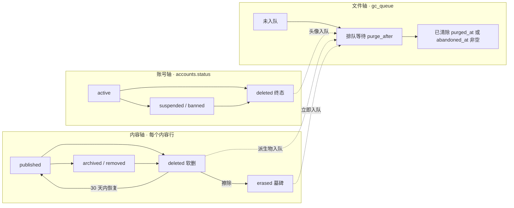
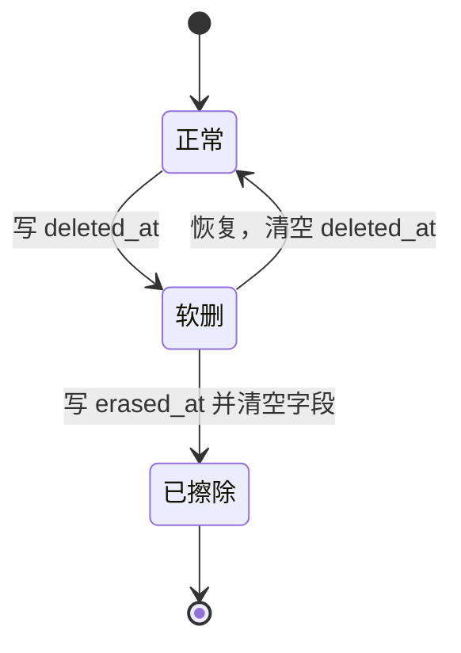
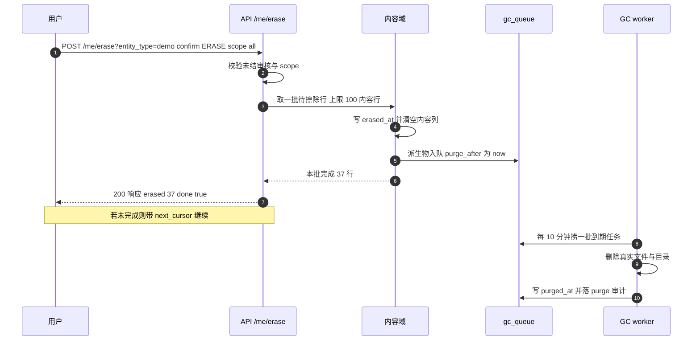

# 数据生命周期设计 v1.6（草案）

**适用范围**：本文定义**跨域**的数据消亡规则——**两个维度**（数据：行 / 字段 / 文件；可见性：公开 / 墓碑 / 仅作者 / 无人）、两维交叉出的**六个合法格子**、每个内容域必须提供什么，以及这些格子怎么组合。日常说的「软删 / 归档 / 移除 / 擦除」一律按**坐标别名**理解，不再单独定义。

本文**不拥有任何业务表**，只定义契约与判定。一句话：**它管「什么东西什么时候真的没了」，不管「表长什么样」**。

- **DDL 约定**见 [`DDL约定.md`](./DDL约定.md)（PostgreSQL 18）。
- **账号状态机**（5 个状态、谁能迁移）见 [`治理域设计.md`](./治理域设计.md) §7.1「状态机」；本文引用，**不重定义**。
- **公开可见谓词与 tombstone 分档**见 [`设计决策台账.md`](./设计决策台账.md) **G1** 与 [`Demo域设计.md`](./Demo域设计.md) §6.4「下架与 tombstone」；本文引用，**不重定义**。
- **派生物回收**（`gc_queue` / `gc_kinds` / 重试）见 [`治理域设计.md`](./治理域设计.md) §9.3「GC 流程」；本文只补「擦除路径的计时差异」。
- **审计写入口**（`WithAudit` / `audit_actions` 目录表）见 [`治理域设计.md`](./治理域设计.md) §8；本文只登记需要新增的动作。
- **身份域数据模型**见 [`身份服务模型设计.md`](./身份服务模型设计.md) §6「数据模型」（v1.7）。

版本：**v1.6 · 草案（2026-10-31）**

**v1.1 改的是「能不能照着实现」**：上一版的判定链和 DDL 有六处对不上已定事实（`demos.deleted_at` 其实早就有、内容列大量 `NOT NULL` 却在擦除时要求写 `NULL`、详情谓词漏了 `erased_at` 导致作者本人还能读到已擦除内容、`purged_at` 一个列分不清「删成功」和「放弃」、GC 单批 50 被抄成 200、`models` 表在模型域根本不存在）。逐条见附录 B。

**本文是新文档**，起因是用户 2026-10-29 的一句话：

> `把注销和数据删除分开吧，软删？这如何描述？`

拆开来看是三个问题：**注销和数据删除是不是一回事**（不是）、**软删到底指什么**（指可恢复的隐藏，不指账号）、**这些东西该写在哪**（原本散在三个域，谁都不全）。

---

## 0. 结论摘要

1. **拆成两个维度，不定义七个动作**（§2）：数据维度只有两个开关——**字段**（`erased_at`）与**文件**（`purged_at`），**行永远不删**；可见性维度只有四档——公开 / 墓碑 / 仅作者 / 无人。交叉后合法格子只有**六个**（§2.3），软删、归档、移除、擦除都只是格子的日常叫法（§2.4）。
2. **三根轴正交**（§3）：账号轴、内容轴、文件轴各有自己的状态，**注销不删内容，擦除不改账号状态**。不拆开这三根轴，就必然要回答「注销之后还能不能擦除」这类没有唯一答案的问题。
3. **账号行永不物理删除，但它不是「软删」，是「墓碑」**（§5.4）。理由只有三条：外键不断链、审计可追、用户名占位防冒充。
4. **擦除也不删行，而是把行降级为墓碑 + 清空内容字段 + 派生物真删**（§6）。这不是对治理域 Q11「行永久保留」的破坏，而是它的**细化**——Q11 保的是「行」，本文清的是「字段」（§6.5）。
5. **加两列是加法，真正的代价在「放宽非空」**：内容表加 `deleted_at` / `erased_at`（§7.1，其中 `demos.deleted_at` 已有），但擦除要「清空内容列」，而这些列在现有 DDL 里**大量是 `NOT NULL`**（`demos.title`、`demo_revisions.manifest_hash`、`proposals.payload` ……）——不先放开约束，擦除根本写不进去。逐表清单见 §11.1，这是本文最容易低估的一块工作量。
6. **内容域必须实现五条契约**（§7），最容易漏的是**第 3 条：可见性必须在详情 / 列表 / 计数搜索三处同时生效**——漏一处的典型症状是「列表 10 条，页码显示 12 条」。
7. **审计可能悄悄毁掉擦除**（§9.2）：治理域 §5.2 的示例把 `title` 写进 `before` 快照，若照做，用户擦除后正文还留在 `audit_log` 里 24 个月——**这是假删除**。本文定「审计只存掩码与摘要」。
8. **恢复窗口 30 天**（§13 L1，**已定 A**），与治理域 D3 / §9.2 一致；Demo 域 §13 待定第 1 条随之结案（Demo 域 v1.5）。
9. **§13 的三条待拍板全部定案**（2026-10-30）：L1 恢复窗口 **30 天** / L2 注销后**仍受理擦除**（留 `accounts.email_hmac` 键控哈希，HMAC-SHA256 + 服务端密钥，核验即清）/ L3 账号侧软删列改名 **`closed_at`**——三条都已落到身份域 v1.2。

10. **结构层收成一个注册表**（§11.4）：内容表只声明「表名 / 属主列 / 擦除列 / slug 列」，`internal/lifecycle` 统一实现列表、分批擦除与恢复，CI 用同一套跨域测试跑每个接入表——**新增业务域接生命周期时，PR 里不出现本文**。

---

## 1. 为什么要这份文档

### 1.1 四个词正在被混用（五处实证）

| # | 现象 | 位置 | 后果 |
|---|---|---|---|
| 1 | 同一张「软删」表里，`demos` 可恢复、`accounts` 是终态 | 治理域 §9.1「软删」 | **同名列两种语义**，读代码的人以为账号也能 restore —— **已修（2026-10-30）**：账号侧的软删时刻改名 `closed_at`（身份域 v1.2 / L3），两个 `deleted_at` 不再同名 |
| 2 | 身份域「IdP 不规定下游怎么处理」与「推荐 B 匿名化」自相矛盾 | 身份域 §5.5「注销的传播语义」vs §8.4「注销的传播」 | 隔 380 行互相打架，读哪儿信哪儿 —— **已修（2026-10-30）**：两节都标「已定」，口径统一为「本站立即、下游不立即；内容行保留、账号行只关闭」（身份域 v1.4 / Q14） |
| 3 | 「删除我的数据」被执行成「隐藏我的作品」 | 治理域 Q11：软删行永久保留、不真删 | **合规口径不成立**——用户以为删了 —— **已修（2026-10-30）**：新增**擦除**（清内容字段 + 文件走 GC），与软删分成两个动作（治理域 v1.9 + 本文 §6 / §7.5） |
| 4 | 保留期两处不一致 | 治理域 §9.2「恢复窗口」已写死 30 天；Demo 域 §13「待定」仍「默认建议 30 天」待定 | 实现时按哪个写？ —— **已修（2026-10-30）**：Demo 域 v1.5 结案第 1 条，统一 30 天（生命周期 L1 = A） |
| 5 | 状态列 DDL 只有 3 值，状态机要 5 态 | 身份域 §6.1「身份域」的 `accounts.status` 列（当时是 `DEFAULT 'active'` + 三值 `CHECK`，现为 `DEFAULT 'pending'` + 五值） vs 治理域 §7.1「状态机」5 态 | **注册流程插不进 `pending`** —— **已修（2026-10-30）**：身份域 v1.1 改 5 值 + `previous_status`（`DEFAULT` 改 `'pending'`），治理域 v1.10 补 `pending` 两条注册流程边；两边的权威关系也定了——**取值域落列在身份域，迁移规则归治理域 §7.1**（治理域 §2.3） |

**这五处到 2026-10-30 已全部修掉**：① 账号侧软删列改名 `closed_at`；② 身份域 §5.5 / §8.4 口径统一；③ 新增「擦除」把合规路径补上；④ 保留期统一 30 天；⑤ `status` 取值域落到 5 值。**这一节保留不删**——它是本文存在的理由：「七个动作」混用不是措辞问题，是七套状态机的问题。

第 1 条与第 3 条是同一件事的两面：**「软删」被当成了万能词**，用来指「行还在但看不见」这件事——可是「看不见」有可恢复和不可恢复两种，混在一个词里，策略就必然自相矛盾。

### 1.2 混用会付出什么代价

不是文字洁癖，是四类具体故障：

1. **端点命名**：`POST /me/delete`（注销账号）与 `DELETE /admin/demos/{id}`（下架作品）都叫 delete，权限码却一个是「本人」一个是 `demo.delete`。前端做「删除」按钮时，同名的两个接口后果完全不同。
2. **恢复接口**：能恢复什么？软删的作品能恢复，注销的账号不能，擦除的作品不能——但三者都只看 `deleted_at`。
3. **合规**：「删除我的数据」在系统里是「标记一行」，用户拿不到「东西真的没了」这个结论。
4. **审计**：`audit_actions` 当时只有 24 个动作（`delete` / `restore` / `purge`，治理域 §5.2），**没有 `erase`**——「用户要求擦除」这件事记不进审计。**已修（2026-10-30）**：治理域 v1.9 加了 `erase`。

### 1.3 本文的地位与边界

| 本文负责 | 本文不负责 |
|---|---|
| 数据 / 可见两个维度与六个格子的判定条件 | 账号状态机的取值与迁移规则（治理域 §7.1） |
| 三根轴的组合关系 | 公开可见谓词与 tombstone 页面内容（台账 G1） |
| 每个内容域必须实现的五条契约 | 各内容域的表结构（Demo / 模型 / 标签 / 实体域） |
| 「不可恢复」的机器可判定标志 | GC worker 的实现与重试策略（治理域 §9.3） |
| 新增审计动作的清单 | 审计表本身的结构与分区（治理域 §8） |

**判定权**：什么情况下对外说「已删除」、什么时候说「已注销」、什么时候返回 409——由本文决定，其他域照此实现。

---

## 2. 两个维度：数据与可见性

### 2.1 数据维度：行、字段、文件

一条内容在库里由三样东西构成，它们**可以各自独立地「没」**：

| # | 对象 | 能不能没 | 由哪一列表达 | 谁改 |
|---|---|---|---|---|
| 1 | **行**（row） | **永远不能**（治理域 Q11 已定） | 没有这一列——行只增不减 | 谁都不改 |
| 2 | **字段**（fields） | 能 | `erased_at` 非空 = 内容字段已清空 | 内容域的擦除动作 |
| 3 | **文件**（blobs） | 能 | `gc_queue.purged_at`（真删成功）或 `gc_queue.abandoned_at`（重试耗尽放弃）非空 = 不会再有了 | GC worker（治理域 §9.3） |

所以数据维度只有**两个自由开关**：字段「完整 / 清空」、文件「在 / 排队 / 已删」。行是常量。

**行为什么永远不删**，三条理由（不是洁癖）：外键会悬空（`audit_log.entity_id`、`demo_revisions.demo_id`）、审计会断链（「谁做的」JOIN 不出来）、`slug` 会被别人抢注。删行等于把别人的历史一起删掉或弄脏。

### 2.2 可见性维度：四档

对外只有一个问题：**谁 GET 得到什么**。四档，没有第五档（取值、判定顺序与两份标准谓词的权威在 `标准对象 §ST-2`，下表是本域视角的投影，冲突以那里为准）：

| 档 | 陌生人 GET | 作者 GET | 列表 / 搜索 / 计数 | 判据 |
|---|---|---|---|---|
| **公开** | `200` + 全文 | `200` + 全文 | 计入 | `erased_at` 空 且 `deleted_at` 空 且已发布 |
| **墓碑** | `200` + 墓碑页 | `200` + 墓碑页 | **不计入** | `erased_at` 空 且 `archived` / `removed`（台账 G1） |
| **仅作者** | `404` | `200`（未公开或已软删，按状态标注） | 不计入 | `erased_at` 空 且（未发布 或 `deleted_at` 非空） |
| **无人** | `404` | `404` | 不计入 | `erased_at` 非空 |

**判定顺序是固定的**：先看 `erased_at`（一票否决，**作者本人也不给**），再看 `deleted_at`，最后才看发布状态。反过来写（先判发布状态、再判擦除）就会出现「已擦除但 `lifecycle_state` 还是 `published`，于是走了发布分支」——而擦除**不改** `lifecycle_state`（§4.3），这个 bug 不是可能发生，是必然发生。

「仅作者」这一档装了两类东西：**未公开**（`draft` / `pending` / `rejected`）与**已软删**（`deleted_at` 非空）。对外的表现完全一样——陌生人 `404`，作者 `200`——所以不必拆成两档；真要区分，看 `deleted_at` 是否为空就够了。

**「曾经公开过」是 200 + 墓碑与 404 的唯一界线**：`archived` / `removed` 的地址可能被转发、被搜索引擎收录，所以回访要给一个说明页；软删与擦除没有这个义务，给 `404`——而且必须与「不存在」逐字节相同（§10 第 10 条）。

### 2.3 两维交叉：合法格子只有六个

| # | 字段 | 文件 | 可见性 | 现实里叫什么 | 谁触发 | 怎么进入 |
|---|---|---|---|---|---|---|
| 1 | 完整 | 在 | 公开 | 正常 | —— | 发布 |
| 2 | 完整 | 在 | 墓碑 | **归档** | 作者 | `POST /{r}/{id}/archive` |
| 3 | 完整 | 在 | 墓碑 | **移除** | 管理员 | 审核裁决 / `POST /admin/...` |
| 4 | 完整 | 在 | 仅作者 | **软删** | 作者本人，或持权限的管理员 | `DELETE /{r}/{id}` |
| 5 | 完整 | 排队 或 已删 | 仅作者 | 软删**且文件已没了**（空壳） | 时间（`purge_after` 到期） | 什么都不做，等 GC |
| 6 | 清空 | 排队 或 已删 | 无人 | **擦除** | 作者申请 / 管理员强制 | `POST /me/erase?entity_type=` · `POST /admin/contents/{entity_type}/{id}/erase` |

**第 2 与第 3 行是同一个格子。** 归档与移除在数据上完全一样：行在、字段在、文件在、对外 `200` + 墓碑。差别只有「谁触发的、能不能申诉」——那是权限与运营，不是数据状态。所以库里不需要为此加列，两者都落在 `lifecycle_state` 上（`archived` / `removed`），审核层不参与——`§ST-4` 只有 `pending` / `approved` / `rejected` 三个值。

**注销不在这张表里。** 它改的是账号行的字段（`status='deleted'` + 匿名化），内容格子一格不动——内容既不会因此变成「仅作者」，也不会失去文件。账号维度见 §5。

### 2.4 术语：只是坐标的别名

原来那七个词不是七个动作，是**六个格子 + 一个账号动作**的日常叫法。保留它们只为一件事：UI、协议、合规条款里得有词可用。

| 日常叫法 | 坐标（字段｜文件｜可见性） | 该不该继续用 |
|---|---|---|
| 正常 | 完整｜在｜公开 | 平时不用 |
| 归档 / 移除 | 完整｜在｜墓碑 | 用：页面文案、申诉流程 |
| 软删 | 完整｜在｜仅作者 | 用：回收站 UI；接口仍叫 `delete` |
| 擦除 | 清空｜排队或已删｜无人 | 用：用户协议、合规条款 |
| **墓碑** | **不是动作**——是「可见性 = 墓碑」或「行在、内容不可用」的形容 | 只在设计讨论里用 |
| **清除（purge）** | **不是状态**——是「文件从排队变已删」这个事件 | 只在 GC 日志与审计 `purge` 里用 |
| **注销** | 账号行字段匿名化（跨轴，不在矩阵里） | 用：账号界面的「注销账号」 |

一句话：**说动作时说坐标，只有面向用户时才说词。**

### 2.5 矩阵直接给出的五条结论

1. **代码里不该出现 `DELETE FROM demos`**。「删除」在这里恒等于 `UPDATE`，行永远留着。看到 `DELETE FROM`（除 GC 的派生物）就是 bug。
2. **归档与移除不需要两套数据**，只需要两套权限和两段文案。
3. **剩下的组合都是非法状态**，可以直接写成断言：「字段清空但公开可见」不可能、「文件已删但公开可读」不可能、**「已擦除但作者还能 200」不可能**。第三条是上一版真漏掉的（§7.3 的详情谓词只写了 `deleted_at`），现在三条都进 §7.6 自检清单。
4. **擦除是唯一同时动两个开关的动作**（字段 + 文件），所以它是唯一需要事务边界与分批的动作——这正是 §6.3 不建任务表但仍要 `next_cursor` 的原因。
5. **恢复只发生在第 4 格**：第 5 格恢复给 `409`（行在、文件没了），第 6 格没有恢复接口（`404`）。

---

## 3. 三根轴

### 3.1 轴是什么

§2 回答「什么没了、谁还看得见」，这一节回答「这些开关长在谁的表上」。同一件事的两个视角：**维度是结果，轴是归属**。

四个开关（行是常量，不算开关）落在三根轴上，各归各的域：

| 轴 | 载体（开关的落点） | 取值 | 谁推动 | 谁消费这个状态 |
|---|---|---|---|---|
| **账号轴** | `accounts.status` + `accounts.closed_at` | `pending` / `active` / `suspended` / `banned` / `deleted`（取值与迁移：`标准对象 §ST-1`） | 治理域定规则（§7.1），身份域落列 | 登录校验、署名展示、下游投影 |
| **内容轴** | 各内容表的 `lifecycle_state` / `moderation_state` / `deleted_at` / `erased_at` | 见 §4.1 | **各内容域自己** | 列表、详情、恢复接口 |
| **文件轴** | `gc_queue.purged_at` / `gc_queue.abandoned_at` | 未入队 / 排队中（`purge_after` 未到）/ 已清除（`purged_at` 非空 = 真删成功；`abandoned_at` 非空 = 重试耗尽放弃） | 治理域 GC worker（§9.3） | 恢复接口的 409 判定、存储核算 |

### 3.2 正交图



**账号轴那三个节点只是示意**：「未注销 / 受限 / 已注销」是粗粒度投影，完整 5 态与 11 条边见 `标准对象 §ST-1`，本节不重复；`deleted` 对外是 404，不是 tombstone。

**这张图上只有三根虚线，全是「账号/内容 → 文件」方向。** 没有一条线从账号轴指向内容轴，也没有一条从内容轴指回账号轴——这就是「分开」的全部含义：

- **注销不动内容**（`A3` 没有箭头指向 `CON`）——作品保留，署名变「已注销」。
- **擦除不动账号**（`C4` 没有箭头指向 `ACC`）——用户删光作品，账号可以继续用。
- **派生物是唯一被两根轴共同推动的东西**（三根虚线全部汇入 `FIL`）。

### 3.3 为什么不能做成一个梯子

如果把「注销 → 擦除 → 清除」排成一条越来越狠的梯子，就必然要回答两个没有唯一答案的问题：

1. ~~**注销的用户还能不能再申请擦除？**~~ **已定（2026-10-30）：能**（§5.5，L2 = B）——他账号没了，但主邮箱的键控哈希还在 `accounts.email_hmac`，提交邮箱比对哈希即可验明正身，核验通过后哈希立即清空。「我后悔了想把作品也删掉」这条路因此留着。
2. **擦除之后账号该变成什么？** 改成 `deleted` 是越权（擦除不是注销），不改又要在状态机里解释「为什么这个 active 账号什么都没有」。

拆成三根轴之后，这两个问题**自动消失**——四种组合都合法，各配一条产品路径：

| 账号轴 | 内容轴 | 场景 | 谁这么做 |
|---|---|---|---|
| `active` | 保留 | 正常用户 | — |
| `active` | 已擦除 | 想清空重来，但账号继续用 | 用户（`POST /me/erase?entity_type=`） |
| `deleted` | 保留 | 走了，作品留给社区 | 用户（`POST /me/delete`，**默认**） |
| `deleted` | 已擦除 | 彻底消失 | 用户（注销时勾选，或事后按 §5.5 申请） |

---

## 4. 内容轴

### 4.1 九个档位

前六档来自台账 **G1** 与 Demo 域 §6.4「下架与 tombstone」，**本文不重定义**；后三档是本文新增的判定档。九档的判定条件与「九档 ↔ 六格」映射的权威在 `标准对象 §ST-3`，下表是投影。

| 档位 | 判定条件 | 公开直访 | 列表 / 计数 | 能恢复吗 | 页面形态 |
|---|---|---|---|---|---|
| `draft` | `lifecycle_state='draft'` | **404** | 否 | — | 作者与管理员的带权限读路径 |
| `pending` | `moderation_state='pending'` | **404** | 否 | — | 同上 |
| `rejected` | `moderation_state='rejected'` | **404** | 否 | — | 同上（可改后重提） |
| `published` | `approved` + `published` + 未删 | **200** | 是 | — | 完整内容 |
| `archived` | `lifecycle_state='archived'` | **200 + tombstone** | 否 | ✅ 作者「恢复发布」 | 「作者已下架该作品」 |
| `removed` | `lifecycle_state='removed'` | **200 + tombstone** | 否 | ⚠️ 只能申诉 | 「因违规被移除」+ 依据条款 |
| **`deleted`（软删）** | `deleted_at` 非空，`erased_at` 空 | **404** | 否 | ✅ 30 天内 | 不存在（不给 tombstone，G1 第 2 条） |
| **`erased`（擦除）** | `erased_at` 非空 | **404** | 否 | ❌ | 不存在 |
| **`purged`（已清除）** | `gc_queue.purged_at` 或 `abandoned_at` 非空 | **404**（作者 `200` 空壳） | 否 | ❌ 恢复得 **409** | 不存在；作者看到「附件已清理」 |

**与 §2.3 六个格子的对应**：`draft` / `pending` / `rejected` 全是「仅作者」；`published` 是「公开」；`archived` / `removed` 是「墓碑」；`deleted` 是「仅作者」；`erased` / `purged` 是「无人」。**九档不是九个格子**——前四档的数据坐标完全相同（字段完整、文件在），差别只在可见性与谁被允许看；只有擦除会动字段，只有 GC 会动文件。

> **tombstone 只属于 `archived` / `removed` 两种「曾经公开过」的档位**——这是 G1 定死的，本文不改。`deleted` / `erased` 对外就是不存在，给墓碑反而等于承认「这里有过东西」。

### 4.2 三个时间戳的分工

内容轴压在三个时间戳上，它们分属两个域，谁也别替谁写：

| 列 | 落在哪 | 含义 | 谁写 | 可空 |
|---|---|---|---|---|
| `deleted_at` | **内容行** | 软删时刻（**可恢复**） | 业务域自己 | 是 |
| `erased_at` | **内容行** | 擦除完成时刻（**字段已清空，不可恢复**） | 业务域自己 | 是 |
| `purged_at` | **`gc_queue`** | 派生物**真删成功**时刻（**文件没了**） | GC worker | 是 |
| `abandoned_at` | **`gc_queue`** | 派生物**重试耗尽被放弃**时刻（文件多半还在，但不再尝试） | GC worker | 是 |

判定逻辑只有四行，写进每个内容域的恢复接口：

```text
erased_at IS NOT NULL                             → 404 gone                 # 擦过：本人也不给，与不存在同形
deleted_at IS NULL                                → 409 not_deleted          # 本来就没删
deleted_at IS NOT NULL AND purge_after <= now()      → 409 restore_window_closed # 本行窗口已过；行还在，但不再受理恢复
deleted_at IS NOT NULL AND (purged_at IS NOT NULL OR abandoned_at IS NOT NULL) → 409 derivative_purged  # 窗口内，但派生物已被 GC 清掉或已放弃
deleted_at IS NOT NULL                             → 200 恢复（清空 deleted_at） # 窗口内且文件还在
```

**为什么 `purged_at` 不放在内容行上**：文件可能被多个作品共享（内容寻址 blob），一个行上的时间戳表达不了「所有引用都清完了没有」。它属于队列，属于那个具体的 `(kind, object_key)`。

**恢复窗口在删除那一刻定型，判定只看本行的时间戳**：删除时读设置域的 `lifecycle.restore_window_days`（默认 30 天），算出 `purge_after = 删除时刻 + 窗口`；**同一个值**既是「恢复资格截止」，也是「GC 到点」。恢复接口判定 `purge_after > now()`，不用「当前配置的窗口」重算。`purged_at` / `abandoned_at` 只决定 `409` 的理由码（是「过期了」还是「东西没了」）。

**为什么不能按「当前配置窗口」重算**：两个数分开算，管理员把窗口从 30 天调到 45 天，系统就会承诺「到第 45 天都能恢复」，而文件早在第 30 天被 GC 清掉——第 40 天点恢复只能拿到 `409`。这是**配置制造了一个做不到的承诺**，比「配置不生效」更糟。

**改窗口只影响之后新删的内容**（与 [`项目需求.md`](项目需求.md) SET-004「设置影响后续」同一条道理）：已排队的内容行按它自己的 `purge_after` 走完，不因管理员后来调整而延长或缩短。

**这不违反「不由时间戳反推」**：被否掉的是 `purged_at`（GC 的**实际执行**时刻）当窗口判据——那等于让 GC 的调度节奏决定业务规则，GC 早跑一次窗口就提前关门。`purge_after` 是删除时按**当时政策**算出的业务计划时刻，与 GC 跑得多勤无关。
### 4.3 删除标记是叠加层，不是状态节点

内容行上其实有**两层**，混在一起画状态机就一定会画错：

| 层 | 列 | 常见变化 | 谁改 |
|---|---|---|---|
| **可见性层** | `lifecycle_state`（`draft` / `published` / `archived` / `removed`）与 `moderation_state`（`pending` / `approved` / `rejected`） | 作者上下架、审核裁决、违规移除 | 作者 / 审核人 / 管理员 |
| **删除标记层** | `deleted_at` / `erased_at` | 只在删除 / 恢复 / 擦除时变化 | 业务域的删除动作 |

**关键一条：软删不改可见性层的任何一列**，它只写 `deleted_at`。

于是「恢复」= **清空 `deleted_at`**，作品自动回到删除前的档位——下架时删的，恢复后还是下架；已发布的，恢复后还是已发布。**不需要额外列记「原状态」**，也不需要从 `audit_log` 的 `before` 快照里还原：前者是冗余，后者会让恢复接口反过来依赖审计表，是根不该有的依赖。



**这张图里没有 `published` / `archived`**——它们在另一层（台账 G1、Demo 域 §6.4 已画过）。两层是**笛卡尔积**关系：任何可见性档 × 任何删除标记都合法（`archived + 软删` = 下架后又删了；`published + 软删` = 发布后删了）。

> ⚠️ **实现者最容易犯的错**：看到 §4.1 表里有「`deleted`」这一档，就去 `lifecycle_state` 里加一个 `deleted` 枚举值。**不要加**。库里没有这个值，对外那一档是「`deleted_at` 非空」算出来的。同理也没有 `erased` 这个 `lifecycle_state` 值。

#### 落地状态（2026-11-05）

三个动作已上线：`POST /api/v1/demos/{slug}/archive`、`/unarchive`、`POST /api/v1/demos/{slug}/restore`、`DELETE /api/v1/demos/{slug}`。
写实现在 `backend/internal/domain/demo/lifecycle.go`，读侧的动作可用性由 `DemoDetail.lifecycleActions` 下发
（服务端算「这个人现在能对这个作品做什么」，前端不自己推）。

四条实现约定：

1. **跃迁只有一句 SQL**（`TransitionDemoLifecycle`）：`from` / `to` 由调用方传，合法性表达在
   `WHERE lifecycle_state = @from_state` 里，0 行受影响 = 跃迁不合法（409）。
   不在 Go 里写 `if state != "published"` —— 那会让同一张状态机在 SQL 与 Go 各存一份。
2. **软删写一条 `gc_queue` 行**，`purge_after` = 删除时刻 + `lifecycle.restore_window_days`（读 `site_settings`，
   缺键回退 `setting_keys.default_value`），**算一次就定型**，恢复时只比对它、不按当前配置重算。
3. **下架与删除都不写 `demo_timeline`**：时间线记录「对外发生过什么」，下架后对外只剩墓碑、
   删除后对外根本不存在，写进去要么误导读者要么得给墓碑开漏口。
4. **软删不是墓碑**：`deleted_at` 非空的作品对访客一律 404（§4.1「对外就是不存在」），
   只有 `archived` / `removed` 才给 200 的墓碑页。作者本人能读到壳（不含内容），并拿到 `restore` 动作。

---

## 5. 注销（account closure）

### 5.1 语义与入口

**一句话**：账号进终态、身份匿名化、**内容不动**。

```text
POST /me/delete
  body { confirm: "DELETE" }
  200 → { status: "deleted" }
```

四条边界，全部继承已定决策，本文不改：

| 边界 | 出处 |
|---|---|
| **只有本人能注销**；管理员的权限上限是封禁（`suspended` / `banned`） | 治理域 §7.1「状态机」中「为什么不给管理员『删除用户』的权限」一段、身份域 Q1=A |
| `deleted` 是**终态**，没有恢复路径 | 治理域 §7.1「状态机」的 `deleted → *` 行 |
| 注销**不动内容** | 本文 §3.2、治理域 §7.3「自删」的「作品保留」一条 |
| 用户名**永久占位**，不释放 | 治理域 §7.3「自删」的「用户名永久占位」一条 |

**`deleted` 是终态、没有出边**；它的取值域与迁移矩阵见 `标准对象 §ST-1`，本节只讲「注销」这一个动作，不重画状态机。

**二次确认用 `"DELETE"` 而不是 `true`**：治理域 §7.5 的通用危险动作判据是 `confirm: true`，但注销是唯一一个「删掉的是自己」的动作——把字符串一字不差打出来，能让误触在最后一步停住。这条是治理域 §7.3 已定，本文引用不改。

### 5.2 字段级清单：14 张表各做什么

注销是**跨表**动作，漏一张就会出现「注销了但还能登录」「注销了但头像还在」。清单如下，逐条都能验收：

| # | 表 | 注销时怎么做 | 为什么 |
|---|---|---|---|
| 1 | `accounts` | `status='deleted'`、`closed_at=now()`（L3 已改名）；**L2=B 时同事务写 `email_hmac`** | 终态标记 |
| 2 | `profiles` | **保留** `username`；`display_name → '已注销用户'`；`bio → ''`；`locale` / `timezone` **保留原值** | 用户名占位防冒充；`bio` 是内容而三列在身份域都是 `NOT NULL`，**空串即「已清空」**（不为擦除放宽约束：`bio` 无识别性，`locale`/`timezone` 是偏好不是内容） |
| 3 | `account_emails` | **全删**（**L2=B，已定**：删之前把主邮箱的键控哈希写进 `accounts.email_hmac`，行程「注销后仍能验明本人」的一次性凭据） | 邮箱是个人身份，且已无用途；留着的只是一个**不可逆哈希**，且核验通过即清空 |
| 4 | `credentials` | **全删** | 不能再有任何登录方式 |
| 5 | `sessions` | 全部 `revoked_at = now()` | 当场踢下线 |
| 6 | `account_marks` | **全删** | 头衔 / 装饰属于个人展示 |
| 7 | `avatars` | 行删 + **文件入队 GC**（`kind='oss_object'`，`purge_after = now() + 当前窗口`） | 头像是人脸级信息，必须清；30 天缓冲**不是**给「撤回注销」用的（注销不可逆，见 §5.1），而是与内容软删共用同一个缓冲区，给误操作与客服介入留窗口 |
| 8 | `username_history` | **保留** | 旧名也占位，否则别人能注册他以前用过的名字 |
| 9 | `consents` | 全部 `revoked_at = now()` | 授权随人消失 |
| 10 | `external_links` | 行**保留**；**`external_email → ''`**（K 定案） | 行要留：下游用户还在（Discourse 的 user id 不变），删了下次登录会重复建号。但 `external_email` 是我们自己存的一份邮箱快照，**与人无关的下游映射不需要它**——留着一个已经注销的人的邮箱，就是留一条可反查的 PII |
| 11 | `auth_events` | **保留**至 90 天保留期（身份域 Q12=A） | 安全日志，删了等于给攻击者擦脚印 |
| 12 | `web_sessions` | **全删**（demo 站持有的本地会话投影，身份域 §11.2 只定义契约） | 本站「立即生效」靠它：`sessions` 管 IdP 侧的授权会话，`web_sessions` 管 demo 站的 cookie 会话——只撤前者，浏览器里那个 cookie 还能接着用 |
| 13 | `outbox_events` | **写一行**（`event_type='account.deleted'`，**同事务**） | 下游传播全靠它；注销事务不写这一行，论坛永远收不到「这个人注销了」 |
| 14 | `group_members` | **全删** | 组是权限与展示的双重来源，留着等于「已注销的人还在 `level-3` 组里」 |

**明确不做的事**

- **不删 `profiles.username`**：删了 = 放开同名注册，等于允许冒充一个已经不在的人。
- **不删 `external_links`**：身份域 §8.4「注销的传播」已写明「`external_id` 会失效（username 变了），所以 `external_links` 要保留，不能删」。
- **但 `external_email` 必须清空**（K 定案）：保留的是**映射关系**（本站账号 ↔ 下游账号），不是**联系方式**。清空后下游只能拿到「这个人在我们这有账号、`external_id` 是 X」，拿不到邮箱——这正是下游重建账号唯一需要的信息。

**一个命名坑（已按 L3 修掉）**：`accounts.deleted_at`（注销时刻）与内容行的 `deleted_at`（软删时刻）**同名不同义**。放进同一个 JOIN 就极易写错——`WHERE d.deleted_at IS NULL AND a.deleted_at IS NULL` 这条「查正常作品」的谓词会顺手把已注销作者的作品全滤掉。**身份域 v1.2 已把账号那列改名 `closed_at`**（L3=A）；本文引用「账号侧时间」一律按 `closed_at` 理解，清单见 §11.1。

### 5.3 会话与下游：为什么「立即」只在本站成立

| 层 | 措施 | 生效速度 |
|---|---|---|
| 本站 | `sessions.revoked_at = now()`；token 里带 `sid`，每次校验查 `sessions` | **立即** |
| 本站 | 同一事务里更新 `accounts.status`，登录校验读它 | **立即** |
| 下游（Discourse） | 发 `account.deleted` 事件 → 下游调 `POST /admin/users/{id}/anonymize.json` | **取决于下游** |
| 下游（Discourse） | 已登录会话 | **不会立即断**——Discourse 的 OIDC 插件**不支持 back-channel logout**（身份域 §8.3「封禁的传播」已核实） |

**所以「注销后立刻生效」只能承诺到本站边界。** 对外文案要说「你在本站已退出并注销」，不能说「你在所有地方都退出了」——后者做不到。下游失败**不阻塞**本站注销（治理域 §7.3「自删」）。

**通知有个时序坑**：治理域 §7.6 要求状态跃迁通知本人，但注销**删掉了全部邮箱**。所以注销通知必须在事务内先用注销前的邮箱地址捕获收件人，或者干脆不发——**不能**先删邮箱再异步发（那时已经没有收件人了）。

### 5.4 账号行永远不物理删除：墓碑留什么

三条理由在 §2.1 已写；这里给出**具体的外键证据**和**墓碑的字段清单**。

**为什么删不了**（都是真 FK，不是逻辑引用）：

| 引用方 | 列 | 删 `accounts` 行的后果 |
|---|---|---|
| `audit_log` | `actor_id` | 历史审计全部悬空，治理域 §8 的「谁做的」永久丢失 |
| `demos` | `author_id` | 作品全挂，要么级联删（= 越权执行擦除），要么悬空 |
| `external_links` | `account_id` | 下游映射断链，用户下次登录可能被建成新号 |
| `consents` / `sessions` / `account_marks` / `profiles` / `avatars` | `account_id` | 同样 |

**墓碑剩下的字段**：

| 字段 | 注销后 | 说明 |
|---|---|---|
| `id` | 保留 | 所有外键指向它 |
| `sub` | 保留 | 下游用它认人（OIDC 的 `sub` 永不改） |
| `status` | `'deleted'` | 终态 |
| `role` | 保留 | 审计要能还原「当时他是管理员吗」 |
| `previous_status` | 保留 | 治理域 Q4=A 的快照列 |
| `created_at` / `closed_at` | 保留 | 注册时间与注销时间。**注意不是 `deleted_at`**——那列是内容行的软删时刻（命名坑见 §5.2 末），账号侧一律 `closed_at` |

其余列（`level` / `exp_total` 等）随所属域处理：成长域的 `exp_total` 已按身份域 Q5=B 搬走，这里的 `level` 只是投影镜像，注销后无意义，**保留不清理**（清理反而让人以为这个人从没升过级）。

### 5.5 注销之后还能不能擦除（L2 = B，已定）

用户注销后，`account_emails` 全删、`credentials` 全删——**他没有任何办法证明自己是本人**。于是「注销后再申请擦除」这条路要么断掉，要么靠一个替代凭据。

| 方案 | 做法 | 代价 | 结论 |
|---|---|---|---|
| **A** | 擦除只能在注销**之前**或**注销时勾选**完成；注销后不再受理 | 干净，无新列；但注销完反悔就没路了 | 可用 |
| **B** | 注销时保留**邮箱的键控哈希**（`accounts.email_hmac` = `HMAC-SHA256(服务端密钥, lower(trim(email)))`，密钥在环境变量 / 密钥管理里，**不进数据库**），日后提交邮箱比对哈希即可验明；**核验通过后立即删除该哈希**（一次性凭据） | 给 `accounts` 加一列 + 一处密钥注入 | **已定（2026-10-30）**，落在身份域 v1.2 |

推荐 B 的理由：**擦除是用户的法定权利，不该被「你先注销了」这个时序没收**。而 B 的代价只是一列不可逆哈希。

**为什么不是「固定盐 SHA-256」**：邮箱是**低熵**输入——攻击者手里本来就有几亿个邮箱地址，盐又是「固定」的，于是哈希比对退化成一次扫描；盐如果还写在同一个库里，拖库即附带解题条件。键控哈希（HMAC）的密钥不在库内，库被拖走也算不出来。这条与治理域「审计不存内容原文」是同一类防线：**不能因为「反正不可逆」就把它当安全的**。

**两个必须一起定的细节**（复核补）：

- **同一邮箱第二次注销**：`uq_accounts_email_hmac` 是部分唯一索引（`WHERE email_hmac IS NOT NULL`），第一个人注销写入哈希后，同邮箱再注册、再注销时会撞键。注销事务里**先清旧值再写新值**：
  ```sql
  UPDATE accounts SET email_hmac = NULL WHERE email_hmac = $1;
  UPDATE accounts SET status = 'deleted', closed_at = now(), email_hmac = $1 WHERE id = $2;
  ```
  旧行此时早就过了核验期（或根本没核验），清掉不损失任何能力——它本来就是一次性凭据。
- **哈希必须过期**：不给期限，就等于把「某个邮箱曾注册过本站」这条事实永久留在库里。跟随 `auth_events` 的 90 天，挂在 GC worker 的日任务里（§8.5）：
  ```sql
  UPDATE accounts SET email_hmac = NULL
   WHERE email_hmac IS NOT NULL AND closed_at < now() - interval '90 days';
  ```
  90 天后仍要擦除的走人工核验（登录日志 + 历史审计），不走这条自动化路。

### 5.6 三件容易做错的事

1. **把 `deleted` 当可恢复**：治理域 §7.1 已定终态。恢复接口不存在，别因为「行还在」就写一个 `restore`。
2. **注销时顺手删内容**：内容归业务域，且用户没要求删。想删内容请走 §6 的擦除，这是两个动作。
3. **注销后 `JOIN profiles` 拿昵称**：`profiles.display_name` 已变成「已注销用户」、`bio` 已清空。展示「已注销」的正确做法是**先看 `accounts.status`**，而不是看 `profiles` 里还剩什么——后者会随匿名化规则变化而漂移。

---

## 6. 擦除（erasure）

### 6.1 语义与入口

**一句话**：内容与文件真没了，**账号状态不变**。

```text
POST /me/erase?entity_type=demo
  body { confirm: "ERASE", scope: "all" | [id, ...] }
  200 → { erased: 37, next_cursor: null, done: true }

POST /admin/contents/{entity_type}/{id}/erase
  body { confirm: "ERASE", reason: "转载内容被权利人投诉" }
  200 → { erased_at: "...", gc_enqueued: 3 }
```

它与注销的区别只有一列，但这一列决定了两者的全部产品语义：

| | 注销 `POST /me/delete` | 擦除 `POST /me/erase?entity_type=` |
|---|---|---|
| 账号 | 进终态、匿名化 | **不动** |
| 内容 | 不动 | **真没了** |
| 文件 | 头像入队 | **立即入队** |
| 二次确认 | `"DELETE"` | `"ERASE"` |
| 可逆 | ❌ | ❌ |
| 谁可以做 | 只能本人 | 本人；管理员另走 `/admin/contents/{entity_type}/{id}/erase`（权限 `content.erase` + 必填 `reason`） |

**`scope` 支持「全部」与「指定几件」**：默认 `all`。指定时只处理列出的行，且**不属于该用户的行一律跳过**（不报错，避免探测别人id是否存在）。

**为什么是 `?entity_type=` 而不是四套路径**：四张内容表（`demos` / `demo_revisions` / `proposals` / `prompt_library_entries`）的擦除语义完全相同——清列、入队、记审计、分批、cursor。按表开路径就要写四份上限逻辑、四份事务边界、四套错误码，而它们迟早会漂。`entity_type` 直接取自 `audit_entity_types` 目录表，**拼错即 404**（与审计同一个词表）。

**管理员那条为什么单独开**：`/me/erase` 的身份是「本人」，`actor` 与「代表谁」是同一个；管理员代行时两者分离，混在一个端点里会让审计的 `actor_id` / `actor_role` 与「这条内容属于谁」纠缠不清。强制擦除因此是**治理动作**：路径在 `/admin/contents/` 下、要 `content.erase` 权限、`reason` 必填、每次一行 `action='erase'` 且 `actor_role='admin'`（§9.1），并且**不受 §6.6 的 409 限制**（但要在审计里写明哪个流程被迫中断）。

### 6.2 擦除在内容行上做什么

**保留骨架，清空一切能还原内容的东西**：

| 表 | 清空（→ `NULL`） | 保留 |
|---|---|---|
| `demos` | `title` / `description` / `cover_url` / `cover_thumb_url` / `guest_name` / **`cover_inline`**（内联封面字节，§8.3） | `id` / `slug` / `author_id` / `moderation_state` / `lifecycle_state` / `delete_reason`（见下条豁免说明）/ `idempotency_key` / 四个时间戳（含 `erased_at`） |
| `demo_revisions` | `title` / `description` / `cover_url` / `entry_path` / `manifest_hash` / `file_count` / `total_bytes` / `prompt` / `model_hint` / `single_file` / `external_url` / `video_url` / **`prompt_id`** / **`cover_inline`** | `id` / `demo_id` / `rev_no` / `demo_type` / `source` / `created_by` / `created_at` / `deleted_at` / `erased_at` |
| `demo_revision_files` | **整行删除** | —— |
| `proposals` | `payload`（JSON 里的 `title` / `content` / `name` / `description` 等全部内容键）、`dedupe_key`（内容指纹，留着能被反查） | `id` / `kind` / `status` / `created_by` / `created_at` / `reviewed_by` / `reviewed_at` / **`reject_reason`**（治理列，是管理员的判断不是提交者的内容）/ `result_kind` / `result_id` / `source` / `confidence` / `updated_at` / `erased_at` |
| `prompt_library_entries` | `title` / `source_url`（外链本身也是内容）/ **`category`**（他填的分类名也是他写的字） | `id` / `prompt_id` / `scope` / `created_by` / `created_at` / `updated_at` / `deleted_at` / `erased_at` |
| `prompts`（共享实体，内容寻址） | **一个字都不动**，只把 `demo_revisions.prompt_id` 断开 | 全文 |
| `blobs`（共享实体，内容寻址） | **不动**，由 GC 在引用数归零后删行（§8.2） | 全行 |

**为什么主表清单比上一版长这么多**：上一版只列了 `demos` 的五列，漏了两类东西——① `guest_name`（作者填的访客署名，是个人数据）、`cover_thumb_url`；② **整个 `demo_revisions` 面**。而生成式作品的正文其实在 revision 上（`prompt` / `video_url` / `model_hint`），只清 `demos` 等于「标题空了、提示词还躺着」，且每个历史版本各躺一份。

**为什么文件行真删、版本行保留**：这与不变量 #4「行永不物理删除」不冲突——#4 管的是**内容行**（它被 `audit_log.entity_id`、外部讨论的 `subject_id` 指着，删了会断链）；`demo_revision_files` 是**清单子行**，没有任何 id 引用它，留下它只会记着「他曾经传过 12 个 3 MB 的 png」。文件行删除**不单独产生审计行**（父行的 `erase` 已表达这个动作），blob 本体走 `gc_queue`。

**`prompts` 为什么不动**：它是**内容寻址的共享实体**（`content_hash UNIQUE`，`created_by` 只是「首次提交人」）。同一条提示词可能被 50 个作品用着，清它就是替别人删内容。擦除只断开 `demo_revisions.prompt_id`——这一步必须做，否则「这条 prompt 被谁用过」仍然可查。

**这些列全部要先放宽 `NOT NULL`**：`demos.title` / `description` / `cover_url` / `cover_thumb_url`，`demo_revisions` 的 `title` / `description` / `cover_url` / `entry_path` / `manifest_hash` / `file_count` / `total_bytes` / `prompt` / `model_hint`，以及 `proposals.payload`，在现有 DDL 里都是 `NOT NULL`（多数还带 `DEFAULT ''`）。逐表清单见 §11.1。**不要用空串代替 `NULL`**：空串与「作者真的交了一个空标题」不可区分，验收 SQL 也判不出来。

**验收判据**（三张表一起查，缺一张就是没擦干净）：

```sql
SELECT
  (SELECT count(*) FROM demos
    WHERE id = :id AND erased_at IS NOT NULL
      AND title IS NULL AND description IS NULL
      AND cover_url IS NULL AND cover_thumb_url IS NULL
      AND cover_inline IS NULL
      AND guest_name IS NULL) AS demo_ok,
  (SELECT count(*) FROM demo_revisions
    WHERE demo_id = :id AND erased_at IS NOT NULL
      AND title IS NULL AND description IS NULL AND cover_url IS NULL
      AND entry_path IS NULL AND manifest_hash IS NULL
      AND file_count IS NULL AND total_bytes IS NULL
      AND prompt IS NULL AND model_hint IS NULL
      AND single_file IS NULL AND external_url IS NULL AND video_url IS NULL
      AND prompt_id IS NULL AND cover_inline IS NULL) AS rev_ok,
  (SELECT count(*) FROM demo_revisions WHERE demo_id = :id) AS rev_total,
  (SELECT count(*) FROM demo_revision_files f
     JOIN demo_revisions r ON r.id = f.revision_id
    WHERE r.demo_id = :id) AS files_left;
-- 期望：demo_ok = 1，rev_ok = rev_total，files_left = 0
```

> **为什么不物理删除行**：§5.4 的四条外键理由在内容上同样成立——`audit_log` 的 `entity_id`、`demo_revisions.demo_id`、外部讨论的 `subject_id` 都指着它。删行要么级联（等于把别人的历史也删了），要么悬空。

### 6.3 执行契约：同步分批，不建任务表

**这可能是全文最反直觉的一条**：擦除是「真删除」，听起来该上队列，但本文**不引入 `erasure_requests` 表**，理由是三条：

1. **量级**：单账号的作品数是几十，不是几十万。分批 **100 内容行**够用（治理域 D8 的 200 是「用户一次批量操作」的上限，管的是请求体，不是这里的事务规模）。
2. **可重试的东西已经有队列**：需要重试的是**文件删除**，那件事在 `gc_queue` 里（治理域 §9.3 已实现重试 5 次）。行上的字段清空是幂等 UPDATE，失败重跑一次即可。
3. **少一张表就少一处状态漂移**：任务表引入 `pending / running / done / failed`，又要回答「卡在 running 的怎么办」。能用一次性规则解决的事，不要建状态机。

**契约**：

| 项 | 规定 |
|---|---|
| 单次上限 | **100 内容行**；同一事务里展开的版本行、文件行不再单独计数，但**计入事务**（详见下条） |
| 「行」的口径 | 计的是**内容行**（`demos` / `proposals` / `prompt_library_entries` / `demo_revisions` 各自的一行）。一条 `demos` 行平均展开 ~3 个版本、每版本若干文件行，所以一批 100 内容行 ≈ 300–400 实际行。按实际行计上限会让「作品大小」决定批大小，客户端没法预估 cursor 进度 |
| 续做 | 返回 `next_cursor` 非空 → 客户端带同一个 cursor 再调一次 |
| 幂等 | 同一 cursor 重复提交结果一致；已擦除的行自动跳过 |
| 事务 | **每批一个事务**（行 UPDATE + `gc_queue` 入队 + 审计同一事务，对齐治理域 §8.1「审计与业务同生共死」） |
| 超时 | 单批目标 < 2s（实测超了就把上限降到 50，**不要**改成异步——见上面三条理由）；单账号 100 件作品 = 1 批 |
| 中断 | 断开后重连会从 `next_cursor` 继续；不会留下「擦了一半又没有标记」的行，因为每批都是原子的 |

### 6.4 时序



### 6.5 与治理域 Q11 的关系：细化，不是例外

治理域 Q11 定的是：**软删的行永久保留，GC 只清派生物，不真删行**。有人会担心本文的「擦除」破坏了它。**没有**——本文只是把「保留」这个词拆细了：

| Q11 说的「保留」 | 本文的细化 |
|---|---|
| 行（row） | ✅ 保留：主键、外键、时间戳 |
| 行的字段（fields） | ❌ 不保留：擦除时清空 |
| 派生物（目录 / OSS / blob） | ❌ 不保留：GC 真删 |

所以两句话是自洽的：**Q11 保的是「行」，本文清的是「字段」**。在 Q11 里「行」和「内容」被当成一件事，本文把它们分开——因为用户的预期是「我的东西没了」，不是「我的数据行没了」。

**不需要给 Q11 开例外条款**。这一点很关键：如果开例外，就要在每个域回答「用户擦除时能不能破例删行」，成本翻倍且口径不统一。

### 6.6 例外：这些内容不许擦除

擦除是用户权利，但**不能成为销毁证据的通道**：

| 情形 | 响应 | 为什么 |
|---|---|---|
| 作品正在审核中（`moderation_state='pending'`） | `409 content_under_review` | 先让审核走完，否则提交→擦除可以躲避审核 |
| 作品被移除且有**未结申诉** | `409 appeal_pending` | 申诉期间双方都需要看原内容 |
| 有未结的举报 / 纠纷 | `409 under_dispute` | 同上（举报恢复前，此条只是预留） |

**处理方式**：不是永久禁止，而是**提示用户「等这个流程结束再来」**，并在响应里给出现在能做什么（撤回申诉 / 等待审核）。管理员强制擦除不受此限，但必须带 `reason` 且记审计。

**按表说清楚**——不是所有内容表都有这三个状态：

| 表 | 审核态 | 申诉 | 举报 | 会命中哪些 409 |
|---|---|---|---|---|
| `demos` | 是（`moderation_state`） | 是（`removed` + 未结申诉） | 是 | 三条都可能 |
| `demo_revisions` | 否（跟随父行） | — | — | **无独立 409**，按父行判 |
| `proposals` | 是（`§ST-6`） | 否 | 是（`kind='report'` 预留） | `content_under_review` / `under_dispute` |
| `prompt_library_entries` | 否 | 否 | 否 | **永不 409**：可见性只由 `deleted_at` / `erased_at` 决定 |

### 6.7 擦除的文件为什么不用等 30 天

内容软删的文件走 `purge_after = now() + 当前窗口`（`lifecycle.restore_window_days`，默认 30 天），擦除路径**直接 `purge_after = now()`**：

- 30 天缓冲的唯一目的是「给误删一个反悔机会」。擦除已经过了 `confirm: "ERASE"` 这道闸，**用户要的就是没有反悔**。
- 保留 30 天等于「嘴上说删了、盘上还留着」——这在合规上是**更坏的**做法，不是更安全。

所以擦除的语义是：**字段清空（同步，即刻）+ 文件删除（异步，10 分钟内的第一批 GC）**。对外可以说「已删除」，内部还差一个 GC 批次，这个差异由 `erased_at`（已置）与 `purged_at`（未置）同时表达，不需要给用户解释。

### 6.8 擦除是 G11 的第二个显式例外

台账 G11 定的是「`demo_revisions` 发布后不可变」：内容列只能发新版本，展示列可改但要走审计。**擦除会原地清空版本行的内容列**，性质上就是改不可变表，所以必须立为例外，而且要把例外写窄：

| 例外 | 允许改的列 | 约束 |
|---|---|---|
| 1. 展示列覆写（治理域 Q5 / §10） | `title` / `description` / `cover_url` | 管理员，写审计行 + 生成新 revision |
| 2. **擦除**（本文） | `demos` 与 `demo_revisions` 的**全部内容列** → `NULL` | 只能在 `erased_at` 由空变非空的那一次事务里做；同一事务必须写 `erase` 审计 |

**实现上一条硬约束**：擦除的 `UPDATE` 必须带 `AND erased_at IS NULL` 谓词。少了它，一次重放会把「擦除后又被管理员覆写的内容」再清一遍——内容本该为空倒无所谓，但会多写一条审计，并且掩盖「有人覆写过」这个事实。

---

## 7. 每个内容域必须实现的五条契约

这一节是全文真正的「接口」：以后新增任何一个带内容的域（模型、提示词、任务、MCP 服务……），必须同时满足五条，缺一条就不能算接入了生命周期体系。

### 7.1 规则 1：两个时间戳列，别无其他

**所有内容表的公共交集只有两列**：

```sql
deleted_at  timestamptz,
erased_at   timestamptz
```

- `deleted_at` 非空 = 软删（可恢复）
- `erased_at` 非空 = 已擦除（不可恢复）
- **两者可以同时非空**（先软删、后擦除），判定时 `erased_at` 优先

**不加第三列 `lifecycle_state`**。原因在 §4.3 已写：内容域自己的状态列（`demos` 的 `moderation_state` / `lifecycle_state`、`proposals.status`）各有业务含义，再加一个生命周期枚举就是两套状态机抢一个字段，迁移与回滚都变难。**软删是叠加层，不是状态**。

**接入分三类，不是「每个域加两列」**：

| 类 | 例子 | 接什么 | 不接什么 |
|---|---|---|---|
| **内容表**（有属主、有正文、有派生物） | `demos` / `demo_revisions` / `proposals` / `prompt_library_entries` | 两列 + §7 五条契约 + §11.4 注册表登记 | —— |
| **主数据表**（有 slug、被引用，但不由用户发布） | `tasks` / `classifications` / `providers` / `model_catalog_items` / `platforms` / `skills` / `mcp_servers` | 只接**展示列覆写**与**slug 不复用**（治理域 §10） | 软删 / 擦除 / 恢复 |
| **文件 / 子行表** | `demo_revision_files`（`blobs` 的删行由 GC 负责） | 只接**擦除时删行** | 两列 / 三个入口 / 恢复 |

**文件类表没有软删语义**——父行没了就该没，只靠 GC。给它加 `deleted_at` 反而要回答「恢复父行时子行恢复哪些」。

**有一张表落在缝里：`proposals`**。它是内容（用户提交的长文本 + 附件引用），但**没有软删语义**——撤回是 `status='withdrawn'`，不是 `deleted_at`。所以它接 **1 / 3 / 5 三条**（列、可见性、清字段 + 审计），**不接 2**（恢复），也不进 §7.2 的三个入口。宁可少接一条，也不要为了对称硬塞一个「恢复提案」接口。它的 `payload` 是 `NOT NULL` 且带 `ck_proposals_payload` 键校验，擦除时写 `NULL` 即可（`payload ? 'x'` 对 `NULL` 求值为 `NULL`，CHECK 放行），但仍要放宽非空（§11.1）。

### 7.2 规则 2：三个入口（不是每域三个端点）

| 动作 | 路径 | 成功 | 语义 |
|---|---|---|---|
| 软删 | `DELETE /{resource}/{id}` | `204` | 幂等；已软删再删仍 204 |
| 恢复 | `POST /{resource}/{id}/restore` | `204` | 已擦除的恢复 → `404`（对齐治理域 G1：**已擦除与不存在不可区分**，永不再返回内容；只有 archived / removed 才 200 + tombstone） |
| 擦除 | `POST /me/erase?entity_type=`（统一入口，见 §6.1） | `200` | 不是每域一个端点——否则每个内容域都要各写一套上限、cursor 与事务边界 |

**为什么擦除不做成 `DELETE /{resource}/{id}/purge`**：擦除是**账号级批量动作**，要跨表、要分批、要 `next_cursor`。按资源开四个端点（四张内容表）会得到四份「100 内容行」上限逻辑与四份事务边界，几乎必然写歪。软删/恢复是单行动作，才适合按资源开。

**这张表只写「用户删自己的东西」**。管理员的删除、下架、批量裁决走治理域 §6 的统一审核契约（`POST /admin/reviews/{kind}/{id}`）或对应资源的 admin 端点，**不在这里**；管理员强制擦除走 §6.1 的 `POST /admin/contents/{entity_type}/{id}/erase`（`content.erase` + 必填 `reason`）。

### 7.3 规则 3：可见性必须三处同时生效

**这是最容易漏的一条**。软删的行还在库里，只要有一处查询漏了过滤，就是「删了但还看得见」——而且这种 bug 通常只出现在分页的第二页或搜索结果里。

| 处 | 用哪份谓词 | 漏掉的后果 |
|---|---|---|
| 详情接口 | `§ST-2` 的**详情谓词**（原文在 [标准对象/10-状态与档位.md §ST-2](标准对象/10-状态与档位.md)，本文不抄第二份） | 直接访问 id 能看到；**漏掉 `erased_at` 则作者本人还能读到已擦除内容** |
| 列表接口 | `§ST-2` 的**列表谓词** + 本域的 `domain_state`（§11.4 注册表） | 列表里出现「已注销」的行 |
| 计数 / 搜索 / 榜单 | 同列表 | **数字对不上**：列表 10 条、页码显示 12 条 |
| 后台治理台 | `§ST-2` 之外**额外放行** `tombstone` 与 `author_only`；`none` 仍是 404 | 审核员看不到待审 / 已移除内容；反过来若连 `none` 也放行，等于后台能读已擦除内容 |

**为什么后台单列一档**：`§ST-2` 判的是「陌生人 / 作者」两种身份，没有第三种。管理员读的不是公开页面，而是治理台工单的上下文，所以走另一条读路径 `detail_for_admin`——**必须在 RBAC 之后**（`demo.review` 或 `demo.curate`），并且**每次访问记审计**（治理域 §8.1 的读动作白名单）。**`none` 不开口子**：擦除是不可逆承诺，管理员也不该能把擦掉的内容读回来。

**列表谓词里的 `erased_at IS NULL` 不许「优化」掉**：擦除必然先经过软删（不变量 #1 / #10：`erased_at` 非空 ⇒ `deleted_at` 非空），单看 `deleted_at IS NULL` 今天也能排除已擦除的行——但 `§ST-2` 的列表谓词就是两句并列，**三处（列表 / 详情 / 计数）必须逐字复用同一份**。省掉一句的代价不是今天出错，而是哪天擦除路径不再写 `deleted_at`、或者有人写只判 `erased_at` 的查询时，两套谓词开始分叉，而这种 bug 只会在分页第二页出现。详情谓词另有一条前置：**`erased_at` 判在最前**（作者本人分支不看 `deleted_at`），否则作者能把自己擦掉的内容读回来。

**验收方式**：删 1 条后，列表条数、`total`、搜索结果数、榜单排名四处必须同时 -1。做不到就是没接对。

### 7.4 规则 4：404 与墓碑，按治理域 G1 的五档表

| 行的状态 | 直接访问 | 说明 |
|---|---|---|
| 不存在 | `404` | 与「已擦除」不可区分——**不泄漏存在性** |
| 已擦除 | `404` | 同上 |
| 软删（非本人） | `404` | 不给作者之外的人看 |
| 软删（本人） | `200` + `deleted_at` 字段 | 本人要能看见自己的回收站 |
| `archived` / `removed` | `200` + tombstone | 有地址、有标题（可匿名化）、正文说明状态 |

**这一档表不是本文发明的**，它与治理域 G1、Demo 域 §6.4 完全一致（当时已把 410 全部改成 404）。本文只负责一件事：**保证「已擦除」也落进 404 这一档**，而不是 410 或 200+tombstone。

### 7.5 规则 5：擦除必须清字段 + 入队 + 记审计

三件事在同一事务里，顺序固定：

1. `UPDATE` 清空内容列（§6.2 那张表）+ 写 `erased_at = now()`。**有 `deleted_at` 列的表**再加一句 `deleted_at = COALESCE(deleted_at, now())` 兜底——擦除可以发生在从未软删过的行上（用户直接申请擦除），那时 §7.3 的谓词与 §7.6 的「仅作者」档都假定它非空。而 `proposals` **没有这一列**（它不接软删，§7.1），所以实现按注册表的 `deleted_col: null` 分支走，**不要对四张表统一 `COALESCE`**——那对 `proposals` 会直接报「列不存在」
2. `INSERT INTO gc_queue`（`reason = 'erase'`、`purge_after = now()`；`ON CONFLICT (kind, object_key) DO UPDATE SET purge_after = LEAST(...)`）。**治理域 v1.9 已把 upsert 改成 `LEAST`**（原来直接覆盖，会让「删 → 恢复 → 再删」的计时被刷新），与本文一致
3. `audit_log` 写一行，`action = 'erase'`（域名不放 action，放 `entity_type`），`entity_type` 必须在 `audit_entity_types` 目录表里已登记

**第 3 步的兜底**：`entity_type` 没登记 → 外键直接拒绝 → 整个事务回滚 → 擦除失败。这是**故意的**：宁可擦不掉，也不要擦了但没有记录。

> `erase` 已在**治理域 v1.9** 落进 `audit_actions` 种子（24 → **25** 条），`gc_queue.reason` 的 `CHECK` 同步加 `'erase'`（3 值 → 4 值）。落地时只需同步后端常量与 CI 清单（§8.3 那两条约束）。

### 7.6 接入自检清单

新域接入时，逐条打勾，全部 ✅ 才算接完：

| # | 检查项 | 怎么验 |
|---|---|---|
| 1 | 表有 `deleted_at` / `erased_at` | `\d+ 表名` |
| 2 | 三个端点齐 | 调一遍，看 204/404/200 |
| 3 | 列表/计数/搜索都有过滤 | 删 1 条，四处数字同步 -1 |
| 4 | 擦除后详情 404（不是 410） | 擦一条再 GET |
| 5 | 擦除后关键字段全 NULL | §6.2 的验收 SQL |
| 6 | 派生物进了 `gc_queue` | 擦除后查队列 |
| 7 | `entity_type` 在目录表里 | `SELECT * FROM audit_entity_types` |
| 8 | `action` 在目录表里 | `SELECT * FROM audit_actions` |
| 9 | **擦除后作者本人 GET 也是 404** | 用作者 token 再 GET 一次（§7.3 最容易漏这条） |
| 10 | 擦除后 `deleted_at` 与 `erased_at` 都非空 | `SELECT deleted_at, erased_at FROM …` |
| 11 | 版本面与文件面也清了 | §6.2 的三表验收 SQL 全绿 |
| 12 | **已在 §11.4 注册表登记** | `registry.yaml` 里有这张表，且 CI 六条断言全绿（否则上面 12 条迟早会漏一条） |

---

## 8. 派生物与 GC

### 8.1 什么是派生物

**派生物 = 行之外、需要独立删除的东西**。四类：

| 类 | 例子 | 存放 |
|---|---|---|
| 对象存储文件 | 截图、缩略图、`manifest.json`、源码包 | OSS |
| 目录前缀 | `<owner>/<slug>/` 下整棵目录 | OSS / 文件系统 |
| 派生索引 | 搜索索引里的文档（若将来上全文检索） | 索引引擎 |
| 缓存实体 | CDN 缓存、渲染缩略图缓存 | CDN |

**纯数据库行不叫派生物**——行由 §7.1 的两个时间戳管，GC 不碰行（这是 Q11 的边界）。

### 8.2 引用计数：为什么「删除时校验」而不是「入队时计算」

**只有 `blob` 需要引用计数**。三类派生物的共享性根本不同，用一个机制套三种东西，只会把简单情形也做贵：

| kind | 路径形态 | 会被多行指同一份吗 | 删除方式 |
|---|---|---|---|
| `demo_dir` | `works/{demo_id}/` | 不会——每个作品一个目录 | 直接删前缀 |
| `oss_object` | `covers/{owner_type}/{owner_id}/{sha256}.webp` | 不会——路径里带行 id | 直接删 key |
| `blob` | `blobs/{sha256}` | **会**——内容寻址，同一个文件被多行共用 | 删前数引用 |

**这条决定了 OSS key 必须按「归属」命名**：`covers/demo/123/…` 而不是 `covers/{sha256}.webp`。代价是同一张封面用在 3 个作品里会存 3 份；换来的是**删除不需要全表扫引用**。去重只做在 `blob` 层（那里天然按内容寻址），不在派生图层面做——成品图本来就要各自可独立删。

对 `blob` 用哪种算法，两种做法对比：

| 做法 | 问题 |
|---|---|
| 入队时算引用数，为 0 才入队 | 与后续「又上传了一份相同内容」竞争：算完到删之间有窗口 |
| **入队时乐观、删除时校验** | ✅ 采用：GC 真正删的那一刻再算一次引用数，为 0 才删 |

采用后者，并且在 GC 里写死一句：**引用数 > 0 就把任务推迟 24 小时**，不是丢弃、不是报错。这样并发上传不会误删，也不会因为一次误判永久留垃圾。

**这是不变量 #6「`purge_after` 只前移」的唯一例外，而且它不在写入侧**：写入侧永远只写更早的值（§8.4 第 2 条）；只有 GC 在执行那一刻发现「还有人指着它」才推迟，推迟的是**这一次尝试**，并且必须写进 GC 日志——否则运维只会看到「这个任务三天了还没删」而查不出原因。

### 8.3 内联门槛：小文件不进 OSS

**≤ 32 KiB 的派生物直接存 `bytea`**（缩略图、小 `manifest`），**列是真的要加**（否则这条永远只是一句话）：

| 表 | 内联列 | 约束 |
|---|---|---|
| `avatars` | `inline_data bytea` | `CHECK (inline_data IS NULL OR octet_length(inline_data) <= 32768)` |
| `demos` | `cover_inline bytea` | 同上 |
| `demo_revisions` | `cover_inline bytea` | 同上 |

**OSS 那份照写，不是二选一**：读时优先内联，回源才走 OSS。只存内联会让列表页拉一屏图片就压满数据库连接；只存 OSS 又回到「按请求计费」。擦除时这两列直接 `= NULL`（与内容列同一事务，比 GC 更早消失）。

理由：

- 小对象在 OSS 上是**按请求计费**的，一次列表页要发 20 个 GET，成本比存 DB 高；
- 小文件内联后，擦除变成一次 `UPDATE ... = NULL`，**不需要 GC 就能立即消失**——对「头像/封面这类最敏感的东西」，这是最好的形态。

代价是表变大，所以门槛定得低（32 KiB），且只有**派生小图**能内联，原图一律进 OSS。**这张门是硬的**：超过 32 KiB 必须走 OSS 预签名直传，不允许「先存 DB 再迁移」。

### 8.4 GC 队列怎么用（结构见治理域 §9.3，这里只写约定）

```text
gc_queue(kind, object_key, entity_type, entity_id, reason, purge_after, attempts, last_error, purged_at, abandoned_at)
  kind         → gc_kinds 目录表（治理域 §5.3，3 条种子）：demo_dir / oss_object / blob
  object_key   → 目录名 / OSS key / blob 内容地址；UNIQUE(kind, object_key)
  entity_type  → 来源（demo / account …），purge 审计要写
  entity_id    → 来源行 id；NULL = 孤儿（行已不存在）
  reason       → delete | orphan | replace | erase（CHECK；前三个治理域已定，`erase` 是本文新增，见 §11.1）
  purge_after  → 到点才删；软删 = now() + 当前窗口（默认 30 天），擦除 = now()
```

**注意 `gc_kinds` 里没有 `thumbnail` / `oss_prefix`**：缩略图是「一个 OSS 对象」，仍走 `oss_object`；整个目录前缀走 `demo_dir`。新增一类派生物才需要向目录表 `INSERT` 一行，**不要为了省事复用一个语义不符的 kind 值**。

**四条使用约定**：

1. **`object_key` 必须是稳定标识**，不要塞随机名（重试会重复入队，靠唯一键收敛）。
2. **`purge_after` 只允许前移，不允许后移**：`ON CONFLICT ... DO UPDATE SET purge_after = LEAST(gc_queue.purge_after, EXCLUDED.purge_after)`。**唯一能让它变晚的合法路径是「恢复」——但恢复不是推后，而是直接删掉这一行 `gc_queue`**（治理域 v1.12 §9.2）：对象重新变成活内容就不该留在队列里，下次删除是一条**新 `INSERT`**，计时从零开始。正因如此，「只前移」不需要开第二个口子。
3. **两列各说一件事**（治理域 v1.9 定的，本文跟着拆）：`purged_at` 非空 = **真删成功了**；`abandoned_at` 非空 = **重试 5 次仍失败，放弃**（留 `last_error`，等人工）。GC 重复捞到任一列非空的行都直接跳过（幂等）。对外两者都按「已清除」处理（不会再被尝试删），但**运维必须能区分**，否则「7 天告警」会一直响却查不到东西。
4. **失败不阻塞**：`attempts` 累加；**5 次后落 `abandoned_at`（不是 `purged_at`）**并留 `last_error`，跳过等人工。

### 8.5 GC worker 契约

| 项 | 值 | 理由 |
|---|---|---|
| 频率 | 每 **10 分钟** 一轮 | 擦除承诺「10 分钟内真删」，这是这句承诺的支撑 |
| 单批 | **50** 条 | 治理域 §9.3 的 worker 单批是 50（`LIMIT 50`）；**200 是「用户操作批量」的上限（D8），不是 GC 单批**——上一版把两个数抄混了 |
| 重试 | **5 次**，指数退避 | 治理域 §9.3 已定 |
| 锁 | `SELECT ... FOR UPDATE SKIP LOCKED` | 多实例可并行，不会互相卡 |
| 超时 | 单轮 60s 硬上限 | 防止一轮跑不完拖住下一轮 |
| 告警 | `abandoned_at` 非空的行（治理域 §9.3：重试 5 次耗尽即落这列并留 `last_error`） | 说明有东西删不掉，需要人看 |
| 积压监控 | `purge_after < now() - 7 days` 的行数 | 说明 GC 本身没在跑（worker 挂了 / 调度没起来），与上面的「删不掉」是两回事 |

### 8.6 三个时机对照

| 触发 | 行的处理 | 派生物 `purge_after` |
|---|---|---|
| 软删 | `deleted_at = now()`，字段保留 | `now() + 当前窗口`（删除时定死，见 §4.2） |
| 恢复 | `deleted_at = NULL` | **删掉该对象的 `gc_queue` 行**（§8.4 约定 2、治理域 §9.2） |
| 擦除 | `erased_at = now()`，字段清空 | `now()`（立即） |
| 注销 | 账号匿名化（§5.2），内容**不动** | 只处理头像：`now() + 当前窗口`（同上） |

**恢复为什么是「删队列行」而不是「推迟到期时间」**：这是治理域 v1.12 专门修掉的一个 bug。原来的论据是「到期时引用计数会把它挡下来」，但它只对 `blob` 成立——`demo_dir` 与 `oss_object` 没有引用数可算（§8.2），指望它挡住等于没有条件。按「推迟」实现，第 29 天恢复、第 30 天目录照样被删，恢复出来的作品必然变空壳。

删行还有第二个好处：计时语义干净。对象重新变成活内容就不该留在队列里；下次删除是一条**新 `INSERT`**，`purge_after` 从零开始算，不需要「回滚」或「恢复到某个旧值」这类额外状态。

---

## 9. 审计：删除、恢复、擦除各记什么

### 9.1 六个动作

审计表与写入契约在治理域 §5.2 / §8.1，本文只规定**生命周期相关的动作怎么写**：

| 触发 | `action` | `entity_type` | `actor_type` | 备注 |
|---|---|---|---|---|
| 作者软删 | `delete` | 域（`demo` …） | `user` | `before` 只留状态摘要 |
| 作者恢复 | `restore` | 同上 | `user` | 只能恢复 `deleted_at` 未过期且 `erased_at` 为空的行；**「未过期」由单点配置判断，不看 `purged_at`**（§4.2） |
| 作者擦除 | `erase`（治理域 v1.9 已落进 `audit_actions` 目录表） | 同上 | `user` | 每批 100 内容行各一行审计，共享 `batch_id` |
| 管理员强制擦除 | `erase` | 同上 | `user` | `actor_role='admin'`、`reason` 必填、`after` 带 `{forced: true}` |
| GC 真删派生物 | `purge` | 来源域 | **`system`** | `actor_id = NULL`、`actor_role = 'system'`、`entity_id` 取队列行 |
| GC 连续失败 | `purge` | 来源域 | `system` | `after` 带 `{attempts: 5, last_error: "..."}`，供人工排查 |

**`action` 用裸 key，不带域前缀**——域名由 `entity_type` 表达。写成 `demo.erase` 会破坏治理域「动作是跨域通用动词」的约定，且目录表里本来就没有这类复合值。

**`erase` 已落**（治理域 v1.9 加进 `audit_actions`）；身份域 §12.1 引入的 **`auth_event.read`**（查他人安全日志要留痕）治理域 v1.11 已加。**动作按名字引用，不按序号**——种子增删会让序号漂移（`setting_set` 就在 v1.12 被移除过）。跨域依赖与落地顺序见 §11。

### 9.2 硬约束：审计不得成为内容备份

治理域 §5.2 的规则 2 原文是「`before` / `after` 只存关键字段（如作品的 `{slug, status, title}`）」。**这个例子与擦除直接冲突**：

> 如果 `before` 里存了 `title`，用户擦除后 `title` 是 NULL，但审计日志里还留着一份，且保留 **24 个月**——那么「擦除」在事实上没有发生，只是把内容从 `demos` 挪进了 `audit_log`。这是**合规意义上的假删除**，比不做擦除更糟。

**本文定的规则（已写回 [治理域 §5.2](./治理域设计.md) 规则 2，2026-10-31）**：

| 允许进 `before` / `after` 的 | 禁止的 |
|---|---|
| 主键、`slug`、状态枚举、布尔、计数 | 正文、简介、提示词、URL、文件名 |
| 字段长度 / 是否为空 / 哈希前缀 | 图片 base64、完整 JSON 快照 |
| 枚举值（`status`、`moderation_state`） | 任何能还原内容的片段 |

擦除动作的 `after` **只允许**写成字段掩码：

```sql
-- 允许：只表达「这些字段被清空了」
UPDATE ... ; INSERT INTO audit_log (action, entity_type, entity_id, before, after, batch_id)
VALUES ('erase', 'demo', 123,
        '{"title": {"len": 37}, "has_cover": true}'::jsonb,
        '{"title": null, "has_cover": false}'::jsonb, :batch);
```

**验收**：对任意已擦除的 `entity_id`，在 `audit_log` 全表（含所有分区）里搜不到它的任何内容原文。这条**只能靠代码规范 + CI 检查**，DB 层拦不住——所以它进了 §10 不变量。

### 9.3 审计与生命周期的时间差

| 事件 | 业务行 | 审计行 | 派生物 |
|---|---|---|---|
| 软删 | `deleted_at` 写入 | 立即写 | 30 天后 GC |
| 恢复 | `deleted_at` 清空 | 立即写 | **删掉该对象的 `gc_queue` 行**（不靠「到期时引用计数挡住」——那套只对 `blob` 成立） |
| 擦除 | `erased_at` 写入、字段清空 | 立即写（同事务） | 10 分钟内 GC |
| GC 真删 | 不改行 | 写 `purge` | 真删 |
| 注销 | 匿名化 | 立即写 | 头像 30 天后 GC |

**审计保留期与擦除互不干涉**：审计按整月分区保留 24 个月（治理域 §8.4），擦除**不缩短也不延长**它——前提是 §9.2 已经保证审计里没有内容原文。

---

## 10. 十条不变量

任何实现都不能违反；破一条就是数据事故。

1. **`erased_at` 非空 ⇒ 所有内容字段为 NULL**。没有例外，包括「管理员想留个念」这种理由。
2. **`erased_at` 非空 ⇒ 永不可恢复**。本人也不行，管理员也不行；恢复接口返回 `404`。
3. **`deleted_at` 非空且 `erased_at` 为空 ⇒ 仅作者本人可见**，且在窗口内可自行恢复；对其他人一律 `404`。
4. **内容行永不物理删除**（继承治理域 Q11）。擦除清的是字段，不是行。**唯一例外是文件子行**（`demo_revision_files`，§6.2）：它不被任何 id 引用，随擦除删除。
5. **派生物只能经 `gc_queue` 删除**。业务代码里出现 `DeleteObject` / `RemoveAll` / `os.RemoveAll` 一律视为违规（CI 拦）。
6. **`purge_after` 只前移**。写入侧任何让它变晚的写法（`SET purge_after = now() + ...`）都是 bug。两条例外都**不是「写入侧改 `purge_after`」**：① GC 执行那一刻发现引用数 > 0，把**这一次尝试**推后 24 小时（§8.2），并写 GC 日志；② **恢复**——不推后，直接**删掉这一行 `gc_queue`**（治理域 v1.12 §9.2），对象重新变成活内容，下次删除走新 `INSERT`、计时从零开始。
7. **审计的 `before` / `after` 不含内容原文**，只含掩码与摘要（§9.2）。
8. **软删与擦除都不改 `author_id`，擦除不释放 `slug`**。改了就无法归因，释放了就会被复用。
9. **注销只动账号侧，不动内容**。`accounts` 进终态，`demos` / 版本 / 文件一律保持原状。
10. **「不存在」与「已擦除」必须不可区分**：状态码、响应体、错误码全一致（`404` + 同一个 body），不做「已删除」这种更友好的提示——那等于告诉对方「这里曾经有东西」。**这条对作者本人同样成立**：§7.3 的详情谓词必须先判 `erased_at`，再判属主。

> 第 10 条容易被当成过度设计。但它防的是**枚举**：攻击者拿一串 id 扫，只要响应有差别，就能重建出「谁删过什么、删了多少」。这条与治理域的「已擦除永不再返回内容」是同一件事的两面。

---

## 11. 与现有文档的关系，以及改动顺序

### 11.1 逐表清单：谁要加列，谁要放宽 `NOT NULL`

**先把硬冲突摆出来**：本文要求擦除把内容列写成 `NULL`，而现有 DDL 里这些列是 `NOT NULL`（多数还带 `DEFAULT ''`）。**不放宽就写不进去**。这一节是唯一权威清单——各域按它改，不要各自决定「写 `NULL` 还是写 `''`」（答案永远是 `NULL`，理由见 §6.2）。

#### A. 加列：4 张内容表

| 表 | 现在有 | 要加 | 备注 |
|---|---|---|---|
| `demos` | `deleted_at` / `delete_reason`（《Demo域设计》§3.1） | `erased_at timestamptz` | `deleted_at` **早就有**；本文 v1.0 误记为「要加」，见附录 B |
| `demo_revisions` | 无 | `deleted_at` + `erased_at timestamptz` | 平时跟着 `demos` 判定；两列是为「某个版本被单独处理」这类将来场景留口，擦除时**两列一起写**（§6.2） |
| `proposals` | 无 | `erased_at timestamptz` | 不接软删——撤回是 `status='withdrawn'`（§7.1 缝里那张表） |
| `prompt_library_entries` | `deleted_at`（《实体域》§3.4） | `erased_at timestamptz` | 已有的 `deleted_at` 直接复用 |

**另外两列内联（§8.3）**：`demos.cover_inline` / `demo_revisions.cover_inline` 与 `avatars.inline_data`（身份域）同批加，都是 `bytea` + 32 KiB 的 `octet_length` 约束。它们不是生命周期列，是**擦除要清的东西**，所以列在这里。

**主数据表一列都不加**：`tasks` / `classifications` / `providers` / `model_catalog_items` / `platforms` / `skills` / `mcp_servers`（§7.1 三类表里的第二类）。它们不是「用户发布的内容」，只有展示列覆写与 slug 不复用两条约束。

**共享实体也不加**：`prompts` / `blobs` 是内容寻址的共享实体，擦除只断开引用（§6.2）。给它们加生命周期列，就要回答「谁有权擦掉一条被别人用着的 prompt」——这问题没有好答案。

#### B. 放宽 `NOT NULL`：14 列

| 表 | 列 | 现在 | 改成 |
|---|---|---|---|
| `demos` | `title` / `description` / `cover_url` / `cover_thumb_url` | `NOT NULL`（后三列 `DEFAULT ''`） | `text`，**无默认值** |
| `demo_revisions` | `title` / `description` / `cover_url` / `entry_path` / `manifest_hash` / `prompt` / `model_hint` | `NOT NULL`（`description` / `cover_url` / `entry_path` / `prompt` / `model_hint` 带 `DEFAULT ''`） | `text`，无默认值 |
| `demo_revisions` | `file_count` / `total_bytes` | `NOT NULL DEFAULT 0` | `bigint`，无默认值 |
| `proposals` | `payload` | `NOT NULL` + 键校验 | `jsonb`，键校验加空值分支（见 D） |

**为什么 `DEFAULT ''` 必须一起去掉**：留默认值，`INSERT` 新行时字段又变成空串——「已擦除」与「刚建的空行」在数据上无法区分，§7.6 第 5 条也就判不出来了。

**`file_count` / `total_bytes` 为什么也要放宽**：擦除后这两个数不是 0，而是「不可知」。留着 0，统计口径会把擦除的作品算成「零文件作品」。

#### C. 注销路径：**不放宽任何约束**

`profiles` 的 `display_name` / `bio` 与 `avatars` 的列都是 `NOT NULL`，但 §5.2 已经决定**不用 `NULL` 表达注销**：`display_name` 写固定文案「已注销用户」、`bio` 写 `''`、头像直接删行。所以身份域**不需要**为本文去掉任何 `NOT NULL`。

这不是妥协，是语义差别：注销的结果仍然是一个**显示得出来的账号**（需要一个能渲染的占位值），擦除的结果是**显示不出来的作品**（必须与「不存在」逐字节相同）。

#### D. `ck_proposals_payload` 加空值分支

```sql
ALTER TABLE proposals ALTER COLUMN payload DROP NOT NULL;

ALTER TABLE proposals DROP CONSTRAINT ck_proposals_payload;
ALTER TABLE proposals ADD CONSTRAINT ck_proposals_payload CHECK (
    payload IS NULL
 OR (kind = 'new_task'          AND payload ? 'title')
 OR (kind = 'new_prompt'        AND payload ? 'title' AND payload ? 'content')
 -- …其余分支一字不动，按《实体域数据结构设计》§3.10 原样保留
);
```

**`payload IS NULL` 为什么放在第一个分支**：严格说 `DROP NOT NULL` 之后 CHECK 自己就会放行（`NULL ? 'title'` 求值为 `NULL`，而 CHECK 只在结果为 `FALSE` 时拒绝），但显式写出来，读代码的人就不用背这条规则。

#### E. 身份域：两处与本文有关的改动（都不是加生命周期列）

| 改动 | 内容 | 为什么 |
|---|---|---|
| 列改名 | `accounts.deleted_at` → `accounts.closed_at` | 与内容行的 `deleted_at` 同名不同义，混进同一个 JOIN 会写错谓词（§5.2 的坑） |
| 补表 | `account_marks`（头衔 / 装饰）与 `auth_events`（安全日志，保留 90 天）在《身份服务模型设计》**v1.2 已补建**（`account_marks` / `auth_events`，均带 DDL 与实测断言） | §5.2 的表清单曾引用它们而身份域 v1.0 没有（当时清单 11 张 → 现 14 张）；v1.2 补齐后清单可落地 |

#### F. 各域文档要改什么

| 文档 | 改什么 | 依据 |
|---|---|---|
| `docs/DDL约定.md` | 加一条：**内容表必须有 `deleted_at` / `erased_at`，且内容列不得 `NOT NULL`**（现在的约定里没有这条） | §7.1、§11.1 A/B |
| `docs/治理域设计.md` | ① `audit_actions` 加 `erase` 种子（24 → 25）② `gc_queue.reason` 的 CHECK 加 `erase`（3 值 → 4 值）③ `gc_queue` 的 upsert 从**覆盖**改成 `LEAST`（只前移）④ `purged_at` 拆成两列——`purged_at`（删成功）/ **`abandoned_at`**（重试耗尽后放弃），`ix_gc_due` 谓词两列都空 ⑤ §9 的触发原因补第三种「擦除」（`reason='erase'`、`purge_after=now()`）⑥ `audit_entity_types` 补 `prompt_library_entry` 种子（13 → 14，否则第四张内容表结构上擦不掉）⑦ §5.2 规则 2 的 `before`/`after` 示例去掉 `title`，改成「不存内容」的硬规则 | §7.5、§8.4、§8.5、§9.2 |
| `docs/Demo域设计.md` | `demos` 加 `erased_at`；`demo_revisions` 加 `deleted_at` / `erased_at`；B 节列出的内容列放宽（数字以 §6.2 的清单为准，不在此处重复计数）；§6.4 补擦除与恢复的判定 | §6.2、§7.1 |
| `docs/实体域数据结构设计.md` | `proposals` 加 `erased_at` 并放宽 `payload`（含 CHECK 分支）；`prompt_library_entries` 加 `erased_at` | §7.1、§11.1 |
| `docs/标签域数据结构设计.md` | **不改**。`classifications` 是主数据表，不是用户发布内容；它的删除走已有的 `status='deprecated'` + `merged_into_id` | §7.1 第二类 |
| `docs/模型域设计.md` | **不改**。`tasks` / `prompts` / `model_catalog_items` 都不是内容表；`prompts` 是共享实体 | §7.1 第二类 |
| `docs/身份服务模型设计.md` | ① `accounts.deleted_at` 改名 `closed_at` ② 补 `account_marks` / `auth_events` 两张表 ③ 与 §5.2 的表清单逐条对齐（含 `web_sessions` / `outbox_events` / `group_members`） ④ 加 `accounts.email_hmac`（L2=B） | §5.2、§13 |
| `docs/设计决策台账.md` | 加 **G20：数据生命周期**（两个维度、六个格子、十条不变量、L1–L3） | 全文 |
| 前端文案 | 「删除」统一按 §12 风险 #8 的口径 | §12 |

**这张表就是 §11.2 的顺序依据**：先 DDL 约定（事实源），再治理域（外键先通），再 Demo 域（样板），最后其余。

**落地状态（2026-10-30，本批已推完）**：

| 行 | 状态 |
|---|---|
| `docs/DDL约定.md` | ✅ 已落（新增 §7 内容表与生命周期列，75 → 114 行） |
| `docs/治理域设计.md` | ✅ v1.9（`erase` 种子 25 / `reason` 4 值 / upsert 改 `LEAST` / `purged_at` 与 `abandoned_at` 分家 / §9 第三种入队来源）→ **v1.10**（补状态机 `pending`）→ **v1.11**（加 `auth_event.read`）→ **v1.12**（审计核对六处修正：`FOR UPDATE` 写法 / `closed_at` / 恢复删队列行 / 权限表断行 / 移除 `setting_set` / 注册表措辞） |
| `docs/Demo域设计.md` | ✅ v1.4（两表加列 / 13 列放宽 / §6.4 §7.6 §9 补擦除口径 / ER 与类图同步），UML 侧见 `Demo域类图与数据结构.md` 的同步轨迹 |
| `docs/实体域数据结构设计.md` | ✅ v2.7（`proposals` / `prompt_library_entries` 加 `erased_at`，`payload` / `title` 放宽 + CHECK 空值分支 + 不变量 #15/#16）；UML 图集 v2.8 同步两列 |
| `docs/标签域数据结构设计.md` | ✅ 按 §11.1 F 表**不改**（主数据表） |
| `docs/模型域设计.md` | ✅ 按 §11.1 F 表**不改**（无内容表；`prompts` 是共享实体） |
| `docs/设计决策台账.md` | ✅ G20 已写入（并回填治理域 v1.9 的五项、状态机收敛一段） |
| `docs/身份服务模型设计.md` | ✅ **v1.5**（2026-10-30）：v1.1 落 `status` 5 值 + `previous_status` + `DEFAULT 'pending'` + 删掉自画 4 态图；v1.2 落 **L2/L3**——`deleted_at` → **`closed_at`**、加 **`email_hmac`**（+ 部分唯一索引）、补 **`account_marks`** / **`auth_events`** 两张表（v1.0 起就被本文 §5.2 引用却不存在）；v1.3–v1.5 落 Q5–Q31 与审计第一批修正（`role` 改真 FK / `consents` 部分唯一 / `profiles`·`sessions` 补 CHECK / `ip_hash` 改 HMAC） |
| 前端文案 | ⏸ 随界面重做 |

**验证记录**：附录 A 的 SQL 在 PostgreSQL 18.6（PGlite 0.5.13）实跑 5/5 通过，且用负向控制证明断言能咬人（7/7）；实体域 v2.7 的两个不变量另有 12/12 断言（含 CHECK 空值分支、擦除后残留 `dedupe_key` / `source_url` 被抓住）；状态机收敛后身份域 `accounts` DDL 另有 **18/18** 断言（`suspended` 缺 `previous_status`、`banned` 缺 `previous_status`、`pending`/`deleted` 携带 `previous_status` 全部被拒；暂停升级、解封回原态可写）。mermaid 真渲染：治理域 7/7、身份域 5/5、本文 3/3。

> **写 CHECK 时踩到的坑（记一次）**：`ck_accounts_previous_status` 最初写成 `WHEN 'suspended' THEN previous_status = 'active'`。当 `previous_status IS NULL` 时这个表达式求值是 `NULL`，而 `CHECK` **只在结果为 `FALSE` 时拒绝**，于是「暂停但没记恢复目标」的行被静默放过——是 18 条断言里的第 2 条把它抓出来的。改成 `IS NOT DISTINCT FROM`，并把 `banned` 的 `NULL` 用 `IS NOT NULL AND …` 显式挡掉。同一类坑还有治理域 §5.4 的 `array_length()`（空数组返回 `NULL`）：**凡是写 `CHECK` 都先问一句「这一行是 NULL 时它还拒绝吗」**。

### 11.2 顺序（六步，不能乱）

1. **`DDL约定.md` 先加两列 + 「内容列不得 `NOT NULL`」**——它是全仓 DDL 的唯一事实源，约定不先定，各域会各写各的。
2. **治理域**：`erase` 动作种子 + `gc_queue.reason` 加值 + upsert 改 `LEAST` + `purged_at` 双语义。**必须在这个顺序**，因为其他域的擦除依赖外键能通过、审计能落。
3. **Demo 域做样板**：它是唯一有真实文件、有版本、有审核状态的行，把 §7 五条与 §6.2 的字段清单完整实现一遍，其他域照抄。
4. **其余两域**（身份为主；标签与模型按 §11.1 F 表不动）：只加列 + 接五条，**不要再造新机制**。实体域已按此路径推完（2026-10-30），可直接当第二个样板。
5. **注册表落地**（§11.4）：`internal/lifecycle/registry.yaml` + 通用实现 + CI 六条断言。放在第 4 步之后，因为注册表要登记的表这时才都在。
6. **台账 + 前端文案 + 错误码表**收尾。

### 11.3 为什么不先写代码

本文是**目标设计**，不是实施计划。顺序按「事实源 → 依赖方 → 样板 → 复制」排，是为了让每一步都能独立验收：第 2 步验「`INSERT` 一个 `erase` 审计能过外键」，第 3 步验「Demo 域的 12 条自检清单全绿」。先写代码再补文档，等于把事实源退化成事后说明书。

---

### 11.4 结构层：`ContentLifecycle` 注册表

**为什么不能只靠清单**：§7.6 有 12 条自检项，五域接入就是 60 次人工打勾——而「打勾」不能被执行。真正的闸门应该是**表自己声明自己**，CI 用同一套测试跑所有声明过的表。

#### 注册表长什么样

`internal/lifecycle/registry.yaml`（新文件，单一事实源）：

```yaml
version: 1

# 有 deleted_at、但不是内容表：必须显式列出并写明理由，不许沉默缺席
not_content_tables:
  - {table: tasks, reason: "有属主与正文，但不产生派生物；删行即无残留，不进擦除契约"}
  - {table: users, reason: "demo 站投影表（5 列），随账号注销立即删行"}

tables:
  - table: demos
    entity_type: demo                 # 对应 audit_entity_types.key
    owner_col: author_id              # NULL = 匿名，擦除后仍保留
    slug_col: slug                    # 不复用；改名走历史表
    deleted_col: deleted_at
    erased_col: erased_at
    content_cols: [title, description, cover_url, cover_thumb_url, guest_name,
                   cover_inline]      # inline 列也是内容：字节在行里
    derivatives:                      # 擦除时要清的东西；kind 必须在 gc_kinds 里
      - {kind: demo_dir, from: slug}
      - {kind: oss_object, from: cover_url, transform: url_to_object_key}
      - {kind: oss_object, from: cover_thumb_url, transform: url_to_object_key}
    visibility: ST-2                  # 列表谓词只引用，不复写
    domain_state: "moderation_state = 'approved' AND lifecycle_state = 'published'"
    endpoints: {delete: true, restore: true, erase: via_admin}

  - table: demo_revisions
    entity_type: demo_revision
    owner_col: created_by
    slug_col: null
    deleted_col: deleted_at
    erased_col: erased_at
    content_cols: [title, description, cover_url, entry_path, manifest_hash,
                   prompt, model_hint, file_count, total_bytes,
                   single_file, external_url, video_url, prompt_id, cover_inline]
    derivatives:
      - {kind: oss_object, from: cover_url, transform: url_to_object_key}
      - {kind: blob, via: demo_revision_files, from: blob_hash}
    parent: {table: demos, col: demo_id}   # 父行被擦除时一并处理
    endpoints: {delete: false, restore: false, erase: via_parent}

  - table: proposals
    entity_type: proposal
    owner_col: created_by
    slug_col: null
    deleted_col: null                 # 提案不接软删（§7.1）：撤回是一次 status 迁移，不是软删
    erased_col: erased_at
    content_cols: [payload, dedupe_key]   # dedupe_key 是内容指纹，留着能被反查
    derivatives: []
    visibility: none                  # 只在「我的提交」里出现，永不进公开列表
    endpoints: {delete: false, restore: false, erase: via_admin}

  - table: prompt_library_entries
    entity_type: prompt_library_entry
    owner_col: created_by
    slug_col: null
    deleted_col: deleted_at
    erased_col: erased_at
    content_cols: [title, source_url, category]
    derivatives: []
    visibility: ST-2
    domain_state: "true"              # 无额外业务状态：可见性只看 §ST-2 谓词
    endpoints: {delete: true, restore: true, erase: via_admin}
```

**`derivatives` 是三段式**：`kind`（必须存在于 `gc_kinds`）、`from`（key 从哪一列取）、以及取法说明。两种取法必须写清，否则「入队」这一步会静默失效：

**`endpoints` 只允许五个字面值**：`true` / `false` / `via_account` / `via_parent` / `via_admin`。它不是一个可自由填写的字段，而是一张**路由表**的索引：

| 值 | 含义 |
|---|---|
| `true` | 按 §7.5 的模板生成**用户自助**端点（`POST /me/erase?entity_type=`），路径必须在 `api/openapi.yaml` 里存在 |
| `false` | 这张表不支持该动作 |
| `via_account` | 没有单条端点，唯一路径是注销整号（内容随账号一起处理） |
| `via_parent` | 随父行一起处理（版本、文件子行） |
| `via_admin` | 只有**管理员强制擦除**端点（`POST /admin/contents/{entity_type}/{id}/erase`，`content.erase` + 必填 `reason`），用户不可自助 |

CI 断言 #5 就按这五个值判定，写别的值直接红——否则这个字段会退化成注释（上一版就有人往里填自然语言）。**`via_account` 与 `via_admin` 不是同义词**：前者是「只能删号」，后者是「有单条端点，但只有治理台能用」。内容表（`demos` / `proposals` / `prompt_library_entries`）现在是后者。

- `transform: url_to_object_key` —— 列里存的是**完整 URL**（`https://oss…/cover/ab12.webp`）时，入队前剥掉域名取 key。不剥就等于拿 URL 当 key，GC 按 URL 去删对象，永远删不中，而 `gc_queue` 里那一行看起来很正常。
- `via: <子表>` —— key 不在本行，要先按 `parent` 关系展开子行（`demo_revision_files` 的 `blob_hash`）逐个取。**必须在删子行之前入队**（§6.3 的顺序：先入队、再清字段、最后删文件行），否则子行一删，blob 的 key 就再也拼不出来，那几个 blob 会永久留在盘上、且没有任何队列行指向它。

擦除时为什么要一次入队三类（`demo_dir` / `oss_object` / `blob`，治理域 §9.1 的口径）：目录是作品整体、`oss_object` 是封面与缩略图、`blob` 是版本文件的内容地址。**只声明 `demo_dir` 的后果是字段清空了、封面图还在 CDN 上躺着**——§6.7 说「擦除的文件不用等 30 天」，靠的就是这一步真的把三类都塞进了队列。

**四个字段值得单独说**：

| 字段 | 为什么必须有 | 不要它会发生什么 |
|---|---|---|
| `visibility` + `domain_state` | 「公开可见」= `§ST-2` 的列表谓词 **AND** 本域业务状态；前者跨域共用一份，后者才是各域私有 | 让各域把整条谓词抄一遍，`erased_at` 迟早漏在某一份里——那不是少一行 SQL，是「擦除了还看得见」 |
| `owner_col` | 恢复 / 擦除要判断「这是不是我的」 | 每个 handler 自己写 if；匿名行（`author_id IS NULL`）会被判成「不是你的」或「是所有人的」 |
| `parent` | 版本行、文件行跟着父行走 | 各域自己写级联，漏一个就是「作品擦了、版本还在」 |
| `derivatives` | 派生物的 key 从哪取（目录名 vs OSS key vs blob hash） | 每个域自己拼 `gc_queue.object_key`，拼错就是**删不掉且没人知道** |

#### 它生成什么

| 产物 | 用途 |
|---|---|
| Go 侧 `lifecycle.Table` 常量与查找表 | handler 不再硬编码列名；同一套端点代码服务所有表 |
| 一组通用 SQL（清字段 / 入队 / 判定） | §7.5 的三步只有一份实现 |
| CI 测试用例（每条注册表一份） | §7.6 的 12 条变成自动断言 |
| 前端错误码表 | `content_under_review` / `appeal_pending` / `under_dispute`（§6.6）不用各处手写 |

#### CI 六条断言

| # | 断言 | 查什么 |
|---|---|---|
| 1 | 注册表里的 `table` 与每个列**真的存在**，且 `content_cols` 全部**可空** | 连临时库读 `information_schema.columns`，`is_nullable='YES'`；不满足即红 |
| 2 | **每张有 `erased_at` 的表要么登记、要么在 `not_content_tables` 里带 `reason` 豁免** | 扫临时库：有 `erased_at` 却既没登记、也没豁免 = 有人偷偷接了一半。**用 `erased_at` 而不是 `deleted_at` 作为判据**——`proposals` 只有前者，用后者它会整张逃逸。豁免条目缺 `reason` 直接红：豁免要写清「为什么不是内容表」，不能靠沉默 |
| 3 | 每条注册表跑一遍**通用用例**：软删 → 列表不可见 / 作者可见 → 恢复 → 擦除 → 404 → 内容列全 `NULL` → `gc_queue` 有行 → 审计有行 | 起真 PG 18 跑真 SQL（`testcontainers`），不能用 mock |
| 4 | `entity_type` 在 `audit_entity_types` 里、`action='erase'` 在 `audit_actions` 里 | 与治理域 §4.4 的 `audit-contract` 同一次跑 |
| 5 | 各端点按 `endpoints` 的五个字面值**确实存在**，且出现在 `api/openapi.yaml` | `true` → `/me/erase`；`via_admin` → `/admin/contents/{entity_type}/{id}/erase`；`via_parent` → 父行端点；`via_account` → `/me/delete`。与 `contract` job 共用同一份契约文件 |
| 6 | `visibility` 必须写着 `ST-2`，且生成的列表谓词**逐字包含** ST-2 的两句（`deleted_at IS NULL` 与 `erased_at IS NULL`） | 把「引用」变成可执行：谁把 `erased_at` 从生成的 SQL 里弄丢，CI 当场红 |

#### 边界：注册表**不表达**什么

- **业务状态机**：`pending → approved → published` 由各域定义，注册表只写 `domain_state`（一句业务谓词），可见性一律引用 `visibility: ST-2`——**两件事分开写，别合成一个 `listing_predicate`**：前者是「这件东西能不能被看到」，后者是「它属于哪个业务状态」。
- **谁能删**：权限判定在治理域 RBAC（§4），注册表只说这张表支持哪几个动作。
- **GC 怎么删**：删文件的行为在治理域 §9.3 的 worker，注册表只声明派生物的 key 从哪一列取。

**验收标准一句话**：新增一个内容域时，PR 的 diff **只应出现在四处**——注册表、该域 migration、该域 handler、`api/openapi.yaml`（端点契约）；不该出现本文，也不该出现第二份「清字段」实现。

---

## 12. 风险

| # | 风险 | 影响 | 缓解 |
|---|---|---|---|
| 1 | 擦除分批中断，只擦了一半 | 用户看到「有的没了、有的还在」 | 每批原子、`erased_at` 逐行写；续做靠 `next_cursor`；已写 `erased_at` 的行是**终态**，不会退回「看起来没擦」 |
| 2 | 引用计数与并发上传赛跑 | 误删仍在用的文件 / 永久残留 | 入队乐观、**删除时**校验；引用数 > 0 把本次尝试推迟 24h（§8.2），并写 GC 日志 |
| 3 | 审计 `before`/`after` 存了正文 | 擦除形同虚设，且保留 24 个月 | §9.2 掩码规则 + CI 检查（DB 拦不住） |
| 4 | 用户恢复时文件已被 GC | 恢复出一个空壳 | 治理域 §9.2 已定：`purged_at` 非空时恢复返回 **409**，文案说明「文件已清除」 |
| 5 | 小文件内联让表膨胀 | 备份/迁移变慢 | 32 KiB 硬门槛，只允许派生小图内联（§8.3） |
| 6 | 下游（Discourse）不即时登出 | 用户以为「注销后到处都退出了」 | 对外文案只承诺本站边界（§5.3） |
| 7 | 注销后本人无法证明身份申请擦除 | 擦除权利被时序没收 | **已缓解**（§13 L2 = B，§5.5）：注销时写 `accounts.email_hmac`（HMAC-SHA256 + 服务端密钥），核验通过即清空 |
| 8 | 文案把「软删」说成「删除」 | 用户以为已经真删，30 天后发现还在 | 软删一律写「移入回收站，30 天内可恢复」；只有擦除能写「已删除」 |
| 9 | GC 长期不跑（worker 挂了） | 派生物永不回收，盘慢慢满 | 告警：`abandoned_at` 非空的行（重试 5 次耗尽即落这列并留 `last_error`，§8.5）；另配 `purge_after < now() - 7d` 的积压监控 |
| 10 | 各域实现不一致（有的擦字段、有的只标状态） | 用户到处踩到「没删干净」 | §7 五条契约 + §7.6 **十二条**自检清单 + §11.4 注册表挂同一套跨域测试，PR 逐条打勾 |

---

## 13. 待拍板（三条已全部定案，2026-10-30）

| # | 问题 | 选项 | 推荐 |
|---|---|---|---|
| **L1** | **软删的恢复窗口多长** | A 30 天（与治理域 D3 / §9.2 一致）· B 7 天（更省空间）· C 0（软删即不可恢复，等于直接擦除） | **A**：治理域已按 30 天写，改它要动 GC 默认值与文案；C 会让「回收站」这个功能不存在 |
| **L2** | **注销之后还能不能申请擦除** | A 不受理（注销即视为放弃）· B 注销时保留**邮箱单向指纹**（`accounts.email_hmac`，HMAC-SHA256 + 服务端密钥，不可逆），用于核验身份后受理擦除 | **B**：擦除是法定权利，不该被「你先注销了」这个时序没收。代价是 `accounts` 多一列、多一处 HMAC 代码。**不用固定盐的裸 SHA-256**：邮箱是低熵输入（`a@gmail.com` 猜得到），固定盐等于不加密，必须用服务端密钥做 HMAC，密钥不入库 |

| **L3** | **`accounts.deleted_at` 要不要改名 `closed_at`** | A 改名（与内容行的 `deleted_at` 区分开）· B 不改，靠命名空间区分 | **A**：两个 `deleted_at` 意义不同（账号注销 vs 内容软删），混进同一个 JOIN 会把「已注销作者的作品」整批滤掉（§5.2 的坑）。改名成本 = 身份域还没写代码，现在改是一行 |

> **定案（2026-10-30）**：**L1 = A（30 天）**、**L2 = B（保留邮箱键控哈希）**、**L3 = A（改名 `closed_at`）**。三条已全部落到 [`身份服务模型设计.md`](./身份服务模型设计.md) **v1.2**：`accounts.closed_at`（原 `deleted_at`）、`accounts.email_hmac` + `uq_accounts_email_hmac`（部分唯一索引，允许多行 `NULL`）、`account_marks` / `auth_events` 两张表补上。DDL 在 PostgreSQL 18.6 实跑 **17/17**。L1 是默认值口径，治理域 §9.2 与 §8 的 GC 默认值都是 30 天，**不改代码**。

---

## 附录 A：判定与验收 SQL

**全部可在 PostgreSQL 18 上直接执行**（`:id` 换成具体值）。四条判定是**所有内容表的公共形状**：换掉表名、属主列、内容列就是该域版本。这里把 `demos` / `demo_revisions` 两层都写全，因为它们是「主行 + 版本行」的样板。

### A.1 四条判定（任何内容表都适用）

```sql
-- 1) 已擦除：任何对外接口都必须 404（作者本人也一样，不变量 #10）
SELECT id FROM demos WHERE erased_at IS NOT NULL;

-- 2) 软删、未擦除：作者可恢复，他人 404
SELECT id FROM demos WHERE deleted_at IS NOT NULL AND erased_at IS NULL;

-- 3) 公开可见：列表 / 计数 / 搜索必须用同一个谓词（完整版见台账 G1）
SELECT id FROM demos
WHERE deleted_at IS NULL AND erased_at IS NULL
  AND moderation_state = 'approved' AND lifecycle_state = 'published';

-- 4) 派生物还在盘上但行已擦除：应恒为 0 行（否则 GC 没跑完）
SELECT q.id, q.object_key, q.purge_after
FROM gc_queue q
JOIN demos d ON d.id = q.entity_id AND q.entity_type = 'demo'
WHERE d.erased_at IS NOT NULL AND q.purged_at IS NULL AND q.abandoned_at IS NULL
ORDER BY q.purge_after;
```

### A.2 擦除验收：三张表一起看

```sql
SELECT
  (SELECT count(*) FROM demos
    WHERE id = :id AND erased_at IS NOT NULL AND deleted_at IS NOT NULL
      AND title IS NULL AND description IS NULL
      AND cover_url IS NULL AND cover_thumb_url IS NULL
      AND cover_inline IS NULL
      AND guest_name IS NULL) AS demo_ok,
  (SELECT count(*) FROM demo_revisions
    WHERE demo_id = :id AND erased_at IS NOT NULL
      AND title IS NULL AND description IS NULL AND cover_url IS NULL
      AND entry_path IS NULL AND manifest_hash IS NULL
      AND file_count IS NULL AND total_bytes IS NULL
      AND prompt IS NULL AND model_hint IS NULL
      AND single_file IS NULL AND external_url IS NULL AND video_url IS NULL
      AND prompt_id IS NULL AND cover_inline IS NULL) AS rev_ok,
  (SELECT count(*) FROM demo_revisions WHERE demo_id = :id) AS rev_total,
  (SELECT count(*) FROM demo_revision_files f
     JOIN demo_revisions r ON r.id = f.revision_id
    WHERE r.demo_id = :id) AS files_left;
-- 期望：demo_ok = 1，rev_ok = rev_total，files_left = 0
```

**为什么 `rev_ok` 要和 `rev_total` 比而不是比 1**：擦除会清**每个版本**，不是一个版本。比 1 会在「作品有 3 个版本」时永远失败。

### A.3 软删验收

```sql
SELECT count(*) AS ok FROM demos
WHERE id = :id AND deleted_at IS NOT NULL AND erased_at IS NULL
  AND title IS NOT NULL;
-- 期望：ok = 1（字段还在，才叫软删）
```

### A.4 注销验收

```sql
SELECT a.status, a.closed_at, p.display_name,
       (SELECT count(*) FROM credentials c
         WHERE c.account_id = a.id)                                    AS creds_left,
       (SELECT count(*) FROM account_emails e
         WHERE e.account_id = a.id)                                    AS emails_left,
       (SELECT count(*) FROM sessions s
         WHERE s.account_id = a.id AND s.revoked_at IS NULL)           AS live_sessions,
       (SELECT count(*) FROM demos d
         WHERE d.author_id = a.id AND d.erased_at IS NULL)             AS demos_kept
FROM accounts a
LEFT JOIN profiles p ON p.account_id = a.id
WHERE a.id = :id;
-- 期望：status='deleted'；closed_at 非空；display_name='已注销用户'；
--       creds_left=0；emails_left=0（L2=B：主邮箱哈希在 accounts.email_hmac，account_emails 行仍全删）；
--       live_sessions=0；demos_kept = 注销前的作品数（注销不碰内容）
```

### A.5 不变量自检（可定时跑）

```sql
-- 不变量 #4 的机器证据：审计指向的 demos.id 必须还存在
SELECT count(*) AS audit_orphans
FROM audit_log a
WHERE a.entity_type = 'demo' AND a.action = 'erase'
  AND NOT EXISTS (SELECT 1 FROM demos d WHERE d.id = a.entity_id);
-- 期望 0：擦除过的作品行必须还在（有人 DELETE FROM demos 才会变正）

-- 不变量 #10 的机器证据：已擦除的行不得处于「未软删」状态
SELECT count(*) AS leak
FROM demos
WHERE erased_at IS NOT NULL AND deleted_at IS NULL;
-- 期望 0：擦除必须同时写 deleted_at（§7.5 第 1 步的兜底）
```

**A.5 第二条查的是什么**：`erased_at` 非空而 `deleted_at` 为空 = 写入路径漏了 §7.5 第 1 步的 `COALESCE`。这条能过，说明「既擦又删」是原子的。

---

## 附录 B：术语与变更记录

| 词 | 定义 |
|---|---|
| **墓碑行** | 行还在、内容已不可用的记录。注销后的账号、擦除后的作品都是墓碑。 |
| **骨架** | 墓碑里保留的那部分：主键、外键、`slug`、`author_id`、各时间戳。 |
| **擦除（erasure）** | 清空内容字段 + 真删派生物。**不是**删行。 |
| **派生物** | 行之外、需要独立删除的东西：对象存储文件、目录前缀、派生索引、缓存实体。 |
| **内联** | 小派生物（≤ 32 KiB）直接存 `bytea`，不经 OSS，擦除即消失。 |
| **引用计数校验** | GC 真删前的最后一道检查：还有别的行指着它，就推迟 24 小时。 |
| **假删除** | 嘴上说删了、盘上/审计里还留着一份。本文 §9.2 专门防它。 |

**变更记录**

| 版本 | 日期 | 变更 |
|---|---|---|
| v1.0 | 2026-10-29 | 初稿：三根轴、内容轴九档、注销字段清单、擦除契约、五条接入契约、GC 与引用计数、十条不变量、关系与顺序、十条风险、L1–L2 待拍板 |
| v1.0-r2 | 2026-10-29 | 按用户意见重写 §2：不再定义「七个动作」，改为**数据维度（行 / 字段 / 文件）+ 可见性维度（四档）**，交叉出六个合法格子，术语降为坐标别名；§0、§1.3、§3.1、适用范围与 changelog 同步 |
| v1.1 | 2026-10-30 | 按独立 review 的 P0 修正**六处与既有事实冲突**：① 擦除补写 `deleted_at`（否则已擦除内容仍被 200 返回）② §7.3 详情谓词加 `erased_at` ③ `purged_at` 拆「完成 / 放弃」（用 `last_error` 区分）④ GC 单批 50（200 是用户操作上限）⑤ 删掉「`models` 表加列」（模型域无此表）⑥ §6.2 补齐 `demo_revisions` 面与 `guest_name`/`cover_thumb_url`；另加 §6.5–§6.8、`gc_kinds` 与 upsert 方向、`ck_proposals_payload` 空值分支 |
| v1.1-r2 | 2026-10-30 | 结构收口：**§11.1 改成逐表清单**（4 张表加列 / 14 列放宽 `NOT NULL` / 注销路径不放宽 / CHECK 分支 / 身份域两处），删掉 v1.0 那版「只动两处」的错口径；§11.2 五步改**六步**（注册表排第 5）；新增 **§11.4 `ContentLifecycle` 注册表**与 CI 五条断言；**附录 A 全部重写为可跑 SQL**（去掉 `demos.prompt` 等不存在的列，擦除验收改成「三表 + 比 `rev_total`」，加两条不变量自检）；§13 加 L3 |
| v1.1-r3 | 2026-10-30 | 落地回填：§7.5 第 2 步与 `erase` 种子的两条「待办」改为「已落」（治理域 **v1.9**）；§11.1 F 表下方补**逐行落地状态表**（DDL约定 §7 ✅ / 治理域 v1.9 ✅ / Demo v1.4 ✅ / 实体 v2.7 ✅ / 标签与模型不改 ✅ / 台账 G20 ✅ / 身份域等 L2·L3 ⏸）与验证记录（附录 A 5/5 + 负向 7/7、实体域 12/12）；§11.2 第 4 步「其余三域」改「其余两域」（实体已推完） |
| v1.1-r4 | 2026-10-30 | 状态机收敛（配合治理域 **v1.10** / 身份域 **v1.1**）：§1.1 第 5 条标「已修」并写清权威分工（**取值域落列在身份域、迁移规则归治理域 §7.1**）；落地状态表身份域由 ⏸ 改 🟡（`status` 5 值 + `previous_status` + 删掉自画 4 态图；仍等 L2/L3）；验证记录补身份域 DDL **18/18** 与 CHECK 三值逻辑坑一条；顺手校正指向身份域的 4 处行号 |
| v1.1-r5 | 2026-10-30 | **L1 / L2 / L3 全部定案**（30 天 / B / 改名 `closed_at`）并落到身份域 **v1.2**：§5.2 清单改 `closed_at` 与 `email_hmac`；§5.5 标「L2=B 已定」；§11.1 F 表身份域行补 `email_hmac`；§13 标题改「已定案」并写明三条的落点与 17/17 验证；附录 A.4 注释改「主邮箱哈希写 `accounts.email_hmac`、`account_emails` 行仍全删」；落地状态表身份域 🟡 → ✅ |
| v1.2 | 2026-10-30 | **跨文档漂移对账**（只对账，不引入新决策）：① 头部 5 条依赖引用的行号全部校正（治理域 §7.1 L839 / §9.3 L1135 / §9.1 L1098 / §9.2 L1128、Demo 域 §6.4 L760 / §13 L1018、身份域 §5.5 L548 / §6 L579 / §8.3 L1010 / §8.4 L1026）；② §1.1 五处实证逐条标「已修」并写清修在哪一版；③ §0 摘要第 8 条与第 9 条同步（L1–L3 全部定案）；④ `purged_at` / `abandoned_at` **两列口径全链对齐**（§2.1 文件维度 / §3.1 文件轴 / §3.2 正交图 / §4.1 九档 / §4.2 时间戳表与 409 判定 / §8.4 四条约定 / §8.5 告警 / 附录 A.2 验收 SQL）；⑤ §8.4 第 2 条改「恢复 = **删掉这一行 `gc_queue`**」（治理域 v1.12），并说明这样「`purge_after` 只前移」不需要开第二个口子；⑥ 审计动作一律**按名字引用不按序号**（种子增删会让序号漂移）；⑦ 风险 7 / 风险 9 的口径与 §5.5 / §8.5 对齐。**附录 A 的 SQL 在 PostgreSQL 18.6 实跑 5/5，负向控制 7/7。** |
| v1.3 | 2026-10-30 | **跨文档引用改锚点**（批次 2 决策 A）：全文 19 处跨文档引用由 `§N.M（L123）` 改为 `§N.M「小节标题」`，**跨文档不再出现行号**——行号是绝对地址，任何一次编辑都会让它集体失效（v1.2 修完仍有 17 处偏移就是实证）。单份文档内部的定位仍可用行号；约定同时写进仓库 `AGENTS.md` 的「文档」节 |
| v1.4 | 2026-10-30 | **批次 2 决策 K**：注销 / 擦除时 `external_links.external_email` 置空串（行与 `external_id` 保留）。理由是这条列存的是我们自己留的邮箱快照，与「账号 ↔ 下游」的映射关系无关，留着就是一条可反查的 PII。§5.2 第 10 行与「明确不做」段同步 |
| v1.5 | 2026-10-31 | **按独立评审的 P0/P1/P2 收口**：擦除清单补 `proposals` / `prompt_library_entries` 两行（此前只列 demo 侧，两张内容表「结构上能擦、契约上没写」）；恢复只有一个动作（删 `gc_queue` 行）；派生物三面入队；审计掩码写成硬规则；注销清单 11 → 14 张表；`email_hmac` 二次注销与过期；409 按表判定；两个擦除端点分工（用户侧 / 管理员侧）；引用计数对 `demo_dir` / `oss_object` 兜底；32 KiB 内联落 `bytea`；`gc_queue.entity_type` 加 FK；CI 断言加到六条；`endpoints` 字段收紧为四个字面值；§7.6 自检项与 `endpoints` 对齐；修复头部版本号（原停在 v1.2）与变更记录逆序 |
| v1.6 | 2026-10-31 | **第三份独立评审（28 条）收口**：① §11.4 的 `registry.yaml` 此前**不是合法 YAML**（在序列前插了顶层键），重写为 `version` + `not_content_tables`（两张豁免表各带理由：`tasks` 无派生物、`users` 是 demo 站投影）+ `tables` 四张内容表；② 注册表 `content_cols` 与 §6.2 清单逐列对齐，补 `cover_inline` / `category` 两处漏列；③ 验收 SQL 补 `cover_inline`（否则擦完还能从字节列读回封面）；④ `endpoints` 收紧为五个字面值并写明它是一张路由表；⑤ §6.4 讲清「为什么不按资源开 `purge` 端点」；⑥ 补一段「`erased_at IS NULL` 不许优化掉」的理由；⑦ 门禁新增第四条断言：yaml 围栏顶层不得映射/序列混用（这条 bug 就是这么漏过去的） |
