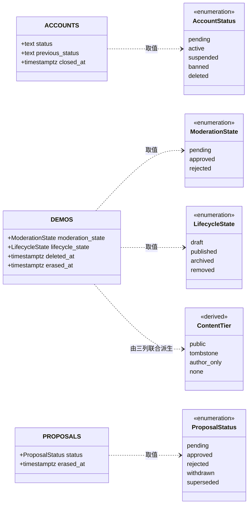

# 标准对象 · 一、状态与档位

> 权威范围：**状态类的取值域、迁移边、不变量 CHECK**。端点、权限 key、自保护规则、论证留在域文档。
> 引用写法：`标准对象 §ST-1`。域文档里再抄一份完整取值集合 = 制造第二份事实源，`scripts/check-objects.mjs` 会报错。
> 返回索引：[../标准对象.md](../标准对象.md) · 本册登记：`ST-1` 账号状态 · `ST-2` 可见性四档 · `ST-3` 内容档位九档 · `ST-4` 作品审核态 · `ST-5` 作品发布态 · `ST-6` 提案状态

## 建模图（本册全部对象）



图里只有「谁携带这个值」。**两个状态列不合并**：`moderation_state` 回答「能不能公开」，`lifecycle_state` 回答「作者想不想公开」——二者正交，任一方未通过都不算公开（判定式见 `§ST-2` 与台账 G1）。

## §ST-1 账号状态 `AccountStatus`

**它是账号轴上唯一的状态列。** `accounts.status` 是「能不能登录、能不能发言、是否已注销」的唯一表达，同一件事不允许再有第二列或第二张图。落列在身份域（`docs/身份服务模型设计.md` §6.1），迁移的端点与权限在治理域（`docs/治理域设计.md` §7.1），本文负责**取值与边本身**。

**五个取值，语义按「谁能做什么」定。** `pending` 没验证邮箱、`suspended` 有期限制、`banned` 无期限制且要申诉、`deleted` 本人自愿且不可逆——四者都不能登录发言，但对下游传播的语义不同，合并了就再没地方表达差别。

| 值 | 语义 | 能登录 | 能发言 |
|---|---|---|---|
| `pending` | 已注册、邮箱未验证（**默认值**） | 否 | 否 |
| `active` | 正常 | 是 | 是 |
| `suspended` | 暂停（可恢复，如临时禁言） | 否 | 否 |
| `banned` | 封禁（长期，走申诉） | 否 | 否 |
| `deleted` | 已注销（**终态**，不可恢复） | 否 | 否 |

`previous_status` **不是状态，是恢复目标**：只在 `suspended` / `banned` 时有值（`suspended` ⇒ 必为 `active`；`banned` ⇒ `active` 或 `suspended`），其余状态必须为 `NULL`，进入 `deleted` 时清空。没有它，`banned` 解除后分不清该回 `active` 还是 `suspended`。

**十一条边，包括入口与一条终态。**

| # | 从 | 到 | 触发者 | 前置条件 |
|---|---|---|---|---|
| 1 | — | `pending` | 本人 | 注册成功 |
| 2 | `pending` | `active` | 本人 | 邮箱验证通过 |
| 3 | `pending` | `deleted` | 系统任务 | 注册满 30 天仍未验证 |
| 4 | `active` | `suspended` | 持 `user.status` 者 | `reason` 必填 |
| 5 | `active` | `banned` | 持 `user.status` 者 | `reason` 必填 |
| 6 | `active` | `deleted` | **本人** | 二次确认 `"DELETE"` |
| 7 | `suspended` | `active` | 持 `user.status` 者 | 回到 `previous_status` |
| 8 | `suspended` | `banned` | 持 `user.status` 者 | 升级；`previous_status` 归一到 `active` |
| 9 | `banned` | `active` | 持 `user.status` 者 | 回到 `previous_status` |
| 10 | `banned` | `suspended` | 持 `user.status` 者 | 降级；`previous_status` 归一为 `active` |
| 11 | `deleted` | — | 无 | **终态**，没有出边 |

**不存在的迁移，写了就是 bug**：`suspended → deleted`、`banned → deleted`、`deleted → 任何`、`pending → suspended`。管理员能做的上限是封禁；删账号是用户自己的权利（治理域 **D2**，旧栈 P12 的修正）。

**三条不变量**（身份域 §6.1 逐字引用，门禁比对值集）：

```sql
-- 取值域
CHECK (status IN ('pending', 'active', 'suspended', 'banned', 'deleted'))

-- previous_status 与 status 联立（`IS NOT DISTINCT FROM` 是必要的：NULL 时 `= 'active'` 求值为 NULL，
-- 而 CHECK 只在 FALSE 时拒绝，三值逻辑会把它放过去）
CHECK (
    CASE status
        WHEN 'active'    THEN previous_status IS NULL
        WHEN 'suspended' THEN previous_status IS NOT DISTINCT FROM 'active'
        WHEN 'banned'    THEN previous_status IS NOT NULL
                          AND previous_status IN ('active', 'suspended')
        ELSE previous_status IS NULL
    END
)

-- 注销时刻与终态同生共死（只有 #3 #6 两条边写 closed_at，两者都置 status='deleted'）
CHECK ((status = 'deleted') = (closed_at IS NOT NULL))
```

**谁能改，按边分组**——「同一个端点覆盖多条边」本身就是容易漏的地方。

| 迁移组 | 谁 | 端点 |
|---|---|---|
| #2 | 本人 | `POST /me/verify-email` |
| #3 | 系统任务 | 无（定时） |
| #4 #5 #7 #8 #9 #10 | 持 `user.status` 者 | `POST /admin/users/{id}/status` |
| #6 | 本人 | `POST /me/delete`（`body { confirm: "DELETE" }`） |

自保护五条（不能改自己角色 / 不能封自己 / 不能降级最后一个 admin / 不能封 admin / 改状态必填 `reason`）是**操作规则**，不是取值域，在治理域 §7.2，不在本文重复。

**「全域统一」在实物上长这样**：

| 层 | 位置 | 形态 |
|---|---|---|
| 数据 | `accounts.status` / `previous_status` / `closed_at` | 列 + 上面三个 CHECK |
| 数据索引 | `ix_accounts_status ON accounts (status) WHERE closed_at IS NULL` | 只索引未注销行 |
| 域文档 | 身份域 §6.1 | 字段表两行 + DDL，带 `标准对象 §ST-1` |
| 域文档 | 身份域 §8.1 | 纯指针（本域不重画状态机） |
| 域文档 | 治理域 §7.1 | 图 + 端点/权限表（治理视角），表为准于图 |
| 横切 | 生命周期 §3.1 账号轴、§5.1 注销语义 | 指针 |
| 下游 | 论坛投影（`docs/论坛外置选型对比.md`） | 只消费 `active`，其余按「不可登录」处理 |
| 契约 | OpenAPI `AccountStatus`（待建） | 枚举，由本文取值域生成 |
| 代码 | `identity.AccountStatus`（待建） | 常量 + `IsLoginable()` |
| 前端 | 状态文案与颜色（待建） | 一处映射表，不在页面里散写 |

**加一个值要动六处**：① 本文取值表；② 第一个 `CHECK`；③ 若新值带新 `previous_status` 规则，改第二个 `CHECK`；④ 本文迁移矩阵与身份域/治理域的图；⑤ 前端文案；⑥ 历史数据回填 migration。**漏②门禁红；漏④门禁不报**（已知边界，靠 review 兜）。

## §ST-2 内容可见性四档 `ContentTier`

**它回答「谁 GET 得到什么」，不落任何列——它是从 `deleted_at` / `erased_at` 与 `§ST-4` / `§ST-5` 派生的判定结果。** 四档，没有第五档。

取值域：`public` / `tombstone` / `author_only` / `none`

| 档 | 键 | 陌生人 GET | 作者 GET | 列表 / 搜索 / 计数 | 判据 |
|---|---|---|---|---|---|
| 公开 | `public` | 200 + 全文 | 200 + 全文 | 计入 | 未擦除、未软删、审核通过且已发布 |
| 墓碑 | `tombstone` | 200 + 墓碑页 | 200 + 墓碑页 | 不计入 | 未擦除、未软删，且 `§ST-5` 为 `archived` / `removed` |
| 仅作者 | `author_only` | 404 | 200（按档位标注） | 不计入 | 未擦除，且（未公开 或 已软删 或 附件已清） |
| 无人 | `none` | 404 | 404 | 不计入 | `erased_at` 非空 |

判定顺序是固定的，顺序错就是 bug：

1. `erased_at` 非空 → `none`（一票否决，**作者本人也不给**）
2. `deleted_at` 非空 → `author_only`
3. `§ST-4` 不是 `approved`，或 `§ST-5` 是 `draft` → `author_only`
4. `§ST-5` 是 `archived` / `removed` → `tombstone`
5. 其余 → `public`（还要过渠道档 `§EN-1`）

反过来写（先判发布状态、再判擦除）必然出错：擦除**不改** `§ST-5`，所以「已擦除但 `lifecycle_state` 还是 `published`」是常态，先判发布就走进 `public` 分支。

```sql
-- 列表 / 搜索 / 计数 / 榜单：只有这一档计入
deleted_at IS NULL AND erased_at IS NULL
  AND moderation_state = 'approved' AND lifecycle_state = 'published'
  AND EXISTS (SELECT 1 FROM demo_channels c
               WHERE c.demo_id = demos.id
                 AND c.channel = :channel AND c.visibility = 'listed')
```

```sql
-- 详情：直访 id 或 slug；前两句就是 404 与 200 的分界
erased_at IS NULL
AND (deleted_at IS NULL OR author_id = :me)
AND (author_id = :me
     OR (moderation_state = 'approved'
         AND lifecycle_state IN ('published', 'archived', 'removed')))
```

**不变量**：① 「曾经公开过」是 `tombstone` 与 404 的唯一界线（台账 G1）——`archived` / `removed` 的地址可能被转发、被收录，回访要给说明页；软删与擦除没有这个义务，给 404，且必须与「不存在」逐字节相同。② `author_only` 装了两类东西（未公开、已软删），对外表现一致，不必拆档；真要区分就看 `deleted_at` 是否为空。③ 同一份谓词在列表、详情、计数三处必须逐字相同——这是四档能站住的前提。

## §ST-3 内容档位九档 `ContentGear`

**它是 `§ST-2` 四档 × 三个时间戳的细化**：可见性只有四档，但「为什么不可见」有九种，运维、申诉、界面文案都要按这九档说话。档位同样**不落列**，从已存在的列派生。

取值域：`draft` / `pending` / `rejected` / `published` / `archived` / `removed` / `deleted` / `erased` / `purged`

| 档位 | 判定条件 | 陌生人直访 | 列表 / 计数 | 能恢复吗 | 页面形态 |
|---|---|---|---|---|---|
| `draft` | `lifecycle_state='draft'` | 404 | 否 | — | 作者与管理员可见 |
| `pending` | `moderation_state='pending'` | 404 | 否 | — | 同上 |
| `rejected` | `moderation_state='rejected'` | 404 | 否 | — | 同上（可改后重提） |
| `published` | `approved` + `published` + 未删 | 200 | 是 | — | 完整内容 |
| `archived` | `lifecycle_state='archived'` | 200 + 墓碑 | 否 | ✅ 作者恢复发布 | 「作者已下架该作品」 |
| `removed` | `lifecycle_state='removed'` | 200 + 墓碑 | 否 | ⚠️ 只能申诉 | 「因违规被移除」+ 依据条款 |
| `deleted` | `deleted_at` 非空、`erased_at` 空 | 404 | 否 | ✅ 30 天内 | 不存在（不发墓碑） |
| `erased` | `erased_at` 非空 | 404 | 否 | ❌ | 不存在 |
| `purged` | `gc_queue.purged_at` 或 `abandoned_at` 非空 | 404 | 否 | ❌ 恢复得 409 | 不存在；**作者看到空壳**「附件已清理」 |

**九档不是九个格子。** 前六档的数据坐标完全相同（字段完整、文件在），差别只在可见性与谁被允许看；`deleted` 只多一个时间戳；只有 `erased` 动字段、`purged` 动文件。映射到 `docs/数据生命周期设计.md` §2.3「合法格子只有六个」：`draft` / `pending` / `rejected` / `deleted` / `purged` 都是「仅作者」，`published` 是「公开」，`archived` / `removed` 是「墓碑」，`erased` 是「无人」。

**两条硬边界**：① 墓碑只属于 `archived` / `removed` 这两种「曾经公开过」的档位——给 `deleted` / `erased` 发墓碑等于对外承认「这里有过东西」（台账 G1）；② `purged` 之后作者仍能打开页面（空壳），只是附件不可下载——`404` 是给陌生人的，不是给作者的。


## §ST-4 作品审核态 `ModerationState`

**它回答「这作品允许公开吗」，不回答「作者发布了吗」。** 后者是 `§ST-5`，两者正交：审核通过但还在草稿 = 不公开；作者发布了但审核拒绝 = 不公开。

| 值 | 语义 | 默认 |
|---|---|---|
| `pending` | 待审（新提交、重建后重新送审） | ✅ |
| `approved` | 审核通过 | |
| `rejected` | 审核拒绝（作者可见，带理由） | |

```sql
-- 承载列：demos.moderation_state（Demo 域 §3.1）
moderation_state text NOT NULL DEFAULT 'pending'
                 CHECK (moderation_state IN ('pending', 'approved', 'rejected'))
```

**边**：`pending → approved`（审核通过）、`pending → rejected`（审核拒绝）、`rejected → pending`（作者修改后重新送审）。**`approved → pending` 只发生在重建内容后**（管理员修正生成新 revision，需要重新审核，治理域 §10.2）——其余情形不得回落。

**强行约束**：`demo_channels.visibility='listed'` 要求 `moderation_state='approved'`（Demo 域 §7 不变量 #8）。谁能改：持 `demo.review` 者；ReviewDecision 见 `§EN-2`。

## §ST-5 作品发布态 `LifecycleState`

**它回答「作者想不想让它公开」**，与 `§ST-4` 正交。软删除**不是**这个枚举里的一个值——它是独立的时间戳列 `demos.deleted_at`（这是 Demo 域 §6.2 那张状态图里唯一需要读两列才成立的节点）。

| 值 | 语义 | 直访表现 |
|---|---|---|
| `draft` | 草稿（默认） | 仅作者可见 |
| `published` | 已发布 | 公开（还要过 `§ST-4` 与渠道 `§EN-1`） |
| `archived` | 作者下架 | 200 + tombstone「作者已下架该作品」 |
| `removed` | 违规下架 | 200 + tombstone「因违规被移除」+ 申诉入口 |

```sql
-- 承载列：demos.lifecycle_state（Demo 域 §3.1）
lifecycle_state text NOT NULL DEFAULT 'draft'
                CHECK (lifecycle_state IN ('draft', 'published', 'archived', 'removed'))
```

**边**：`draft → published`（发布）、`published ↔ archived`（下架 / 恢复）、`published → removed`、`archived → removed`（违规下架）、`removed → published`（申诉通过）。**`deleted` 不在本枚举内**：软删除由 `deleted_at` 表达，且 `deleted_at IS NOT NULL` 时本列维持原值（恢复时不需要回填）。

## §ST-6 提案状态 `ProposalStatus`

**提案是「半开放实体」的修改通道**（实体域 §4），状态只回答「这条提案走到哪了」。终态有三个，别把它们混成一个「不通过」。

| 值 | 语义 | 终态 |
|---|---|---|
| `pending` | 待处理（默认） | |
| `approved` | 通过（并已执行） | ✅ |
| `rejected` | 审核拒绝 | ✅ |
| `withdrawn` | 提交人撤回 | ✅ |
| `superseded` | 被取代（目标被合并 / 已有更新的提案） | ✅ |

```sql
-- 承载列：proposals.status（实体域 §3）
status text NOT NULL DEFAULT 'pending'
       CHECK (status IN ('pending', 'approved', 'rejected', 'withdrawn', 'superseded'))
```

**边**：`pending → approved`、`pending → rejected`（审核）、`pending → withdrawn`（提交人）、`pending → superseded`（系统：目标实体被合并或出现更新的提案，实体域 §4.12）。四个终态互不迁移。谁能改：`approved` / `rejected` 由持 `proposal.review` 者，`withdrawn` 只能提交人。

## 变更记录

| 版本 | 日期 | 变更 |
|---|---|---|
| v2.1 | 2026-10-30 | 收编 `ST-2` 四档（判定顺序 + 列表/详情两份标准谓词）与 `ST-3` 九档（判定条件 + 九档↔六格映射）；九档与四档是「细化」不是两套事实源 |
| v2.0 | 2026-10-30 | 从 `docs/标准对象.md` 拆出成册；补建模图；`ST-4` / `ST-5` / `ST-6` 三个状态对象从域文档收编（取值域与 CHECK 在此，端点与论证留在域文档）；指出 `deleted` 不是 `LifecycleState` 的值 |
