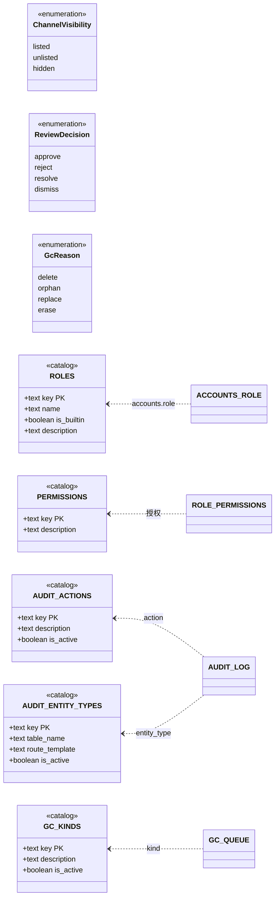

# 标准对象 · 二、枚举值域

> 权威范围：**枚举型取值域**，以及承载它们的**目录表 DDL 与种子**。谁有权改、什么时候写、怎么读，留在域文档。
> 引用写法：`标准对象 §EN-3`。返回索引：[../标准对象.md](../标准对象.md) · 本册登记：`EN-1` 渠道可见性 · `EN-2` 审核裁决 · `EN-3` 角色 · `EN-4` 权限键 · `EN-5` 审计动作 · `EN-6` 审计实体类型 · `EN-7` GC 对象类型 · `EN-8` GC 原因

**为什么有两类形态**：`EN-1` / `EN-2` / `EN-8` 是**列上的约束**（`CHECK` 或 `text[]` 白名单），值少且几乎不变；`EN-3`–`EN-7` 是**目录表**（一行一个值），因为给它们加值不应该动主表——`audit_log` 是全库最热最大的表，`ALTER TABLE ... ADD CONSTRAINT CHECK` 要对全表校验并取 `ACCESS EXCLUSIVE`，代价随行数线性涨。目录表的「加值」是纯 `INSERT`，引用完整性一样硬。

## 建模图（本册全部对象）



目录表都带 `is_active`（除 `roles` / `permissions`）：**停用一个值用 `is_active=false`，不删行**——删行会被 `ON DELETE RESTRICT` 挡住，而历史审计/队列行必须能一直解析出它的含义。

## §EN-1 渠道可见性 `ChannelVisibility`

**它回答「这件作品在这个渠道里露不露」**，与审核（`§ST-4`）、发布（`§ST-5`）都不同：同一作品可以 deeply 列出、astra 隐藏。

| 值 | 语义 |
|---|---|
| `listed` | 该渠道列表可见（默认） |
| `unlisted` | 列表不出现，直访可用（未列表的分享链接） |
| `hidden` | 该渠道完全不可见（含直访） |

```sql
-- 承载列：demo_channels.visibility（Demo 域 §3.2）
visibility text NOT NULL DEFAULT 'listed'
           CHECK (visibility IN ('listed', 'unlisted', 'hidden'))
```

约束：`visibility='listed'` 要求 `moderation_state='approved'`（Demo 域 §7 不变量 #8）。**渠道自身**（`deep` / `astra` / 未来渠道）是数据不是枚举，落在 `channels` 主数据表（迁移 0010），`demo_channels.channel` 是它的外键 —— 「是数据」不等于「随便写」，打错一个字会被外键拒。本对象只管「三档可见性」。谁能改：持 `demo.curate` 者；加渠道要写 `channels` 一行。

## §EN-2 审核裁决 `ReviewDecision`

**它不是状态，是「这次审核做了什么决定」**——写进审计、写进 `review_kinds.decisions` 白名单。把裁决当状态是旧栈的一类混淆（`entity_suggestions` 只有 approve/reject 两值，于是「忽略」只能记成 reject）。

| 值 | 语义 |
|---|---|
| `approve` | 通过 |
| `reject` | 驳回（带理由） |
| `resolve` | 处理完毕（举报类队列：内容无需变更，问题已解决） |
| `dismiss` | 不予处理（举报类队列：举报不成立） |

```sql
-- 承载：review_kinds.decisions（治理域 §5.4）——每个审核种类声明自己允许哪些裁决
CONSTRAINT ck_review_decisions CHECK (
    cardinality(decisions) >= 1
    AND decisions <@ ARRAY['approve', 'reject', 'resolve', 'dismiss']::text[]
)
```

`cardinality(...) >= 1` 而不是 `array_length(..., 1) >= 1`：**空数组时 `array_length` 返回 `NULL`**，而 CHECK 只在 `FALSE` 时拒绝——写错就是「空白名单也能存进去」（PG 18.6 实测过）。

当前两个种类：`proposal` → `{approve, reject}`，`demo` → `{approve, reject}`；`report` 恢复时再加 `{resolve, dismiss}`。**加一种裁决要动**：本表、`ck_review_decisions` 的白名单、各 `review_kinds.decisions` 的种子值。

## §EN-3 角色 `Role`（目录表）

角色是**数据**不是枚举：加一个角色 = `INSERT` 一行，不动任何表结构。`accounts.role` 直接 `REFERENCES roles(key)`（跨域硬引用，治理域 §2.3）。

> **DDL 见 [20-governance.sql](../../db/schema/20-governance.sql)**（本节涉及的 1 张表/视图：`roles`）。表结构以 SQL 文件为准，文档不再复制。

**单角色**（Q9 定案）：`accounts.role` 是单列，一个人只有一个角色。多角色表达力增益在只有三个角色且 `admin` 已含全部权限时不成立，成本是全部（鉴权、界面、审计都要重做）。

## §EN-4 权限键 `PermissionKey`（目录表）

权限是**数据**：加一个权限 = `INSERT` 一行 + 端点声明 `RequirePermission`，不动结构。键的命名是 `域.动作`（kebab 段、点分段、全小写），如 `demo.review`、`user.status`。

> **DDL 见 [20-governance.sql](../../db/schema/20-governance.sql)**（本节涉及的 1 张表/视图：`permissions`）。表结构以 SQL 文件为准，文档不再复制。

**当前 21 个键的语义与角色绑定**（`moderator` 五条、`admin` 全绑）在治理域 §4.3——那是**策略**，会随产品调整；本对象只管「键的形式、存在性与唯一权威」。加权限的四步与四条 CI 检查同样在治理域 §4.4，其中「`admin` 必须绑全」由 `permission-contract` job 硬拦。

## §EN-5 审计动作 `AuditAction`（目录表）

> **DDL 见 [20-governance.sql](../../db/schema/20-governance.sql)**（本节涉及的 1 张表/视图：`audit_actions`）。表结构以 SQL 文件为准，文档不再复制。

**25 条，且这是唯一权威**：加一个动作 = 这里加一行 + 后端常量清单同步（两者不一致 CI 会红，治理域 §8.3）。`audit_log.action` 是 `REFERENCES audit_actions(key) ON DELETE RESTRICT`。

## §EN-6 审计实体类型 `AuditEntityType`（目录表）

> **DDL 见 [20-governance.sql](../../db/schema/20-governance.sql)**（本节涉及的 1 张表/视图：`audit_entity_types`）。表结构以 SQL 文件为准，文档不再复制。

**15 条**。`table_name` + `route_template` 是后台「点审计行跳回被改的对象」的依据——没有它，`audit_log` 里的 `entity_id` 只能靠 19 个硬编码 `if` 拼链接。**未设计的域不入枚举**（`announcement` / `forum_*` 都等到那个域设计时再加；`setting` 已随设置域 v1.0 于 v2.1 加入），`report` 是唯一的显式占位。

## §EN-7 GC 对象类型 `GcKind`（目录表）

> **DDL 见 [20-governance.sql](../../db/schema/20-governance.sql)**（本节涉及的 1 张表/视图：`gc_kinds`）。表结构以 SQL 文件为准，文档不再复制。

```sql
INSERT INTO gc_kinds (key, description) VALUES
    ('demo_dir',   '作品目录前缀'),
    ('oss_object', 'OSS 上的单个对象'),
    ('blob',       '内容寻址的 blob');
```

**3 条**。加一种派生物 = `INSERT` 一行；`gc_queue.kind` 是 `REFERENCES gc_kinds(key) ON DELETE RESTRICT`。写成种子而不是散文，是因为散文没法被机器校验（`contract` 门禁要拿它去核对生命周期 `registry.yaml` 里每个 `kind`）。

## §EN-8 GC 原因 `GcReason`

**它是 `gc_queue` 上唯一的列级枚举**（不是目录表），因为四个值直接决定 `purge_after` 的算法。

| 值 | 什么动作入队 | 默认延迟 |
|---|---|---|
| `delete` | 软删（可恢复） | 30 天 |
| `orphan` | 引用归零（被替换的 blob / 孤儿目录） | 24 小时 |
| `replace` | 内容被新版本替换 | 24 小时 |
| `erase` | 擦除（不再恢复） | **立即**：`purge_after = now()`，没有恢复窗口 |

```sql
-- 承载列：gc_queue.reason（治理域 §5.3）
reason text NOT NULL DEFAULT 'delete'
       CHECK (reason IN ('delete', 'orphan', 'replace', 'erase'))
```

**恢复 = 删队列行**（不是把 `purge_after` 推远）：否则「第 29 天恢复、第 30 天再删」会立刻到期。入队用 `ON CONFLICT (kind, object_key) DO UPDATE SET purge_after = LEAST(...)`——只前移，不推后。

**`erase` 与 `delete` 的延迟不是同一个数**：软删有 30 天恢复窗口（治理域 §9.2 / L1=A），擦除是不可逆承诺，所以到期点就是入队那一刻（生命周期 §6.7 / §7.5）。写成「同 `delete`」会让擦掉的内容在盘上多躺 30 天。

## §EN-9 设置键 `SettingKey`（目录表）

> **DDL 见 [15-settings.sql](../../db/schema/15-settings.sql)**（本节涉及的 3 张表：`setting_keys` / `site_settings` / `user_preferences`）。表结构以 SQL 文件为准，文档不再复制。

**首批 18 行注册（`site` 15 行 / `user` 3 行），`setting_keys` 是唯一权威**：加一项参数 = `INSERT` 一行 + 一条 migration，**不改表结构、不改接口形状**（设置域 §3.2 / 需求 SET-001）。各键的语义、默认值与「谁读它」在设置域 §4 的表里。

**为什么它是标准对象，而不是设置域的私有物**：这些键**被别的域读**——`demo.auto_approve` 由 Demo 域在读，`history.record` 由浏览历史域在读，`auth.login_rate_account` 由身份域在读，`notify.retention_days` 由通知域在读，`collection.public_default` 由收藏域在读。判据见 [标准对象.md](../标准对象.md)「两个及以上域必须读到同一值域时，它才是标准对象」。

**键的形式**：`域.键`，小写 `snake_case`，至少一个点。**域段是「这个参数影响哪个域」，不是设置域自己**——`notify.retention_days` 影响通知域。`CHECK` 在 `setting_keys.key` 上强制这个形状，所以「设置域自己的参数」这种键名写不出来。

**同名不同 `scope` 是允许的**：主键是 `(key, scope)`。`notify.retention_days` 同时有 `site` 行（站点默认 90 天）与 `user` 行（用户覆盖，只允许配得更短）。

**退役**：`is_active = false`，**不删行**（§ID-5 通则①）。值行同样不删——审计的 `before`/`after` 要能对上键名，删了就指向一个不存在的键。

## 变更记录

| 版本 | 日期 | 变更 |
|---|---|---|
| v2.1 | 2026-11-01 | 新增 §EN-9 设置键（设置域 v1.0）；§EN-4 权限键 20 → 21（加 `setting.write`）；§EN-6 审计实体类型 14 → 15（`setting` 重新入枚举，设置域已设计） |
| v2.0 | 2026-10-30 | 从 `docs/标准对象.md` 拆出成册；`EN-3`–`EN-7` 五张目录表的 DDL 与种子从治理域 §5 收编（治理域改为指针）；`EN-1`/`EN-2`/`EN-8` 三处列级枚举收编；补建模图与 `is_active` 通则 |
