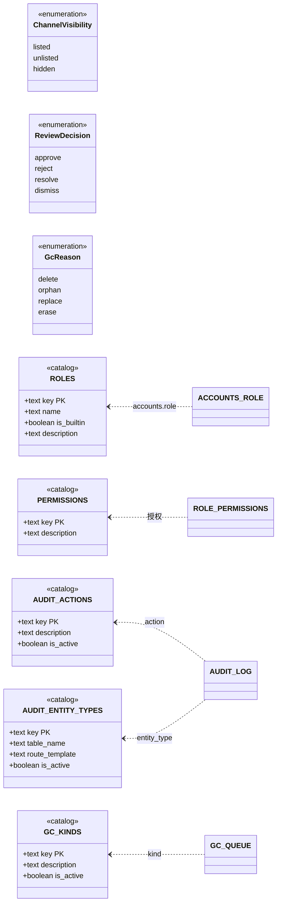

# 标准对象 · 二、枚举值域

> 权威范围：**枚举型取值域**，以及承载它们的**目录表 DDL 与种子**。谁有权改、什么时候写、怎么读，留在域文档。
> 引用写法：`标准对象 §EN-3`。返回索引：[../标准对象.md](../标准对象.md) · 本册登记：`EN-1` 渠道可见性 · `EN-2` 审核裁决 · `EN-3` 角色 · `EN-4` 权限键 · `EN-5` 审计动作 · `EN-6` 审计实体类型 · `EN-7` GC 对象类型 · `EN-8` GC 原因

**为什么有两类形态**：`EN-1` / `EN-2` / `EN-8` 是**列上的约束**（`CHECK` 或 `text[]` 白名单），值少且几乎不变；`EN-3`–`EN-7` 是**目录表**（一行一个值），因为给它们加值不应该动主表——`audit_log` 是全库最热最大的表，`ALTER TABLE ... ADD CONSTRAINT CHECK` 要对全表校验并取 `ACCESS EXCLUSIVE`，代价随行数线性涨。目录表的「加值」是纯 `INSERT`，引用完整性一样硬。

## 建模图（本册全部对象）



目录表都带 `is_active`（除 `roles` / `permissions`）：**停用一个值用 `is_active=false`，不删行**——删行会被 `ON DELETE RESTRICT` 挡住，而历史审计/队列行必须能一直解析出它的含义。

## §EN-1 渠道可见性 `ChannelVisibility`

**它回答「这件作品在这个渠道里露不露」**，与审核（`§ST-4`）、发布（`§ST-5`）都不同：同一作品可以 deeply 列出、astra 隐藏。

| 值 | 语义 |
|---|---|
| `listed` | 该渠道列表可见（默认） |
| `unlisted` | 列表不出现，直访可用（未列表的分享链接） |
| `hidden` | 该渠道完全不可见（含直访） |

```sql
-- 承载列：demo_channels.visibility（Demo 域 §3.2）
visibility text NOT NULL DEFAULT 'listed'
           CHECK (visibility IN ('listed', 'unlisted', 'hidden'))
```

约束：`visibility='listed'` 要求 `moderation_state='approved'`（Demo 域 §7 不变量 #8）。**渠道自身**（`deep` / `astra` / 未来渠道）是数据不是枚举，在 `demo_channels.channel` 里自由增长；本对象只管「三档可见性」。谁能改：持 `demo.curate` 者。

## §EN-2 审核裁决 `ReviewDecision`

**它不是状态，是「这次审核做了什么决定」**——写进审计、写进 `review_kinds.decisions` 白名单。把裁决当状态是旧栈的一类混淆（`entity_suggestions` 只有 approve/reject 两值，于是「忽略」只能记成 reject）。

| 值 | 语义 |
|---|---|
| `approve` | 通过 |
| `reject` | 驳回（带理由） |
| `resolve` | 处理完毕（举报类队列：内容无需变更，问题已解决） |
| `dismiss` | 不予处理（举报类队列：举报不成立） |

```sql
-- 承载：review_kinds.decisions（治理域 §5.4）——每个审核种类声明自己允许哪些裁决
CONSTRAINT ck_review_decisions CHECK (
    cardinality(decisions) >= 1
    AND decisions <@ ARRAY['approve', 'reject', 'resolve', 'dismiss']::text[]
)
```

`cardinality(...) >= 1` 而不是 `array_length(..., 1) >= 1`：**空数组时 `array_length` 返回 `NULL`**，而 CHECK 只在 `FALSE` 时拒绝——写错就是「空白名单也能存进去」（PG 18.6 实测过）。

当前两个种类：`proposal` → `{approve, reject}`，`demo` → `{approve, reject}`；`report` 恢复时再加 `{resolve, dismiss}`。**加一种裁决要动**：本表、`ck_review_decisions` 的白名单、各 `review_kinds.decisions` 的种子值。

## §EN-3 角色 `Role`（目录表）

角色是**数据**不是枚举：加一个角色 = `INSERT` 一行，不动任何表结构。`accounts.role` 直接 `REFERENCES roles(key)`（跨域硬引用，治理域 §2.3）。

```sql
-- 治理域 §5.1（v1.13 起本表归标准对象，治理域只写「怎么用」）
CREATE TABLE roles (
    key         text        PRIMARY KEY,              -- user / moderator / admin（≤32 字符，kebab-case）
    name        text        NOT NULL,                 -- 展示名（中文）
    is_builtin  boolean     NOT NULL DEFAULT false,   -- 内置角色不可删、不可改 key
    description text        NOT NULL DEFAULT '',
    created_at  timestamptz NOT NULL DEFAULT now(),
    updated_at  timestamptz NOT NULL DEFAULT now()
);

INSERT INTO roles (key, name, is_builtin, description) VALUES
    ('user',      '注册用户', true, '只能操作自己拥有的资源'),
    ('moderator', '审核员',   true, '内容审核、提案审核、论坛治理'),
    ('admin',     '管理员',   true, '全部治理权限');
```

**单角色**（Q9 定案）：`accounts.role` 是单列，一个人只有一个角色。多角色表达力增益在只有三个角色且 `admin` 已含全部权限时不成立，成本是全部（鉴权、界面、审计都要重做）。

## §EN-4 权限键 `PermissionKey`（目录表）

权限是**数据**：加一个权限 = `INSERT` 一行 + 端点声明 `RequirePermission`，不动结构。键的命名是 `域.动作`（kebab 段、点分段、全小写），如 `demo.review`、`user.status`。

```sql
-- 治理域 §5.1（v1.13 起本表归标准对象）
CREATE TABLE permissions (
    key         text        PRIMARY KEY,              -- 如 demo.review（≤64 字符）
    description text        NOT NULL DEFAULT '',
    created_at  timestamptz NOT NULL DEFAULT now()
);
```

**当前 20 个键的语义与角色绑定**（`moderator` 五条、`admin` 全绑）在治理域 §4.3——那是**策略**，会随产品调整；本对象只管「键的形式、存在性与唯一权威」。加权限的四步与四条 CI 检查同样在治理域 §4.4，其中「`admin` 必须绑全」由 `permission-contract` job 硬拦。

## §EN-5 审计动作 `AuditAction`（目录表）

```sql
-- 治理域 §5.2（v1.13 起本表归标准对象）
CREATE TABLE audit_actions (
    key         text        PRIMARY KEY,          -- review / create / delete …
    description text        NOT NULL DEFAULT '',
    is_active   boolean     NOT NULL DEFAULT true, -- 停用用这个，**不删行**
    created_at  timestamptz NOT NULL DEFAULT now()
);

INSERT INTO audit_actions (key, description) VALUES
    ('create', '新建'),            ('update', '修改'),
    ('status_set', '状态跃迁'),     ('review', '审核裁决'),
    ('merge', '合并'),             ('unmerge', '撤销合并'),
    ('attach', '建立关联'),         ('detach', '解除关联'),
    ('delete', '删除'),            ('restore', '恢复'),
    ('purge', '派生物真删'),        ('erase', '擦除内容字段'),
    ('alias_add', '加别名'),        ('alias_remove', '删别名'),
    ('attribute', '归属迁移'),      ('slug_set', '改 slug'),
    ('featured_add', '进精选'),     ('featured_remove', '出精选'),
    ('featured_order', '精选排序'),  ('featured_hero', '设为 hero'),
    ('role_set', '改角色'),         ('permission_grant', '授权'),
    ('permission_revoke', '收权'),
    ('override_content', '管理员覆写内容'),
    ('auth_event.read', '查他人安全日志');
```

**25 条，且这是唯一权威**：加一个动作 = 这里加一行 + 后端常量清单同步（两者不一致 CI 会红，治理域 §8.3）。`audit_log.action` 是 `REFERENCES audit_actions(key) ON DELETE RESTRICT`。

## §EN-6 审计实体类型 `AuditEntityType`（目录表）

```sql
-- 治理域 §5.2（v1.13 起本表归标准对象）
CREATE TABLE audit_entity_types (
    key            text        PRIMARY KEY,       -- demo / account / proposal …
    description    text        NOT NULL DEFAULT '',
    table_name     text,                          -- 承载该实体的表；UNIQUE，NULL = 尚未有表
    route_template text,                          -- 后台深链模板，必须以 {id} 结尾
    is_active      boolean     NOT NULL DEFAULT true,
    created_at     timestamptz NOT NULL DEFAULT now(),
    CONSTRAINT uq_audit_entity_table UNIQUE (table_name),
    CONSTRAINT ck_audit_entity_route CHECK (
        route_template IS NULL OR (route_template LIKE '/%' AND route_template LIKE '%{id}')
    )
);

INSERT INTO audit_entity_types (key, description, table_name, route_template) VALUES
    ('demo',            '作品',        'demos',            '/admin/demos/{id}'),
    ('demo_revision',   '作品版本',    'demo_revisions',   '/admin/revisions/{id}'),
    ('proposal',        '提案',        'proposals',        '/admin/proposals/{id}'),
    ('account',         '账号',        'accounts',         '/admin/users/{id}'),
    ('model',           '模型',        'models',           '/admin/models/{id}'),
    ('task',            '题目',        'tasks',            '/admin/tasks/{id}'),
    ('prompt',          '提示词',      'prompts',          '/admin/prompts/{id}'),
    ('prompt_library_entry', '提示词收录', 'prompt_library_entries', '/admin/prompt-library/{id}'),
    ('classification',  '分类项',      'classifications',  '/admin/classifications/{id}'),
    ('platform',        '平台',        'platforms',        '/admin/platforms/{id}'),
    ('platform_config', '平台配置',    'platform_configs', '/admin/platform-configs/{id}'),
    ('skill',           '技能',        'skills',           '/admin/skills/{id}'),
    ('mcp_server',      'MCP',         'mcp_servers',      '/admin/mcp-servers/{id}'),
    ('report',          '举报（预留）', NULL,               NULL);
```

**14 条**。`table_name` + `route_template` 是后台「点审计行跳回被改的对象」的依据——没有它，`audit_log` 里的 `entity_id` 只能靠 19 个硬编码 `if` 拼链接。**未设计的域不入枚举**（`setting` / `announcement` / `forum_*` 都等到那个域设计时再加），`report` 是唯一的显式占位。

## §EN-7 GC 对象类型 `GcKind`（目录表）

```sql
-- 治理域 §5.3（v1.13 起本表归标准对象）
CREATE TABLE gc_kinds (
    key         text        PRIMARY KEY,          -- demo_dir / oss_object / blob …
    description text        NOT NULL DEFAULT '',
    is_active   boolean     NOT NULL DEFAULT true, -- 停用用这个，**不删行**
    created_at  timestamptz NOT NULL DEFAULT now()
);
```

当前三条：`demo_dir`（作品目录）、`oss_object`（OSS 上的对象）、`blob`（内容寻址的 blob）。加一种派生物 = `INSERT` 一行；`gc_queue.kind` 是 `REFERENCES gc_kinds(key) ON DELETE RESTRICT`。

## §EN-8 GC 原因 `GcReason`

**它是 `gc_queue` 上唯一的列级枚举**（不是目录表），因为四个值直接决定 `purge_after` 的算法。

| 值 | 什么动作入队 | 默认延迟 |
|---|---|---|
| `delete` | 软删（可恢复） | 30 天 |
| `orphan` | 引用归零（被替换的 blob / 孤儿目录） | 24 小时 |
| `replace` | 内容被新版本替换 | 24 小时 |
| `erase` | 擦除（不再恢复） | 同 `delete` 的到期点 |

```sql
-- 承载列：gc_queue.reason（治理域 §5.3）
reason text NOT NULL DEFAULT 'delete'
       CHECK (reason IN ('delete', 'orphan', 'replace', 'erase'))
```

**恢复 = 删队列行**（不是把 `purge_after` 推远）：否则「第 29 天恢复、第 30 天再删」会立刻到期。入队用 `ON CONFLICT (kind, object_key) DO UPDATE SET purge_after = LEAST(...)`——只前移，不推后。

## 变更记录

| 版本 | 日期 | 变更 |
|---|---|---|
| v2.0 | 2026-10-30 | 从 `docs/标准对象.md` 拆出成册；`EN-3`–`EN-7` 五张目录表的 DDL 与种子从治理域 §5 收编（治理域改为指针）；`EN-1`/`EN-2`/`EN-8` 三处列级枚举收编；补建模图与 `is_active` 通则 |
