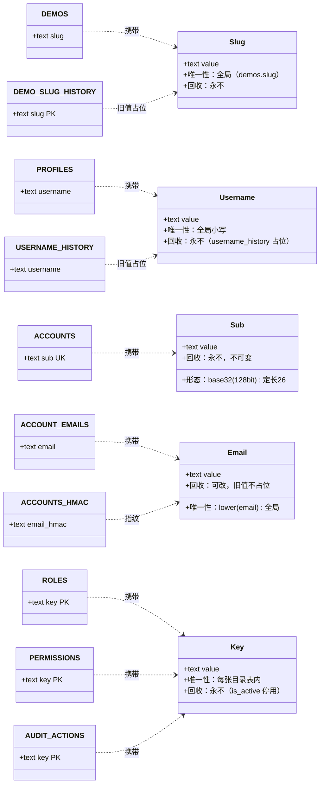

# 标准对象 · 三、标识符与命名

> 权威范围：**标识符的形态、唯一性作用域、生成与回收规则**。谁有权改、什么时候改，留在域文档。
> 引用写法：`标准对象 §ID-3`。返回索引：[../标准对象.md](../标准对象.md) · 本册登记：`ID-1` `slug` · `ID-2` `username` · `ID-3` `sub` · `ID-4` `email` 与邮箱指纹 · `ID-5` `key`（目录表键名） · `ID-6` 路由模板

**共同点只有一条**：这些列都是**对外可见或被外部系统引用的字符串**，所以它们的错误代价不是「数据难看」而是「链接失效、下游认不出人、审计指向不存在的对象」。也正因为对外，它们比内部 `id` 更难改——唯一的补救手段是「永不回收 + 留历史表」。

## 建模图（本册全部对象）



## §ID-1 `slug` — 内容标识符

**它是对外的名字，不是主键。** 所有路由用 slug 而不是 id（`/demos/{slug}`），这样链接可读、可分享、对搜索引擎友好；代价是它必须**永久唯一**——已发出去的链接不能因为别人用了同一个名字而失效。

| 项 | 规则 |
|---|---|
| 类型 | `text`，长度上限 **128** |
| 唯一性 | 全局唯一（`demos.slug`），**永久** |
| 字符集 | 生成侧保证 `[a-z0-9-]`；**DDL 目前无 `CHECK`**（见下） |
| 回收 | **永不**。改名后旧 slug 写入 `demo_slug_history` 占位，访问旧 slug → **301** 到当前 slug |
| 谁生成 | 服务端（从标题音译/截断 + 冲突加后缀）；**不接受客户端直给** |

```sql
-- 承载：demos.slug（Demo 域 §3.1）
slug text NOT NULL UNIQUE,          -- 唯一且永久；≤128 字符

-- 旧值占位：demo_slug_history（Demo 域 §3.10）
slug        text PRIMARY KEY,      -- 旧 slug（≤128 字符）
demo_id     bigint NOT NULL REFERENCES demos(id),
changed_at  timestamptz NOT NULL DEFAULT now(),
```

**已知缺口**：文档只写了「≤128 字符」，DDL 没有字符集约束——`slug='中文 空格!'` 现在能写进去，路由层再 404 就成了「数据在、页面不在」。建议补 `CHECK (slug ~ '^[a-z0-9][a-z0-9-]{2,127}$')`（**待拍板**，因为要连带决定历史数据里是否已存在非法 slug）。

**301 链不重写**：`a → b → c` 时，`a` 仍直接 301 到 `c`，不允许改成 `a → b` 再 `b → c`（否则旧链接多一跳，且删除 `b` 的行会断链）。

## §ID-2 `username` — 账号标识符

**它是登录名与 @提及名，和展示名（`display_name`）是两件事。** 标识要稳（唯一、ASCII、跨下游一致），展示名要好听（Unicode、可重名）——混在一列是旧栈的核心毛病（旧栈 `users.username` 是唯一身份，`display_name` 半死）。

| 项 | 规则 |
|---|---|
| 类型 | `text`，**3–20** 字符 |
| 字符集 | `[a-zA-Z0-9_-]`（ASCII） |
| 唯一性 | 全局唯一，**按小写比较**（`lower(username)`） |
| 回收 | **永不**。改名后旧名永久占位（`username_history`），防冒充 |
| 变更 | 少见但允许（§5.3）；改时**同一事务**同步 `credentials.identifier`（登录名两处存） |

```sql
-- 承载：profiles.username（身份域 §6.2）
username     text NOT NULL,        -- 3–20，[a-zA-Z0-9_-]
CONSTRAINT ck_profiles_username CHECK (username ~ '^[a-zA-Z0-9_-]{3,20}$')
CREATE UNIQUE INDEX uq_profiles_username ON profiles (lower(username));

-- 旧名占位：username_history（身份域 §6.2）
CREATE UNIQUE INDEX uq_username_history ON username_history (lower(username));
```

**为什么上限是 20 而不是旧栈的 32**：下游（Discourse）的 `max_username_length=20`，IdP 的约束必须取**所有下游的最严值**，否则会出现「本站能注册、下游登不进去」。

**两条容易踩的坑**：① 「不支持改名」与「旧名永不释放」是两件事——即使将来完全禁止改名，历史表也不能清；② 改名时下游（Discourse）可能**自己造一个名字**（`user_name_suggester`），所以下游必须有「名字与我方不一致」的对账，不能假设一改就对。

## §ID-3 `sub` — 对外不可变标识

**它是所有外部系统认人的依据**，等价于 OIDC 的 `subject`。`id` 是库内主键（会被重置、迁移、分库），`sub` 是**永久不变的对外身份**。

| 项 | 规则 |
|---|---|
| 类型 | `text`，**定长 26** |
| 形态 | `base32(128 bit)`（Crockford/无填充 base32） |
| 唯一性 | 全局唯一（`accounts.sub`） |
| 可变性 | **永不可变**，注册时生成一次 |
| 谁引用 | 下游 `users.sub`（demo 站 5 列表）、`web_sessions`、论坛投影、`external_links` 对账 |

```sql
-- 承载：accounts.sub（身份域 §6.1）
sub text NOT NULL UNIQUE,          -- base32(128 bit)，26 字符
```

**为什么不用邮箱或 username 当对外键**：两者都会变（邮箱可改、username 极少但允许改），一改下游全部失联。**为什么不用自增 id**：id 会暴露规模，且跨库/重建时不稳定。

**判据（跨库时的唯一依据）**：两端在**同一个 PG 实例**里 → 可以用 `bigint` 代理键互相引用（如实体域 7 处 `REFERENCES users(id)`）；跨库/跨服务 → **一律用 `sub`**。这是 `标准对象 §ID-3` 的分界线，也是批次 2 决策 F 的落点。

## §ID-4 `email` 与邮箱指纹

**邮箱是「可变的联系方式」+「注销后的验身凭据」两种用途**，两者要求的形态不同，所以要拆成两列。

| 用途 | 列 | 形态 |
|---|---|---|
| 联系与登录 | `account_emails.email` | 原文（保留用户输入的大小写，展示用），唯一性按 `lower(email)` |
| 注销后验身 | `accounts.email_hmac` | `HMAC-SHA256(服务端密钥, lower(trim(email)))`，**一次性** |

```sql
-- 承载：account_emails（身份域 §6.1）
CREATE UNIQUE INDEX uq_account_emails_email ON account_emails (lower(email));

-- 承载：accounts（身份域 §6.1）—— 只在注销那一刻写，核验通过立即置 NULL
email_hmac text,
CREATE UNIQUE INDEX uq_accounts_email_hmac ON accounts (email_hmac)
    WHERE email_hmac IS NOT NULL;
```

**为什么必须 HMAC 而不是裸哈希**：邮箱是**低熵**输入（几亿个可能值），固定盐 SHA-256 可以离线枚举反推；HMAC 的密钥在库外（环境变量/密钥管理），拿到库也反推不出来。`ip_hash` 同规格——裸 SHA-256 对 IPv4 只有 2³² 种输入。

**为什么索引是「部分」唯一**：平时所有人都是 `NULL`，不能互相冲突；只有注销那一行有值。**归一化只有一处**：`lower(trim(...))`，在写入侧做，读侧只做 lookup——两边各写一遍归一化，迟早不一致。

## §ID-5 `key` — 目录表键名

**目录表（角色/权限/审计动作/审计实体/GC 类型/分类维度）的主键都是 `key`**，它是被代码常量、审计行、种子数据同时引用的字符串，所以形态必须统一。

| 用途 | 形态 | 例 |
|---|---|---|
| 角色 | 小写、kebab-case、≤32 | `user` / `moderator` / `admin` |
| 权限 | `域.动作`，小写、点分段、≤64 | `demo.review` / `user.status` / `audit.read` |
| 审计动作 | 小写 `snake_case`，**不加域前缀** | `review` / `status_set` / `slug_set` |
| 审计实体类型 | 小写 `snake_case`，与 `table_name` 单数对应 | `demo` / `demo_revision` / `platform_config` |
| GC 类型 | 小写 `snake_case` | `demo_dir` / `oss_object` / `blob` |
| 分类维度 | 小写 `snake_case` | `language` / `license` |

**三条通则**：① 键**只增不改**——改键等于改代码常量 + 历史数据，一律用 `is_active=false` 停用旧键、新增新键；② 键**不翻译**（中文名放 `name` / `description` 列）；③ 键**不加域前缀**（`demo_create` 是错的，`create` + `entity_type='demo'` 才对——否则 `audit_actions` 会膨胀成笛卡尔积）。

## §ID-6 路由模板 `route_template`

**它把「审计行里的 entity_id」变成「能点开的链接」**，是后台可运维的关键。

```sql
-- 承载：audit_entity_types.route_template（治理域 §5.2）
route_template text,
CONSTRAINT ck_audit_entity_route CHECK (
    route_template IS NULL OR (route_template LIKE '/%' AND route_template LIKE '%{id}')
)
```

规则：以 `/` 开头（站内绝对路径）、必须含 `{id}` 占位符、**只允许一个**占位符、不带查询串。没有它（或没有 `table_name`）的实体类型，后台只能显示裸 id——这就是为什么 `report` 两列为空、而其余 12 条都填了真实路由。

## 变更记录

| 版本 | 日期 | 变更 |
|---|---|---|
| v2.0 | 2026-10-30 | 从 `docs/标准对象.md` 拆出成册；收编 `slug` / `username` / `sub` / `email` / `key` / `route_template` 六个标识符对象；指出 `demos.slug` 缺字符集 `CHECK`（待拍板）；写明 `ID-3` 的跨库判据（同库可用 bigint，跨库必须 `sub`） |
