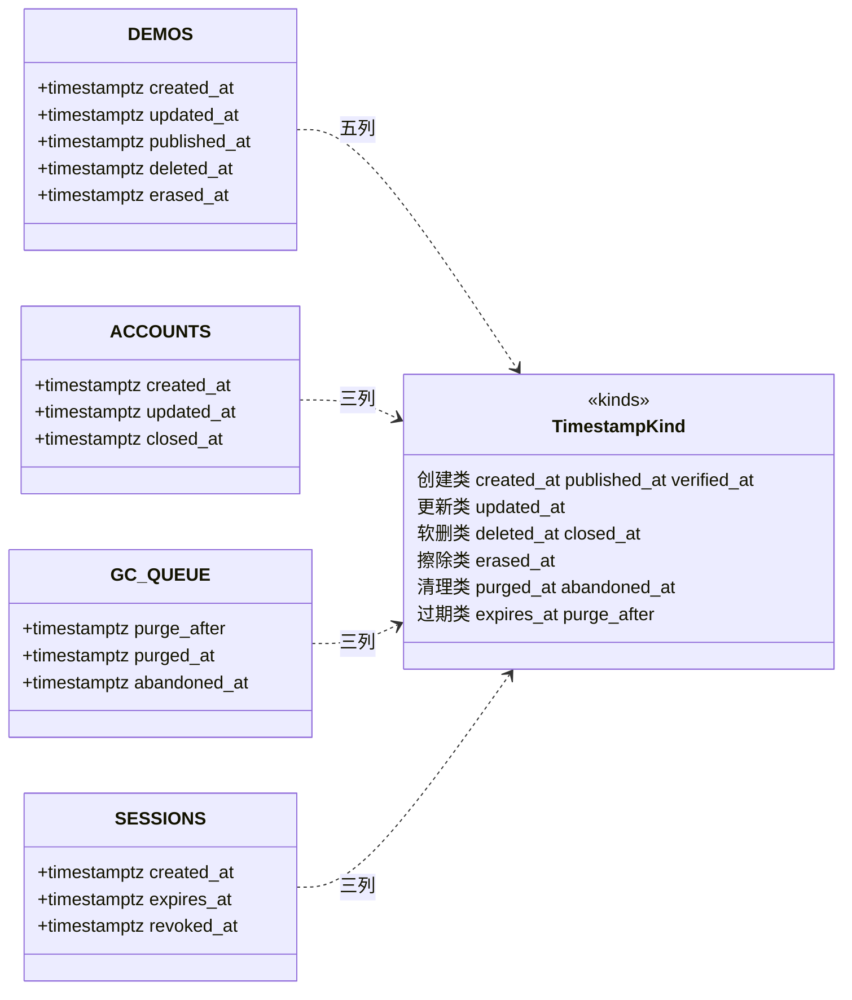

# 标准对象 · 四、时间戳与过期

> 权威范围：**时间戳列的语义、类型、默认值与先后关系**。谁在哪个动作里写它，留在域文档。
> 引用写法：`标准对象 §TS-1`。返回索引：[../标准对象.md](../标准对象.md) · 本册登记：`TS-1` 时间戳族 · `TS-2` 内容行的三时间戳 · `TS-3` 过期时间

**为什么值得单独一册**：时间戳是**唯一一类每个域都有、每个域都可能写错**的列。写错的后果不是报错而是静默——用 `timestamp` 而不是 `timestamptz` 会让跨时区排序错位；用应用进程时间而不是数据库时间会让多实例写入乱序；把「可变」和「不可变」的时间戳混在一列会让审计失去意义。这些错误在代码 review 里都看不出来。

## 建模图（本册全部对象）



## §TS-1 时间戳族

**唯一类型：`timestamptz`。** 不是 `timestamp`（无时区，跨时区排序会错位）、不是 `bigint` 毫秒（无法直接比较、无法用 `date_trunc`）、不是字符串。

```sql
created_at  timestamptz NOT NULL DEFAULT now(),
updated_at  timestamptz NOT NULL DEFAULT now(),
```

**九个语义，各有各的不可变要求**：

| 类 | 列 | 何时写 | 可再改？ |
|---|---|---|---|
| 创建 | `created_at` | `INSERT` 默认 | **永不** |
| 发布 | `published_at` | 首次 `published` | 撤回再发布**不覆写**（首发时间是对外事实） |
| 验证 | `verified_at`（邮箱） | 验证通过 | 可改（换绑后重新验证） |
| 更新 | `updated_at` | 任何内容列变更 | 每次都改 |
| 软删 | `deleted_at` | 软删 | 恢复时**置 `NULL`** |
| 注销 | `closed_at` | 进入 `deleted` | **永不**（注销不可逆） |
| 擦除 | `erased_at` | 擦除 | **永不** |
| 清理 | `purged_at` / `abandoned_at` | GC 成功 / 放弃 | **永不** |
| 过期 | `expires_at` / `purge_after` | 创建时算定 | 可改（续期/恢复重算） |

**三条通则**：

1. **一律 `DEFAULT now()`，由数据库写**。应用进程时间会因多实例时钟偏移产生「后写的时间更早」，而这种错误只在跨机复制/审计对账时暴露。
2. **`now()` 是事务开始时间**，同一事务里所有 `now()` 相同。这正好让「同一事务写的 `created_at` 与 `deleted_at`」相等，所以先后约束必须用 **`>=`** 而不是 `>`；也意味着**同一事务写入的多行无法按时间戳排序**（要用 `id`）。
3. **`updated_at` 不要交给应用层**：漏写一次就永久错。用触发器或统一 `UPDATE` 包装；本文不规定实现，只要求**任何内容列变更后 `updated_at >= 变更时刻`**。

**先后关系（可写成 CHECK 的都写）**：

```sql
-- 内容行（Demo 域 §3.1）。注意 published_at 不在这里：它属于 DemoChannel（§3.5）
CHECK (updated_at >= created_at)
CHECK (deleted_at  IS NULL OR deleted_at >= created_at)
CHECK (erased_at   IS NULL OR (deleted_at IS NOT NULL AND erased_at >= deleted_at))

-- 渠道行（Demo 域 §3.5 DemoChannel）：发布时刻记在渠道上，一件作品可以先后进多个渠道
CHECK (published_at IS NULL OR published_at >= created_at)
```

## §TS-2 内容行的三时间戳

**三个时间戳对应三个不可逆的台阶**，每个都是一次「数据少一部分」，所以必须能靠时间戳分辨走到哪一步。

| 台阶 | 列 | 之后还剩什么 | 谁能回退 |
|---|---|---|---|
| 软删 | `deleted_at` | 行完整、内容完整，只是不公开 | **30 天内作者可恢复**（置 `deleted_at = NULL`） |
| 擦除 | `erased_at` | 行在、内容列全 `NULL`、文件入 GC | **不可恢复** |
| 清理 | `purged_at`（在 `gc_queue`，不在内容行） | 派生物（目录/OSS/blob）真删 | 不可恢复 |

**为什么清理时间戳不在内容行上**：一个内容行的派生物可能有多种（目录、OSS 对象、无引用 blob），各自清理成功的时间不同；放在内容行只能记一个「最后清理时间」，丢掉「哪些还没清」。所以它在 `gc_queue` 的**行**上。

**组合不变量**：`erased_at IS NOT NULL ⇒ deleted_at IS NOT NULL`（擦除必须先软删）；`purged_at IS NOT NULL ⇒ 派生物已全删`；`erased_at` 与 `purged_at` **无必然先后**（内容字段是同步清的，文件是异步清的——中间态合法，界面必须能表达「内容已清、文件还在排队」）。

## §TS-3 过期时间

**「过期」是唯一允许写未来时间的类**，所以它的时间源必须与「当前时间」分开。

| 列 | 语义 | 到期后的动作 |
|---|---|---|
| `sessions.expires_at` | 会话失效时刻 | 拒绝鉴权（不必删行） |
| `sessions.revoked_at` | 主动撤销时刻 | 立即拒绝；**与 `expires_at` 独立** |
| `account_marks.expires_at` | 头衔到期 | 展示层过滤（不删行） |
| `gc_queue.purge_after` | 派生物可清理时刻 | GC 扫描 `purge_after <= now() AND purged_at IS NULL AND abandoned_at IS NULL` |

**三条规则**：① 过期判定**只读数据库时间**，不信客户端；② 「过期」与「撤销」是两列不是一列——`revoked_at` 有值时 `expires_at` 可能还没到，合并后就分不清是「自己退的」还是「到期踢的」；③ `purge_after` **只能前移不能推后**（`LEAST(旧值, 新值)`），否则「恢复后再删」会无限拖延清理。

## 变更记录

| 版本 | 日期 | 变更 |
|---|---|---|
| v2.0 | 2026-10-30 | 从 `docs/标准对象.md` 拆出成册；收编九个时间戳语义、三条通则、四条先后 CHECK、内容三台阶与 `purge_after` 前移规则 |
