# 标签域 UML 图集 v1.8

**v1.8 变更（2026-10-28，镜像 G17 / G18 定稿形状）**：数据文档已定稿（标签域 **v1.8**），本轮按它同步图集——**数据文档是唯一事实源，本版不新增任何形状**。

| # | 变化 | 台账 | 落点 |
|---|---|---|---|
| 1 | `platforms` **删 `kind` 四值枚举**、加 **`is_harness boolean NOT NULL`**（无默认，逼人工表态）；新增 **`platform_forms(platform_id, form)`**（多值，6 形态 `cli`/`tui`/`gui`/`web`/`ide`/`other`） | **G17** | §1 类图 / §2 ER / §3.5 / §11 / §12 / §15.2 |
| 2 | 新增 **`mcp_servers`**（**跨平台**、无 `platform_id`）+ `demo_revision_mcp_servers`；`platform_configs.kind` 只剩 **`plugin` / `preset`**（`mcp_server` 移出） | **G17** | §1 / §2 / §3.5 / §5 / §11 / §12 |
| 3 | 生成条件**下放 revision**（G18）：新增 **`demo_revision_platforms` / `…_platform_configs` / `…_skills` / `…_mcp_servers`**（均 PK `(revision_id, xxx_id)`）；`demo_platforms` / `demo_platform_configs` / `demo_skills` **由表改为同名只读视图**（ER 标 `（VIEW）`、类图标 `<<view>>`） | **G18** | §1 / §2 / §5 / §11 / §12 / §13.2 / §15.2 |
| 4 | 类图里 `Demo` **不再直连**四类生成条件，改由 **`DemoRevision`** 挂；`Demo` 只留 `current_revision_id`；`Demo → Model` 改 **`DemoRevision → Model`**（`demo_models` 是模型域视图，G18） | **G18** | §1 |
| 5 | **`gen_platform` 退场**（删列；平台归属改走 `demo_revision_platforms`，按当前 revision） | **G18 / §9.2 #24** | §15.2 / 文末「原 §15.1 / 原 §15.2」 |
| 6 | §12 索引表按 v1.8 重算：**显式 13 条**（本域 12 张新表；数据结构文档含既有 `external_threads` 记 14 条）+ 隐式 **18 条**；视图无索引 | — | §12 |
| 7 | `?tag=platform:` 兼容层的新语义 = **`demo_revision_platforms`（按当前 revision）**，**不是** `demo_platforms` | G18 / #24 | 文末「原 §10 末」 |
| 8 | 迁移数字随 G17 修正：`platforms` **15 → 14 行**、平台引用 **209 → 206 条**、删除词表值 **15 → 16**（`网页端` 整平台删除、它那 3 条标签不要了） | **G17** | 文末「原 §8 / 原 §9」 |

> **同日修订（2026-10-28）**：**§12 部署表 / 部署图 + §11 组件图 / 依赖表**按 v1.8 重算（**12 表 / 13 显式 / 18 隐式**；视图不计表、不计索引、不可写），并同步**目标态图与过渡节**里的 G17 数字（平台 **14** 行、平台引用 **206** 条 / **203** 件、删除词表值 **16**、目标实体 **111** 行）——上一轮只改了本变更表，§11 / §12 与相关图漏改，现已与数据结构文档 v1.8 对齐。**+ §15.2 图内 7 处口径**：`platforms` 去 `kind`（`is_harness` + `platform_forms`）、`models.vendor` → **`vendor_id`（G10）**、**4 个 demo 级视图**（`demo_models` / `demo_platforms` / `demo_platform_configs` / `demo_skills`）按 **G18** 由「圆柱表 + 只存 N 个 id」改为**视图节点**（矩形 + `（VIEW）` + 派生式 + 列清单）、`demo_revisions` 补「当前版本投影（读时）」虚线；「0 条派生边」指的是**无写时派生**，视图是读时 join。**+ 模型层级残留修正（用户指认，2026-10-28）**：§2 ER 里 `DEMO_MODELS` 曾按「表」画（3 列 + `PK`、`MODELS ||--o{ DEMO_MODELS`），现改为——新增 **`DEMO_REVISION_MODELS` 真表**（`PK (revision_id, model_id)`，实线，G18）+ `MODELS ||--o{ DEMO_REVISION_MODELS`，`DEMO_MODELS` 只保留**视图**节点（5 列、**无 PK**、`||..o{` 虚线派生）；三个 demo 视图（`DEMO_PLATFORMS` / `DEMO_PLATFORM_CONFIGS` / `DEMO_SKILLS`）同样去掉 `PK` 标记；约束标注表补 `demo_revision_models` 行、`MODELS` 行改为「`demo_revision_models` 的 FK 目标（视图不建 FK）」。
>
> **同日修订·审计修正（2026-10-28，12 处）**：§5 打标时序的写目标改 `demo_revision_*`（视图不可写）+ 补 `set_demo_mcp_servers`（四条→五条）；`set_demo_*(demo,…)`→`(revision,…)`、PK→`(revision_id,…)`；平台提案 payload 去 `kind`（改 `is_harness` / `forms`）；兼容层语义统一到 `demo_revision_platforms`；G11 白名单删 `gen_platform`；`Skill → DemoRevisionSkill` 关系与 ER 的 `DEMO_MODELS` 派生边；陈旧引用（实体域 UML **v2.7**、Demo 域 **v1.3**、模型域 **v1.3 / §11.1**）；`external_threads.subject_type` 补 `mcp_server`（**7 类主体**）；索引措辞「14 条 `CREATE INDEX` 语句」。

**v1.6 变更（2026-10-28，台账 G16「正文只放目标态，过渡态下沉」）**：**只搬位置、不改图内容**（例外见下）。现状图 / 现状 vs 目标对比图 / 迁移过程图从正文下沉到文末新增的 **「过渡期与现状（非目标态）」** 一节，图号**沿用原编号、未重编**；图目录同步拆成两块。

| 下沉内容 | 原位置 | 为什么算过渡 / 现状 |
|---|---|---|
| 数据流图：现状 → 目标 | §8 | ① 过渡期结构（`tags` / `tag_keys`）+ ② 现状→目标对照 |
| 迁移映射图 | §9 | 迁移过程图 |
| `?tag=` 兼容层 | §10 末 | ① 过渡期才存在的结构（G14 保留，但仍是过渡层） |
| 现状：写入流 / 并排对比 | §13.1 / §13.3 | ③ 旧栈实现细节 + ② 对照 |
| 现状：读取流 / 并排对比 | §14.1 / §14.3 | 同上 |
| 现状：派生流 / 并排对比 | §15.1 / §15.3 | 同上 |
| 现状：改一个值 / 并排对比 | §16.1 / §16.3 | 同上 |

**留在正文的目标态**：§1 类图 · §2 ER · §3 / §3.5 形状 · §4 状态机 · §5 / §6 / §7 时序 · §10 读路径选型 · §11 组件图 · §12 部署图 · §13.2 目标写入流 · §14.2 目标读取流 · **§14.4 tombstone 分档（目标态，G1 / G8）** · §15.2 目标派生流 · §16.2 目标改名 · §17 阅读顺序。

**例外与顺带修正**（均不改图的语义）：① §8 的 `O8 --> C2` 在 v1.5 删 `version_of_id` 后成了**断引用**（C2 不存在），补回 C2 节点并标注「version-of 合并成原作的 revision，**G15**」；② §9 里「新增的 `demos.version_of_id`」按 **G15** 改正；③ §12 的显式索引数三处口径不一致（12 / 13 / 12），统一为 **12 条**（本域 9 张新表 + `demos`；数据结构文档把既有 `external_threads` 的 `ix_ext_threads_subject` 也算进去，故那边写 13）；④ 清掉类图 `Demo` 块与 ER `DEMOS` 块里删列后残留的空行。

**v1.7 变更（2026-10-28，台账 G16 第二轮「文本级」）**：v1.6 只下沉了**图**；本轮把仍留在目标章节里的**文字块 / 表**下沉到文末「过渡期与现状（非目标态）」，原位只留一行指针。共 7 处：原 §2 的两段旧列说明（`prompt_id` / `status` / `gen_*` / `version_of_id`）、原 §4 的「与现状的对比」表 + `candidate` 陷阱态证据 + KB-3「编辑放行」、原 §5 的「与旧栈的差异（有意变更）」段、原 §6 的「与现状 `merge_tags` 的差异」表、原 §7 的旧栈 4 套待审机制 + 源码核过段 + 存量分流两段、原 §12 的「`ix_demo_cls_cls` 修的是现状的什么」+ python 块、原 §15.2 的「现状的边 → 目标如何消失」表。**只搬位置、不改图内容；mermaid 一字未动。**

**v1.5 变更（2026-10-28）**：`version_of_id` **判给 revision（台账 G15）**——删除 ER 的 `DEMOS.version_of_id` 列与 `DEMOS ||--o{ DEMOS` 边、类图 `Demo.version_of_id` 与 `Demo → Demo` 关系、`ix_demos_version_of`（显式索引 13 → **12**）、§15.2 的 `demos.version_of_id` 节点；并把「归属未定」段改写为「已定」。

**适用范围**：本文是 [`标签域数据结构设计.md`](./标签域数据结构设计.md) v1.8 的**图形化补充**。只画图，不重复 DDL 与文字论证。唯一事实源是数据结构文档 + [`设计决策台账.md`](./设计决策台账.md)（G1–G18），本文只做同步。决策一律引**台账 G 编号**。

**v1.3 变更说明（2026-10-28，与数据结构文档 §v1.3 对齐）**：① `platform` 的基数从「单列外键」改为**多值关联表 `demo_platforms`**（PK `(demo_id, platform_id)`；数据里 3 件作品各有 2 个平台标签）；② 新增 `classification_dimensions`（维度元数据，承接旧 `tag_keys` 的 `label` / `description` / `mode` / `tier` / `sort`）；③ `classifications` 补 `description` 列；④ `external_threads` 定案（`subject_type` + `subject_id` + `provider` + `host`，PK `(subject_type, subject_id, provider)`，UNIQUE `(provider, host, external_topic_id)`）。本次同步同时修正若干口径数字（§8 / §12 / §15 / §17）。

**v1.4 变更说明（2026-10-28，对齐数据结构文档 v1.3+ 与台账 G1–G14）**：本轮把图集推进到台账口径。**v1.4 相对 v1.3 的变化**：

| # | 变化 | 台账 | 落点 |
|---|---|---|---|
| 1 | `platforms.vendor text` → **`vendor_id bigint REFERENCES vendors(id)`**（`vendors` 升级为跨域共享主数据，模型域 `models.vendor_id` 指向同一张表）；平台读路径 `JOIN vendors v` → `v.slug` / `v.name` | **G10** | 类图 / ER / §3 / §3.5 / §11 / §12 / §15.2 |
| 2 | 提案 kind 扩到 4 个：`new_classification` / `new_platform` / `new_platform_config` / `new_skill`；提交端**给全字段**；**缺运营必填字段（`platform_id` / `vendor_id`）时审核界面不允许批准**；**厂商不由用户提**，从共享 `vendors` 下拉选 | **G9 / G10** | §7 / §11 |
| 3 | 只有 `mode='fixed'` 的键会有「值申请」行（`model` / `plugin` / `type` / `skills` / `preset` / `category`）；`game` / `platform`（open）、`rounds` / `time`（int）**不可能**有申请行 | 源码核过（`tags.py:181-182`） | §7 / §9 |
| 4 | 旧栈 `platform` 是 **open**、打标时**自动建值**（`demos.py:161-184`）；新模型升级为实体后改成**不自动建**——这是**有意变更**，不是旧行为 | G9 附注 7 | §5 / §13.1 |
| 5 | 公开可见谓词 **`<公开可见谓词>`**（4 条件 + 渠道）；下架作品按 slug 直访返回 **200 + tombstone**（`archived` / `removed` 两类内容不同）；未公开状态走**带权限读路径** | **G1**（+ **G8**） | §14 |
| 6 | 外部集成表归属：`external_threads` 唯一归**本域 §3.8**；`external_events` 归《论坛外置选型对比》；`external_identities` 归《身份服务模型设计》 | **G12**（+ **G5**） | §2 ER / 约束标注 |
| 7 | `?tag=` 对照基线 = **`main:AI_AGENT_GUIDE.md`**（旧栈文件在 `main` 仓库根，`dev` 工作区没有）；**新栈保留 agent 上传通道**（2026-10-28 用户裁决）→ 数据结构文档 §9.4 #9「`?tag=` 永久保留」继续成立 | **G14**（+ G2） | §10 |
| 8 | 迁移阶段归属统一到全局 **M 编号**：本域阶段 ①–④ = **M11（建议，待确认）· 标签域结构重整**；域内 ①–④ 编号保留，但须显式标 M 归属 | **G13** | §9 |
| 9 | 版本头 → **v1.4**；全篇决策引用统一用**台账 G 编号**（G1–G14） | — | 全篇 |

> **G6 的余波（本轮只同步与本域有关的部分）**：`rounds` / `time` 的归宿由 `demos.gen_*` 改为 **`demo_revisions.gen_rounds` / `gen_minutes`**（数据结构文档 §0 / §1.2 / §6.5）。ER / 类图里的 `DEMOS` / `Demo` 列清单仍按本域视角保留，完整列以《实体域 UML 图集》**v2.7** 与 Demo 域图集为准。

**状态：草案，基于线上 1358 件作品实测数据**（2026-10-27 抓取）。

**图目录**：

| # | 图 | 类型 | 回答什么问题 | 位置 |
|---|---|---|---|---|
| 1 | 全景类图 | classDiagram | 5 个聚合、实体、关系 | 正文 |
| 2 | ER 图（完整） | erDiagram | 表结构 + 外键 + 基数 | 正文 |
| 3 | 维度形状对比 | flowchart | 3 个维度各需要哪些列 | 正文 |
| 3.5 | 平台 / 形态 / MCP / 配置 / 技能的形状 | flowchart | 5 类实体各装什么（G17） | 正文 |
| 4 | 状态机：Classification | stateDiagram | 分类项的一生 | 正文 |
| 5 | 时序：打标 | sequenceDiagram | 分类/平台/配置/技能/MCP **五条**写入路径（G17） | 正文 |
| 6 | 时序：合并分类项 | sequenceDiagram | 引用怎么迁 | 正文 |
| 7 | 时序：用户提案（半开放实体） | sequenceDiagram | 4 个 kind + 审核兜底（G9 / G10） | 正文 |
| 10 | 读路径对比 | flowchart | 1 次 JOIN vs 3 路 UNION（选型论证） | 正文 |
| 11 | 组件图 | flowchart | 谁依赖谁 | 正文 |
| 12 | 部署图 | flowchart | 表与索引落在哪 | 正文 |
| 13.2 | 写入流（目标态） | flowchart | 目标模型下一次上传的流向 | 正文 §13 |
| 14.2 | 读取流（目标态） | flowchart | 「作品卡片的标签」怎么算出来 | 正文 §14 |
| 14.4 | 按 slug 直访：分档与 tombstone | flowchart | G1 谓词与两类下架 | 正文 |
| 15.2 | 派生流（目标态） | flowchart | 0 条派生边，只有 join | 正文 §15 |
| 16.2 | 改一个值（目标态） | flowchart | 目标模型下一次改名怎么走 | 正文 §16 |
| 17 | 阅读顺序 | flowchart | 只看三张图时看哪三张 | 正文 |

**过渡期与现状（非目标态）**——按 **G16** 下沉，图号沿用原编号：

| # | 图 | 类型 | 原位置 |
|---|---|---|---|
| 2 | 旧列说明（v1.4 / v1.5 修订留痕） | 文字 | 原 §2 |
| 4 | `candidate` 陷阱态与「编辑放行」 | 表 | 原 §4 |
| 5 | 与旧栈的差异（有意变更） | 文字 | 原 §5 |
| 6 | 与现状 `merge_tags` 的差异 | 表 | 原 §6 |
| 7 | 提案层的现状与存量迁移 | 文字 | 原 §7 |
| 8 | 数据流图：现状 → 目标 | flowchart | 原 §8 |
| 9 | 迁移映射图 | flowchart | 原 §9 |
| 10 | `?tag=` 兼容层（G14） | 表 | 原 §10 末 |
| 12 | `ix_demo_cls_cls` 修的是现状的什么 | 文字 | 原 §12 |
| 13.1 | 现状：写入流 | flowchart | 原 §13.1 |
| 13.3 | 并排对比：写入流 | 表 | 原 §13.3 |
| 14.1 | 现状：读取流 | flowchart | 原 §14.1 |
| 14.3 | 并排对比：读取流 | 表 | 原 §14.3 |
| 15.1 | 现状：派生流（8 条派生边） | flowchart | 原 §15.1 |
| 15.2 | 现状的边 → 目标如何消失 | 表 | 原 §15.2 |
| 15.3 | 并排对比：派生流 | 表 | 原 §15.3 |
| 16.1 | 现状：改一个值 | flowchart | 原 §16.1 |
| 16.3 | 并排对比：改一个值 | 表 | 原 §16.3 |

---

## 1. 全景类图

```mermaid
classDiagram
    direction TB

    class Classification {
        +bigint id
        +Dimension dimension
        +text slug
        +text label
        +text description
        +bigint parent_id
        +bigint merged_into_id
        +textArray aliases
        +ClassificationStatus status
        +parent() Classification
        +children() ClassificationList
        +demos() DemoClassificationList
    }

    class DemoClassification {
        +bigint demo_id
        +Dimension dimension
        +bigint classification_id
    }

    class Vendor {
        +bigint id
        +text slug
        +text name
        +text status
    }

    class Platform {
        +bigint id
        +text slug
        +text name
        +boolean is_harness
        +bigint vendor_id
        +text url
        +textArray aliases
        +PlatformStatus status
        +forms() PlatformFormList
        +configs() PlatformConfigList
    }

    class PlatformForm {
        +bigint platform_id
        +PlatformFormKind form
    }

    class PlatformConfig {
        +bigint id
        +bigint platform_id
        +ConfigKind kind
        +text slug
        +text name
        +text description
        +text url
        +ConfigSource source
        +PlatformStatus status
        +platform() Platform
    }

    class MCPServer {
        +bigint id
        +text slug
        +text name
        +text description
        +MCPServerTransport transport
        +text endpoint
        +bigint vendor_id
        +PlatformStatus status
    }

    class Skill {
        +bigint id
        +text slug
        +text name
        +text description
        +text url
        +text spec
        +ConfigSource source
        +PlatformStatus status
    }

    class ClassificationDimension {
        +text dimension
        +text label
        +text description
        +text mode
        +int tier
        +int sort
        +ClassificationStatus status
        +classifications() ClassificationList
    }

    class Demo {
        +bigint id
        +text slug
        +text title
        +bigint author_id
        +bigint current_revision_id
        +ModerationState moderation_state
        +LifecycleState lifecycle_state
        +timestamptz deleted_at
        +classifications() DemoClassificationList
        +revisions() DemoRevisionList
    }

    class DemoRevision {
        +bigint id
        +bigint demo_id
        +int rev_no
        +platforms() DemoRevisionPlatformList
        +configs() DemoRevisionPlatformConfigList
        +skills() DemoRevisionSkillList
        +mcpServers() DemoRevisionMCPServerList
        +models() DemoRevisionModelList
    }

    class DemoRevisionPlatform {
        +bigint revision_id
        +bigint platform_id
    }

    class DemoRevisionPlatformConfig {
        +bigint revision_id
        +bigint config_id
    }

    class DemoRevisionSkill {
        +bigint revision_id
        +bigint skill_id
    }

    class DemoRevisionMCPServer {
        +bigint revision_id
        +bigint mcp_server_id
    }

    class DemoPlatform {
        <<view>>
        +bigint demo_id
        +bigint platform_id
    }

    class DemoPlatformConfig {
        <<view>>
        +bigint demo_id
        +bigint config_id
    }

    class DemoSkill {
        <<view>>
        +bigint demo_id
        +bigint skill_id
    }

    class Model {
        +bigint id
        +text slug
        +text name
        +bigint vendor_id
        +ModelStatus status
        +Resolution resolution
        +bigint merged_into_id
    }

    class Dimension {
        <<enumeration>>
        genre
        technique
        subject
    }

    class PlatformFormKind {
        <<enumeration>>
        cli
        tui
        gui
        web
        ide
        other
    }

    class ConfigKind {
        <<enumeration>>
        plugin
        preset
    }

    class MCPServerTransport {
        <<enumeration>>
        stdio
        sse
        http
    }

    class ConfigSource {
        <<enumeration>>
        manual
        parsed
        imported
    }

    class PlatformStatus {
        <<enumeration>>
        active
        deprecated
    }

    class ClassificationStatus {
        <<enumeration>>
        active
        deprecated
    }

    class ModerationState {
        <<enumeration>>
        pending
        approved
        rejected
    }

    class LifecycleState {
        <<enumeration>>
        draft
        published
        archived
        removed
    }

    class ModelStatus {
        <<enumeration>>
        candidate
        active
        unverified
        deprecated
    }

    class Resolution {
        <<enumeration>>
        exact
        family
        unknown
        guess
    }

    Classification "1" --> "0..*" Classification : parent_id
    Classification "1" --> "0..*" Classification : merged_into_id
    Classification "1" --> "0..*" DemoClassification : 被引用
    Demo "1" --> "0..*" DemoClassification : 拥有（demo 级）
    Vendor "1" --> "0..*" Platform : vendor_id（共享主数据，G10）
    Vendor "1" --> "0..*" MCPServer : vendor_id（可空，G10）
    Platform "1" --> "0..*" PlatformForm : 形态（多值，G17）
    Platform "1" --> "0..*" PlatformConfig : platform_id NOT NULL
    Platform "1" --> "0..*" DemoRevisionPlatform : 被引用
    PlatformConfig "1" --> "0..*" DemoRevisionPlatformConfig : 被引用
    Skill "1" --> "0..*" DemoRevisionSkill : 被引用
    MCPServer "1" --> "0..*" DemoRevisionMCPServer : 被引用
    Demo "1" --> "1..*" DemoRevision : 版本（G18）
    DemoRevision "1" --> "0..*" DemoRevisionPlatform : 这一版用了哪些平台
    DemoRevision "1" --> "0..*" DemoRevisionPlatformConfig : 这一版用了哪些配置
    DemoRevision "1" --> "0..*" DemoRevisionSkill : 这一版用了哪些技能
    DemoRevision "1" --> "0..*" DemoRevisionMCPServer : 这一版用了哪些 MCP
    DemoRevision "1" --> "0..*" Model : demo_revision_models（模型域，G18）
    DemoRevisionPlatform ..> DemoPlatform : 按 current_revision 投影（VIEW）
    DemoRevisionPlatformConfig ..> DemoPlatformConfig : 按 current_revision 投影（VIEW）
    DemoRevisionSkill ..> DemoSkill : 按 current_revision 投影（VIEW）
    ClassificationDimension "1" --> "0..*" Classification : dimension（判别列）
    Classification ..> Dimension
    Classification ..> ClassificationStatus
    Platform ..> PlatformFormKind
    PlatformConfig ..> ConfigKind
    MCPServer ..> MCPServerTransport
    PlatformConfig ..> ConfigSource
    Skill ..> ConfigSource
    Demo ..> ModerationState
    Demo ..> LifecycleState
    Model ..> ModelStatus
    Model ..> Resolution
```

**读图要点**：

| 关系 | 基数 | 含义 |
|---|---|---|
| `Classification → Classification`（`parent_id`） | 1 : 0..* | 只有 `genre` 用（`game → FPS`） |
| `Platform → PlatformConfig` | 1 : 0..* | **`platform_id NOT NULL`**，配置必须属于平台 |
| `Vendor → Platform` | 1 : 0..* | `vendor_id` 指向**共享主数据** `vendors`（模型域 §3.4 定义，G10）；本域只引用、不定义 |
| `Platform → DemoRevisionPlatform` | 1 : 0..* | 「**这一版**用了哪些平台」（PK `(revision_id, platform_id)`，G18）；`demo_platforms` 是按 `current_revision_id` 派生的**同名视图** |
| `Demo → DemoRevision → DemoRevision*` | 1 : 1..* : 0..* | 生成条件（平台 / 配置 / 技能 / MCP / 模型）一律挂 **revision**，`Demo` 只留 `current_revision_id`（G18） |
| `Platform → PlatformForm` | 1 : 0..* | 形态**多值**（`cli`/`tui`/`gui`/`web`/`ide`/`other`）；角色轴是 `platforms.is_harness` 布尔（G17） |
| `Skill → DemoRevisionSkill` | 1 : 0..* | **`Skill` 没有 `platform_id`**，跨平台；`demo_skills` 是按 `current_revision_id` 派生的**同名视图**（G18） |
| `ClassificationDimension → Classification` | 1 : 0..* | `dimension` 是判别列，元数据在 `classification_dimensions` |


**5 个聚合的边界**：

| 聚合 | 实体 | 生命周期 |
|---|---|---|
| **内容分类** | `Classification` + `ClassificationDimension` | 独立，不随 Demo 存亡 |
| **生成环境** | `Platform` + `PlatformConfig` | 独立，有详情页和讨论 |
| **跨平台能力** | `Skill` + `MCPServer`（G17：无 `platform_id`） | 独立，有详情页和讨论 |
| **作品** | `Demo` + `DemoRevision`（生成条件挂它）+ `DemoClassification` + 3 个只读视图 | 随 Demo 级联删除 |
| **模型** | `Model` | 独立，已有完整实体 |

**关键差异：`PlatformConfig` 有 `platform_id`，`Skill` 没有**：

| | `PlatformConfig` | `Skill` |
|---|---|---|
| 归属 | `platform_id NOT NULL` | **无此列** |
| 标准 | 平台私有 | **开放标准**（agentskills.io） |
| 跨平台 | ❌ | ✅ |

---


## 2. ER 图（完整）

```mermaid
erDiagram
    CLASSIFICATIONS {
        bigint id PK
        text dimension
        text slug
        text label
        text description
        bigint parent_id FK
        bigint merged_into_id FK
        text_array aliases
        text status
    }

    CLASSIFICATION_DIMENSIONS {
        text dimension PK
        text label
        text description
        text mode
        int tier
        int sort
        text status
    }

    DEMO_CLASSIFICATIONS {
        bigint demo_id PK,FK
        text dimension PK
        bigint classification_id PK,FK
    }

    PLATFORMS {
        bigint id PK
        text slug UK
        text name
        boolean is_harness "G17：是否自带 agent 循环（NOT NULL、无默认）"
        bigint vendor_id FK
        text url
        text_array aliases
        text status
    }

    PLATFORM_FORMS {
        bigint platform_id PK,FK
        text form PK "cli / tui / gui / web / ide / other（G17）"
    }

    VENDORS {
        bigint id PK
        text slug UK
        text name
        text status
    }

    PLATFORM_CONFIGS {
        bigint id PK
        bigint platform_id PK,FK
        text kind PK "plugin / preset（mcp_server 已移出，G17）"
        text slug PK
        text name
        text description
        text url
        text source
        text status
    }

    MCP_SERVERS {
        bigint id PK
        text slug UK
        text name
        text description
        text transport "stdio / sse / http（G17）"
        text endpoint
        bigint vendor_id FK "可空：很多 MCP server 无厂商（G10）"
        text status
    }

    DEMO_PLATFORMS["DEMO_PLATFORMS（VIEW）"] {
        bigint demo_id "视图列（无 PK）"
        bigint platform_id "视图列（无 PK）"
    }

    DEMO_PLATFORM_CONFIGS["DEMO_PLATFORM_CONFIGS（VIEW）"] {
        bigint demo_id "视图列（无 PK）"
        bigint config_id "视图列（无 PK）"
    }

    DEMO_SKILLS["DEMO_SKILLS（VIEW）"] {
        bigint demo_id "视图列（无 PK）"
        bigint skill_id "视图列（无 PK）"
    }

    SKILLS {
        bigint id PK
        text slug UK
        text name
        text description
        text url
        text spec
        text source
        text status
    }

    DEMOS {
        bigint id PK
        text slug UK
        text title
        bigint current_revision_id FK "G18：「当前」的唯一定义"
        bigint author_id FK "author 标签退场后由本列承载"
        text moderation_state "G1 谓词依赖"
        text lifecycle_state "G1 谓词依赖"
        timestamptz deleted_at "G1 谓词依赖"
    }

    DEMO_REVISIONS {
        bigint id PK
        bigint demo_id FK
        int rev_no
    }

    DEMO_REVISION_PLATFORMS {
        bigint revision_id PK,FK
        bigint platform_id PK,FK
    }

    DEMO_REVISION_PLATFORM_CONFIGS {
        bigint revision_id PK,FK
        bigint config_id PK,FK
    }

    DEMO_REVISION_SKILLS {
        bigint revision_id PK,FK
        bigint skill_id PK,FK
    }

    DEMO_REVISION_MCP_SERVERS {
        bigint revision_id PK,FK
        bigint mcp_server_id PK,FK
    }

    MODELS {
        bigint id PK
        text slug UK
        text name UK
        bigint vendor_id FK "G10：指向共享 vendors，不再是自由文本"
        text status
        text resolution
    }

    DEMO_REVISION_MODELS {
        bigint revision_id PK,FK "G18 事实源"
        bigint model_id PK,FK
        bigint provider_id FK "可空 = 来源未标注"
    }

    DEMO_MODELS["DEMO_MODELS（VIEW）"] {
        bigint demo_id "视图列（无 PK）"
        bigint model_id "视图列（无 PK）"
        bigint provider_id "视图列（无 PK）"
        text serving_note "视图列"
        text source "视图列"
    }

    USERS {
        bigint id PK
        text username UK
    }

    EXTERNAL_THREADS {
        text subject_type PK "demo / platform / platform_config / skill / model / mcp_server / task"
        bigint subject_id PK
        text provider PK
        text host
        text external_topic_id
        text url
        int post_count
    }

    CLASSIFICATION_DIMENSIONS ||--o{ CLASSIFICATIONS : "dimension"
    CLASSIFICATIONS ||--o{ CLASSIFICATIONS : "parent_id"
    CLASSIFICATIONS ||--o{ DEMO_CLASSIFICATIONS : "被引用"
    DEMOS ||--o{ DEMO_CLASSIFICATIONS : "拥有（demo 级）"
    VENDORS ||--o{ PLATFORMS : "vendor_id"
    VENDORS ||--o{ MCP_SERVERS : "vendor_id（可空）"
    VENDORS ||--o{ MODELS : "vendor_id（共享主数据）"
    PLATFORMS ||--o{ PLATFORM_FORMS : "形态（多值，G17）"
    PLATFORMS ||--o{ PLATFORM_CONFIGS : "platform_id NOT NULL"
    PLATFORMS ||--o{ DEMO_REVISION_PLATFORMS : "被引用"
    PLATFORM_CONFIGS ||--o{ DEMO_REVISION_PLATFORM_CONFIGS : "被引用"
    SKILLS ||--o{ DEMO_REVISION_SKILLS : "被引用"
    MCP_SERVERS ||--o{ DEMO_REVISION_MCP_SERVERS : "被引用"
    DEMOS ||--o{ DEMO_REVISIONS : "版本"
    DEMO_REVISIONS ||--o{ DEMO_REVISION_PLATFORMS : "这一版用了哪些平台（G18）"
    DEMO_REVISIONS ||--o{ DEMO_REVISION_PLATFORM_CONFIGS : "…配置（G18）"
    DEMO_REVISIONS ||--o{ DEMO_REVISION_SKILLS : "…技能（G18）"
    DEMO_REVISIONS ||--o{ DEMO_REVISION_MCP_SERVERS : "…MCP（G18）"
    DEMO_REVISIONS ||--o{ DEMO_REVISION_MODELS : "记录（真表，G18）"
    MODELS ||--o{ DEMO_REVISION_MODELS : "被使用"
    DEMO_REVISIONS ||..o{ DEMO_MODELS : "…模型（经 current_revision 派生，模型域视图，G18）"
    DEMOS ||--o{ DEMO_PLATFORMS : "派生（VIEW）"
    DEMOS ||--o{ DEMO_PLATFORM_CONFIGS : "派生（VIEW）"
    DEMOS ||--o{ DEMO_SKILLS : "派生（VIEW）"
    DEMOS ||..o{ DEMO_MODELS : "派生（VIEW）"
    USERS ||--o{ DEMOS : "author_id"
```

**约束标注**：

| 表 | 约束 |
|---|---|
| `classifications` | `UNIQUE (dimension, slug)`；`UNIQUE (dimension, id)`；`ck_classifications_shape` |
| `classification_dimensions` | `PK (dimension)`；`dimension` CHECK ∈ 3 值 |
| `demo_classifications` | `PK (demo_id, dimension, classification_id)`；复合外键 |
| `platforms` | `UNIQUE (slug)`；**`is_harness boolean NOT NULL`（无默认，G17）**；`vendor_id` FK → `vendors(id)` ON DELETE SET NULL（G10） |
| `platform_forms` | `PK (platform_id, form)`；`form` CHECK ∈ 6 值（`cli`/`tui`/`gui`/`web`/`ide`/`other`，G17） |
| `platform_configs` | `UNIQUE (platform_id, kind, slug)`；`platform_id NOT NULL`；`kind` CHECK ∈ 2 值（`plugin`/`preset`，G17） |
| `mcp_servers` | `UNIQUE (slug)`；`transport` CHECK ∈ 3 值（`stdio`/`sse`/`http`）；**无 `platform_id`（跨平台，G17）** |
| `skills` | `UNIQUE (slug)`；**无 `platform_id`** |
| `vendors` | `UNIQUE (slug)`；**共享主数据**（模型域 §3.4 定义，G10）——本域只引用 |
| `demo_revision_platforms` | `PK (revision_id, platform_id)`；`platform_id` FK ON DELETE **RESTRICT** |
| `demo_revision_platform_configs` | `PK (revision_id, config_id)`；`config_id` FK ON DELETE **RESTRICT** |
| `demo_revision_skills` | `PK (revision_id, skill_id)`；`skill_id` FK ON DELETE **RESTRICT** |
| `demo_revision_mcp_servers` | `PK (revision_id, mcp_server_id)`；`mcp_server_id` FK ON DELETE **RESTRICT** |
| `demo_revision_models` | `PK (revision_id, model_id)`；`model_id` FK ON DELETE **RESTRICT**；`provider_id` FK ON DELETE **SET NULL**（可空）；**模型域拥有**（G18） |
| `demo_platforms`（**VIEW**） | 只读：`demos ⋈ demo_revision_platforms`（按 `current_revision_id`）——**无约束、不可写**（G18） |
| `demo_platform_configs`（**VIEW**） | 只读：同上（G18） |
| `demo_skills`（**VIEW**） | 只读：同上（G18） |
| `demo_models`（**VIEW**，模型域） | 只读：`demos ⋈ demo_revision_models`（按当前 revision，模型域 §3.3） |
| `demos` | `UNIQUE (slug)`；`current_revision_id` FK（G18）；**无 `platform_id`**；**无 `version_of_id`**（G15） |
| `external_threads` | `PK (subject_type, subject_id, provider)`；`UNIQUE (provider, host, external_topic_id)`；**多态引用无外键**；**归属本域（G12/G5）** |


**外部集成表的归属（G12，2026-10-28）**：三张表**各有唯一归属，不允许两份定义**——

| 表 | 归属 | 本图是否画 |
|---|---|---|
| `external_threads`（主体↔主题） | **本文 §3.8**（G5，已泛化到 **7 类主体**：含 `mcp_server`） | ✅ 画（本节 ER 里） |
| `external_events`（webhook 事件收件箱） | 《论坛外置选型对比》 | ❌ 不画（不在本域） |
| `external_identities`（身份映射） | 《身份服务模型设计》（B2 待拍板：可能与 `external_links` / `account_links` 合并） | ❌ 不画（不在本域） |

**`DEMOS` / `MODELS` / `USERS` 是外部实体的投影**：本域**只画自己依赖的列**，完整列以《实体域 UML 图集》**v2.7**、《Demo域设计》**v1.3**、《模型域设计》**v1.3** 为准。

| 外部实体 | 本域为什么画它 | 本域依赖哪些列 |
|---|---|---|
| `DEMOS` | `demo_classifications` / `demo_revisions` 的 FK 目标 | `id`（FK）· `current_revision_id`（**「当前」的唯一定义**，G18）· `moderation_state` / `lifecycle_state` / `deleted_at`（G1 谓词）· `author_id` |
| `DEMO_REVISIONS` | 4 张 `demo_revision_*` 关联表 + 模型域 `demo_revision_models` 的 FK 目标 | `id`（FK）· `demo_id` · `rev_no`；生成条件与 `gen_*` 都在这一层（G18 / G6） |
| `MODELS` | `demo_revision_models` 的 FK 目标（**`demo_models` 是视图，不建 FK**；视图经底表派生） | `id` · `slug`（`?tag=model:x` 兼容层要翻译成 slug）· `vendor_id`（G10 后不再是自由文本 `vendor`） |
| `USERS` | `demos.author_id` 的 FK 目标 | `id` · `username` |

> 原 §2 的两段旧列说明（「旧列名已清除（v1.4 修订）」「`version_of_id` 已判给 revision（G15）」）已按 **G16**（③ 旧栈列定义 + ④ 修订留痕）下沉到文末「过渡期与现状（非目标态）」；目标态口径见上面的**约束标注**（`demos`：无 `platform_id`、无 `version_of_id`）。

**复合外键的画法说明**：`DEMO_CLASSIFICATIONS` 的 `dimension` 既是 PK 的一部分，也是外键的一部分。这是 mermaid erDiagram 表达不了的细节：

```text
FOREIGN KEY (dimension, classification_id)
    REFERENCES classifications (dimension, id)
```

**为什么需要它**：如果只写 `classification_id REFERENCES classifications(id)`，`dimension='genre'` 的行可能指向一个 `subject` 分类项。复合外键让 DB 保证两者一致。

**为什么 `platform` 用关联表而不是单列外键（v1.3 改）**：206 件有平台标签的作品里有 **3 件各有 2 个平台**（`DSH+Codex` / `DSH+Codebuddy` / `DSH+workbuddy`）。单列外键会把其中一条静默丢掉，而回填后的校验（`count(*) WHERE platform_id IS NOT NULL` 仍是 206）**发现不了**。改用多值关联表后标签引用逐条落地（G17 删 `网页端` 后为 **206 条**），读路径改用 `EXISTS`（§5 打标时序、§13 写入流）。**G18 起关联挂在 revision 上**（`demo_revision_platforms`），`demo_platforms` 是同名只读视图——「多值」的判断不变，只是「**这一版**用了哪些平台」成为版本事实；关联只有约 206 行，性能差异可忽略。

**`external_threads` 定案（v1.3 定案，v1.4 补归属；对齐数据结构文档 §3.8，台账 G5 / G12）**：`subject_type` + `subject_id` + `provider` + **`host`** + `external_topic_id`；PK `(subject_type, subject_id, provider)`，UNIQUE `(provider, host, external_topic_id)`。本节定义**取代**《论坛外置选型对比》的 `external_threads (demo_id, provider)` 与《Demo域设计》的 `DemoExternalThread (demo_id, provider, host, topic_id)`——保留 `host` 是为了区分不同论坛实例（否则两个 Discourse 实例的 `topic_id` 会撞车）。`subject_id` 是多态引用，DB 层无外键，靠应用层 + 定期一致性检查。按 **G12**，本表的**唯一归属**就是本域 §3.8；另外两张外部集成表（`external_events` / `external_identities`）不归本域，故本图集不画它们。

---


## 3. 维度形状对比

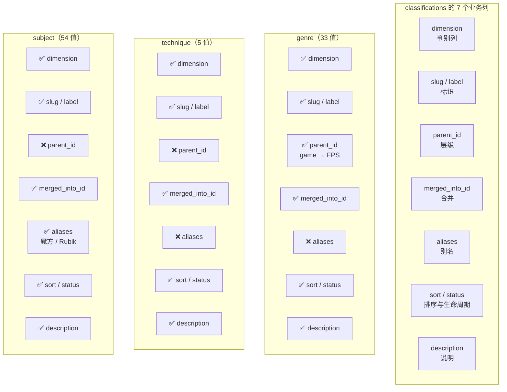

**这张图回答「为什么不能共用一张表」**：

| 列 | genre | technique | subject |
|---|---|---|---|
| `parent_id` | ✅ | ❌ | ❌ |
| `aliases` | ❌ | ❌ | ✅ |

**3 个维度有 3 种不同的列组合**。现状 `tags` 表用 `group` 和 `parent_id` 两个通用列硬扛，结果是：

- `group` 只有 `model` 有值（132/142），其他 9 个键**全部 `None`**
- `parent_id` 354 个值里只有 **2 个**有值

**新模型用 `ck_classifications_shape` 把「哪个维度能用哪些列」变成 DB 约束**，而不是靠应用层自觉。

**`vendor` / `url` 两列已移出**：它们只服务 `platform`，而 `platform` 已升级为独立实体（§1 的 `Platform` 类）。其中 `vendor` 在 **v1.4 进一步改成 `vendor_id` → 共享 `vendors`**（G10）：厂商是跨域概念，用自由文本会让同一家出现 `DeepSeek` / `deepseek` / `DS` 多种写法，统计口径立刻分裂。

---

## 3.5 平台 / 配置 / 技能的形状

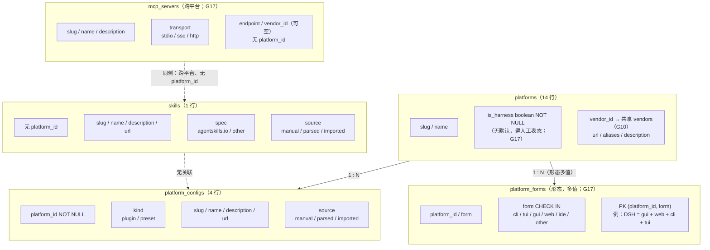

**三者的关键差异**：

| | `platforms` | `platform_configs` | `skills` |
|---|---|---|---|
| `platform_id` | — | **NOT NULL** | **无此列** |
| `vendor_id` | ✅（→ 共享 `vendors`，G10） | ❌ | ❌ |
| `kind` | —（**G17 已删**：角色轴 → `is_harness`，形态 → `platform_forms`） | 2 值（plugin / preset） | — |
| `spec` | ❌ | ❌ | ✅（agentskills.io） |
| `source` | ❌ | ✅ | ✅ |
| 跨平台 | ❌ | ❌ | ✅ |

**`mcp_servers` 不在上表里**：它和 `skills` 同侧——**跨平台、没有 `platform_id`**；G17 把它从 `platform_configs.kind` 里独立出来（数据结构文档 §3.6.1），形状见上图第三个子图。

**平台读路径带厂商（G10）**：`platforms.vendor_id` → `vendors`，列表查询 `LEFT JOIN vendors v ON v.id = p.vendor_id`，取 `v.slug AS vendor_slug` / `v.name AS vendor_name`；`platforms` 自己**没有** `vendor` 文本列（对照数据结构文档 §5.3）。

**为什么 `platform_configs` 和 `skills` 是两张表**：

| 理由 | 说明 |
|---|---|
| **归属不同** | 配置必须属于平台（`NOT NULL`），技能跨平台（无此列） |
| **标准不同** | 配置是平台私有，技能是开放标准（agentskills.io） |
| **数据零共现** | 12 件有配置的作品（`plugin` 6 + `preset` 11，共现 5 件去重后 12；含 `skills` 为 17 件）里，`plugin`/`preset` 与 `skills` 零共现 |
| **详情页不同** | 「routing-suite 是什么」和「j-space 是什么」是两种页面 |

**为什么 `plugin` 和 `preset` 合并成 `platform_configs`**：

| 理由 | 说明 |
|---|---|
| 共现 5 次 | 互补而非互斥 |
| 归属相同 | 都必须是某平台的配置 |
| 形状相同 | 名字 + 描述 + 平台 + 来源 |
| 数据量小 | 各 2 个值 |

**`mcp_server` 为什么不在 `platform_configs`（G17 修正）**：它是**跨平台**的能力提供者（与 `skills` 同侧），不是平台私有配置。旧版写「从归属看它属于平台配置」是错的——`platform_configs.platform_id` 是 `NOT NULL`，放进去等于断言「每个 MCP server 只属于一个平台」，与本节自己的「跨平台」论证冲突。已独立为 `mcp_servers`（数据结构文档 §3.6.1）。

---


## 4. 状态机：Classification

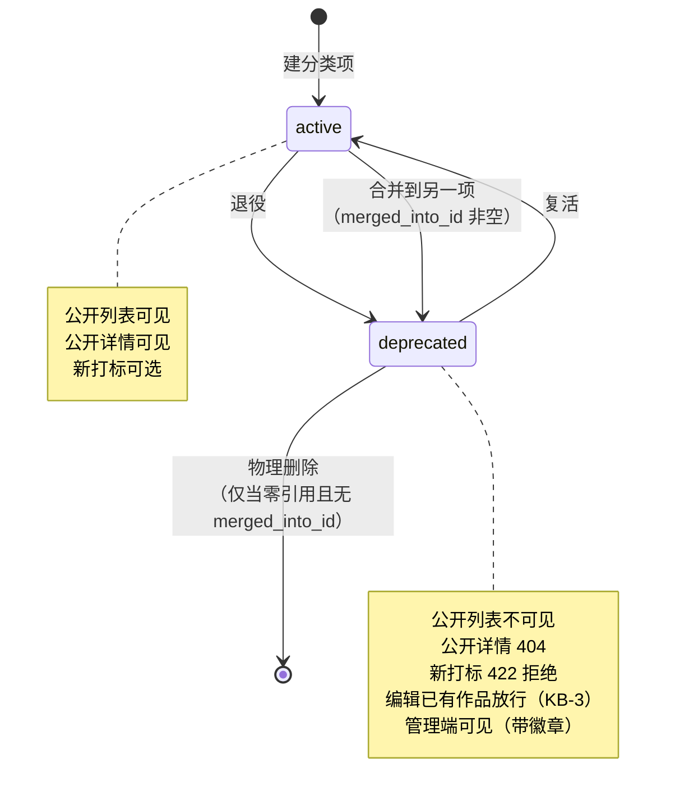

> 原 §4 的「与现状的对比」表、「为什么删 `candidate`」（旧栈陷阱态 `candidate` 的证据）与「编辑放行」的 KB-3 旧栈出处已按 **G16**（② 对照 + ③ 旧栈实现细节）下沉到文末「过渡期与现状（非目标态）」。

---

## 5. 时序：打标

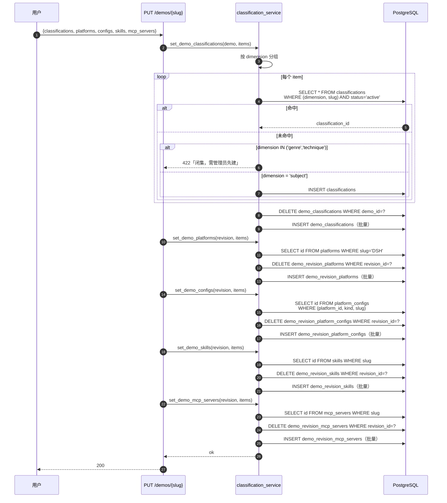

**五条写入路径的差异**：

| 路径 | 表 | 基数 | 未命中时 |
|---|---|---|---|
| 分类 | `demo_classifications` | 多值 | `genre`/`technique` 422；`subject` 自动建 |
| 平台 | `demo_revision_platforms` | 多值（PK `(revision_id, platform_id)`） | 422（平台必须已存在） |
| 配置 | `demo_revision_platform_configs` | 多值 | 422（配置必须已存在） |
| 技能 | `demo_revision_skills` | 多值 | 422（技能必须已存在） |
| MCP | `demo_revision_mcp_servers` | 多值（PK `(revision_id, mcp_server_id)`） | 422（MCP server 必须已存在） |

**三个 `demo_*` 是只读视图（G18）**：上表列的是**写入目标**（`demo_revision_*`），直接写 `demo_platforms` / `demo_platform_configs` / `demo_skills` 会报错；**读**仍走同名视图（§11 组件图 / §14 读取流）。

**为什么平台/配置/技能不自动建**：它们是**有详情页的实体**，自动建会造出空页面。分类里的 `subject` 自动建是因为它只是标签值，没有独立页面。

**「半开放」的落点（G9）**：平台 / 配置 / 技能**不能内联创建**（打标时 422），但用户可以走**提案**——`new_platform` / `new_platform_config` / `new_skill`（见 §7）。

> 原 §5 的「与旧栈的差异（有意变更）」段（旧栈 `platform` 是 open、打标时自动建值）已按 **G16**（②③）下沉到文末「过渡期与现状（非目标态）」——**「平台不能内联创建」是新模型的新规则**，迁移时不能拿旧行为当依据（G9 附注 7）。

**闭集 vs 开放的处理差异**：

| 维度 | 未命中时 | 理由 |
|---|---|---|
| `genre` | **422** | 闭集，管理员维护，用户不能自创题材 |
| `technique` | **422** | 同上 |
| `subject` | 自动建 | 开放，新游戏/新作品随时出现（54 个值里 33 个单次使用） |

---


## 6. 时序：合并分类项

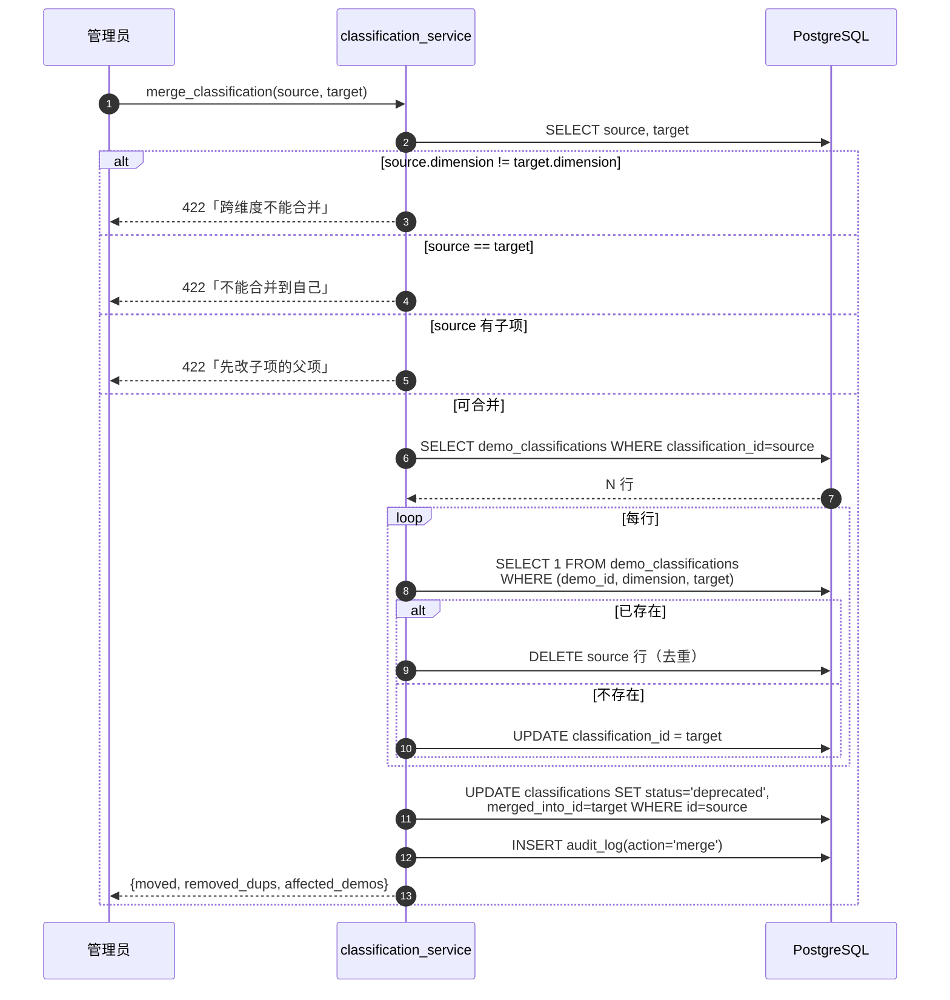

> 原 §6 的「与现状 `merge_tags` 的差异」表（含「为什么改成软删」）已按 **G16**（②③）下沉到文末「过渡期与现状（非目标态）」。

---

## 7. 时序：用户提案（半开放实体）

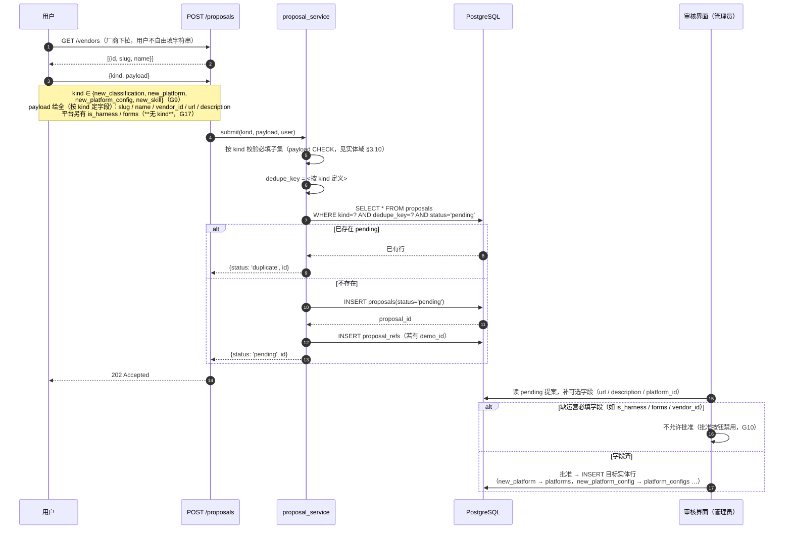

**为什么走 `proposals` 而不是新建表**：

> 原 §7 的「旧栈 4 套待审机制」表已按 **G16**（③ 旧栈实现细节）下沉到文末「过渡期与现状（非目标态）」。

实体域（现 **v2.6**）已经把前两套统一成 `proposals`，标签域直接复用；**v1.4 起 kind 扩到 4 个**（G9）：

| kind | payload（提交端给全） | 审核必填（缺则不允许批准） |
|---|---|---|
| `new_classification` | `{dimension, slug, label}` | — |
| `new_platform` | `{slug, name, is_harness, forms[], vendor_id?, url?, description?}` | `is_harness` / `forms`（**人工录入**，G17；平台**没有 `kind`**）+ `vendor_id`（G10：厂商从共享 `vendors` 下拉**选**，不设 `new_vendor`） |
| `new_platform_config` | `{kind, slug, name, platform_slug?, url, description}` | `platform_id` |
| `new_skill` | `{slug, name, url, description}` | — |

**「半开放」的准确含义（G9）**：用户**不能内联创建**（打标时 422），但**可以提案**；管理员审核通过后才建行。`vendor_id` / `url` / `platform_id` 等运营字段由管理员在审核时补——这正是提案层存在的意义。**缺运营必填字段时审核界面不允许批准**（G10），否则会落库一条「只有名字」的空实体，详情页是空的。

> 原 §7 的「只有 `mode='fixed'` 的键会有「值申请」行（源码核过）」段与「存量待审行按旧 key 分流」「`tag_value_suggestions` 的存量待审行不在本域迁移」两段已按 **G16**（① 过渡期存量迁移 + ③ 旧栈实现细节）下沉到文末「过渡期与现状（非目标态）」。

---

## 10. 读路径对比

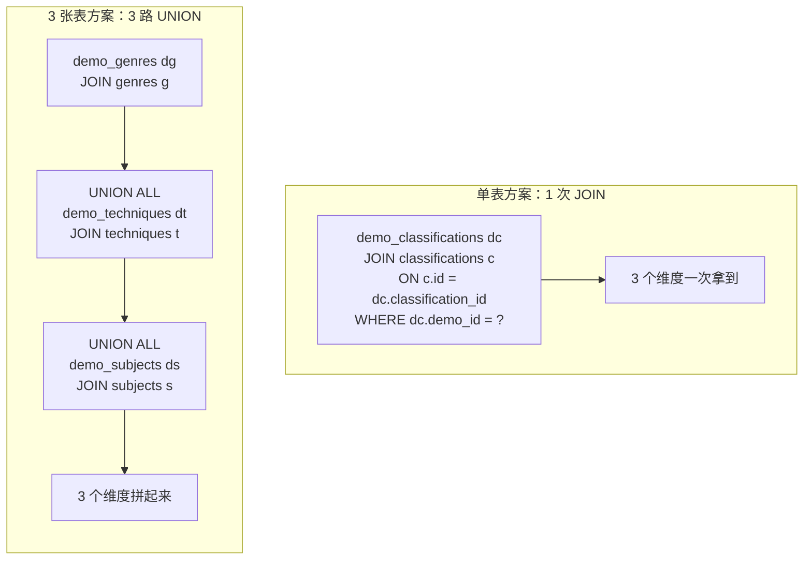

**这是选单表而非 3 张表的主要理由**：「作品详情页显示所有分类」是最高频读路径。

**其他对比**：

| | 1 张 `classifications` | 3 张 `genres`/`techniques`/`subjects` |
|---|---|---|
| 表数 | 2 | 6 |
| 空列 | 2 个（`parent_id`/`aliases`） | 0 |
| 「一件作品的所有分类」 | 1 次 JOIN | 3 路 UNION |
| 加新维度 | 加一个 CHECK 枚举值 | 加 2 张表 |
| 类型安全 | 复合外键 + CHECK | 天然 |

**总共 92 行，2 个空列的成本可以忽略。**

**平台和配置不走 UNION**：它们是独立实体，各有自己的表和详情页。

> **原 §10 末的「`?tag=` 兼容层（G14）」已按 G16（① 过渡期结构）下沉到文末「过渡期与现状（非目标态）」。**

---


## 11. 组件图

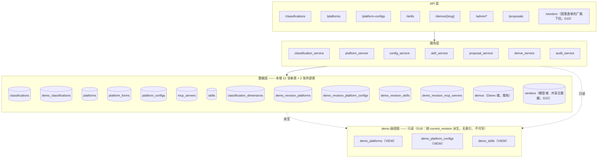

**请求 → 服务的路由**：

| 端点 | 服务 |
|---|---|
| `/classifications` | `classification_service` |
| `/platforms` | `platform_service` |
| `/platform-configs` | `config_service` |
| `/skills` | `skill_service` |
| `/demos/{slug}` | 四个都调 |
| `/admin/*` | 四个都调 |
| `/proposals` | `proposal_service` |
| `/vendors` | `platform_service`（只读，供提案表单下拉，G10） |

**服务 → 数据的依赖**：

| 服务 | 写 | 读 |
|---|---|---|
| `classification_service` | `classifications` / `demo_classifications` | `demos` |
| `platform_service` | `platforms` / `platform_forms` / `demo_revision_platforms` | `demos` / `vendors`（只读，G10）/ `demo_platforms`（**视图**，G18） |
| `config_service` | `platform_configs` / `demo_revision_platform_configs` | `platforms` / `demo_platform_configs`（**视图**，G18） |
| `skill_service` | `skills` / `demo_revision_skills` | `demo_skills`（**视图**，G18） |
| `proposal_service` | `proposals` | 调前四个 |
| `derive_service` | — | `classifications` / `platforms` / `skills` / 三个 `demo_*` **视图** |

**写一律落 revision 级关联表（G18）**：`demo_revision_platforms` / `…_platform_configs` / `…_skills` / `…_mcp_servers`（PK `(revision_id, xxx_id)`），三个 `demo_*` 是同名**只读视图**——写视图会直接报错。口径见数据结构文档 **§4.3**（`set_demo_*` 的参数是 `revision`，不是 `demo`）与 **§4.5**（合并时的迁移同样写 revision 表）。

**MCP 暂无独立服务（G17）**：`mcp_servers`（跨平台、无 `platform_id`）/ `demo_revision_mcp_servers` 已建模，写路径也已定（数据结构文档 §4.3 的 `set_demo_mcp_servers`），但**服务划分不在本域定**（G17 只定数据形状），故上表暂不归属；组件图里它挂在数据层、不连服务边。

**`audit_service` 被四个写服务调用**：每次写都记审计。

**`skill_service` 不依赖 `platform_service`**：`skills` 没有 `platform_id`，这是它与 `config_service` 的根本差异。

---


## 12. 部署图

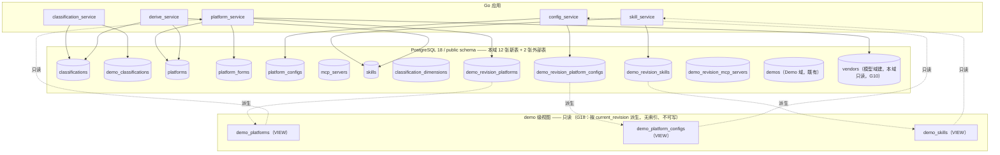

**读图注意（G17 / G18）**：① `platforms` 的**形态**在 `platform_forms`（1 : N），`is_harness` 是平台自身的布尔列；② `platform_configs.kind` 只剩 `plugin` / `preset`，**MCP 在 `mcp_servers`**（跨平台、无 `platform_id`）——暂无独立服务，图上不连服务边（服务划分不在本域定，G17 只定数据形状）；③ 三个 `demo_*` **是视图不是表**：写入一律落 `demo_revision_*`（虚线到视图表示「派生」），视图不可写、也没有索引；④ 本域新表 **12 张**（T1–T12），T13 `demos` / T14 `vendors` 是既有表。

**部署要点**：

| 项 | 值 |
|---|---|
| 数据库 | PostgreSQL 18 |
| 扩展 | 无（`aliases` 用原生 `text[]` + GIN） |
| 表数 | **12 新增**（v1.3 增 `demo_platforms` / `classification_dimensions`；**v1.8 / G18 后 `demo_platforms` / `demo_platform_configs` / `demo_skills` 改为同名视图、不计表**，新增 `platform_forms` / `mcp_servers` / 四张 `demo_revision_*`，即 9 − 3 + 6）；另有**共享主数据 `vendors`**（模型域建表，G10，不计入本域新表） |
| 索引数 | **13 条显式 `CREATE INDEX`**（本域 12 张新表；`demos` 无新增索引）+ **18 条 PK / UNIQUE 隐式索引**；**三个 `demo_*` 已改视图，无任何索引**。不含既有 `external_threads` 的 `ix_ext_threads_subject`、也不含模型域 `vendors` 的 `UNIQUE (slug)`（数据结构文档把前者也算进去，故那边是 **14 条 `CREATE INDEX` 语句**） |
| 跨库 | 无 |

**13 条显式索引的分布**（本域口径，见上；与数据结构文档 v1.8 §3.1–§3.9 的 `CREATE INDEX` 一一对应，已逐条核过）：

| 表 | 显式索引 | 条数 |
|---|---|---|
| `classifications` | `(dimension, sort)` WHERE active / `parent_id` / `merged_into_id` / GIN `aliases` | 4 |
| `demo_classifications` | `classification_id` | 1 |
| `platforms` | GIN `aliases` / `vendor_id`（v1.4 补，G10）——**原 `(kind, sort)` 已随 `kind` 删除（G17）** | 2 |
| `platform_forms` | `form`（G17 新增表） | 1 |
| `platform_configs` | `(platform_id, kind)` WHERE active | 1 |
| `mcp_servers` | 无显式索引（`slug` 靠 `UNIQUE` 隐式索引） | 0 |
| `skills` | 无显式索引（`slug` 靠 `UNIQUE` 隐式索引） | 0 |
| `classification_dimensions` | 无（`PK (dimension)` 即隐式索引） | 0 |
| `demo_revision_platforms` | `platform_id`（G18：由 demo 级平移到 revision 级） | 1 |
| `demo_revision_platform_configs` | `config_id`（同上） | 1 |
| `demo_revision_skills` | `skill_id`（同上） | 1 |
| `demo_revision_mcp_servers` | `mcp_server_id`（同构） | 1 |
| `demo_platforms` / `demo_platform_configs` / `demo_skills`（**VIEW**） | 视图**无索引**（G18） | 0 |
| **合计** | | **13** |

**约束带来的隐式索引（18 条，不含 `demos` 既有 PK；视图不产生索引）**：`classifications` PK + 2 个 UNIQUE（3）/ `demo_classifications` PK（1）/ `platforms` PK + `UNIQUE (slug)`（2）/ `platform_forms` PK `(platform_id, form)`（1）/ `platform_configs` PK + `UNIQUE (platform_id, kind, slug)`（2）/ `mcp_servers` PK + `UNIQUE (slug)`（2）/ `skills` PK + `UNIQUE (slug)`（2）/ `classification_dimensions` PK（1）/ `demo_revision_platforms` PK（1）/ `demo_revision_platform_configs` PK（1）/ `demo_revision_skills` PK（1）/ `demo_revision_mcp_servers` PK（1）。

> 原 §12 的「`ix_demo_cls_cls` 修的是现状的什么」+ 旧栈 `tag_dict` / `tag_key_out` 的 python 块已按 **G16**（③ 旧栈实现细节）下沉到文末「过渡期与现状（非目标态）」。

这是**最高频的读路径**（标签列表页、标签详情页、explore 页、site-info 页、删标签前的引用检查、合并标签）。

**`ix_demo_rev_pcfg_cfg` / `ix_demo_rev_skills_skill` / `ix_demo_rev_mcp_mcp` 同理**：关联表的 PK 是 `(revision_id, X_id)`，按 `X_id` 统计需要独立索引——**G18 后这三条已从 demo 级平移到 revision 级**（原 `ix_demo_pcfg_cfg` / `ix_demo_skills_skill` 随表改视图而取消）。

---


## 13. 写入流（目标态）

同一次「上传作品」在**目标模型**里的数据流向（现状与并排对比见文末）。

> 原 §13.1 现状 / §13.3 并排对比已按 **G16** 下沉到文末「过渡期与现状（非目标态）」（本节只留目标态）。

### 13.2 目标

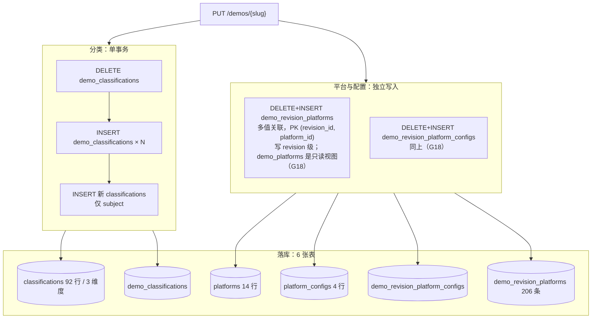

**目标写入流的 4 个变化**：

| 变化 | 说明 |
|---|---|
| **分类只碰 2 张表** | `classifications`（仅新建）+ `demo_classifications` |
| **平台走多值关联表** | `demo_revision_platforms`（PK `(revision_id, platform_id)`），一件作品可挂多个平台，不需要 partial unique index；`demo_platforms` 是同名**只读视图**（G18） |
| **配置走独立关联表** | `demo_revision_platform_configs`（视图 `demo_platform_configs`），与分类互不干扰（G18） |
| **单事务** | 三条路径在同一事务，不存在「标签已提交、派生失败」的中间态 |

---


## 14. 读取流（目标态）

「作品卡片上显示的那几个标签」在**目标模型**里怎么算出来（现状与并排对比见文末）。

> 原 §14.1 现状 / §14.3 并排对比已按 **G16** 下沉到文末「过渡期与现状（非目标态）」（本节只留目标态 + §14.4 的直访分档）。

### 14.2 目标

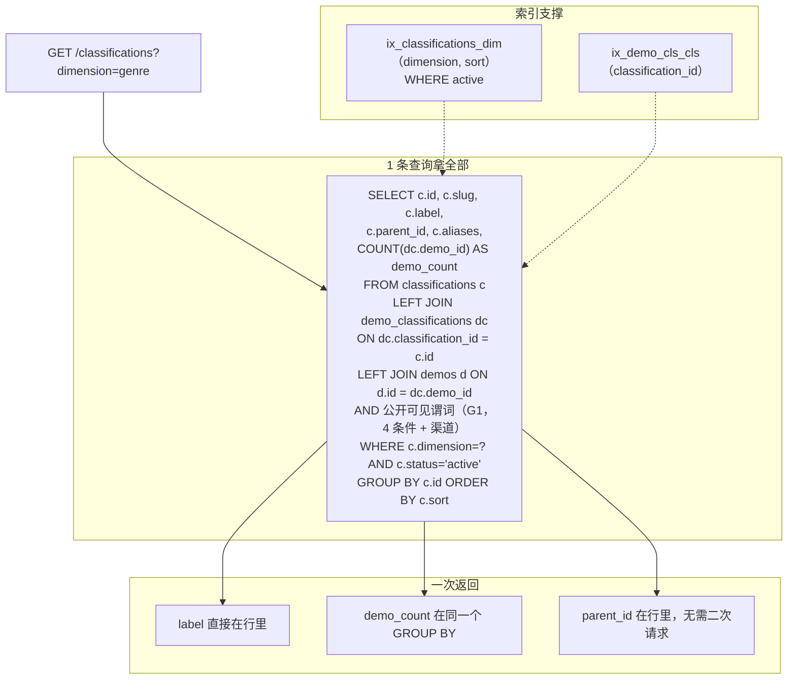

**目标读取流的 3 个变化**：

| 变化 | 说明 |
|---|---|
| **`label` 随行返回** | `classifications.label` 是列，不是靠前端拼 `key:value` |
| **`demo_count` 用 `LEFT JOIN + GROUP BY` 一次算完** | 不需要每条 3 次查询；且只数**公开可见**的作品（`<公开可见谓词>`，G1） |
| **`ix_demo_cls_cls` 修掉全表扫** | 现状 `demo_tags` 的 PK 是 `(demo_id, tag_id)`，按 `tag_id` 查询用不到 btree 前缀 |

**`<公开可见谓词>` 是什么（G1；权威定义见 `标准对象 §ST-2`）**：数据结构文档 §5 开头定义，展开为 4 个条件 —— `moderation_state='approved' AND lifecycle_state='published' AND deleted_at IS NULL AND EXISTS (demo_channels: channel=:channel AND visibility='listed')`。**列表 / 计数 / 榜单**一律套它；**下架作品按 slug 直访**返回 200 + tombstone（见 §14.4）。

### 14.4 按 slug 直访：分档与 tombstone（G1 / G8）

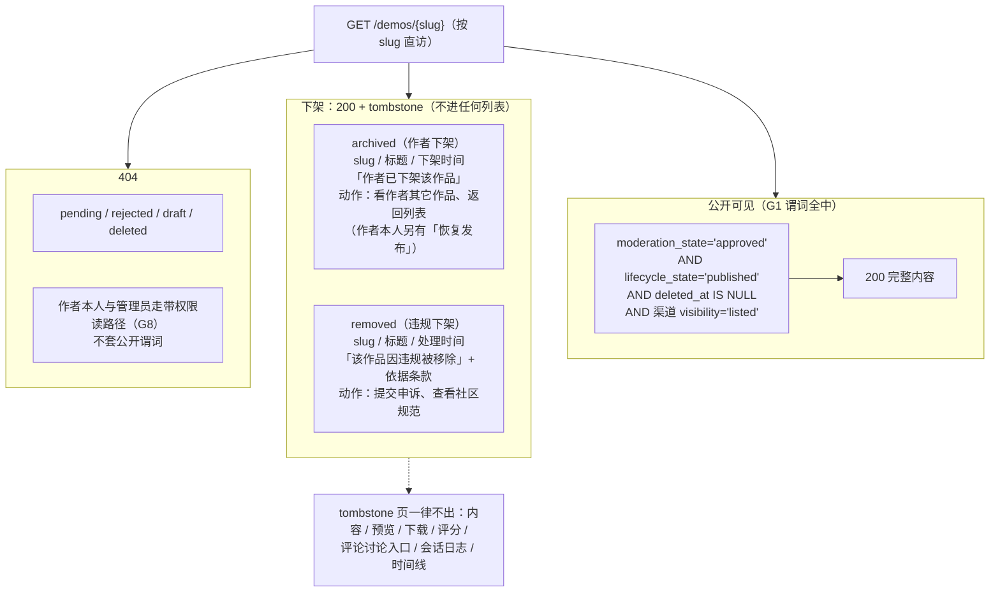

**为什么要有 tombstone（G1）**：「发现」与「定位」是两种语义——列表不该出现下架作品，但旧链接直接 404 会让分享链接与搜索结果变成死链。

| 分档 | 响应 | 内容 |
|---|---|---|
| `published` + `approved` + 未删除 + 渠道 `listed` | 200 | 完整内容 |
| `archived`（作者下架） | **200 + tombstone** | slug / 标题 / 下架时间 /「作者已下架该作品」；动作 = 看作者其它作品、返回列表（作者本人另有「恢复发布」） |
| `removed`（违规下架） | **200 + tombstone** | slug / 标题 / 处理时间 /「该作品因违规被移除」/ 依据条款；动作 = **提交申诉**、查看社区规范 |
| `pending` / `rejected` / `draft` / `deleted` | **404** | 作者本人与管理员走**带权限读路径**（G8），不套公开谓词 |

**两类 tombstone 必须内容不同**：`archived` 是作者自主行为（可恢复、无申诉），`removed` 是平台处置（有申诉、有条款）——合成一个页面会让用户既不知道能不能申诉，也不知道作品会不会回来。**下架作品不进任何列表 / 计数 / 榜单**（那三类一律套 `<公开可见谓词>`）。

---

---


## 15. 派生流（目标态）

**目标态：0 条派生边，只有 join。** 现状的 8 条派生边见文末「过渡期与现状」。

> 原 §15.1 现状 / §15.3 并排对比已按 **G16** 下沉到文末「过渡期与现状（非目标态）」（本节只留目标态）。

### 15.2 目标：0 条派生边

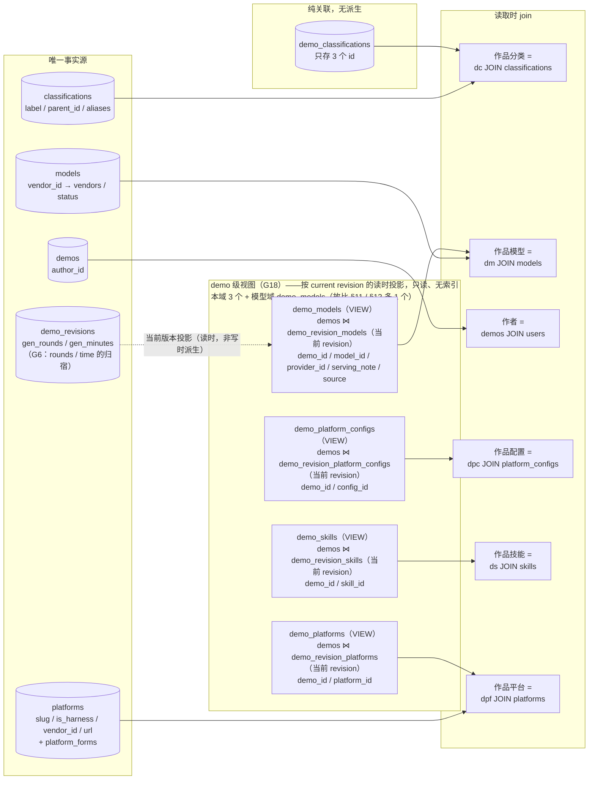

**目标没有派生边，只有 join**：

> 原 §15.2 的「现状的边 → 目标如何消失」对照表已按 **G16**（② 现状→目标对照）下沉到文末「过渡期与现状（非目标态）」。

**`gen_*` 的写契约（G11）**：`demo_revisions` 的**内容列不可变**，但**运行元数据列**（`gen_rounds` / `gen_minutes` / `model_hint`；`gen_platform` 已随 G18 退场）**允许作者本人更正**，每次更正写 `audit_log`，不触发重新审核——这是「`gen_*` 是唯一事实源」的另一面：它是**录入记录**，不是内容本身。

---


## 16. 改一个值（目标态）

「管理员把 `Zcode` 改名成 `ZCode`」——最小的一次变更在**目标模型**里怎么走（现状见文末）。

> 原 §16.1 现状 / §16.3 并排对比已按 **G16** 下沉到文末「过渡期与现状（非目标态）」（本节只留目标态）。

### 16.2 目标

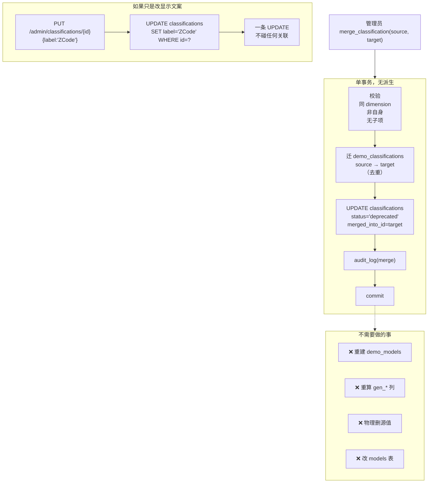

**目标的 3 个变化**：

| 变化 | 说明 |
|---|---|
| **「改名」和「合并」是两个操作** | 只改显示文案走 `UPDATE label`，不动任何关联；只有语义合并才走 `merge_classification` |
| **源值软删，可回溯** | `status='deprecated'` + `merged_into_id`，`audit_log` 的 `before` 永远能反查到行 |
| **无 commit 后的派生** | 派生边在目标里不存在（见 §15.2），所以合并天然是原子的 |

---


## 17. 阅读顺序与取舍

如果只看三张图，建议按这个顺序：

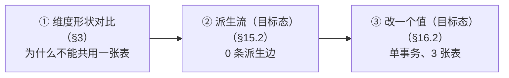

**为什么这个顺序**：

1. **维度形状对比**回答「为什么」——3 个维度有 3 种列组合，现状用 2 个通用列硬扛
2. **派生流对比**回答「改起来有多疼」——现状 8 条派生边分布在 3 个方向，目标 0 条
3. **改一个值对比**回答「最小变更的成本」——现状要动 5 张表，目标 3 张表

> 上面提到的「现状」半边（§13.1 / §13.3、§14.1 / §14.3、§15.1 / §15.3、§16.1 / §16.3）连同 §8 / §9 / §10 末的 `?tag=` 兼容层，已按 **G16** 下沉到文末「过渡期与现状（非目标态）」；本节仍按**原图号**引用。

**如果只看一张图**：看 §15.2 的派生流（目标态）+ 文末 §15.1 的现状对照。它是整份设计的核心论点——标签域的问题在于同一份事实被写了两遍，两遍互为派生源。只要保留 `tags` 承载 `author` / `model` / `rounds`，无论怎么调列和索引，这 8 条边都会以某种形式回来。

---

## 过渡期与现状（非目标态）

> **本节按台账 G16 收纳**：正文只放**目标态**；下列内容只在过渡期存在、或只在旧栈成立，故从正文下沉。每条注明**原位置**；图号**沿用原编号、未重编**。

### 原 §2 · 旧列说明（v1.4 / v1.5 修订留痕）

**旧列名已清除（v1.4 修订）**：此前本图保留了 `prompt_id` / `status` / `gen_rounds` / `gen_minutes`，并加脚注说「保留旧列名仅用于对照旧栈」——**读者看的是方框，不是脚注**，等于图在说谎。按 **G6**：`prompt_id` / `gen_*` 已移入 `demo_revisions`，`status` 已拆成 `moderation_state` + `lifecycle_state` + `deleted_at`（G1 的依据）。类图里 `DemoStatus` 枚举同步替换为 **`ModerationState` + `LifecycleState`** 两个当前枚举。

**`version_of_id` 已判给 revision（G15，2026-10-28）**：旧栈**没有这一列**（`version-of` 是 tag 键，值是指向原作的 slug 字符串，`main` 源码里查不到 `version_of`）。本域 §3.3 曾提出把它改成 FK，但它与 `DemoRevision` **语义不同**：前者是**跨作品**自引用（A 是 B 的版本，两个 slug），后者是**同一作品**的内容历史（`rev_no` 递增，一个 slug）。用户裁决 **不引入该列**——`version-of` 的 2 条引用改为「把对应快照作品合并成原作的 revision」（其中 1 条已断链）。本图已删除 `version_of_id` 列与 `DEMOS ||--o{ DEMOS` 边；详见台账 **G15**、标签域 §3.3（已撤销）。

### 原 §4 · `candidate` 陷阱态与「编辑放行」

**与现状的对比**：

| 态 | 现状 `tags.status` | 新模型 |
|---|---|---|
| `candidate` | ✅ 存在但是**陷阱态** | ❌ 删除 |
| `active` | ✅ | ✅ |
| `deprecated` | ✅ | ✅ |

**为什么删 `candidate`**：

现状 `TAG_STATUSES = ("candidate", "active", "deprecated")`，`TagStatusIn.status` 的 pattern 也允许 `candidate`。但：

| 行为 | `candidate` 的实际效果 |
|---|---|
| 写入 | 只有 `PUT /admin/entities/tag/{id}/status` 能写，**没有任何代码路径写它** |
| 公开列表 | **可见**（`tag_key_out` 只过滤 `deprecated`） |
| 公开详情 | **可见**（`get_tag` 只对 `deprecated` 返回 404） |
| 新选 | **422 拒绝**（`_resolve_tag`：`if status != "active"`） |
| 错误文案 | **「已退役（candidate）」** ← 文案是错的 |

管理员一旦设了，标签变成「看得见、选不了、报错说已退役」。

**「编辑放行」是现状的 KB-3 修复**：作品已挂的退役值，编辑时放行（`_resolve_tag` 的 `allow_tag_ids`），否则一次改描述就会因为历史值被 422 卡死。

### 原 §5 · 与旧栈的差异（有意变更）

**与旧栈的差异（有意变更，2026-10-28 读 `main` 源码核过）**：旧栈里 `platform` 是 **open 模式**，打标时**会自动建标签值**（`demos.py:161-184` 的 `_resolve_tag`：非 fixed 走 `ensure_value` 自动建）；真正「必须已存在」的是 `plugin` / `preset` / `skills`（fixed 模式）。新模型把 `platform` 升级成独立实体后**改成不自动建**——自动建会造出没有厂商、没有描述的 `platforms` 行，详情页是空的。**所以「平台不能内联创建」是新模型的新规则，不是旧行为**；迁移时不能拿旧行为当依据（G9 附注 7）。

### 原 §6 · 与现状 `merge_tags` 的差异

**与现状 `merge_tags` 的差异**：

| | 现状 | 新模型 |
|---|---|---|
| 源项处置 | **物理删**（`db.delete(src)`） | **软删**（`status='deprecated'` + `merged_into_id`） |
| 审计可回溯 | ❌ `before` 快照指向不存在的 id | ✅ 源项还在，可查 |
| 跨 key 合并 | 422 拒绝 | 422 拒绝（同 dimension） |
| 有子项 | 422 拒绝 | 422 拒绝 |
| 派生回填 | 硬编码 `if from_key == "model" or from_key in ("rounds","time","platform")` | 不需要（`model`/`rounds`/`time` 已不在分类域） |

**为什么改成软删**：现状物理删后，审计日志里的 `before` 快照指向一个不存在的 id，无法回溯「这个值曾经存在过、被合并到哪了」。新模型与 `models.merge_model` 的语义一致。

### 原 §7 · 提案层的现状与存量迁移

现状有 4 套待审机制：

| 机制 | 表 |
|---|---|
| 统一建议收件箱 | `entity_suggestions`（8 种 kind） |
| 标签值申请 | `tag_value_suggestions` |
| 论坛举报 | `forum_reports` |
| 作品待审 | `demos.status='pending'` |

**只有 `mode='fixed'` 的键会有「值申请」行（源码核过）**：用户提交端点只收 `mode='fixed'`（`backend/app/routers/tags.py:181-182`），另两条写入路径硬编码 `key='model'`（`tags.py:309` / `tags.py:507`），且表与校验由**同一 commit**（`f6e37e1`）引入。所以存量 `tag_value_suggestions` 里**可能出现申请行的只有 6 个键**：`model` / `plugin` / `type` / `skills` / `preset` / `category`（全部 fixed）。`game` / `platform` 是 **open**、`rounds` / `time` 是 **int**——这 4 个键**不可能**有申请行，图上不能画成「用户申请任意键的新值」。

**存量待审行按旧 key 分流（G9）**：`type` / `category` → `new_classification`；`plugin` / `preset` → `new_platform_config`；`skills` → `new_skill`；`model` → `new_model` / `model_alias`（模型域）。`new_platform` kind 保留（新系统里用户可直接提），但**没有迁移来源**——迁移因此只有 **4 个分支**（不是 6 个）。

**`tag_value_suggestions` 的存量待审行不在本域迁移**：由《实体域数据结构设计》§6.8 迁进 `proposals`；本域不删这张表，等那边跑完并核对行数后，才在阶段 ④ 随旧表一起删（见 §9 迁移映射图注）。

### 原 §8 · 数据流图：现状 → 目标

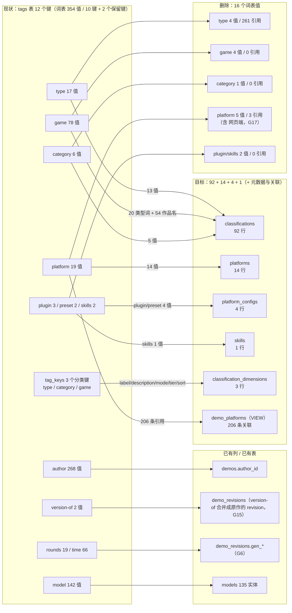

**数字对账**（分母 = `tag_keys` 里的 **354 个词表值**）：

| 去向 | 值数 | 说明 |
|---|---|---|
| → `classifications` | 13 + 20 + 5 + 54 = **92** | 引用 1447 |
| → `platforms` | **14** | 引用 206（`网页端` 3 条随平台删除、不迁，G17） |
| → `platform_configs` | **4**（`plugin` 2 + `preset` 2） | 引用 17 |
| → `skills` | **1** | 引用 5 |
| → `models`（已有表） | **142** → 135 实体 | 引用 1367 |
| → `demo_revisions.gen_*`（G6 后挂在 revision 上） | **85** | 引用 305 |
| **删除** | **16** | 见下 |
| **合计** | **354** ✅ | |

**删除的 16 个词表值**：

| 来源 | 值数 | 值 | 引用 |
|---|---|---|---|
| `type` | 4 | `demo` / `html` / `svg` / `slides` | 261 |
| `game` | 4 | 零引用值 | 0 |
| `category` | 1 | `ppt` | 0 |
| `platform` | 5 | `codebuddy` / `hermes` / `omp` / `豆包2.1turbo` / **`网页端`**（形态不是产品，G17 删平台） | 3 |
| `plugin` / `skills` | 2 | `graded0.0.1exp` / `J-space` | 0 |

**目标实体数** = 92 + 14 + 4 + 1 = **111 行**。

**v1.3 另有两项不在这 354 个值里**：

| 新增结构 | 行数 | 来源 |
|---|---|---|
| `classification_dimensions` | **3** | 承接旧 `tag_keys` 的 `type` / `category` / `game` 三行的 `label` / `description` / `mode` / `tier` / `sort`（不是词表值） |
| `demo_platforms`（**VIEW**，G18） | **206 条关联** | `platform` 的 206 条标签引用逐条落地（原 209 条中 `网页端` 的 3 条不迁，G17；不改变值数；**203 件作品**，其中 3 件多平台） |

**对账自洽**：92 + 14 + 4 + 1 + 142 + 85 + **16** = **354** ✅

**v1.4 补记（G10；v1.8 按 G17 修正）**：`platforms` 回填只写 `slug` / `name` / `sort`（**`kind` 已删，G17**），**`vendor_id` 留空**——**14 条**由管理员从共享 `vendors` 里**选**（数据结构文档 §8 风险 3 / §9.3 #6）。`vendors` 表由**模型域**建，不在本域 **12 张新表**里，也不进本图的 354 个值对账。

### 原 §9 · 迁移映射图

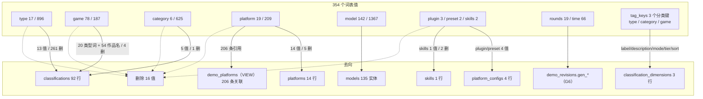

**`author`（268 值 / 1355 引用）与 `version-of`（2 值 / 2 引用）不在 354 个词表值里**：它们是 `tags` 表里的保留键，`tag_keys` 没有对应词表行，直接进 `demos.author_id`；`version-of` 的 2 条引用按 **G15** 改为「把对应快照作品**合并成原作的 revision**」（**不引入** `demos.version_of_id`）——上图 O7 / O8 画的是它们在 `tags` 里的现状，不计入词表 354。

**v1.3+ 建表与回填顺序**（对应数据结构文档 §6.2；v1.4 补 G9 / G10 两步）——**里程碑归属（G13）**：本域阶段 ①–④ = **M11（建议，待确认）· 标签域结构重整**；全局阶段一律用 M 编号，下面的 ①–④ 是域内步骤编号：

1. **建表（12 张表 + 3 个视图）**：表 = `classifications` / `demo_classifications` / `platforms` / **`platform_forms`** / `platform_configs` / **`mcp_servers`** / `skills` / **`classification_dimensions`** / **`demo_revision_platforms`** / **`demo_revision_platform_configs`** / **`demo_revision_skills`** / **`demo_revision_mcp_servers`**；视图 = `demo_platforms` / `demo_platform_configs` / `demo_skills`（G18 同名视图，按 `current_revision_id` 派生，**无索引、不可写**）（`vendors` 由**模型域**建，见 G10，不计入这 12 张）
2. **回填实体**：92 个分类项（`genre` 33 / `technique` 5 / `subject` 54）+ **14 个平台** + 4 个配置 + 1 个技能；**`platforms.vendor_id` 留空**（**14 条**由管理员从共享 `vendors` 选，G10）；**形态 `platform_forms` 与 `is_harness` 是人工录入**（G17）
3. **回填 `classification_dimensions`（v1.3 新增步骤）**：从 `tag_keys` 的 3 行（`type` / `category` / `game`）取 `label` / `description` / `sort` / `tier`，`mode` 按闭集/开放映射（`game` → `open`，其余 `fixed`）
4. **回填关联（落到各自 `current_revision_id`，G18）**：`demo_classifications`（1447 行）+ `demo_revision_platforms`（**206 条 / 203 件 / 3 件多平台**；原 209 条中 `网页端` 的 3 条不迁，G17）+ `demo_revision_platform_configs`（17 条）+ `demo_revision_skills`（5 条）
5. **校验**：各维度行数、`demo_platforms`（视图）的 **206 / 203 / 3** 三个计数、覆盖率（~851 件 / 62.7%）
6. **`external_threads` 泛化**（§3.8，G5 / G12）：加 `subject_type` / `host`、`demo_id` 改名 `subject_id`、主键与唯一键按定案重建，迁移前后行数须一致
7. **存量 `tag_value_suggestions` 分流（G9）**：只有 **4 个迁移分支**（`type`/`category` → `new_classification`；`plugin`/`preset` → `new_platform_config`；`skills` → `new_skill`；`model` → `new_model`/`model_alias`）；`new_platform` **无迁移来源**；这张表本身由实体域 §6.8 处理，本域不删（见下）

**`tag_value_suggestions` 由实体域 §6.8 迁进 `proposals` 后再删，本域不删**：它的存量待审行不属于标签域迁移，本域只在阶段 ④（删旧表）确认那边跑完并核对行数后才 `DROP TABLE`。

**旧表退役口径（G4）**：`tags` / `tag_keys` / `demo_tags` **最终删除**——以**本域**的退役计划为准（《模型域设计》**§11.1** 与《ORM现状与演进》里「不动 `tags` / `tag_keys` 结构」的表述**服从本域**）；其中 `key='model'` 的行按模型域 **§11.1** 的 M8/A6 单独退场，其余键随本域切完读写路径、观察 2 周后随表删除。

**删掉的 16 个值**：

| 来源 | 值数 | 值 | 引用 |
|---|---|---|---|
| `type` | 4 | `demo` / `html` / `svg` / `slides` | 261 |
| `game` | 4 | 零引用值 | 0 |
| `category` | 1 | `ppt` | 0 |
| `platform` | 5 | `codebuddy` / `hermes` / `omp` / `豆包2.1turbo` / **`网页端`**（形态不是产品，G17 删平台） | 3 |
| `plugin` / `skills` | 2 | `graded0.0.1exp` / `J-space` | 0 |

**删掉的 4 个 `type` 值，理由各不相同**：

| 值 | 引用 | 为什么删 |
|---|---|---|
| `demo` | 200 | 垃圾桶。80.5% 的 `type:demo` 没有其他语义 type |
| `html` | 38 | 技术栈。38 件**全部** `demo_type='web'` |
| `svg` | 23 | 同上。23 件里 22 件 `demo_type='web'` |
| `slides` | 0 | 零引用 |

### 原 §10 末 · `?tag=` 兼容层（G14）

**`?tag=` 兼容层（G14）**：**新栈保留 agent 上传通道**（2026-10-28 用户裁决）——继续提供 `GET /api/v1/meta/agent-guide`（指南全文）与 `POST /demos/from-url`（agent 投稿），并保留 `?tag=` 的 6 个用法；因此 `?tag=key:value` **永久保留**（数据结构文档 §9.4 #9 继续成立）。**对照基线是 `main:AI_AGENT_GUIDE.md`**——旧栈文件在 `main` 分支仓库根，`dev` 工作区**没有**这个文件（线上由 `GET /api/v1/meta/agent-guide` 返回全文）。逐条翻译：

| 旧参数 | 新参数 | 备注 |
|---|---|---|
| `?tag=type:game` | `?genre=game` | |
| `?tag=category:3D建模` | `?technique=3D建模` | |
| `?tag=game:魔方` | `?subject=魔方` | |
| `?tag=platform:DSH` | `?platform=DSH` | **语义变化**：旧值是 `gen_platform` 的 `ilike` 模糊匹配，新语义是 **`demo_revision_platforms`（按当前 revision）** 的外键等值（§9.2 #24 / G18），需在兼容层写明 |
| `?tag=plugin:routing-suite` | `?config=routing-suite` | |
| `?tag=skills:j-space` | `?skill=j-space` | |

> 另有 `?tag=model:dsv4-flash` → `?model=dsv4-flash`、`?tag=rounds:3-10` → `?rounds=3-10`（两者新栈已有），不在 `AI_AGENT_GUIDE.md` 的 6 个用法里，但走同一层翻译。

### 原 §12 · `ix_demo_cls_cls` 修的是现状的什么

**`ix_demo_cls_cls` 修的是现状的什么**：

现状 `demo_tags` 的 PK 是 `(demo_id, tag_id)`，btree 只能服务 `demo_id` 前缀。所有按标签统计的查询都是全表扫：

```python
# serializers.py tag_dict
db.query(func.count(DemoTag.demo_id)).filter(DemoTag.tag_id == tag.id)
# tag_service.py tag_key_out
db.query(Tag, func.count(DemoTag.demo_id)).outerjoin(DemoTag, DemoTag.tag_id == Tag.id)
```

### 原 §13.1 · 现状：写入流

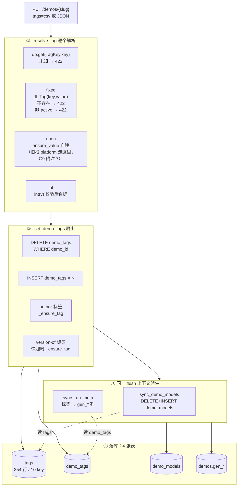

**现状写入流的 4 个特征**：

| 特征 | 具体表现 |
|---|---|
| **一次写扇出到 4 张表** | `tags` + `demo_tags` + `demo_models` + `demos.gen_*` |
| **顺序敏感** | `sync_run_meta` 依赖刚写入的 `demo_tags`，所以内部要 `db.flush()`；`sync_demo_models` 也必须先 flush |
| **同一语义两个写口** | `model` 通过 `_resolve_tag`（fixed 校验）写 `tags`，再通过 `sync_demo_models` 写 `demo_models` |
| **派生无事务边界** | `sync_demo_models` / `sync_run_meta` 在 `_set_demo_tags` 尾部调用，不在独立事务里；任一步抛错整笔回滚，但**中途已 flush 的行**在 `merge_tags` 路径下会先被 commit 掉 |

**「中途已 flush」是个真实风险点**：`merge_tags` 的派生回填在 `db.commit()` **之后**才跑（`tag_service.py`），所以标签已经合并完成、`demo_models` 同步失败时，两者会不一致。

### 原 §13.3 · 并排对比：写入流

| 维度 | 现状 | 目标 |
|---|---|---|
| 写入涉及表数 | **4** | **6**（但语义分离；v1.3 把平台从 `demos` 单列拆成关联表；**G18 后三张关联表挂在 revision 上**，写 `demo_revision_*`） |
| `flush` 依赖 | 2 处（`sync_demo_models` / `sync_run_meta`） | 0 |
| 派生调用 | `_set_demo_tags` 尾部内联 2 次 | 无 |
| 校验分叉 | `fixed` / `open` / `int` 三种 mode | `genre`/`technique` 闭集 vs `subject` 开放 |
| **平台值来源（有意变更）** | 旧栈 `platform` 是 **open**，打标时**自动建值**（`demos.py:161-184`） | **不自动建**：必须已存在（否则 422），或走提案 `new_platform`（G9） |
| 未知名 key | 422「请管理员先定义」 | **不可能**（`dimension` / `kind` 是 CHECK 枚举） |
| 语义混杂 | `author` / `version-of` / `platform` / `plugin` 全走保留 key | `author` → 列；`version-of` → **revision**（G15）；`platform` / `plugin` → 各自实体表 |
| 事务边界 | `merge_tags` 路径下派生在 commit 后 | 全程单事务 |

**表数从 4 增到 6，但语义分离了**：现状 4 张表混装 4 类信息，目标 6 张表各装 1 类（v1.3 把平台从 `demos` 单列拆成关联表；G18 后这三张挂在 revision 上，`demo_platforms` 等降为同名视图）。表数增加换来的是「改一处不用动其他」。

---

### 原 §14.1 · 现状：读取流

```mermaid
flowchart TB
    Q["GET /demos?page=1&page_size=20"]

    subgraph PRE["preload_demo_relations（5 条查询）"]
        P1["DemoTag JOIN Tag<br/>排除 deprecated"]
        P2["DemoModel JOIN Model<br/>排除 deprecated"]
        P3["DemoTask JOIN Task<br/>排除 merged/hidden"]
        P4["ForumTopic SUM(reply_count)<br/>GROUP BY demo_slug"]
        P5["User.id → User.username"]
    end

    subgraph SER["serialize_demo 逐条组装"]
        S1["tags: [{key, value}]<br/>只有 key 和 value"]
        S2["models: [{id,slug,name,...}]"]
        S3["tasks: [{id,slug,title}]"]
    end

    subgraph MISS["每条记录额外触发（N+1）"]
        M1["COUNT(demo_tags)<br/>WHERE tag_id=?"]
        M2["COUNT(tags)<br/>WHERE parent_id=?"]
        M3["db.get(TagKey, key)"]
    end

    Q --> PRE
    P1 --> S1
    P2 --> S2
    P3 --> S3
    P4 --> S1
    P5 --> S1
    S1 -.-> M1
    S1 -.-> M2
    S1 -.-> M3
```

**现状读取流的 3 个特征**：

| 特征 | 具体表现 |
|---|---|
| **卡片上只有 `key:value`** | `serialize_demo` 的 `tags` 只有 `{key, value}`，没有 `label`、`id`、`parent_id`——前端要么自己拼显示文案，要么再发一次 `GET /tags/{id}` |
| **`tag_dict` 每条 3 次查询** | `COUNT(demo_tags)` + `COUNT(tags WHERE parent_id)` + `db.get(TagKey)`；标签列表页 354 个值就是 354×3 = **1062 次额外查询**（加列表查询本身共 1063 次；无索引，`demo_tags` 按 `tag_id` 全表扫） |
| **`demo_count` 口径不统一（2 种）** | `tag_dict` / `tag_key_out` 数**全部**（pending + approved + rejected）；`explore._top_tag_values` / `site_info._top_tag_values` 只数 `approved`（site_info 还叠加当前视区）——同一个标签，标签列表页显示 10，explore 页显示 7 |

**另有一处口径分叉**：`preload` 过滤 `Tag.status != 'deprecated'`，但 `site_info._top_tag_values` **不过滤**、`explore._top_tag_values` 过滤——退役值的可见性同样没有统一。新模型两侧都统一：分类项侧 `classifications.status='active'`（退役值不进列表），作品侧 **`<公开可见谓词>`**（G1）。

### 原 §14.3 · 并排对比：读取流

| 维度 | 现状 | 目标 |
|---|---|---|
| 标签列表页查询数 | 1 + 354×3 = **1063**（1 次列表查询 + 354 个值 × 3 次 = 1062 次额外查询） | **1** |
| 是否全表扫 | 是（`demo_tags` 按 `tag_id`） | 否（`ix_demo_cls_cls`） |
| 卡片上的字段 | `{key, value}` | `{id, slug, label, description, parent_id, aliases}` |
| 显示文案来源 | 前端拼 `key:value` | DB 的 `label` 列 |
| `demo_count` 口径 | 2 种（`tag_dict` / `tag_key_out` 数**全部**；`explore` / `site_info` 只数 `approved`） | **`<公开可见谓词>`** 统一（G1） |
| `deprecated` 过滤 | `preload` 过滤、`site_info` **不过滤**、`explore` 过滤（3 处口径不一致） | 分类项侧 `status='active'` + 作品侧 `<公开可见谓词>` 统一 |
| 层级 | 要再发一次 `GET /tags?parent_id=` | `parent_id` 在行里 |

### 原 §15.1 · 现状：派生流（8 条派生边，3 个方向）

```mermaid
flowchart TB
    subgraph SRC["三张表互为派生源"]
        direction LR
        T[("tags<br/>354 行")]
        C[("demos 列<br/>author_id / gen_*")]
        M[("models<br/>+ demo_models")]
    end

    subgraph L1["列 → 标签（2 条）"]
        direction LR
        E1["E1  author_id → author 标签<br/>写入时反向生成"]
        E5["E5  models.vendor → tag.group<br/>sync_model_tag"]
    end

    subgraph L2["标签 → 列 / 实体（3 条）"]
        direction LR
        E2["E2  model 标签 → demo_models<br/>sync_demo_models"]
        E3["E3  rounds/time/platform<br/>→ gen_* 列<br/>sync_run_meta"]
        E4["E4  models.status → tag.status<br/>sync_status"]
    end

    subgraph L3["批量路径（2 条）"]
        direction LR
        E6["E6  merge_tags<br/>commit 后回填两处"]
        E7["E7  快照复制 DemoTag<br/>漏 demo_models / gen_*"]
    end

    subgraph L4["断头（1 条）"]
        E8["E8  gen_platform<br/>写列 + 被过滤读取<br/>但 API schema 不暴露"]
    end

    C --> L1
    M --> L1
    T --> L2
    M --> L2
    T --> L3
    C -.-> L4
```

**8 条边逐条证据**：

| # | 边 | 方向 | 位置 |
|---|---|---|---|
| E1 | `demos.author_id` → `tags('author', username)` | **列 → 标签** | `demos.py` `_set_demo_tags` 尾部 |
| E2 | `tags('model', name)` → `demo_models` | 标签 → 实体 | `sync_demo_models` |
| E3 | `tags('rounds'/'time'/'platform')` → `demos.gen_*` | 标签 → 列 | `sync_run_meta` |
| E4 | `models.status` → `tags.status` | 实体 → 标签 | `tag_service.sync_status` |
| E5 | `models.vendor` → `tags.group` | 实体 → 标签 | `sync_model_tag` 的 `group=model.vendor` |
| E6 | `merge_tags` → 回填 `demo_models` + `gen_*` | 标签 → 两者 | `tag_service.py` **commit 之后** |
| E7 | 快照复制 `DemoTag` 但不复制 `demo_models` / `gen_*` | 半份 | `_snapshot_demo` |
| E8 | `gen_platform` 写列 + 被过滤读取，但 API schema 不暴露 | 断头 | `demos.py:450` 用作过滤；`schemas.py` 无此字段 |

**E2 与 E5 方向相反，指的是同一对表**：`sync_model_tag` 的 docstring 自己写明「实体 → 词表单向补写」，而「反向（标签 → 实体）由 `sync_demo_models` 负责，两侧合起来才是双写」。这两条边是**互相补写**——`models` 变了要写 `tags`，`tags` 变了要写 `models`。任何一侧漏掉，两边就不一致。

**E1 和 E3 方向相反**，是同一个表的两条边：

```text
author 标签:    demos.author_id  ──E1──▶  tags('author', username)
rounds 标签:    tags('rounds', v) ──E3──▶  demos.gen_rounds
```

这两条边在同一段代码里相邻（`_set_demo_tags` 尾部），但一条把列变成标签，另一条把标签变成列。

**E7 是实测到的**：两个快照作品（`lofi-studio-89a1ee54`、`4k-6fb0d016`）的 `gen_rounds` / `gen_minutes` 全部是 `null`，`demo_models` 却是有的。因为 `_snapshot_demo` 复制 `DemoTag`（触发 `author` / `version-of` / `model` 标签），但**不调 `sync_run_meta`**，所以 `gen_*` 列没被派生。

**E8 是确认的**：`gen_platform` 在 `models.py` 有列、在 `sync_run_meta` 有写入、在 `demos.py:450` 用作过滤，但 `serializers.py` 的 `data` 字典里**没有这个键**，`schemas.py` 的 `DemoSummaryOut` 里**也没有声明**。所以线上 API 永远拿不到它。

### 原 §15.2 · 现状的边 → 目标如何消失

| 现状的边 | 目标如何消失 |
|---|---|
| E1 `author_id` → `author` 标签 | `author` 不再是标签，`demos.author_id` 直接 JOIN `users` |
| E2 `model` 标签 → `demo_models` | `model` 不再是标签，`demo_models` 是唯一关联 |
| E3 `rounds`/`time`/`platform` → `gen_*` 列 | 标签删除，`demo_revisions.gen_rounds` / `gen_minutes` 是唯一事实源（G6） |
| E4 `Model.status` → `Tag.status` | `model` 标签不存在，`models.status` 直接生效 |
| E5 `Model.vendor` → `Tag.group` | `models.vendor` 是列，不从标签读 |
| E6 `merge_tags` → 回填 | 合并分类项只改 `demo_classifications`，无二次派生 |
| E7 快照半份复制 | 快照不再复制 `author` / `version-of` 标签；`version-of` 由 **revision** 表达（G15） |
| E8 `gen_platform` 断头（写列 + 被过滤读取，但 API schema 不暴露） | 列和响应字段一一对应（要么删列，要么补序列化） |

### 原 §15.3 · 并排对比：派生流

| 维度 | 现状 | 目标 |
|---|---|---|
| 派生边数 | **8** | **0** |
| 派生方向 | 3 个（列→标签、标签→列、标签→实体） | 无 |
| 「改一处要跟着改几处」 | 改 `author_id` 要同步 `author` 标签；改标签要同步列 | **1 处** |
| 派生失败的一致性 | `merge_tags` 路径下派生在 commit 后，可能不一致 | 单事务，不可能不一致 |
| 快照完整性 | 复制 `DemoTag`，漏 `demo_models` / `gen_*` | 版本关系由 revision 链表达，**无跨作品自引用列**（G15） |
| 「写列但不暴露」的列 | `gen_platform`（写列 + 被过滤读取，API schema 不暴露） | 无（schema 与列对齐） |

**这一节是整份设计的核心论点**：标签域的问题不是「表设计不好看」，是**同一份事实被写了两遍，而且两遍互为对方的派生源**。只要保留 `tags` 承载 `author` / `model` / `rounds`，无论怎么调整列和索引，这 8 条边都会以某种形式回来。

---

### 原 §16.1 · 现状：改一个值

```mermaid
flowchart TB
    A["管理员<br/>merge_tags(from='Zcode', to='ZCode')"]

    subgraph M1["① 主合并（单事务）"]
        S1["校验<br/>非保留 key / 同 key / 无子项"]
        S2["DELETE demo_tags<br/>WHERE tag_id=src"]
        S3["INSERT demo_tags(tag_id=tgt)<br/>跳过重复"]
        S4["db.delete(src)<br/>⚠️ 物理删，审计 before 的 id 指向空气"]
        S5["audit_log(merge)"]
        S6["db.commit()<br/>⚠️ 事务边界在此结束"]
    end

    subgraph POST["② commit 之后才派生"]
        P1{"from_key"}
        P2["model → sync_demo_models<br/>全删重建 demo_models<br/>⚠️ 失败则标签已合并、实体没跟上"]
        P3["rounds/time/platform<br/>→ sync_run_meta"]
        P4["其他 key → 什么都不做"]
        P5["db.commit()"]
    end

    R3["⚠️ Tag 与 Model 名不同步<br/>model 合并后 models.name 仍是旧名<br/>_find_model 的 name 兜底失效"]

    A --> M1
    S1 --> S2 --> S3 --> S4 --> S5 --> S6
    S6 --> P1
    P1 --> P2 --> P3 --> P4 --> P5
    P2 -.-> R3
```

**为什么「改 `Zcode` → `ZCode`」在现状是一次 merge 而不是 update**：`tags` 有 `UNIQUE(key, value)`，没有「改名」端点，只能「建新值 → 合并旧值 → 删旧值」。`ZCode` 不存在时要先 `PUT /admin/entities/tag` 建出来，再 `merge_tags`。

**3 个风险的具体后果**：

| 风险 | 后果 |
|---|---|
| 物理删源值 | `audit_log` 的 `before` 快照带 `{"id": 404, "value": "Zcode"}`，事后无法从 id 反查——只能看快照里的字符串 |
| 派生在 commit 后 | `merge_tags` 返回成功时，`demo_models` 可能还是旧状态；下一次 `GET` 才暴露 |
| `Tag` 与 `Model` 名不同步 | `model` 键合并后 `models.name` 不变，但 `tags.value` 变了；`_find_model` 的 name 兜底会失效 |

### 原 §16.3 · 并排对比：改一个值

| 维度 | 现状 | 目标 |
|---|---|---|
| 「改显示文案」怎么做 | 建新值 + 合并 + 物理删旧值 | `UPDATE classifications SET label=?` |
| 涉及表数 | `tags` + `demo_tags` + `demo_models` + `demos.gen_*` + `audit_log` = **5** | `classifications` + `demo_classifications` + `audit_log` = **3** |
| 事务边界 | 主合并 commit **后**再派生 | 单事务 |
| 审计可回溯 | ❌ 源行已删 | ✅ 源行软删 |
| 失败后的一致性 | 可能「标签已合并、实体没跟上」 | 不可能 |
| 是否需要先建目标值 | 是（`merge_tags` 要求 target 存在） | 否（`merged_into_id` 直接指向已有行） |

---

---

## 附录：图的取舍说明

### 为什么没有画「对象图」

对象图是类图的实例化，用于展示某一时刻的具体对象。本文的场景是**设计**而非**调试**，对象图的价值不大。

### 为什么没有画「通信图」

通信图与时序图等价，只是强调对象间的链接而非时间顺序。时序图更直观。

### 为什么没有画「包图」

包图用于展示代码组织。本文只做数据结构，不涉及代码结构。

### 为什么状态机只有一张

`Classification` 有状态（`active` / `deprecated`）。`DemoClassification` 没有状态机——它是纯关联表，`created_at` 是唯一的时间字段。

### 为什么数据流图只有一层

Level 0（上下文图）在这里没有意义——分类域没有外部实体，只有「作品」和「分类项」两个内部实体。Level 1 已经足够细。
