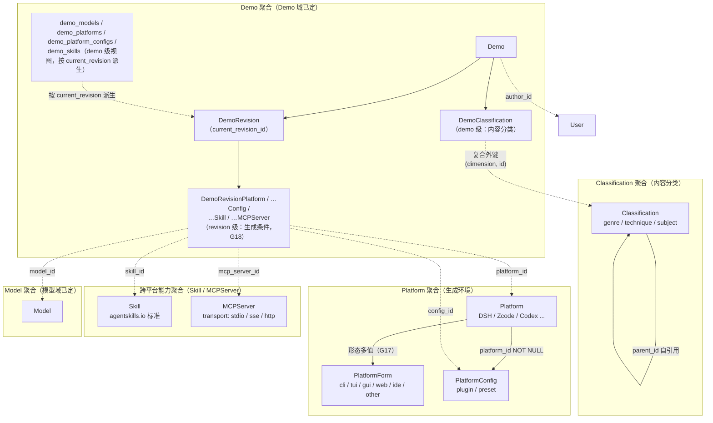
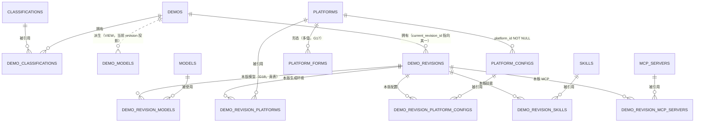
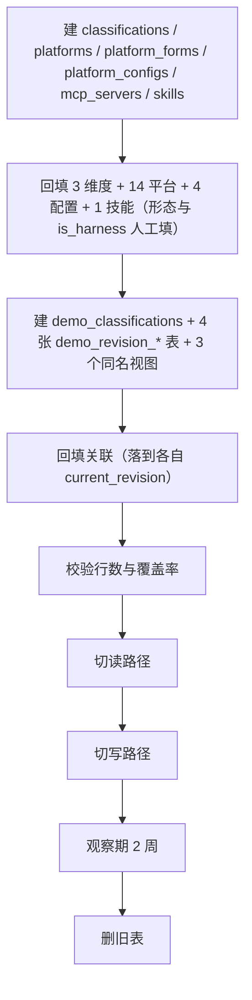

# 标签域数据结构设计 v1.8

**适用范围**：本文只做**数据结构设计**——表、列、类型、约束、索引、外键、状态枚举、派生字段的事实源、迁移顺序。不含产品形态、UI、代码结构。

> **DDL 约定**：[`DDL约定.md`](./DDL约定.md)——方言（PostgreSQL 18）、语义 → 类型映射、字段表写法、图与 DDL 的关系（含「视图不标 PK/FK」「mermaid ER 用单 token 类型」）。本域无偏差。

**状态：草案，基于线上 1358 件作品实测数据**。数据抓取于 2026-10-27，样本为 `deepdemos.top` 全量已上架作品（`/api/v1/demos` 分页 14 次）+ 135 个模型实体 + 10 个标签键 / 354 个值。原始数据为本地快照（4 个 JSON：demos / models / tag-keys / site-info，未入库）。

**配套图集**：[`标签域UML图集.md`](./标签域UML图集.md)。

**v1.2 变更**：`platform` 从分类域移出，升级为独立实体 `platforms`；`plugin` / `preset` 升级为 `platform_configs`（`platform_id NOT NULL`）；`skills` 升级为独立实体 `skills`（跨平台，无 `platform_id`）。分类域维度从 4 个减为 3 个（`genre` / `technique` / `subject`），值数从 107 减为 92。

**v1.3 变更**（2026-10-28）：`platform` 的基数从「单列外键」改为**多值关联表 `demo_platforms`**（数据里 3 件作品各有 2 个平台标签，单列外键会静默丢一条）；新增 `classification_dimensions` 承接旧 `tag_keys` 的 `label` / `description` / `mode` / `tier` / `sort`（§3.9）；补上 `external_threads` 泛化迁移与 `tag_value_suggestions → proposals` 的待审行迁移（§6.2）；修正「22 件有配置的作品」口径（实际 12 件）；去掉机器绑定路径；补记词表里 2 个 GBK 乱码值（§B.4.1）。

**v1.4 变更**（2026-10-28）：本版把「跨域决议」落进本域，并补齐两处读路径缺口。

| # | 变更 | 决策 |
|---|---|---|
| 1 | `platforms.vendor`（自由文本）→ **`vendor_id` → 共享主数据 `vendors`**（模型域 §3.4 定义）；§5.3 平台列表/详情改为 `LEFT JOIN vendors v`；新增索引 `ix_platforms_vendor`（显式索引 12 → **13** 条） | 台账 **G10** |
| 2 | 「半开放」提案落地：新增 4 个 `proposals.kind`（`new_classification` / `new_platform` / `new_platform_config` / `new_skill`）；提交端给全字段、**缺运营必填字段不允许批准**；厂商从 `vendors` **下拉选**，不由用户提 | 台账 **G9/G10** |
| 3 | **只有 `mode='fixed'` 的 6 个键**（`model` / `plugin` / `type` / `skills` / `preset` / `category`）会有「值申请」行；`game` / `platform` 是 open、`rounds` / `time` 是 int → **不可能**有申请行（读 `main` 源码核过：`tags.py:181-182`） | 台账 **G9** |
| 4 | **与旧栈的有意差异**：旧栈 `platform` 是 open 模式、打标时**自动建值**（`demos.py:161-184`）；新模型升级为实体后**改成不自动建**（否则造出没有厂商/描述的空详情页） | 台账 **G9/G10** |
| 5 | §5 全部读路径套**公开可见谓词**（G1）；**§8 风险 8** 的对照基线改为 **`main:AI_AGENT_GUIDE.md`**；新增 §9.6 **#30 已定：新栈保留 agent 通道** | 台账 **G1/G14** |
| 6 | `external_threads` 归属本域（§3.8）；`external_events` → 论坛外置、`external_identities` → 身份域（本域不建） | 台账 **G5/G12** |
| 7 | 阶段 ①–④ 标注里程碑归属 = **M11（建议，待确认）** | 台账 **G13** |
| 8 | §8 风险 8 与 §9.6 #30 对齐（agent 通道已定为「保留」） | 台账 **G14** |

**v1.5 变更**（2026-10-28）：**撤销 §3.3 的 `demos.version_of_id`**（用户裁决「判给 revision」，台账 **G15**）。`version-of` 这个 tag 键只有 2 个值 / 2 条引用（其中 1 条还指向不存在的 slug），而它要表达的「改版后的作品」在有 `DemoRevision` 之后就是「给原作加一个 revision」——保留这列会让「作品版本」有两个事实源。同步撤销：§6.2 的 `ALTER TABLE`、`ix_demos_version_of`、回填 SQL、§6.5 前置条件、不变量 #14。

**v1.6 变更**（2026-10-28）：按台账 **G16**（正文只放目标态，过渡态下沉），把**兼容层**（原 §6.3）、**已撤销的 `demos.version_of_id`**（原 §3.3）、**旧栈实现细节**与**现状→目标对照**整体下沉到新增的 **§10 过渡期与退役（非目标态）**；正文只保留目标态定义与设计结论。**本版不改任何表 / 列 / 约束 / 索引 / 不变量，不改 §6 迁移路线的顺序与前置条件，不改决策编号（G1–G16）。**

**v1.7 变更**（2026-10-28）：文本级收尾——把 §3.8 的旧表主键定义（`external_threads (demo_id, provider)`）与 §5.8 的旧栈排序口径（`site-info` 按 `tier` 再按 `key`）两处**从句**下沉到 §10.3，原位各留一行指针（台账 **G16**）。**本版不改任何表 / 列 / 约束 / 索引 / 不变量，不改决策编号（G1–G16）。**

**v1.8 变更**（2026-10-28，台账 **G17 + G18**）：

| # | 变更 | 决策 |
|---|---|---|
| 1 | **`platforms.kind` 四值枚举撤销** → 两轴：`platform_forms(platform_id, form)`（`cli`/`tui`/`gui`/`web`/`ide`/`other`，多值）+ `platforms.is_harness`（boolean NOT NULL，无默认，人工填）；`tui`≠`cli`、IDE 插件与独立 AI IDE 统一 `ide`；DSH = `{gui, web, cli, tui}` | **G17** |
| 2 | **删 `网页端` 平台**（它是形态不是产品）；`web` 形态保留。代价：3 件用网页对话做的作品失去平台归属（那 3 个标签不要了）——回填 15 → 14 行，平台引用 209 → 206 条 | **G17** |
| 3 | **MCP 独立建模**：新增 `mcp_servers`（跨平台，无 `platform_id`；`transport` / `endpoint`）+ `demo_revision_mcp_servers`；`platform_configs.kind` 删掉 `mcp_server`（只留 `plugin` / `preset`）；见新增 **§3.6.1** | **G17** |
| 4 | **生成条件下放 revision**：新增 `demo_revision_platforms` / `demo_revision_platform_configs` / `demo_revision_skills` / `demo_revision_mcp_servers`（均 `PRIMARY KEY (revision_id, xxx_id)`）；`demo_platforms` / `demo_platform_configs` / `demo_skills` **由表改同名视图**（按 `current_revision_id` 派生）；写契约参数由 `demo` 改 `revision`（§4.3 / §4.5） | **G18** |
| 5 | **§9.2 #24 口径改**：删 `gen_platform`，`?platform=` 改走 **`demo_revision_platforms`（按当前 revision）**；§5.5 筛选 SQL、§6.2 回填、§6.5 前置条件、§8 风险 12 同步；§9.1 #12（mcp 在 kind 里）与 §9.3 #17（网页端保留）已撤销/关闭 | **G17 / G18** |

**新表 DDL 落点**：`platform_forms` / `demo_revision_platforms` + `demo_platforms` 视图 → **§3.5**；`demo_revision_platform_configs` + 视图 → **§3.6**；`mcp_servers` / `demo_revision_mcp_servers` → **§3.6.1**；`demo_revision_skills` + 视图 → **§3.7**。

**另**：本版把文件行尾统一为 **CRLF**（上一版混入了 14 处 LF，属格式修正，无内容变化）。
>
> **同日修订·审计修正（2026-10-28，8 处）**：`external_threads.subject_type` 补 `mcp_server`（CHECK / §3.8 列举 / 7 类主体 / UML ER 同步）；`demo_revision_platform_configs` 回填量 `17 件`→**17 条 / 12 件**；风险 3 的「15 条」→**14 行**；§5.1 ② 平台查询补 `p.status='active'`；`demo_platform_configs` 措辞（关联表→**视图**）；「缺运营必填字段」例子改 `is_harness` / `forms`；不变量 #18 覆盖三个视图；§6.2 的 `is_harness=false` 占位注释补强「**占位不是决策**」。
>
> **另（2026-10-28，用户指认后补）**：**§2.1 聚合图与 §2.2 边界原则表里 `model` 仍挂在 demo 级**——`Demo -.-> demo_models -> Model` 改为 **`Revision -.-> model_id -> Model`**（G18：模型与平台/配置/技能/MCP 同属 revision 级），`demo_models` 归入 demo 级视图清单，边界原则两行补「走 `demo_revision_models` / `demo_revision_platforms`，demo 层同名表是视图」；**§3.4 的 ER 也按同一口径重画**（新增 `DEMO_REVISION_MODELS` 真表 + 两条实线，`DEMO_MODELS` 改为 `||..o{` 虚线派生）。交叉引用版本同步（实体域 **v2.6**）。

**待拍板按阻塞阶段分组**（§9）：回填 3 条（#17 已按 G17 关闭）/ 切路径 2 条 / 需真实数据 1 条；建表阶段的 6 条与 3 条新增结构决策已于 2026-10-28 拍板（§9.2，另加 G17 / G18 两条跨域决议）；跨域待确认项里 **#25（提案 kind）、#27（公开读路径判据）、#28（`version_of_id`）、#29（提案字段）已关闭**，**#30（agent 通道）已定**。

**核心结论**：**「tag」不是一种东西，是 4 类。** 现状用一张 `tags` 表 + 一个 `demo_tags` 关联表硬扛 4 类形状完全不同的信息：

| 类别 | 现状键 | 归宿 |
|---|---|---|
| **内容分类** | `type` / `category` / `game` | `classifications`（本文 §3） |
| **生成环境** | `platform` | `platforms`（本文 §3.5） |
| **平台配置** | `plugin` / `preset` | `platform_configs`（本文 §3.6） |
| **跨平台能力** | `skills` | `skills`（本文 §3.7） |
| **关系与数值** | `author` / `version-of` / `rounds` / `time` | `author` → `demos.author_id`；`rounds` / `time` → `demo_revisions.gen_*`；**`version-of` → 由 `DemoRevision` 取代**（G15，不引入新列） |

---

## 0. 决策摘要

| 决策 | 结论 |
|---|---|
| 分类的承载 | **`classifications` 单表 + `dimension` 判别列**（不用 3 张表） |
| 关联 | **`demo_classifications` 单表 + 复合外键**（`dimension` 不可能漂移） |
| 维度枚举 | **`genre` / `technique` / `subject`** 三值，`CHECK` 约束 |
| `model` | **不纳入**，已有 `models` 表 |
| `platform` | **不纳入分类域**，独立实体 `platforms` + 形态小表 `platform_forms` + `is_harness`（§3.5，G17）；作品↔平台是 **revision 级**关联，`demo_platforms` 为 demo 级视图（§3.5，G18） |
| 维度元数据 | 新增 `classification_dimensions`（label / mode / tier / sort），承接旧 `tag_keys`（§3.9） |
| 厂商 | **共享主数据 `vendors`**（模型域 §3.4 定义）；`platforms.vendor_id` 指向它，不用自由文本（G10） |
| `plugin` / `preset` | **不纳入分类域**，升级为 `platform_configs`（§3.6） |
| `skills` | **不纳入分类域**，升级为独立实体 `skills`（§3.7） |
| `mcp_server` | **独立实体 `mcp_servers`**（跨平台能力提供者，§3.6.1）；`platform_configs.kind` 只留 `plugin` / `preset`（G17） |
| `author` | **不纳入**，已有 `demos.author_id` |
| `version-of` | **不纳入，且不引入新列**：由 `DemoRevision` 取代（G15） |
| `rounds` / `time` | **不纳入**，已有 `demo_revisions.gen_rounds` / `gen_minutes`（G6 后挂在 revision 上） |
| `type:demo` / `html` / `svg` / `slides` | **删除**（垃圾桶 + 技术栈 + 零引用） |
| 分类状态 | **`active` / `deprecated`**（去掉陷阱态 `candidate`） |
| 值来源 | `genre` / `technique` 闭集（管理员）；`subject` 开放 |
| 用户申请 | 走 `proposals(kind='new_classification')`，不新建表 |
| 实体详情页 | `platforms` / `platform_configs` / `skills` 各自可挂 `external_threads`（§3.8） |
| 平台形态 | **`platform_forms` 小表**（`cli`/`tui`/`gui`/`web`/`ide`/`other`，多值）+ `platforms.is_harness`（布尔）——取代 `kind` 四值枚举（G17） |
| 生成条件 | **下放 revision**：`demo_revision_platforms` / `…_platform_configs` / `…_skills` / `…_mcp_servers`；`demo_platforms` 等为 demo 级视图（G18） |

**为什么 `plugin`/`preset` 同表而 `skills` 独立**：

| | `plugin` / `preset` | `skills` |
|---|---|---|
| 归属 | `platform_id NOT NULL` | **无 `platform_id`** |
| 标准 | 平台私有 | **开放标准**（agentskills.io） |
| 数据共现 | 互相共现 5 次 | 与两者**零共现** |

**这是两个不同的轴**：平台配置 vs 跨平台能力。**`mcp_server` 独立成表**：它与 `skills` 同属「跨平台」侧（G17 → `mcp_servers`，§3.6.1），不属于平台配置。


## 1. 为什么 tag 不是一种东西

### 1.1 数据证据：7 个键，4 类归宿

| 类别 | 现状键 | 覆盖率 | 值数 | 值来源 | 基数 | 语义 |
|---|---|---|---|---|---|---|
| **题材** | `type` + `game`(类型词) | 45.9% | 33 | 管理员闭集 | 多值 | 这是什么 |
| **技术** | `category` | 40.4% | 5 | 管理员闭集 | 多值 | 用了什么技术 |
| **主题** | `game`(作品名) | 9.8% | 54 | 用户开放 | 多值 | 关于什么 |
| **模型** | `model` | 94.0% | 135 | 半开 | 多值 | 谁生成的 |
| **平台** | `platform` | 15.2% | 15 | 半开 | **多值**（98.5% 单值，3 件两值） | 用什么工具做的 |
| **平台配置** | `plugin` / `preset` | 0.9%（12 件；按标签引用 1.2%） | 4 | 半开 | 多值 | 用了什么配置 |
| **跨平台能力** | `skills` | 0.4% | 1 | 半开 | 多值 | 会什么能力 |

**7 个键归 4 类**：

| 类 | 键 | 归宿 |
|---|---|---|
| 内容分类 | `type` / `category` / `game` | `classifications` |
| 生成环境 | `platform` | `platforms` |
| 平台配置 | `plugin` / `preset` | `platform_configs` |
| 跨平台能力 | `skills` | `skills` |
| 已有实体 | `model` | `models`（已有表） |


### 1.2 另外 4 个键不是分类

| 键 | 引用 | 实际是什么 | 归宿 |
|---|---|---|---|
| `author` | 1348 | 关系 | `demos.author_id` |
| `version-of` | 2 | 关系 | **`DemoRevision`**（G15：2 条数据合并成原作 revision；其中 1 条已断链） |
| `rounds` | 194 | 数值 | `demo_revisions.gen_rounds`（G6） |
| `time` | 111 | 数值 | `demo_revisions.gen_minutes`（G6） |

### 1.3 为什么 `platform` 不能留在分类域

| 理由 | 证据 |
|---|---|
| **与 `model` 多对多** | `DSH` 下有 **25 个不同模型**，不能做 `models` 的列 |
| **有厂商归属** | `Zcode` = GLM 专武、`qoder` = 阿里、`Codebuddy` = 腾讯 |
| **有官网/文档** | 15 个工具都有 |
| **有别名需求** | `Codebuddy` / `codebuddy` 大小写重复 |
| **需要详情页** | 「DSH 怎么用」「Zcode 有什么坑」是独立话题 |
| **与内容分类零重叠** | 206 件有 `platform`，其中 46 件**没有任何内容分类**（口径：无 `category` / `game`，且 `type` 只剩 `demo`/`html`/`svg`/`slides` 这类非内容值；若把垃圾 `type` 也算作分类则是 33 件） |

**最后一条是关键**：如果 `platform` 是分类的一个维度，那它应该和 `genre` / `technique` 共现。但 46 件作品只有 `platform` 没有内容分类——**它们是两类不同的信息**。

### 1.4 为什么 `plugin` / `preset` / `skills` 不能留在分类域

| 理由 | 证据 |
|---|---|
| **形状与分类不同** | 分类是「作品是什么」，配置是「用什么做的」 |
| **有归属关系** | `routing-suite` 是 DSH 的插件，`j-space` 跨平台 |
| **需要详情页** | 「router-standard 预设怎么配」是独立话题 |
| **与 `platform` 零重叠** | 12 件有配置的作品（`plugin` 6 + `preset` 11，共现 5 件去重后 12；含 `skills` 为 17 件），**一件都没有 `platform`** |

**最后一条是异常信号**：如果配置是平台的附属，那有配置就该有平台。零重叠说明填写者把它们当互斥选项——**这是 UI 引导问题，不是数据模型问题**。数据模型应该允许两者共存。

### 1.4.1 三者不是一类，是两个轴

**共现矩阵**（demo 数）：

| | `plugin` | `preset` | `skills` |
|---|---|---|---|
| `plugin` | 6 | **5** | **0** |
| `preset` | **5** | 11 | **0** |
| `skills` | **0** | **0** | 5 |

**组合分布**：

| 组合 | demo 数 |
|---|---|
| 只有 `preset` | 6 |
| 只有 `skills` | 5 |
| `plugin` + `preset` | 5 |
| 只有 `plugin` | 1 |

**`plugin` 和 `preset` 共现 5 次（互补），`skills` 与两者零共现（正交）。**

| 关系 | 含义 |
|---|---|
| **互补**（同时出现） | 两个**不同**的东西，可以一起用 |
| **互斥**（从不同时出现） | 两个**同类**的东西，二选一 |

`plugin` 和 `preset` 互补 → 它们是不同的东西，但同属「平台配置」。
`skills` 与两者正交 → 它是另一个轴上的东西（跨平台能力）。

### 1.4.2 官方文档的佐证

VS Code 官方把 agent 定制分成 **6 种不同机制**，每种作用在不同层：

| 机制 | 作用 | 归属 |
|---|---|---|
| **instructions** | 提供上下文 | 项目/用户 |
| **agent skills** | 定义可重复的工作流 | **跨平台开放标准** |
| **prompt files** | 打包任务特定指引 | 平台特定 |
| **custom agents** | 配置角色（指令 + 工具 + 模型） | 平台特定 |
| **MCP servers** | 添加能力（外部系统工具） | 可跨平台 |
| **agent plugins** | **打包多种定制成一个可安装单元** | 平台特定 |

**官方原话**：

> These mechanisms affect **different layers of the agent**. Instructions guide the model's decisions, tools expand the actions it can take, and hooks run outside the model's decision-making.

**`plugin` 是容器，`skill` 是组件**：

> Agent plugins **bundle related customizations** into one installable setup.

plugin 可以包含：Skills / MCP servers / Custom agents / Hooks / Automation templates / Slash commands。

**`skill` 是开放标准**（[agentskills.io](https://agentskills.io/)）：

> Originally developed by **Anthropic**, released as an **open standard**, adopted by a growing number of agent products.

**结论**：`plugin`/`preset` 是**平台私有配置**，`skill` 是**跨平台开放标准**。这是两个不同的轴，不能合并。


### 1.5 3 处形状差异，全部有数据支撑

| | `genre` | `technique` | `subject` |
|---|---|---|---|
| **层级** | ✅ `game → FPS` | ❌ | ❌ |
| **别名** | ❌ | ❌ | ✅ `魔方` / `Rubik` |

**现状怎么扛这 3 种差异**：`tags` 表有 `group` 和 `parent_id` 两个通用列。

| 列 | 实际使用 |
|---|---|
| `group` | 只有 `model` 有值（132/142），其他 9 个键**全部 `None`** |
| `parent_id` | 354 个值里只有 **2 个**有值（`dsv4-flash` / `dsv4-pro` → `dsv4`） |

**两个列服务 1 个键，而那个键已经实体化了。**

### 1.6 `type` 混了四种东西

| 类别 | 值 | 引用 | 占比 | 处置 |
|---|---|---|---|---|
| **垃圾桶** | `demo` | 200 | 22.3% | 删（80.5% 的 `type:demo` 没有其他语义 type） |
| **技术栈** | `html` / `svg` | 61 | 6.8% | 删（38 件 `type:html` **全部** `demo_type='web'`） |
| **载体形态** | `widget` / `effect` | 27 | 3.0% | 归 `genre` |
| **内容题材** | 11 个值 | 608 | 67.9% | 归 `genre` |

### 1.7 `game` 混了两种东西

| 类别 | 值数 | 引用 | 例 | 归宿 |
|---|---|---|---|---|
| **具体作品** | 54 | 137 | `魔方` / `我的世界` / `雨夜便利店` | `subject` |
| **类型词** | 20 | 50 | `FPS` / `肉鸽` / `跑酷` / `赛车` | `genre`（作为 `game` 的子类） |

**证据**：`type=game` 的 227 件里，只有 77 件（33.9%）有 `game` 标签；有 `game` 标签的 168 件里，只有 77 件（45.8%）是 `type=game`。两者几乎正交。

---


## 2. 领域边界

### 2.1 五个聚合



### 2.2 边界原则

| 原则 | 说明 |
|---|---|
| **分类是独立聚合** | `Classification` 不随 `Demo` 存亡；删作品不删分类 |
| **平台是独立聚合** | `Platform` 有详情页、有讨论、有厂商，不随 `Demo` 存亡 |
| **生成条件是 revision 级** | 作品 ↔ **模型** / 平台 / 配置 / 技能 / MCP 都是 **revision 级**关联（`demo_revision_*`，G18）；`demo_models` / `demo_platforms` 等是 demo 级视图（按 `current_revision_id` 派生）。数据里 3 件作品各有 2 个平台标签 |
| **平台形态是独立小表** | `platform_forms` 多值（`cli`/`tui`/`gui`/`web`/`ide`/`other`）；`is_harness` 是平台上的布尔（G17） |
| **MCP 是跨平台能力** | `mcp_servers` 独立实体，**没有** `platform_id`（与 `skills` 同侧，G17） |
| **配置属于平台聚合** | `PlatformConfig.platform_id` **NOT NULL**，配置必须属于平台 |
| **技能是独立聚合** | `Skill` 跨平台，**没有** `platform_id` |
| **关联属于 Demo 聚合** | `DemoClassification`（内容分类，demo 级）与 `DemoRevision*` 关联（生成条件，revision 级）随 `Demo` 级联删除 |
| **维度是判别列，不是表** | 3 个维度共用一张表，靠 `dimension` + `CHECK` 区分形状 |
| **`model` 不在分类域** | 已有 `models` 表；作品 ↔ 模型走 **revision 级** `demo_revision_models`（G18），demo 层 `demo_models` 是视图 |
| **`platform` 不在分类域** | 独立实体，走 **revision 级** `demo_revision_platforms` 多值关联（§3.5，G18）；demo 层 `demo_platforms` 是视图 |
| **关系不是分类** | `author` 用 `demos.author_id` 表达；`version-of` 由 `DemoRevision` 取代（G15） |
| **数值不是分类** | `rounds` / `time` 是数值，用列表达 |


## 3. 目标数据模型

### 3.1 `Classification`（分类项）

```sql
CREATE TABLE classifications (
    id         bigint      GENERATED ALWAYS AS IDENTITY PRIMARY KEY,
    dimension  text        NOT NULL
                           CHECK (dimension IN ('genre', 'technique', 'subject')),
    slug       text        NOT NULL,
    label       text        NOT NULL,
    description text        NOT NULL DEFAULT '',
    parent_id      bigint  REFERENCES classifications(id) ON DELETE SET NULL,
    merged_into_id bigint  REFERENCES classifications(id) ON DELETE SET NULL,
    aliases    text[]      NOT NULL DEFAULT '{}',
    sort       int         NOT NULL DEFAULT 0,
    status     text        NOT NULL DEFAULT 'active'
                           CHECK (status IN ('active', 'deprecated')),
    created_at timestamptz NOT NULL DEFAULT now(),
    updated_at timestamptz NOT NULL DEFAULT now(),

    UNIQUE (dimension, slug),
    UNIQUE (dimension, id),          -- 供 join 表复合外键

    CONSTRAINT ck_classifications_shape CHECK (
        (dimension = 'genre'
            AND cardinality(aliases) = 0)
     OR (dimension = 'technique'
            AND parent_id IS NULL AND cardinality(aliases) = 0)
     OR (dimension = 'subject'
            AND parent_id IS NULL)
    )
);
CREATE INDEX ix_classifications_dim ON classifications (dimension, sort)
    WHERE status = 'active';
CREATE INDEX ix_classifications_parent ON classifications (parent_id)
    WHERE parent_id IS NOT NULL;
CREATE INDEX ix_classifications_merged ON classifications (merged_into_id)
    WHERE merged_into_id IS NOT NULL;
CREATE INDEX ix_classifications_aliases ON classifications USING gin (aliases);
```

**`merged_into_id` 的作用**：合并后源项软删（`status='deprecated'`），`merged_into_id` 指向归宿。与 `models.merged_into_id` 同构。

**为什么 `merged_into_id` 不在 `ck_classifications_shape` 里限制**：3 个维度都可能被合并，它是**跨维度的通用列**，不像 `parent_id`（只有 `genre` 用）或 `aliases`（只有 `subject` 用）。

**`dimension` 是 CHECK 枚举，不是开放 `key`**：

新模型只有 3 个合法值，非法值进不来。旧 `tags.key` 是开放字符串（靠 `RESERVED_TAG_KEYS` 与 `JOIN TagKey` 排除），细节见 §10.3。

**`ck_classifications_shape` 的作用**：

| 维度 | `parent_id` | `aliases` |
|---|---|---|
| `genre` | ✅ | ❌ |
| `technique` | ❌ | ❌ |
| `subject` | ❌ | ✅ |

**为什么 `genre` 允许 `parent_id`**：数据里真实存在 `game → FPS` / `game → 肉鸽` / `game → 跑酷` 的父子关系（20 个类型词）。

**为什么 `subject` 允许 `aliases`**：`魔方` 有 `魔方模拟器` / `Rubik's Cube` / `三阶魔方` 等写法；`我的世界` 有 `MC` / `Minecraft`。

**为什么 `technique` 什么都不允许**：5 个值（`3D建模` / `仿真` / `动画` / `图形学` / `机器人`）是纯闭集，无层级、无别名。

**`vendor` / `url` 两列已从本表移除**：它们只服务 `platform`，而 `platform` 已升级为独立实体（§3.5）。

**`UNIQUE (dimension, id)` 的作用**：

这是给 `demo_classifications` 的复合外键用的。没有它，PostgreSQL 无法建立 `(dimension, classification_id) → (dimension, id)` 的外键。


### 3.2 `DemoClassification`（作品↔分类）

```sql
CREATE TABLE demo_classifications (
    demo_id           bigint NOT NULL REFERENCES demos(id) ON DELETE CASCADE,
    dimension         text   NOT NULL
                             CHECK (dimension IN ('genre', 'technique', 'subject')),
    classification_id bigint NOT NULL,
    created_at        timestamptz NOT NULL DEFAULT now(),

    PRIMARY KEY (demo_id, dimension, classification_id),
    FOREIGN KEY (dimension, classification_id)
        REFERENCES classifications (dimension, id) ON DELETE CASCADE
);
CREATE INDEX ix_demo_cls_cls ON demo_classifications (classification_id);
```

**复合外键解决什么**：

如果只写 `classification_id REFERENCES classifications(id)`，那么 `dimension` 列和 `classification_id` 指向的行可能不一致——比如 `dimension='genre'` 但 `classification_id` 指向一个 `subject`。复合外键让 DB 保证两者一致。

**`ix_demo_cls_cls` 解决什么**：

这是**最高频的读路径**（标签列表页、标签详情页、explore 页、site-info 页、删标签前的引用检查、合并标签），`classification_id` 需要独立索引。

旧 `demo_tags` 缺 `tag_id` 索引、按标签统计全表扫的细节，以及上一版草稿的 `uq_demo_cls_tool` 约束，见 §10.3 / §10.4。


### 3.3 ~~`demos` 新增列~~（**已撤销**，2026-10-28，台账 G15）

**不再引入 `demos.version_of_id`，也不建 `ix_demos_version_of`**：作品版本由 `DemoRevision` 表达（§2.2、§7 不变量 #14）。

撤销理由、撤销前的历史设计、以及「将来要表达二创 / 衍生关系」的落点，见 §10.4；决策台账见 §9.6 #28。

### 3.4 与 `models` 的接缝



> 图中 **`DEMO_REVISION_MODELS`**（全大写是 mermaid ER 的实体命名惯例）就是表 **`demo_revision_models`**——DDL 与配套视图定义见《模型域设计》§3.3；**`DEMO_MODELS（VIEW）`** 是它的「当前 revision」投影，**只读、不可写**（G18）。`demo_platforms` / `demo_platform_configs` / `demo_skills` 同理。

**`model` 不进 `classifications`**：

| | `classifications` | `models` |
|---|---|---|
| 行数 | 92 | 135 |
| 有 `resolution` | ❌ | ✅ `exact`/`family`/`unknown`/`guess` |
| 有 `merged_into_id` | ✅ | ✅ |
| 有 `vendor` 实体 | ❌ | ✅ `vendors` 表 |
| 有别名表 | `aliases text[]` | `model_aliases` 表 |
| 有第三方基准 | ❌ | ✅ 4 张表 |

`models` 已经是完整实体，`classifications` 不该重复它的形状。

**`platform` 不进 `classifications`**：与 `model` 多对多（`DSH` 下有 25 个模型），且需要独立详情页。

**`platform_config` 和 `skill` 也不进 `classifications`**：它们是「用什么做的」，不是「是什么」。


### 3.5 `Platform`（生成环境）

```sql
CREATE TABLE platforms (
    id          bigint      GENERATED ALWAYS AS IDENTITY PRIMARY KEY,
    slug        text        NOT NULL UNIQUE,
    name        text        NOT NULL,
    is_harness  boolean     NOT NULL,                 -- 是不是自带 agent 循环的宿主（人工填、无默认，G17）
    vendor_id   bigint      REFERENCES vendors(id) ON DELETE SET NULL,  -- 共享主数据，见 G10
    url         text,
    description text        NOT NULL DEFAULT '',
    aliases     text[]      NOT NULL DEFAULT '{}',
    sort        int         NOT NULL DEFAULT 0,
    status      text        NOT NULL DEFAULT 'active'
                            CHECK (status IN ('active', 'deprecated')),
    created_at  timestamptz NOT NULL DEFAULT now(),
    updated_at  timestamptz NOT NULL DEFAULT now()
);
CREATE INDEX ix_platforms_aliases ON platforms USING gin (aliases);
CREATE INDEX ix_platforms_vendor ON platforms (vendor_id);   -- G10：平台按厂商查（对齐模型域的 ix_models_vendor）

-- 形态（多值，G17）：一个产品可以同时是 CLI / IDE 扩展 / Web
CREATE TABLE platform_forms (
    platform_id bigint NOT NULL REFERENCES platforms(id) ON DELETE CASCADE,
    form        text   NOT NULL
                CHECK (form IN ('cli','tui','gui','web','ide','other')),
    PRIMARY KEY (platform_id, form)
);
CREATE INDEX ix_platform_forms_form ON platform_forms (form);

-- 作品↔平台是 **revision 级**（G18）：一次生成用了哪些平台，属于那一版
CREATE TABLE demo_revision_platforms (
    revision_id bigint NOT NULL REFERENCES demo_revisions(id) ON DELETE CASCADE,
    platform_id bigint NOT NULL REFERENCES platforms(id) ON DELETE RESTRICT,
    PRIMARY KEY (revision_id, platform_id)
);
CREATE INDEX ix_demo_rev_platforms_platform ON demo_revision_platforms (platform_id);

-- demo 级视图：保留原表名，读路径不用改（按当前 revision 派生，G18）
CREATE VIEW demo_platforms AS
SELECT d.id AS demo_id, rp.platform_id
  FROM demos d JOIN demo_revision_platforms rp ON rp.revision_id = d.current_revision_id;
```

**两轴取代 `kind`（G17）**：旧的 `kind` 四值枚举（`agent` / `harness` / `web` / `other`）把**两个不同层的东西**塞进了一个单值列，本次拆成两轴：

| 轴 | 落点 | 取值 |
|---|---|---|
| **角色**（单值） | `platforms.is_harness` | 是不是**自带 agent 循环的宿主**（`DSH` = true；打包好的 agent 产品 = false） |
| **形态**（多值） | `platform_forms(platform_id, form)` | `cli` / `tui` / `gui` / `web` / `ide` / `other` |

**为什么拆**：`agent` 与 `harness` **不是同一层的对立值**——agent 是打包好的产品、harness 是跑循环的骨架（agent = harness + AI），且**形态天然多值**：Codex / Claude Code 都是 CLI + IDE 扩展 + Web 并存，单值枚举必然丢信息。`harness` 轴区分度极低（15 个值里 13–14 个是），只适合做**布尔**。

**6 个形态的定案细节**：

| 细节 | 定案 |
|---|---|
| `tui` 与 `cli` | **不合并**——TUI（全屏终端界面）与 CLI（命令行）是两个明确不同的形态 |
| IDE 内插件 vs 独立 AI IDE | **不区分**，统一 `ide` |
| `gui` 命名 | 叫 `gui`，不叫 `desktop` |
| DSH 的形态 | `{gui, web, cli, tui}`——`gui` = dsh desktop，`web` = dsh web（BS 架构前端），另有 CLI / TUI |
| `sdk` | 暂不设；将来要加就是一次轻量 migration |
| 录入方式 | **人工录入**（`platform_forms` 没有 `source` 列）；标签数据里只有平台名，推不出形态——**14 行**一次性录入 + 部分值需作者确认 |

**`is_harness` 不给默认值**：`NOT NULL` 且无 `DEFAULT`，逼人工在 INSERT 时明确表态（14 行，见 §6.2）。若给 `DEFAULT false`，「忘了填」会静默变成「不是 harness」。

**`网页端` 已删除（G17，2026-10-28 用户裁决）**：它不是产品而是**形态**。确实有用网页对话产出作品的场景，所以 **`web` 形态保留在 `platform_forms`**；但「网页端」这个占位平台整体删除。**代价**：3 件用网页对话做的作品（标签 `platform:网页端`）失去平台归属——**那 3 个标签不要了**。实测影响：`platforms` 回填 15 → **14 行**，`demo_revision_platforms` 209 → **206 条**（那 3 件作品没有其它平台标签；`demo_platforms` 视图 206 条 / 203 件作品）。

**为什么平台用关联表而不是单列外键**（v1.3 改）：206 件有平台标签的作品里有 **3 件各有 2 个平台**（`DSH+Codex` / `DSH+Codebuddy` / `DSH+workbuddy`）。单列外键会把其中一条静默丢掉，而且回填后的校验（`count(*) WHERE platform_id IS NOT NULL` 仍然是 206）**发现不了**。改用多值关联表后标签引用逐条落地，读路径改用 `EXISTS`（§5.5）。**G18 后关联挂在 revision 上**（`demo_revision_platforms`），`demo_platforms` 是同名视图（按 `current_revision_id` 派生）——「多值」的判断不变，只是「**这一版**用了哪些平台」成为版本事实；关联只有约 206 行，性能差异可忽略。

**`vendor_id` / `url` / `aliases` 为什么在这里**：只服务 `platform`，放在分类表里是空列。其中 **`vendor_id` 指向共享主数据 `vendors`**（G10）——厂商是跨域概念（模型域的 `models.vendor_id` 指向同一张表），**不能用自由文本**，否则同一厂商会出现 `DeepSeek` / `deepseek` / `DS` 多种写法，统计口径立刻分裂。

### 3.6 `PlatformConfig`（平台配置）

```sql
CREATE TABLE platform_configs (
    id          bigint      GENERATED ALWAYS AS IDENTITY PRIMARY KEY,
    platform_id bigint      NOT NULL REFERENCES platforms(id) ON DELETE CASCADE,
    kind        text        NOT NULL
                            CHECK (kind IN ('plugin', 'preset')),   -- mcp_server 已移出（G17），见 §3.6.1
    slug        text        NOT NULL,
    name        text        NOT NULL,
    description text        NOT NULL DEFAULT '',
    url         text,
    source      text        NOT NULL DEFAULT 'manual'
                            CHECK (source IN ('manual', 'parsed', 'imported')),
    status      text        NOT NULL DEFAULT 'active'
                            CHECK (status IN ('active', 'deprecated')),
    created_at  timestamptz NOT NULL DEFAULT now(),
    updated_at  timestamptz NOT NULL DEFAULT now(),
    UNIQUE (platform_id, kind, slug)
);
CREATE INDEX ix_platform_configs_platform ON platform_configs (platform_id, kind)
    WHERE status = 'active';

-- 与本版生成关联（G18）
CREATE TABLE demo_revision_platform_configs (
    revision_id bigint NOT NULL REFERENCES demo_revisions(id) ON DELETE CASCADE,
    config_id   bigint NOT NULL REFERENCES platform_configs(id) ON DELETE RESTRICT,
    PRIMARY KEY (revision_id, config_id)
);
CREATE INDEX ix_demo_rev_pcfg_cfg ON demo_revision_platform_configs (config_id);

-- demo 级视图：保留原表名，读路径不用改（按当前 revision 派生）
CREATE VIEW demo_platform_configs AS
SELECT d.id AS demo_id, rc.config_id
  FROM demos d JOIN demo_revision_platform_configs rc ON rc.revision_id = d.current_revision_id;
```

**`kind` 的 2 个值**（`mcp_server` 已移出，G17）：

| kind | 含义 | 数据里的值 | 归属 |
|---|---|---|---|
| `plugin` | 打包容器（可含 skill / MCP / agent / hook） | `routing-suite` / `suite` | DSH |
| `preset` | 角色配置（指令 + 工具 + 模型） | `router-standard` / `spec` | DSH |

> MCP **不是平台配置**：它是**跨平台**能力提供者，独立建模为 `mcp_servers`（§3.6.1）。

**`platform_id NOT NULL` 是逻辑约束，不是技术选择**：

配置**必须**属于某个平台。这与 `skills` 的跨平台性质形成对比（§3.7）。

**为什么 `plugin` 和 `preset` 可以同表**：

| 理由 | 证据 |
|---|---|
| 共现 5 次 | `plugin`+`preset` 同时出现 5 件，说明是互补而非互斥 |
| 归属相同 | 都必须是某平台的配置 |
| 形状相同 | 名字 + 描述 + 平台 + 来源 |
| 数据量小 | 各 2 个值 |

**为什么 `mcp_server` 不再放这张表（G17）**：旧设计把 MCP 当成平台配置，导致 `platform_id NOT NULL` 这个约束对 MCP 也成立——等于断言「每个 MCP server 只属于一个平台」。**这与本域自己的论证冲突**（§1.4.1 把 MCP 归到「跨平台」侧，与 `skills` 同侧），所以本次**独立建模**为 `mcp_servers`（§3.6.1），`platform_configs.kind` 只留 `plugin` / `preset`。

**`source` 列的作用**：

| 值 | 含义 |
|---|---|
| `manual` | 用户手动填的标签迁移过来 |
| `parsed` | 从 `session.jsonl` 等生成记录解析出来 |
| `imported` | 从外部数据导入 |

**为什么需要 `source`**：解析出来的值和人工填的值可信度不同。`source='parsed'` 的行可以标 `unverified` 让管理员确认。

**为什么配置走关联表而不是 `demos` 的列**：一件作品可以同时有多个配置（数据里 `plugin` + `preset` 同时出现的有 5 件）；`demo_platform_configs` 是 `demo_revision_platform_configs` 的同名**只读视图**（G18）。

### 3.6.1 `MCPServer`（跨平台能力提供者，G17）

```sql
CREATE TABLE mcp_servers (
    id          bigint      GENERATED ALWAYS AS IDENTITY PRIMARY KEY,
    slug        text        NOT NULL UNIQUE,
    name        text        NOT NULL,
    description text        NOT NULL DEFAULT '',
    transport   text        NOT NULL
                            CHECK (transport IN ('stdio', 'sse', 'http')),
    endpoint    text        NOT NULL DEFAULT '',
    vendor_id   bigint      REFERENCES vendors(id) ON DELETE SET NULL,  -- 可空：很多 MCP server 无厂商（G10 共享主数据）
    status      text        NOT NULL DEFAULT 'active'
                            CHECK (status IN ('active', 'deprecated')),
    created_at  timestamptz NOT NULL DEFAULT now(),
    updated_at  timestamptz NOT NULL DEFAULT now()
);

-- 与本版生成关联（G18）：这一次生成用过哪些 MCP server
CREATE TABLE demo_revision_mcp_servers (
    revision_id   bigint NOT NULL REFERENCES demo_revisions(id) ON DELETE CASCADE,
    mcp_server_id bigint NOT NULL REFERENCES mcp_servers(id) ON DELETE RESTRICT,
    PRIMARY KEY (revision_id, mcp_server_id)
);
CREATE INDEX ix_demo_rev_mcp_mcp ON demo_revision_mcp_servers (mcp_server_id);
```

**为什么要独立成表（G17，用户原话「mcp 属于跨平台的，独立出来建模好了」）**：

旧设计把 MCP 塞进 `platform_configs.kind`，而 `platform_configs.platform_id` 是 `NOT NULL`——这等于断言「每个 MCP server 只属于一个平台」。**这与本域自己的论证冲突**：§1.4.1 已写明 MCP 是**跨平台**的能力提供者（与 `skills` 同侧），`plugin` / `preset` 才是平台私有配置。**「必须属于某平台」是错的，本次修正。**

| | `platform_configs`（plugin / preset） | `mcp_servers` |
|---|---|---|
| `platform_id` | **NOT NULL**（平台私有） | **无此列**（跨平台） |
| 标准 | 平台自定义 | MCP 协议（`stdio` / `sse` / `http`） |
| 归属判据 | 「哪个平台的配置」 | 「哪个能力提供者」 |

**形态与 `skills` 一致、与 `platform_configs` 相反**：`mcp_servers` 和 `skills` 一样没有 `platform_id`，详情页与讨论挂载点同 §3.8。

**「某平台怎么加载它」暂不建绑定表**：数据里 MCP 相关行是 **0 行**（词表里没有 `mcp` 键，只有 1 件作品在文本里提及），建 `platform_mcp_servers` 这类绑定表没有数据支撑。等有真实数据再加，加的时候是一次轻量 migration（不动本表）。

**`transport` / `endpoint` 两列**：连接方式是这个实体唯一稳定的技术属性（`stdio` 起子进程、`sse` / `http` 连远端）；`endpoint` 只对远端有意义，`stdio` 留空。

### 3.7 `Skill`（跨平台能力）

```sql
CREATE TABLE skills (
    id          bigint      GENERATED ALWAYS AS IDENTITY PRIMARY KEY,
    slug        text        NOT NULL UNIQUE,
    name        text        NOT NULL,
    description text        NOT NULL DEFAULT '',
    url         text,
    spec        text        NOT NULL DEFAULT 'agentskills.io'
                            CHECK (spec IN ('agentskills.io', 'other')),
    source      text        NOT NULL DEFAULT 'manual'
                            CHECK (source IN ('manual', 'parsed', 'imported')),
    status      text        NOT NULL DEFAULT 'active'
                            CHECK (status IN ('active', 'deprecated')),
    created_at  timestamptz NOT NULL DEFAULT now(),
    updated_at  timestamptz NOT NULL DEFAULT now()
);

-- 与本版生成关联（G18）
CREATE TABLE demo_revision_skills (
    revision_id bigint NOT NULL REFERENCES demo_revisions(id) ON DELETE CASCADE,
    skill_id    bigint NOT NULL REFERENCES skills(id) ON DELETE RESTRICT,
    PRIMARY KEY (revision_id, skill_id)
);
CREATE INDEX ix_demo_rev_skills_skill ON demo_revision_skills (skill_id);

-- demo 级视图：保留原表名，读路径不用改（按当前 revision 派生）
CREATE VIEW demo_skills AS
SELECT d.id AS demo_id, rs.skill_id
  FROM demos d JOIN demo_revision_skills rs ON rs.revision_id = d.current_revision_id;
```

**为什么 `skills` 必须独立成表，不能和 `platform_configs` 合并**：

| 差异 | `platform_configs` | `skills` |
|---|---|---|
| **归属** | `platform_id NOT NULL` | **无 `platform_id`** |
| **标准** | 平台私有 | **开放标准**（agentskills.io） |
| **跨平台** | ❌ | ✅ |
| **数据共现** | 与 `skills` **零共现** | 与 `plugin`/`preset` **零共现** |

**数据证据**：

| | `plugin` | `preset` | `skills` |
|---|---|---|---|
| `plugin` | 6 | **5** | **0** |
| `preset` | **5** | 11 | **0** |
| `skills` | **0** | **0** | 5 |

`plugin` 和 `preset` 共现 5 次（互补），`skills` 与两者零共现（正交）。**这是两个不同的轴。**

**`spec` 列的作用**：

| 值 | 含义 |
|---|---|
| `agentskills.io` | 遵循 Agent Skills 开放标准（`SKILL.md` + `scripts/` + `references/` + `assets/`） |
| `other` | 其他格式 |

**为什么需要 `spec`**：Agent Skills 是 Anthropic 发起、已被多个 agent 产品采纳的开放标准。标注 `spec` 后，前端可以显示「这个 skill 是标准格式，可跨 agent 使用」。

**`skills` 没有 `platform_id`**：这是它与 `platform_configs` 的根本差异。一个 skill 可以在 DSH、Zcode、Codex 上通用。

### 3.8 详情页与讨论的挂载点

`platforms`、`platform_configs`、`skills`、`mcp_servers` 都需要「详情页 + 社区讨论」。

> 旧栈 `external_threads` 的主键是 `(demo_id, provider)`、只支持 demo 的旧表定义已按 **G16**（③ 旧栈实现细节）下沉到 §10.3。

```sql
-- 泛化：subject_type + subject_id
CREATE TABLE external_threads (
    subject_type      text   NOT NULL
                             CHECK (subject_type IN (
                                 'demo', 'platform', 'platform_config',
                                 'skill', 'model', 'mcp_server', 'task'
                             )),
    subject_id        bigint NOT NULL,
    provider          text   NOT NULL,
    host              text   NOT NULL DEFAULT '',
    external_topic_id text   NOT NULL,
    external_slug     text   NOT NULL DEFAULT '',
    url               text   NOT NULL,
    post_count        int     NOT NULL DEFAULT 0,   -- 与全库一致用 int（PG 里 int = integer）
    last_posted_at    timestamptz,
    synced_at         timestamptz,
    PRIMARY KEY (subject_type, subject_id, provider),
    UNIQUE (provider, host, external_topic_id)
);
CREATE INDEX ix_ext_threads_subject ON external_threads (subject_type, subject_id);
```

**为什么保留 `host`**：不同论坛实例的 `topic_id` 会撞车，唯一键必须是 `(provider, host, external_topic_id)`；主键泛化为 `(subject_type, subject_id, provider)`。

本节定义与此前两份文档（《论坛外置选型对比》的 `external_threads (demo_id, provider)`、《Demo域设计》的 `DemoExternalThread (demo_id, provider, host, topic_id)`）的差异对照，见 §10.2。

**为什么用 `subject_type` + `subject_id` 而不是 7 个可空外键**：

| 方案 | 列数 | 约束 | 加新类型 |
|---|---|---|---|
| `subject_type` + `subject_id` | 2 | 应用层校验 | 加一个 CHECK 值 |
| 7 个可空 FK + CHECK | 7 + 1 | DB 保证 | 加一列 + 改 CHECK |

**代价**：`subject_id` 无法加外键，可能指向已删除的行。

**为什么这个代价可接受**：讨论关联是**弱引用**——主题丢了不影响主数据。定期跑一致性检查清理孤儿行即可。

**与实体域 `proposal_refs` 的差异**：`proposal_refs` 用的是「拆成具体 FK」，因为那里只有 4 种类型且都是核心表，且提案的 `subject` 必须存在。讨论关联的语义不同。


### 3.9 `ClassificationDimension`（维度元数据）

`classifications` 只有 `dimension` 枚举，维度级元数据（中文名、说明、排序、是否闭集）没有归宿——旧 `tag_keys` 的 `label` / `description` / `sort` / `tier` / `mode` 正是这些；`tier` 还是旧站 site-info 的排序依据。

```sql
CREATE TABLE classification_dimensions (
    dimension   text        PRIMARY KEY
                            CHECK (dimension IN ('genre', 'technique', 'subject')),
    label       text        NOT NULL,
    description text        NOT NULL DEFAULT '',
    mode        text        NOT NULL DEFAULT 'fixed'
                            CHECK (mode IN ('fixed', 'open')),
    tier        int         NOT NULL DEFAULT 2,
    sort        int         NOT NULL DEFAULT 0,
    status      text        NOT NULL DEFAULT 'active'
                            CHECK (status IN ('active', 'deprecated'))
);
```

| dimension | label | mode | tier | 承接旧 `tag_keys` |
|---|---|---|---|---|
| `genre` | 题材 | fixed | 1 | `type`（+ `game` 的类型词） |
| `technique` | 技术 | fixed | 2 | `category` |
| `subject` | 主题 | open | 2 | `game`（作品名部分） |

> `classification_dimensions` 的回填方式、以及其余旧键的退场去向，见 §10.2。

**为什么单独一张表而不是写死在代码里**：维度中文名与排序是运营可调内容（旧站能改 `tag_keys.label`），写死会让每次改文案都要发版；这张表只有 3 行，成本可忽略。

## 4. 写入契约

### 4.1 建分类项

```text
create_classification(dimension, slug, label, description?, parent_id?, aliases?, sort?)
  ├─ 校验 dimension ∈ ('genre','technique','subject')
  ├─ 校验形状（按 dimension 的 CHECK，应用层先挡一次给出友好错误）
  ├─ 若 parent_id 非空：
  │   ├─ 父项必须存在
  │   ├─ 父项 dimension 必须相同
  │   └─ 父项不能是自身（防自环）
  ├─ INSERT classifications
  └─ audit_log(action='create', entity_type='classification')
```

**为什么父项必须同 dimension**：新模型里 `parent_id` 只允许 `genre` 用，而 `genre` 的父项必然是 `genre`——但 DB 无法强制，所以保留应用层检查（旧栈也只有运行时检查，见 §10.3）。

### 4.2 打标

```text
set_demo_classifications(demo, items)
  ├─ items = [{dimension, slug}, ...]
  ├─ 按 dimension 分组
  ├─ 对每个 item：
  │   ├─ 查 classifications WHERE (dimension, slug) AND status='active'
  │   │   ├─ 命中 → 用它的 id
  │   │   └─ 未命中：
  │   │       ├─ dimension ∈ ('genre','technique') → 422（闭集，必须管理员先建）
  │   │       └─ dimension = 'subject' → INSERT classifications（自动建）
  ├─ DELETE demo_classifications WHERE demo_id = ?
  ├─ INSERT demo_classifications（批量）
  └─ audit_log(action='attach', after={counts_by_dimension})
```

**闭集 vs 开放的处理差异**：

| 维度 | 未命中时 | 理由 |
|---|---|---|
| `genre` | **422** | 闭集，管理员维护，用户不能自创题材 |
| `technique` | **422** | 同上 |
| `subject` | 自动建 | 开放，新游戏/新作品随时出现（54 个值里 33 个单次使用） |

**`tool` 维度已移出**：`platform` 升级为实体后，打标走 **revision 级**平台关联（`demo_revision_platforms`；`demo_platforms` 是同名视图，G18），不再走分类关联表。


### 4.3 写平台 / 配置 / 技能

```text
set_demo_platforms(revision, items)
  ├─ items = [{slug}, ...]          -- 形态 / is_harness 是平台自身属性，不在打标里传
  ├─ 对每个 item：
  │   ├─ 查 platforms WHERE slug=? AND status='active'
  │   │   ├─ 未命中 → 422（平台必须已存在，不自动建）
  │   │   └─ 命中 → 收集 id
  ├─ DELETE demo_revision_platforms WHERE revision_id = ?     -- 写 revision 级（G18）
  ├─ INSERT demo_revision_platforms（批量）
  └─ audit_log(action='attach', entity_type='platform')

set_demo_configs(revision, items)
  ├─ items = [{kind, slug}, ...]
  ├─ 对每个 item：
  │   ├─ 查 platform_configs WHERE kind=? AND slug=? AND status='active'
  │   │   ├─ 未命中 → 422（配置必须已存在，不自动建）
  │   │   ├─ 命中多行 → 422「该配置名在多个平台下存在，请指定 platform」
  │   │   └─ 命中一行 → 用它的 id
  ├─ DELETE demo_revision_platform_configs WHERE revision_id = ?
  ├─ INSERT demo_revision_platform_configs（批量）
  └─ audit_log(action='attach', entity_type='platform_config')

set_demo_skills(revision, items)
  ├─ items = [{slug}, ...]
  ├─ 对每个 item：
  │   ├─ 查 skills WHERE slug=? AND status='active'
  │   │   ├─ 未命中 → 422（技能必须已存在，不自动建）
  │   │   └─ 命中 → 用它的 id
  ├─ DELETE demo_revision_skills WHERE revision_id = ?
  ├─ INSERT demo_revision_skills（批量）
  └─ audit_log(action='attach', entity_type='skill')

set_demo_mcp_servers(revision, items)          -- G17 新增（§3.6.1）
  ├─ items = [{slug}, ...]
  ├─ 对每个 item：
  │   ├─ 查 mcp_servers WHERE slug=? AND status='active'
  │   │   ├─ 未命中 → 422（MCP server 必须已存在，不自动建）
  │   │   └─ 命中 → 用它的 id
  ├─ DELETE demo_revision_mcp_servers WHERE revision_id = ?
  ├─ INSERT demo_revision_mcp_servers（批量）
  └─ audit_log(action='attach', entity_type='mcp_server')
```

**写路径一律指向 revision 级表**：三个 `demo_*` 都是 `CREATE VIEW` 出来的**同名视图**（G18），**不可写**——对视图 INSERT / DELETE 会直接报错。写契约的参数因此从 `demo` 改成 `revision`（= `demos.current_revision_id`）。

**为什么平台/配置/技能都不自动建**：

| 实体 | 自动建？ | 理由 |
|---|---|---|
| `subject`（分类） | ✅ | 只是标签值，没有独立页面 |
| `platform` | ❌ | 有详情页、有厂商、有讨论 |
| `platform_config` | ❌ | 有详情页、有讨论 |
| `skill` | ❌ | 有详情页、有讨论 |

**自动建会造出空页面**：一个没有描述、没有厂商、没有讨论的 `platforms` 行，详情页是空的。

**「半开放」的落点**：平台 / 配置 / 技能**不能内联创建**（打标时 422），但用户可以走**提案**——`new_platform` / `new_platform_config` / `new_skill`（台账 G9）。

> 与旧栈行为的差异（旧栈 `platform` 是 open 模式、打标时自动建值）见 §10.2——**「平台不能内联创建」是新模型的新规则**，迁移时不能拿旧行为当依据。

**接口给全 + 审核兜底**（G10）：

- 提交端**提供完整字段表单**：`slug` / `name` / `is_harness` / `forms[]`（多值）/ `vendor_id`（**下拉选已有厂商**，见 §3.5）/ `url` / `description`，用户能填的都填；
- **必填子集**由 payload CHECK 强制（见《实体域数据结构设计》§3.10 的字段表）；
- **缺运营必填字段（如 `is_harness`、`forms`、`vendor_id`）时，审核界面不允许批准**——否则会造出「只有名字」的空详情页，这正是本节反对自动建的理由；
- **厂商不由用户提**：`vendors` 是共享主数据，用户在表单里**选择**；缺哪个厂商由管理员先建（不设 `new_vendor` kind）。

**`set_demo_configs` 的歧义处理**：

配置的 `platform_id` 是配置自身的属性（`NOT NULL`），不是作品的。所以查配置时只按 `(kind, slug)` 查，若同一 `(kind, slug)` 在多个平台下存在则要求显式传 `platform_id`。

```sql
-- 唯一命中
SELECT id FROM platform_configs
WHERE kind = :kind AND slug = :slug AND status = 'active';
-- 若返回多行 → 422「该配置名在多个平台下存在，请指定 platform」
```

### 4.4 合并分类项

```text
merge_classification(source, target)
  ├─ 拒绝 source.dimension != target.dimension
  ├─ 拒绝 source == target
  ├─ 拒绝 source 有子项（走「先改父项」）
  ├─ 迁 demo_classifications：source → target
  │   ├─ 若 (demo, dimension, target) 已存在 → 删 source 行（去重）
  │   └─ 否则 → UPDATE classification_id = target.id
  ├─ source.status = 'deprecated'
  ├─ source.merged_into_id = target.id
  └─ audit_log(action='merge', before, after)
```

**为什么是软删（`deprecated`）而不是物理删**：

新模型用软删 + `merged_into_id`，与 `models` 的合并语义一致；审计日志里的 `before` 快照始终能反查到行（旧栈物理删会让快照指向不存在的 id，见 §10.3）。

### 4.5 合并平台 / 配置 / 技能

```text
merge_platform(source, target)
  ├─ 拒绝 source == target
  ├─ 迁 demo_revision_platforms：source → target（去重）
  ├─ 迁 platform_configs.platform_id：source → target
  │   └─ 若 (target, kind, slug) 已存在 → 删 source 行（去重）
  ├─ source.status = 'deprecated'
  └─ audit_log(action='merge')

merge_platform_config(source, target)
  ├─ 拒绝 source.kind != target.kind
  ├─ 拒绝 source.platform_id != target.platform_id
  ├─ 迁 demo_revision_platform_configs：source → target（去重）
  ├─ source.status = 'deprecated'
  └─ audit_log(action='merge')

merge_skill(source, target)
  ├─ 拒绝 source == target
  ├─ 迁 demo_revision_skills：source → target（去重）
  ├─ source.status = 'deprecated'
  └─ audit_log(action='merge')
```

**合并一律写 revision 级表**（G18）：`demo_platforms` 等是只读视图，`UPDATE` 会报错——三个 `merge_*` 的「迁关联」步骤都替换成 `demo_revision_*` 同名表。

**`mcp_servers` 的合并暂不写**：数据 0 行（G17），等有真实数据再补（与「平台怎么加载 MCP」的绑定表一起评估）。

**为什么 `platforms` / `platform_configs` / `skills` 没有 `merged_into_id`**：

| 表 | 有 `merged_into_id`？ | 理由 |
|---|---|---|
| `classifications` | ✅ | 有层级，合并后子项要能追溯 |
| `platforms` | ❌ | 平铺，`status='deprecated'` 足够 |
| `platform_configs` | ❌ | 同上 |
| `skills` | ❌ | 同上 |

**这是与 `classifications` 的刻意差异**：分类有 `parent_id`，合并可能产生「子项归到另一个父项」的追溯需求；平台/配置/技能是平铺的，`deprecated` 就够了。


### 4.6 退役分类项

```text
deprecate_classification(cls)
  ├─ 拒绝 cls 有子项（genre 的父项）
  ├─ cls.status = 'deprecated'
  └─ audit_log(action='status_set')
```

**`deprecated` 的语义**：

| 读口 | 行为 |
|---|---|
| 公开列表 | 不出现 |
| 公开详情 | 404 |
| 新打标 | 422 拒绝 |
| 编辑已有作品 | **放行**（保留自己原有的值） |
| 管理端 | 全量可见，带状态徽章 |

### 4.7 用户申请新分类

```text
submit_classification_proposal(dimension, slug, label, demo_id?)
  ├─ 校验 dimension ∈ ('genre','technique','subject')
  ├─ dedupe_key = dimension || ':' || slug
  ├─ 查 proposals WHERE kind='new_classification' AND dedupe_key=? AND status='pending'
  │   ├─ 命中 → 返回 {status: 'duplicate', id}
  │   └─ 未命中 → INSERT proposals + proposal_refs
  └─ 同一事务提交
```

**为什么走 `proposals` 而不是新建表**：

待审机制已统一到 `proposals`（实体域 v2.6），标签域直接复用，**不新建表**（旧栈四套待审机制的对照见 §10.3）。

**`proposal_refs` 的 `role`**：

| 场景 | `role` | 指向 |
|---|---|---|
| 独立申请 | 无 | 无引用 |
| 上传时申请 | `subject` | 该 demo |

---

### 4.8 维度元数据（`classification_dimensions`）

```text
update_classification_dimension(dimension, label?, description?, tier?, sort?)
  ├─ 校验 dimension ∈ ('genre','technique','subject')
  ├─ UPDATE classification_dimensions
  └─ audit_log(action='update', entity_type='classification_dimension')
```

**只有管理员可写**（与 `create_classification` 同级）。`mode` 本期**不允许改**（`fixed` → `open` 的坑见附录 A 的 `tag_keys` 说明）。

## 5. 读取契约

> **公开可见谓词（决议 G1，2026-10-28）**：本节所有列表 / 计数读路径统一套《实体域数据结构设计》§5.0 的谓词 ——
> `moderation_state='approved' AND lifecycle_state='published' AND deleted_at IS NULL AND EXISTS (demo_channels: channel=:channel AND visibility='listed')`。
> 下文 SQL 用 `<公开可见谓词>` 指代，执行时展开为上述 4 个条件。下架作品按 slug 直访返回 tombstone（200），不进任何列表。

### 5.1 作品详情（含分类 + 平台 + 配置 + 技能）

```sql
-- ① 分类（3 个维度一次拿）
SELECT c.dimension, c.slug, c.label, c.parent_id, c.aliases
FROM demo_classifications dc
JOIN classifications c ON c.id = dc.classification_id
WHERE dc.demo_id = :demo_id
  AND c.status = 'active'
ORDER BY c.dimension, c.sort, c.label;

-- ② 平台（多值；形态多值，按当前 revision 派生）
SELECT p.id, p.slug, p.name, p.is_harness, v.slug AS vendor_slug, v.name AS vendor_name, p.url,
       ARRAY(SELECT f.form FROM platform_forms f WHERE f.platform_id = p.id ORDER BY f.form) AS forms
FROM demo_platforms dp
JOIN platforms p ON p.id = dp.platform_id
LEFT JOIN vendors v ON v.id = p.vendor_id
WHERE dp.demo_id = :demo_id
  AND p.status = 'active'
ORDER BY p.sort, p.name;

-- ③ 平台配置（多值）
SELECT pc.kind, pc.slug, pc.name, pc.description
FROM demo_platform_configs dpc
JOIN platform_configs pc ON pc.id = dpc.config_id
WHERE dpc.demo_id = :demo_id
  AND pc.status = 'active'
ORDER BY pc.kind, pc.slug;

-- ④ 技能（多值）
SELECT s.slug, s.name, s.description, s.spec
FROM demo_skills ds
JOIN skills s ON s.id = ds.skill_id
WHERE ds.demo_id = :demo_id
  AND s.status = 'active'
ORDER BY s.slug;

-- ⑤ MCP server（多值，G17）
SELECT m.slug, m.name, m.transport, m.endpoint
FROM demo_revision_mcp_servers rm
JOIN demos d ON d.current_revision_id = rm.revision_id
JOIN mcp_servers m ON m.id = rm.mcp_server_id
WHERE d.id = :demo_id
  AND m.status = 'active'
ORDER BY m.slug;
```

**5 条查询拿到全部**。分类走单表 JOIN；平台 / 配置 / 技能经同名视图（按当前 revision 派生），MCP 直接 JOIN revision 级表。


### 5.2 分类项列表（按维度）

```sql
SELECT c.id, c.slug, c.label, c.parent_id, c.aliases,
       COUNT(dc.demo_id) AS demo_count
FROM classifications c
LEFT JOIN demo_classifications dc ON dc.classification_id = c.id
LEFT JOIN demos d ON d.id = dc.demo_id AND <公开可见谓词>
WHERE c.dimension = :dimension
  AND c.status = 'active'
GROUP BY c.id
ORDER BY c.sort, c.label;
```

**`demo_count` 的口径**：只数 `approved`。

> 旧栈的两种口径（`tag_dict` / `tag_key_out` 数全部，`explore` / `site_info` 只数 `approved`）见 §10.2。

### 5.3 平台列表与详情

```sql
-- 列表（含形态与厂商；demo_count 按当前 revision 派生）
SELECT p.id, p.slug, p.name, p.is_harness, v.slug AS vendor_slug, v.name AS vendor_name, p.url,
       ARRAY(SELECT f.form FROM platform_forms f WHERE f.platform_id = p.id ORDER BY f.form) AS forms,
       COUNT(DISTINCT d.id) FILTER (WHERE <公开可见谓词>) AS demo_count
FROM platforms p
LEFT JOIN vendors v ON v.id = p.vendor_id
LEFT JOIN demo_platforms dp ON dp.platform_id = p.id
LEFT JOIN demos d ON d.id = dp.demo_id
WHERE p.status = 'active'
GROUP BY p.id
ORDER BY p.sort, p.name;

-- 详情（含该平台下的配置）
SELECT p.*, 
       (SELECT json_agg(json_build_object('kind', c.kind, 'slug', c.slug, 'name', c.name))
        FROM platform_configs pc WHERE pc.platform_id = p.id AND pc.status = 'active') AS configs
FROM platforms p
WHERE p.slug = :slug;
```

**`demo_count` 用 `FILTER` 而不是 `WHERE`**：`WHERE <公开可见谓词>` 会把 0 作品的平台过滤掉，`FILTER` 保留它们（显示 0）。

### 5.4 平台配置列表与详情

```sql
-- 列表（按平台 + kind 分组）
SELECT pc.id, pc.kind, pc.slug, pc.name, pc.platform_id, pc.description,
       COUNT(dpc.demo_id) AS demo_count
FROM platform_configs pc
LEFT JOIN demo_platform_configs dpc ON dpc.config_id = pc.id
LEFT JOIN demos d ON d.id = dpc.demo_id AND <公开可见谓词>
WHERE pc.status = 'active'
GROUP BY pc.id
ORDER BY pc.platform_id, pc.kind, pc.slug;

-- 详情
SELECT pc.*, p.slug AS platform_slug, p.name AS platform_name
FROM platform_configs pc
JOIN platforms p ON p.id = pc.platform_id
WHERE p.slug = :platform_slug AND pc.kind = :kind AND pc.slug = :slug;
```

**`platform_id` 是 `NOT NULL`**：配置必须属于某个平台，所以用 `JOIN` 而不是 `LEFT JOIN`。

### 5.4.1 技能列表与详情

```sql
-- 列表
SELECT s.id, s.slug, s.name, s.spec, s.description,
       COUNT(ds.demo_id) AS demo_count
FROM skills s
LEFT JOIN demo_skills ds ON ds.skill_id = s.id
LEFT JOIN demos d ON d.id = ds.demo_id AND <公开可见谓词>
WHERE s.status = 'active'
GROUP BY s.id
ORDER BY s.slug;

-- 详情
SELECT * FROM skills WHERE slug = :slug;
```

**`skills` 没有 `platform_id`**：它是跨平台的，所以列表不按平台分组。


### 5.5 筛选（维度间 AND、维度内 OR）

```sql
-- ?genre=game&genre=puzzle&technique=3D建模&platform=DSH&config=routing-suite&skill=j-space
-- 语义：每个维度内 OR，维度间 AND
SELECT DISTINCT d.*
FROM demos d
WHERE <公开可见谓词>
  -- 分类：genre IN (game, puzzle)
  AND EXISTS (
      SELECT 1 FROM demo_classifications dc
      JOIN classifications c ON c.id = dc.classification_id
      WHERE dc.demo_id = d.id AND c.dimension = 'genre'
        AND c.slug IN ('game', 'puzzle')
  )
  -- 分类：technique IN (3D建模)
  AND EXISTS (
      SELECT 1 FROM demo_classifications dc
      JOIN classifications c ON c.id = dc.classification_id
      WHERE dc.demo_id = d.id AND c.dimension = 'technique'
        AND c.slug IN ('3D建模')
  )
  -- 平台：本版生成环境（按当前 revision，G18 / #24）
  AND EXISTS (
      SELECT 1 FROM demo_revision_platforms rp
      JOIN platforms p ON p.id = rp.platform_id
      WHERE rp.revision_id = d.current_revision_id AND p.slug IN ('DSH')
  )
  -- 配置：多值关联
  AND EXISTS (
      SELECT 1 FROM demo_platform_configs dpc
      JOIN platform_configs pc ON pc.id = dpc.config_id
      WHERE dpc.demo_id = d.id AND pc.slug = 'routing-suite'
  )
  -- 技能：多值关联
  AND EXISTS (
      SELECT 1 FROM demo_skills ds
      JOIN skills s ON s.id = ds.skill_id
      WHERE ds.demo_id = d.id AND s.slug = 'j-space'
  );
```

**四条路径的差异**：

| 维度 | 过滤方式 | 为什么 |
|---|---|---|
| 分类 | `EXISTS` + 复合外键 | 多值，且要按 `dimension` 分组 |
| 平台 | `EXISTS` + `demo_revision_platforms` | 多值，且**按当前 revision**（G18 / #24）；配置 / 技能经同名视图读取 |
| 配置 | `EXISTS` + 关联表 | 多值 |
| 技能 | `EXISTS` + 关联表 | 多值 |


### 5.6 分类项详情（含父子）

```sql
-- 自身
SELECT * FROM classifications WHERE dimension = :dim AND slug = :slug;

-- 父项
SELECT * FROM classifications WHERE id = :parent_id;

-- 子项
SELECT * FROM classifications WHERE parent_id = :id AND status = 'active';
```

**只有 `genre` 有父子**，其余维度 `parent_id` 恒 `NULL`。

### 5.7 别名匹配

```sql
-- 分类项
SELECT * FROM classifications
WHERE dimension = :dim
  AND status = 'active'
  AND (slug = :q OR :q = ANY(aliases));

-- 平台
SELECT * FROM platforms
WHERE status = 'active'
  AND (slug = :q OR :q = ANY(aliases));
```

**`aliases` 的 GIN 索引**支撑这两个查询。

---


### 5.8 维度元数据

```sql
-- 筛选器与标签页的维度元数据
SELECT dimension, label, description, mode, tier, sort
FROM classification_dimensions
WHERE status = 'active'
ORDER BY tier, sort, dimension;
```

**只有 3 行，可整表缓存**；页面上「题材 / 技术 / 主题」的中文名与排序都来自这里，不再写死在代码里。

> 旧栈 `site-info` 按 `tier` 再按 `key` 排序的旧口径已按 **G16**（③ 旧栈实现细节）下沉到 §10.3。

## 6. 迁移路线

### 6.1 阶段划分


**里程碑归属（G13）**：本域阶段 ①–④ = **M11（建议，待确认）· 标签域结构重整**。全局阶段一律用 M 编号；本文的 ①–④ 是域内步骤编号。

### 6.2 阶段 ①：建表 + 回填

```sql
-- 建表
CREATE TABLE classifications (...);
CREATE TABLE demo_classifications (...);
CREATE TABLE platforms (...);                  -- is_harness（NOT NULL、无默认，人工填）
CREATE TABLE platform_forms (...);             -- 形态多值（人工录入，G17）
CREATE TABLE platform_configs (...);           -- kind: plugin / preset（mcp_server 已移出）
CREATE TABLE mcp_servers (...);                -- 跨平台能力提供者（G17）
CREATE TABLE skills (...);
CREATE TABLE classification_dimensions (...);
CREATE TABLE demo_revision_platforms (...);            -- revision 级（G18）
CREATE TABLE demo_revision_platform_configs (...);
CREATE TABLE demo_revision_skills (...);
CREATE TABLE demo_revision_mcp_servers (...);
CREATE VIEW  demo_platforms AS ...;                    -- demo 级视图（按 current_revision 派生）
CREATE VIEW  demo_platform_configs AS ...;
CREATE VIEW  demo_skills AS ...;
-- （原计划：ALTER TABLE demos ADD COLUMN version_of_id … 已于 2026-10-28 撤销，见 §3.3 / G15）

-- 回填 genre：type 的 13 个语义值（label 优先取 description，空则退回 value）
INSERT INTO classifications (dimension, slug, label, description, sort)
SELECT 'genre', value, COALESCE(NULLIF(description, ''), value), description, 0
FROM tags t JOIN tag_keys k ON k.key = t.key
WHERE t.key = 'type'
  AND t.value NOT IN ('demo', 'html', 'svg', 'slides');

-- 回填 genre：game 的 20 个类型词（作为 game 的子项）
INSERT INTO classifications (dimension, slug, label, parent_id, sort)
SELECT 'genre', t.value, t.value,
       (SELECT id FROM classifications WHERE dimension='genre' AND slug='game'),
       0
FROM tags t
WHERE t.key = 'game'
  AND t.value IN ('FPS','FPV','肉鸽','动作肉鸽','赛车','兵棋推演','弹幕','跑酷',
                  '割草','恐怖','解密','平台跳跃','战略模拟','载具射击','靶场射击',
                  '多边形射击','增量','移动适配','历史','地质');

-- 回填 technique：category 的 5 个值（category 的 description 实测全空，label 退回 value）
INSERT INTO classifications (dimension, slug, label, description, sort)
SELECT 'technique', value, COALESCE(NULLIF(description, ''), value), description, 0
FROM tags t
WHERE t.key = 'category' AND t.value <> 'ppt';

-- 回填 subject：game 的 54 个作品名
INSERT INTO classifications (dimension, slug, label, sort)
SELECT 'subject', value, value, 0
FROM tags t
WHERE t.key = 'game'
  AND t.value NOT IN ('FPS','FPV','肉鸽','动作肉鸽','赛车','兵棋推演','弹幕','跑酷',
                      '割草','恐怖','解密','平台跳跃','战略模拟','载具射击','靶场射击',
                      '多边形射击','增量','移动适配','历史','地质');

-- 回填 platforms：platform 的 **14 个**在用值（G17）
--   `网页端` **不建平台行**——它是形态不是产品；`web` 形态保留在 platform_forms
--   `is_harness` / `forms` 都是**人工录入属性**：标签数据里只有平台名，推不出形态。
--   **不要**再用 `CASE WHEN value='DSH' THEN 'harness' ELSE 'agent'` 这类规则推断——G17 已把那段整段删除。
INSERT INTO platforms (slug, name, sort, is_harness)
SELECT value, value, 0, false          -- ⚠️ 占位不是决策：is_harness NOT NULL 且无默认，INSERT 必须给值，故先写 false 过一次约束；**必须在 ②③ 逐行改成实际值**（false 只表示「还没填」，不等于「不是 harness」）
FROM tags t
WHERE t.key = 'platform'
  AND t.value NOT IN ('codebuddy','hermes','omp','豆包2.1turbo','网页端');
-- ② 人工把 14 行的 is_harness 改成实际值（数据里 13–14 个是 true；DSH 必定 true）
-- ③ 人工录形态（platform_forms），示意：
--    INSERT INTO platform_forms (platform_id, form)
--    SELECT id, unnest(ARRAY['gui','web','cli','tui']) FROM platforms WHERE slug='DSH';
--    …其余 13 个平台按实际核（Codex / Claude Code 等通常是 {cli, ide}）

-- 回填 platform_configs：plugin / preset
-- ⚠️ 假设：都属于 DSH（见 §9.3 #20）
--    数据里 0/6 的 plugin 作品、0/11 的 preset 作品有 platform 标签
--    归属是从 seed 描述推断的，不是数据验证的
--    若假设不成立，改用 §9.3 的选项 B（platform_id 可空）或 C（占位平台）
INSERT INTO platform_configs (platform_id, kind, slug, name, source)
SELECT (SELECT id FROM platforms WHERE slug = 'DSH'), 'plugin', value, value, 'manual'
FROM tags t WHERE t.key = 'plugin' AND t.value IN ('routing-suite','suite');

INSERT INTO platform_configs (platform_id, kind, slug, name, source)
SELECT (SELECT id FROM platforms WHERE slug = 'DSH'), 'preset', value, value, 'manual'
FROM tags t WHERE t.key = 'preset';

-- 回填 skills：skills 的 1 个在用值
INSERT INTO skills (slug, name, spec, source)
SELECT value, value, 'agentskills.io', 'manual'
FROM tags t WHERE t.key = 'skills' AND t.value = 'j-space';

-- 回填分类关联
INSERT INTO demo_classifications (demo_id, dimension, classification_id)
SELECT dt.demo_id, c.dimension, c.id
FROM demo_tags dt
JOIN tags t ON t.id = dt.tag_id
JOIN classifications c ON c.dimension = CASE t.key
        WHEN 'type' THEN 'genre'
        WHEN 'category' THEN 'technique'
        WHEN 'game' THEN CASE WHEN t.value IN (...) THEN 'genre' ELSE 'subject' END
    END
    AND c.slug = t.value
WHERE t.key IN ('type','category','game')
  AND t.value NOT IN ('demo','html','svg','slides','ppt');

-- 回填 demo_revision_platforms（G18：落到**各自当前 revision**，不做取舍）
--   前置：demo_revisions 已为每件作品建出首个 revision，且 demos.current_revision_id 已回填（Demo 域 §6）
--   `网页端` 的 3 条**自动不迁**（platforms 里已没有这一行，JOIN 不到）——G17 的既定代价
INSERT INTO demo_revision_platforms (revision_id, platform_id)
SELECT DISTINCT d.current_revision_id, p.id
FROM demo_tags dt
JOIN tags t ON t.id = dt.tag_id
JOIN demos d ON d.id = dt.demo_id
JOIN platforms p ON p.slug = t.value
WHERE t.key = 'platform'
  AND d.current_revision_id IS NOT NULL
ON CONFLICT DO NOTHING;

-- 回填 demo_revision_platform_configs（G18）
INSERT INTO demo_revision_platform_configs (revision_id, config_id)
SELECT d.current_revision_id, pc.id
FROM demo_tags dt
JOIN tags t ON t.id = dt.tag_id
JOIN demos d ON d.id = dt.demo_id
JOIN platform_configs pc ON pc.kind = t.key AND pc.slug = t.value
WHERE t.key IN ('plugin','preset')
  AND d.current_revision_id IS NOT NULL;

-- 回填 demo_revision_skills（G18）
INSERT INTO demo_revision_skills (revision_id, skill_id)
SELECT d.current_revision_id, s.id
FROM demo_tags dt
JOIN tags t ON t.id = dt.tag_id
JOIN demos d ON d.id = dt.demo_id
JOIN skills s ON s.slug = t.value
WHERE t.key = 'skills'
  AND d.current_revision_id IS NOT NULL;

-- 回填 demo_revision_mcp_servers：**0 行**（旧表里没有 mcp 键；G17 独立建模后迁移期不灌数据）

-- version-of：不迁移（G15）。原计划回填 demos.version_of_id，已撤销——
-- 2 条 version-of 引用改为「把对应快照作品合并成原作的 revision」（Demo 域 §13），其中 1 条已断链需人工确认。

-- 回填 classification_dimensions：承接旧 tag_keys 的 3 个分类键（§3.9）
INSERT INTO classification_dimensions (dimension, label, description, mode, tier, sort)
SELECT CASE key WHEN 'type' THEN 'genre' WHEN 'category' THEN 'technique' ELSE 'subject' END,
       label, description,
       CASE WHEN key = 'game' THEN 'open' ELSE 'fixed' END,
       tier, sort
FROM tag_keys WHERE key IN ('type', 'category', 'game');

-- GBK 乱码词表值（§B.4.1）：'³¬¼¶ÂíÀï°Â' = 超级马里奥、'ħ·½' = 魔方
--   两者 demo_count 均为 0（无引用），回填时跳过、不生成新的 subject 行，
--   避免在 classifications 里造出两个"看似不同"的重复主题。

-- 迁移 external_threads（泛化，§3.8）：
--   ① 加 subject_type（默认 'demo'）、host（默认 ''）
--   ② demo_id 改名 subject_id
--   ③ 主键 (demo_id, provider) → (subject_type, subject_id, provider)
--   ④ 唯一键 (provider, external_topic_id) → (provider, host, external_topic_id)
--   ⑤ 校验：迁移前后行数一致（旧 demo 主题一条不丢）

-- tag_value_suggestions 的存量待审行不在本域迁移：
--   由《实体域数据结构设计》§6.8 迁进 proposals；本域只在那边跑完后删表（§6.5）
```

**回填后的校验**：

```sql
-- 1. 各维度行数
SELECT dimension, count(*) FROM classifications GROUP BY dimension;
-- 期望：genre 33 / technique 5 / subject 54 = 92

-- 2. 关联行数（这里数的是「标签引用行数」，不是「作品数」）
SELECT dimension, count(*) FROM demo_classifications GROUP BY dimension;
-- 期望（2026-10-27 快照实测）：genre 686 / technique 625 / subject 136 = 1447 行
-- 作品数另算：genre 623 / technique 549 / subject 133（对应 §1.1 的覆盖率）

-- 3. 平台与配置（G17 / G18 后的期望值）
SELECT count(*) FROM platforms;      -- 期望 14（15 − 网页端；G17）
SELECT count(*) FROM platform_forms; -- 人工录入，无固定期望（DSH 至少 4 条：gui/web/cli/tui）
SELECT count(*) FROM platforms WHERE is_harness;  -- 人工填：期望 13–14
SELECT kind, count(*) FROM platform_configs GROUP BY kind;  -- plugin 2 / preset 2（mcp_server 已无）
SELECT count(*) FROM mcp_servers;    -- 期望 0（迁移期无数据；G17）
SELECT count(*) FROM skills;         -- 期望 1
SELECT count(*) FROM demo_revision_platforms;                    -- 期望 206（209 − 网页端 3 条；G17）
SELECT count(DISTINCT revision_id) FROM demo_revision_platforms; -- 期望 203（作品数）
SELECT count(*) FROM (SELECT revision_id FROM demo_revision_platforms
                      GROUP BY revision_id HAVING count(*) > 1) x; -- 期望 3（多平台，人工复核）
SELECT count(*) FROM demo_platforms;                    -- 期望 206（视图 = 上面按 current_revision 派生）
SELECT count(*) FROM demo_revision_platform_configs;    -- 期望 17
SELECT count(*) FROM demo_revision_skills;              -- 期望 5
SELECT count(*) FROM demo_revision_mcp_servers;         -- 期望 0

-- 4. 覆盖率
SELECT count(DISTINCT demo_id) FROM demo_classifications;
-- 期望：~851（62.7%）
```


### 6.3 阶段 ②：切读路径

| 读路径 | 现状 | 目标 |
|---|---|---|
| 作品详情的 tags | `demo_tags` JOIN `tags` | `demo_classifications` JOIN `classifications` |
| 作品详情的平台 | `tags('platform')` | `demo_platforms` JOIN `platforms` |
| 作品详情的配置 | `tags('plugin'/'preset')` | `demo_platform_configs` JOIN `platform_configs` |
| 作品详情的技能 | `tags('skills')` | `demo_skills` JOIN `skills` |
| 标签列表页 | `tag_key_out` | `classifications WHERE dimension=?` |
| 标签详情页 | `get_tag` | `classifications WHERE (dimension, slug)` |
| 平台详情页 | 无 | `platforms WHERE slug=?` |
| 配置详情页 | 无 | `platform_configs WHERE (platform_id, kind, slug)` |
| 技能详情页 | 无 | `skills WHERE slug` |
| explore 页 | `_top_tag_values` | 同上 + `GROUP BY` |
| site-info 页 | `_top_tag_values` | 同上 |
| 筛选 | `?tag=key:value` | `?genre=` / `?technique=` / `?subject=` / `?platform=` / `?config=` / `?skill=` |
| 派生建议 | `derive_service.suggest_pack` | 同上（词表来源换表） |

**兼容层**：`?tag=key:value` → 新参数的逐条映射见 **§10.1**。它是过渡机制，但按 **G14** 判定**永久保留、不退役**（agent 契约，见 §9.4 #9 / §9.6 #30）。

### 6.4 阶段 ③：切写路径

| 写路径 | 现状 | 目标 |
|---|---|---|
| 上传打标 | `_set_demo_tags` | `set_demo_classifications` + `set_demo_platforms` + `set_demo_configs` + `set_demo_skills` + `set_demo_mcp_servers`（写 revision 级表，G18） |
| 编辑打标 | 同上 | 同上 |
| 合并分类 | `merge_tags` | `merge_classification` |
| 合并平台 | `merge_tags` | `merge_platform` |
| 退役分类 | `tag_status_set` | `deprecate_classification` |
| 用户申请 | `tag_value_suggestions` | `proposals(kind='new_classification')` |


### 6.5 阶段 ④：删旧表

```sql
-- 前置：所有读写路径已切完，且观察期 ≥ 2 周
DROP TABLE demo_tags;
DROP TABLE tags;
DROP TABLE tag_keys;
-- 注意：tag_value_suggestions 不在这里删。它的存量待审行由《实体域数据结构设计》§6.8 迁进 proposals，
--      必须等那一步跑完（并核对行数）再删，否则存量待审建议直接丢失。
```

**注意**：`tags` 表里实际有 **12 个 key**：`author` / `version-of` / `model` / `type` / `category` / `game` / `platform` / `plugin` / `preset` / `skills` / `rounds` / `time`。删表前必须逐键确认：

| 键 | 前置条件 |
|---|---|
| `author` | `demos.author_id` 已全量回填（现状 1348/1358，10 件无 author） |
| `version-of` | **不迁移**（G15）：由 `DemoRevision` 取代。2 条引用里 **1 条指向不存在的 slug**（`lofi-studio-32d3fa31`），需人工确认是否合并成原作 revision |
| `model` | 按《模型域设计》**§11.1**（原 §3.8，2026-10-28 按 G16 下沉）的 M8/A6 单独退场（`model_tag_projection=off` → 观察 → 归档 → 删行），不由本域删表覆盖 |
| `type` / `category` / `game` | 已迁 `classifications`（92 行 / 1447 条关联） |
| `rounds` / `time` | `demo_revisions.gen_rounds` / `gen_minutes` 已回填（现状 194/111，与标签完全一致；G6 后挂在 revision 上） |
| `platform` | `demo_revision_platforms` 已回填（**206 条 / 203 件作品**，含 3 件多平台）；`网页端` 的 3 条**有意不迁**（G17） |
| `plugin` / `preset` | `demo_revision_platform_configs` 已回填（**17 条 / 12 件**） |
| `skills` | `demo_revision_skills` 已回填（5 件） |

### 6.6 迁移顺序的依赖



---

## 7. 不变量

| # | 不变量 | 检查 SQL |
|---|---|---|
| 1 | `(dimension, slug)` 唯一 | 唯一约束保证 |
| 2 | `(dimension, id)` 唯一 | 唯一约束保证（供复合外键） |
| 3 | 每个维度的形状符合 `ck_classifications_shape` | CHECK 保证 |
| 4 | `parent_id` 指向同 dimension 的行 | `SELECT c.* FROM classifications c JOIN classifications p ON p.id = c.parent_id WHERE c.dimension <> p.dimension` |
| 5 | `parent_id` 不成环 | 递归 CTE |
| 6 | `demo_classifications.dimension` 与 `classifications.dimension` 一致 | 复合外键保证 |
| 7 | `platforms.slug` 唯一 | 唯一约束保证 |
| 8 | `platform_configs.(platform_id, kind, slug)` 唯一 | 唯一约束保证 |
| 9 | **`platform_configs.platform_id` 非空** | `NOT NULL` 保证 |
| 10 | `skills.slug` 唯一 | 唯一约束保证 |
| 11 | **`skills` 没有 `platform_id`** | 表结构保证（无此列） |
| 12 | `deprecated` 的分类项不被新打标 | 应用层保证（`set_demo_classifications` 只查 `status='active'`） |
| 13 | `merged_into_id` 指向同 dimension 的行 | `SELECT c.* FROM classifications c JOIN classifications t ON t.id = c.merged_into_id WHERE c.dimension <> t.dimension` |
| 14 | 作品版本链由 `DemoRevision` 表达（同一作品内 `rev_no` 递增）；**不存在跨作品自引用列** | 表结构保证（无此列）+ 递归 CTE 检查历史遗留 |
| 15 | `external_threads.subject_id` 指向存在的行 | 应用层 + 定期一致性检查（多态引用无外键） |
| 16 | `demo_revision_platforms.(revision_id, platform_id)` 唯一 | 主键保证（多值，同一版内不重复） |
| 17 | `platform_forms.(platform_id, form)` 唯一 | 主键保证（形态多值，同一形态不重复） |
| 18 | 三个 `demo_*` 视图恒等于各自 `demo_revision_*` 表里 `current_revision_id` 那一版的行集（`demo_platforms` / `demo_platform_configs` / `demo_skills`） | 视图定义保证（G18） |
| 19 | `mcp_servers.slug` 唯一；`demo_revision_mcp_servers.(revision_id, mcp_server_id)` 唯一 | 唯一约束 / 主键保证 |

---

## 8. 风险

| # | 风险 | 影响 | 缓解 |
|---|---|---|---|
| 1 | `subject` 长尾（54 值 / 33 个单次使用） | 筛选器价值低 | 先保留，观察 3 个月；若仍长尾则降级为自由文本 |
| 2 | `genre` 的 20 个类型词只有 50 次引用 | 层级价值存疑 | 先保留，`parent_id` 可空 |
| 3 | `platforms.vendor_id` 无数据 | **14 行**要手工挂厂商 | 迁移期留空；管理员从共享 `vendors` 里**选**（G10） |
| 4 | `platform_configs` 只有 4 个值 | 详情页内容少 | 靠 `source='parsed'` 自动扩充（§3.6） |
| 5 | `skills` 只有 1 个值 | 详情页内容少 | 同上 |
| 6 | **`plugin`/`preset` 归属 DSH 是假设** | 数据里 0/6 有 `platform` 标签 | 从 seed 描述推断，需人工确认 |
| 7 | 复合外键的性能 | JOIN 变慢 | 数据量小（~1500 行关联），可接受 |
| 8 | `?tag=` 兼容层的翻译遗漏 | agent 契约破坏 | 逐条对照 **`main:AI_AGENT_GUIDE.md`** 的 6 个用法（旧栈文件在 `main` 仓库根，`dev` 工作区**没有**；线上由 `GET /api/v1/meta/agent-guide` 返回全文）。**新栈保留 agent 通道（G14，2026-10-28 已定）**，§9.6 #30 已关闭 |
| 9 | `aliases text[]` 的 GIN 索引体积 | 磁盘 | 92 行，可忽略 |
| 10 | 删 `tags` 表时漏掉 `author` 回填 | 作者信息丢失 | 删表前跑校验 SQL |
| 11 | `external_threads` 的多态引用无外键 | 孤儿行 | 定期一致性检查 |
| 12 | `gen_platform` 列与 revision 级平台关联并存 | 双写不一致；`?platform=` 的 `ilike` 语义会变成等值 | 迁移期后删 `gen_platform`；`?platform=` 改走 `demo_revision_platforms`（按当前 revision，#24 / G18），兼容层显式转换 |
| 13 | **`plugin` 可包含 `skill` 但未建模** | 关系丢失 | 数据里零共现，等有数据再加关联表 |
| 14 | **形态 / `is_harness` 是人工录入** | 14 行需人工填；部分值需作者确认，可能填错 | 迁移期一次性录入（§6.2 ②③）+ 管理端可改；`is_harness` 无默认值，逼人工表态 |
| 15 | **删除 `网页端` 平台** | 3 件作品失去平台归属（`web` 形态仍在 `platform_forms`） | 已知代价、用户已裁决（G17）；那 3 个标签**有意不迁** |
| 16 | **`demo_*` 变成视图（G18）** | 写路径若漏改会直接报错（视图不可写）；视图无独立索引 | 写契约参数全改 `revision`（§4.3）；读走 `demo_revision_*` 上的 `platform_id` / `config_id` / `skill_id` 索引 |

---

## 9. 待拍板

### 9.1 已采纳（2026-10-27 确认）

| # | 问题 | 结论 |
|---|---|---|
| 1 | `classifications` 要不要 `merged_into_id` | **要**（合并可回溯，见 §3.1） |
| 10 | `plugin`/`preset` 同表 vs 分表 | **同表** `platform_configs`（共现 5 次，形状相同） |
| 11 | `skills` 独立成表 | **独立**（跨平台，零共现） |
| 12 | `platform_configs.kind` 含 `mcp_server` | **已撤销（G17，2026-10-28）**：MCP 改为独立表 `mcp_servers`（§3.6.1），`platform_configs.kind` 只留 `plugin` / `preset` |
| 13 | `skills.spec` 列 | **要**（标 agentskills.io） |
| 14 | `plugin` 包含 `skill` 的关系 | **暂不建模**（零共现） |
| 15 | `instructions` / `hook` 要不要建模 | **不建模**（太细，无数据） |

### 9.2 已采纳（2026-10-28 确认：原「阻塞建表」6 条 + 本轮新增 3 条 + 跨域 G17 / G18）

| # | 问题 | 结论 | 备注 |
|---|---|---|---|
| 2 | `classifications` 1 张表 vs 3 张表 | **1 张**（`dimension` 判别列 + 复合外键） | 确定 |
| 3 | `subject` 要不要保留 | **保留**（观察 3 个月后再评估） | 暂定，可推翻 |
| 4 | `genre` 的 20 个类型词 | **保留**（作为 `game` 的子项） | 暂定，可推翻 |
| 7 | `technique` 是否独立维度 | **独立**（语义与 genre 不同） | 暂定，可推翻 |
| 16 | `external_threads` 泛化 | **泛化**（`subject_type` + `subject_id`，见 §3.8） | 确定 |
| 19 | `platform_configs.source` 的 `parsed` | **要**（区分人工/解析） | 确定 |
| 22 | 3 件多平台作品的基数 | **改多值关联表**——G18 后挂在 revision（`demo_revision_platforms`），`demo_platforms` 是同名视图 | 确定（影响 §3.5 / §4.3 / §5 / §6.2） |
| 23 | 维度级元数据（旧 `tag_keys` 的 label / mode / tier / sort） | **新增 `classification_dimensions` 表** | 确定（本轮新增，见 §3.9） |
| 24 | `?platform=` 与 `gen_platform` 列 | **删 `gen_platform`，`?platform=` 改走 `demo_revision_platforms`（按当前 revision）** | 确定（**2026-10-28 口径改**：原写 `demo_platforms`；G18 后下放到 revision）；旧值是 `ilike` 模糊匹配，语义变化需在兼容层写明 |
| **G17** | `platforms.kind` 四值枚举 | **撤销**：改「形态小表 `platform_forms` + `platforms.is_harness`」两轴；`mcp_server` 移出 `platform_configs.kind` → 独立表 `mcp_servers`；**删 `网页端` 平台** | 确定（§3.5 / §3.6.1 / §6.2） |
| **G18** | 生成条件下放 revision | **采纳**：新增 `demo_revision_platforms` / `…_platform_configs` / `…_skills` / `…_mcp_servers`；`demo_platforms` / `demo_platform_configs` / `demo_skills` 由表改**同名视图**（按 `current_revision_id` 派生） | 确定（§3.5–§3.7 / §4.3 / §6.2） |

> 「暂定」的三条（3 / 4 / 7）按推荐执行：它们都是**可逆**的结构选择（删维度 / 删子项 / 合并维度），迁移真正执行前可以推翻。

### 9.3 待拍板（阻塞回填）

| # | 问题 | 选项 | 推荐 | 阻塞什么 |
|---|---|---|---|---|
| 5 | `历史` / `地质` 归 genre 还是 subject | **genre** / subject | genre（数据里在 `game` 键下） | §6.2 回填 |
| 6 | `platforms.vendor_id` 从哪来 | **从共享 `vendors` 选**（管理员）/ 留空 | 从 `vendors` 选 | §6.2 回填 + G10 |
| 17 | `网页端` 怎么处理 | ~~`kind='web'` 保留~~ / **删** | **已定（G17，2026-10-28 用户裁决）：删**——它是形态不是产品；`web` 形态保留在 `platform_forms`；代价是 3 件作品失去平台归属 | 已关闭（§6.2 回填按 14 行） |
| 20 | **`plugin`/`preset` 归属哪个平台** | **DSH**（按 seed 描述） / 待验证 / 允许 `platform_id` 可空 | DSH，但需人工确认 | §6.2 回填 + §3.6 的 `NOT NULL` |

**第 20 条是本轮新发现的阻塞项**：

| 事实 | 数据 |
|---|---|
| `plugin` 作品有 `platform` 标签的 | **0/6** |
| `preset` 作品有 `platform` 标签的 | **0/11** |
| `skills` 作品有 `platform` 标签的 | **0/5** |

**「`routing-suite` 属于 DSH」是从 seed 描述（「路由套件插件」）推断的，不是数据验证的。**

如果这个假设错了，`platform_configs.platform_id NOT NULL` 会导致回填失败或数据错误。三个选项：

| 选项 | 后果 |
|---|---|
| **A. 确认属于 DSH** | 按现设计回填，`NOT NULL` 成立 |
| **B. 允许 `platform_id` 可空** | 配置可以不属于任何平台，但失去「配置必须属于平台」的约束 |
| **C. 先留空，等人工补** | 回填时 `platform_id` 填一个「未知平台」占位行 |

### 9.4 待拍板（阻塞切路径）

| # | 问题 | 选项 | 推荐 | 阻塞什么 |
|---|---|---|---|---|
| 8 | `demo_count` 口径 | **只 approved** / 全部 | 只 approved | §6.3 切读路径 |
| 9 | `?tag=` 兼容层保留多久 | **永久** / 6 个月后删 | 永久（agent 契约） | §10.1 兼容层（原 §6.3，2026-10-28 按 G16 下沉） |
| ~~18~~ | 已并入 §9.2 #24（2026-10-28 拍板：删 `gen_platform`，`?platform=` 改走 `demo_revision_platforms`；G18 口径） | — | — | — |

### 9.5 需要真实数据才能定（1 条）

| # | 待定项 | 需要什么数据 | 取数 SQL |
|---|---|---|---|
| 21 | `plugin`/`preset` 是否真的属于 DSH | 这 17 件作品的作者实际用了什么平台 | 无法从现有数据取——**只能问作者或看 `session.jsonl`** |

**为什么这条不能靠推理**：数据里 `plugin`/`preset` 与 `platform` 零共现，说明填写者把它们当互斥选项。真实归属只能从生成记录或作者确认。

**另见实体域 §10.1「需要线上数据才能定的项」**。其中与本域直接相关的两条：第 ④ 条（`tag_value_suggestions` 按旧 key 的分布，决定存量待审建议分流到哪个新 kind）与第 ⑤ 条（pending 明细，人工复核清单）。

> 旧栈 `tag_value_suggestions` 只收 `mode='fixed'` 键的源码依据（含可能出现的键集合：`model` / `plugin` / `type` / `skills` / `preset` / `category`）见 §10.3。

---


### 9.6 跨域待确认（不阻塞本域建表，但阻塞回填 / 切路径）

| # | 事项 | 当前状态 | 卡在哪 |
|---|---|---|---|
| 25 | 「用户申请新分类」走哪个 `proposals.kind` | **已定（G9，2026-10-28）**：新增 `new_classification`，payload `{dimension, slug, label}`，`dedupe_key = dimension:slug`；实体域 §3.10 的 kind CHECK 与 payload 分支已加，执行分支已加 | 已关闭；本域 §4.7 原样成立 |
| 26 | `tag_value_suggestions` 存量待审行 | **已定**：实体域 §6.8 先迁进 `proposals` 并核对行数，本域 §6.5 再删表 | 需要线上数据确认 pending 行数（见实体域 §10.1 待取数清单） |
| 29 | 提案字段是否给全 | **已定（G10，2026-10-28）**：提交端提供完整字段表单（`slug` / `name` / `is_harness` / `forms[]` / `vendor_id` / `url` / `description`）；payload CHECK 只强制必填子集；**缺运营必填字段时审核界面不允许批准**；厂商由用户从共享 `vendors` 中**选择**，不自由填。**G17 后平台没有 `kind` 字段**，实体域 §3.10 的 `new_platform` payload CHECK 需同步 | 已关闭（payload 字段待同步实体域） |
| 30 | 新栈是否保留 **agent 上传通道** | **已定（2026-10-28 用户裁决）：保留**。旧栈有 `AI_AGENT_GUIDE.md`（`main` 仓库根）+ `GET /api/v1/meta/agent-guide` 端点 + `POST /demos/from-url` + `?tag=` 的 6 个用法 | 已关闭。连带：§9.4 #9「`?tag=` 永久保留」**继续成立**；新契约（G2 重写）必须包含 agent 指南与端点；§9.6 #8 的对照基线 = `main:AI_AGENT_GUIDE.md` |
| 27 | 公开读路径判据 | **已定（G1，2026-10-28）**：套《实体域数据结构设计》§5.0 的公开可见谓词 —— `moderation_state='approved' AND lifecycle_state='published' AND deleted_at IS NULL` + 渠道 `visibility='listed'`；下架作品按 slug 直访返回 tombstone（200），不进列表 | 已关闭；本域 §5 已同步 |
| 28 | `demos.version_of_id` | **已定（G15，2026-10-28 用户裁决）：判给 revision**——**不引入该列**，由 `DemoRevision` 取代。已撤销：§3.3（整节）、§6.2 的 `ALTER TABLE` + `ix_demos_version_of` + 回填 SQL、§6.5 前置条件、不变量 #14（改为「版本链由 revision 表达」） | 已关闭；Demo 域 §13 同步（历史 `version-of` 快照合并成原作 revision） |

---

## 10. 过渡期与退役（非目标态）

> **本节定位（台账 G16：正文只放目标态，过渡态下沉）**：本节收纳四类**非目标态**内容 —— ① 过渡期才存在的结构、② 现状→目标对照、③ 旧栈实现细节、④ 一次性留痕物。每条注明「原位置」。
> 目标态定义以 §0–§9 为准；**§6 迁移路线的顺序与前置条件不受本节影响**。

### 10.1 过渡期才存在的结构（①）

#### 10.1.1 `?tag=` 兼容层（原位置：§6.3「兼容层」）

**退役状态：永久保留，不退役。** 它是**过渡机制**（旧参数 → 新参数的翻译层），但按 **G14**（2026-10-28 用户裁决：新栈保留 agent 上传通道）**永久保留**——§9.4 #9 的结论是「永久」而不是「6 个月后删」，§9.6 #30 已关闭。**不要**按「过渡期结束即删」处理。

`?tag=key:value` 保留，在 API 层翻译成新参数：

| 旧参数 | 新参数 |
|---|---|
| `?tag=type:game` | `?genre=game` |
| `?tag=category:3D建模` | `?technique=3D建模` |
| `?tag=game:魔方` | `?subject=魔方` |
| `?tag=platform:DSH` | `?platform=DSH`（已有参数；**语义变化**：旧值是 `gen_platform` 的 `ilike` 模糊匹配，新语义是 **`demo_revision_platforms` / 当前 revision 的外键等值**（G18 / #24），需在兼容层写明） |
| `?tag=plugin:routing-suite` | `?config=routing-suite` |
| `?tag=skills:j-space` | `?skill=j-space` |
| `?tag=model:dsv4-flash` | `?model=dsv4-flash`（已有） |
| `?tag=rounds:3-10` | `?rounds=3-10`（已有） |

### 10.2 现状→目标对照（②）

**（原位置：§3.8）`external_threads` 的跨文档定案**

**v1.3 定案（2026-10-28）**：本节定义取代此前两份文档的版本——《论坛外置选型对比》的 `external_threads (demo_id, provider)` 与《Demo域设计》的 `DemoExternalThread (demo_id, provider, host, topic_id)`。合并后保留 Demo 域的 `host` 列（区分不同论坛实例，否则两个 Discourse 实例的 `topic_id` 会撞车），主键泛化为 `(subject_type, subject_id, provider)`；那两份文档需按本节同步修订。

**（原位置：§3.9）`classification_dimensions` 的回填与其余旧键去向**

回填：从 `tag_keys` 的 3 行（`type` / `category` / `game`）取 `label` / `description` / `sort` / `tier`，`mode` 按闭集/开放映射；其余键随各自实体退场（`model` → `models`、`platform` / `plugin` / `preset` / `skills` → 各自表、`rounds` / `time` → **`demo_revisions.gen_rounds` / `gen_minutes`**（G6）、`author` → **`demos.author_id`**、`version-of` → **`DemoRevision`**（G15））。

**（原位置：§4.3）与旧栈的差异（有意变更，2026-10-28 读源码核过）**

旧栈里 `platform` 是 **open 模式**，打标时**会自动建标签值**（`demos.py:161-184` 的 `_resolve_tag`：非 fixed 走 `ensure_value` 自动建）；真正「必须已存在」的是 `plugin` / `preset` / `skills`（fixed 模式）。新模型把 `platform` 升级成独立实体后**改成不自动建**——因为自动建会造出没有厂商、没有描述的 `platforms` 行，详情页是空的。**所以「平台不能内联创建」是新模型的新规则，不是旧行为**，迁移时不能拿旧行为当依据。

**（原位置：§5.2）`demo_count` 的旧口径**

现状有 2 种口径：

| 读口 | 数哪些 demo |
|---|---|
| `tag_dict` | **全部**（pending + approved + rejected） |
| `tag_key_out` | **全部** |
| `explore._top_tag_values` | 只 `approved` |
| `site_info._top_tag_values` | 只 `approved` + 当前视区 |

同一个标签，标签列表页显示 10，explore 页显示 7。新模型统一成 `approved`。

### 10.3 旧栈实现细节（③）

**（原位置：§3.1）**

现状 `tags.key` 可以是任何字符串——`author` / `version-of` / `rounds` / `time` / `platform` / `plugin` / `skills` / `preset` 全在里面，靠 `RESERVED_TAG_KEYS` 和 `JOIN TagKey` 排除。

**（原位置：§3.2）**

现状 `demo_tags` 的 PK 是 `(demo_id, tag_id)`，btree 只能服务 `demo_id` 前缀。所有按标签统计的查询都是全表扫：

```python
# serializers.py tag_dict
db.query(func.count(DemoTag.demo_id)).filter(DemoTag.tag_id == tag.id)
# tag_service.py tag_key_out
db.query(Tag, func.count(DemoTag.demo_id)).outerjoin(DemoTag, DemoTag.tag_id == Tag.id)
# explore.py / site_info_service.py 的 _top_tag_values
```

**（原位置：§3.8）**

现状 `external_threads` 的主键是 `(demo_id, provider)`，只支持 demo。

**（原位置：§4.1）**

现状 `create_tag_value` 有同样的检查（`tag_service.py:180`），但那是**运行时检查**，DB 层没有约束。

**（原位置：§4.4）**

现状 `merge_tags` 是物理删源值（`db.delete(src)`）。后果：审计日志里的 `before` 快照指向一个不存在的 id，无法回溯。

**（原位置：§4.6）**

**「编辑放行」是现状的 KB-3 修复**（`_resolve_tag` 的 `allow_tag_ids`），新模型保留。

**（原位置：§4.7）**

现状 `tag_value_suggestions` 是第 4 套待审机制（`entity_suggestions` / `tag_value_suggestions` / `forum_reports` / `demos.status`）。实体域（现 **v2.6**）已经把前两套统一成 `proposals`，标签域直接复用。

**（原位置：§5.5）**

**与现状一致**：`list_demos` 的标签过滤已经是「键间 AND、键内 OR」（`demos.py:400`）。

**（原位置：§5.8）**

对应旧栈 `site-info` 按 `tier` 再按 `key` 排序的口径。

**（原位置：§9.5）**

**源码事实（2026-10-28 读 `main` 核过）**：`tag_value_suggestions` **只收 `mode='fixed'` 的键**——用户提交端点对非 fixed 直接 422（`backend/app/routers/tags.py:181-182`），另两条写入路径硬编码 `key='model'`（`tags.py:309` / `tags.py:507` / `scripts/sync_models_from_modelsdev.py:70`），且表与校验由同一 commit（`f6e37e1`）引入。seed 的 mode 里 `game`=open、`rounds`=int（`main.py:669-670`）。**所以可能出现的键只有 `model` / `plugin` / `type` / `skills` / `preset` / `category`**（全部 fixed）；`game` / `platform` 是 **open**、`rounds` / `time` 是 **int**，都不可能出现在这张表里（`time` / `platform` 的 mode 见 `backend/tests/test_run_meta_v2.py:24`——两者不在 seed 里，由管理员后加）。详见实体域 §6.8 的 ③。

### 10.4 一次性留痕物（④）

**（原位置：§3.2）**

**`uq_demo_cls_tool` 已删除**：`tool` 维度移出分类域后，单值约束改由平台关联表的主键 `(revision_id, platform_id)` 保证（`demo_platforms` 是其同名视图；§3.5、G18）；多值场景不再需要 partial unique index。

**（原位置：§3.3，整节）已撤销的 `demos.version_of_id`（G15）**

| 维度 | 说明 |
|---|---|
| **语义不同** | `version_of_id` 是**跨作品**的自引用（A 是 B 的版本，两个 slug）；`DemoRevision` 是**同一作品**的内容历史（`rev_no` 递增，一个 slug） |
| **旧栈为什么需要它** | 旧栈**没有 revision 模型**——用户要发「v2」只能再传一个作品、再用 `version-of` 标签链回原作（旧栈源码里查不到 `version_of` 列，它只是 tag 键） |
| **有了 revision 之后** | 正确做法是给原作**加一个 revision**，于是这一列失去用途 |
| **保留的代价** | 「作品版本」会有**两个事实源**（revision 链 + `version_of` 链），正是本域自己反对的「同一份事实写两遍」 |
| **数据量** | `version-of` 只有 **2 个值 / 2 条引用**，其中 1 条还指向不存在的 slug（`lofi-studio-32d3fa31`） |

**撤销前的历史设计**：曾计划把 `version-of:<slug>` 的字符串弱引用改成 FK，以解决「作品改 slug 就断链」「作品被删后标签指向不存在的 slug」「查所有版本要按字符串匹配」三个问题。这三个问题现在由 revision 模型解决——同一作品的所有版本天然在同一条 revision 链上。

**若将来要表达「A 是 B 的二创 / 衍生」**（另一件作品，不是同一作品的新版本），需要的是另一种关系（如 `related_demos` 引用表），**不复用 `version_of`**。

## 附录 A：现状字段清单（逐列）

> **本附录描述的是「现状」**（旧栈 `main` 的 SQLAlchemy 模型 / SQLite）。表里的 `Integer` / `String(n)` / `DateTime` 是 **ORM 类型名**，**不是**目标态的 PostgreSQL 类型——目标态一律 `bigint` / `text` / `timestamptz`（见正文 §3）。**迁移时不要拿附录 A 的类型去建表。**

### `tags`（7 列）

| 列 | 类型 | 约束 | 实际使用 | 判定 |
|---|---|---|---|---|
| `id` | Integer | PK | 多处 | 核心 |
| `key` | String(64) | index | 10 个值 | **混了 5 种语义** |
| `value` | String(128) | index | 354 个值 | 核心 |
| `description` | String(1000) | — | 多处 | 核心 |
| `group` | String(64) | nullable | **只有 `model` 有值** | 死列（9/10 键全空） |
| `parent_id` | Integer | FK self | **354 值里 2 个** | 死列（只服务 `model`） |
| `status` | String(16) | index | `active` / `deprecated` | 核心（`candidate` 是陷阱态） |

**约束**：`UNIQUE (key, value)`

### `tag_keys`（6 列）

| 列 | 类型 | 约束 | 判定 |
|---|---|---|---|
| `key` | String(64) | PK | 核心 |
| `mode` | String(16) | — | 核心（`fixed`/`open`/`int`） |
| `label` | String(64) | — | 核心 |
| `description` | String(1000) | — | 核心 |
| `sort` | Integer | — | 核心 |
| `tier` | Integer | — | 核心（1/2/3） |

**问题**：`mode` 可改但无迁移（`fixed` → `open` 会让所有 fixed 值变成「历史值」）。

### `demo_tags`（2 列）

| 列 | 类型 | 约束 | 判定 |
|---|---|---|---|
| `demo_id` | Integer | PK, FK CASCADE | 核心 |
| `tag_id` | Integer | PK, FK CASCADE | 核心 |

**问题**：**缺 `tag_id` 索引**。PK 是 `(demo_id, tag_id)`，btree 只能服务 `demo_id` 前缀，所有按标签统计的查询全表扫。

### `tag_value_suggestions`（11 列）

| 列 | 类型 | 约束 | 判定 |
|---|---|---|---|
| `id` | Integer | PK | 核心 |
| `key` | String(64) | index | 核心 |
| `value` | String(128) | — | 核心 |
| `description` | String(1000) | — | 核心 |
| `group` | String(64) | nullable | 死列 |
| `status` | String(16) | index | 核心 |
| `demo_id` | Integer | FK SET NULL | 核心 |
| `created_by` | Integer | FK SET NULL | 核心 |
| `created_at` | DateTime | — | 核心 |
| `reviewed_by` | Integer | FK SET NULL | 核心 |
| `reviewed_at` | DateTime | nullable | 核心 |

**判定**：第 4 套待审机制，已被 `proposals` 覆盖。

---

## 附录 B：数据证据

### B.1 抓取方式

| 端点 | 分页 | 结果 |
|---|---|---|
| `GET /api/v1/demos?page=N&page_size=100` | 14 次 | 1358 件 |
| `GET /api/v1/models?page=N&page_size=100` | 2 次 | 135 个 |
| `GET /api/v1/tags/tag-keys` | 1 次 | 10 键 / 354 值 |
| `GET /api/v1/meta/site-info` | 1 次 | 站点概况 |

无鉴权、无写入。原始数据为本地快照（4 个 JSON，未入库），本文所有数字都可由这 4 个文件复算。

### B.2 覆盖率

| 键 | 有该键 | 占比 | 有效值（≥3 件） |
|---|---|---|---|
| `author` | 1348 | 99.3% | 268 |
| `model` | 1277 | **94.0%** | 42/142 |
| `type` | 805 | 59.3% | 16/17 |
| `category` | 549 | 40.4% | 5/6 |
| `platform` | 206 | 15.2% | 9/19 |
| `rounds` | 194 | 14.3% | 5/19 |
| `game` | 168 | 12.4% | **18/78** |
| `time` | 111 | 8.2% | **13/66** |
| `preset` | 11 | 0.8% | 2/2 |
| `plugin` | 6 | 0.4% | 1/3 |
| `skills` | 5 | 0.4% | 1/2 |
| `version-of` | 2 | 0.1% | 2 |

> 口径说明：最后一列对词表键是「声明值里 `demo_count ≥ 3` 的个数 / 声明值总数」；`author` / `version-of` 不是词表键，给的是**在用值数**。`time` 按在用作品数算是 12（声明口径 13），差异来自 1 个零引用值（`450`）。

### B.3 长尾

| 键 | 在用值数 | ≥2 件 | ≥3 件 | ≥5 件 | ≥2 件的引用占比 |
|---|---|---|---|---|---|
| `game` | 74 | 31 | 18 | 9 | 144/187（77.0%） |
| `time` | 65 | 23 | 12 | 3 | 69/111（62.2%） |
| `rounds` | 18 | 11 | 5 | 5 | 187/194（96.4%） |
| `platform` | 15 | 12 | 9 | 6 | 206/209（98.6%） |
| `model` | 68 | 47 | 42 | 35 | 1346/1367（98.5%） |

### B.4 死值

`tag_keys` 里 **354 个词表值中有 88 个（24.9%）零引用**。

| 键 | 零引用 |
|---|---|
| `model` | **74/142**（`fetch-models` 导入的 2026-08 老型号 + 12 个 `*-unknown` 占位） |
| `platform` | 4/19（`codebuddy` / `hermes` / `omp` / `豆包2.1turbo`） |
| `game` | 4/78 |
| `time` | 1/66（`450`） |
| `type` | 1/17（`slides`） |
| `category` | 1/6（`ppt`） |
| `skills` | 1/2（`J-space`，与 `j-space` 大小写重复） |
| `plugin` | 1/3 |
| `rounds` | 1/19（`48`） |
| `preset` | 0/2 |

**`model` 一个键占了 88 个死值里的 84.1%**。这不是分类域的问题——它是「词表被当成外部数据导入的落地缓冲区」，`models` 实体化之后这 74 个死值自然消失。

**剔除 `model` 后，死值只有 14 个（4.0%）**。

#### B.4.1 词表里的 GBK 乱码值（2 个）

`game` 键下有 2 个零引用值是**编码损坏**，不是真实作品名：

| 乱码值 | GBK 还原 | 现有正确值 |
|---|---|---|
| `³¬¼¶ÂíÀï°Â` | 超级马里奥 | `超级马里奥`（2 件） |
| `ħ·½` | 魔方 | `魔方`（20 件） |

两者都是「GBK 字节被按 Latin-1 解码」产生的重复值（把左列字符串按 ISO-8859-1 取字节、再按 GBK 解码即得中间列）。它们没有 `demo_tags` 引用，因此回填时**直接跳过**、不生成 `classifications` 行（§6.2 已写明）；否则会在 `subject` 里造出两个看似不同的重复主题。

**这是大小写重复之外的第三类重复**：§B.5 只覆盖大小写，漏了编码损坏。

### B.5 大小写重复

`safe_casefold` 口径下，354 个值只收敛 **2 组**：

| 键 | 重复 | 引用 |
|---|---|---|
| `platform` | `Codebuddy` / `codebuddy` | 2 / **0** |
| `skills` | `J-space` / `j-space` | **0** / 5 |

`model` 的 `dsv4-flash` / `dsv4flash` 是**分隔符**差异，不是大小写差异；它在 `models` 域里由 `model_aliases` 处理，不在分类域。

**两组都恰好是「一条有引用、一条零引用」**——说明大小写重复直接制造死值。

### B.6 作者集中度

| 作者 | 作品数 | 有 `type` | 有 `category` |
|---|---|---|---|
| `HWDyzzZ` | 247 | **100%** | **95.1%** |
| `public`（匿名） | 387 | 52.7% | 33.6% |
| `admin` | 61 | 62.3% | 36.1% |
| `tonyunreal` | 51 | 90.2% | 2.0% |
| `event` | 30 | **3.3%** | 6.7% |
| `liankun` | 12 | **0%** | 0% |

**一个人（`HWDyzzZ`，247 件）占了全部 805 件带 `type` 作品的 30.7%**。排除他之后，`type` 覆盖率从 59.3% 掉到 **50.2%**（n=1111）。

> 分母说明：本表以**带 `author` 标签的作品**为基数（`public` = 387 件），不是 `author` 字段的作品数（393 件），两者差 6 件（无 `author` 标签的作品）。

### B.7 `type` 的四种语义

| 类别 | 值 | 引用 | 占比 |
|---|---|---|---|
| 垃圾桶 | `demo` | 200 | 22.3% |
| 技术栈 | `html` / `svg` | 61 | 6.8% |
| 载体形态 | `widget` / `effect` | 27 | 3.0% |
| 内容题材 | 11 个值 | 608 | 67.9% |

### B.8 `type` 与 `category` 的关系

| | 件数 |
|---|---|
| 两者都有 | 485 (35.7%) |
| 只有 `type` | 320 (23.6%) |
| 只有 `category` | 64 (4.7%) |
| 都没有 | 489 (36.0%) |

条件熵：`category` 全局 **2.004 bits**，给定 `type=spatial` 后降到 **0.575 bits**（`spatial` 的 82 件里，58 件有 `category`，其中 52 件是 `3D建模`）。但给定 `type=game` 后仍是 1.712 bits（227 件里 102 件有 `category`，`3D建模` 49 / `仿真` 44 平分）——**`game` 和 `category` 几乎正交**。

**结论**：两者不能合并。`type` 说「这是什么」，`category` 说「用了什么技术」。
