# 模型域设计（统一定稿）

**适用范围**：本文描述模型域的目标模型。文中 DDL 基于 SQLite（旧栈 `main`），`dev` 已迁移至 Go + 新前端，落库时需按新栈 ORM 复核；领域划分与三条硬约束不受技术栈影响。

版本：**v1.0 · 阶段性定稿（2026-10-25）**

状态：**设计已通过评审，作为实施基线；尚未实现。** 后续变更追加到「附录 B 变更记录」，不改写正文结论。

本文合并并取代此前的两份草稿（《模型数据流重整设计》《模型档案与第三方基准设计》），是模型域的唯一设计来源。

## 0. 决策摘要

| 决策 | 结论 |
|---|---|
| 作品 ↔ 模型的事实源 | **`demo_models` 唯一权威**；`model:` 标签降级为兼容投影 |
| `model` 标签终局 | **归档后彻底删除**（S6），不长期保留 |
| 上传新字段名 | **`models: [slug\|name\|id]`**，旧 `tags: model:*` 兼容解析 |
| 厂商自报成绩 | **单独标注，不计入综合分** |
| models.dev 的角色 | **参考源 + 本地镜像**，不是运行时依赖；不可用时本站照常工作 |
| 目录刷新 | **手动刷新 + 可选定时**（默认关闭） |
| 上游覆盖策略 | **逐字段 diff，管理员勾选后应用**；`manual` / `locked` 字段不覆盖 |
| slug 生成 | **展示名走 `_slugify_unique`**；`canonical_model_id` 只做去重键，不进 URL |
| 厂商（lab） | **实体化为 `vendors`**；`slug` 取 `canonical_model_id` 前缀；`models.vendor_id` 指向它，官方 provider 判定靠 `vendor_id` 相等 |
| 聚合平台条目 | **默认只显官方 provider**；聚合条目只作 external_ref，不单独建模型 |
| provider 维度 | **作品可标注服务方**（可空）；`providers` 独立实体表 |
| provider 与分数 | **只做分布展示，不拆分社区分/综合分** |
| 基准的 provider | **不记**；榜方注明服务方时只写 `note` |
| 跨榜归一化 | **待拍板**（百分位 / min-max / 原始分） |
| 基准数据落地方式 | **待拍板**（手工 JSON / 后台录入 / 抓取） |
| 社区分与第三方分 | **分开呈现，任何位置不混算** |
| 合并后的历史数据 | 榜分与链接**不搬迁**，查询时沿 `merged_into_id` 解析，保证 `unmerge` 可用 |

## 1. 问题诊断

### 1.1 当前数据流

```text
上传/编辑 ──model: 标签──▶ sync_demo_models ──▶ demo_models ──▶ 读取聚合
                    ▲                              │
                    └────── sync_model_tag ◀───────┘（实体 → 词表）
```

同一事实存两遍：`demo_tags(tag.value)` 与 `demo_models(model_id)`，且两边都能反向生成对方。

### 1.2 六个结构性问题

| # | 问题 | 位置/证据 | 影响 |
|---|---|---|---|
| 1 | 双向双写 | `sync_demo_models` / `sync_model_tag` | 任一路径漏一半，下次编辑静默改回 |
| 2 | 全删重建 | `backend/app/services/model_service.py:300`（旧栈路径） | 编辑重置链接；并发编辑可能互相清空 |
| 3 | 归属必须回写标签 | `attribute_demos` | 只改实体表等于埋雷 |
| 4 | 合并只搬实体不搬标签 | `merge_model` | 实体指向目标、标签仍是源名，靠别名间接兜住 |
| 5 | 三个写入入口三套语义 | 上传 / 管理端 / models.dev 脚本 | models.dev 只写词表，永远不建实体 |
| 6 | 读取期聚合无缓存 | `_agg_subqueries` / `score_prior` | 列表与详情各自重算先验 |

1–4 是必须靠换事实源解决的，不是加注释能修的。

## 2. 领域边界

模型域要回答三件不同的事，混在一起就会算错：

| 子域 | 回答 | 数据 |
|---|---|---|
| **身份**（identity） | 这个模型是谁 | `models` / `model_aliases` / `demo_models` |
| **档案**（spec） | 它是什么样 | `model_specs`（模态、上下文、规模、价格…） |
| **表现**（evidence） | 它做得怎么样 | 站内：`demos` 评分聚合；站外：`benchmark_scores` |

两条硬规则：

1. 表现分不能写回 `models`（否则又造一个「编辑后回退」的坑）。
2. 站内社区分与第三方基准分不混算：前者是本站观众喜好，后者是外部测量。

## 3. 目标数据模型

### 3.1 实体关系

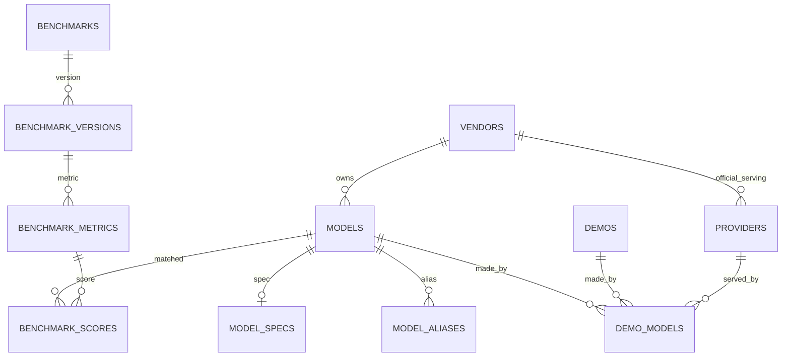

### 3.2 现有表（结构不动，语义收紧）

| 表 | 变化 |
|---|---|
| `models` | 语义：`id` 是唯一身份；`name` 是展示名；`slug` **创建后不可变**；加 `vendor_id` 指向 `vendors`（`vendor` 文本保留为过渡期展示缓存） |
| `model_aliases` | 唯一解析表；所有外部名/写法都落这里 |
| `demo_models` | **升级为唯一事实源**；加 `provider_id`、`serving_note`、`source`、`created_at` |
| `vendors`（新） | 模型厂商 / lab；`slug` 取自 `canonical_model_id` 前缀 |
| `providers`（新） | 服务方实体：官方 / 聚合平台 / 自建，与 models.dev 的 `provider_id` 对齐 |
| `tags` / `demo_tags` | `key='model'` 的行在 S6 归档删除；其余键不受影响 |

`models.slug` 不可变的原因：它是公开 URL 与聚合主键。若将来要改名，另加 `model_slug_history` + 301，不在本期范围。

### 3.3 `demo_models`（事实源）

```sql
ALTER TABLE demo_models ADD COLUMN provider_id   INTEGER REFERENCES providers(id);
ALTER TABLE demo_models ADD COLUMN serving_note  TEXT NOT NULL DEFAULT '';
ALTER TABLE demo_models ADD COLUMN source        TEXT NOT NULL DEFAULT 'unknown';
-- api | legacy_tag | migration | attribution | merge
ALTER TABLE demo_models ADD COLUMN created_at    DATETIME;
```

**主键保持 `(demo_id, model_id)`，provider 作为属性而非主键的一部分。** 原因：

1. 「一件作品用同一个模型走两个 provider」没有实际意义；
2. SQLite 的 `UNIQUE` 把 NULL 视为互不相等，`(demo_id, model_id, provider_id)` 在 `provider_id IS NULL` 时**无法去重**，只能造 `unknown` 哨兵实体——那等于把「未知」变成一个假数据。

`provider_id IS NULL` 表示「来源未标注」，UI 显式显示，不回填、不猜测。

`serving_note` 用于记录影响表现的服务差异（`fp8`、`free tier`、`context 32k`），可空，自由文本但限制 100 字符。

### 3.4 `vendors`（模型厂商 / lab）

models.dev 的网站按 **lab** 组织（`/labs/deepseek`），其 API 里没有独立的 lab 集合，但 **`canonical_model_id` 的前缀就是 lab**（实测 77 个），且多数 lab 的 `provider_id` 与前缀同名（28 个，如 `deepseek`、`moonshotai`、`zhipuai`）。

| 字段 | 类型 | 空 | 默认 | 说明 |
|---|---|---|---|---|
| `id` | INTEGER PK | 否 | 自增 | |
| `slug` | TEXT(64) | 否 | — | 唯一，`canonical` 前缀，如 `deepseek` |
| `name` | TEXT(128) | 否 | — | 展示名，如 `DeepSeek` |
| `homepage_url` | TEXT(500) | 否 | `''` | 官方主页 |
| `status` | TEXT(16) | 否 | `active` | `active` / `hidden` |
| `source` | TEXT(32) | 否 | `manual` | `models.dev` / `manual` |
| `created_at` / `updated_at` | DATETIME | 否 | utcnow | |

```text
UNIQUE (slug)
```

填充规则：

```text
1. 取 model_catalog_items.canonical_id 的前缀集合（77 个）
2. 展示名：若存在 provider_id == 前缀，用该 provider 的 name（如 moonshotai → "Moonshot AI"）
3. 否则把前缀人性化（`bytedance-seed` → `ByteDance Seed`），标 source='models.dev'
4. 已存在同名 vendor（source='manual'）时不覆盖 name / homepage_url
5. canonical 前缀里出现新 lab 时只新增，不删除旧 vendor
```

为什么必须实体化：

- 现在 `Model.vendor` 是自由文本（来自标签 group），同一个厂商会出现 `DeepSeek` / `deepseek` / `深度求索`；
- 「官方 provider」的判定需要一个稳定的厂商键（`provider.vendor_id == model.vendor_id`），靠字符串比对必然出错。

### 3.5 `providers`（服务方）

| 字段 | 类型 | 空 | 默认 | 说明 |
|---|---|---|---|---|
| `id` | INTEGER PK | 否 | 自增 | |
| `slug` | TEXT(64) | 否 | — | 唯一，如 `deepseek`、`openrouter`、`self-hosted` |
| `name` | TEXT(128) | 否 | — | 展示名 |
| `vendor_id` | INTEGER | 是 | NULL | FK → `vendors.id`；官方服务方指向其厂商，聚合平台为 NULL |
| `kind` | TEXT(16) | 否 | `aggregator` | `official` / `aggregator` / `self_hosted` / `other` |
| `homepage_url` | TEXT(500) | 否 | `''` | |
| `description` | TEXT(500) | 否 | `''` | |
| `status` | TEXT(16) | 否 | `active` | `active` / `hidden` |
| `source` | TEXT(32) | 否 | `manual` | `models.dev` / `manual` |
| `created_at` / `updated_at` | DATETIME | 否 | utcnow | |

```text
UNIQUE (slug)
INDEX (vendor_id)
```

```python
PROVIDER_KINDS = ("official", "aggregator", "self_hosted", "other")
```

规则：

- **provider 是「谁提供服务」，vendor 是「谁做的模型」**，两者在官方服务方上重合，但不能合并成一个字段。
- 「官方」是**相对模型**的：`provider.vendor_id == model.vendor_id`（两者都非空）才算官方。聚合平台（OpenRouter / Bothub）的 `vendor_id` 为 NULL。
- 上传时只能选已存在的 provider（避免 `OpenRouter` / `openrouter` / `Open Router` 三种写法并存）；缺失时由管理员在后台新增。
- 从 models.dev 目录导入的 provider 自动落库（`source='models.dev'`）：`provider_id` 能匹配到 `vendors.slug` 时 `kind='official'` + 回填 `vendor_id`，否则 `kind='aggregator'`。

复合主键 `(demo_id, model_id)` 已满足唯一性；查询索引按现有 `model_id` 即可。

### 3.6 `model_specs`（档案，1:1）

| 字段 | 类型 | 空 | 默认 | 说明 |
|---|---|---|---|---|
| `model_id` | INTEGER PK | 否 | — | FK → `models.id`，CASCADE |
| `modalities_in` | TEXT(64) | 否 | `''` | 逗号枚举，固定顺序序列化 |
| `modalities_out` | TEXT(64) | 否 | `''` | 同上 |
| `context_window` | INTEGER | 是 | NULL | token |
| `max_output` | INTEGER | 是 | NULL | token |
| `param_total_b` | REAL | 是 | NULL | 总参数（十亿） |
| `param_active_b` | REAL | 是 | NULL | MoE 激活参数；非 MoE 留空 |
| `param_kind` | TEXT(16) | 否 | `undisclosed` | `exact` / `estimate` / `undisclosed` |
| `param_note` | TEXT(200) | 否 | `''` | 估算依据 |
| `release_date` | DATE | 是 | NULL | |
| `knowledge_cutoff` | TEXT(7) | 是 | NULL | `YYYY-MM` |
| `open_weights` | INTEGER | 是 | NULL | 三态：NULL 未知 / 0 / 1 |
| `cost_in` / `cost_out` | REAL | 是 | NULL | 每百万 token，美元 |
| `license` | TEXT(64) | 是 | NULL | |
| `canonical_model_id` | TEXT(128) | 是 | NULL | models.dev 规范名，供去重 |
| `source` | TEXT(64) | 否 | `manual` | `models.dev` / `manual` / `vendor_doc` |
| `fetched_at` | DATETIME | 是 | NULL | |
| `note` | TEXT(500) | 否 | `''` | |

```python
MODALITIES = ("text", "image", "audio", "video", "pdf", "file")
PARAM_KINDS = ("exact", "estimate", "undisclosed")
```

规则：

- `param_kind=undisclosed` ⇔ `param_total_b IS NULL`；**绝不用 0 表示未知**。
- `param_active_b` 仅 MoE 且 ≤ `param_total_b`。
- models.dev 提供 `modalities` / `limit` / `cost` / `open_weights` / `release_date` / `knowledge` / `canonical_model_id`，**不提供参数量**；参数量只能人工或从 canonical id 推断（推断记 `estimate`）。

**字段级来源**：`model_specs.source` 只表示「主要来源」，不参与覆盖判定。每个字段的实际来源与锁定状态存在 `model_spec_fields(model_id, field, source, locked)`：

- `source=manual`：管理员手工填过，同步不覆盖。
- `source=models.dev`：来自上游，可被后续 diff 更新（仍需勾选）。
- `locked=1`：显式钉住，任何同步都跳过。

只给行级来源不够：手工改了一个字段，就会导致整行都不再接收上游更新。

### 3.7 第三方基准（4 张表）

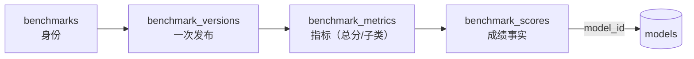

**`benchmarks`**（与版本无关）

| 字段 | 类型 | 说明 |
|---|---|---|
| `id` / `slug` unique / `name` / `publisher` / `homepage_url` | | 榜单身份 |
| `category` | TEXT(64) | 多值逗号枚举，固定顺序；coding / math / agent / general / multimodal / safety / other；综合榜标多个（如 `coding,math`）；空串视为 `general` |
| `description` / `status` | | `active` / `retired` / `hidden` |
| `created_at` / `updated_at` | DATETIME | |

> 一个榜常同时覆盖多个方向（LiveBench 的 6 个子类就是 coding / math / reasoning 混合）。`category` 因此建模为**多值**：固定顺序序列化，如 `coding,math`；按 category 过滤/分组时，任一命中即归属该组。不设「复合榜」专用标签、不为凑单值丢弃具体方向，也不因多值在聚合时重复计权。

**`benchmark_versions`**（一次发布的快照）

| 字段 | 说明 |
|---|---|
| `benchmark_id` / `version` / `as_of` | `UNIQUE(benchmark_id, version)` |
| `source_type` | `leaderboard` / `independent` / `self_reported` |
| `coverage` | `full` / `partial`；partial 不参与归一化 |
| `participant_count` / `score_min` / `score_max` | **分布属性放版本**，不逐条存 |
| `status` | `active` / `superseded` |
| `source_url` / `retrieved_at` / `note` | 溯源 |

**`benchmark_metrics`**（版本内的指标）

| 字段 | 说明 |
|---|---|
| `version_id` / `key` / `label` | `UNIQUE(version_id, key)` |
| `metric_kind` | percent / pass_at_1 / pass_at_k / elo / usd / seconds / score / unknown |
| `unit` / `scale_min` / `scale_max` / `higher_is_better` | 量纲 |
| `is_primary` | 每版至多一个 1；综合分只用它 |
| `sort` / `note` | 展示 |

> 为什么要单独一张表：LiveBench 同时发布总分和 6 个子类。若把子类建成「榜」，同一发布方会被计 7 次权，去极值也救不回来。

**`benchmark_scores`**（成绩事实）

| 字段 | 说明 |
|---|---|
| `metric_id` | FK → metrics，CASCADE |
| `model_id` | FK → models，SET NULL；未匹配为空 |
| `external_name` / `external_name_key` | 原榜名 + 确定性规范化键 |
| `match_status` | `matched` / `unmatched` / `ignored` |
| `raw_score` / `rank` / `ranked` | 事实：分数、名次、是否进总排名 |
| `source_url` / `retrieved_at` / `note` | 溯源 |

```text
UNIQUE (metric_id, external_name_key)
INDEX  (model_id, metric_id)
INDEX  (metric_id, rank)
```

`external_name_key` 规范化：NFKC → trim → lower → 连续空白/下划线/斜杠/点号折叠为 `-`。不做厂商前缀模糊匹配（模糊匹配交给别名建议，人工确认）。

### 3.8 `model` 标签退场

| 阶段 | 状态 |
|---|---|
| 兼容期 | 由投影函数写入，**只写不读** |
| 冻结期 | 停止写入，存量只读 |
| 清理期 | 归档到 `model_tag_archive` 后删除，旧代码分支一并移除 |

兼容期唯一保留的读取入口：`GET /demos?tag=model:x` 在服务端翻译成 `model=<slug>`，不依赖标签行存在。

### 3.9 不变量

1. 作品与模型的关联只能由 `DemoModelWriter` 写入。
2. 任何业务逻辑不得从 `model:` 标签反推关联。
3. `match_status='matched'` ⇔ `model_id IS NOT NULL`。
4. 每个 `benchmark_version` 至多一个 `is_primary=1`。
5. `coverage='partial'` 或 `source_type='self_reported'` 的版本不进入综合分。
6. `param_kind` 与 `param_total_b` 的空值语义一致。
7. `models.slug` 不可变；改名只改 `name`。
8. `demo_models.provider_id` 为空表示未知，**不得回填推断值**；不得用哨兵实体冒充未知。
9. `provider_id` 非空时必须存在于 `providers` 且 `status='active'`。
10. provider **不改变**社区分与综合分的计算口径：分数仍按模型聚合，provider 只做分布展示。
11. 兜底实体（`resolution ∈ family/unknown/guess`）不得有 `model_external_refs` 或 `model_specs`。
12. 同一 `(source, provider_id, external_id)` 只能被一个 `Model` 认领。
13. `status` 与档案完整度正交：`active` 允许无档案，`candidate` 允许有档案。
14. `providers.vendor_id` 与 `models.vendor_id` 都非空且相等时，该 provider 才是该模型的官方服务方。
15. `vendors.slug` 来自 `canonical_model_id` 前缀，不得手改成自由文本。
16. 兜底实体与 fallback 服务方（`unspecified` 等）不参与 vendor 判定。

## 4. 写入契约

### 4.1 上传 / 编辑

```jsonc
// 推荐：字符串简写 = provider 未知
{ "models": ["glm-5"], "tags": ["type:game"] }

// 推荐：指定服务方
{
  "models": [
    { "ref": "dsv4-flash", "provider": "openrouter", "note": "fp8" }
  ],
  "tags": ["type:game"]
}

// 混合：同一作品用多个模型，各自带 provider
{
  "models": [
    "glm-5",
    { "ref": "dsv4-flash", "provider": "deepseek" }
  ]
}

// 兼容（agent 契约，provider 未知）
{ "tags": ["model:dsv4-flash", "type:game"] }
```

- `models` 元素支持两种形态：字符串（`ref`，provider 未知）或对象 `{ref, provider?, note?}`。
- `ref` 接受 slug / name / alias / 数字 id，统一走 `resolve_model_refs`。
- `provider` 接受 `providers.slug` 或数字 id；**必须是已存在的 provider**，未知返回 422 并提示管理员补充，不做自由文本落库。
- `note` 落 `demo_models.serving_note`，最长 100 字符。
- `tags` 中 `model:` 项在入口剥离，转成 `{ref, provider:null}`，**不再写入 `demo_tags` 作为事实**。
- 两者同时出现取并集，按 `model_id` 去重；同一 `model_id` 出现两次但 provider 不同时，**保留先出现的**并记一条警告（不静默二选一但不报错）。
- 至少一个模型引用（含 `unspecified` / `<vendor>-unknown` 兜底），否则 422。
- 解析不到时自动建 `candidate`（灰测名 → `unverified`），但只建实体、不写标签。

### 4.2 差集写入（替换 `sync_demo_models`）

```text
S        = resolve(demo)        # {(model_id, provider_id|NULL, note)}
current  = SELECT model_id, provider_id, serving_note FROM demo_models WHERE demo_id = ?
INSERT   S - current            source='api'
UPDATE   provider_id / serving_note 变化的行
DELETE   current - S
```

- 差集按 `model_id` 比较；provider / note 变化视为该行更新，不新增行。
- 不再全删重建：未涉及的链接不受影响。
- 同一事务内刷新该作品的标签投影（若开关打开）；兼容入口写入时 `source='legacy_tag'`。
- 写 `provider_id` 前校验其存在且 `status='active'`，否则整次写入 422。

### 4.3 投影

```text
refresh(demo_id):
  1. 读 demo_models 关联的 Model
  2. 删除该作品的 model 标签关联
  3. 按 Model.name 写回 tags(key='model')，group=Model.vendor
```

- 开关：`settings.model_tag_projection = write | off`（默认 `write`）。
- 投影与业务写入**同一事务**：投影失败则整次写入失败，宁可报错也不留分叉。
- 投影只是兼容层，不参与任何业务判定；A5 关闭后此函数不再被调用。

### 4.4 合并 / 撤销 / 归属

| 动作 | 规则 |
|---|---|
| 合并 | 迁 `demo_models`（去重）→ 迁别名 → 源置 `deprecated` + `merged_into` → **只刷新受影响作品的投影** |
| 撤销 | 按审计快照恢复链接/别名/状态 → 重刷投影 |
| 归属 | **只改 `demo_models`**（差集 writer），投影自动跟随；不再要求回写标签 |

### 4.5 基准导入

独立入口，不参与上面的双写链路：

```text
1. upsert benchmarks           by slug
2. upsert benchmark_versions   by (benchmark_id, version)；旧版本 superseded
3. upsert benchmark_metrics    by (version_id, key)
4. upsert benchmark_scores     by (metric_id, external_name_key)
5. 解析模型：alias → slug → name；未命中 → 收件箱
6. 整批事务；任何校验失败全部回滚
```

**基准不带 provider 维度**（已定）：`benchmark_scores` 只记 `model_id`。若榜方明确注明测的是某个 provider，写进 `note` 供人工参考，不参与计算。

### 4.6 models.dev 导入与同步

#### 4.6.1 原则

1. **上游是参考源，不是运行时依赖**：models.dev 不可用时，本站全部功能照常；导入后数据即我们的数据。
2. **本地镜像，不做实时查询**：models.dev 只提供整包 JSON（约 10MB），没有搜索接口；后台搜索查本地镜像。
3. **字段级来源**：是否被上游覆盖由 `model_spec_fields` 逐字段判定，不看行级 `source`。
4. **手工优先**：`source=manual` 或 `locked=1` 的字段永不被同步覆盖。
5. **默认只显官方条目**：`provider_id == canonical_id` 前缀才算官方；聚合平台条目默认折叠。

#### 4.6.2 新增表

| 表 | 作用 |
|---|---|
| `model_catalog_items` | 上游目录镜像（可搜索、离线可用） |
| `model_external_refs` | `(source, provider_id, external_id) → model_id` |
| `model_spec_fields` | 字段级来源与锁定 |
| `model_source_sync` | 目录刷新状态（一个来源一行） |

目录里的 `provider_id` / `provider_name` 会同步进 `providers` 表（`source='models.dev'`）：

```text
kind = (provider_id == canonical 前缀) ? 'official' : 'aggregator'
vendor_id = kind == 'official' ? vendors[slug=provider_id].id : NULL
```

已存在同名 provider 时不覆盖人工维护的 `name` / `homepage_url`（`source='manual'` 优先）。

DDL 见 §6.1。

#### 4.6.3 上游条目 → 本地实体

```text
canonical_id = "deepseek/deepseek-v4-flash"
vendor_slug  = canonical 前缀 "deepseek"
vendor       = vendors[slug='deepseek']（缺失时按 §3.4 规则新建）
is_official  = (provider_id == vendor_slug)
slug         = _slugify_unique(上游 name)
```

规则：

- 展示名去掉 `:free`、`(free)` 这类渠道标记；原文保留在 `external_id`。
- **无 `canonical_id` 时（8890 条里约 1300 条）：`vendor_id` 留空**，在 diff 里标「需人工确认厂商」，**不从 `provider_name` 建 vendor**——否则从 Bothub / OpenRouter 导入会造出「Bothub」这种假厂商。
- 同一 canonical 的多个 provider 条目**只建一个 `Model`**，其余全部记 `model_external_refs`。
- 若某 canonical 没有任何官方条目，搜索时退回显示聚合条目并标记「仅第三方收录」，仍可导入（`is_official=0`）。

上游还有三个可用字段（实测覆盖）：

| 字段 | 覆盖 | 用途 |
|---|---|---|
| `type` | 453/8890 | `image` / `embedding` / `video` / `speech` / `transcription` / `reranking` / `realtime` / `chat` → 落 `model_type`，用于筛选与图标 |
| `status` | 977/8890 | `deprecated` / `beta` / `alpha` → 落 `upstream_status`，只在导入时提示，**不改我们的 `Model.status`** |
| `family` | 8458 | 模型家族（`deepseek-flash`），落 `family`，供同族对比参考 |

注意上游 `status=deprecated` 的条目有 904 条：导入默认过滤，需要时显式勾选「含上游已弃用」。这与我们的 `Model.status='deprecated'`（合并退役）是**两套语义**，不可混用。

#### 4.6.4 匹配链路

```text
1. model_external_refs(source, provider_id, external_id) 精确命中 → 同一模型
2. canonical_id 命中任意 ref                              → 同一模型（只加 ref）
3. ModelAlias 命中 external_id / canonical_id / name
4. Model.slug / Model.name 规范化命中
5. 仍未命中 → 返回候选（同厂商 + 名称相似），管理员选「关联 / 新建」
```

不静默建重复实体；「关联」等价于新增 external_ref + 别名。

#### 4.6.5 导入 vs 补全

| 模式 | 触发 | 写入 |
|---|---|---|
| **新建** | 未匹配 | `Model` + 选中字段写 `model_specs` + `model_spec_fields(source='models.dev')` + `model_external_refs` + 别名 + 审计 |
| **补全** | 已匹配 | 只写选中字段 + 新增 ref；不动 `manual` / `locked` |

差异视图逐字段给出：`字段 / 当前值 / 上游值 / 当前来源 / 是否锁定 / 勾选`。

- 值相同 → 不可勾选（no-op）。
- `manual` / `locked` → 默认不可勾选，需显式解锁。
- 应用后逐字段写 `model_spec_fields(source='models.dev')`。

#### 4.6.6 目录刷新

```text
手动：后台「刷新目录」按钮，随时可用
定时：modelsdev_sync_enabled=1 时按 interval 拉取（默认关闭）
```

- 拉取 → `payload_hash` 比较 → 变化才替换镜像（单事务）。
- 成功：`status=ok`、`last_success_at`、`item_count`。
- 失败：**保留旧镜像**，`status=stale` 并记 `error`；导入页显示「目录更新于 …」。
- 目录为空且从未成功 → 提示先刷新，不返回 500。

#### 4.6.7 后台交互

```text
/admin?tab=models&action=import
  [搜索] 名称 / id / canonical / 厂商
  [过滤] 仅官方（默认） | 含第三方收录 | 已导入 | 可补全
  结果行：名称 · 厂商 · 模态 · 上下文 · 价格 · 徽章（已导入 / 可补全 N 项）
  操作：查看差异 → 勾选字段 → 导入 / 补全
  批量：按厂商勾选多个未导入条目
```

模型详情（管理端）另有「从 models.dev 补全」入口，走同一 diff 组件。

#### 4.6.8 失败与降级

- 批量导入按条目独立事务：单条失败不影响已成功的，失败列表可重试。
- 上游字段消失 → **不清空本地值**，只在 diff 中标记「上游已移除」供人工判断。
- 上游改名 → canonical 不变即同一模型，只更新候选展示名，由管理员决定是否改 `Model.name`。

### 4.7 候选确认与手动新建

#### 4.7.1 状态与档案正交

**`status` 管生命周期，`model_specs` 管档案完整度，两者互不阻塞。**

| 组合 | 是否允许 | 说明 |
|---|---|---|
| `candidate` 有档案 | 允许 | 先导入档案、后确认 |
| `active` 无档案 | 允许 | 手动建的私有模型、上游没有的模型 |
| `active` 有档案 | 常态 | 从目录导入 |
| fallback 有档案 | **禁止** | 见 4.7.5 |

所以确认动作**不要求**先有档案；缺档案时用徽章提示，不拦上架、不拦展示。

#### 4.7.2 `candidate → active` 的确认流程

三个入口共用同一个确认面板：

1. 收件箱 `new_model` 批准
2. 管理端模型列表逐条确认
3. 管理端批量确认

面板内容：

```text
模型 Foo · candidate · 12 件作品 · 厂商 DeepSeek

[上游建议] 在 models.dev 找到 3 个候选（按名称 + 厂商实时搜索）
  ○ deepseek/deepseek-v4-flash    DeepSeek · 1M 上下文 · 官方
  ○ openrouter/deepseek-v4-flash  OpenRouter · 聚合
  ○ 跳过，稍后补档案

[操作] 关联并确认 | 仅确认（档案缺失） | 合并到已有模型 | 驳回
```

- 选条目 → 走 §4.6.5 的字段级 diff → 勾选 → 应用 → `status=active`。
- 选「仅确认」→ `status=active`，档案为空，列表加「档案缺失」徽章。
- 选「合并到已有」→ 转 `merge_model`（源 candidate 被合并，不保留）。
- 「驳回」只在该 candidate **没有任何作品引用**时才允许物理删除；有引用则只能合并或降级，避免孤儿链接。

**建议来源是实时查询**，不落表：对 `Model.name` 规范化后，在 `model_catalog_items` 按 `name` / `external_id` / `canonical_id` 模糊匹配，官方条目置顶。

#### 4.7.3 管理员手动新建

表单分两段，默认落在第一段：

| 段落 | 输入 | 结果 |
|---|---|---|
| **从目录选择**（默认） | 搜索目录 → 选条目 | 与「导入新建」完全同一条路径：`Model` + 档案 + `external_refs` + 别名 + 审计 |
| **手动新建** | `name` 必填；`vendor` 从下拉选择（可搜索 + 内联新建，写 `vendor_id`） | `slug` 自动生成；档案为空；状态默认 `active`（可改 `candidate`） |

规则：

- `vendor` **不是自由文本**：必须落到 `vendors` 表，避免再造 `DeepSeek` / `deepseek` / `深度求索` 三种写法。下拉里没有时可内联新建一条 vendor（写 `source='manual'`）。
- vendor 允许留空（未知），但列表会显示「厂商未标注」，且该模型不参与「官方 provider」判定。
- 手动新建时若名称命中目录条目，提示「发现同名上游条目，建议改用导入」，但**不阻止**——确实存在上游没有的私有模型。
- 手动新建的模型，详情页常驻「从 models.dev 补全」入口。
- 手动新建**不允许**直接选 `unspecified` / `<vendor>-unknown` 这类兜底名（它们由系统维护，见 4.7.5）。

#### 4.7.4 认领冲突

`model_external_refs` 的 `UNIQUE(source, provider_id, external_id)` 保证一个上游条目只能被一个 `Model` 认领。关联时若已被占用：

| 占用方状态 | 处理 |
|---|---|
| `candidate` / `unverified` | 提示「已由 X 认领」，给出合并入口；不允许第二个认领 |
| `active` | 拒绝，并给出对方模型链接 |
| `deprecated` | 拒绝，并指向其 `merged_into` 归宿 |

同理，**导入路径的匹配必须覆盖所有状态**（candidate / active / unverified），否则会造出「一个 active + 一个 candidate 指向同一上游条目」的重复。命中 `deprecated` 时报错，不自动复活。

#### 4.7.5 兜底实体（fallback）

`resolution ∈ {family, unknown, guess}` 的模型，包括 `unspecified` 与 `<vendor>-unknown`：

- **不得**有 `model_external_refs`，**不得**有 `model_specs`；
- 不参与目录匹配（导入搜索、确认建议都过滤掉）；
- 揭晓正确路径是 `attribute_demos` 把作品迁到真实型号 + 合并兜底实体，**不是**给它补档案。

这与现有 `attribute_demos` 要求目标 `resolution='exact'` 的约束一致。

#### 4.7.6 档案完整度（派生，不落库）

```text
missing  : 无 model_specs 行
partial  : 有行，但 context_window / modalities_in 任一为空
complete : 两者都有
```

用途：模型列表徽章、管理端筛选「档案缺失」、确认面板的默认提示。不参与排序或评分。

## 5. 读取契约

### 5.1 模型页

```text
模型页 = 档案（spec） + 站内表现（社区分/作品/题目） + 第三方基准（综合分/单榜）
```

三个区块独立取数、独立口径说明，不合并成一个「总分」。

### 5.2 站内社区分（已有口径，保持不变）

```text
demo_count = COUNT(approved demos)
votes      = SUM(demos.rating_count)
wsum       = SUM(demos.rating_avg * demos.rating_count)
rating_avg = AVG(demos.rating_avg)              # 等权旧语义
score      = (wsum + m*C) / (votes + m)         # 贝叶斯收缩
C          = 全站票加权均分
m          = 各模型票数中位数（≥1）
```

排序键与展示值同源（SQL 里 `round(score, 2)`）。

**provider 不参与这条公式**：同一模型无论走哪个 provider，都计入同一个模型分。

### 5.2.1 provider 分布（只读展示）

模型页在社区分下方给一张分布表，**不改变上面的分数**：

```sql
SELECT dm.provider_id,
       p.slug, p.name, p.kind,
       COUNT(DISTINCT dm.demo_id)          AS demos,
       AVG(NULLIF(d.rating_avg, 0))         AS avg_rating,
       SUM(d.rating_count)                  AS votes
FROM demo_models dm
JOIN demos d  ON d.id = dm.demo_id
LEFT JOIN providers p ON p.id = dm.provider_id
WHERE dm.model_id = :id AND d.status = 'approved'
GROUP BY dm.provider_id
ORDER BY demos DESC;
```

展示规则：

- `provider_id IS NULL` 归为一行「未标注」，永远排在最后。
- 分布里的 `avg_rating` 只做参考，**不参与排序**，也不进 `score`。
- 作品数少于 3 的行显示作品数、隐藏均分（样本太小）。
- 有 provider 的行可点进 `?model=<slug>&provider=<slug>` 的作品列表。

### 5.3 第三方归一化（待拍板）

```text
K = participant_count；r = rank（1 最好）

A. 百分位（推荐）  p = (K - r) / (K - 1) * 100
                   higher_is_better=0 时 r' = K + 1 - r
B. min-max        p = (raw - score_min) / (score_max - score_min) * 100
C. 原始分          p = raw（仅同量纲榜单之间）
```

参与条件：`benchmark.status=active`、`version.status=active`、`coverage=full`、`source_type≠self_reported`、有 primary 指标、`ranked=1` 且有 `rank`、`K ≥ 3`。

### 5.4 综合分与偏离

```text
x(1) ≤ … ≤ x(N)

N ≥ 3 : composite = mean(x(2) .. x(N-1))     # 去 1 高 1 低
N == 2: composite = mean(x)                  # NOT_TRIMMED
N <= 1: composite = null                     # INSUFFICIENT

med = median(x); dev = x_i - med
N ≥ 4 且 |dev| ≥ 25 个百分位点 → strong / weak
MAD > 0 且 |0.6745*dev/MAD| ≥ 3.5 → 同样标记
```

- 基线用**中位数**，不用裁剪均值（否则循环论证）。
- 标记语义是「强项/弱项」，不是「榜单有错」。
- 被剔除的最高/最低必须展示（榜名 + 分数 + 方向）。

### 5.5 过滤与 facet

| 入口 | 目标 |
|---|---|
| `GET /demos?model=<slug>` | 唯一推荐路径，走 `demo_models` |
| `GET /demos?model=<slug>&provider=<slug>` | 两者 AND；`provider` 缺省不过滤 |
| `GET /demos?provider=<slug>` | 单独按服务方过滤（跨模型） |
| `GET /demos?provider=none` | 只看「来源未标注」 |
| `GET /demos?tag=model:x` | 入口翻译为 `model=` |
| 作品库模型 facet | 读 `Model` 表，不读标签统计 |
| 作品库 provider facet | 读 `providers` 表，附带该 provider 的可选模型数 |
| 作品卡片 `models` | 只读实体，无标签兜底；provider 以徽章显示 |

## 6. 数据库变更汇总

### 6.1 新增表（11 张）

`vendors`、`providers`、`model_specs`、`benchmarks`、`benchmark_versions`、`benchmark_metrics`、`benchmark_scores`，以及 models.dev 同步用的 `model_catalog_items`、`model_external_refs`、`model_spec_fields`、`model_source_sync`。参考 DDL：

```sql
CREATE TABLE vendors (
    id           INTEGER PRIMARY KEY AUTOINCREMENT,
    slug         TEXT NOT NULL UNIQUE,
    name         TEXT NOT NULL,
    homepage_url TEXT NOT NULL DEFAULT '',
    status       TEXT NOT NULL DEFAULT 'active',
    source       TEXT NOT NULL DEFAULT 'manual',
    created_at   DATETIME NOT NULL,
    updated_at   DATETIME NOT NULL
);

CREATE TABLE providers (
    id           INTEGER PRIMARY KEY AUTOINCREMENT,
    slug         TEXT NOT NULL UNIQUE,
    name         TEXT NOT NULL,
    vendor_id    INTEGER REFERENCES vendors(id),
    kind         TEXT NOT NULL DEFAULT 'aggregator',
    homepage_url TEXT NOT NULL DEFAULT '',
    description  TEXT NOT NULL DEFAULT '',
    status       TEXT NOT NULL DEFAULT 'active',
    source       TEXT NOT NULL DEFAULT 'manual',
    created_at   DATETIME NOT NULL,
    updated_at   DATETIME NOT NULL
);
CREATE INDEX ix_providers_vendor ON providers (vendor_id);

CREATE TABLE model_specs (
    model_id            INTEGER PRIMARY KEY REFERENCES models(id) ON DELETE CASCADE,
    modalities_in       TEXT NOT NULL DEFAULT '',
    modalities_out      TEXT NOT NULL DEFAULT '',
    context_window      INTEGER,
    max_output          INTEGER,
    param_total_b       REAL,
    param_active_b      REAL,
    param_kind          TEXT NOT NULL DEFAULT 'undisclosed',
    param_note          TEXT NOT NULL DEFAULT '',
    release_date        DATE,
    knowledge_cutoff    TEXT,
    open_weights        INTEGER,
    cost_in             REAL,
    cost_out            REAL,
    license             TEXT,
    canonical_model_id  TEXT,
    source              TEXT NOT NULL DEFAULT 'manual',
    fetched_at          DATETIME,
    note                TEXT NOT NULL DEFAULT ''
);

CREATE TABLE benchmarks (
    id            INTEGER PRIMARY KEY AUTOINCREMENT,
    slug          TEXT NOT NULL UNIQUE,
    name          TEXT NOT NULL,
    publisher     TEXT NOT NULL DEFAULT '',
    homepage_url  TEXT NOT NULL DEFAULT '',
    category      TEXT NOT NULL DEFAULT 'general',  -- 多值：逗号枚举固定顺序（如 'coding,math'）；空串按 'general' 处理
    description   TEXT NOT NULL DEFAULT '',
    status        TEXT NOT NULL DEFAULT 'active',
    created_at    DATETIME NOT NULL,
    updated_at    DATETIME NOT NULL
);

CREATE TABLE benchmark_versions (
    id                INTEGER PRIMARY KEY AUTOINCREMENT,
    benchmark_id      INTEGER NOT NULL REFERENCES benchmarks(id) ON DELETE CASCADE,
    version           TEXT NOT NULL,
    as_of             DATE NOT NULL,
    source_type       TEXT NOT NULL DEFAULT 'leaderboard',
    coverage          TEXT NOT NULL DEFAULT 'full',
    participant_count INTEGER,
    score_min         REAL,
    score_max         REAL,
    status            TEXT NOT NULL DEFAULT 'active',
    source_url        TEXT NOT NULL DEFAULT '',
    retrieved_at      DATETIME NOT NULL,
    note              TEXT NOT NULL DEFAULT '',
    UNIQUE (benchmark_id, version)
);
CREATE INDEX ix_benchmark_versions_asof ON benchmark_versions (benchmark_id, as_of DESC);

CREATE TABLE benchmark_metrics (
    id               INTEGER PRIMARY KEY AUTOINCREMENT,
    version_id       INTEGER NOT NULL REFERENCES benchmark_versions(id) ON DELETE CASCADE,
    key              TEXT NOT NULL,
    label            TEXT NOT NULL,
    metric_kind      TEXT NOT NULL DEFAULT 'score',
    unit             TEXT NOT NULL DEFAULT '',
    scale_min        REAL,
    scale_max        REAL,
    higher_is_better INTEGER NOT NULL DEFAULT 1,
    is_primary       INTEGER NOT NULL DEFAULT 0,
    sort             INTEGER NOT NULL DEFAULT 0,
    note             TEXT NOT NULL DEFAULT '',
    UNIQUE (version_id, key)
);
CREATE UNIQUE INDEX uq_benchmark_metrics_primary
    ON benchmark_metrics (version_id) WHERE is_primary = 1;

CREATE TABLE benchmark_scores (
    id                INTEGER PRIMARY KEY AUTOINCREMENT,
    metric_id         INTEGER NOT NULL REFERENCES benchmark_metrics(id) ON DELETE CASCADE,
    model_id          INTEGER REFERENCES models(id) ON DELETE SET NULL,
    external_name     TEXT NOT NULL,
    external_name_key TEXT NOT NULL,
    match_status      TEXT NOT NULL DEFAULT 'unmatched',
    raw_score         REAL NOT NULL,
    rank              INTEGER,
    ranked            INTEGER NOT NULL DEFAULT 1,
    source_url        TEXT NOT NULL DEFAULT '',
    retrieved_at      DATETIME NOT NULL,
    created_at        DATETIME NOT NULL,
    note              TEXT NOT NULL DEFAULT '',
    UNIQUE (metric_id, external_name_key)
);
CREATE INDEX ix_benchmark_scores_model ON benchmark_scores (model_id, metric_id);
CREATE INDEX ix_benchmark_scores_rank  ON benchmark_scores (metric_id, rank);

-- ---------- models.dev 导入与同步 ----------

CREATE TABLE model_catalog_items (
    id                         INTEGER PRIMARY KEY AUTOINCREMENT,
    source                     TEXT NOT NULL DEFAULT 'models.dev',
    provider_id                TEXT NOT NULL,
    provider_name              TEXT NOT NULL,
    external_id                TEXT NOT NULL,
    name                       TEXT NOT NULL,
    canonical_id               TEXT,
    vendor_slug                TEXT,
    family                     TEXT,
    description                TEXT NOT NULL DEFAULT '',
    modalities_in              TEXT NOT NULL DEFAULT '',
    modalities_out             TEXT NOT NULL DEFAULT '',
    context_window             INTEGER,
    max_output                 INTEGER,
    cost_in                    REAL,
    cost_out                   REAL,
    release_date               DATE,
    knowledge_cutoff           TEXT,
    open_weights               INTEGER,
    model_type                 TEXT,
    upstream_status            TEXT,
    supports_tool_call         INTEGER,
    supports_reasoning         INTEGER,
    supports_structured_output INTEGER,
    supports_attachment        INTEGER,
    raw_json                   TEXT NOT NULL DEFAULT '',
    fetched_at                 DATETIME NOT NULL,
    UNIQUE (source, provider_id, external_id)
);
CREATE INDEX ix_catalog_canonical ON model_catalog_items (source, canonical_id);
CREATE INDEX ix_catalog_provider  ON model_catalog_items (source, provider_id);
CREATE INDEX ix_catalog_vendor    ON model_catalog_items (source, vendor_slug);

CREATE TABLE model_external_refs (
    id            INTEGER PRIMARY KEY AUTOINCREMENT,
    model_id      INTEGER NOT NULL REFERENCES models(id) ON DELETE CASCADE,
    source        TEXT NOT NULL DEFAULT 'models.dev',
    provider_id   TEXT NOT NULL,
    provider_name TEXT NOT NULL DEFAULT '',
    external_id   TEXT NOT NULL,
    canonical_id  TEXT,
    is_official   INTEGER NOT NULL DEFAULT 0,
    created_at    DATETIME NOT NULL,
    UNIQUE (source, provider_id, external_id)
);
CREATE INDEX ix_external_refs_model     ON model_external_refs (model_id);
CREATE INDEX ix_external_refs_canonical ON model_external_refs (source, canonical_id);

CREATE TABLE model_spec_fields (
    model_id   INTEGER NOT NULL REFERENCES models(id) ON DELETE CASCADE,
    field      TEXT NOT NULL,
    source     TEXT NOT NULL DEFAULT 'manual',
    locked     INTEGER NOT NULL DEFAULT 0,
    updated_at DATETIME NOT NULL,
    PRIMARY KEY (model_id, field)
);

CREATE TABLE model_source_sync (
    source          TEXT PRIMARY KEY,
    last_attempt_at DATETIME,
    last_success_at DATETIME,
    payload_hash    TEXT,
    item_count      INTEGER,
    status          TEXT NOT NULL DEFAULT 'stale',
    error           TEXT NOT NULL DEFAULT ''
);
```

### 6.2 改现有表

```sql
ALTER TABLE models ADD COLUMN vendor_id INTEGER REFERENCES vendors(id);
CREATE INDEX ix_models_vendor ON models (vendor_id);

ALTER TABLE demo_models ADD COLUMN provider_id   INTEGER REFERENCES providers(id);
ALTER TABLE demo_models ADD COLUMN serving_note  TEXT NOT NULL DEFAULT '';
ALTER TABLE demo_models ADD COLUMN source        TEXT NOT NULL DEFAULT 'unknown';
ALTER TABLE demo_models ADD COLUMN created_at    DATETIME;
CREATE INDEX ix_demo_models_provider ON demo_models (provider_id);
```

注意：SQLite 的 `ALTER TABLE ... ADD COLUMN` 允许带 `REFERENCES`，但该列必须可空（默认 NULL）。这与「provider 未知」的语义正好一致。

### 6.3 配置/状态键（`settings` 表）

| key | 值 | 用途 |
|---|---|---|
| `model_tag_projection` | `write` / `off` | 投影开关 |
| `model_benchmark_scale` | `percentile` / `minmax` / `raw` | 归一化方案（待拍板后写死） |
| `modelsdev_sync_enabled` | `0` / `1` | 定时刷新开关，默认 `0` |
| `modelsdev_sync_interval_hours` | 整数 | 定时刷新间隔，默认 `24` |
| `modelsdev_search_official_only` | `0` / `1` | 导入页默认过滤，默认 `1` |

### 6.4 不需要做的

- 不给 `models` 加 `demo_count` / `score` 等冗余列。
- 不改 `demo_models` 主键。
- 不动 `tags` / `tag_keys` 结构（`key='model'` 的行按 §3.8 单独退场）。
- 不物化社区分（等 `/benchmarks` 变热再评估）。
- **不删 `models.vendor` 文本列**，直到 `vendor_id` 回填完成且 §8.2 的 vendor 体检为空（A6 时再删）。

## 7. 统一迁移路线

三条 lane，可并行但有关键同步点。

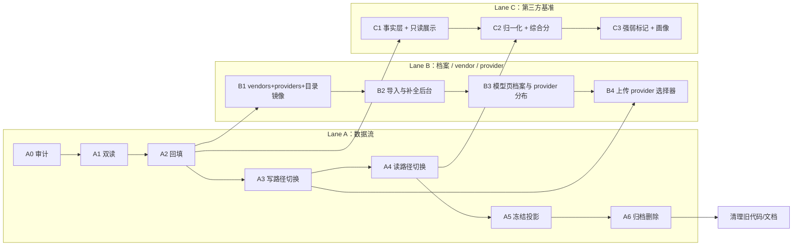

### Lane A

| 阶段 | 内容 | 验收 |
|---|---|---|
| A0 | 只读审计脚本 `scripts/audit_model_links.py`：标签解析 vs `demo_models` 四类差异 | 产出基线报告 |
| A1 | 读取统一「实体优先、标签兜底」并打点 | 知道兜底占比 |
| A2 | 差集回填补齐 `demo_models`（`source='migration'`），不删标签 | 「仅标签有」= 0 |
| A3 | 上传/归属切 `DemoModelWriter`，投影刷新；保留旧函数一个版本 | 连续编辑不抖动 |
| A4 | `?tag=model:x` 翻译；facet 读 `Model` | 旧分享链接行为不变 |
| A5 | `model_tag_projection=off` | 一个发布周期无依赖 |
| A6 | 归档后删除 `model` 标签与旧代码；更新 `API_CONTRACT.md` | 对拍全绿 |

### Lane B

| 阶段 | 内容 |
|---|---|
| B1 | 建 `vendors` / `providers` / `model_specs` + 4 张同步表；`sync_models_from_modelsdev.py` 改为写 `model_catalog_items`（镜像）+ `vendors` + `providers`，不直接改实体；回填 `models.vendor_id` |
| B2 | 管理端导入页：搜索镜像 → 字段级 diff → 导入 / 补全 / 按厂商批量；vendor 与 provider 维护入口 |
| B3 | 模型页展示档案 + provider 分布；作品卡 provider 徽章 |
| B4 | 上传页 provider 选择器（**必须在 A3 之后**，见下） |

### Lane C

| 阶段 | 内容 |
|---|---|
| C1 | 建 4 张基准表；手工 JSON 导入；模型页只读展示（原始分/名次/来源/截止日） |
| C2 | 归一化 + 综合分 + 剔除明细 + 退化标记（需先拍板归一化方案） |
| C3 | 强项/弱项 + 按 category 分组（多值榜在各组均出现）；独立 `/benchmarks` 页排在最后 |

### 关键同步点

- **A2 完成**是 B1/C1 的前置：先保证「作品↔模型」干净，再往上挂档案与基准。
- **B4 必须晚于 A3**：`demo_models.provider_id` 若在旧的全删重建写入下上线，每次编辑都会被抹掉。这是排序上的硬约束，不是偏好。
- **C2 依赖 A4**：归一化要按模型聚合，读路径必须已统一到实体。
- **A6 必须在 A4 稳定一个发布周期之后**，否则旧链接会断。

## 8. 验收与回滚

### 8.1 每阶段必跑

```text
后端全量 pytest + OpenAPI 契约快照（P0 护栏）
A0 审计脚本对拍（集合相等）
基准不变量测试（唯一 primary、self_reported 排除、partial 不归一化）
前端 typecheck / vitest / build
```

### 8.2 SQL 体检

```sql
-- 孤儿链接
SELECT dm.demo_id, dm.model_id FROM demo_models dm
LEFT JOIN demos d ON d.id = dm.demo_id
LEFT JOIN models m ON m.id = dm.model_id
WHERE d.id IS NULL OR m.id IS NULL;

-- 已合并实体仍被直接挂载
SELECT src.id, src.merged_into_id, COUNT(dm.demo_id)
FROM models src JOIN demo_models dm ON dm.model_id = src.id
WHERE src.merged_into_id IS NOT NULL
GROUP BY src.id;

-- vendor 体检：同一 slug 的多种写法（实体化后应只剩一种）
SELECT v.id, v.name, m.vendor AS legacy_text, COUNT(m.id) AS models
FROM models m LEFT JOIN vendors v ON v.id = m.vendor_id
WHERE v.id IS NULL AND m.vendor <> ''
GROUP BY m.vendor;

-- 官方 provider 错配：kind=official 但 vendor_id 与模型厂商不一致
SELECT p.slug AS provider, v1.slug AS provider_vendor, m.name, v2.slug AS model_vendor
FROM demo_models dm
JOIN providers p ON p.id = dm.provider_id AND p.kind = 'official'
JOIN models m ON m.id = dm.model_id
LEFT JOIN vendors v1 ON v1.id = p.vendor_id
LEFT JOIN vendors v2 ON v2.id = m.vendor_id
WHERE v1.id IS NULL OR v2.id IS NULL OR v1.id <> v2.id;
```

### 8.3 回滚

| 阶段 | 回滚 |
|---|---|
| A1–A3 | 关开关 + 回滚代码；数据只多不少 |
| A4 | 恢复 `tag=model:` 直读 |
| A5 | `model_tag_projection=write` 重建投影 |
| A6 | 从 `model_tag_archive` 恢复 |
| B/C | 新表独立，删表即回滚，无反向依赖 |

## 9. 风险

| 风险 | 应对 |
|---|---|
| 外部 agent 仍传 `model:` 标签 | 兼容期入口解析；`API_CONTRACT.md` 标 deprecated 并给新字段 |
| 分享链接用 `tag=model:x` | A4 入口翻译，保留足够长的兼容期 |
| 投影与实体再次分叉 | 投影只由 writer 调用；A5 后不再写 |
| 合并并发编辑 | 单事务 + 差集写入；合并后按 id 重刷投影 |
| 回填误挂 | A0 先出报告并抽样；A2 只补不删 |
| 基准数据自报污染 | 单独标注、不计入综合分 |
| 榜方改版 | 版本表隔离，旧版 `superseded`，不覆盖 |
| 综合分被误读 | 固定文案：跨榜相对位置，非任何单一榜的官方结论 |
| models.dev 改版/字段消失 | 镜像保留 `raw_json`；只取已知字段；字段消失不清空本地值，只进 diff 提示 |
| 聚合平台条目淹没目录 | canonical 去重 + 默认只显官方 provider；聚合条目仅作 external_ref |
| 定时刷新失败 | 保留旧镜像，`status=stale`；UI 显示上次成功时间，不阻塞导入 |
| 上游名称与本地冲突 | 唯一约束 + 匹配链路候选，人工选「关联 / 新建」，不静默建重复 |
| provider 写法不一致 | 只允许选已存在实体，禁止自由文本落库；管理端统一维护 |
| provider 被当成模型能力差异的证据 | 分布表只用原始均分做参考，明确标注「非能力结论」；社区分公式不含 provider |
| 老数据 provider 全空 | 不回填推断值；分布表固定显示「未标注」一行，避免误读为「没有 provider」 |
| vendor 历史写法散乱 | `vendor` 文本保留为展示缓存，`vendor_id` 逐步回填；8.2 体检查询列为空的行，人工归并后再删文本列 |
| 从聚合平台误建厂商 | 无 `canonical_id` 时 `vendor_id` 留空并标「需人工确认」，不从 `provider_name` 建 vendor |
| vendor 改名影响历史 | `vendors.slug` 不可变（来自 canonical 前缀）；改名只改 `name`，与 `models.slug` 同规则 |

## 10. 开放问题

1. **归一化方案**：百分位（推荐）/ min-max / 原始分。
2. **基准数据落地**：手工 JSON（推荐先做）/ 后台录入 / 抓取。
3. **综合分对外名称**与是否要独立 `/benchmarks` 页。
4. **vendor 展示名的初始值**：models.dev 里 `provider_id == canonical 前缀` 时可取 `provider.name`（如 `moonshotai` → "Moonshot AI"），其余前缀按人性化规则生成——需要人工过一遍 77 个前缀确认展示名。
5. **导入字段边界**：`description` / `family` 是否也要落库，还是只留在 `raw_json` 里备查？
6. **provider 的可见范围**：访客是否能看到「某 provider 的作品数」聚合数字，还是只看到单件作品的 provider 徽章（当前按前者设计）？
7. **社区分是否物化**：本期不做；触发条件是模型列表或 `/benchmarks` 变热。

## 附录 A：UML 视图

### A.1 身份与档案（ER）

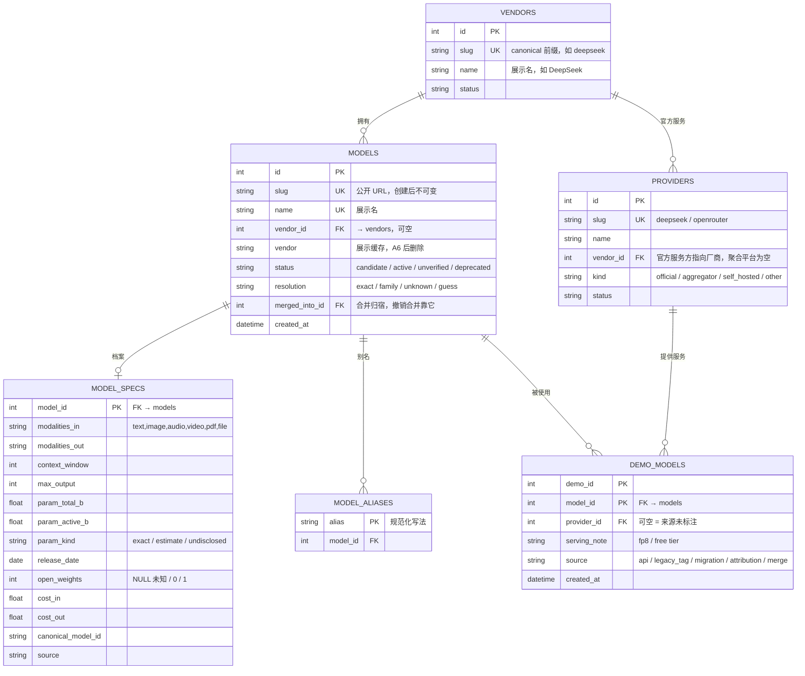

读数要点：

- 作品只通过 `DEMO_MODELS` 指向模型，**不再看标签**。
- `MODEL_ALIASES` 只用于「外部名 → `model.id`」的解析，不参与关联存储。
- `MODEL_SPECS` 一行一个模型，未知值留 NULL + `param_kind`，不写 0。
- `DEMO_MODELS.provider_id` 可空：空 = 来源未标注，**不是**某个「未知 provider」实体。

### A.1.1 provider 选择与展示

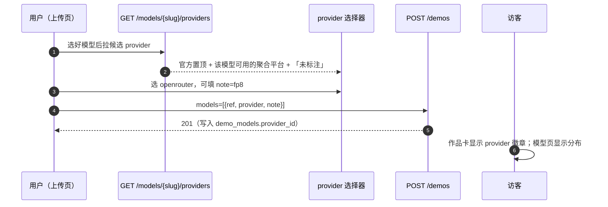

要点：

- 候选列表来源：`model_external_refs`（该模型在目录里出现过哪些 provider）+ 全部 `kind='official'` 且 `vendor_id` 匹配的条目。
- 没选 = `provider_id NULL`，UI 显示「来源未标注」，与「选了但不知道」区分开的是 **note**，不是空值。
- 一个模型若没有任何 external_ref（人工建的），选择器只给「官方（若有）+ 未标注」，不阻塞上传。

### A.1.2 候选确认

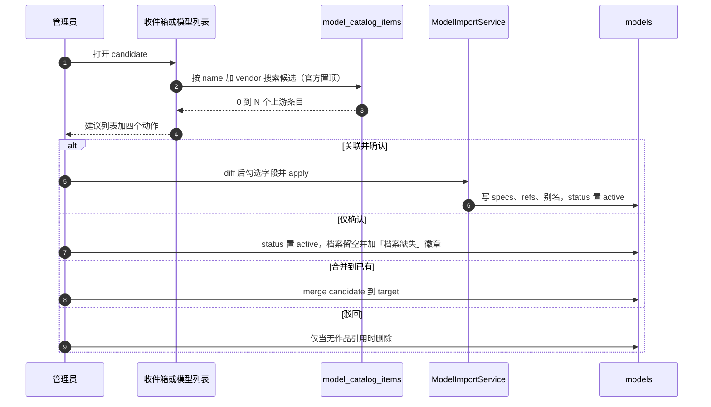

关键约束：

- 建议是**实时搜索**，不落「建议表」——候选改名后不会留下过期建议。
- 「仅确认」是一等公民，不是降级路径：私有模型合法存在。
- 「驳回」有作品引用时不可删除，只能合并。

### A.2 第三方基准（ER）

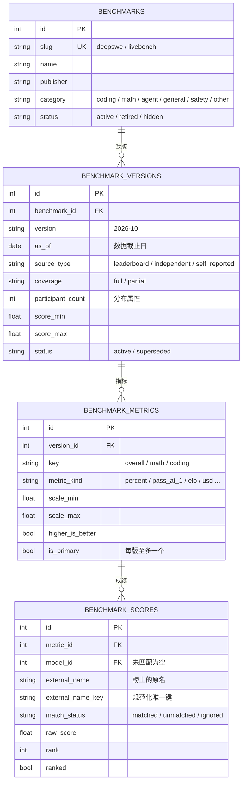

读数要点：

- 「榜」只有身份；「版本」才有量纲、参赛数、来源类型。
- 总分与子类分是同一版本下的不同 **metric**，综合分只取 `is_primary=1`。
- `self_reported` 版本照常入库，但不参与综合分。

### A.3 状态机

模型生命周期：

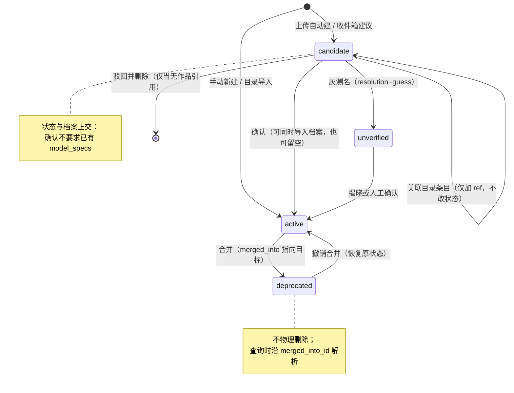

榜单与版本状态：

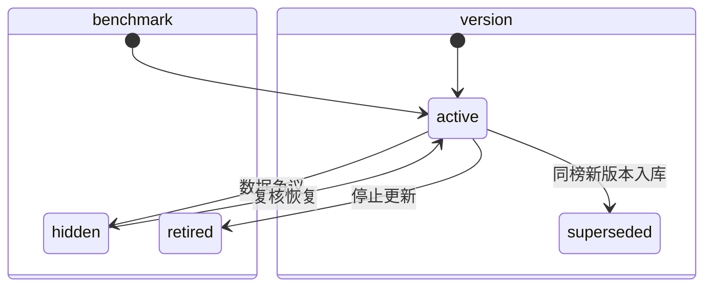

### A.4 写入时序（上传 / 编辑）

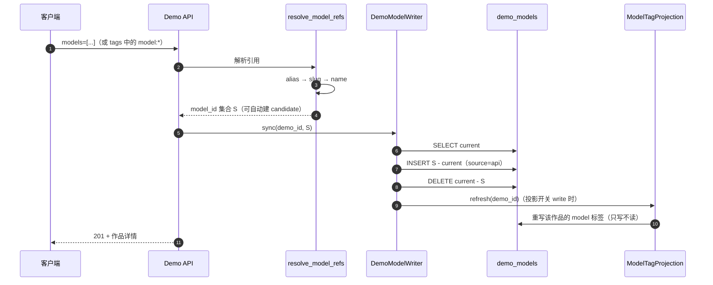

关键差异：**只有差集变化**，不再「先清空再重建」。

### A.5 合并时序

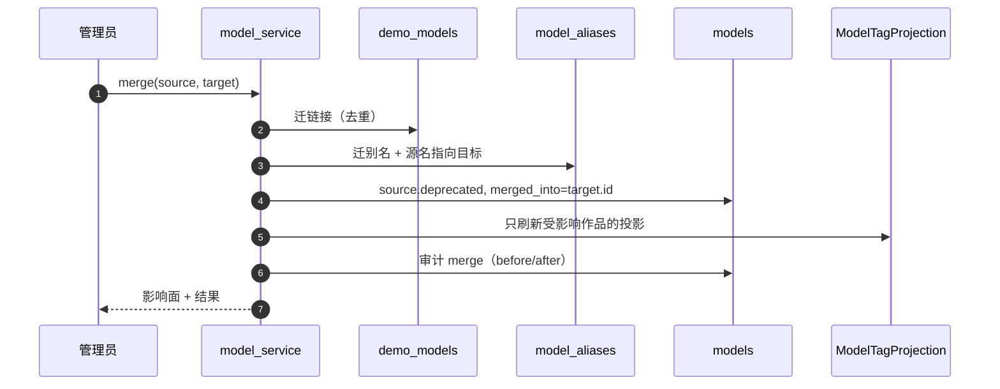

撤销合并按审计快照反向执行；榜分与历史链接不搬迁。

### A.6 写读职责矩阵

| 表 | 写入者 | 读取者 | 备注 |
|---|---|---|---|
| `models` | 上传自动建 / 管理端 / 收件箱 / 迁移 | 列表、详情、过滤、基准匹配 | `slug` 不可变 |
| `model_aliases` | 自动建、别名管理、合并 | 解析入口、搜索 | 唯一解析表 |
| `model_specs` | models.dev 脚本 / 管理端 | 模型页档案 | 未知留 NULL |
| `demo_models` | **仅 `DemoModelWriter`** | 列表、详情、facet、基准覆盖率 | 唯一事实源 |
| `benchmarks` | 导入脚本 | 基准页、模型页 | 与版本解耦 |
| `benchmark_versions` | 导入脚本 | 归一化、展示 | 新版入库旧版 superseded |
| `benchmark_metrics` | 导入脚本 | 综合分、画像 | 每版至多一个 primary |
| `benchmark_scores` | 导入脚本 | 归一化、展示 | 未匹配进收件箱 |
| `tags`（`key=model`） | 投影函数 | 兼容期 `?tag=model:x` | A6 后删除 |

### A.7 目标组件（写路径）

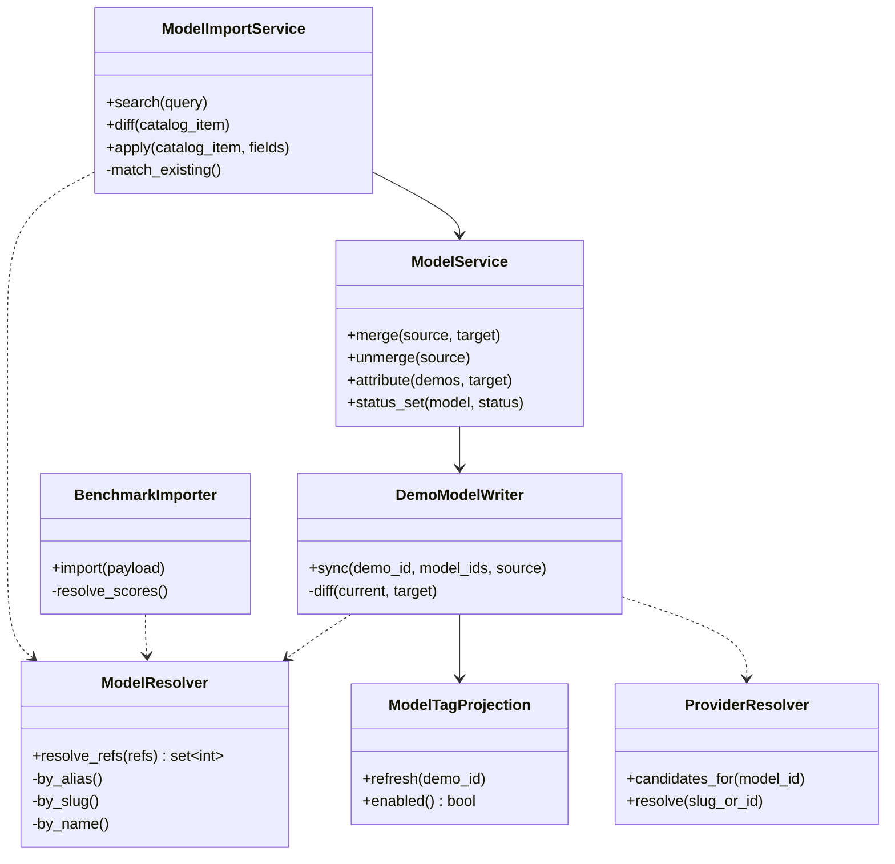

这五个组件是重构后**唯一**允许触碰模型关联的地方；路由与前端都不直接写表。

### A.8 models.dev 导入与同步

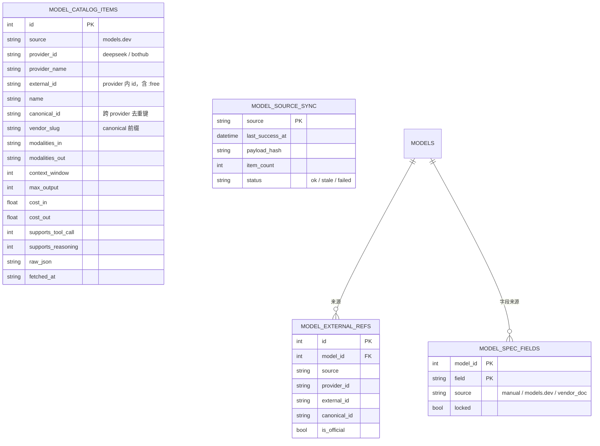

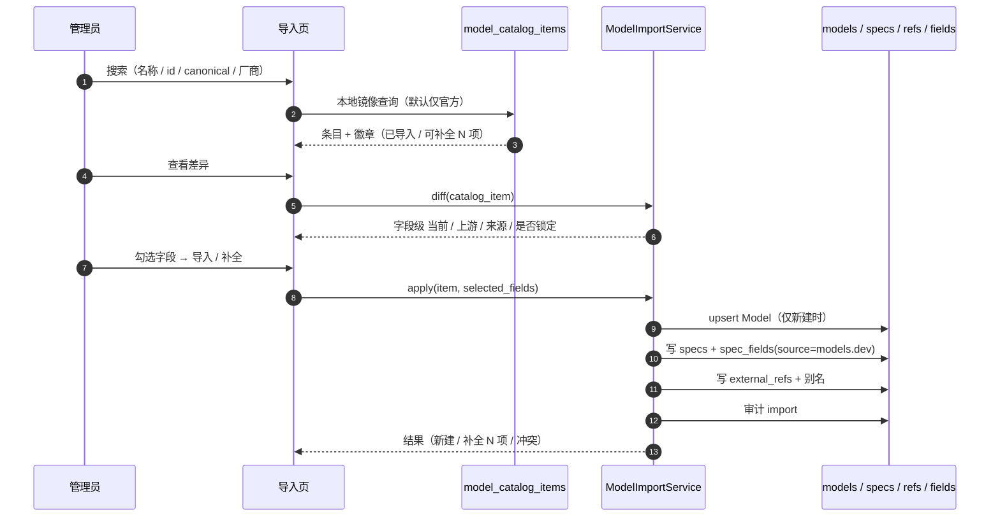

读数要点：

- `model_catalog_items` 是**上游镜像**，删掉也不影响本站数据；导入后数据在 `models` / `model_specs`。
- 一个 `canonical_id` 对应一个 `Model`，但可以有多个 `model_external_refs`（官方 + 聚合平台）。
- `model_spec_fields.locked=1` 或 `source=manual` 的字段，在 diff 里默认不可勾选。

## 附录 B：变更记录

| 版本 | 日期 | 变更 |
|---|---|---|
| v1.0 | 2026-10-25 | 阶段性定稿：合并两份草稿，确定 `demo_models` 唯一事实源、models.dev 字段级同步、provider 维度、`vendors` 实体化、第三方基准 4 表 |

