# 模型域设计（统一定稿）

**适用范围**：本文描述模型域的目标模型。文中 DDL 统一为 **PostgreSQL 18**（C2）；§1 的现状描述引用旧栈（`main`，SQLite）的行为、不含 DDL。领域划分与三条硬约束不受技术栈影响。

版本：**v1.3 · 阶段性定稿（2026-10-28）**

本版变更（v1.3）：**DDL 方言统一为 PostgreSQL 18（C2），无结构变化**——§3.x 字段表、§6.1 目标表 DDL、§6.2 迁移脚本、§11.2 `model_tag_archive`、附录 A 的 ER / 类图全部改用 PG 类型。类型映射明细见全仓统一约定 [`DDL约定.md`](./DDL约定.md)（语义 → 类型见 §2，SQLite 迁入对照见附录 A，图内单 token 写法见 §4）。列名 / 约束 / 注释文字 / `model_tag_archive` 的归档恢复 SQL 逻辑均未改。另按用户裁决修正 5 个标志列：`higher_is_better` / `is_primary` / `ranked` / `is_official` / `locked` 由 `integer 0/1` 改为 **`boolean NOT NULL DEFAULT true/false`**（旧栈 SQLite 无 boolean 类型的痕迹；与附录 A ER 的 `boolean` 口径统一），相关 `=1` / `=0` 的行文与部分索引谓词同步——**这是本版唯一的语义修正**。

上一版（v1.2）：按 G18 把生成条件下放到 revision——新增 `demo_revision_models`（PK `(revision_id, model_id)`；同一模型经不同 provider 算一条），`demo_models` 由表改为「当前 revision 的只读视图」（保留表名，读路径不用重写），口径统一为「按当前 revision」。

（v1.2 同日修订）：审计修正 10 处——§5.2 / §5.2.1 的取数改用 `demo_stats` 与 G1 公开可见谓词；`source` 默认值 `unknown` → `api`；`serving_note` 可空性统一为「非空、默认空串」；`created_at` 补 `NOT NULL DEFAULT now()`；§4.6.3 三个上游字段改为落 `model_catalog_items`；§3.5 误置句删除；A.7 `sync()` 签名统一为 `sync(revision_id, target_set, source)`、「五个组件」改为「七个」；A.1 视图基数改 `||--||`、视图列去掉 `FK` 标记。

（v1.1）：过渡态下沉到 §11（G16）——原 §3.8 / §3.8.1 / §4.3 与 `model_tag_projection` 开关移入 §11，正文只留目标态。

状态：**设计已通过评审，作为实施基线；尚未实现。** 后续变更追加到「附录 B 变更记录」，不改写正文结论。

本文合并并取代此前的两份草稿（《模型数据流重整设计》《模型档案与第三方基准设计》），是模型域的唯一设计来源。

## 0. 决策摘要

| 决策 | 结论 |
|---|---|
| 作品 ↔ 模型的事实源 | **`demo_revision_models`（revision 级）唯一权威**；`demo_models` 保留表名、改为**当前 revision 的只读视图**（G18）；`model:` 标签降级为兼容投影 |
| `model` 的多值 | **一个 revision 可记多个模型**（「多个模型接力完成」是常态）；PK `(revision_id, model_id)`，同一模型经不同 provider **算一条** |
| `model` 标签终局 | **归档后彻底删除**（S6），不长期保留 |
| 上传新字段名 | **`models: [slug\|name\|id]`**，旧 `tags: model:*` 兼容解析 |
| 厂商自报成绩 | **单独标注，不计入综合分** |
| models.dev 的角色 | **参考源 + 本地镜像**，不是运行时依赖；不可用时本站照常工作 |
| 目录刷新 | **手动刷新 + 可选定时**（默认关闭） |
| 上游覆盖策略 | **逐字段 diff，管理员勾选后应用**；`manual` / `locked` 字段不覆盖 |
| slug 生成 | **展示名走 `_slugify_unique`**；`canonical_model_id` 只做去重键，不进 URL |
| 厂商（lab） | **实体化为 `vendors`**；`slug` 取 `canonical_model_id` 前缀；`models.vendor_id` 指向它，官方 provider 判定靠 `vendor_id` 相等 |
| 聚合平台条目 | **默认只显官方 provider**；聚合条目只作 external_ref，不单独建模型 |
| provider 维度 | **每个 revision 的模型可标注服务方**（可空，只是属性、不进主键）；`providers` 独立实体表 |
| provider 与分数 | **只做分布展示，不拆分社区分/综合分** |
| 基准的 provider | **不记**；榜方注明服务方时只写 `note` |
| 跨榜归一化 | **待拍板**（百分位 / min-max / 原始分） |
| 基准数据落地方式 | **待拍板**（手工 JSON / 后台录入 / 抓取） |
| 社区分与第三方分 | **分开呈现，任何位置不混算** |
| 合并后的历史数据 | 榜分与链接**不搬迁**，查询时沿 `merged_into_id` 解析，保证 `unmerge` 可用 |

## 1. 问题诊断

### 1.1 当前数据流

```text
上传/编辑 ──model: 标签──▶ sync_demo_models ──▶ demo_models ──▶ 读取聚合
                    ▲                              │
                    └────── sync_model_tag ◀───────┘（实体 → 词表）
```

同一事实存两遍：`demo_tags(tag.value)` 与 `demo_models(model_id)`，且两边都能反向生成对方。

### 1.2 六个结构性问题

| # | 问题 | 位置/证据 | 影响 |
|---|---|---|---|
| 1 | 双向双写 | `sync_demo_models` / `sync_model_tag` | 任一路径漏一半，下次编辑静默改回 |
| 2 | 全删重建 | `backend/app/services/model_service.py:300`（旧栈路径） | 编辑重置链接；并发编辑可能互相清空 |
| 3 | 归属必须回写标签 | `attribute_demos` | 只改实体表等于埋雷 |
| 4 | 合并只搬实体不搬标签 | `merge_model` | 实体指向目标、标签仍是源名，靠别名间接兜住 |
| 5 | 三个写入入口三套语义 | 上传 / 管理端 / models.dev 脚本 | models.dev 只写词表，永远不建实体 |
| 6 | 读取期聚合无缓存 | `_agg_subqueries` / `score_prior` | 列表与详情各自重算先验 |

1–4 是必须靠换事实源解决的，不是加注释能修的。

## 2. 领域边界

模型域要回答三件不同的事，混在一起就会算错：

| 子域 | 回答 | 数据 |
|---|---|---|
| **身份**（identity） | 这个模型是谁 | `models` / `model_aliases` / `demo_revision_models`（当前值经视图 `demo_models`） |
| **档案**（spec） | 它是什么样 | `model_specs`（模态、上下文、规模、价格…） |
| **表现**（evidence） | 它做得怎么样 | 站内：`demos` 评分聚合；站外：`benchmark_scores` |

两条硬规则：

1. 表现分不能写回 `models`（否则又造一个「编辑后回退」的坑）。
2. 站内社区分与第三方基准分不混算：前者是本站观众喜好，后者是外部测量。

## 3. 目标数据模型

### 3.1 实体关系

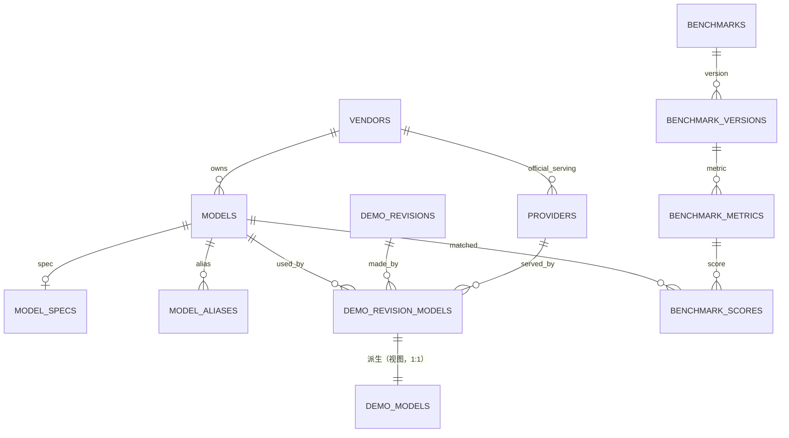

### 3.2 现有表（结构不动，语义收紧；`demo_models` 例外：由表改视图）

| 表 | 变化 |
|---|---|
| `models` | 语义：`id` 是唯一身份；`name` 是展示名；`slug` **创建后不可变**；加 `vendor_id` 指向 `vendors`（`vendor` 文本保留为过渡期展示缓存） |
| `model_aliases` | 唯一解析表；所有外部名/写法都落这里 |
| `demo_models` | **由表改为视图**（保留表名，语义 = 当前 revision 的投影）；业务列（`provider_id` / `serving_note` / `source` / `created_at`）落在 `demo_revision_models`（§3.3） |
| `vendors`（新） | 模型厂商 / lab；`slug` 取自 `canonical_model_id` 前缀 |
| `providers`（新） | 服务方实体：官方 / 聚合平台 / 自建，与 models.dev 的 `provider_id` 对齐 |
| `tags` / `demo_tags` | `key='model'` 的行在 S6 归档删除；其余键不受影响 |

`models.slug` 不可变的原因：它是公开 URL 与聚合主键。若将来要改名，另加 `model_slug_history` + 301，不在本期范围。

### 3.3 `demo_revision_models`（事实源）与 `demo_models`（视图）

**G18**：生成条件挂 revision。「这一次生成用了什么」是 revision 层事实；demo 层只保留「当前版本」的派生值，**不加冗余列**。`model` 因此从 demo 级下放到 revision 级。

**新表（模型域拥有，Demo 域引用）**：

> **DDL 见 [60-model.sql](../db/schema/60-model.sql)**（本节涉及的 1 张表/视图：`demo_revision_models`）。表结构以 SQL 文件为准，文档不再复制。

**视图（沿用旧名，语义 = 当前 revision 的投影；只读）**：

> **DDL 见 [70-views.sql](../db/schema/70-views.sql)**（本节涉及的 1 张表/视图：`demo_models`）。表结构以 SQL 文件为准，文档不再复制。

- 依赖 `demos.current_revision_id`（定义见《Demo域设计》§3.1）。**「当前」就是该列**：回滚后筛选与计数**跟着回滚**。
- **保留旧名**是为了让读路径 SQL 不用重写——与 G7 把 `demo_tasks` 由表改视图同构。
- 视图暴露 `demo_id` / `model_id` / `provider_id` 与 `serving_note` / `source`（作品卡要显示 `fp8` 这类服务差异）；**只有需要 `created_at` 等审计列时才直读 `demo_revision_models`**。读路径 SQL 一行不用改。
- **视图只读**：写入一律走 `DemoModelWriter` 写 `demo_revision_models`（§4.2）；迁移时先 `DROP TABLE demo_models` 再建视图（§6.2 / §7 A2）。

**主键是 `(revision_id, model_id)`，`provider_id` 只是属性、不进主键。** 原因：

1. **用户裁决（G18）**：同一模型经不同 provider 用过**算一条**；
2. PG 的 `UNIQUE` 默认也把 NULL 视为互不相等（`NULLS DISTINCT`），`(revision_id, model_id, provider_id)` 在 `provider_id IS NULL` 时**无法去重**，只能造 `unknown` 哨兵实体——那等于把「未知」变成一个假数据。

**每版只记本版**：数据模型层**不做继承 / 追加**——新 revision **不继承**上一版的模型列表；所谓「追加一个模型」是**前端在新建 revision 时预填**上一版数据后由用户改，**不是数据模型行为**（G18 用户裁决）。

`provider_id IS NULL` 表示「来源未标注」，UI 显式显示，不回填、不猜测。

`serving_note` 用于记录影响表现的服务差异（`fp8`、`free tier`、`context 32k`），**非空、默认空串**（`NOT NULL DEFAULT ''`，未标注就是空串），自由文本但限制 100 字符。

### 3.4 `vendors`（模型厂商 / lab；**跨域共享主数据**）

> **共享主数据（G10，2026-10-28）**：`vendors` 不只属于模型域——《标签域数据结构设计》§3.5 的 `platforms.vendor_id` 也指向这张表。**改本表结构前必须同时看那份文档**。理由：厂商是跨域概念（DeepSeek / 阿里 / 字节 / 智谱……），平台域若用自由文本存厂商，同一家会出现 `DeepSeek` / `deepseek` / `DS` 多种写法，统计口径立刻分裂——这正是本域把厂商实体化的同一个理由（§2.1「靠字符串比对必然出错」）。

models.dev 的网站按 **lab** 组织（`/labs/deepseek`），其 API 里没有独立的 lab 集合，但 **`canonical_model_id` 的前缀就是 lab**（实测 77 个），且多数 lab 的 `provider_id` 与前缀同名（28 个，如 `deepseek`、`moonshotai`、`zhipuai`）。

| 字段 | 类型 | 空 | 默认 | 说明 |
|---|---|---|---|---|
| `id` | bigint PK | 否 | 自增 | |
| `slug` | text（≤64） | 否 | — | 唯一，`canonical` 前缀，如 `deepseek` |
| `name` | text（≤128） | 否 | — | 展示名，如 `DeepSeek` |
| `homepage_url` | text（≤500） | 否 | `''` | 官方主页 |
| `status` | text（≤16） | 否 | `active` | `active` / `hidden` |
| `source` | text（≤32） | 否 | `manual` | `models.dev` / `manual` |
| `created_at` / `updated_at` | timestamptz | 否 | now() | |

```text
UNIQUE (slug)
```

填充规则：

```text
1. 取 model_catalog_items.canonical_id 的前缀集合（77 个）
2. 展示名：若存在 provider_id == 前缀，用该 provider 的 name（如 moonshotai → "Moonshot AI"）
3. 否则把前缀人性化（`bytedance-seed` → `ByteDance Seed`），标 source='models.dev'
4. 已存在同名 vendor（source='manual'）时不覆盖 name / homepage_url
5. canonical 前缀里出现新 lab 时只新增，不删除旧 vendor
```

为什么必须实体化：

- 现在 `Model.vendor` 是自由文本（来自标签 group），同一个厂商会出现 `DeepSeek` / `deepseek` / `深度求索`；
- 「官方 provider」的判定需要一个稳定的厂商键（`provider.vendor_id == model.vendor_id`），靠字符串比对必然出错。

### 3.5 `providers`（服务方）

| 字段 | 类型 | 空 | 默认 | 说明 |
|---|---|---|---|---|
| `id` | bigint PK | 否 | 自增 | |
| `slug` | text（≤64） | 否 | — | 唯一，如 `deepseek`、`openrouter`、`self-hosted` |
| `name` | text（≤128） | 否 | — | 展示名 |
| `vendor_id` | bigint | 是 | NULL | FK → `vendors.id`；官方服务方指向其厂商，聚合平台为 NULL |
| `kind` | text（≤16） | 否 | `aggregator` | `official` / `aggregator` / `self_hosted` / `other` |
| `homepage_url` | text（≤500） | 否 | `''` | |
| `description` | text（≤500） | 否 | `''` | |
| `status` | text（≤16） | 否 | `active` | `active` / `hidden` |
| `source` | text（≤32） | 否 | `manual` | `models.dev` / `manual` |
| `created_at` / `updated_at` | timestamptz | 否 | now() | |

```text
UNIQUE (slug)
INDEX (vendor_id)
```

```python
PROVIDER_KINDS = ("official", "aggregator", "self_hosted", "other")
```

规则：

- **provider 是「谁提供服务」，vendor 是「谁做的模型」**，两者在官方服务方上重合，但不能合并成一个字段。
- 「官方」是**相对模型**的：`provider.vendor_id == model.vendor_id`（两者都非空）才算官方。聚合平台（OpenRouter / Bothub）的 `vendor_id` 为 NULL。
- 上传时只能选已存在的 provider（避免 `OpenRouter` / `openrouter` / `Open Router` 三种写法并存）；缺失时由管理员在后台新增。
- 从 models.dev 目录导入的 provider 自动落库（`source='models.dev'`）：`provider_id` 能匹配到 `vendors.slug` 时 `kind='official'` + 回填 `vendor_id`，否则 `kind='aggregator'`。

### 3.6 `model_specs`（档案，1:1）

| 字段 | 类型 | 空 | 默认 | 说明 |
|---|---|---|---|---|
| `model_id` | bigint PK | 否 | — | FK → `models.id`，CASCADE |
| `modalities_in` | text（≤64） | 否 | `''` | 逗号枚举，固定顺序序列化 |
| `modalities_out` | text（≤64） | 否 | `''` | 同上 |
| `context_window` | integer | 是 | NULL | token |
| `max_output` | integer | 是 | NULL | token |
| `param_total_b` | double precision | 是 | NULL | 总参数（十亿） |
| `param_active_b` | double precision | 是 | NULL | MoE 激活参数；非 MoE 留空 |
| `param_kind` | text（≤16） | 否 | `undisclosed` | `exact` / `estimate` / `undisclosed` |
| `param_note` | text（≤200） | 否 | `''` | 估算依据 |
| `release_date` | date | 是 | NULL | |
| `knowledge_cutoff` | text（≤7） | 是 | NULL | `YYYY-MM` |
| `open_weights` | integer | 是 | NULL | 三态：NULL 未知 / 0 / 1 |
| `cost_in` / `cost_out` | double precision | 是 | NULL | 每百万 token，美元 |
| `license` | text（≤64） | 是 | NULL | |
| `canonical_model_id` | text（≤128） | 是 | NULL | models.dev 规范名，供去重 |
| `source` | text（≤64） | 否 | `manual` | `models.dev` / `manual` / `vendor_doc` |
| `fetched_at` | timestamptz | 是 | NULL | |
| `note` | text（≤500） | 否 | `''` | |

```python
MODALITIES = ("text", "image", "audio", "video", "pdf", "file")
PARAM_KINDS = ("exact", "estimate", "undisclosed")
```

规则：

- `param_kind=undisclosed` ⇔ `param_total_b IS NULL`；**绝不用 0 表示未知**。
- `param_active_b` 仅 MoE 且 ≤ `param_total_b`。
- models.dev 提供 `modalities` / `limit` / `cost` / `open_weights` / `release_date` / `knowledge` / `canonical_model_id`，**不提供参数量**；参数量只能人工或从 canonical id 推断（推断记 `estimate`）。

**字段级来源**：`model_specs.source` 只表示「主要来源」，不参与覆盖判定。每个字段的实际来源与锁定状态存在 `model_spec_fields(model_id, field, source, locked)`：

- `source=manual`：管理员手工填过，同步不覆盖。
- `source=models.dev`：来自上游，可被后续 diff 更新（仍需勾选）。
- `locked=true`：显式钉住，任何同步都跳过。

只给行级来源不够：手工改了一个字段，就会导致整行都不再接收上游更新。

### 3.7 第三方基准（4 张表）

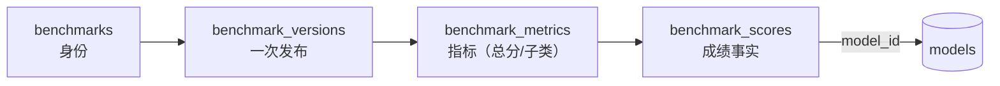

**`benchmarks`**（与版本无关）

| 字段 | 类型 | 说明 |
|---|---|---|
| `id` / `slug` unique / `name` / `publisher` / `homepage_url` | | 榜单身份 |
| `category` | text（≤64） | 多值逗号枚举，固定顺序；coding / math / agent / general / multimodal / safety / other；综合榜标多个（如 `coding,math`）；空串视为 `general` |
| `description` / `status` | | `active` / `retired` / `hidden` |
| `created_at` / `updated_at` | timestamptz | |

> 一个榜常同时覆盖多个方向（LiveBench 的 6 个子类就是 coding / math / reasoning 混合）。`category` 因此建模为**多值**：固定顺序序列化，如 `coding,math`；按 category 过滤/分组时，任一命中即归属该组。不设「复合榜」专用标签、不为凑单值丢弃具体方向，也不因多值在聚合时重复计权。

**`benchmark_versions`**（一次发布的快照）

| 字段 | 说明 |
|---|---|
| `benchmark_id` / `version` / `as_of` | `UNIQUE(benchmark_id, version)` |
| `source_type` | `leaderboard` / `independent` / `self_reported` |
| `coverage` | `full` / `partial`；partial 不参与归一化 |
| `participant_count` / `score_min` / `score_max` | **分布属性放版本**，不逐条存 |
| `status` | `active` / `superseded` |
| `source_url` / `retrieved_at` / `note` | 溯源 |

**`benchmark_metrics`**（版本内的指标）

| 字段 | 说明 |
|---|---|
| `version_id` / `key` / `label` | `UNIQUE(version_id, key)` |
| `metric_kind` | percent / pass_at_1 / pass_at_k / elo / usd / seconds / score / unknown |
| `unit` / `scale_min` / `scale_max` / `higher_is_better` | 量纲 |
| `is_primary` | 每版至多一个 true；综合分只用它 |
| `sort` / `note` | 展示 |

> 为什么要单独一张表：LiveBench 同时发布总分和 6 个子类。若把子类建成「榜」，同一发布方会被计 7 次权，去极值也救不回来。

**`benchmark_scores`**（成绩事实）

| 字段 | 说明 |
|---|---|
| `metric_id` | FK → metrics，CASCADE |
| `model_id` | FK → models，SET NULL；未匹配为空 |
| `external_name` / `external_name_key` | 原榜名 + 确定性规范化键 |
| `match_status` | `matched` / `unmatched` / `ignored` |
| `raw_score` / `rank` / `ranked` | 事实：分数、名次、是否进总排名 |
| `source_url` / `retrieved_at` / `note` | 溯源 |

```text
UNIQUE (metric_id, external_name_key)
INDEX  (model_id, metric_id)
INDEX  (metric_id, rank)
```

`external_name_key` 规范化：NFKC → trim → lower → 连续空白/下划线/斜杠/点号折叠为 `-`。不做厂商前缀模糊匹配（模糊匹配交给别名建议，人工确认）。

### 3.8 ~~`model` 标签退场~~（**已下沉至 §11.1**，2026-10-28，G16）

本节原描述 `model` 标签的三阶段退场（兼容期 / 冻结期 / 清理期）与兼容期读取入口——那是**过渡态**，按 G16 已整体移入 **§11.1**。此处保留编号（不重编号）以免外部引用失效：`docs/标签域数据结构设计.md`、`docs/标签域UML图集.md`、`docs/设计决策台账.md`、`docs/ORM现状与演进.md` 都引用过「§3.8」。

### 3.9 不变量

1. revision 与模型的关联（`demo_revision_models`）只能由 `DemoModelWriter` 写入；`demo_models` 是只读视图。
2. 任何业务逻辑不得从 `model:` 标签反推关联。
3. `match_status='matched'` ⇔ `model_id IS NOT NULL`。
4. 每个 `benchmark_version` 至多一个 `is_primary=true`。
5. `coverage='partial'` 或 `source_type='self_reported'` 的版本不进入综合分。
6. `param_kind` 与 `param_total_b` 的空值语义一致。
7. `models.slug` 不可变；改名只改 `name`。
8. `demo_models.provider_id` 为空表示未知，**不得回填推断值**；不得用哨兵实体冒充未知。
9. `provider_id` 非空时必须存在于 `providers` 且 `status='active'`。
10. provider **不改变**社区分与综合分的计算口径：分数仍按模型聚合，provider 只做分布展示。
11. 兜底实体（`resolution ∈ family/unknown/guess`）不得有 `model_external_refs` 或 `model_specs`。
12. 同一 `(source, provider_id, external_id)` 只能被一个 `Model` 认领。
13. `status` 与档案完整度正交：`active` 允许无档案，`candidate` 允许有档案。
14. `providers.vendor_id` 与 `models.vendor_id` 都非空且相等时，该 provider 才是该模型的官方服务方。
15. `vendors.slug` 来自 `canonical_model_id` 前缀，不得手改成自由文本。
16. 兜底实体与 fallback 服务方（`unspecified` 等）不参与 vendor 判定。
17. `demo_models` 是只读视图；`demos` 层**不得**冗余存「当前模型」列或模型计数（G18：demo 层纯派生，「当前」由 `current_revision_id` 决定）。

## 4. 写入契约

### 4.1 上传 / 编辑

```jsonc
// 推荐：字符串简写 = provider 未知
{ "models": ["glm-5"], "tags": ["type:game"] }

// 推荐：指定服务方
{
  "models": [
    { "ref": "dsv4-flash", "provider": "openrouter", "note": "fp8" }
  ],
  "tags": ["type:game"]
}

// 混合：同一作品用多个模型，各自带 provider
{
  "models": [
    "glm-5",
    { "ref": "dsv4-flash", "provider": "deepseek" }
  ]
}

// 兼容（agent 契约，provider 未知）
{ "tags": ["model:dsv4-flash", "type:game"] }
```

- `models` 元素支持两种形态：字符串（`ref`，provider 未知）或对象 `{ref, provider?, note?}`。
- `ref` 接受 slug / name / alias / 数字 id，统一走 `resolve_model_refs`。
- `provider` 接受 `providers.slug` 或数字 id；**必须是已存在的 provider**，未知返回 422 并提示管理员补充，不做自由文本落库。
- `note` 落 `demo_revision_models.serving_note`，最长 100 字符。
- 写入落在**本次生成对应的 revision** 上（新上传建新 revision、编辑内容建新 revision）；demo 层不存模型列表（G18）。
- `tags` 中 `model:` 项在入口剥离，转成 `{ref, provider:null}`，**不再写入 `demo_tags` 作为事实**。
- 两者同时出现取并集，按 `model_id` 去重；同一 `model_id` 出现两次但 provider 不同时，**保留先出现的**并记一条警告（不静默二选一但不报错）。
- 至少一个模型引用（含 `unspecified` / `<vendor>-unknown` 兜底），否则 422。
- 解析不到时自动建 `candidate`（灰测名 → `unverified`），但只建实体、不写标签。

### 4.2 差集写入（替换 `sync_demo_models`）

**写入目标表是 `demo_revision_models`（按 `revision_id`）；`demo_models` 是视图，永不直接写。**

```text
S        = resolve(revision)    # {(model_id, provider_id|NULL, note)}
current  = SELECT model_id, provider_id, serving_note
           FROM demo_revision_models WHERE revision_id = ?
INSERT   S - current            source='api'
UPDATE   provider_id / serving_note 变化的行
DELETE   current - S
```

- 差集按 `model_id` 比较；provider / note 变化视为该行更新，不新增行（同一模型经不同 provider 算一条）。
- 不再全删重建：未涉及的链接不受影响。
- **每版只记本版**：新 revision **不继承**上一版的模型列表；「追加」是前端预填，不是数据模型行为（§3.3 / G18）。
- 与 revision 的创建 / 切换**同一事务**：revision 未落库前不写关联。
- 同一事务内刷新该作品的标签投影（过渡机制，若开关打开；见 §11.3）；兼容入口写入时 `source='legacy_tag'`。
- 写 `provider_id` 前校验其存在且 `status='active'`，否则整次写入 422。

### 4.3 唯一写入面

模型关联的唯一写入面是 `DemoModelWriter`（§4.2，写 `demo_revision_models`）；读路径只读 `demo_models` 视图。标签投影等过渡机制见 §11.3。

### 4.4 合并 / 撤销 / 归属

| 动作 | 规则 |
|---|---|
| 合并 | 迁 `demo_revision_models`（按 `(revision_id, model_id)` 去重）→ 迁别名 → 源置 `deprecated` + `merged_into` → **只刷新受影响作品的投影** |
| 撤销 | 按审计快照恢复链接/别名/状态 → 重刷投影 |
| 归属 | **只改对应 revision 的 `demo_revision_models`**（差集 writer），视图与投影自动跟随；不再要求回写标签 |

### 4.5 基准导入

独立入口，不参与上面的双写链路：

```text
1. upsert benchmarks           by slug
2. upsert benchmark_versions   by (benchmark_id, version)；旧版本 superseded
3. upsert benchmark_metrics    by (version_id, key)
4. upsert benchmark_scores     by (metric_id, external_name_key)
5. 解析模型：slug → alias → name（同形态取小的 model_id）；未命中 → 收件箱
6. 整批事务；任何校验失败全部回滚
```

**基准不带 provider 维度**（已定）：`benchmark_scores` 只记 `model_id`。若榜方明确注明测的是某个 provider，写进 `note` 供人工参考，不参与计算。

### 4.6 models.dev 导入与同步

#### 4.6.1 原则

1. **上游是参考源，不是运行时依赖**：models.dev 不可用时，本站全部功能照常；导入后数据即我们的数据。
2. **本地镜像，不做实时查询**：models.dev 只提供整包 JSON（约 10MB），没有搜索接口；后台搜索查本地镜像。
3. **字段级来源**：是否被上游覆盖由 `model_spec_fields` 逐字段判定，不看行级 `source`。
4. **手工优先**：`source=manual` 或 `locked=true` 的字段永不被同步覆盖。
5. **默认只显官方条目**：`provider_id == canonical_id` 前缀才算官方；聚合平台条目默认折叠。

#### 4.6.2 新增表

| 表 | 作用 |
|---|---|
| `model_catalog_items` | 上游目录镜像（可搜索、离线可用） |
| `model_external_refs` | `(source, provider_id, external_id) → model_id` |
| `model_spec_fields` | 字段级来源与锁定 |
| `model_source_sync` | 目录刷新状态（一个来源一行） |

目录里的 `provider_id` / `provider_name` 会同步进 `providers` 表（`source='models.dev'`）：

```text
kind = (provider_id == canonical 前缀) ? 'official' : 'aggregator'
vendor_id = kind == 'official' ? vendors[slug=provider_id].id : NULL
```

已存在同名 provider 时不覆盖人工维护的 `name` / `homepage_url`（`source='manual'` 优先）。

DDL 见 §6.1。

#### 4.6.3 上游条目 → 本地实体

```text
canonical_id = "deepseek/deepseek-v4-flash"
vendor_slug  = canonical 前缀 "deepseek"
vendor       = vendors[slug='deepseek']（缺失时按 §3.4 规则新建）
is_official  = (provider_id == vendor_slug)
slug         = _slugify_unique(上游 name)
```

规则：

- 展示名去掉 `:free`、`(free)` 这类渠道标记；原文保留在 `external_id`。
- **无 `canonical_id` 时（8890 条里约 1300 条）：`vendor_id` 留空**，在 diff 里标「需人工确认厂商」，**不从 `provider_name` 建 vendor**——否则从 Bothub / OpenRouter 导入会造出「Bothub」这种假厂商。
- 同一 canonical 的多个 provider 条目**只建一个 `Model`**，其余全部记 `model_external_refs`。
- 若某 canonical 没有任何官方条目，搜索时退回显示聚合条目并标记「仅第三方收录」，仍可导入（`is_official=false`）。

上游还有三个可用字段（实测覆盖）：

| 字段 | 覆盖 | 用途 |
|---|---|---|
| `type` | 453/8890 | `image` / `embedding` / `video` / `speech` / `transcription` / `reranking` / `realtime` / `chat` → 落 **`model_catalog_items.model_type`**（镜像列），用于筛选与图标 |
| `status` | 977/8890 | `deprecated` / `beta` / `alpha` → 落 **`model_catalog_items.upstream_status`**，只在导入时提示，**不改我们的 `Model.status`** |
| `family` | 8458 | 模型家族（`deepseek-flash`）→ 落 **`model_catalog_items.family`**；是否进一步落业务侧**待定**（§10 #5） |

这三个字段只落**目录镜像** `model_catalog_items`（§6.1 的 `model_specs` 列集里没有它们）。

注意上游 `status=deprecated` 的条目有 904 条：导入默认过滤，需要时显式勾选「含上游已弃用」。这与我们的 `Model.status='deprecated'`（合并退役）是**两套语义**，不可混用。

#### 4.6.4 匹配链路

```text
1. model_external_refs(source, provider_id, external_id) 精确命中 → 同一模型
2. canonical_id 命中任意 ref                              → 同一模型（只加 ref）
3. ModelAlias 命中 external_id / canonical_id / name
4. Model.slug / Model.name 规范化命中
5. 仍未命中 → 返回候选（同厂商 + 名称相似），管理员选「关联 / 新建」
```

不静默建重复实体；「关联」等价于新增 external_ref + 别名。

#### 4.6.5 导入 vs 补全

| 模式 | 触发 | 写入 |
|---|---|---|
| **新建** | 未匹配 | `Model` + 选中字段写 `model_specs` + `model_spec_fields(source='models.dev')` + `model_external_refs` + 别名 + 审计 |
| **补全** | 已匹配 | 只写选中字段 + 新增 ref；不动 `manual` / `locked` |

差异视图逐字段给出：`字段 / 当前值 / 上游值 / 当前来源 / 是否锁定 / 勾选`。

- 值相同 → 不可勾选（no-op）。
- `manual` / `locked` → 默认不可勾选，需显式解锁。
- 应用后逐字段写 `model_spec_fields(source='models.dev')`。

#### 4.6.5.1 落地状态（2026-11-06）——导入是两步的，且只写勾选的

- 端点：`GET /api/v1/admin/models/catalog`（搜镜像）、`POST /api/v1/admin/models/import/preview`（算 diff）、`POST /api/v1/admin/models/import/apply`（落库）。三者都要 `model.import` 权限（与 `entity.edit` 分开：导入改的是**共享目录**，一次影响所有引用该模型的版本）。
- **新建也是 active**：`CreateModelFromCatalog` 直接写 `status='active'`。作者手填建的是 `candidate`（没人背书），目录导入是管理员对着上游条目点的（有人背书）——状态不同正是「这条凭什么可信」的答案。
- **apply 只写 `fields` 里列出的**：新建与补全都一样。第一版实现让新建无条件带上上游 `description`（理由「新行本来就是空的」），被 `TestIntegrationModelImportCreateWritesOnlySelected` 抓住——没勾 description 就不该有 description，勾选清单是调用方看过 diff 之后的决定。
- 不可勾三条落在 `diffFields`：`upstream == current`（no-op）、`source = 'manual'`、`locked = true`。反向验证证明这三条都真的有用例压着（去掉 `!isLocked` → `字段被锁了，不该可勾`）。
- **认领是 `is_official = (providerId == canonical 前缀)`**：不相等只说明这条是第三方收录，不是错，但徽章要能区分。
- 未做的：目录刷新（`model_source_sync` 仍无写入者，镜像目前只能靠 psql 灌）；批量导入（`4.6.8` 说的「按条目独立事务」还没实现，当前 apply 一次一条）。

#### 4.6.6 目录刷新

```text
手动：后台「刷新目录」按钮，随时可用
定时：`modelsdev.sync_enabled` 为真时按 `modelsdev.sync_interval_hours` 拉取（v1.15 起默认开启）
```

- 拉取 → `payload_hash` 比较 → 变化才替换镜像（单事务）。
- 成功：`status=ok`、`last_success_at`、`item_count`。
- 失败：**保留旧镜像**，`status=stale` 并记 `error`；导入页显示「目录更新于 …」。
- 目录为空且从未成功 → 提示先刷新，不返回 500。

#### 4.6.7 后台交互

```text
/admin?tab=models&action=import
  [搜索] 名称 / id / canonical / 厂商
  [过滤] 仅官方（默认） | 含第三方收录 | 已导入 | 可补全
  结果行：名称 · 厂商 · 模态 · 上下文 · 价格 · 徽章（已导入 / 可补全 N 项）
  操作：查看差异 → 勾选字段 → 导入 / 补全
  批量：按厂商勾选多个未导入条目
```

模型详情（管理端）另有「从 models.dev 补全」入口，走同一 diff 组件。

#### 4.6.8 失败与降级

- 批量导入按条目独立事务：单条失败不影响已成功的，失败列表可重试。
- 上游字段消失 → **不清空本地值**，只在 diff 中标记「上游已移除」供人工判断。
- 上游改名 → canonical 不变即同一模型，只更新候选展示名，由管理员决定是否改 `Model.name`。

### 4.7 候选确认与手动新建

#### 4.7.1 状态与档案正交

**`status` 管生命周期，`model_specs` 管档案完整度，两者互不阻塞。**

| 组合 | 是否允许 | 说明 |
|---|---|---|
| `candidate` 有档案 | 允许 | 先导入档案、后确认 |
| `active` 无档案 | 允许 | 手动建的私有模型、上游没有的模型 |
| `active` 有档案 | 常态 | 从目录导入 |
| fallback 有档案 | **禁止** | 见 4.7.5 |

所以确认动作**不要求**先有档案；缺档案时用徽章提示，不拦上架、不拦展示。

#### 4.7.2 `candidate → active` 的确认流程

三个入口共用同一个确认面板：

1. 收件箱 `new_model` 批准
2. 管理端模型列表逐条确认
3. 管理端批量确认

面板内容：

```text
模型 Foo · candidate · 12 件作品 · 厂商 DeepSeek

[上游建议] 在 models.dev 找到 3 个候选（按名称 + 厂商实时搜索）
  ○ deepseek/deepseek-v4-flash    DeepSeek · 1M 上下文 · 官方
  ○ openrouter/deepseek-v4-flash  OpenRouter · 聚合
  ○ 跳过，稍后补档案

[操作] 关联并确认 | 仅确认（档案缺失） | 合并到已有模型 | 驳回
```

- 选条目 → 走 §4.6.5 的字段级 diff → 勾选 → 应用 → `status=active`。
- 选「仅确认」→ `status=active`，档案为空，列表加「档案缺失」徽章。
- 选「合并到已有」→ 转 `merge_model`（源 candidate 被合并，不保留）。
- 「驳回」只在该 candidate **没有任何作品引用**时才允许物理删除；有引用则只能合并或降级，避免孤儿链接。

**建议来源是实时查询**，不落表：对 `Model.name` 规范化后，在 `model_catalog_items` 按 `name` / `external_id` / `canonical_id` 模糊匹配，官方条目置顶。

#### 4.7.3 管理员手动新建

表单分两段，默认落在第一段：

| 段落 | 输入 | 结果 |
|---|---|---|
| **从目录选择**（默认） | 搜索目录 → 选条目 | 与「导入新建」完全同一条路径：`Model` + 档案 + `external_refs` + 别名 + 审计 |
| **手动新建** | `name` 必填；`vendor` 从下拉选择（可搜索 + 内联新建，写 `vendor_id`） | `slug` 自动生成；档案为空；状态默认 `active`（可改 `candidate`） |

规则：

- `vendor` **不是自由文本**：必须落到 `vendors` 表，避免再造 `DeepSeek` / `deepseek` / `深度求索` 三种写法。下拉里没有时可内联新建一条 vendor（写 `source='manual'`）。
- vendor 允许留空（未知），但列表会显示「厂商未标注」，且该模型不参与「官方 provider」判定。
- 手动新建时若名称命中目录条目，提示「发现同名上游条目，建议改用导入」，但**不阻止**——确实存在上游没有的私有模型。
- 手动新建的模型，详情页常驻「从 models.dev 补全」入口。
- 手动新建**不允许**直接选 `unspecified` / `<vendor>-unknown` 这类兜底名（它们由系统维护，见 4.7.5）。

#### 4.7.4 认领冲突

`model_external_refs` 的 `UNIQUE(source, provider_id, external_id)` 保证一个上游条目只能被一个 `Model` 认领。关联时若已被占用：

| 占用方状态 | 处理 |
|---|---|
| `candidate` / `unverified` | 提示「已由 X 认领」，给出合并入口；不允许第二个认领 |
| `active` | 拒绝，并给出对方模型链接 |
| `deprecated` | 拒绝，并指向其 `merged_into` 归宿 |

同理，**导入路径的匹配必须覆盖所有状态**（candidate / active / unverified），否则会造出「一个 active + 一个 candidate 指向同一上游条目」的重复。命中 `deprecated` 时报错，不自动复活。

#### 4.7.5 兜底实体（fallback）

`resolution ∈ {family, unknown, guess}` 的模型，包括 `unspecified` 与 `<vendor>-unknown`：

- **不得**有 `model_external_refs`，**不得**有 `model_specs`；
- 不参与目录匹配（导入搜索、确认建议都过滤掉）；
- 揭晓正确路径是 `attribute_demos` 把作品迁到真实型号 + 合并兜底实体，**不是**给它补档案。

这与现有 `attribute_demos` 要求目标 `resolution='exact'` 的约束一致。

#### 4.7.6 档案完整度（派生，不落库）

```text
missing  : 无 model_specs 行
partial  : 有行，但 context_window / modalities_in 任一为空
complete : 两者都有
```

用途：模型列表徽章、管理端筛选「档案缺失」、确认面板的默认提示。不参与排序或评分。

## 5. 读取契约

### 5.1 模型页

```text
模型页 = 档案（spec） + 站内表现（社区分/作品/题目） + 第三方基准（综合分/单榜）
```

三个区块独立取数、独立口径说明，不合并成一个「总分」。

**站内表现一律「按当前 revision」**（G18，与 G7 的题归属同构）：一件作品的模型归属取 `demos.current_revision_id` 对应的关联；历史 revision 用过的模型**不**参与统计。

> **落地状态（2026-11-08）——模型页只读，三块分开给**
>
> - 端点：`GET /api/v1/models/{slug}` 一次返回 `model` / `specs` / `site` / `demos` /
>   `providers` / `benchmarks`。一个端点而不是三个：三块都只读、都很快，拆开只会让页面
>   多两次失败处理，还要想办法对齐「这三份是同一时刻的」。
> - **公开可见的判据收进视图** `demo_public_demos`（迁移 0022）：`approved` + `published`
>   + 未删 + 有 `listed` 渠道。作品数、作品列表、模型页三处问的是同一张视图，
>   所以「模型页说 6 件」与「作品库按该模型筛出 6 条」不会分裂——分类目录踩过这个坑
>   （一边 230、点进去 12 条）。`demos.sql` 与 `classifications.sql` 里那两份手写判据
>   仍在单一出处门禁的基线里，等下次改到再收敛。
> - **档案没有时是 `null`，不是空对象**：`model_specs` 一行都没有 = 「还没录入」，
>   有一行但每栏都空 = 「录了，上游也没给」。前者界面说「还没有档案」，后者排一排 `—`。
> - **没有票就不给分**：契约里 `site.scored=false` 时 `score` 仍是数字（给 0），但界面
>   不该显示「0 分」——「没人投过」与「平均 0 分」是两件事。`priorWeight` 把收缩用的
>   `m` 摆出来，读者能自己复核分数。
> - **基准只列有资格的条目**：榜单与版本都 `active`、`coverage=full`、非 `self_reported`、
>   有 primary 指标、`ranked` 且有名次、参赛数 ≥ 3。不满足的留在库里但不进页面。
> - **综合分与强弱标记本期不算**：归一化方案仍是 §5.3 的待拍板项。这一层只把「每张榜
>   给了什么」如实摆出来（原始分 + 名次 + 参赛数 + 来源），不发明一个自己的口径。
> - 前端页面（`/models/{slug}`）与详情页的模型链接在下一个 PR；这一期先把读路径与口径
>   钉住，免得界面先画出来、字段再改。

### 5.2 站内社区分（已有口径，保持不变）

```text
s          = demo_stats（DemoStat；rating_* 已移出 demos，按 demo_id 1:1 取）
demo_count = COUNT(公开可见 demos)             # G1：moderation_state='approved' AND lifecycle_state='published' AND deleted_at IS NULL
                                               # 谓词权威：标准对象 §ST-2
votes      = SUM(s.rating_count)
wsum       = SUM(s.rating_avg * s.rating_count)
rating_avg = AVG(s.rating_avg)                  # 等权旧语义
score      = (wsum + m*C) / (votes + m)         # 贝叶斯收缩
C          = 全站票加权均分
m          = 各模型票数中位数（≥1）
```

排序键与展示值同源（SQL 里 `round(score, 2)`）。

**provider 不参与这条公式**：同一模型无论走哪个 provider，都计入同一个模型分。

**按当前 revision 计数**：`demo_count` / `votes` 的取数走 `demo_models` 视图（= 当前 revision 的投影）——「某模型的作品数」= **当前 revision 用了该模型**的作品数；换模型或回滚后跟着 `current_revision_id` 变。

### 5.2.1 provider 分布（只读展示）

模型页在社区分下方给一张分布表，**不改变上面的分数**：

```sql
-- 按当前 revision：demo_models 是视图（demos ⋈ demo_revision_models(current_revision_id)）
SELECT dm.provider_id,
       p.slug, p.name, p.kind,
       COUNT(DISTINCT dm.demo_id)           AS demos,
       AVG(NULLIF(s.rating_avg, 0))         AS avg_rating,
       SUM(s.rating_count)                  AS votes
FROM demo_models dm
JOIN demos d       ON d.id = dm.demo_id
LEFT JOIN demo_stats s ON s.demo_id = d.id
LEFT JOIN providers p  ON p.id = dm.provider_id
WHERE dm.model_id = :id
  AND d.moderation_state = 'approved'       -- G1 公开可见谓词
  AND d.lifecycle_state  = 'published'
  AND d.deleted_at IS NULL
GROUP BY dm.provider_id
ORDER BY demos DESC;
```

展示规则：

- `provider_id IS NULL` 归为一行「未标注」，永远排在最后。
- 分布里的 `avg_rating` 只做参考，**不参与排序**，也不进 `score`。
- 作品数少于 3 的行显示作品数、隐藏均分（样本太小）。
- 有 provider 的行可点进 `?model=<slug>&provider=<slug>` 的作品列表。

### 5.3 第三方归一化（待拍板）

```text
K = participant_count；r = rank（1 最好）

A. 百分位（推荐）  p = (K - r) / (K - 1) * 100
                   higher_is_better=false 时 r' = K + 1 - r
B. min-max        p = (raw - score_min) / (score_max - score_min) * 100
C. 原始分          p = raw（仅同量纲榜单之间）
```

参与条件：`benchmark.status=active`、`version.status=active`、`coverage=full`、`source_type≠self_reported`、有 primary 指标、`ranked=true` 且有 `rank`、`K ≥ 3`。

### 5.4 综合分与偏离

```text
x(1) ≤ … ≤ x(N)

N ≥ 3 : composite = mean(x(2) .. x(N-1))     # 去 1 高 1 低
N == 2: composite = mean(x)                  # NOT_TRIMMED
N <= 1: composite = null                     # INSUFFICIENT

med = median(x); dev = x_i - med
N ≥ 4 且 |dev| ≥ 25 个百分位点 → strong / weak
MAD > 0 且 |0.6745*dev/MAD| ≥ 3.5 → 同样标记
```

- 基线用**中位数**，不用裁剪均值（否则循环论证）。
- 标记语义是「强项/弱项」，不是「榜单有错」。
- 被剔除的最高/最低必须展示（榜名 + 分数 + 方向）。

### 5.5 过滤与 facet

| 入口 | 目标 |
|---|---|
| `GET /demos?model=<slug>` | 唯一推荐路径，**按当前 revision** 走 `demo_models`（视图；回滚跟着回滚） |
| `GET /demos?model=<slug>&provider=<slug>` | 两者 AND；`provider` 缺省不过滤 |
| `GET /demos?provider=<slug>` | 单独按服务方过滤（跨模型） |
| `GET /demos?provider=none` | 只看「来源未标注」 |
| `GET /demos?tag=model:x` | 入口翻译为 `model=` |
| 作品库模型 facet | 读 `Model` 表，不读标签统计 |
| 作品库 provider facet | 读 `providers` 表，附带该 provider 的可选模型数 |
| 作品卡片 `models` | 只读实体，无标签兜底；provider 以徽章显示 |

> **口径统一（G18）**：`?model=` 筛选、「某模型的所有作品」、`model_counts` 计数一律**按当前 revision** 判定（与 G7 的题归属同构）；历史 revision 用过的模型**不进**这些结果。

## 6. 数据库变更汇总

### 6.1 新增表（12 张）

`vendors`、`providers`、`model_specs`、`benchmarks`、`benchmark_versions`、`benchmark_metrics`、`benchmark_scores`，models.dev 同步用的 `model_catalog_items`、`model_external_refs`、`model_spec_fields`、`model_source_sync`，以及 **`demo_revision_models`**（revision ↔ 模型；本域拥有、Demo 域引用）。参考 DDL：

> `demo_revision_models` 的 DDL 与配套视图 `demo_models` 见 **§3.3**（不在此重复，避免两处漂移）。
> 退场留痕表 `model_tag_archive` 属过渡态，不在目标表清单内（DDL 见 §11.2）。

> **DDL 见 [60-model.sql](../db/schema/60-model.sql)**（本节涉及的 11 张表/视图：`vendors` / `providers` / `model_specs` / `benchmarks` / `benchmark_versions` / `benchmark_metrics` / `benchmark_scores` / `model_catalog_items` / `model_external_refs` / `model_spec_fields` / `model_source_sync`）。表结构以 SQL 文件为准，文档不再复制。

### 6.2 改现有表

> **DDL 见 [70-views.sql](../db/schema/70-views.sql)**（本节涉及的 1 张表/视图：`demo_models`）。表结构以 SQL 文件为准，文档不再复制。

注意 1：`DROP TABLE` 必须在「数据已回填到 `demo_revision_models`」之后执行（顺序见 §7 A2）。
注意 2：PG 的 `ALTER TABLE ... ADD COLUMN` 加 `REFERENCES` 时该列默认即可空（不写 `NOT NULL` 就是 NULL）。这与「provider 未知」的语义正好一致。

### 6.3 配置项（**不建 `settings` 表**，走设置域）

> **v1.4 变更（2026-11-01）**：本节原先自建了一张 `settings` 表。设置域落地后作废——
> 全仓只有一套设置机制（`db/schema/15-settings.sql` 的 `setting_keys`），模型域再建一张
> 就是第二份事实源。原先四个键的去向见下表。

| 原键 | 现在在哪 | 说明 |
|---|---|---|
| `modelsdev_sync_enabled` | 设置域 `modelsdev.sync_enabled`（site，boolean，v1.15 起默认 `true`） | 定时刷新开关。**原稿用 `0`/`1` 表达，违反 [`DDL约定`](DDL约定.md) §2「boolean 不用 0/1」，一并改掉** |
| `modelsdev_sync_interval_hours` | 设置域 `modelsdev.sync_interval_hours`（site，number，默认 `24`） | 定时刷新间隔 |
| `modelsdev_search_official_only` | 设置域 `modelsdev.search_official_only`（site，boolean，默认 `true`） | 导入页默认过滤 |
| `model_benchmark_scale` | **不进设置**，见下 | 归一化方案 |

**默认值在 v1.15 改过一次（迁移 `0021`）**：`modelsdev.sync_enabled` 登记进基线时模型目录
同步还没实现，默认 `false` 的意思是「没有可同步的东西，别开」。同步落地后（`POST /admin/models/sync`
与进程内定时器都成了真事），默认 `false` 变成另一句话——「装好了但永远不动」。所以迁移把
`default_value` 改成 `true`，且**只改默认值、不覆盖已写过的 `site_settings` 行**：运营显式关掉过
就保持关掉，那是一个决定。

**`model_benchmark_scale` 为什么不做成配置**：它决定「综合分怎么算」。改了它，所有已经算出来的
综合分与强弱标记都要重算，旧榜单会在一夜之间变样——这正是设置域 D13 判据 J2（「改了不会让历史数据
自相矛盾」）要挡的事。它现在是**代码常量**，归 [`运行手册-可变常量.md`](运行手册-可变常量.md) §6 管；
真要改，得连着重算脚本一起发版。

#### 4.6.5.2 落地状态（2026-11-07）——批量导入：逐条事务，形态错误整批拒

`POST /api/v1/admin/models/import/apply-batch`（`model.import` 权限）一次最多 50 条，
每条独立成事务。四种判断：

1. **逐条事务，不整批回滚**。50 条里第 37 条因为「目录刷新后这条没了」失败，前 36 条
   仍然落库。整批回滚会让调用方反复重试同一批，而失败往往只跟单条有关。代价是调用方
   必须读 `results[]` 而不是只看 HTTP 状态码——每条带 `status`（`created` / `completed` /
   `failed`）与失败原因。
2. **形态错误整批 400**。批内同一个上游条目出现两次、某条字段名拼错、某条勾选为空，
   这些都是**请求本身拼错了**，不是「某条暂时做不到」，所以一条都不写，让调用方先修请求。
3. **上限 50 条**，与契约 `maxItems: 50` 一致。再大就不是「导入一屏」而是「灌库」了，
   灌库该走上游同步（§6.3）而不是逐条 apply。
4. **`created` 与 `completed` 分开报**。前者是新建了本地模型，后者是补全了已有模型——
   这两件事对调用方的含义不同：前者会产生新的 slug，后者不会。

`status` 同样是 `string` 而不是 enum，理由与 `ModelSyncResult.status` 一致（松点 53）。

**没有批次 id**：一次批量导入不产生「批次」这个实体，库里没有地方记「这次导入了哪些条」。
要回溯只能按 `audit_log` 的 `entity_id` 逐条翻。为什么先不做见松点 54。

#### 落地状态（2026-11-06）——目录同步是一天一次的快照

`model_catalog_items`（models.dev 的镜像）此前只能靠运维手工 `psql` 灌。这次补上同步：
`POST /api/v1/admin/models/sync` 手动触发，进程内每 5 分钟看一次「到点没有」。

**镜像是快照，不是我们的数据。** 本地事实在 `models` / `model_external_refs` /
`model_specs` 三张表；镜像只回答「上游现在有什么」。这条边界决定了下面每一条：

- **按条更新，不是整表重写（2026-11-12 改）。** 唯一键
  `(source, provider_id, external_id)` 决定行身份：同一条上游条目重同步后行 id 不变，
  上游下架的条目在同一事务里删掉。原先的「先 `DELETE ... WHERE source` 再 `COPY`」
  每天换掉 9000 个 id、留 9000 个死元组，任何记住过某个 id 的人第二天都会拿到别人的行；
  而它原本想解决的问题（「目录更新于什么时候」）由下面那道闸门正面回答。
- **只有内容真的变了才写，`fetched_at` 才有意义。** `ON CONFLICT ... DO UPDATE` 带一句
  闸门：整行（去掉 `id` / `source` / `fetched_at` 三列）与 `EXCLUDED` 逐列比，
  `IS DISTINCT FROM` 为假就不更新。于是 `fetched_at` 记的是**这一行内容最后一次变化**
  的时间，不是「这次同步跑过」的时间——没有这道闸门，一天一次同步会把整表的
  `fetched_at` 原地刷新一遍，「上游改了」与「我们同步过」又混成一个时间点。
- **payload 没变就不解析、不写。** 比 `payload_hash`（sha256）；相同且上次成功时直接返回
  `skipped: true`。按条更新之后这一步不再是「防止 id 漂移」的必需品，省下的是一次
  11 MB 的解析与一趟 9000 行的写。
- **失败保留旧镜像。** 上游 502 时只写 `model_source_sync.status='failed'` 与
  `error`，不碰 `last_success_at` / `item_count` / `payload_hash`——运维看到
  「上次成功时间」还是过去那个，就知道镜像不是新的。清空比不更新更糟。
- **空目录当失败。** 上游返回 `{}` 时返回 502 而不是「同步成功、0 条」。一次
  「成功」的空同步会静默清空镜像，而运行时看起来一切正常。
- **抢不到锁就跳过，不排队。** `pg_try_advisory_lock(7312004411)`，key 是常量而不是
  随机数（随机数等于没锁）。抢不到回 409，等下一轮。
- **解析是确定的。** provider 与 model 都按 id 排序，同样的字节两次解析出同样的行序；
  否则「幂等」与「人工对 diff」都没有基准。

配置（设置域，`scope=site`）：

| 键 | 类型 | 默认 | 说明 |
|---|---|---|---|
| `modelsdev.sync_enabled` | boolean | `true` | 关掉只停自动同步，手动端点仍可用 |
| `modelsdev.sync_interval_hours` | number | `24` | 与 `last_success_at` 比，到点才跑 |

`MODEL_CATALOG_URL` 是环境变量而不是设置项：部署拓扑不是运营参数，运营改不了上游地址。

**落地状态（2026-11-07）——管理端数据面：目录分页 + 同步状态**

- `GET /api/v1/admin/models/catalog` 带 `offset`，响应里回 `total` / `limit` / `offset`。
  上游实测 8931 条，只给「前 50 条」等于把「找一条模型」变成「猜搜索词」。
  `total` 与列表**必须同一组筛选条件**（`CountCatalogItems` 与 `ListCatalogItems` 的
  WHERE 逐字一致）：不一致时表现为「最后一页少几条」，很难归因。
- 目录搜索的 `q` 也做了 LIKE 转义（`%` / `_` / `\` 按字面匹配，SQL 侧 `ESCAPE '\'`），
  与作品搜索同一口径。此前只有作品搜索转义过，管理端这一处是漏的。
- 新端点 `GET /api/v1/admin/models/sync` 读 `model_source_sync` 的记账：
  `{source, status, items, lastAttemptAt, lastSuccessAt, error}`。
  **从没同步过不是 404**——返回 200 + `status=never`，否则管理页只能用一条红色
  错误来表达「初始状态」。
- `status` 直接取库里的值，不在读取时重算「是否已过间隔」：那是定时器
  （`SyncIfDue`）的判断，读取端点重算等于把定时配置耦合进查询。
- `lastSuccessAt` 在失败时**不被覆盖**（`UpsertModelSourceSync` 用 `COALESCE`）：
  它是判断「镜像有多旧」的唯一依据。


### 6.4 不需要做的

- 不给 `models` 加 `demo_count` / `score` 等冗余列。
- 不改 `models` 主键；`demo_models` 已由表改为**视图**（不再有主键，G18）。
- 不动 `tags` / `tag_keys` 结构（`key='model'` 的行按 §11.1 单独退场）。
- 不物化社区分（等 `/benchmarks` 变热再评估）。
- **不删 `models.vendor` 文本列**，直到 `vendor_id` 回填完成且 §8.2 的 vendor 体检为空（A6 时再删）。

## 7. 统一迁移路线

三条 lane，可并行但有关键同步点。

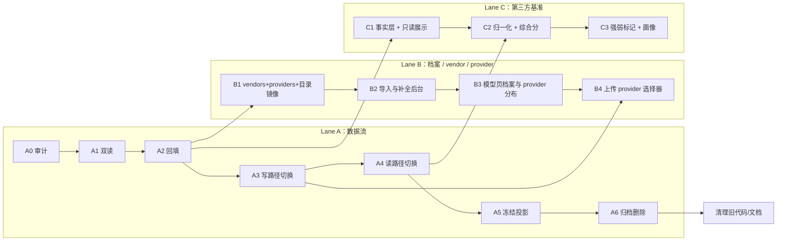

### Lane A（M3 → M4 → M8）

| 阶段 | 内容 | 验收 |
|---|---|---|
| A0 | 只读审计脚本 `scripts/audit_model_links.py`：标签解析 vs `demo_models` 四类差异 | 产出基线报告 |
| A1 | 读取统一「实体优先、标签兜底」并打点 | 知道兜底占比 |
| A2 | 按每件作品的 **`current_revision_id`** 差集回填 `demo_revision_models`（`source='migration'`），随后 `DROP TABLE demo_models` + 建视图；不删标签 | 「仅标签有」= 0；视图可读 |
| A3 | 上传/归属切 `DemoModelWriter`，投影刷新；保留旧函数一个版本 | 连续编辑不抖动 |
| A4 | `?tag=model:x` 翻译；facet 读 `Model` | 旧分享链接行为不变 |
| A5 | `model_tag_projection=off` | 一个发布周期无依赖 |
| A6 | 归档后删除 `model` 标签与旧代码；更新 `API_CONTRACT.md` | 对拍全绿 |

### Lane B（M5 → M6）

| 阶段 | 内容 |
|---|---|
| B1 | 建 `vendors` / `providers` / `model_specs` + 4 张同步表；`sync_models_from_modelsdev.py` 改为写 `model_catalog_items`（镜像）+ `vendors` + `providers`，不直接改实体；回填 `models.vendor_id` |
| B2 | 管理端导入页：搜索镜像 → 字段级 diff → 导入 / 补全 / 按厂商批量；vendor 与 provider 维护入口 |
| B3 | 模型页展示档案 + provider 分布；作品卡 provider 徽章 |
| B4 | 上传页 provider 选择器（**必须在 A3 之后**，见下） |

### Lane C（M7）

| 阶段 | 内容 |
|---|---|
| C1 | 建 4 张基准表；手工 JSON 导入；模型页只读展示（原始分/名次/来源/截止日） |
| C2 | 归一化 + 综合分 + 剔除明细 + 退化标记（需先拍板归一化方案） |
| C3 | 强项/弱项 + 按 category 分组（多值榜在各组均出现）；独立 `/benchmarks` 页排在最后 |

### 关键同步点

- **A2 完成**是 B1/C1 的前置：先保证「当前 revision ↔ 模型」干净，再往上挂档案与基准。
- **A2 的回填口径（G18）**：目标表 `demo_revision_models`，每行落到该作品的 `current_revision_id`（定义见《Demo域设计》§3.1）；回填完成后 `demo_models` 视图即刻生效，读路径 SQL 不用改。A2 之前 `demo_models` 仍是旧表。
- **B4 必须晚于 A3**：`demo_revision_models.provider_id` 若在旧的全删重建写入下上线，每次编辑都会被抹掉。这是排序上的硬约束，不是偏好。
- **C2 依赖 A4**：归一化要按模型聚合，读路径必须已统一到实体。
- **A6 必须在 A4 稳定一个发布周期之后**，否则旧链接会断。

## 8. 验收与回滚

### 8.1 每阶段必跑

```text
后端全量 pytest + OpenAPI 契约快照（P0 护栏）
A0 审计脚本对拍（集合相等）
基准不变量测试（唯一 primary、self_reported 排除、partial 不归一化）
前端 typecheck / vitest / build
```

### 8.2 SQL 体检

```sql
-- 孤儿链接（revision 级；FK 已挡住大部分，这里是兜底体检）
SELECT rm.revision_id, rm.model_id FROM demo_revision_models rm
LEFT JOIN demo_revisions r ON r.id = rm.revision_id
LEFT JOIN models m ON m.id = rm.model_id
WHERE r.id IS NULL OR m.id IS NULL;

-- 已合并实体仍被直接挂载
SELECT src.id, src.merged_into_id, COUNT(rm.revision_id)
FROM models src JOIN demo_revision_models rm ON rm.model_id = src.id
WHERE src.merged_into_id IS NOT NULL
GROUP BY src.id;

-- vendor 体检：同一 slug 的多种写法（实体化后应只剩一种）
SELECT v.id, v.name, m.vendor AS legacy_text, COUNT(m.id) AS models
FROM models m LEFT JOIN vendors v ON v.id = m.vendor_id
WHERE v.id IS NULL AND m.vendor <> ''
GROUP BY m.vendor;

-- 官方 provider 错配：kind=official 但 vendor_id 与模型厂商不一致
SELECT p.slug AS provider, v1.slug AS provider_vendor, m.name, v2.slug AS model_vendor
FROM demo_revision_models dm
JOIN providers p ON p.id = dm.provider_id AND p.kind = 'official'
JOIN models m ON m.id = dm.model_id
LEFT JOIN vendors v1 ON v1.id = p.vendor_id
LEFT JOIN vendors v2 ON v2.id = m.vendor_id
WHERE v1.id IS NULL OR v2.id IS NULL OR v1.id <> v2.id;
```

### 8.3 回滚

| 阶段 | 回滚 |
|---|---|
| A1–A3 | 关开关 + 回滚代码；数据只多不少 |
| A4 | 恢复 `tag=model:` 直读 |
| A5 | `model_tag_projection=write` 重建投影 |
| A6 | 从 `model_tag_archive` 恢复 |
| B/C | 新表独立，删表即回滚，无反向依赖 |

## 9. 风险

| 风险 | 应对 |
|---|---|
| 外部 agent 仍传 `model:` 标签 | 兼容期入口解析；`API_CONTRACT.md` 标 deprecated 并给新字段 |
| 分享链接用 `tag=model:x` | A4 入口翻译，保留足够长的兼容期 |
| 投影与实体再次分叉 | 投影只由 writer 调用；A5 后不再写 |
| 合并并发编辑 | 单事务 + 差集写入；合并后按 id 重刷投影 |
| 回填误挂 | A0 先出报告并抽样；A2 只补不删 |
| 换模型后历史归属不清（Demo 域 §2.2 方案 A 的旧代价） | **已由 revision 级解决**（G18）：`demo_revision_models` 按 revision 记录，历史版本归属可查；demo 层只派生当前版本，不再需要「历史版本模型归属不提供」这条不变量 |
| 基准数据自报污染 | 单独标注、不计入综合分 |
| 榜方改版 | 版本表隔离，旧版 `superseded`，不覆盖 |
| 综合分被误读 | 固定文案：跨榜相对位置，非任何单一榜的官方结论 |
| models.dev 改版/字段消失 | 镜像保留 `raw_json`；只取已知字段；字段消失不清空本地值，只进 diff 提示 |
| 聚合平台条目淹没目录 | canonical 去重 + 默认只显官方 provider；聚合条目仅作 external_ref |
| 定时刷新失败 | 保留旧镜像，`status=stale`；UI 显示上次成功时间，不阻塞导入 |
| 上游名称与本地冲突 | 唯一约束 + 匹配链路候选，人工选「关联 / 新建」，不静默建重复 |
| provider 写法不一致 | 只允许选已存在实体，禁止自由文本落库；管理端统一维护 |
| provider 被当成模型能力差异的证据 | 分布表只用原始均分做参考，明确标注「非能力结论」；社区分公式不含 provider |
| 老数据 provider 全空 | 不回填推断值；分布表固定显示「未标注」一行，避免误读为「没有 provider」 |
| vendor 历史写法散乱 | `vendor` 文本保留为展示缓存，`vendor_id` 逐步回填；8.2 体检查询列为空的行，人工归并后再删文本列 |
| 从聚合平台误建厂商 | 无 `canonical_id` 时 `vendor_id` 留空并标「需人工确认」，不从 `provider_name` 建 vendor |
| vendor 改名影响历史 | `vendors.slug` 不可变（来自 canonical 前缀）；改名只改 `name`，与 `models.slug` 同规则 |

## 10. 开放问题

1. **归一化方案**：百分位（推荐）/ min-max / 原始分。
2. **基准数据落地**：手工 JSON（推荐先做）/ 后台录入 / 抓取。
3. **综合分对外名称**与是否要独立 `/benchmarks` 页。
4. **vendor 展示名的初始值**：models.dev 里 `provider_id == canonical 前缀` 时可取 `provider.name`（如 `moonshotai` → "Moonshot AI"），其余前缀按人性化规则生成——需要人工过一遍 77 个前缀确认展示名。
5. **导入字段边界**：`description` / `family` 是否也要落库，还是只留在 `raw_json` 里备查？
6. **provider 的可见范围**：访客是否能看到「某 provider 的作品数」聚合数字，还是只看到单件作品的 provider 徽章（当前按前者设计）？
7. **社区分是否物化**：本期不做；触发条件是模型列表或 `/benchmarks` 变热。

## 11. 过渡期与退役（非目标态）

> **分层约定（G16）**：正文 §1–§10 只放目标态；本节收纳**过渡期才存在**的结构、机制与一次性留痕物，它们不是目标模型的一部分，退场完成后本节整体删除。迁移顺序与前置条件见 §7。外部文档若引用旧编号，按各小节标注的「原位置」对应。

### 11.1 `model` 标签退场

> 原位置：§3.8（2026-10-28 下沉到本节）。

| 阶段 | 状态 |
|---|---|
| 兼容期 | 由投影函数写入，**只写不读** |
| 冻结期 | 停止写入，存量只读 |
| 清理期 | 归档到 `model_tag_archive` 后删除，旧代码分支一并移除 |

兼容期唯一保留的读取入口：`GET /demos?tag=model:x` 在服务端翻译成 `model=<slug>`，不依赖标签行存在。

### 11.2 `model_tag_archive`（清理期归档表；v1.1 补 DDL）

> 原位置：§3.8.1（2026-10-28 下沉到本节）。外部引用：`ORM现状与演进.md` T6 行的「DDL 见《模型域设计》§3.8.1」应改指 **§11.2**。

**为什么需要**：清理期要**删除** `tags` / `demo_tags` 里 `key='model'` 的行，这是不可逆操作。只有归档能保住两件事：

1. **可恢复（A6）**：A5 冻结投影后若仍有漏网读路径（分享出去的 `?tag=model:x` 链接、已发布的 agent 契约），必须能把标签与关联**原样写回**；
2. **可追溯**：归档保存「哪件作品曾被标成哪个模型」的历史——删表后再也查不出来。

**注意**：旧栈源码里**没有这张表**（`main` 的 `*.py` 零命中），它是退场流程引入的**一次性留痕表**，不属于任何业务聚合。

> **DDL 见 [60-model.sql](../db/schema/60-model.sql)**（本节涉及的 1 张表/视图：`model_tag_archive`）。表结构以 SQL 文件为准，文档不再复制。

**归档（T6 的 S6 步）**：

```sql
INSERT INTO model_tag_archive (original_tag_id, key, value, tag_group, tag_status,
                               description, demo_ids, demo_count)
SELECT t.id, t.key, t.value, t.group, t.status, t.description,
       COALESCE((SELECT jsonb_agg(dt.demo_id ORDER BY dt.demo_id)
                 FROM demo_tags dt WHERE dt.tag_id = t.id), '[]'::jsonb),
       (SELECT count(*) FROM demo_tags dt WHERE dt.tag_id = t.id)
FROM tags t
WHERE t.key = 'model';
-- 核对 demo_count 之和 = 归档前 demo_tags 里 key='model' 的行数，通过后才删行
```

**恢复（A6）**：按 `original_tag_id` 写回 `tags`（原 id 可用则沿用），再按 `demo_ids` 重建 `demo_tags`，最后 `UPDATE model_tag_archive SET restored_at = now()`。恢复脚本与归档脚本**必须共用同一份实现**（同 `title_key` 的教训：函数变更 = 数据迁移）。

**与标签域删表计划的关系**：本表是「`key='model'` 行退场」的留痕；`tags` / `demo_tags` 整表删除（G4）在其后，且届时本表**保留**（`original_tag_id` 不设外键，不受影响）。

### 11.3 投影

> 原位置：§4.3（2026-10-28 下沉到本节）；`settings.model_tag_projection` 配置键原位置：§6.3（同批下沉）。

```text
refresh(demo_id):
  1. 读 demo_models 关联的 Model
  2. 删除该作品的 model 标签关联
  3. 按 Model.name 写回 tags(key='model')，group=Model.vendor
```

- 开关：**`model_tag_projection`（`write` | `off`，默认 `write`）**。它**不进设置域**——这是迁移期的过渡开关，A6 之后整个函数消失，做成可配置反而要给它写一套退役流程。登记在 [`运行手册-可变常量.md`](运行手册-可变常量.md) §6「算法阈值与过渡开关」。
- 投影与业务写入**同一事务**：投影失败则整次写入失败，宁可报错也不留分叉。
- 投影只是兼容层，不参与任何业务判定；A5 关闭后此函数不再被调用。

> **本节的边界**：`demo_models` 由表改视图（G18）**不属于本节**——它是目标态（§3.3），迁移步骤见 §7 A2；本节只收「退场后整体消失」的东西。

## 附录 A：UML 视图

### A.1 身份与档案（ER）

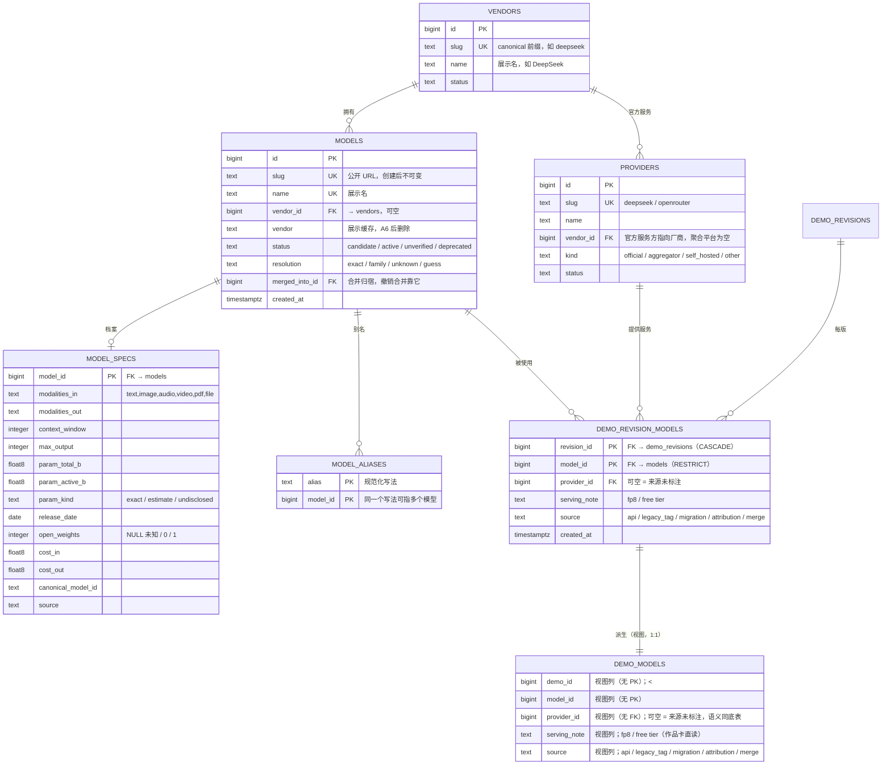

读数要点：

- 作品只通过 **revision** 的 `DEMO_REVISION_MODELS` 指向模型；`DEMO_MODELS` 是**当前 revision 的视图**（`<<view>>`），**不再看标签**。
- `DEMO_MODELS` 是 **1:1 派生视图**：视图行数 = 当前 revision 在 `DEMO_REVISION_MODELS` 里的行数（不聚合、不去重），所以 ER 基数写 `||--||`。**视图实体不标 PK / FK**（视图没有键约束，键语义只在底表上；跨三份文档统一此画法）。
- `MODEL_ALIASES` 只用于「外部名 → `model.id`」的解析，不参与关联存储。
- `MODEL_SPECS` 一行一个模型，未知值留 NULL + `param_kind`，不写 0。
- `DEMO_MODELS.provider_id` 可空：空 = 来源未标注，**不是**某个「未知 provider」实体。

### A.1.1 provider 选择与展示

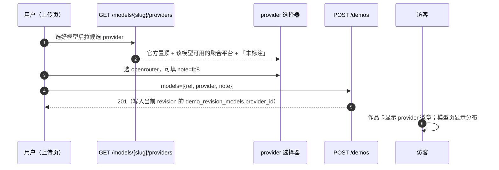

要点：

- 候选列表来源：`model_external_refs`（该模型在目录里出现过哪些 provider）+ 全部 `kind='official'` 且 `vendor_id` 匹配的条目。
- 没选 = `provider_id NULL`，UI 显示「来源未标注」，与「选了但不知道」区分开的是 **note**，不是空值。
- 一个模型若没有任何 external_ref（人工建的），选择器只给「官方（若有）+ 未标注」，不阻塞上传。

### A.1.2 候选确认

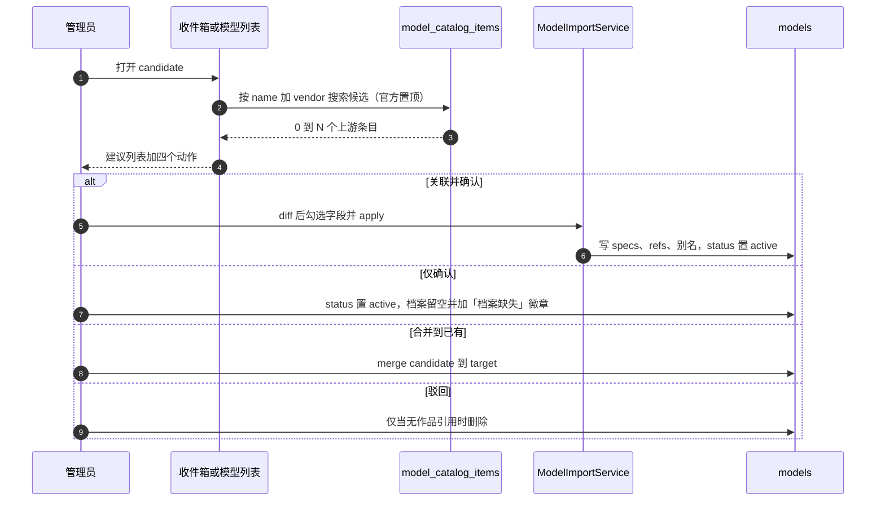

关键约束：

- 建议是**实时搜索**，不落「建议表」——候选改名后不会留下过期建议。
- 「仅确认」是一等公民，不是降级路径：私有模型合法存在。
- 「驳回」有作品引用时不可删除，只能合并。

### A.2 第三方基准（ER）

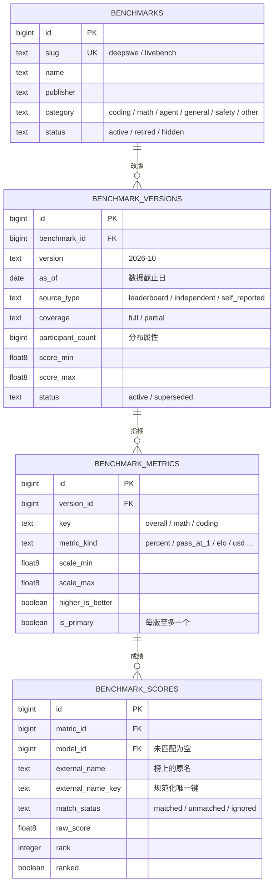

读数要点：

- 「榜」只有身份；「版本」才有量纲、参赛数、来源类型。
- 总分与子类分是同一版本下的不同 **metric**，综合分只取 `is_primary=true`。
- `self_reported` 版本照常入库，但不参与综合分。

### A.3 状态机

模型生命周期：

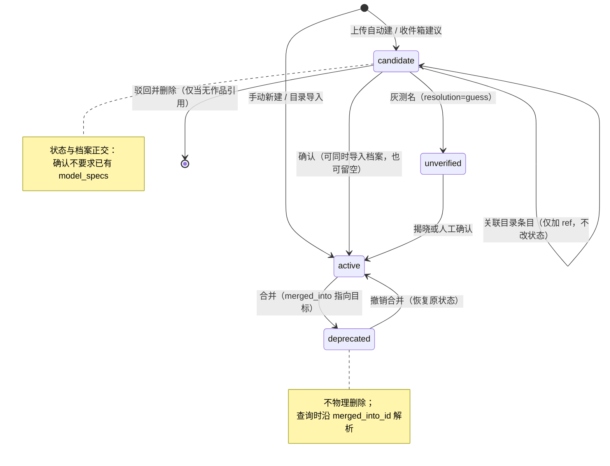

榜单与版本状态：

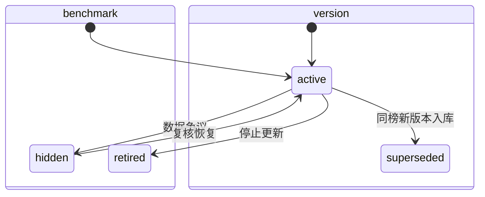

### A.4 写入时序（上传 / 编辑）

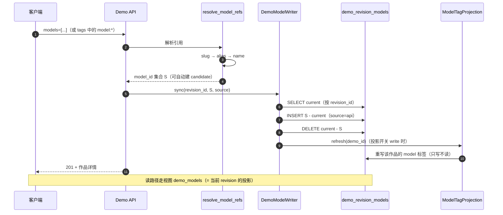

关键差异：**只有差集变化**，不再「先清空再重建」。

### A.5 合并时序

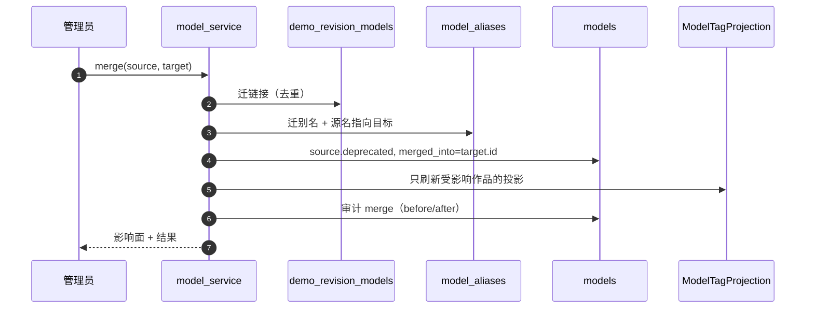

撤销合并按审计快照反向执行；榜分与历史链接不搬迁。

### A.6 写读职责矩阵

| 表 | 写入者 | 读取者 | 备注 |
|---|---|---|---|
| `models` | 上传自动建 / 管理端 / 收件箱 / 迁移 | 列表、详情、过滤、基准匹配 | `slug` 不可变 |
| `model_aliases` | 自动建、别名管理、合并 | 解析入口、搜索 | 唯一解析表 |
| `model_specs` | models.dev 脚本 / 管理端 | 模型页档案 | 未知留 NULL |
| `demo_revision_models` | **仅 `DemoModelWriter`** | 仅 `created_at` 等审计列时直读 | 唯一事实源（revision 级，PK `(revision_id, model_id)`） |
| `demo_models`（视图） | **无（只读）** | 列表、详情、facet、基准覆盖率、`serving_note` / `source` | 当前 revision 的投影（G18） |
| `benchmarks` | 导入脚本 | 基准页、模型页 | 与版本解耦 |
| `benchmark_versions` | 导入脚本 | 归一化、展示 | 新版入库旧版 superseded |
| `benchmark_metrics` | 导入脚本 | 综合分、画像 | 每版至多一个 primary |
| `benchmark_scores` | 导入脚本 | 归一化、展示 | 未匹配进收件箱 |
| `tags`（`key=model`） | 投影函数 | 兼容期 `?tag=model:x` | A6 后删除 |

### A.7 目标组件（写路径）

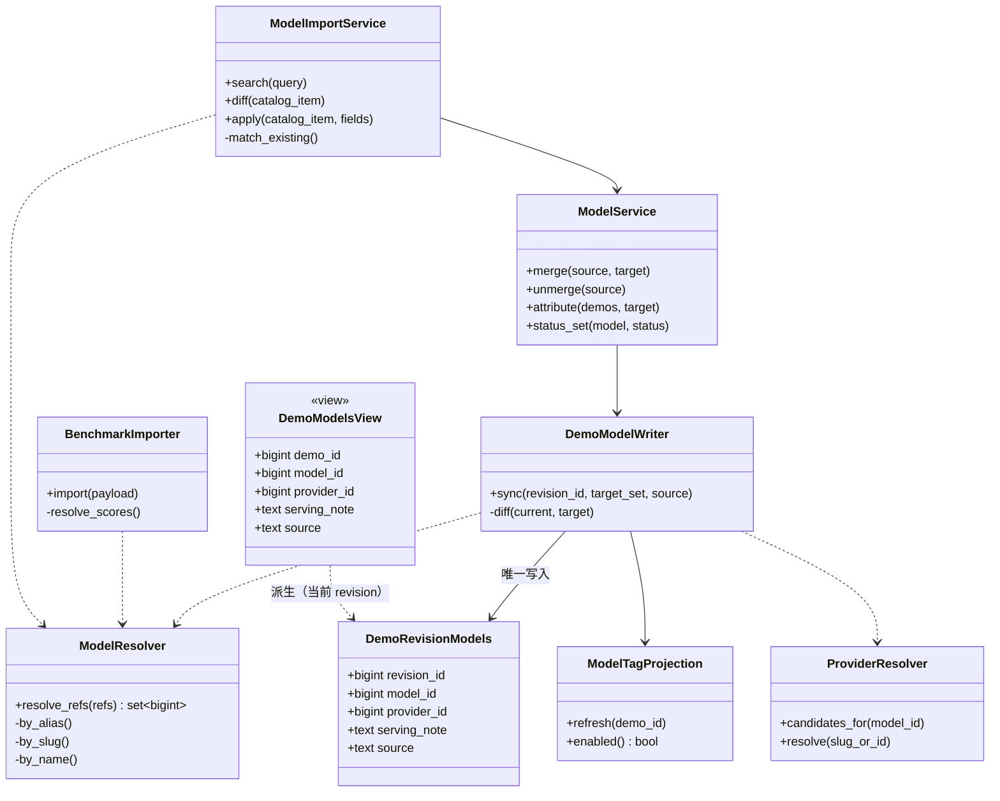

这**七个**组件是重构后**唯一**允许触碰模型关联的地方；路由与前端都不直接写表。`DemoModelsView` 只是读面（`<<view>>`），不构成写入方。`DemoModelWriter.sync()` 的 `target_set` 即 §4.2 / A.4 里解析出的 `S`。

### A.8 models.dev 导入与同步

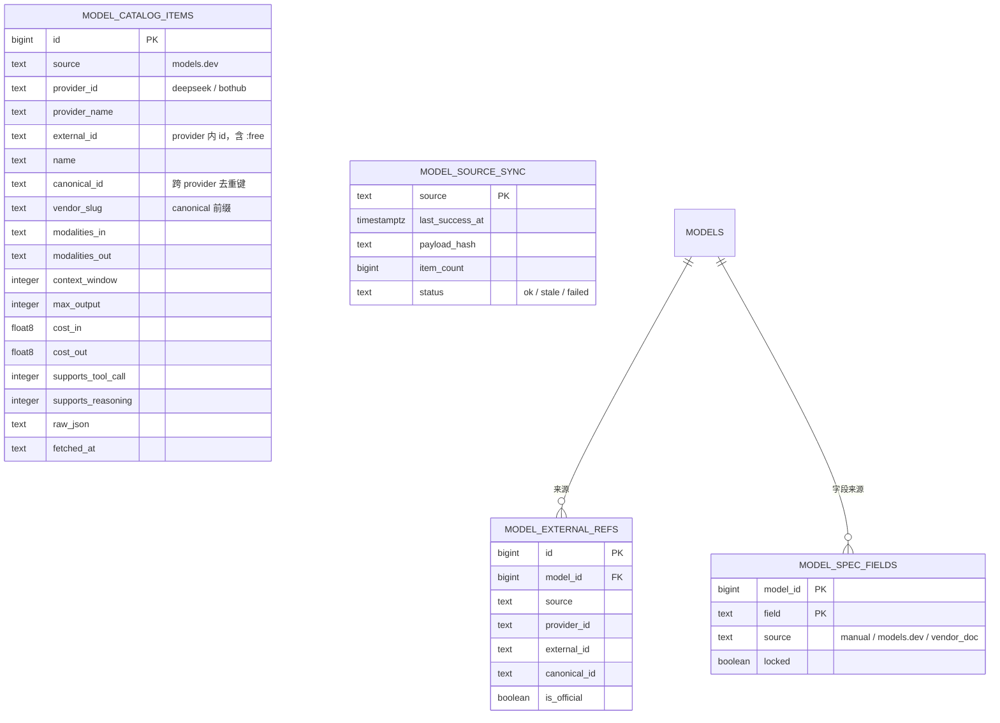

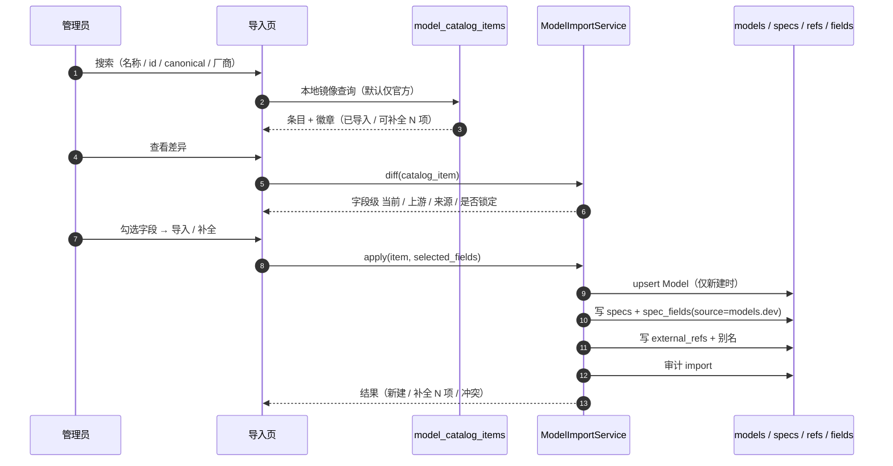

读数要点：

- `model_catalog_items` 是**上游镜像**，删掉也不影响本站数据；导入后数据在 `models` / `model_specs`。
- 一个 `canonical_id` 对应一个 `Model`，但可以有多个 `model_external_refs`（官方 + 聚合平台）。
- `model_spec_fields.locked=true` 或 `source=manual` 的字段，在 diff 里默认不可勾选。

## 附录 B：变更记录

| 版本 | 日期 | 变更 |
|---|---|---|
| v1.0 | 2026-10-25 | 阶段性定稿：合并两份草稿，确定 `demo_models` 唯一事实源、models.dev 字段级同步、provider 维度、`vendors` 实体化、第三方基准 4 表 |
| v1.1 | 2026-10-28 | `model_tag_archive` 补 DDL（§11.2）；按 G16 分层：过渡态（原 §3.8 / §3.8.1 / §4.3 与 `model_tag_projection` 配置键）下沉到 §11，正文只留目标态 |
| v1.2 | 2026-10-28 | 按 G18 落地：新增 `demo_revision_models`（PK `(revision_id, model_id)`；同一模型经不同 provider 算一条；每版只记本版）；`demo_models` 由表改为**当前 revision 的只读视图**（保留表名）；§4 写入目标改 revision 级、§5 口径统一「按当前 revision」、§6/§7 迁移与 §8 体检同步、附录 A 标 `<<view>>`。**同日审计修正 10 处**（SQL 列名 / `source` 默认值 / `serving_note` 可空性 / `sync()` 签名 / ER 基数等） |
| v1.3 | 2026-10-28 | **DDL 方言统一为 PostgreSQL 18（C2），无结构变化**：§3.x 字段表（22 个 `TEXT(n)`、15 个 `DATETIME`、11 个 `REAL`、PK/类型列）、§6.1 的目标表 DDL（8 处 `AUTOINCREMENT` → `IDENTITY`、27 个 `INTEGER` 分流、`TEXT`/`REAL`/`DATE`）、§6.2 迁移脚本、§11.2 `model_tag_archive`、附录 A 的 ER（`int`/`string`/`float`/`bool`/`datetime`）与类图（`set~int~`）。映射见版本头；列名 / 约束 / 注释文字 / 归档恢复 SQL 逻辑均未改；另 5 个标志列 `integer 0/1` → `boolean`（C2 顺带修正，与 ER 口径统一） |

