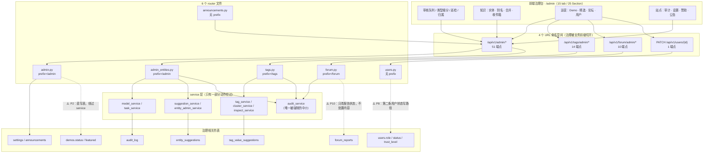
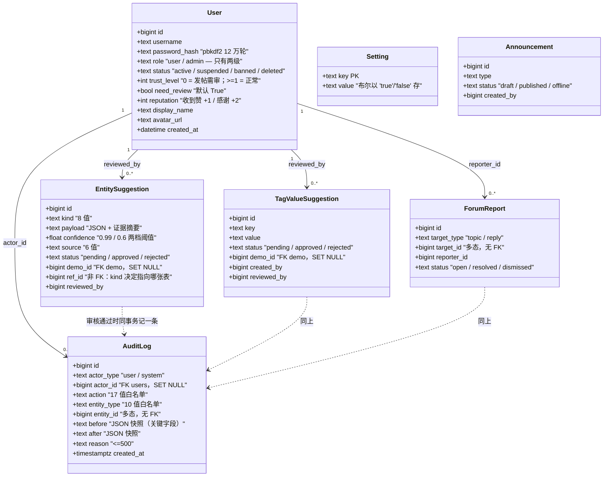
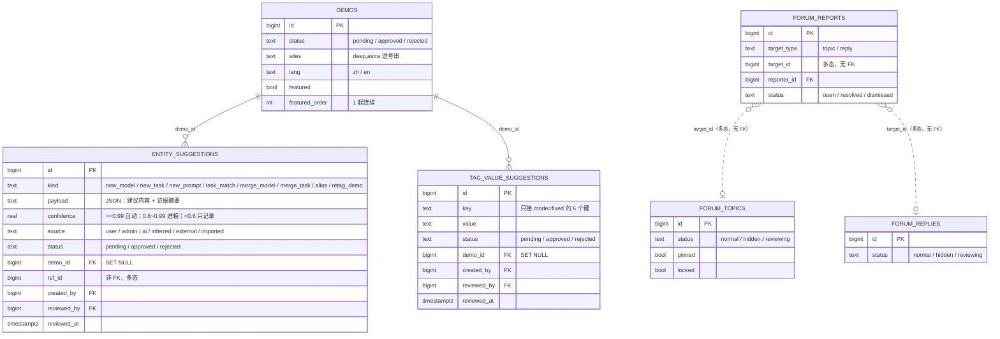
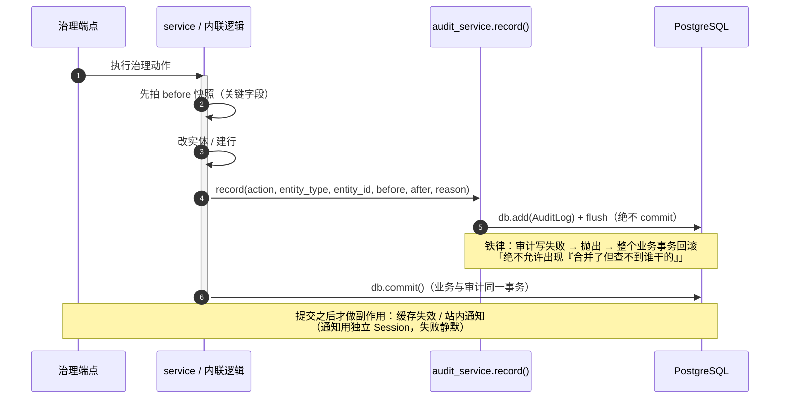
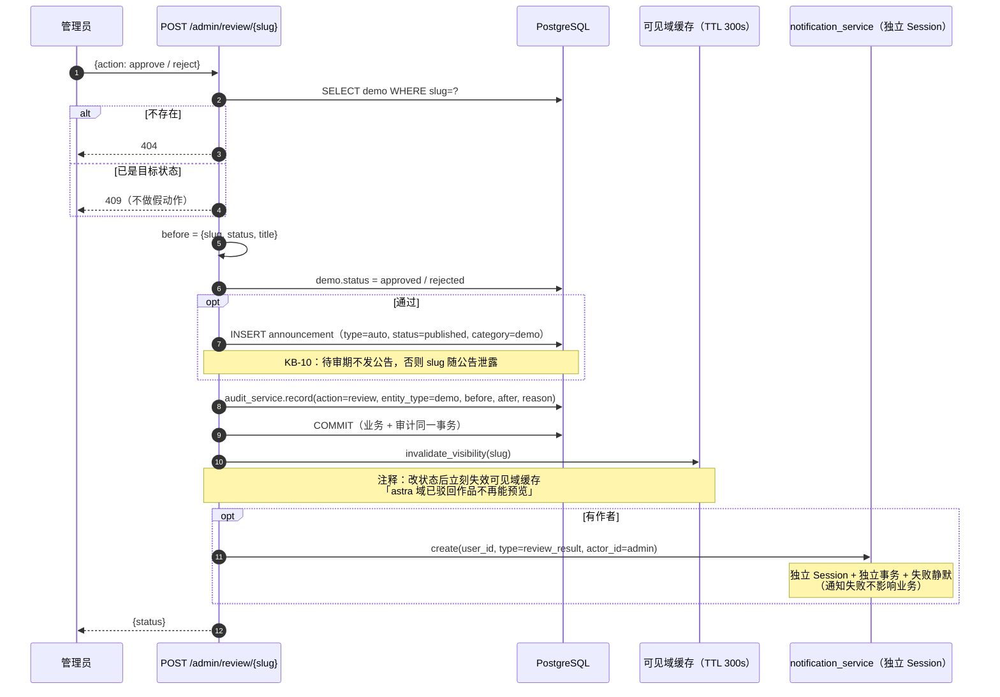
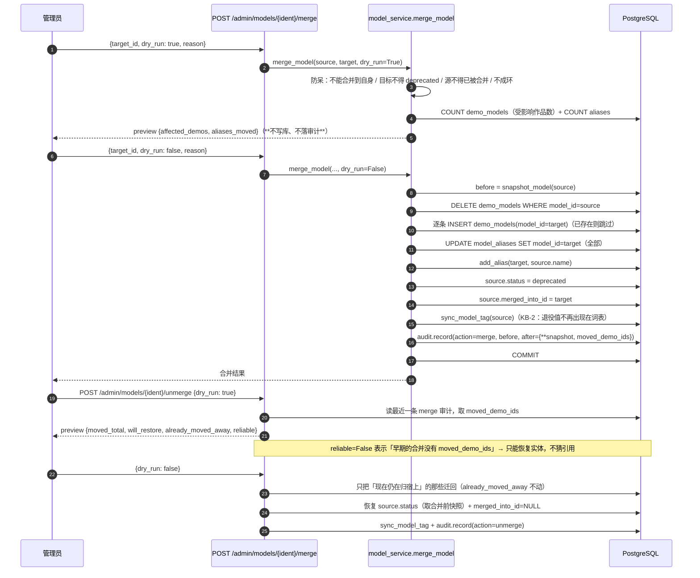
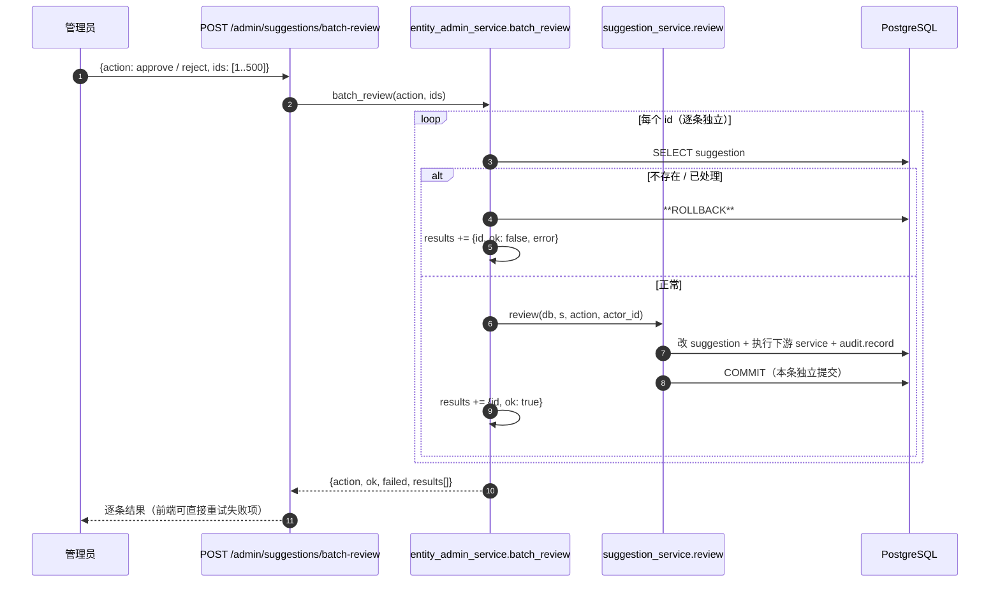
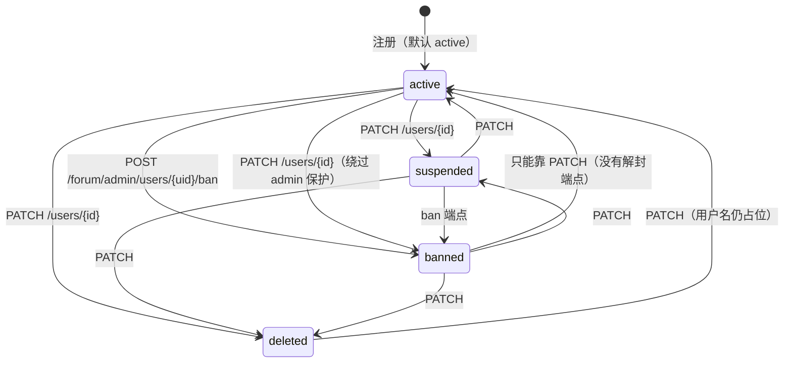

# 治理域 · 旧栈现状与 UML

> **本文只描述旧栈**（`main` @ `4ba0122`）。目标态**尚未设计**——台账 [`设计决策台账.md`](./设计决策台账.md) **G19** 只有占位。
> 源码一律指 `../legacy-main/`（只读快照，见其 `LEGACY-REF.md`）；本文所有 `文件:行号` 都以该快照为准。
> **用途**：给目标态设计提供「旧栈到底怎么长的、哪里坏了」的证据。**不是**要照搬的规范。

**范围内**：谁有权改什么、治理动作从哪个入口进来、落到哪张表、审计怎么记、以及**这些做法哪里坏了**。
**范围外**：目标态设计（未开始）、前端交互与视觉、权限之外的业务规则。

---

## 0. 一页数据

| 事实 | 数量 | 备注 |
|---|---|---|
| 治理端点 | **81** | `admin.py` 16 · `admin_entities.py` 35 · `tags.py` 14 · `forum.py` 10 · `announcements.py` 5 · `users.py` 1 |
| **URL 命名空间** | **4** | `/admin/*` · `/tags/admin/*` · `/forum/admin/*` · `PATCH /users/{id}` |
| router 文件 | 6 | 其中 2 个 `prefix="/admin"`，2 个挂在业务前缀下，2 个无前缀 |
| **待审机制** | **4 套** | `demos.status` · `entity_suggestions` · `tag_value_suggestions` · `forum_reports` |
| 权限层级 | **2** | `role ∈ {user, admin}`，**没有 moderator / 权限表** |
| 用户状态 | 4 | `active / suspended / banned / deleted` |
| 审计动作 | 17 | `AUDIT_ACTIONS` 常量 |
| 审计实体类型 | 10 | `AUDIT_ENTITY_TYPES` 常量 |
| 治理台 tab | 15 | 4 个导航组（总览 / 知识中心 / 运营 / 站点） |
| 前端 Section 组件 | 25 | `frontend/src/components/admin/` |
| 源码里自记的治理事故 | **27 条** | `KB-nn` 注释（KB-1…KB-29，缺 9/27） |

---

## 1. 全景：治理没有自己的域

治理能力不是设计出来的，是跟着「业务域分包」长出来的：**同一个治理动作分散在 4 个 URL 命名空间、6 个 router 文件里**，前端再用一个 `/admin` 页面把 81 个端点拼回去。



**读图要点**

- 实线 = 走 service；**虚线 = 直写或动作不完整**（图里三处都对应 §9 的问题编号）。
- `audit_service` 是唯一「谁都得调」的组件，但它**不 commit**（见 §4）。
- `tags.py` / `forum.py` 的治理端点之所以在 `/tags/admin` / `/forum/admin`，是因为它们的 router 前缀是业务名——**不是治理设计，是分包副作用**。

---

## 2. 权限：两层 + 一套论坛防滥用

**授权逻辑只有两处**：`require_admin`（角色）与 `current_user`（状态）。



**权限判定清单（源码事实）**

| 判定 | 位置 | 行为 |
|---|---|---|
| 登录 | `deps.py:12-22` | 无 token / token 无效 / 用户不存在 → 401 |
| 账号可用 | `deps.py:19-22` | `status != "active"` → 403「账号不可用」 |
| 管理员 | `deps.py:33-36` | `role != "admin"` → 403 |
| **归属**（手写，非 Depends） | `demos.py:1411`（改）/ `demos.py:1614`（删） | `author_id != user.id and role != "admin"` → 403 |
| 论坛信誉 | `forum.py:428-437` | 主题处 `reviewing` 才能审；**通过时把作者 `trust_level` 提到 1、`need_review` 关掉** |

**⚠️ 这两个「自保护」不对称**（见 P7）：
- `forum.py:531-532` 封禁有保护——`if u.role == "admin": 400 不能封禁管理员`；
- `users.py:81-104` **改角色没有任何保护**——可以把自己降成 `user`，也可以把最后一个 `admin` 降级 → 治理台自锁。

---

## 3. 四套待审机制（互不相通）

同一个「待办队列」在旧栈里有 **4 张表、4 个入口、4 种审核语义**。



**四套机制的差异（逐列核对过源码）**

| | ① 作品审核 | ② 实体建议 | ③ 标签值申请 | ④ 论坛举报 |
|---|---|---|---|---|
| 队列表 | `demos.status` | `entity_suggestions` | `tag_value_suggestions` | `forum_reports` |
| 入口 | `POST /admin/review/{slug}`<br/>`admin.py:40` | `/admin/suggestions` +`/review` +`/batch-review`<br/>`admin_entities.py:385,414,428` | `/tags/admin/suggestions` +`/review`<br/>`tags.py:217,229` | `/forum/admin/reports/{rid}/handle`<br/>`forum.py:558` |
| 审核动作 | `approve` / `reject` | `approve` / `reject` | `approve` / `reject` | **`resolve` / `dismiss`** |
| 通过后执行 | 改状态 + 补公告 + 失效缓存 + 通知作者 | 调对应 service 落库（**本表永不直接改实体**） | `tag_service.ensure_value` + 可选回挂提交者作品 + `model` 键**双写** `demo_models` | **只改报告状态**，不处置内容 |
| 是否有置信度 | ❌ | ✅ 3 档阈值 | ❌ | ❌ |
| 是否可批量 | ❌ | ✅ `/batch-review`（≤500） | ❌ | ❌ |
| 审计 entity_type | `demo` | `suggestion` | `tag` | `forum_report` |

**几个源码细节**

- `entity_suggestions` 的 **3 档置信度**写死在模型注释里（`models.py:621-628`）：`≥0.99` 自动接受但必须留日志；`0.6~0.99` 进收件箱；`<0.6` **只记录不骚扰**（列表默认不展示）。
- `tag_value_suggestions` **只服务 `mode='fixed'` 的 6 个键**，且审核通过时可以「顺带把值挂到提交者那件作品」——这是**唯一一条把「审核」与「归属」耦合在一起的机制**。
- 论坛主题/回复还有一个自己的状态机 `normal / hidden / reviewing`（`forum.py:420-470`），`reviewing` 才可审，`approve` 会**顺带把作者 `trust_level` 提到 1**。
- 四个入口的**返回结构、分页参数、筛选参数全不一样**——前端 `AdminInboxSection` / `AdminReviewSection` / `AdminTagsSection` / `AdminForumSection` 各写一套。

---

## 4. 审计铁律

旧栈把「审计」写成了硬规则，一行注释就是一条纪律：



**五条纪律（全部有源码原文）**

| # | 纪律 | 源码 |
|---|---|---|
| 1 | **同事务**：`record()` 只 `add`/`flush`，**自己绝不 commit**，事务边界归调用方 | `audit_service.py:1-9,31-43` |
| 2 | **快照只取关键字段**，不整行（`snapshot_model` / `snapshot_task`） | `audit_service.py:55-75` |
| 3 | `before`/`after` 存 JSON；`reason ≤ 500`；`actor_type ∈ {user, system}` | `models.py:552-571` |
| 4 | **动作与实体类型是常量单一来源**，路由筛选参数 import 同一份 | `models.py:582-618` |
| 5 | **守卫优先**：同状态重复置位 409 / 空补丁 422 / 白名单外 422 / 合并先 `dry_run` | `entity_admin_service.py:9,42-43,128-133` |

**白名单（单一来源，17 + 10）**

```text
AUDIT_ACTIONS (17)
  create · update · status_set · merge · alias_add · alias_remove · attach · detach ·
  delete · review · attribute · unmerge · slug_set ·
  featured_add · featured_remove · featured_order · featured_hero

AUDIT_ENTITY_TYPES (10)
  model · task · tag · suggestion · demo ·
  forum_topic · forum_reply · forum_report · user · setting
```

**⚠️ 白名单是「人肉维护」的**（见 P4）：`models.py:605-606` 的注释自认——「避免『加了新写入动作但忘了补白名单』导致审计记录筛不出来（**`tag` / `user` / `setting` 曾各漏一次**）」，`AUDIT_ACTIONS` 那边还漏过 `attribute`。

**副作用不参与事务，这是刻意的**：`notification_service.create` 用独立 Session + 独立事务 + `except: 静默`（`notification_service.py:12-35`），注释写「通知失败不影响业务」。这条可以继承。

---

## 5. 一次作品审核：四个副作用，顺序被注释写死



**为什么值得单画一张**：这是旧栈**唯一**一个「一次动作触发 4 个副作用」的治理端点，且四者的**事务归属各不相同**——状态与审计同事务、缓存与通知在提交之后。新设计必须明确继承哪些、改写哪些。

| 副作用 | 事务归属 | 失败时 |
|---|---|---|
| 改 `demos.status` | 与审计同事务 | 整体回滚 |
| 补公告 | 同事务 | 整体回滚 |
| 审计行 | 同事务 | **整体回滚（铁律）** |
| 缓存失效 | 提交后调用 | 已提交，缓存最多 300s 后自然过期 |
| 站内通知 | 独立 Session | 静默失败 |

---

## 6. 合并与撤销合并：两段式 + 一个为撤销留的钩子

旧栈把「合并」做成了**可撤销**的：合并时把迁走的作品 id 记进审计的 `after.moved_demo_ids`，撤销时靠它精确迁回。



**值得继承的两点**

1. **`dry_run` 是协议的一部分**，不是 UI 提示——`MergeIn.dry_run` 是请求体字段，预览与执行走**同一个函数**，只差一个分支。
2. **「诚实面对边界」**：`unmerge` 没有 `moved_demo_ids` 时**不猜**，预览里返回 `reliable=false` 并在审计 `after.note` 里写明「无 moved_demo_ids 记录，仅恢复实体」（`model_service.py:1003-1010,1036-1048`）。这是旧栈最好的一处设计。

---

## 7. 批量审核：事务边界是被事故教出来的



**Why**：`entity_admin_service.py:151-176` 的注释写得很清楚——

> **KB-16：失败分支必须 `db.rollback()`** —— 否则失败行未提交的写入会被下一条成功行的 `commit` 顺带提交；若失败发生在 `flush`（如 `IntegrityError`），SQLAlchemy 事务已失效，后续条目会全部抛 `PendingRollbackError`，**整批变成假失败**。

**这是治理域里唯一「批量」入口**，语义被定成「**逐条独立提交，单条失败不拖垮整批**」——与前端「失败列表 + 重试」交互同构。新设计要不要保留这种「部分成功」语义，是个明确的决策点。

---

## 8. 用户状态机：一个字段、两条写路径、没有回头路



**状态语义与写路径**

| 状态 | 语义 | 谁能写 | 端点 |
|---|---|---|---|
| `active` | 唯一能通过 `current_user` 的状态 | — | — |
| `suspended` | 停用（无专门动作） | 管理员 | 只有 `PATCH /users/{id}` |
| `banned` | 封禁 | 管理员 ×2 条路径 | `POST /forum/admin/users/{uid}/ban`（**只有单向**）<br/>`PATCH /users/{id}` |
| `deleted` | 已注销 | 管理员 | **只有 `PATCH`**——**没有用户自删端点**（`auth.py` 8 个路由里没有注销） |

**三条反常识的源码事实**

1. **封禁不可逆**：`forum.py:525-543` 只有 `ban`，全库没有 `unban`；注释自认「封禁是不可逆治理动作」。解封只能绕到通用 `PATCH`。
2. **保护只做了一半**：封禁端点有 `if u.role == "admin": 400 不能封禁管理员`（`forum.py:531-532`），但 `patch_user`（`users.py:81-104`）**对角色变更零保护**——可以把自己降成 `user`，可以把最后一个 `admin` 降级，**治理台直接自锁**。
3. **`trust_level` 只升不降**：全库只有两处赋值，都是 `= 1`（`forum.py:434,463`），且是「首帖审核通过」的副作用；**没有降级路径**（没有把 `trust_level` 降回 0 / 重开 `need_review` 的端点）。

---

## 9. 问题清单（P1–P14）

> 每条：**现象 → 证据 → 后果 → 目标态必须满足什么**。证据行号以 `../legacy-main/` 为准。

| # | 问题 | 证据 | 后果 |
|---|---|---|---|
| **P1** | 治理散在 **4 个 URL 命名空间**、6 个 router | `/admin` · `/tags/admin` · `/forum/admin` · `PATCH /users/{id}` | 权限覆盖面靠人肉保证；新增治理端点不知道该挂哪；审计筛选要跨 4 处找 |
| **P2** | **两套写路径并存** | `admin_entities.py:3-5` 声明「不写业务规则、不直接 UPDATE」；但 `admin.py:54,131` 直接改 `demo.status` / `demo.sites` | 同一种治理动作，一半走 service（可复用、可测），一半内联在路由里 |
| **P3** | **四套待审机制**（图 3） | 4 张表、4 个入口、4 种动作名 | 前端写 4 套；管理员要记 4 个地方；「待办总数」没有单一口径 |
| **P4** | **审计白名单人肉维护** | `models.py:605-606` 自认 `tag`/`user`/`setting` 各漏一次；`attribute` 也漏过 | 漏一条 = 那类动作在审计页**筛不出来**（数据在、查不到） |
| **P5** | `GET /admin/demos` **缺省全量** | `admin.py:94-96`：`page_size` 默认 `None` → 不限条数 | 1358 件一次吐出；管理台刷新即全量序列化 |
| **P6** | **封禁不可逆**（图 8） | `forum.py:525-543` 无 unban | 误封只能靠通用 PATCH 手工解；两个月的封禁也会被当永久 |
| **P7** | **角色变更无保护**（图 8） | `users.py:81-104` 无自身/最后管理员检查 | 可把自己降级 → 治理台自锁；线上需 DB 手工改回 |
| **P8** | 用户状态 **两条写路径且覆盖不全**（图 8） | `forum.py:536` vs `users.py:91` | `banned` 有保护、`PATCH` 没保护；两条路径语义不同却改同一字段 |
| **P9** | **作品硬删除无审计** | `demos.py:1612-1622`：`db.delete(demo)` + `rmtree` + 删 OSS，**全程无 `audit_service.record`** | 管理员可借作者端点删任意作品，**不留痕**；删了就找不回 |
| **P10** | **举报处置不联动内容**（图 3） | `forum.py:558-587`：只改 `forum_reports.status`，隐藏/封禁要另做 | 举报「已解决」但违规内容还在；审计只记了报告状态 |
| **P11** | `trust_level` **只升不降** | `forum.py:434,463` 全库仅两处赋值，均为 `= 1` | 用户靠首帖拿到免审后无法降级；防滥用只有单向棘轮 |
| **P12** | `deleted` 状态**没有自然入口** | `auth.py` 8 个路由无注销；只有 `PATCH /users/{id}` 能写 | 语义上的「注销」只能管理员代操作，用户名永远占位 |
| **P13** | 四套机制的**返回结构/分页参数不一致** | ④ 无分页、② 有 `page/page_size`、① 返回裸 dict | 前端 4 个 Section 各写一套，无法共用列表组件 |
| **P14** | **新栈缺口：`audit_log` 没有表定义** | 全库 11 份文档 ~40 处「写 `audit_log`」，**零 `CREATE TABLE audit_log`** | 目标态里所有时序图都在写一张**不存在的表**；归属域、索引、保留期全未定 |

**两条「不是问题，可以继承」**

| 做法 | 为什么保留 |
|---|---|
| 通知走独立 Session + 失败静默 | 治理动作不能被「发通知失败」回滚（`notification_service.py:12-35`） |
| `dry_run` 作为合并/撤销的协议字段 | 预览与执行同一个函数，只差分支；避免「预览一套逻辑、执行另一套」 |

---

## 10. 对目标态（G19）的输入：8 个必须先定的问题

> 这里只列**决定表结构/路由形态**的问题。每条给出「旧栈怎么做的 / 为什么现在得定 / 我的倾向」。

| # | 问题 | 旧栈做法 | 为什么现在定 | 我的倾向 |
|---|---|---|---|---|
| Q1 | **角色模型**：两级还是引入 moderator / 权限表？ | 只有 `user` / `admin`，`require_admin` 一把梭 | 决定 `users.role` 是枚举还是 `roles` 表 + `user_roles`；影响每个端点的鉴权写法 | **先保持两级**，但把 `role` 定成 CHECK 枚举；等真出现「能审作品但不能改用户」的需求再加表 |
| Q2 | **用户状态机**：`suspended` / `banned` 能否撤销？ | 4 态、封禁单向、无自删 | 决定要不要 `user_status_history` 表、要不要 `unban` 端点 | **封禁必须可逆**（附理由字段）；`deleted` 只有「用户自删」入口，管理员只能封禁不能替人注销 |
| Q3 | **删除策略**：硬删还是软删？ | `delete_demo` 硬删（无审计）；论坛主题硬删 | Demo 域已定**软删 + tombstone**（G1），治理域必须与之对齐 | **全软删**；删除本身是一条治理动作，必须留审计 + 可恢复窗口 |
| Q4 | **待审队列**：一个 `proposals` 还是保留多张队列表？ | 4 套（图 3） | G9 已定「提案 kind 扩展」，但**没定 UI 与路由形态** | **一张表 + kind 过滤 + 一组动作名**（`approve`/`reject`/`resolve`/`dismiss` 统一成 `review(decision)`） |
| Q5 | **admin 能否改内容列**（G11 的例外） | 旧栈能（`demos.py` 的 PUT 就带 force） | 决定 G11「revision 内容不可变」要不要开例外、审计要不要记 `admin_override` | **能改，但必须**：走独立端点 + 带 `reason` + 审计记 `admin_override=true` + 生成新 revision（而不是原地改） |
| Q6 | **`audit_log` 归属与结构**（P14） | 谁写谁调 `record()`，表在 `models.py` | **全库没有它的定义**，所有时序图都在写一张不存在的表 | **治理域拥有**（独占写口 `audit_log` + 读口 `/admin/audit`）；`entity_type` 用 CHECK 枚举；保留期与分区策略写进文档 |
| Q7 | **写路径是否强制 service** | 一半一半（P2） | 决定 router 的职责边界、也决定能否做「全部治理动作可回放」 | **强制**：router 只做鉴权 + 参数校验 + 转调；service 负责事务与审计 |
| Q8 | **批量语义**：部分成功还是全有全无？ | 逐条独立提交（KB-16） | 决定 `/batch-review` 的返回结构与前端重试逻辑 | **保留部分成功**，但返回结构必须固定（`{ok, failed, results[]}`），且**每条都要有审计** |

**另外三个「不决定结构、但必须在文档里写死」的规矩**

1. **副作用分层**：业务 + 审计同事务；缓存失效与通知在提交后，且**失败不得回滚业务**（§5）。
2. **守卫优先**：同状态重复置位 / 空补丁 / 白名单外，一律 4xx，**不产生审计行**（「假动作比没动作更坏」）。
3. **诚实边界**：做不到的事在预览里明说（`unmerge` 的 `reliable=false`），不要静默降级。

---

## 11. 图与源码对照表

| 图 | 覆盖的源码 | 说明 |
|---|---|---|
| 图 1 全景 | `main.py:117-140`（router 挂载顺序/前缀）<br/>`admin.py` · `admin_entities.py` · `tags.py:37` · `forum.py` · `announcements.py` · `users.py` | 81 个端点按文件归档；命名空间由各 router 的 `prefix` 决定 |
| 图 2 权限与治理类 | `models.py:24,27-51`（User）<br/>`models.py:552-618`（AuditLog + 两个白名单）<br/>`models.py:621-647`（EntitySuggestion）<br/>`models.py:98-113`（TagValueSuggestion）<br/>`models.py:397-408`（ForumReport）<br/>`models.py:242-246`（Setting）<br/>`deps.py:12-36`（三个 Depends） | 属性从 `mapped_column` 逐个抄的；`role`/`status` 取值来自源码注释 |
| 图 3 四套待审 | `models.py:117-165`（Demo）<br/>`models.py:621-647`（EntitySuggestion）<br/>`models.py:98-113`（TagValueSuggestion）<br/>`models.py:317-356`（ForumTopic/Reply）<br/>`models.py:397-408`（ForumReport） | 多态引用（`target_id` / `ref_id`）**没有外键**，ER 里用虚线表示 |
| 图 4 审计铁律 | `audit_service.py:1-75`（全部）<br/>`models.py:552-618` | `record()` 不 commit 是文件头注释的原话 |
| 图 5 作品审核 | `admin.py:40-87` | 四个副作用的事务归属逐个核对过 |
| 图 6 合并/撤销 | `model_service.py:871-935`（merge）<br/>`model_service.py:996-1048+`（unmerge） | `moved_demo_ids` 钩子在 `after` 快照里 |
| 图 7 批量审核 | `entity_admin_service.py:151-176` | KB-16 的 `rollback` 是图的核心 |
| 图 8 用户状态机 | `models.py:24,34`<br/>`deps.py:19-22`<br/>`forum.py:525-543`（ban）<br/>`users.py:81-104`（PATCH）<br/>`auth.py`（8 个路由，无注销）<br/>`forum.py:428-464`（trust_level 两处赋值） | 每条边都有端点来源 |

---

## 12. 边界与免责

- **本文是现状证据，不是规范。** 目标态以 `docs/` 其余文档与台账为准；旧栈里很多行为是**明确要改掉**的（见 §9）。
- **行号会漂**：以 `../legacy-main/` 快照（`main` @ `4ba0122`）为准；`origin/main` 若前进，行号需重核。
- **图已做渲染验收**：8 块 mermaid 用 `mermaid@11.17.2` + `jsdom` 逐块 `parse` + `render`，**8/8 通过**（`getBBox` 打桩命中 838 次，说明渲染管线真的跑了）。**但 jsdom 没有布局引擎**，几何坐标靠打桩 → **只证明语法与内容正确，不证明版式好看**。
- **渲染踩到的一个坑（留作备忘）**：sequence 图的消息文本里 **ASCII 分号 `;` 会被当成语句分隔符**，把一条消息劈成两句后报 `Parse error ... got 'NEWLINE'`。本文初稿就在 §6 挂在这里，现已拆成两条消息。**写时序图时避免在标签里用 `;`。**
- **没有验证的部分**：未在 PostgreSQL 上执行任何 DDL/SQL；「哪个端点真被前端调用」只按 `AdminView.vue` 的 15 个 tab 与 25 个 Section 反推，未逐个跑。

**变更**

| 版本 | 日期 | 变更 |
|---|---|---|
| v1.0 | 2026-10-29 | 首版：8 张图（**8/8 真渲染通过**）+ P1–P14 + Q1–Q8。基于 `../legacy-main/`（`main` @ `4ba0122`）逐文件核对 |


