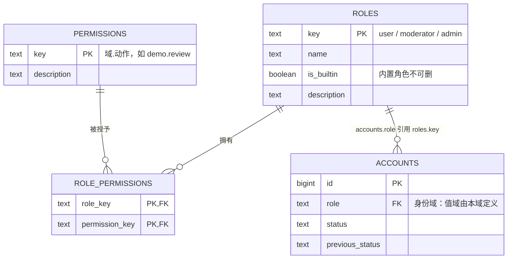
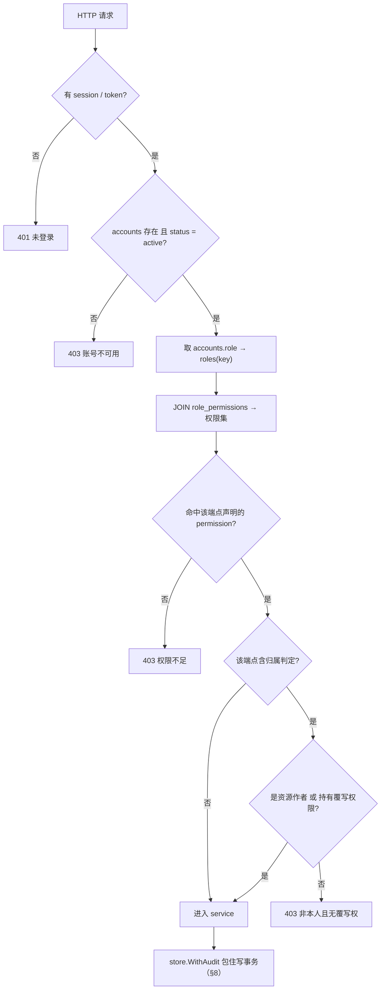
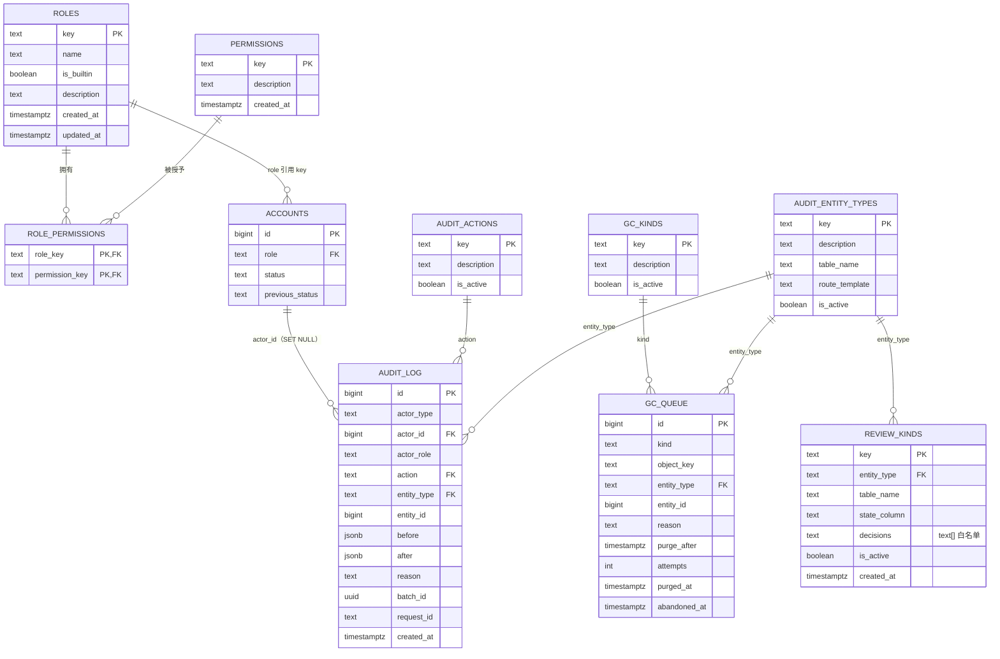
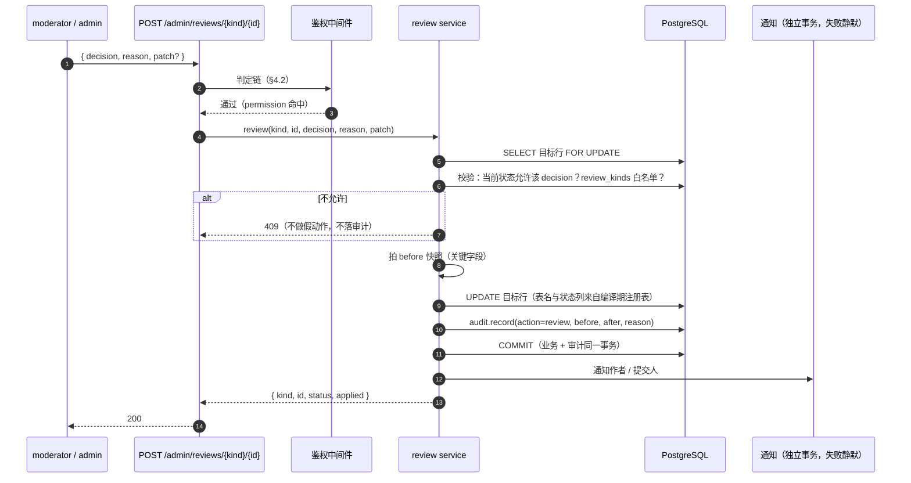
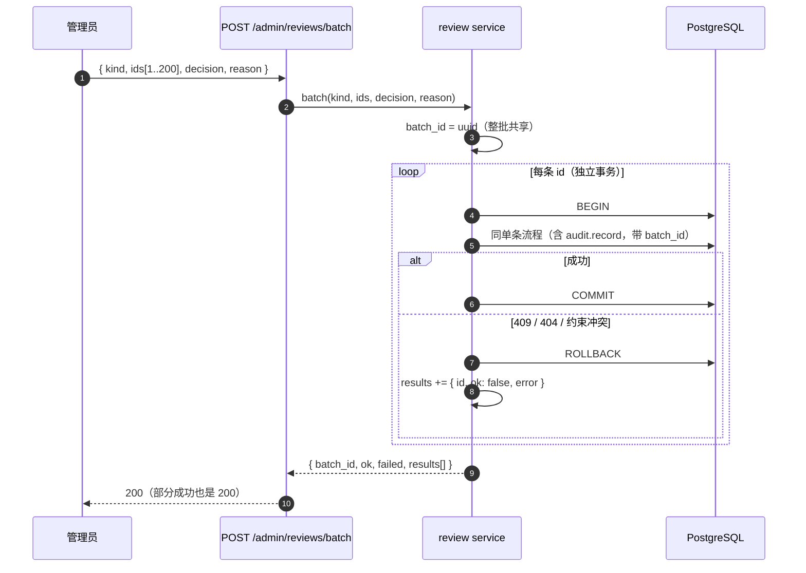
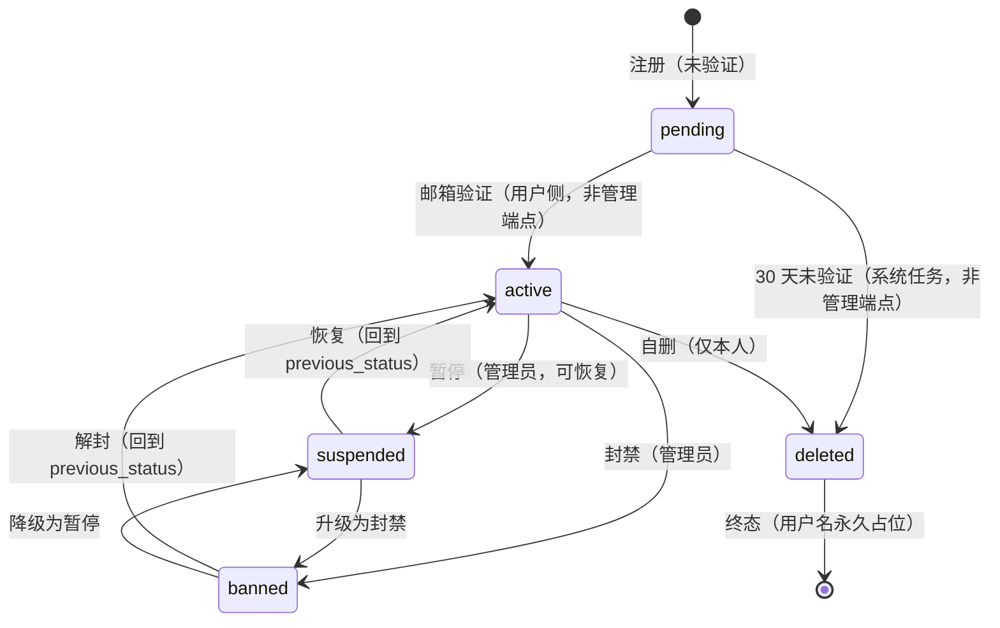
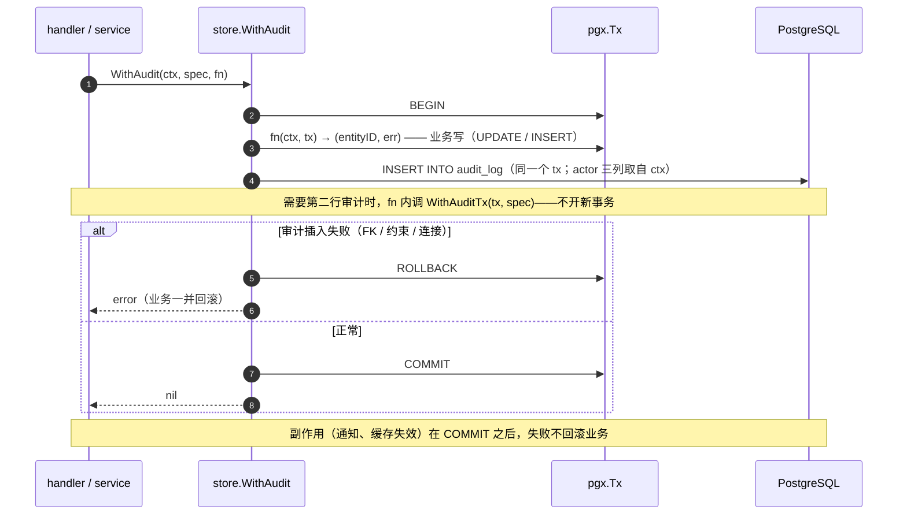

# 治理域设计 v1.13（草案）

**适用范围**：本文描述**治理域**的目标设计——权限、审核、审计、用户状态、删除回收、覆写，以及把这些动作组织起来的管理端契约。

- **DDL 约定**见 [`DDL约定.md`](./DDL约定.md)（PostgreSQL 18）。**本域偏离**：审计的 `action` / `entity_type` **不用 `CHECK`**，改用**目录表 + FK**（理由见 §8.3）。
- **旧栈事实**见 [`治理域-旧栈现状与UML.md`](./治理域-旧栈现状与UML.md)（8 张图 + P1–P14）。本文**不重复旧栈细节**，只在其上做设计。
- **用户与角色数据存在身份域**：`accounts`（[`身份服务模型设计.md`](./身份服务模型设计.md) §6.1）。本文定义其**取值域与状态机**，并在 §2.3 列出需要身份域同步的改动。

版本：**v1.13 · 草案（2026-10-30）**

**本版变更（v1.13，2026-10-30）：跨文档漂移收口。** 一轮独立审计之后，各文档之间出现了「同一件事在不同地方写着不同数字/不同口径」的漂移——本文这一版只做**对账**，不引入任何新决策：① §2.3 跨域债表三条全部标「✅ 已落」（`accounts.role` 真 FK 落在身份域 v1.5、`accounts.status` 5 值 + `previous_status` 落在身份域 v1.1）——**本文与身份域之间的跨域债到此清零**；② §12 迁移第 3 / 4 步标「已落」；③ §5.2 种子注释的条数改成实测值 **25 个动作**（v1.11 加 `auth_event.read`、v1.12 移除 `setting_set`，净 25）；④ §9.3 的 `abandoned_at` 口径与 [`数据生命周期设计.md`](./数据生命周期设计.md) v1.2 对齐。

**本版变更（v1.12，2026-10-30）：外部审计核对后的六处修正。** 一份独立审计对本文与身份域做了交叉审查，以下六条经复核成立（另有三条「措辞需修正」与一条误判不计入），本版逐条修：

1. **§7.2「最后一个 admin」的判据换写法**：原写 `SELECT count(*) … FOR UPDATE`，PostgreSQL 直接拒绝——`ERROR: FOR UPDATE is not allowed with aggregate functions`（PG 18.6 实测）。改为**先锁行、再在应用层计数**。
2. **§7.3 / §9.1 的 `accounts.deleted_at` 改 `closed_at`**：身份域 v1.2 已按 L3 定案改名，同一列两个名字正是 [`数据生命周期设计.md`](./数据生命周期设计.md) §5.2 点名的坑（会把「已注销作者的作品」整批滤掉）。
3. **§9.2 / §9.3 补「恢复 = 删除队列行」**：原设计恢复只改状态列、`gc_queue` 行留着，而 GC 到期只看 `purge_after` / `purged_at`，**不会**因为恢复就不删——用户在第 29 天恢复，第 30 天目录与 OSS 对象照样被删，恢复出来的作品一夜之间变成空壳。这是本版修的最严重一条。
4. **§4.3 权限表中间的空行删掉**：它把 `ops.run` 从表头里切了出去，Markdown 渲染成两张表。
5. **`audit_actions` 移除 `setting_set`**（26 → **25** 条种子）：`'setting'` 实体类型在 v1.3 已移出枚举，动作却留着——等于给未设计域占位，违反 §8.3「未设计域不预先入枚举」。
6. **§6.4 时序的措辞改「编译期注册表」**：原写「`review_kinds` 给出表名与状态列」，照字面实现就是动态拼接 SQL（绕过 sqlc、注入面）。目录表仍做校验与前端展示，表名/状态列落在 Go 侧注册表。

**本版变更（v1.11，2026-10-30）：审计动作 25 → 26，加 `auth_event.read`。** 身份域 v1.4 §12.1 定了 `auth_events`（安全日志）的读口径：本人可查自己的最近 20 条，管理员查他人要**留痕**。留痕就得有个动作值，而目录表是唯一事实源——**加一个动作 = `INSERT` 一行**（这正是 D6 把 `CHECK` 换成目录表换来的）。本版：① 种子加 `('auth_event.read', '查他人安全日志')`（25 → 26 条）；② §5.2 种子注释与 §12 迁移第 2 步的条数同步。**注意**：本次仍然改了本文档——因为 §16.1 第 2 项说的 `catalog.yaml` **还没建**，现在种子只能写在本文里；yaml 落地后，加动作就只是改 yaml + migration，**本文不再是落点**。

**本版变更（v1.10，2026-10-30）：把 `pending` 补进用户状态机。** 上一版的 §7.1 从「注册成功」起步，只有 4 态（`active/suspended/banned/deleted`），而身份域 §8.1 有 `pending`（注册未验证）。后果：**注册流程插不进去**——`accounts.status` 的取值域由本节定义，这里没有 `pending`，身份域落列时就不会写它；§2.3 的跨域债也只列了 `banned` 与 `previous_status`，照着改完仍然不通。本版：① §7.1 加 `pending` 两条出边并标明它们**不是管理端点**；② §2.3 跨域债补 `pending`；③ §7.1 尾注「为什么是 4 态」改 5 态并解释分层；④ §12 迁移第 4 步补 `pending`；⑤ 删掉身份域那两条与本文冲突的旧口径的**出口指引**（原 `suspended → deleted: 管理员删除` 属旧栈 P12，本文 D2 已定 `deleted` 只能本人自删，身份域 v1.1 同步删除）。

**本版变更（v1.9，2026-10-30）**：把**擦除（erasure）**这条新路径接进 GC，顺带修掉三处「同一列承担两种含义」的坑。起因是 [`数据生命周期设计.md`](./数据生命周期设计.md) v1.1 的 §11.1 F 表列的五行。

1. **`audit_actions` 加 `erase`**（24 → **25** 条种子）：擦除是清空内容字段的写操作，必须留痕；与 `delete`（软删）/ `purge`（派生物真删）三者语义互不重叠。（v1.11 加 `auth_event.read`、v1.12 移除 `setting_set`，现共 **25** 条。）
2. **`gc_queue.reason` 加第四值 `erase`**（CHECK 3 → 4）：擦除入队的 `purge_after = now()`（不等 30 天），唯一能让它变晚的理由是「引用数 > 0 推迟 24 小时」。
3. **入队 upsert 由「覆盖」改 `LEAST`（只前移）**：删 → 恢复 → 再删时用户已经等过一次，覆盖写会把计时重置回 30 天后，等于无限延期。
4. **`purged_at` 拆开**：新增 **`abandoned_at`**——`purged_at` 只表示「删成功」，重试耗尽落 `abandoned_at` 并留 `last_error`。原来两者都写 `purged_at`，排障时看不出是删掉了还是放弃了；`ix_gc_due` 的谓词也随之改成两列都空。
5. **§9 补第三种入队来源**：软删 30 天、孤儿 30 天、**擦除 0 天**——三者在同一张队列里靠 `reason` 区分。
6. §12 迁移步的种子数、§13 风险同步。


**本版变更（v1.8，2026-10-29）**：**Q9–Q16 逐条定案 + 两条 review 遗留落地**（用户 2026-10-29 拍板）。

1. **Q9 单角色**（已定）：`accounts.role` 保持单列。理由写进 §14——只有 3 个角色且 `admin` 已含全部权限，多角色唯一的表达力增益是「同时是 `moderator` 和 `admin`」，属子集关系。
2. **Q10 旧栈审计不迁**（已定）：删掉「若迁则加 `source='legacy'`」这条备选。**Q11 软删行永久保留**（已定 A）：GC 只清派生物、不真删行；§9.2 / §13 风险 4 同步。
3. **Q12 二次确认要有服务端判据**（已定）：危险动作请求体必须带 `confirm: true`，否则 422；前端弹窗只是载体（新 §7.5）。
4. **Q14 状态变更通知本人**（已定）：通知域未设计，本文只定**事件点**（新 §7.6）。
5. **Q16 目标形态 C**（已定）：顺序 = 治理域 → 身份域 → 设置域；真拆库时把 §2.4 两条 FK 降级为逻辑引用。
6. **#10 审核队列改注册表**（review 遗留）：新增 **`review_kinds`** 目录表（§5.4），统一端点按表分派，加队列 = 加一行 + 注册 handler；§6.1 / §6.2 / §6.4 改写。
7. **#12 CI 加「`admin` 绑全」检查**（review 遗留）：§4.4 由 4 条变 5 条，与 §16.4 第 4 条对齐。
8. **命名**：`tag.edit` → **`classification.edit`**（`tags` 已退役，§4.3 / §16.2 同步）。
9. §5 表数 8 → **9**；ER 图与接缝表顺延为 **§5.5 / §5.6**。

**本版变更（v1.7，2026-10-29）**：补上 §16 点名的两处缺口——**审计实体类型可回跳**、**GC 派生物类型进目录表**。

1. `audit_entity_types` 加 **`table_name`** / **`route_template`** 两列（都可空）：后台审计页不再硬编码 19 个 if；`route_template` 带 CHECK（以 `/` 开头且含 `{id}`），`table_name` 带 `UNIQUE`（一张真表只对一个类型）。
2. 种子 **14 → 13**：删 `tag`——G4 已定 `tags` / `tag_keys` 退役、分类由 `classifications` 承载，`tag` **没有真表可指**；旧审计不迁（Q10），新栈也从未写过它。`report` 是唯一两列留空的**显式预留**（附录 A 草案表未建）。
3. 新增 **`gc_kinds` 目录表**（3 条种子），`gc_queue.kind` 由 `CHECK` 改 **FK**，与 §8.3「加值不 ALTER」自洽。
4. §5 表数 7 → **8**，§5.4 ER 图加 `GC_KINDS`、`AUDIT_ENTITY_TYPES` 补两列，§9.3 入队说明指向目录表，§12 迁移步的种子数同步。
5. §13 新增两条风险（`route_template` 与实际路由漂移、`table_name` 改表后失同步）。
6. §16.1 现状列 / §16.4 第 3 条 / §16.6 同步为「已闭合」。

**本版变更（v1.6，2026-10-29）**：新增 **§16 新业务域接入协议**——把「扩展性」写成可检验的契约，而不是形容词。

1. **六项接入清单**（权限 / 审计动作 / 实体类型 / 端点声明 / 写路径 / 派生物回收），每项写明交付物、落点、判定方与现状。
2. **命名规范**四类 + 一条硬规则：**发布后不可重命名**，只能 `is_active=false` 再加快照新值。
3. **单一来源**：`catalog.yaml` / `permissions.yaml` 的路径与形状（**待兑现**——文件还不存在，现在仍是「migration 种子 + 后端常量 + CI 清单」三处手写）。
4. **四条机器可判定的验收**，第一条是「新域 PR 的 diff 不含本文」。
5. **五条反向约束**：禁止直写审计 / 权限表、禁止角色布尔、禁止自造审核状态机、禁止悬空 `entity_id`。
6. **诚实标注**两处未闭合（`entity_types` 缺 `route_template`、`gc_queue.kind` 仍是 CHECK）与两项内部实现缺口（kind 分发、权限缓存的多实例正确性）。

**本版变更（v1.5，2026-10-29）**：权限清单按同一条原则清一遍——**未设计域的权限不预先占位**。

1. `announcement.write`（公告 CRUD）拿掉：公告随**策展与运营**域，该域未设计。
2. `setting.write`（站点设置）拿掉：设置域未设计（同 v1.3 拿掉的 `setting` 实体类型）。
3. 权限数 21 → **19**，`admin` 的绑定随之为 19 条。
4. **保留** `report.handle`：它是「已有附录 A 草案、将来可能恢复」的**显式预留**，正文写着「当前无队列」，不是幽灵占位。

> **判定口径（此后按这一条裁）**：域没设计 → 权限、审计动作、实体类型**都不占位**，等域落地时随域加；功能明确作废但**可能恢复** → 保留并注明。两者的区别是「将来一定会做」还是「将来可能不做」。

**本版变更（v1.4，2026-10-29）**：按 v1.3 的原则继续清审计实体类型枚举——**未设计域的、已作废的、永远不会建表的**，一律不入枚举。

1. `announcement` 拿掉：公告属于**策展与运营**域（首页精选 + 公告是同一块业务，该域尚未设计）。
2. `forum_topic` / `forum_reply` 拿掉：论坛已定**外置**，这两张表在新栈里不会再建。
3. 种子 17 → **14** 个实体类型；`report` 作为**唯一保留的占位**（附录 A 草案表在，D4 已定作废）。
4. 复验：DDL 在 PostgreSQL 18.6 重跑，**21/21 断言全绿**（种子断言按「24 动作 / 14 实体类型」核对）。

**本版变更（v1.3，2026-10-29）**：`setting` 从审计实体类型枚举里**拿掉**——设置域还没设计，等设计时随该域 migration 一起 `INSERT`（用户 2026-10-29 定）。

1. 种子 18 → **17** 个实体类型（§5.2 种子 / §12 迁移表同步）。
2. §8.3 新增原则：**未设计域不预先入枚举**；同时把另外 4 个「表还不存在」的值标成**待裁定占位**。
3. §14 新增 **Q17**：`audit_log` 要不要 `entity_key`（text 主键实体的审计）——随设置域一起定。
4. **复验**：改后的 §5.2 DDL 在 PostgreSQL 18.6 上重跑，**21/21 断言仍全绿**（其中种子断言按「24 动作 / 17 实体类型」核对）。

**本版变更（v1.2，2026-10-29）**：只做一件事——把 **Q15**（`audit_log` 的分区与主键）从散文承诺落成可执行 DDL，不推翻任何已有决策。

1. `audit_log` 改为 **`PARTITION BY RANGE (created_at)` 的分区表**，主键由 `id` 单列改为 **`(id, created_at)`**（PG 要求唯一约束包含全部分区键）。
2. 新增 **默认分区** `audit_log_default` 兜底：审计与业务同事务，**缺一个月分区 = 那一个月的治理写全挂**，默认分区把故障降级为告警（§5.2）。
3. 分区维护写实（**已用 PostgreSQL 18.6 实跑验证**）：提前 2 个月建、默认分区非空即告警、到期**先归档再** `DETACH PARTITION` + `DROP TABLE`（§8.4）。原稿的 `DETACH ... CONCURRENTLY` **不可执行**——只要默认分区存在，PG 结构性拒绝（空表也拒），已改并记入 §5.2。
4. **不做「按 id 查单条审计」的端点**——`id` 不再被单列唯一约束保证唯一；列表接口返回完整行，详情即列表行（§5.2 / §8.4）。
5. **Q15 定案**；§5.2 / §8.4 / §11 / §12 / §13 / §14 同步。
6. **验证**：§5.2 整块 DDL 在 **PostgreSQL 18.6**（PGlite/WASM 构建，同 major）上**原样执行通过**；**21 项断言全绿**——分区落点、默认分区兜底、FK 拒绝未知值、补建分区被拒、索引自动下沉（父 5 + 每分区 5）、`id` 序列跨分区共享、`DETACH CONCURRENTLY` 确实被默认分区拒绝。

**本版变更（v1.1，2026-10-29）**：两次修订后的**一致性收口**，不新增决策——

1. **D6 结论反转**：审计的 `action` / `entity_type` 由 DB `CHECK` 改为**目录表（`audit_actions` / `audit_entity_types`）+ FK**，避免在最大表上加枚举值就取 `ACCESS EXCLUSIVE`（§1.3 / §5.2 / §8.3）。
2. `WithAudit` 拆成 **`WithAudit` + `WithAuditTx`**，`fn` 返回实体 id、actor 三列由 ctx 注入（§8.1）。
3. 软删直访口径由 **410 Gone** 改正为 **404**，与台账 G1 / Demo 域 §6.4 对齐（§9.1）。
4. 新增权限 **`demo.rebuild`**，权限数 20 → **21**（§4.3 / §10.2）。
5. `gc_queue` 加 `entity_type` / `entity_id`，入队改 **upsert**（「删 → 恢复 → 再删」必须刷新计时）（§5.3 / §9.3）。
6. §2.4 明写对身份域的**两处硬引用**与形态 C 的退路，新增 **Q16**。
7. **Q13 定案**：`audit.read` 只给 `admin`，`moderator` 不读审计（§4.3 / §8.4）。
8. 修正与以上改动不同步的表述：§1.2 枚举写法、§3.1 矩阵、§5 表数、§8.5 时序注、附录 B P4，并升版本号。

**本版变更（v1.0）**：首版。把台账 **G19**（管理端写入契约，此前只有占位）展开为完整设计；决策编号 **D1–D8** 来自 Q1–Q8 的裁决，其中 **D2 / D4 在跨域核对后做了修订**（见 §1.3 脚注与 §2.3）。

---

## 1. 这个域要解决什么

### 1.1 旧栈的五个硬伤

旧栈**没有治理域**——81 个管理端点散在 4 个 URL 命名空间、6 个 router 里，靠一个 `/admin` 前端拼回去。五处最要命的：

| # | 硬伤 | 一句话 | 证据册 |
|---|---|---|---|
| P1 | **没有域边界** | 治理端点寄居在 `/admin`、`/tags/admin`、`/forum/admin`、`PATCH /users` 四处；权限覆盖面靠人肉保证 | 图 1 |
| P3 | **四套待审队列** | 4 张表、4 个入口、4 种动作名；「待办总数」没有单一口径 | 图 3 |
| P4 | **审计白名单靠人肉** | 动作与实体类型是 Python 常量，注释自认漏过 4 次；漏一条 = 那类动作在审计页**筛不出来** | 图 4 |
| P7 | **角色只有一个档** | `role ∈ {user, admin}`；「能审内容的」和「能降级管理员的」是同一批人 | 图 8 |
| P9 | **删除无痕** | 删作品 `db.delete` + 删目录 + 删 OSS，**不落审计** | §9 |

> 完整的 P1–P14 与逐条源码行号在证据册；本文只引用编号，不复制行号（避免两处漂移）。

### 1.2 不可回避的约束

| 约束 | 来源 | 对本域的要求 |
|---|---|---|
| **PostgreSQL 18** | 台账 C2 / [`DDL约定.md`](./DDL约定.md) | 全部 DDL 用 PG；状态枚举用 `CHECK`，JSON 用 `jsonb`，时间用 `timestamptz`。**本域偏离**：审计枚举用**目录表 + FK**（§8.3） |
| **Go + chi + sqlc/pgx** | AGENTS「当前状态」 | 权限与审计要做成**中间件/事务包装**，不靠每个 handler 手写 |
| **公开可见谓词** | 台账 **G1** | 治理域读作品列表时口径必须与公开读一致（`approved + published + 未删`） |
| **revision 内容不可变** | 台账 **G11** | 管理员改内容 = 发新版本，**不开原地改的例外**（§10） |
| **软删 + tombstone** | 台账 **G1**（Demo 域） | 删除一律软删，物理清理走延迟 GC（§9） |
| **提案归实体域** | 实体域 §3.10 | 治理域**不拥有** `proposals`，只提供审核动作与审计（§2.2） |
| **用户与角色在身份域** | 身份域 §6.1 | 治理域**不拥有** `accounts`，只定义取值域与状态机（§2.3） |
| **安全红线** | AGENTS | 鉴权/限流/输入校验不得后补；管理员覆写必须可追溯 |

### 1.3 八条决策

| # | 决策 | 结论 | 主要代价 |
|---|---|---|---|
| **D1** | **权限模型** | **完整 RBAC**：`roles` / `permissions` / `role_permissions` 三表 + 账号挂角色；permission 到「域.动作」粒度；**单角色**（岗位语义） | 权限清单要长期维护；**必须有 CI 拦住「新端点没声明 permission」**（旧栈 P4 就是这么漏的） |
| **D2** | **用户状态机** | 5 态 `pending / active / suspended / banned / deleted`，**除 `pending` 两条注册流程边以外每个迁移都有端点**；管理端点单一入口 `POST /admin/users/{id}/status`；`deleted` **只能用户自删**；解封回 `previous_status` | 需要 `accounts` 加 `banned` / `pending` / `previous_status` 三处（§2.3）；用户名永不释放 |
| **D3** | **删除策略** | 行**软删** + 派生物**延迟 30 天 GC** | 需要 GC 任务与恢复窗口；短期磁盘双倍 |
| **D4** | **审核队列** | **一表一语义**：提案（实体域 `proposals`）· 作品审核（Demo 域 `moderation_state`）· 举报（**论坛外置后作废**，见 §2.2）——**动作契约统一** | 前端要做聚合收件箱；三个 kind 的落地规则要写成矩阵 |
| **D5** | **列的分类** | 内容列（**只能发新版本**）/ 展示列（管理员可改 + 审计）/ 治理列（管理员专属） | G11 不破，但「管理员改内容」必须走重建路径 |
| **D6** | **审计** | `audit_log` **治理域独占**；`actor_role` **快照**取代 G19 原本的 `admin_override` 布尔；`action` / `entity_type` 用 **目录表 + FK**（**不用 CHECK**，见 §8.3） | 加新动作 = `INSERT` + CI 校验，**不再锁审计主表** |
| **D7** | **写路径** | 强制 service/store；`store.WithAudit(...)` 包住写事务；**CI 拦裸 `tx.Commit()` 与裸 `INSERT INTO audit_log`** | 每个 service 都要走包装；lint 规则要自己写 |
| **D8** | **批量** | 逐条独立提交 + 固定返回 `{batch_id, ok, failed, results[]}` + 上限 **200** | 部分成功语义要写进契约，前端要处理失败项 |

> **两处跨域核对后的修订**（相对 Q 的原答）：
> - **D2**：Q2 答「4 态」时默认状态在 `users` 上；核对发现用户身份已迁到身份域 `accounts`（3 态，无 `banned`），故本文明确**要求 `accounts` 补两列**，而不是另建一套状态。v1.10 又补了 `pending`（注册未验证）——没有它，注册流程插不进去；补 `pending` 时一并把「Endpoints」这一列的含义说清：**不是所有迁移都走 `/admin/*`**。
> - **D4**：Q4 答「三张表（proposals / moderation_state / reports）」，但实体域 §12.10 已定 **`forum_reports` 不迁移、`report` kind 作废**（论坛外置后举报在论坛平台内处理）。故本文**不建 `reports` 表**；若将来恢复站内举报，按附录 A 的草案补。

---

## 2. 领域边界

### 2.1 范围内

1. **权限**：角色目录、权限目录、角色↔权限绑定、鉴权判定链
2. **审核动作**：对提案 / 作品 / （将来）举报的统一审核入口与落地规则
3. **审计**：唯一写口、记录口径、查询接口、保留策略
4. **用户状态**：状态机、迁移入口、自保护规则
5. **删除与回收**：软删语义、派生物 GC、恢复
6. **覆写**：管理员改内容/展示列的规则（含"改内容=发新版本"）
7. **批量与收件箱**：批量的语义与返回契约、跨 kind 的聚合查询

### 2.2 范围外（以及归谁）

| 不做什么 | 归谁 |
|---|---|
| 提案表本身（`proposals` 的字段、kind 的 payload 校验、`execute` 分支） | **实体域** §3.10 |
| 作品审核状态的**列**（`demos.moderation_state`）与公开可见谓词 | **Demo 域** §3.1 / 台账 G1 |
| 身份认证、会话、凭据、档案 | **身份域** §6 |
| 站内论坛的内容与举报 | **论坛外置**（Discourse）；见 §2.2 下方说明 |
| 存储/OSS 的物理布局 | 待定（本文只定义 GC 队列，不定义对象布局） |

**关于举报（D4 的修订依据）**：实体域 §12.10 明确 `forum_reports` **不迁移**、`proposals.kind='report'` 保留在 CHECK 里但**不再写入**。因此治理域**当前不拥有举报队列**；`kind='report'` 只是存量兼容位。若将来决定恢复站内举报（例如论坛仍留站内轻量版），按附录 A 草案补 `reports` 表，且**不复用** `proposals`。

### 2.3 与其它域的分工（谁定义、谁只读）

| 对象 | 定义方 | 治理域的关系 | **需要对方同步的改动** |
|---|---|---|---|
| `accounts.role` | 身份域 §6.1（**已落真 FK** `REFERENCES roles(key)`，身份域 v1.5） | **只读引用**；取值域由本文 §4 定义 | ✅ **已落**（身份域 v1.5）：`role text REFERENCES roles(key)`，值域不变仍是三值 |
| `accounts.status` | 身份域 §6.1（**已落 5 值** `pending/active/suspended/banned/deleted`，身份域 v1.1） | **只读引用**；状态机由本文 §7 定义 | ✅ **已落**（身份域 v1.1）：CHECK 3 值 → **5 值**（补 `banned` 与 `pending`）+ `previous_status text` + `ck_accounts_previous_status` |
| `proposals` | 实体域 §3.10 | 审核动作 + 审计；**不写表结构** | 无（`status` 已有 `pending/approved/rejected/withdrawn/superseded`，足够） |
| `demos.moderation_state` | Demo 域 §3.1（`pending/approved/rejected`） | 审核动作 + 审计 | 无 |
| `users`（demo 站） | 身份域 §9.1（5 列：`id/sub/history_enabled/created_at/deleted_at`） | 业务外键目标；**不再承载 role/status** | 无 |
| `forum_*` | 论坛侧（外置） | 不涉及 | — |

> **这三条「需要对方同步」已全部落进身份域**（2026-10-30）：① `accounts.role` 的真 FK —— 身份域 **v1.5**；② `accounts.status` 的 5 值 + `previous_status` —— 身份域 **v1.1**。本文 §7 的状态机与 `previous_status` 语义是它们的口径来源。**本文与身份域之间的跨域债到此清零**；以后新增跨域债时，同步改这一行。

### 2.4 唯一的例外：治理域被所有域依赖

其它域的文档里都在写「`audit_log` 留痕」。这意味着**所有域都依赖治理域**——看起来像循环依赖，其实不是：

- **数据方向单向**：各域写 `audit_log`（只写自己的 `entity_type`），治理域**从不反读**业务表做治理判断（审计页只按 `entity_type/entity_id` 过滤展示）。
- **代码方向单向**：各域调用 `store.WithAudit(ctx, spec, fn)` / `store.WithAuditTx(tx, spec)`，这是治理域导出的**唯一写口**；任何域**不得裸 `INSERT INTO audit_log`**（CI 拦）→ 细节见 §8.1。
- **依赖图**：`各域 → 治理域`。治理域对业务表的**结构**零依赖（只认 `entity_type` 字符串），**但它不是零依赖**——对身份域有**两处硬引用**：

| 引用 | 位置 | 为什么现在保留 |
|---|---|---|
| `accounts.role REFERENCES roles(key)` | §2.3 | 角色 key 拼错会立刻报错；值域只有 3 个，稳定 |
| `audit_log.actor_id REFERENCES accounts(id)` | §5.2 | 能按人查审计；账号是**软删**，行不会消失，`SET NULL` 实际不会触发 |

**前提与退路（必须记住）**：这两条 FK **只在「治理域与身份域同库」时成立**。身份域 §9.2 的三步路径里，**B 步（同库独立 schema）就够用**，C 步（独立库）是可选的远期形态；**走到 C 步前，这两处必须降级为逻辑引用**——去掉 FK、保留 `actor_role` 快照、`role` 值域改应用层校验 + `CHECK`。这件事记在 **§14 Q16**，不靠记忆。

---

## 3. 概念与术语

| 术语 | 定义 | 不是 |
|---|---|---|
| **治理动作** | 一次会改变「谁能看到/能不能存在/归谁」的写操作 | 不是业务写（作者改自己的作品不是治理动作） |
| **审核** | 对一条待决记录给出裁决（approve / reject / hide / dismiss） | 不是编辑（审核不改内容，改内容见 §10） |
| **提案** | 用户或机器提交的「新建/合并/改写」请求，落实体域 `proposals` | 不是直接写库；`approve` 才执行 |
| **举报** | 对论坛内容的投诉（当前作废，见 §2.2） | 不是审核裁决本身 |
| **覆写** | 管理员越过正常流程直接改某列的**展示值** | 不是绕过约束（唯一/FK/CHECK 不可绕，台账 G19） |
| **收件箱** | 跨 kind 的待办聚合视图（只读，动作走统一入口） | 不是一张表 |
| **批量** | 对多条独立记录执行同一裁决，逐条独立提交 | 不是一个大事务 |
| **留痕** | 审计行；每次治理动作至少一条 | 不是日志（不写 stdout，写 `audit_log`） |

### 3.1 「谁对什么做什么」矩阵

| 主体 \ 对象 | 作品 | 提案 | 账号 | 实体（模型/题目/标签） | 站点设置 | 审计 |
|---|---|---|---|---|---|---|
| 访客 | 只读公开 | 不可提交 | — | 只读公开 | — | — |
| 注册用户 | 提交 / 自删自己的 | **提交**、撤回自己的 | 改自己档案、**自删** | 提交提案 | — | — |
| `moderator` | **审核** | **审核** | 只读 | 只读 | — | — |
| `admin` | 审核 / 下架 / 策展 / 删 / **重建** | 审核 / 覆写 | **改状态 / 改角色**（受自保护） | 增删改 / 合并 | 读写 | 只读 |
| `system` | 自动下架（如 GC） | 自动接受高置信提案 | 自动封禁（风控） | 同步写入 | — | 写入 |

> 矩阵的每一格最终都对应一个 **permission key**（§4.3）；`system` 不查权限，但**必须留审计**。审计列只有 `admin` 有读权（Q13），`moderator` 的「—」是刻意的，不是遗漏。

---

## 4. 权限

### 4.1 模型：三张表 + 账号挂角色



**四个决定**

1. **`roles.key` 直接做主键**（不用 `id`）——账号表上的 `role` 是文本，直接 `REFERENCES roles(key)` 就能拿到引用完整性，**不用改身份域的列类型**。
2. **单角色**：`accounts.role` 一个字段。角色是「岗位」不是「能力叠加」。
3. **`is_builtin`**：三个内置角色（`user` / `moderator` / `admin`）不可删、不可改 `key`；**可以**改它们的权限绑定（管理员自定 `moderator` 能干什么）。
4. **权限表是数据不是枚举**：加权限是 `INSERT`，不需要 migration；但**引用它的地方**（CI 的端点清单）需要一起加。

### 4.2 判定链



**实现要点**

- 判定链落在 **chi 中间件 + 一个 `RequirePermission(key)` 依赖**：中间件负责 401 / 403A（账号状态），依赖负责 403P（权限），归属判定留在 handler（它需要业务对象）。
- **权限集走缓存**：`role → [permission]` 的映射进程内缓存 + **角色变更时失效**（改 `role_permissions` 或 `accounts.role` 都要 bump 版本号）。
- `system` 主体**跳过**权限检查，但**不跳过**审计与约束。

### 4.3 权限清单（20 个）

| 域 | permission | 说明 | `moderator` | `admin` |
|---|---|---|---|---|
| 作品 | `demo.review` | 审核（approve / reject） | ✅ | ✅ |
| 作品 | `demo.curate` | 渠道通行证 `sites` / `lang` | — | ✅ |
| 作品 | `demo.featured` | 精选池增删 / 排序 / hero | — | ✅ |
| 作品 | `demo.delete` | 删除作品（软删） | — | ✅ |
| 内容 | `content.erase` | **强制擦除**任一内容行的字段（四张内容表通用，§10.3 / 生命周期 §6.1） | — | ✅ |
| 作品 | `demo.rebuild` | **重建内容**（管理员修正 → 生成新 revision，§10.2） | — | ✅ |
| 提案 | `proposal.review` | 审核提案（approve 触发执行） | ✅ | ✅ |
| 论坛 | `forum.moderate` | 主题/回复隐藏、置顶、锁定 | ✅ | ✅ |
| 举报 | `report.handle` | 处理举报（**当前无队列，预留**） | ✅ | ✅ |
| 实体 | `entity.read` | 读管理端实体列表（含非公开状态） | ✅ | ✅ |
| 实体 | `entity.edit` | 改实体字段（白名单） | — | ✅ |
| 实体 | `entity.merge` | 合并 / 撤销合并 | — | ✅ |
| 实体 | `entity.status` | 实体状态跃迁（candidate/active/…） | — | ✅ |
| 标签 | `classification.edit` | 分类词表增删改、分组（v1.8 由 `tag.edit` 改名——`tags` / `tag_keys` 已退役，G4） | — | ✅ |
| 归属 | `attribution.write` | 归属工作台（把作品从兜底位迁到真实型号） | — | ✅ |
| 账号 | `user.read` | 读账号列表（含状态） | — | ✅ |
| 账号 | `user.status` | 改账号状态（suspend / ban / restore） | — | ✅ |
| 账号 | `user.role` | 改账号角色 | — | ✅ |
| 审计 | `audit.read` | 读审计 | — | ✅ |
| 运维 | `ops.run` | 巡检、OSS 同步、GC 触发、类型细分预览 | — | ✅ |

**内置角色的默认绑定**

| 角色 | 权限 |
|---|---|
| `user` | 无（只能操作自己拥有的资源，靠归属判定，不查权限表） |
| `moderator` | `demo.review` · `proposal.review` · `forum.moderate` · `report.handle` · `entity.read`（**不含 `audit.read`**，见 §8.4） |
| `admin` | 全部 20 个 |

> `moderator` 的集合是**建议值**，管理员可以在界面上改（`role_permissions` 是数据）。`admin` 也不吃「全部」这个特例——它的 20 条绑定是**种子数据**，同样可改（但取消 `admin` 的 `user.role` 会立刻锁死管理台，界面上要二次确认，见 §13 风险 1）。

### 4.4 维护规则（防旧栈 P4 复发）

**加一个权限 = 四步，缺一不可**

1. `INSERT INTO permissions`（种子文件里加一行）
2. 绑定给需要的角色：**`admin` 必须绑**（§16.4 第 4 条的可检验形式），给 `moderator` 则要单独写理由
3. **端点声明** `RequirePermission("<key>")`
4. `permissions.key` 与端点声明**双向核对**由 CI 完成

**CI 检查（`permission-contract` job）**

| 检查 | 失败条件 |
|---|---|
| 端点覆盖 | `backend/` 里存在**未声明** `RequirePermission` 的 `/admin/*` 路由 |
| key 存在性 | 端点声明的 key 不在 `permissions` 种子清单里 |
| 孤儿 key | 种子里有 key 但没有任何端点使用（**警告**，不失败——预留给未来端点） |
| 种子一致性 | 迁移文件里的 `INSERT` 与种子清单不一致 |
| **`admin` 绑全** | `permissions` 种子里的某个 key **不在** `admin` 的 `role_permissions` 种子绑定里 |

> 「`admin` 绑全」这条是第 2 步的兜底：加权限时忘了绑 `admin`，端点会 403 而**没有任何报错**——旧栈最贵的一类故障（`admin` 看着功能坏了，日志里什么都没有）。§16.4 第 4 条把它列为验收项，这里把它变成 CI 硬拦。
>
> 这是对旧栈 P4 的正面回应：那里的白名单是「Python 常量 + 人肉补」，漏了 4 次；这里是「声明式 + CI 硬拦」。

---

## 5. 目标数据模型

本域**拥有 9 张表**：`roles` / `permissions` / `role_permissions` / `audit_actions` / `audit_entity_types` / `audit_log` / `gc_kinds` / `gc_queue` / `review_kinds`。

> 其中 **5 张目录表**（`roles` / `permissions` / `audit_actions` / `audit_entity_types` / `gc_kinds`）的 **DDL 与种子在 [标准对象 §EN-3–§EN-7](标准对象/20-枚举值域.md)**——它们被跨域读到（`accounts.role` 直接引用角色、审计行引用动作），按 G22 的判据只在标准对象定义一次。本节只写本域怎么用它们。
**不拥有**：`accounts`（身份域）、`proposals`（实体域）、`demos`（Demo 域）——只读引用，见 §5.6。

### 5.1 `roles` / `permissions` / `role_permissions`

**`roles` / `permissions` 的 DDL 与种子在 [标准对象 §EN-3 / §EN-4](标准对象/20-枚举值域.md)**——它们是跨域共享的目录表（`accounts.role` 直接 `REFERENCES roles(key)`），按 `标准对象.md` 的判据不在本域重复定义。本节只保留本域独有的关联表。

```sql
-- 角色↔权限。两端的主键都由 标准对象 §EN-3 / §EN-4 定义
CREATE TABLE role_permissions (
    role_key       text NOT NULL REFERENCES roles(key)       ON DELETE CASCADE,
    permission_key text NOT NULL REFERENCES permissions(key) ON DELETE CASCADE,
    PRIMARY KEY (role_key, permission_key)
);
CREATE INDEX ix_role_permissions_permission ON role_permissions (permission_key);
```

**种子数据**：`roles` 三条与 `permissions` 的 20 条键都在 [标准对象 §EN-3 / §EN-4](标准对象/20-枚举值域.md)（角色的中文名、`is_builtin`，权限键的语义）。**本域只定义绑定**：`admin` 绑全部 20 条，`moderator` 绑 5 条（清单见 §4.3），`user` 不绑（靠归属判定）。绑定是策略、可以改；键本身是字典、加键要动标准对象。

### 5.2 审计：两个目录表 + `audit_log`

**为什么 `action` / `entity_type` 不用 CHECK**：在 PG 里 `ADD CONSTRAINT ... CHECK` 要对**全表**做校验并取 `ACCESS EXCLUSIVE`，而 `audit_log` 是全库最热、最大的表——加一个枚举值就锁它一次，代价随行数线性涨。目录表 + FK 把「加值」变成纯 `INSERT`，**引用完整性一样硬**（详见 §8.3）。

**`audit_actions` / `audit_entity_types` 两张目录表的 DDL 与种子在 [标准对象 §EN-5 / §EN-6](标准对象/20-枚举值域.md)**（25 个动作 / 14 个实体类型，含 `table_name` 与 `route_template`）。主表只引用它们。

```sql
CREATE TABLE audit_log (
    -- 主键必须含分区键，所以拆成「列 + 表级复合主键」（见下方「分区与主键」）
    id          bigint      GENERATED ALWAYS AS IDENTITY,

    -- 谁（actor_role 是**当时的角色快照**：角色会变，布尔会失真）
    actor_type  text        NOT NULL CHECK (actor_type IN ('user', 'system')),
    actor_id    bigint      REFERENCES accounts(id) ON DELETE SET NULL,
    actor_role  text        NOT NULL,                 -- user / moderator / admin / system

    -- 做了什么（目录表 + FK：加值不用 ALTER 大表）
    action      text        NOT NULL REFERENCES audit_actions(key) ON DELETE RESTRICT,

    -- 对什么（多态：entity_type 决定 entity_id 指向哪张表；entity_id 本身不建外键）
    entity_type text        NOT NULL REFERENCES audit_entity_types(key) ON DELETE RESTRICT,
    entity_id   bigint      NOT NULL,

    -- 改前改后（只存关键字段的 JSON 快照：状态 / 计数 / 掩码；不存内容，也不存整行）
    before      jsonb,
    after       jsonb,
    reason      text        NOT NULL DEFAULT '' CHECK (length(reason) <= 500),

    -- 串联：同一次批量 / 同一次请求
    batch_id    uuid,
    request_id  text,

    created_at  timestamptz NOT NULL DEFAULT now(),

    -- 分区表要求：主键必须包含全部分区键（§8.4 / Q15）
    PRIMARY KEY (id, created_at)
) PARTITION BY RANGE (created_at);

CREATE INDEX ix_audit_entity  ON audit_log (entity_type, entity_id, id DESC);
CREATE INDEX ix_audit_actor   ON audit_log (actor_id, created_at DESC);
CREATE INDEX ix_audit_action  ON audit_log (action, created_at DESC);
CREATE INDEX ix_audit_batch   ON audit_log (batch_id) WHERE batch_id IS NOT NULL;

-- 分区：默认分区兜底 + 按月（维护任务提前 2 个月建，见 §8.4）
CREATE TABLE audit_log_default PARTITION OF audit_log DEFAULT;  -- 缺月不再让写入失败

CREATE TABLE audit_log_p2026_10 PARTITION OF audit_log
    FOR VALUES FROM ('2026-10-01 00:00+08') TO ('2026-11-01 00:00+08');

-- 种子（25 个动作 / 14 个实体类型）在 标准对象 §EN-5 / §EN-6；与后端常量、CI 清单共用同一份来源。
-- 未设计的域（setting / announcement / forum_*）落地时再加；`report` 是唯一两列留空的显式预留。
```

**三条写死的规则**

1. **审计行与业务变更同事务**，审计写失败 → 整个业务回滚（旧栈铁律，继承）。
2. **`before` / `after` 只存关键字段，绝不存内容**。允许：主键 / `slug` / 状态枚举 / 布尔 / 计数 / 字段长度 / 是否为空 / 哈希前缀；禁止：正文、简介、提示词、URL、文件名、图片数据、任何能还原内容的片段。例：作品记 `{"moderation_state": "pending", "has_cover": true}`，**不记 `title`**。
   - 前半句（不存内容）是为了让擦除成立：审计保留 24 个月，一旦 `before` 里存了 `title`，用户擦除后内容仍留在 `audit_log` 里——那是合规意义上的假删除。论证见 [`数据生命周期设计.md`](./数据生命周期设计.md) §9.2。
   - 后半句（不存整行）是另一半原因：否则审计表会比业务表还大。
3. **不可改、不可删**：没有 `UPDATE` / `DELETE` 端点；保留期到了按**整月分区**处理（先归档、再 `DETACH PARTITION`、后 `DROP TABLE`，§8.4），不做逐行删除。

**分区与主键（Q15 定案，2026-10-29）**

- **为什么必须复合主键**：PG 要求分区表的主键 / 唯一约束**包含全部分区键**；分区键是 `created_at`，所以主键是 `(id, created_at)`。单个分区的唯一索引只能保证「分区内唯一」，跨分区唯一性只能由「分区键不重叠」来保证。
- **`id` 不再单列唯一**：`GENERATED ALWAYS AS IDENTITY` 仍然全局单调、事实上不重复，但**没有约束**保证这一点。因此**不提供**「按 `id` 查一条审计」的端点——列表接口本来就把整行（含 `before` / `after`）返回，详情即列表行。
- **必须同时有默认分区**：审计与业务**同事务**（不变量 #2），一旦某个月的分区没建，`INSERT` 直接报错 → **那一个月的治理写全部失败**，且报错看起来像无关的业务错误。`audit_log_default` 把「缺分区」从**故障**降级为**告警**。
- **默认分区的两个代价**（都实测过，PG 18.6）：
  1. **补建同月分区要扫默认分区**：默认分区里已有该月数据时，`CREATE TABLE ... PARTITION OF` 直接失败——`ERROR: updated partition constraint for default partition "audit_log_default" would be violated by some row`。所以监控「`audit_log_default` 行数 > 0」并人工把行迁到正确分区。
  2. **保留期不能用 `DETACH ... CONCURRENTLY`**：只要默认分区存在，PG 就报 `ERROR: cannot detach partitions concurrently when a default partition exists`，**空表也一样**（是结构限制，不是行数限制）。→ 保留期改走普通 `DETACH`（§8.4）。
- **索引自动下沉**：在父表上 `CREATE INDEX` 会自动建到每个分区，后续新分区也自动继承；但**分区表上不能 `CONCURRENTLY`** 建索引——首次建表无所谓，日后加索引要走 `CREATE INDEX ON ONLY` + 逐分区 `CONCURRENTLY` + `ALTER INDEX ... ATTACH PARTITION`。
- **边界用固定 `+08`**：`Asia/Shanghai` 无夏令时，`FROM ('2026-10-01 00:00+08')` 与本地月界一致，不受服务器时区影响。

### 5.3 `gc_queue`（派生物延迟回收）

**`gc_kinds` 的 DDL 与三条种子在 [标准对象 §EN-7](标准对象/20-枚举值域.md)**。本域只定义队列本身。

```sql
CREATE TABLE gc_queue (
    id           bigint      GENERATED ALWAYS AS IDENTITY PRIMARY KEY,
    kind         text        NOT NULL REFERENCES gc_kinds(key) ON DELETE RESTRICT,
    object_key   text        NOT NULL,                  -- 目录名 / OSS key / blob hash
    entity_type  text        NOT NULL REFERENCES audit_entity_types(key) ON DELETE RESTRICT,
                                                        -- 来源对象，给 purge 审计用：demo / account …（挂同一张目录表）
    entity_id    bigint,                                -- 作品 id / 账号 id；NULL = 无对应行（孤儿）
    -- 取值域与四个值对 purge_after 的影响：标准对象 §EN-8
    reason       text        NOT NULL DEFAULT 'delete'
                             CHECK (reason IN ('delete', 'orphan', 'replace', 'erase')),
    enqueued_at  timestamptz NOT NULL DEFAULT now(),
    purge_after  timestamptz NOT NULL,                  -- 默认 enqueued_at + 30 天
    attempts     int         NOT NULL DEFAULT 0,
    last_error   text,
    purged_at    timestamptz,                           -- 真删成功
    abandoned_at timestamptz,                           -- 重试耗尽后放弃（与「删成功」区分；见 §9.3）
    UNIQUE (kind, object_key)                           -- 入队必须 upsert，见 §9.3
);
CREATE INDEX ix_gc_due ON gc_queue (purge_after) WHERE purged_at IS NULL AND abandoned_at IS NULL;
-- entity_type 挂 audit_entity_types：拼错一个字符的后果是「GC 删了文件、purge 审计写不进去、整个事务回滚」，
-- 文件已经不在盘上而队列行还在——最难查的一类。加 FK 之后，拼错在入队那一刻就失败。
CREATE INDEX ix_gc_entity ON gc_queue (entity_type, entity_id);

-- 三条种子（demo_dir / oss_object / blob）见 标准对象 §EN-7
```

> **为什么要有这张表**：软删只解决「行还在不在」，不解决「磁盘上那 200MB 还在不在」。入队 → 到期 → 真删，中间任何一步失败都能重试，且 `purged_at` 与审计 `purge` 动作一起落。

### 5.4 `review_kinds`（审核队列目录）

审核队列原来散在三个域里（提案在实体域、作品审核在 Demo 域、举报作废），但统一端点 `POST /admin/reviews/{kind}/{id}` 只有一处。这张表把「有哪些队列、每个队列能做什么裁决、改哪张表的哪一列」变成**数据**——加一个队列只需 `INSERT` 一行 + 注册一个 handler，不动路由与鉴权。

```sql
-- 审核队列目录（加一个队列 = INSERT 一行 + 注册一个 handler，不改路由）
CREATE TABLE review_kinds (
    key          text        PRIMARY KEY,          -- proposal / demo（report 恢复时再加）
    entity_type  text        NOT NULL REFERENCES audit_entity_types(key) ON DELETE RESTRICT,
    table_name   text        NOT NULL,             -- 承载该队列的表
    state_column text        NOT NULL,             -- 状态列名
    decisions    text[]      NOT NULL,             -- 允许的裁决集合
    is_active    boolean     NOT NULL DEFAULT true,
    created_at   timestamptz NOT NULL DEFAULT now(),

    CONSTRAINT ck_review_decisions CHECK (
        cardinality(decisions) >= 1
        AND decisions <@ ARRAY['approve', 'reject', 'resolve', 'dismiss']::text[]
    )
);

INSERT INTO review_kinds (key, entity_type, table_name, state_column, decisions) VALUES
    ('proposal', 'proposal', 'proposals', 'status',           ARRAY['approve', 'reject']),
    ('demo',     'demo',     'demos',     'moderation_state', ARRAY['approve', 'reject']);
```

三条规则：

1. **目录行与 handler 必须两边都有**：handler 在代码里按 `key` 注册（`map[string]reviewHandler`），启动时比对「表里 `is_active` 的行」与「已注册的 handler」——缺一边**拒绝启动**。否则会退化成「端点 501」或「表里有、点进去 500」。
2. **`decisions` 是白名单的唯一来源**：§6.2 的「decision 按 kind 白名单」不再写死在常量或前端，从这张表读；加一个裁决值要同时改 CHECK 与调用方。
3. **`entity_type` 指向审计目录**：审核必写审计（不变量 #1），`review` 行的 `entity_type` 直接取这一列，保证「队列 → 审计」不会各写各的。

> `report` 不在种子里，与 `audit_entity_types.report` 两列留空是同一口径——**表没建就没有队列**。恢复内建举报时：建表 + 补 `audit_entity_types` 两列 + `INSERT` 本表一行，三件事同一份 migration。

### 5.5 ER 图



> `ACCOUNTS` 属身份域，这里**只画与本域相关的列**，完整定义见身份域 §6.1。

### 5.6 与别域表的接缝（只读引用，不重复定义）

| 表 | 归属 | 本域怎么用 | 为什么不能放本域 |
|---|---|---|---|
| `accounts` | 身份域 §6.1 | 读 `role` / `status`；写状态与角色（§7） | 身份是身份域的唯一职责；拆开会让「谁能登录」分散两处 |
| `proposals` | 实体域 §3.10 | 审核动作改 `status`；审计 `entity_type='proposal'` | 提案的 payload 校验与 `execute` 分支是实体域的业务 |
| `demos` | Demo 域 §3.1 | 审核动作改 `moderation_state`；精选改 `featured*` | 作品的所有权与版本模型属 Demo 域 |
| `forum_topics` / `forum_replies` | 论坛侧 | 若站内保留则治理；当前外置，不涉及 | 论坛外置后由 Discourse 负责 |

---

## 6. 审核：一表一语义，一套动作

### 6.1 现在到底有几个队列

| 队列 | 承载表 | 归属 | 当前状态 |
|---|---|---|---|
| **提案** | `proposals`（`status`：pending / approved / rejected / withdrawn / superseded） | 实体域 | 在用。**14 个 kind**（其中 `new_tag_value` / `report` 两个是存量兼容，见实体域 §12.10），审核通过才执行 |
| **作品审核** | `demos.moderation_state`（pending / approved / rejected） | Demo 域 | 在用 |
| **举报** | ~~`forum_reports`~~ | — | **作废**（实体域 §12.10：论坛外置后不再写入、不迁移） |

> 旧栈是「四张表、四个入口、四种动作名」；新栈把它收敛成**两个队列 + 一个统一入口**。举报位置留空但契约先定好（附录 A 给了表草案），恢复时不用改前端协议。
>
> 两个**在用**的队列在 v1.8 收进 §5.4 的 `review_kinds` 目录表：统一端点按表分派，`report` 恢复时只是多一行 —— **不新增路由、不改前端协议**。

### 6.2 统一契约

```text
POST /admin/reviews/{kind}/{id}
  kind   = review_kinds 里的一行（当前 proposal / demo）
  body   { decision, reason?, patch? }
    decision ∈ { approve, reject, resolve, dismiss }   # 按 kind 白名单校验
    reason   可选，写进审计（≤500）
    patch    可选，审核时补可选字段（见下方「审核兜底」）

200 → { kind, id, status, applied? }
409 → 当前状态不允许该 decision（不做假动作）
403 → 权限不足 / 非本人
```

**decision 按 kind 的白名单**（来源：§5.4 `review_kinds.decisions`，不写死在代码里）

| kind | `table_name` | `state_column` | 允许的 decision |
|---|---|---|---|
| `proposal` | `proposals` | `status` | `approve` / `reject` |
| `demo` | `demos` | `moderation_state` | `approve` / `reject` |

`report`（`resolve` / `dismiss`）不在表里——**表没建就没有队列**；恢复时 `INSERT` 一行即可，端点与前端协议不变。

**审核兜底（台账 G10）**：`patch` 只允许补**可选字段**；**缺运营必填字段时不允许批准**（如 `new_platform` 缺 `is_harness` / `forms` 时返回 422，提示先补）。这条来自旧栈的教训——「只带名字的提案」会落库一个空详情页。

### 6.3 动作矩阵（decision × 效果 × 副作用）

| kind | decision | 改什么 | 副作用（都在提交之后） |
|---|---|---|---|
| `proposal` | `approve` | `status=approved`、`reviewed_by/at`、`result_kind/result_id` | **执行**实体域的 `execute` 分支（建实体）、通知提交人 |
| `proposal` | `reject` | `status=rejected`、`reject_reason`、`reviewed_by/at` | 通知提交人 |
| `demo` | `approve` | `moderation_state=approved` | **补发公告**（公告属**策展与运营**域，该域设计后才接得上；当前只登记这个副作用意图，不实现）、失效可见域缓存、通知作者 |
| `demo` | `reject` | `moderation_state=rejected` | 失效可见域缓存、通知作者 |

> `proposal` 的 `approve` 会触发实体域的 `execute`——**它必须与治理域的改动在同一个事务里**：治理域用 `WithAudit` 开事务并记 `review` 审计，实体域的 `apply(tx)` 在该事务内执行，并用 `store.WithAuditTx` 追加自己的 `create` 审计。两行共享 `request_id`（ctx 自带），批量场景还共享 `batch_id`。**不要在 `WithAudit` 的 `fn` 里再调 `WithAudit`**（见 §8.1 规则 1）。

### 6.4 时序：一次审核



**两条不许省**

1. **`FOR UPDATE`**：两个管理员同时点「通过」时，第二个必须看到已改完的状态并返回 409——不能两条审计行都写「pending → approved」。
2. **拒绝也要留痕**：`reject` 与 `approve` 一样记审计（旧栈 P10 那类「只改报告状态不记处置」的问题不能重演）。

### 6.5 批量



**四条契约**

1. **逐条独立提交**：一条失败不拖垮整批（旧栈 KB-16 的教训：失败行必须 `ROLLBACK`，否则被下一条的 `COMMIT` 顺带提交，或 `flush` 失败后整批假失败）。
2. **返回固定结构**：`{ batch_id, ok, failed, results: [{ id, ok, error? }] }`。
3. **上限 200**：超过直接 422，让前端分批。
4. **`batch_id` 串起整批审计**：将来要「整批撤销」时，按 `batch_id` 查出全部审计行就有依据。

---

## 7. 用户与身份操作

### 7.1 状态机

> **状态列在身份域 `accounts.status`**；本节的取值域与迁移规则**自 v1.13 起以 `标准对象 §ST-1` 为唯一权威**，本节保留图、端点/权限列与论证（治理视角），并要求 `accounts` 补 `banned` / `pending` 与 `previous_status` 两列（§2.3）。
>
> **图与表冲突时以 `标准对象 §ST-1` 为准**；加一个状态值的改动面见 §ST-1 第 7 段。

**分层**：`pending` 的两条出边（验证邮箱、超时清号）是**注册流程**，不是管理动作——它们和本域其余迁移放在同一张图里，是为了让「取值域」只有一个权威定义（否则又会出现「三值 vs 五态」那种两张表述打架的情况，见 v1.10 变更说明）。表里用「谁能做」列区分：标注**非管理端点**的两行不落在 `/admin/*` 下。



**下表是本域视角的投影**：只列管理侧要用的端点与权限，并把同一对端点覆盖的双向迁移合并成一行；**边的全集（含前置条件与触发者分类）见 `标准对象 §ST-1` 的迁移矩阵**。

| 迁移 | 谁能做 | 端点 | 备注 |
|---|---|---|---|
| `pending → active` | 本人 | `POST /me/verify-email` | **非管理端点**；验证前不能登录、不能发言，`level` 固定 L0 |
| `pending → deleted` | 系统任务 | 无（定时清理） | **非管理端点**；30 天未验证自动清号，写审计 `action='status_set'`、`entity_type='account'`、`actor_type='system'` |
| `active → suspended` | `user.status` | `POST /admin/users/{id}/status` | `reason` 必填 |
| `active → banned` | `user.status` | 同上 | `reason` 必填 |
| `suspended → banned` / `banned → suspended` | `user.status` | 同上 | 改判 |
| `suspended → active` / `banned → active` | `user.status` | 同上 | **回到 `previous_status`**（默认 `active`） |
| `active → deleted` | 本人 | `POST /me/delete` | **本人进入 `deleted` 的唯一方式**；另一条入口是 `pending → deleted`（系统清理未验证账号） |
| `deleted → *` | — | 无 | **终态**，不可恢复（`previous_status` 在此清空） |

**为什么不给管理员「删除用户」的权限**：删账号是**用户自己的权利**（GDPR 式），管理员能做的上限是封禁。这直接修掉了旧栈 P12（`deleted` 只能管理员代点）。

**为什么是 5 态而不是 3 态**：先说后两个——`suspended`（可恢复，如临时禁言）与 `banned`（长期封禁）在**通知文案、申诉路径、时长策略**上都不同；再往前一个——`pending`（注册了但没验证邮箱）与 `active` 的差别是**能不能登录**，把它塞进 `active` 会让「未验证」只能靠另一张表表达，状态判定散到两处。身份域原本只有 3 态（无 `banned`、无 `pending`），本设计要求补上——见 §2.3。

**`previous_status` 的语义**：只在**当前受限**（`suspended` / `banned`）时有值，表示「解除限制后回到哪」。取值域：`suspended` 时必须是 `active`；`banned` 时可以是 `active` 或 `suspended`（从暂停升级来的封禁，解封退回暂停）；其余状态（`pending` / `active` / `deleted`）必须为 `NULL`。`banned → suspended` 降级时把 `previous_status` 归一为 `active`（因为再解除就回 `active`，留着 `suspended` 只会让人以为还有一层）。写法见身份域 §6.1 的 `ck_accounts_previous_status`。

### 7.2 自保护规则（修旧栈 P7）

| 规则 | 行为 |
|---|---|
| 不能改自己的角色 | `403 不能修改自己的角色` |
| 不能封禁自己 | `403 不能封禁自己` |
| 不能降级**最后一个** `admin` | `409 系统至少需要一个管理员`（先任命新的再降） |
| 不能封禁 `admin` | `409 管理员账号不可封禁`（旧栈有，保留） |
| 改角色 / 改状态都要 `reason` | 审计里能看出「为什么」 |

> 实现上，「最后一个 admin」的判断要**先锁行、再计数**：`SELECT id FROM accounts WHERE role='admin' AND status='active' FOR UPDATE`，拿到结果集后在**应用层**数个数，为 1 且目标就是它自己时返回 409。
>
> **不能写成 `SELECT count(*) … FOR UPDATE`** —— PostgreSQL 直接拒绝：`ERROR: FOR UPDATE is not allowed with aggregate functions`（v1.12 在 PG 18.6 上实测）。行锁的语义正好合用：两个管理员同时互降时，第二个事务会阻塞在 `FOR UPDATE` 上，拿到锁后重新计数就会看到只剩一个，返回 409。

### 7.3 自删

```text
POST /me/delete
  body { confirm: "DELETE" }        # 二次确认，防误触
  200 → { status: "deleted" }
```

- **软删**：`accounts.status='deleted'`、`accounts.closed_at=now()`、`users.deleted_at=now()`（demo 站同步）。**列名不同不是笔误**：账号行的注销时刻是 `closed_at`（身份域 v1.2 / L3 定案），内容行的软删时刻才是 `deleted_at`——两者混进同一个 JOIN 会把「已注销作者的作品」整批滤掉。
- **用户名永久占位**：`profiles.username` 不释放，防止别人注册同名冒充。
- **作品保留**：作者显示「已注销」（与身份域 §5 的下游约定一致）。
- **下游传播**：Discourse 侧调用其匿名化接口（身份域 §9 已定义），失败不阻塞本站注销。

### 7.4 唯一入口与状态列

| 动作 | 端点 | 权限 |
|---|---|---|
| 改状态 | `POST /admin/users/{id}/status` | `user.status` |
| 改角色 | `POST /admin/users/{id}/role` | `user.role` |
| 账号列表 | `GET /admin/users` | `user.read` |
| 自删 | `POST /me/delete` | 本人 |

> **不保留**旧栈那个「通用 PATCH 什么都能改」的入口——它是 P8「两条写路径」的根源。
>
> 上表里三个**写**动作（改状态 / 改角色 / 自删），连同 §4.4 的「改角色权限」，都属于 §7.5 的「危险动作」，请求体必须带 `confirm: true`。

### 7.5 危险动作的二次确认

**判据在服务端，不在前端弹窗**——弹窗只是把「要不要继续」问给用户，`confirm: true` 才是可校验的同意。

| 动作 | 端点 | 为什么算危险 |
|---|---|---|
| 改角色 | `POST /admin/users/{id}/role` | 提权 / 降权立刻改变这个人能做什么 |
| 改状态 | `POST /admin/users/{id}/status` | `suspended` / `banned` 会让当事人**当场**无法登录 |
| 删作品 | `DELETE /admin/demos/{id}` | 进回收站 + 派生物 30 天后 GC |
| 改角色权限 | `POST /admin/roles/{key}/permissions` | 一次提交影响该角色下所有人 |
| 自删账号 | `POST /me/delete` | 已有 `confirm: "DELETE"`（§7.3） |

```text
body { …, confirm: true }
缺 confirm 或非 true → 422 { code: "confirm_required" }
```

**两条规则**

1. **新增危险动作必须登记到本表**——漏了不会报错，但会让「一次误触改掉一群人权限」重新变得可能。
2. **`confirm` 不进审计**：它是传输层同意，不是业务事实；审计记 `reason`（必填）与 `before` / `after`（§8.2）。

### 7.6 状态变更通知（依赖通知域）

`status` 跃迁要通知本人，但**渠道与模板属于通知域**（未设计）。本文只定**事件点**：

| 跃迁 | 事件 | 渠道（通知域定） | 失败处理 |
|---|---|---|---|
| `active → suspended` | `account.suspended` | 站内信 + 邮件 | 不阻塞主事务 |
| `suspended → active` | `account.reinstated` | 站内信 + 邮件 | 同上 |
| `* → banned` | `account.banned` | 站内信 + 邮件（文案不提申诉期） | 同上 |
| `→ deleted` | `account.deleted` | 不发（已注销） | — |

> 「通知失败不阻塞封禁 / 审核」与 §6.3 的副作用口径一致：**治理事实先落库，通知是事后尽力而为**。通知域设计时把这些事件当输入契约即可，不需要回改治理域。

---

## 8. 审计

### 8.1 唯一写口

治理域导出**两个**函数（一个开事务、一个在既有事务里追加），所有域都调它们：

```go
// AuditSpec 描述一条审计行。actor 三列**不在其中**——由 WithAudit 从 ctx 取，
// 调用方无法伪造「谁做的」。
type AuditSpec struct {
    Action     string      // 白名单动作：review / create / update / ...
    EntityType string      // 白名单实体类型：proposal / demo / account / ...
    EntityID   int64       // 创建场景先填 0，由 fn 的返回值回填
    Before     any         // 关键字段快照（nil = 不记）
    After      any
    Reason     string      // ≤500
    BatchID    *uuid.UUID  // 批量场景整批共享
    RequestID  string      // 一次请求内共享（ctx 里已有则自动带）
}

// WithAudit：开事务 → 跑 fn → 写一条审计 → 一起提交。
// 返回 fn 报出的实体 id（创建场景用它回填 spec.EntityID）。
func WithAudit(ctx context.Context, pool *pgxpool.Pool, spec AuditSpec,
    fn func(ctx context.Context, tx pgx.Tx) (int64, error)) (int64, error)

// WithAuditTx：在**已存在**的事务里追加一条审计行（不 BEGIN、不 COMMIT）。
// 用于「一次动作要写多行审计」——例如提案 approve 的 review + create。
func WithAuditTx(ctx context.Context, tx pgx.Tx, spec AuditSpec) error
```

**四条使用规则**

1. **不嵌套**：`WithAudit` 的 `fn` 里**不得**再调 `WithAudit`（会二次开事务）。要多行审计就在 `fn` 里调 `WithAuditTx`。
2. **id 回填**：`fn` 返回 `0` = 不需要回填；返回 `>0` 且 `spec.EntityID == 0` 时回填（创建场景）。
3. **actor 来源**：`actor_type` / `actor_id` / `actor_role` 三列**由 `WithAudit` 从 ctx 取当前主体**（`auth` 中间件注入）；`system` 主体显式标注（`store.WithSystemActor(ctx)`）。**调用方不能自报 actor**——否则审计可伪造。
4. **禁止直写**：`INSERT INTO audit_log` 只允许出现在 `store` 包里；CI 扫 `sqlc` 生成的 query 与手写 SQL，出现即失败。

**组合示例：提案 approve（两行审计、一个事务）**

```go
_, err := store.WithAudit(ctx, s.pool, store.AuditSpec{
    Action: "review", EntityType: "proposal", EntityID: id,
    Before: before, Reason: reason,
}, func(ctx context.Context, tx pgx.Tx) (int64, error) {
    if err := proposal.SetStatus(ctx, tx, id, "approved", actorID); err != nil {
        return 0, err
    }
    // 实体域在**同一个 tx** 里执行，并用 WithAuditTx 追加自己的 create 审计
    return 0, s.apply[kind](ctx, tx, id)
})
```

### 8.2 记什么、不记什么

| 记 | 不记 |
|---|---|
| 改变「可见性/存在性/归属」的写 | 读操作（含管理台列表、审计查询本身） |
| 审核裁决（含 reject） | 用户自己改自己的展示字段（非治理） |
| 角色/权限/状态变更 | 通知的读写 |
| 删除、恢复、GC 真删 | 计数递增（浏览/下载） |
| 覆写（§10） | — |

**一条治理写 = 一条审计行**：批量是 N 条（共享 `batch_id`），不是 1 条汇总——否则「哪一条失败了」无从追溯。

### 8.3 枚举维护

`action` / `entity_type` 落在**目录表**（`audit_actions` / `audit_entity_types`），**不是 CHECK**。加一个值 = 一条 `INSERT`：

```sql
INSERT INTO audit_actions (key, description) VALUES ('new_action', '新动作的说明');
```

**为什么不用 CHECK**：PG 的 `ADD CONSTRAINT ... CHECK` 会对全表做校验并取 `ACCESS EXCLUSIVE`；`audit_log` 是最热最大的表，加一个枚举值就锁它一次，代价随行数线性增长。目录表 + FK 把「加值」变成纯 DML，**引用完整性一样硬**。

**为什么比旧栈好**：旧栈把白名单放在 Python 常量里，注释自认「`tag` / `user` / `setting` 曾各漏一次」，`attribute` 也漏过——漏了 = **审计页筛不出来**（数据在、查不到）。现在 FK 在**写入时**就拦，漏不掉；而「加值」又不用动大表。

**未设计域不预先入枚举**：`entity_type` 只收**表已经在新栈里定义**的实体。`setting`（设置域未设计）暂时不入枚举——等设置域落地时，随该域的 migration 一起 `INSERT`，这样审计与实体表**同一次上线**，不会出现「能记审计、但没有表」的空吊。

**加实体类型 = 两列必须给**：`table_name`（真表名，`UNIQUE` 保证一表一类型）与 `route_template`（`/admin/…/{id}`，CHECK 保证含 `{id}`）。只给 `key` 不给表名 → 后台审计页只能显示「类型 #id」，追溯断一跳。CI 对这两列做非空校验，**唯一豁免是显式预留**（当前只有 `report`：表还在附录 A 草案里）。

**为什么 `tag` 从种子删掉**：G4 已定 `tags` / `tag_keys` 退役，分类由 `classifications` 承载——`tag` **没有真表可指**。旧审计不迁（§14 Q10），新栈也从未写过 `tag`，不需要为「历史对齐」留一个空类型。以后若恢复某个已删类型，同一次 migration 里先建表、再 `INSERT` 两列齐全的行。

> 同理已拿掉的：`announcement`（公告属于**策展与运营**域——首页精选与公告是同一块业务，该域未设计）、`forum_topic` / `forum_reply`（论坛已定**外置**，这两张表不会再建）。
>
> **唯一保留的占位是 `report`**：`reports` 表只有附录 A 的草案，D4 已定举报作废（论坛外置后在论坛平台内处理）。留着它是为了将来恢复站内举报时不必改枚举；但若真出现 `entity_type='report'` 的审计行，说明有人恢复了站内举报却没按附录 A 建表——这是要查的异常，不是正常写入。

**四条配套约束**

1. **种子清单只有一个来源**：migration 的 `INSERT`、后端常量、`sqlc` 查询共用同一份清单；CI 比对不一致即失败。
2. **端点用的动作必须在目录表里**：CI 扫代码里的 `Action:` 字面量，不在 `audit_actions` 就红（与 §4.4 的 `permission-contract` 同思路）。
3. **目录表禁止删行**：`ON DELETE RESTRICT` + 不给删除端点；要退役某动作就 `is_active = false`（历史审计行仍能 JOIN 出说明）。
4. **前端下拉直接查目录表**（§8.4 的 `actions` / `entity_types` 由后端从这两张表读出），不再各抄一份白名单。

### 8.4 查询与保留

```text
GET /admin/audit?entity_type=&entity_id=&action=&actor_id=&batch_id=&from=&to=&page=
  权限：audit.read
  返回：{ items: [...], total, page, page_size, actions: [...], entity_types: [...] }
```

- **`actions` / `entity_types` 随响应返回**（前端下拉直接用），避免前后端各抄一份白名单（旧栈就是这么分叉的）。
- **谁能读**：只有 `admin`（`audit.read`，**Q13 已于 2026-10-29 定案**）。**`moderator` 不读审计**——`before` 快照可能含隐私字段；若将来要放开，先做**字段级脱敏**（把 `before` 里的敏感键置 `***`）再给权限，不要直接开。
- **保留期**：默认 **24 个月**；按 `created_at` **按月分区**（`audit_log_p2026_10` …）。到期处理**三步**，不做逐行删除：
  1. **归档**：把整月分区导出到 OSS（`COPY ... TO PROGRAM 'gzip'` 或 `pg_dump -t`），**导出成功才进第 2 步**；失败则跳过该月并告警——宁可不删，不可删了没备份。
  2. **摘除**：`SET lock_timeout = '2s'; ALTER TABLE audit_log DETACH PARTITION audit_log_p2024_10;`——取 `ACCESS EXCLUSIVE`，但只做**元数据变更**（不重写、不搬数据），持续毫秒级；`lock_timeout` + 失败重试保证它不会排在长事务后面把写入一起拖住。
  3. **丢弃**：`DROP TABLE audit_log_p2024_10;`（此时它已是独立普通表，不再锁父表）。
- **为什么不用 `DETACH ... CONCURRENTLY`**（实测，PG 18.6）：只要表上**存在默认分区**，PG 就拒绝并发摘除——`ERROR: cannot detach partitions concurrently when a default partition exists`，**默认分区为空也一样**。而「先非并发摘掉默认分区 → 并发摘月分区 → 再挂回默认分区」这两步仍然各取一次 `ACCESS EXCLUSIVE`，收益为零、风险更高。所以顺序是：**默认分区的安全兜底 > 并发摘除的低锁**，选「普通 `DETACH` + 毫秒级锁 + 低峰执行」。
- **为什么不直接 `DROP TABLE` 分区**：那要对父表取 `ACCESS EXCLUSIVE` **并逐个分区加锁、删数据文件**，锁的持续时间远长于纯元数据的 `DETACH`；先摘除再单独删，父表只被短暂锁一下。
- **分区维护（后台任务，与 GC worker 同一个循环，每天一次）**：
  - 幂等建「下月 + 下下月」分区（`CREATE TABLE IF NOT EXISTS ... PARTITION OF`）；
  - 检查 1：`SELECT count(*) FROM audit_log_default` **必须为 0**，否则告警并人工迁移（落到默认分区说明建分区任务漏了）；
  - 检查 2：**未来 2 个月的分区必须存在**，否则告警（否则一个月后写入开始报错）。
- **主键与分区键（Q15 定案）**：`PRIMARY KEY (id, created_at)` + `PARTITION BY RANGE (created_at)`，DDL 见 §5.2。代价是 `id` 不再单列唯一，所以**没有「按 id 查单条审计」的端点**——列表即详情。

### 8.5 时序：审计与业务同事务



---

## 9. 删除与回收

### 9.1 软删

| 对象 | 软删列 | 谁能删 | 审计 `action` |
|---|---|---|---|
| 作品 `demos` | `deleted_at` + `deleted_by` | `demo.delete` / 作者本人 | `delete` |
| 提案 `proposals` | 无软删；用 `status='withdrawn'`（提交人撤）| 提交人 / 审核人 | `update` |
| 账号 `accounts` | **`closed_at`** + `status='deleted'` | **仅本人** | `status_set` |

**软删语义（严格对齐 G1）**：行还在，所有公开读路径都加 `deleted_at IS NULL`。详情页按 G1 的「定位」分档返回：

| 状态 | 公开直访 | 说明 |
|---|---|---|
| `published` + `approved` + 未删 | **200** 完整内容 | 正常 |
| `archived`（作者下架） | **200 + tombstone** | slug / 标题 / 下架时间 /「作者已下架该作品」 |
| `removed`（违规移除） | **200 + tombstone** | slug / 标题 / 处理时间 / 依据条款 + 申诉入口 |
| `pending` / `rejected` / `draft` / **`deleted`** | **404** | **软删不给 tombstone**——与 G1 第 2 条、Demo 域 §6.4 一致 |
| 作者本人 / 管理员 | 带权限读路径 | 不套公开谓词；**GC 真删之前仍可查**（Demo 域 §6.4 同款） |

> ⚠️ 早前草稿此处写过「410 Gone」，与台账 G1 和 Demo 域 §6.4 的 404 冲突，已按实物改正。**tombstone 只属于 `archived` / `removed` 两种「曾经公开过」的状态**；`deleted` 是作者/管理员移除，对外就是不存在。

**第三种入队来源：擦除**（[`数据生命周期设计.md`](./数据生命周期设计.md) §7.5）。上表是「可恢复的隐藏」，擦除是「不可恢复的清空」，两者都往 `gc_queue` 入队，差别只有三个字段：

| | 软删 | 擦除 |
|---|---|---|
| `reason` | `delete` | **`erase`** |
| `purge_after` | `enqueued_at + 30 天` | **`now()`**（文件必须立刻消失，不等窗口） |
| 恢复 | 30 天内可恢复（§9.2） | 不可恢复；行保留、字段已 `NULL`（Q11） |

擦除**一次入队三类派生物**（`demo_dir` / `oss_object` / `blob`），并且必须与业务写**同事务**——文件删了、字段没清，或者反过来，都是不一致。

### 9.2 恢复窗口

- 作者删除自己的作品：**30 天内可自行恢复**（`POST /me/demos/{slug}/restore`，需要 `deleted_at` 未过期）。
- 管理员删除：同样 30 天窗口，但恢复要 `demo.delete` 权限 + `reason`。
- **恢复 = 删除该对象的 `gc_queue` 行**（与状态列回改同事务）。这一条是 v1.12 补的：原设计只改状态列、队列行留着，而 GC 到期只看 `purge_after` 与 `purged_at`，**不会**因为有人恢复就不删——用户在第 29 天恢复，第 30 天目录与 OSS 对象照样被删，恢复出来的作品一夜之间变成空壳。**删行而不是把 `purge_after` 推后**：对象重新变成活内容，它就不该留在队列里；下次删除是一条新 `INSERT`，也就不用给「只前移」的不变量（[`数据生命周期设计.md`](./数据生命周期设计.md) §11 #6）开第二个口子。
- 过期后：行**永久保留**（Q11 已定 A：不真删行），但**派生物（目录 / OSS / blob）已被 GC 真删** → 恢复只能得到「空壳」，因此恢复接口在 `purged_at` 非空时返回 **409**——是「行还在、东西没了」，不是 404。`abandoned_at` 非空（重试耗尽、文件多半还在）**也按 409 处理**：不承诺「能恢复成原样」，只承诺「行还在」。

### 9.3 GC 流程

```text
入队（与业务同事务）
  INSERT INTO gc_queue (kind, object_key, entity_type, entity_id, purge_after)
    VALUES ('demo_dir', '<slug>', 'demo', :demo_id, now() + interval '30 days')
    -- kind 只能取自 gc_kinds 目录表（FK 把关，加值不改表结构）
  ON CONFLICT (kind, object_key) DO UPDATE          -- 同一对象重复入队只前移（生命周期不变量 #6）；恢复会删掉本行，故「删 → 恢复 → 再删」走 INSERT 不走这里
    SET purge_after  = LEAST(gc_queue.purge_after, EXCLUDED.purge_after),  -- 只前移，不后移
        entity_type  = EXCLUDED.entity_type,
        entity_id    = EXCLUDED.entity_id,
        reason       = EXCLUDED.reason,
        attempts     = 0,
        last_error   = NULL,
        purged_at    = NULL,
        abandoned_at = NULL

到期执行（后台任务，每 10 分钟一批）
  SELECT ... FROM gc_queue
   WHERE purge_after <= now() AND purged_at IS NULL AND abandoned_at IS NULL
    ORDER BY purge_after LIMIT 50 FOR UPDATE SKIP LOCKED
  → 删真实对象
  → UPDATE gc_queue SET purged_at = now()
  → store.WithAudit(ctx, AuditSpec{
        Action: "purge", EntityType: row.entity_type, EntityID: row.entity_id,
        After: {object_key, kind},
    }, func(ctx, tx) (int64, error) { … })
    （entity_type / entity_id 从队列行取；孤儿行 entity_id 为 NULL 时审计降级为 entity_id=0 并在 after 里写明 object_key）

失败
  attempts += 1，last_error = ...
  attempts >= 5 → 不再重试，落 `abandoned_at`（**不是 `purged_at`**）并留 `last_error`，等人工（运维看板报警）
```

**为什么 `purged_at` / `abandoned_at` 必须分开**：两者都会让 `ix_gc_due` 把行筛掉，判据只能靠「哪个列非空」。合成一列则「删成功了」与「放弃了」不可区分——恢复接口该不该 409（§9.2）、审计该不该补 `purge` 行（§8.1）、告警该不该响，三个问题全都会得到错误答案。

**为什么 upsert 用 `LEAST` 而不是直接覆盖**：`purge_after` 的语义是「用户从哪一刻起不再需要它」，而同一个对象的删除意图可能被重复写入（作者删、管理员删、擦除、重试）——**任何一次写入都不该把已经排定的删除时间往后推**，否则重复调用就能把软删无限延后、永远不落地（[`数据生命周期设计.md`](./数据生命周期设计.md) §11 不变量 #6）。**唯一允许让它变晚的路径**是 GC 执行时发现引用数 > 0（文件还被别的行引用），把**这一次尝试**推后 24 小时并记日志。
> 这条规则**不覆盖「恢复」**：恢复会把该对象的队列行**删掉**（§9.2），对象重新变成活内容，下次删除是一条新 `INSERT`——所以「删 → 恢复 → 再删」的计时确实是重新开始的，但走的是删行 + 新插入，不是把旧任务推后。

**为什么用 `SKIP LOCKED`**：多个 GC worker 并行时不会互相阻塞；旧栈那种「删除即删文件」的做法一旦中断就留下孤儿，新栈可以先入队再说。

### 9.4 与 P9 的关系

旧栈 `delete_demo` 是**硬删且无审计**。新栈三条都改：

1. **软删**（行留 30 天）
2. **派生物延迟 GC**（30 天，可重试）
3. **删除本身记审计**（谁、何时、删了什么、为什么）

---

## 10. 覆写：管理员改内容

### 10.1 列分三类

| 类 | 列（示例） | 作者能改 | `moderator` | `admin` | 审计 |
|---|---|---|---|---|---|
| **内容列** | `manifest_hash` / `file_count` / `total_bytes` / `entry_path` / `demo_revision_files` | 只能**上传新版本** | — | **只能走重建**（发新 revision） | `override_content` + `create`（新 revision） |
| **展示列** | `title` / `description` / 封面 / `slug` | ✅（改标题 → 新 revision 或 demo 级？见下） | — | ✅ | `update` |
| **治理列** | `moderation_state` / `lifecycle_state` / `channels` / `featured*` | — | 部分（审核） | ✅ | `review` / `status_set` / `featured_*` |

**关于 `title` / `description` 在哪一层**：Demo 域把 `title` / `description` 同时放在 `Demo`（展示）与 `DemoRevision`（内容）上。规则：**作者改标题 = 改 demo 级展示列（不产生新版本）；改内容文件 = 新 revision**。管理员改展示列与作者同口径，只多一条审计。

### 10.2 管理员改内容 = 发新版本

```text
POST /admin/demos/{slug}/rebuild          # 权限：demo.rebuild（§4.3）
  body { reason, ... }                    # 走与作者上传相同的重建流程
```

- 结果：**新增一个 revision**，`Demo.current_revision_id` 指向它，旧 revision 保留（G11：内容列不可变）。
- 审计：两条——`override_content`（说明是管理员发起）+ 新 revision 的 `create`，共享 `request_id`。
- **不开例外**：`demo_revisions` 的内容列**没有**任何「管理员可直接 UPDATE」的路径。

### 10.3 为什么这样设计

台账 G11 的原始语义是「revision 内容不可变」，为的是**历史版本可追溯**。如果允许管理员原地改 `manifest_hash`，那「这个版本当时是什么样」就永久丢失了。把管理员的修正变成一次新的版本，既满足治理需求（发现错误能立刻修好），又不破坏追溯。

---

## 11. 不变量

| # | 不变量 | 怎么保证 |
|---|---|---|
| 1 | **任何治理写都至少有一条审计行** | `store.WithAudit` 是唯一写口；CI 拦裸 `Commit` |
| 2 | **审计行与业务变更同生共死** | 同一 tx；审计失败则回滚 |
| 3 | **审计不可改、不可删** | 无 UPDATE/DELETE 端点；保留期按**整月**分区处理（归档 → `DETACH` → `DROP TABLE`，§8.4） |
| 4 | **状态值只能来自枚举** | `accounts.status` / `proposals.status` / `moderation_state` / `reports.status` 全部 CHECK；审计的 `action` / `entity_type` 走**目录表 FK**（§5.2） |
| 5 | **权限只能通过角色授予** | 没有「用户直挂权限」的表；`role_permissions` 是唯一路径 |
| 6 | **系统永远至少有一个 active 的 admin** | 改角色/封禁时的「最后一个 admin」检查（同事务 `FOR UPDATE`） |
| 7 | **`deleted` 账号不可用且不可恢复** | `current_user` 只放行 `active`；无恢复端点 |
| 8 | **内容列只能由「新版本」写入** | `demo_revisions` 无 UPDATE 路径；管理员走重建（§10） |
| 9 | **`moderator` 不能提升任何人的权限** | 无 `user.role` 权限，且角色可见但不可改 |
| 10 | **批量部分成功必须逐条可见** | 返回结构固定 `results[]`；每条一条审计 |

---

## 12. 迁移（旧栈 → 新栈）

按**一次交互式审核测试数据**（旧栈无生产数据，直接 rebuild 也可，但下面是可回滚路径）：

| 步 | 做什么 | 备注 |
|---|---|---|
| 1 | 建 `roles` / `permissions` / `role_permissions` + 种子（3 角色 / **19 权限**） | 空表起步，无回填 |
| 2 | 建 `audit_actions` / `audit_entity_types`（含 **25** + **14** 条种子）/ `audit_log`（分区表 + 默认分区 + 当月分区）/ `review_kinds`（2 条种子）/ `gc_kinds`（3 条种子）/ `gc_queue` | 新表；目录表种子与后端常量同一次提交；分区维护任务随后台上线（§8.4）。`gc_queue` 的 `reason` 四值（含 `erase`）、`abandoned_at` 一列在这一步一次建齐 |
| 3 | `accounts.role`：`CHECK` → `REFERENCES roles(key)` | 值域不变（3 值），加 FK。**必须在「治理域与身份域同库」时执行**；若已到形态 C，改为「建 `roles` + 应用层校验」（§14 Q16）。**✅ 已落（身份域 v1.5）** |
| 4 | `accounts.status`：**3 值 → 5 值**（加 `banned` / `pending`）；加 `previous_status text` + `ck_accounts_previous_status` | 存量回填：`status='active'` 的行 `previous_status` 留 `NULL`；现存 `suspended` 行回填 `'active'`。**注意**：老账号没有 `pending`，加值只是扩取值域、不回填。**✅ 已落（身份域 v1.1）** |
| 5 | demo 站 `users` 删除 `role` / `status` / `trust_level` 等身份列 | 身份域 §9.1 已定「只剩 5 列」 |
| 6 | 旧 `audit_log` 数据：**默认不迁**（见 §14 Q10） | 旧表结构与新表不同；旧数据只 1 年且是 SQLite |
| 7 | `forum_reports`：**不迁**（作废） | 实体域 §12.10 已定 |

**回滚**：1–2 步纯新增，删表即回退；3–5 步是 `ALTER`，回滚需要反向 `ALTER`（`DROP CONSTRAINT` / `ADD CHECK` / `DROP COLUMN`）——**在 4 步之前先备份 `accounts`**。

---

## 13. 风险

| # | 风险 | 影响 | 缓解 |
|---|---|---|---|
| 1 | **管理员把自己锁死**（降级自己 / 降级最后一个 admin / 取消 `admin` 的 `user.role` 权限） | 治理台不可用，只能改数据库 | 自保护规则（§7.2）+ 界面二次确认 + `admin` 的 `user.role` 绑定禁止被取消（DB 触发器或启动自检） |
| 2 | **权限清单腐化**（加了端点忘了 key，或 key 加了没人用） | 端点裸奔或权限噪音 | `permission-contract` CI job（§4.4） |
| 3 | **审计表膨胀** | 查询变慢、磁盘涨 | 按月分区 + 24 个月「归档 → 摘除 → 丢弃」（§8.4）；`before/after` 只存关键字段 |
| 4 | **软删数据膨胀** | 列表查询变慢（带 `deleted_at IS NULL`） | 部分索引 `WHERE deleted_at IS NULL`；**Q11 已定 A：行永久保留、不真删**——膨胀是接受的成本，靠部分索引兜查询；真到磁盘压力，只谈「归档到冷表」，不谈删行 |
| 5 | **批量部分成功被误解** | 用户以为全成功 | 返回结构固定 + 前端显示「N 成功 / M 失败」并可重试；`batch_id` 可查整批审计 |
| 6 | **管理员改内容破 G11** | 历史不可追溯 | §10 的「只能发新版本」硬规则 + 无 UPDATE 路径 |
| 7 | **漏建月分区 → 治理写全挂**（审计与业务同事务，`INSERT` 报错即回滚） | 审核、归档、改角色等**所有治理写失败**，且报错看起来像无关的业务错误 | ① 默认分区 `audit_log_default` 兜底；② 维护任务提前 2 个月建分区；③ 两条告警：默认分区行数 > 0、未来 2 个月分区缺失（§5.2 / §8.4） |
| 8 | **`route_template` 与管理台实际路由漂移** | 审计页「跳转」404；数据不丢，追溯断一跳 | ① 改路由必须同 PR 改目录行；② 前端 e2e 覆盖审计列表逐类型点一遍（13 条） |
| 9 | **`table_name` 改表后失同步**（表重命名 / 拆分没回写目录） | 运维核对失效，`UNIQUE` 也发现不了 | 表结构 PR 模板加勾选：改表名 → 同步 `audit_entity_types.table_name`；CI 可扫 migration 里的 `ALTER TABLE … RENAME` 与目录做差集 |

---

## 14. 待定

| # | 问题 | 现状 | 我的倾向 |
|---|---|---|---|
| **Q9** ✅ | 角色是**单角色**还是多角色？ | **已定（2026-10-29）：单角色**。`accounts.role` 保持单列（FK → `roles.key`） | 理由：只有 3 个角色且 `admin` 已含全部权限（§4.1），多角色唯一的表达力增益是「同时是 `moderator` 和 `admin`」——那是子集关系，没有意义；真要「一个账号多项职责」，正确做法是加角色，不是加绑定表 |
| **Q10** ✅ | 旧栈 `audit_log` 数据**迁不迁**？ | **已定（2026-10-29）：不迁** | 结构不同、量小、价值低于迁移成本；旧库审计留在旧库只读。v1.8 删掉了「加 `source='legacy'` 一次性脚本」这条备选 |
| **Q11** ✅ | 软删的**行**要不要真删？ | **已定（2026-10-29）：A —— 行永久保留，只 GC 派生物** | 追溯价值 > 存储成本；该删的派生物已清（§9.2），行只是指针。磁盘压力真上来，只做「归档到冷表」，不做物理删除 |
| **Q12** ✅ | 危险动作要**二次确认**吗？（改角色、封禁、删作品、砍权限） | **已定（2026-10-29）：要，且服务端校验 `confirm: true`** | 已落：新 §7.5（动作清单 + `422 confirm_required`）；前端弹窗只是载体，不是判据 |
| **Q13** ✅ | 谁能读审计？ | **已定（2026-10-29）：只有 `admin`**——`before` 快照可能含隐私字段 | 已落：§4.3 去掉 `moderator` 的 `audit.read`；§8.4 补「谁能读」 |
| **Q14** ✅ | 封禁/解封要**通知本人**吗？ | **已定（2026-10-29）：要**；通知域未设计，本文只定事件点 | 已落：§7.6 四类事件（`account.suspended` / `reinstated` / `banned` / `deleted`），失败不阻塞主事务 |
| **Q15** ✅ | `audit_log` 主键与分区键的冲突怎么写？ | **已定（2026-10-29，v1.2）**：`PARTITION BY RANGE (created_at)` + `PRIMARY KEY (id, created_at)` | 已落：§5.2 的 DDL 与「分区与主键」六条；代价是 `id` 不再单列唯一 → **不提供按 id 查单条**的端点（§8.4） |
| **Q16** ✅ | 身份域什么时候走到**形态 C（独立库）**？ | **已定（2026-10-29）：目标形态 C，暂不执行**；顺序 = 治理域 → 身份域 → 设置域 | 只要身份域停在 B 步（同库独立 schema），FK 就保留。真走 C 时，先把两条 FK 降级为逻辑引用、`role` 值域改应用层校验 + `CHECK`——一次独立迁移，不与别的改动混 |
| **Q17** | `audit_log` 要不要 `entity_key text`（给 text 主键的实体记审计）？ | **暂不加**：唯一会用到的是 `settings`（主键是 text），而设置域还没设计 | 等设置域定了一起定；届时加 1 列 + 1 条 CHECK（`entity_id` / `entity_key` 至少一个非空） |

---

## 15. 明确不做

1. **行级权限**（如「只能审自己分类下的作品」）——靠归属判定 + 后续策略，不进 permission 表。
2. **事件溯源**（业务表由审计重放）——审计是旁路，不是真相源。
3. **站内论坛实现**——外置（Discourse）。
4. **管理台 UI 的视觉设计**——只定契约与权限，界面另册。
5. **举报队列**——当前作废（§2.2）；恢复时按附录 A。

---

## 16. 新业务域接入协议

**这一节是契约，不是建议。** 治理域是横向域——每个业务域都要声明权限、写审计、可能要回收派生物。协议的目标是把「接入」变成**加数据**，而不是改治理域。

> **验收标准（本文档自证）**：未来任何一个域接入时，它的 PR diff **不应出现 `docs/治理域设计.md`**。若出现，说明协议漏了一个扩展点——补协议，并在 PR 描述里说明「下一个域为什么不会再撞」。

### 16.1 接入清单（六项，PR 里逐项打勾）

| # | 交付物 | 落在哪 | 判定方 | 现状 |
|---|---|---|---|---|
| **1** | 权限 key（`<域>.<动作>`） | `permissions.yaml` | `permission-contract` | 规范已定（§4.3 / §4.4）；**清单文件待建** |
| **2** | 审计动作（若新增） | `catalog.yaml` → `actions` | `audit-contract` | 目录表已建；**yaml 待建** |
| **3** | 实体类型（含 `table_name` / `route_template`） | `catalog.yaml` → `entity_types` | `audit-contract` | 目录表已建、两列已加（v1.7）；**yaml 待建** |
| **4** | 端点上 `RequirePermission("...")` | handler | `permission-contract` | 已定（§4.4） |
| **5** | 写路径走 `store.WithAudit` / `WithAuditTx` | service / store | `audit-contract`（拦裸 SQL） | 已定（§8.1） |
| **6** | 派生物回收 kind | `catalog.yaml` → `gc_kinds` | `gc-contract` | 目录表已建（v1.7，3 条种子）；**yaml 待建** |

> 六项不是六次提交：**1–3 是数据/清单，4–5 是代码约定，6 多数情况可省略**（不产生派生物就不用管）。

> **CI job 名说明**：`permission-contract` 是 §4.4 已定的口径；`audit-contract` / `gc-contract` 是**待建** job——仓库当前注册的只有 `backend` / `frontend` / `ui-contract` / `file-size` / `pr-guard`（`AGENTS.md`「CI 与合并门槛」）。名字先占，判定规则在 §16.6 那两处缺口落地时一并写进 CI，不一件事拆两个 PR。

### 16.2 命名规范

| 对象 | 规范 | 现有例子 | 反例 |
|---|---|---|---|
| permission key | `<域>.<动作>`，域**单数**小写，动作动词、至多两段 | `demo.featured`、`classification.edit` | `demo`（没动作）、`demos.featured`（复数）、`demo_featured`（下划线） |
| audit action | **全局动词语义**，snake_case，**不加域前缀** | `create`、`status_set`、`featured_order` | `demo_create`（动作本身是通用的，加前缀会让同名动作分裂） |
| audit entity_type | 与**真表一一对应**、单数，不许两个域共用一个值 | `demo` ↔ `demos`、`platform_config` ↔ `platform_configs` | `content`（跨表拼一个值） |
| gc kind | `<域>_<派生物>` 或基础设施名 | `demo_dir`、`oss_object`、`blob` | `files`（太泛，无法路由到处理函数） |

**发布后不可重命名。** 审计行是历史记录，改名等于让历史对不上号。要改只能**加新值 + 旧值 `is_active=false`**（§8.3 第 1 条），旧值永久保留。

### 16.3 单一来源：两个清单文件

现在没有后端代码，先定**路径与形状**；后端开工时按此生成。

```yaml
# backend/internal/audit/catalog.yaml —— 审计目录的唯一事实源
# 注：下面用「假设接入一个新域」演示形状；announcement 当前未设计（v1.4 已从枚举移除），
#     真实落地时按它把 announcements 表建起来，再插这三段。
actions:                                  # 只写新动作；通用动作已在种子里
  - key: publish
    description: 发布
entity_types:
  - key: announcement
    table_name: announcements             # 真表名，运维核对用
    route_template: /admin/announcements/{id}   # 后台深链，前端不用改
gc_kinds:
  - key: announcement_attachment
    description: 公告附件
```

```yaml
# backend/internal/authz/permissions.yaml
- key: announcement.publish
  domain: announcement
  description: 发布 / 撤下公告
  default_roles: [admin]                  # admin 永远绑全，见 §16.4 第 4 条
```

**由它生成三处**：migration 的 `INSERT`（种子）、Go 常量（`audit.Action`）、后台审计页的跳转目标（`route_template`）。

**为什么不直接写在 Go 常量里**：migration 必须有种子、代码必须有常量，两处手写必然漂。yaml 是第三份，但它能被 CI 同时比对两边——**三份里两份是生成的，实际只有一个编辑点**。

> 现状提醒：这两个文件**还不存在**。今天的事实是「migration 种子 + 后端常量 + CI 清单」三处手写，靠 CI 比对兜底（§8.3 第 1 条）。本节写的是**待兑现的形态**，不要按"已经这样了"去读代码。

### 16.4 新域 PR 的验收（四条，全部可机器判定）

1. **diff 不含本文**——§16 开头那条。
2. **六项清单齐全**——§16.1 里缺哪项就是缺哪项。
3. **后台审计页不改前端就能跳到新域实体**——由 `entity_types.route_template` 提供（该列已有，v1.7）。新类型插入时**必须**带 `table_name` 与 `route_template`，只允许显式预留留空（当前仅 `report`）。
4. **新权限已绑给 `admin`**——CI 校验「`permissions` 里每个 key 都在 `admin` 的绑定集内」。反过来：**加 key 不等于给 `moderator`**，`moderator` 的每一条都要单独写理由（§4.3 那 5 条就是全部）。

### 16.5 反向约束：新域**不许**做

| 禁止 | 为什么 | 替代 |
|---|---|---|
| 直写 `audit_log` | 绕过 actor 注入，等于可以伪造操作人 | `store.WithAudit`（§8.1） |
| 直写 `permissions` / `role_permissions` | 权限表是治理域独占，旁路写入会让判定链和 UI 不一致 | 走 `/admin/roles` 契约 |
| 在业务表加 `is_admin` / `can_edit` 之类的角色布尔 | 角色只有一个来源（`accounts.role`），布尔必然与 `roles` 表漂移 | `RequirePermission` |
| 自造审核状态机 | D4：一表一语义、动作契约统一；4 套队列就是旧栈 P3 | 复用 §6 的动作契约与 §7.1 的状态词表 |
| `entity_id` 指向未声明的 `entity_type` | 审计行指向不存在的实体，追溯断在那儿 | 先 `INSERT` 目录行（§8.3） |

### 16.6 协议缺口的状态

**两处已闭合（v1.7）**：`entity_types` 加了 `table_name` / `route_template`（后台审计页不再硬编码 if）；`gc_queue.kind` 由 `CHECK` 改成 `gc_kinds` 目录表 + FK（加一种派生物不需要 `ALTER` 表）。§16.1 里这两行已从「待补」变为「已建」。

**一处仍是内部实现**（v1.8 又闭合了「审核队列 kind 分发」：§5.4 `review_kinds` + handler 注册，启动时比对两边），故不列入清单：

| 缺口 | 现在怎么做 | 何时动 |
|---|---|---|
| 权限缓存 | 进程内 + 版本号（bump） | **第一次多副本部署前**必须改成 DB 版本号 + 30s TTL（或 `LISTEN/NOTIFY`）；当前单实例不紧急 |

**一条刻意留白**：`report` 的两列是 NULL（表在附录 A 草案里）。它不是缺口，是**显式预留**——意味着「审计页能跳」这条验收对它不成立；恢复内建举报时，建表与补两列必须同一份 migration。

### 16.7 协议自己怎么改

1. 某个域接入时**确实**需要动本文 → 协议缺了一条：补 §16.1 的一行与对应规范，并在 PR 里写「为什么下一个域不会再撞」。
2. 不许以「这次比较特殊」绕过：特殊的一次就是协议缺失的证据。
3. **扩展点数量是稳定指标**：从 6 项涨到 7、8……每涨一次都先问「能不能合并掉一项」，而不是默认加。

---

## 附录 A：`reports` 草案（仅在恢复站内举报时启用）

> 现在**不要建**这张表。记录在这里是为了「将来要恢复时不用重新设计」。

```sql
CREATE TABLE reports (
    id           bigint      GENERATED ALWAYS AS IDENTITY PRIMARY KEY,
    target_type  text        NOT NULL CHECK (target_type IN ('topic', 'reply', 'demo', 'comment')),
    target_id    bigint      NOT NULL,
    reporter_id  bigint      REFERENCES accounts(id) ON DELETE SET NULL,
    reason       text        NOT NULL DEFAULT '' CHECK (length(reason) <= 500),
    status       text        NOT NULL DEFAULT 'open'
                             CHECK (status IN ('open', 'resolved', 'dismissed')),
    handled_by   bigint      REFERENCES accounts(id) ON DELETE SET NULL,
    handled_at   timestamptz,
    created_at   timestamptz NOT NULL DEFAULT now(),
    UNIQUE (target_type, target_id, reporter_id)      -- 同一个人对同一目标只报一次
);
CREATE INDEX ix_reports_open ON reports (status, created_at) WHERE status = 'open';
```

启用时还要：① §6.2 的 `kind='report'` 去掉「预留」；② `report.handle` 权限从预留变成实装；③ 审计 `entity_type='report'` 已在枚举里，无需改。

---

## 附录 B：旧栈问题 ↔ 本设计决策

| 旧栈问题 | 本设计的回答 | 是否解决 |
|---|---|---|
| P1 治理散在 4 个命名空间 | 本域独占 `/admin/*`；其余域的管理端点按 §2.2 归位 | ✅ |
| P2 两套写路径 | D7：强制 service/store，CI 拦裸 Commit | ✅ |
| P3 四套待审队列 | D4：两队列 + 统一契约（举报作废） | ✅ |
| P4 审计白名单人肉 | D6：目录表 + FK + 白名单随响应返回 | ✅ |
| P5 `GET /admin/demos` 缺省全量 | 分页默认 50、上限 200（契约层规定） | ✅ |
| P6 封禁不可逆 | §7.1 的解封迁移 | ✅ |
| P7 角色无保护 / 只有两档 | D1 三档 RBAC + §7.2 自保护 | ✅ |
| P8 用户状态两条写路径 | §7.4 单一入口，废掉通用 PATCH | ✅ |
| P9 硬删无痕 | D3 软删 + GC + 审计 | ✅ |
| P10 举报处置不联动 | 举报作废；恢复时按附录 A 定联动 | ⚠️ 规避 |
| P11 `trust_level` 只升不降 | 转成身份域的 `level`，不在本域 | ➡️ 转移 |
| P12 `deleted` 无自然入口 | §7.3 自删 | ✅ |
| P13 四套接口结构不一 | §6.2 统一契约 + 固定返回 | ✅ |
| P14 `audit_log` 无表定义 | §5.2 给出完整 DDL | ✅ |

**变更记录**

| 版本 | 日期 | 变更 |
|---|---|---|
| v1.8 | 2026-10-29 | Q9–Q16 定案（单角色 / 不迁 / 行永久保留 / 服务端 `confirm` / 通知事件点 / 形态 C 顺序）；新增 `review_kinds` 注册表（§5.4）；`tag.edit` → `classification.edit`；新增 §7.5 / §7.6；CI 加「`admin` 绑全」。**v1.2–v1.7 的变更见文首「本版变更」段** |
| v1.1 | 2026-10-29 | 一致性收口（不新增决策）：D6 反转为目录表 + FK；`WithAudit` / `WithAuditTx` 拆分；410 → 404；新增 `demo.rebuild`（20 → 21）；`gc_queue` 加 `entity_type`/`entity_id` + upsert；§2.4 明写身份域两处硬引用 + Q16；Q13 定案；修正与这些改动不同步的表述（§1.2 / §3.1 / §5 / §8.5 / 附录 B） |
| v1.0 | 2026-10-29 | 首版草案：D1–D8、5 张表 DDL、7 张图、10 条不变量、迁移与风险、附录 A/B |


