# Demo 域 · 目标设计

> **本文只描述目标态。** 现状对照、迁移路线与过渡期结构见 [`../Demo域设计.md`](../Demo域设计.md)（完整版，含迁移与变更史）。
> 本文与完整版的章节对应见[附录 A](#附录-a-新旧章节对照)。

**DDL 方言 = PostgreSQL 18**；运行栈为 Go + 新前端，落库时按新栈 ORM 复核。

**范围内**：Demo 域自身的实体（作品 / 版本 / 清单 / 内容块 / 渠道 / 统计 / 评分 / 时间线 / slug 历史）与其状态规则。
**范围外**：分类与标签（标签域）、模型与厂商（模型域）、题目与提案（实体域）——本文只写与它们的**接缝**。

## 1. 设计理念

这一域的目标可以压成一句：

> **「Demo 完全抽象为 Demo 站的作品本身；模型生成的内容 / 功能下放到 revision。」**

下面四条是从这句话推出来的，也是后面所有表结构的依据。

### 1.1 一个实体不该混四种生命周期

`Demo` 这一层会同时牵涉四类事实，它们的**可变性**与**归属**完全不同：

| 生命周期 | 事实性质 | 目标落点 |
|---|---|---|
| 内容 | 随编辑改变 | `DemoRevision`（每版一份不可变快照） |
| 运行证据 | 不可变，证明「这一次怎么生成的」 | `DemoRevision` 的 `prompt` / `gen_*` + revision 级关联表 |
| 发布 | 渠道 / 可见性 / 语言 / 精选位，彼此正交 | `DemoChannel` |
| 版本 | 每次提交追加一条，不能原地覆盖 | `DemoRevision`（追加） |

只要它们同表，任何一类的变更都会污染其余三类（改一次标题就可能改动证据、改一次可见性就可能影响计数）。
因此 `Demo` 只保留**身份与治理**——slug、作者、审核状态、生命周期状态、当前版本指针——其余按可变性拆出去。

### 1.2 版本是不可变快照

编辑 = **新增一条 `DemoRevision`**，而不是覆盖当前内容：(1) 历史版本天然可追溯；(2) 列表与详情可以直读最新一版而不回表；(3) 回滚 = 用旧清单新建一条 revision（`source='rollback'`），历史一条不删。

内容列的不可变是硬约束（§11 不变量 #1）；只有**运行元数据**（`gen_rounds` / `gen_minutes` / `model_hint`）允许作者更正——它们是录入记录，不是内容，让人为改一个填错的数字去新建「内容完全相同的 revision」会污染版本号语义（规则见 §8.5）。

### 1.3 生成条件挂在 revision（G18）

「这一版用了什么模型 / 平台 / 平台配置 / 技能 / MCP」是 **revision 级事实**，不是 demo 级：

- **一次生成运行对应一个版本**——同一件作品在不同版本里换模型是常态（「更新 demo 时用了新模型」不是边缘场景）。挂在 demo 层，历史版本归谁就永久说不清。
- **它们与运行元数据同类**：`model` / `platform` / `skill` 和 `prompt` / `gen_rounds` 一样回答「这一次怎么生成的」。同一类事实放两个层，会出现两套归属规则。
- **demo 层要的只是派生值**：demo 层只回答「当前版本用了什么」，那是 `demos ⋈ demo_revisions(current) ⋈ demo_revision_*` 的结果——与「题目归属按当前 revision」（G7）同构。

**代价**：查「某模型的所有作品」多一层 JOIN，demo 层读路径改成读视图。可接受——读路径 SQL 形状不变，只是基表换成视图。

**历史归属怎么表达**：`Demo` 层面看到的模型归属代表**当前版本**（纯派生，不加冗余列）；历史版本的归属由各自 revision 的关联行提供，可追溯。五张关联表与四条规则见 §5.2.1。

### 1.4 内容寻址

文件按内容哈希（`Blob.sha256`）存储与寻址，revision 只存清单。带来三件事：同一内容不重复写盘、只改一个文件时其余文件零拷贝、预览 URL 里嵌 `manifest_hash` 因此可以 `immutable` 缓存（详 §9.5）。

## 2. 决策摘要

| 决策 | 结论 |
|---|---|
| 逻辑作品名 | **`Demo`**（保留） |
| 版本载体 | **`DemoRevision`**：不可变内容快照，编辑产生新版本，不复制整行 |
| 运行元数据 | **可更正**（`gen_rounds` / `gen_minutes` / `model_hint`，作者本人，留痕）；内容列仍不可变（§8.5） |
| 内容存储 | **内容寻址**：`Blob`（sha256 命名）+ `DemoRevisionFile`（清单） |
| 发布渠道 | **`DemoChannel`**：渠道、可见性、语言、精选位，与审核状态正交 |
| 审核 | **`Demo.moderation_state`** 全局一次；渠道只管「在不在该渠道露」 |
| 生命周期 | **`Demo.lifecycle_state`**：draft / published / archived / removed |
| 统计 | **`DemoStat`** 独立表，可重建，不作为权威 |
| 评分 | **`DemoRating`** 只增不改（撤销是 delete），聚合进 `DemoStat` |
| 模型关联 | **挂 `DemoRevision`**（见 §5.2.1）；demo 层 `demo_models` 是视图 |
| 删除 | **软删除**（`deleted_at` + tombstone），物理清理走 GC |
| 社区 | **`DemoExternalThread`** 只存外链标识，不复制帖子 |

## 3. 聚合与边界

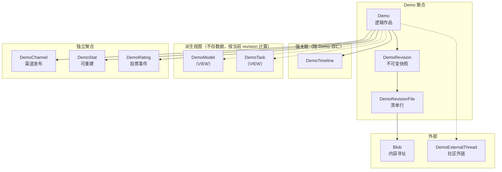

要点：

- **`DemoRevision` 属于聚合内部**：它的生命周期被 `Demo` 完全拥有，删除作品时一起走
- **`DemoModel` / `DemoTask` 是派生视图、不是表**（G18 / G7）：不存数据、没有独立生命周期，按 `current_revision_id` 计算，因此单列一个子图、不与「强关联」混放
- **`DemoChannel` / `DemoStat` / `DemoRating` 是独立聚合**：各自的事务边界，可以独立重建或清理
- **`Blob` 不属于任何聚合**：它是共享的存储层，靠引用关系存活

## 4. DDL 约定

DDL 与字段表**统一用 PostgreSQL 18 方言**。按语义取类型：

| 语义 | 落库类型 | 适用列 |
|---|---|---|
| 主键 | `bigint` + `GENERATED ALWAYS AS IDENTITY`；字段表写作 `bigint PK`、「默认」列写「自增」 | 全部 `id` |
| 外键 / 行计数 / 字节数 | `bigint` | `*_id`、`*_count`、`*_bytes`、`size` |
| 有序号或有界小范围 | `int`（PG 里 `int` ≡ `integer`） | `rev_no` / `score` / `featured_order` / `gen_rounds` / `gen_minutes` |
| 0/1 标志 | `boolean`（默认 `false`） | `featured`（§6 类图与 §7 ER 写作 `boolean`） |
| 字符串 | `text`；长度上限写进注释，或落库时用 `CHECK (length(x) <= n)`（**不用 `varchar(n)`**） | 全部字符串列 |
| 时间点 | `timestamptz`；建表一律 `NOT NULL DEFAULT now()`（可空列除外） | 全部时间列 |
| 比率 / 小数 | `numeric(3,2)` | `rating_avg`（1–5 分，两位小数） |
| 结构化数据 | `jsonb` | 本文暂无 JSON 列（`payload` 类列在实体域） |

**表格约定**：「类型」列只写类型名；PK / FK / 唯一性写在类型名之后（`bigint PK`、`bigint FK→demos`），自增由 DDL 层的 `GENERATED ALWAYS AS IDENTITY` 表达。**§6 类图与 §7 ER 的属性类型与 DDL 同名**（`+bigint` / `text` / `timestamptz` / `boolean` / `numeric`）。

**跨域对齐**：`demo_revision_models` 的类型与《模型域设计》§3.3 一致（`revision_id bigint` / `model_id bigint` / `provider_id bigint`）；其余照《标签域数据结构设计》《实体域数据结构设计》的写法（`bigint` / `text` / `timestamptz` / `boolean` / `jsonb`）。

## 5. 实体设计（字段级）

### 5.1 `Demo`（逻辑作品）

| 字段 | 类型 | 空 | 默认 | 说明 |
|---|---|---|---|---|
| `id` | bigint PK | 否 | 自增 | |
| `slug` | text | 否 | — | **唯一且永久**；改名留历史见 §5.10（≤128 字符） |
| `title` | text | 否 | — | 展示用；同时快照进 revision（≤200 字符） |
| `description` | text | 否 | `''` | 可编辑 |
| `cover_url` | text | 否 | `''` | 当前版本封面（便于列表直读；≤500 字符） |
| `cover_thumb_url` | text | 否 | `''` | 200 档小图（≤500 字符） |
| `author_id` | bigint FK→users | 是 | NULL | NULL = 匿名 |
| `guest_name` | text | 是 | NULL | 匿名展示名（≤64 字符） |
| `current_revision_id` | bigint FK→demo_revisions | 是 | NULL | 建库时可能还没有版本 |
| `moderation_state` | text | 否 | `pending` | `pending` / `approved` / `rejected`（≤16 字符） |
| `lifecycle_state` | text | 否 | `draft` | `draft` / `published` / `archived` / `removed`（≤16 字符） |
| `idempotency_key` | text | 是 | NULL | 唯一，agent 重试去重（≤128 字符） |
| `created_at` | timestamptz | 否 | `now()` | |
| `updated_at` | timestamptz | 否 | `now()` | **无 onupdate**，仅内容变更时显式赋值 |
| `deleted_at` | timestamptz | 是 | NULL | 软删除时间 |
| `delete_reason` | text | 否 | `''` | 删除/下架理由（≤200 字符） |

**这些关注点不在 `Demo` 上**（各自的归属如下）：

| 关注点 | 归属 |
|---|---|
| 内容属性（类型 / 单文件 / 外链） | `DemoRevision` |
| 提示词与视频 | `DemoRevision` |
| 运行证据（`model_hint` / `gen_rounds` / `gen_minutes`） | `DemoRevision` |
| 平台证据 | `demo_revision_platforms`（G18；**不设 `gen_platform` 列**） |
| 清单哈希 | `DemoRevision.manifest_hash` |
| 审核与生命周期 | 拆成 `Demo.moderation_state` + `Demo.lifecycle_state` |
| 渠道属性（`lang` / `featured` / `featured_order` / 可见性） | `DemoChannel` |
| 计数与评分 | `DemoStat` |

**为什么 `title` 两边都有**：`Demo.title` 是最新标题（列表直读，避免 JOIN）；`DemoRevision.title` 是该版本的标题（历史页正确渲染）。改标题不产生新版本——它只更新 `Demo.title`，`updated_at` 显式赋值。

### 5.2 `DemoRevision`（不可变内容快照）

| 字段 | 类型 | 空 | 默认 | 说明 |
|---|---|---|---|---|
| `id` | bigint PK | 否 | 自增 | |
| `demo_id` | bigint FK→demos | 否 | — | CASCADE |
| `rev_no` | int | 否 | — | 1 起连续；`UNIQUE(demo_id, rev_no)` |
| `title` | text | 否 | — | 该版本的标题快照（≤200 字符） |
| `description` | text | 否 | `''` | |
| `cover_url` | text | 否 | `''` | （≤500 字符） |
| `demo_type` | text | 否 | `web` | `web` / `zip` / `link` / `image`（≤16 字符） |
| `single_file` | text | 是 | NULL | `html` / `svg`（≤8 字符） |
| `external_url` | text | 是 | NULL | link 类型（≤2000 字符） |
| `entry_path` | text | 否 | `''` | 入口文件，如 `index.html`（≤500 字符） |
| `manifest_hash` | text | 否 | — | 清单哈希（**预览版本号来源**；≤64 字符） |
| `file_count` | bigint | 否 | 0 | |
| `total_bytes` | bigint | 否 | 0 | |
| `prompt` | text | 否 | `''` | 第一轮提示词原文 |
| `prompt_id` | bigint FK→prompts | 是 | NULL | 规范化去重实体 |
| `video_url` | text | 是 | NULL | （≤2000 字符） |
| `model_hint` | text | 否 | `''` | 兜底型号依据；**可更正**（§8.5）（≤500 字符） |
| `gen_rounds` | int | 是 | NULL | **可更正**（§8.5） |
| `gen_minutes` | int | 是 | NULL | **可更正**（§8.5） |
| `source` | text | 否 | `upload` | `upload` / `url_import` / `rollback`（≤16 字符） |
| `created_by` | bigint FK→users | 是 | NULL | |
| `created_at` | timestamptz | 否 | `now()` | |

**不可变**：任何字段写入后不再修改。要改内容 → 新增一条 revision。

`manifest_hash` 计算：

```text
canonical = 按 path 升序的 "path\0blob_sha256\n" 拼接
manifest_hash = sha256(canonical)
```

与 zip 如何打包无关——同样内容重新打包，`manifest_hash` 不变，预览 URL 也不变。

#### 5.2.1 revision 的生成条件关联表（G18）

「这一版用了什么模型 / 平台 / 平台配置 / 技能 / MCP」是 **revision 级事实**，由 5 张关联表表达。**表定义在模型域 / 标签域，本域只引用关系，不重复 DDL**：

| # | 关联表 | 关联到 | 定义方 | demo 层派生（视图） |
|---|---|---|---|---|
| 1 | `demo_revision_models` | `models` / `providers` | 模型域 | `demo_models` |
| 2 | `demo_revision_platforms` | `platforms` | 标签域 | `demo_platforms` |
| 3 | `demo_revision_platform_configs` | `platform_configs` | 标签域 | `demo_platform_configs` |
| 4 | `demo_revision_skills` | `skills` | 标签域 | `demo_skills` |
| 5 | `demo_revision_mcp_servers` | `mcp_servers` | 标签域 | —（MCP 无 demo 级表） |

> `mcp_servers` 的实体定义见《标签域数据结构设计》**§3.6.1（v1.8）**（跨平台：`id` / `slug` / `name` / `description` / `transport` / `endpoint` / `vendor_id?` / `status`）。本表只引用关系，不重复 DDL。

**四条规则**：

1. **多值**：每个维度都可多条——「多个模型接力完成」是常态；同一件作品可同时用多个平台 / 配置 / 技能。`demo_revision_models` 的 PK = `(revision_id, model_id)`：同一模型经不同 provider 用过**算一条**，`provider_id` 只是属性（可空）。
2. **每版只记本版**：数据模型层**不做继承 / 追加**。新增 revision 时由**前端自动预填**上一版的数据——「追加」是 UI 行为，不是数据模型行为（G18）。
3. **「当前」= `Demo.current_revision_id`**：demo 层的「当前版本用了什么」是**纯派生值**，不加冗余列。`?model=` 筛选、`model_counts` 计数、平台归属全部按当前 revision 算，回滚后跟着回滚——与 **G7**（题目归属按当前 revision）同构。
4. **demo 层同名表改为视图**：`demo_models` / `demo_platforms` / `demo_platform_configs` / `demo_skills` **保留表名，但由表改为视图**（`demos ⋈ demo_revisions(current) ⋈ demo_revision_*`），由各自拥有域定义；本域只依赖视图形状，读路径 SQL 不用重写。

`platform` 维度由 `demo_revision_platforms` 表达，**不设 `gen_platform` 列**（G18）。

### 5.3 `DemoRevisionFile`（清单）

| 字段 | 类型 | 空 | 说明 |
|---|---|---|---|
| `id` | bigint PK | 否 | |
| `revision_id` | bigint FK→demo_revisions | 否 | CASCADE |
| `path` | text | 否 | 相对路径，正斜杠（≤500 字符） |
| `blob_hash` | text | 否 | FK→blobs.sha256（≤64 字符） |
| `size` | bigint | 否 | |
| `mime` | text | 否 | （≤128 字符） |

```text
UNIQUE (revision_id, path)
INDEX  (blob_hash)   -- GC 反查
```

### 5.4 `Blob`（内容寻址）

| 字段 | 类型 | 空 | 说明 |
|---|---|---|---|
| `sha256` | text PK | 否 | 内容哈希（≤64 字符） |
| `size` | bigint | 否 | 字节数 |
| `mime` | text | 否 | （≤128 字符） |
| `storage_key` | text | 否 | 物理位置，如 `blobs/ab/cd/abcd…`（≤500 字符） |
| `backend` | text | 否 | `local` / `oss`（≤16 字符） |
| `created_at` | timestamptz | 否 | |
| `last_ref_at` | timestamptz | 否 | GC 用：最近一次被引用 |

**不可变**：同一 sha256 永远同一内容。上传时若已存在则**只加引用，不重复写**。

### 5.5 `DemoChannel`（渠道发布）

| 字段 | 类型 | 空 | 默认 | 说明 |
|---|---|---|---|---|
| `id` | bigint PK | 否 | 自增 | |
| `demo_id` | bigint FK→demos | 否 | — | CASCADE |
| `channel` | text | 否 | — | `deep` / `astra` / 未来渠道（≤32 字符） |
| `visibility` | text | 否 | `listed` | `listed` / `unlisted` / `hidden`（≤16 字符） |
| `lang` | text | 否 | `zh` | 该渠道的语言标记（≤8 字符） |
| `featured` | boolean | 否 | `false` | 精选位 |
| `featured_order` | int | 是 | NULL | 1 起连续 |
| `published_at` | timestamptz | 是 | NULL | |
| `curated_by` | bigint FK→users | 是 | NULL | 策展人 |
| `created_at` / `updated_at` | timestamptz | 否 | `now()` | |

```text
UNIQUE (demo_id, channel)
INDEX  (channel, visibility, featured_order)
```

**渠道与可见性正交**：

- 作品可以在 `deep` 上 `listed`，同时在 `astra` 上不存在（无行）
- `astra` 要求 `lang='en'`，这是**渠道规则**，由发布时校验，不是全局字段
- 首页精选 = `featured=true` + `visibility='listed'`

### 5.6 `DemoStat`（可重建聚合）

| 字段 | 类型 | 空 | 默认 | 说明 |
|---|---|---|---|---|
| `demo_id` | bigint PK FK→demos | 否 | — | CASCADE |
| `view_count` | bigint | 否 | 0 | |
| `download_count` | bigint | 否 | 0 | |
| `rating_sum` | bigint | 否 | 0 | 票分总和 |
| `rating_count` | bigint | 否 | 0 | |
| `rating_avg` | numeric(3,2) | 否 | 0 | 冗余：sum/count |
| `rating_god` | bigint | 否 | 0 | 5 分票数 |
| `rating_ghost` | bigint | 否 | 0 | 1 分票数 |
| `updated_at` | timestamptz | 否 | `now()` | |

**不作为权威**：任何时候都可以从 `DemoRating` 与事件流水重建。提供 `scripts/rebuild_demo_stats.py`。

### 5.7 `DemoRating`（投票事件）

| 字段 | 类型 | 空 | 说明 |
|---|---|---|---|
| `id` | bigint PK | 否 | |
| `demo_id` | bigint FK→demos | 否 | CASCADE |
| `user_id` | bigint FK→users | 是 | 登录用户 |
| `rater_key` | text | 否 | 匿名指纹 `sha256(device|ip|salt)`（≤128 字符） |
| `score` | int | 否 | 1–5 |
| `created_at` / `updated_at` | timestamptz | 否 | |

```text
UNIQUE (demo_id, rater_key)
```

**只增不改**：改评分是 UPDATE `score`（同一人一票）；撤销是 DELETE。计数由 `DemoStat` 维护，可重建。

### 5.8 关联表

**Demo ↔ 分类的关联表由标签域拥有**（`demo_classifications`），本域不重复定义。

**生成条件（模型 / 平台 / 平台配置 / 技能 / MCP）的真表在 revision 层**：5 张 `demo_revision_*` 见 §5.2.1，表定义在模型域 / 标签域，本域只引用关系。demo 层同名表**保留表名但由表改为视图**（G18）：

```text
demo_models           = demos ⋈ demo_revisions(current) ⋈ demo_revision_models
demo_platforms        = demos ⋈ demo_revisions(current) ⋈ demo_revision_platforms
demo_platform_configs = demos ⋈ demo_revisions(current) ⋈ demo_revision_platform_configs
demo_skills           = demos ⋈ demo_revisions(current) ⋈ demo_revision_skills
```

> `demo_mcp_servers` **不需要**：MCP 从来没有 demo 级表，只有 revision 级 → 无 demo 层视图。`mcp_servers` 实体定义见《标签域数据结构设计》§3.6.1（v1.8）。

**`DemoRevisionModel`（revision 级真表，模型域设计的落点）**：字段定义以模型域为准，此处列出是为说明主键与多值语义。

| 字段 | 类型 | 说明 |
|---|---|---|
| `revision_id` | bigint FK→demo_revisions | PK 之一（CASCADE） |
| `model_id` | bigint FK→models | PK 之一 |
| `provider_id` | bigint FK→providers | **可空 = 来源未标注**；同一模型经不同 provider 用过算一条 |
| `serving_note` | text | `fp8` / `free tier`（≤100 字符） |
| `source` | text | `api` / `legacy_tag` / `migration` / `attribution` / `merge`（≤16 字符） |
| `created_at` | timestamptz | |

**`DemoModel`（demo 层）**：**不再是表，改为视图**（G18）——定义 = `demos ⋈ demo_revisions(current) ⋈ demo_revision_models`，只按当前 revision 派生，供列表 / 模型页读路径沿用。

**`DemoTask`**：**不再是表，改为视图**（G7）。定义 = `demos ⋈ demo_revisions(当前) ⋈ task_prompts`，只按当前 revision 派生；详见《实体域数据结构设计》§1.3 / §3.6。

**`DemoTimeline`**：只记「事件」不记「版本」——版本由 revision 表达。

| 字段 | 类型 | 说明 |
|---|---|---|
| `id` | bigint PK | |
| `demo_id` | bigint FK | CASCADE |
| `kind` | text | `create` / `approve` / `reject` / `archive` / `restore` / `slug_change` / `merge`（≤16 字符） |
| `message` | text | （≤500 字符） |
| `actor_id` | bigint FK→users | 可空 = 系统 |
| `created_at` | timestamptz | |

### 5.9 `DemoExternalThread`（社区外链）

| 字段 | 类型 | 说明 |
|---|---|---|
| `demo_id` | bigint PK FK→demos | CASCADE |
| `provider` | text | `discourse` / `mastodon` / …（≤32 字符） |
| `host` | text | 实例域名（≤200 字符） |
| `topic_id` | text | 外部 ID（≤64 字符） |
| `url` | text | （≤500 字符） |
| `post_count` | bigint | 缓存的回复数（用于作品卡显示） |
| `synced_at` | timestamptz | |

```text
UNIQUE (provider, host, topic_id)
```

**只存关联键与缓存计数**，不复制帖子内容。`comment_count` 从「查 `ForumTopic`」改为「读 `post_count`」，由同步任务更新。

### 5.10 `DemoSlugHistory`（slug 永久性）

| 字段 | 类型 | 说明 |
|---|---|---|
| `slug` | text PK | 旧 slug（≤128 字符） |
| `demo_id` | bigint FK→demos | |
| `created_at` | timestamptz | |

访问旧 slug → 301 到当前 slug。这样 `slug` 可以唯一且永久，同时支持改名。

## 6. 全景类图

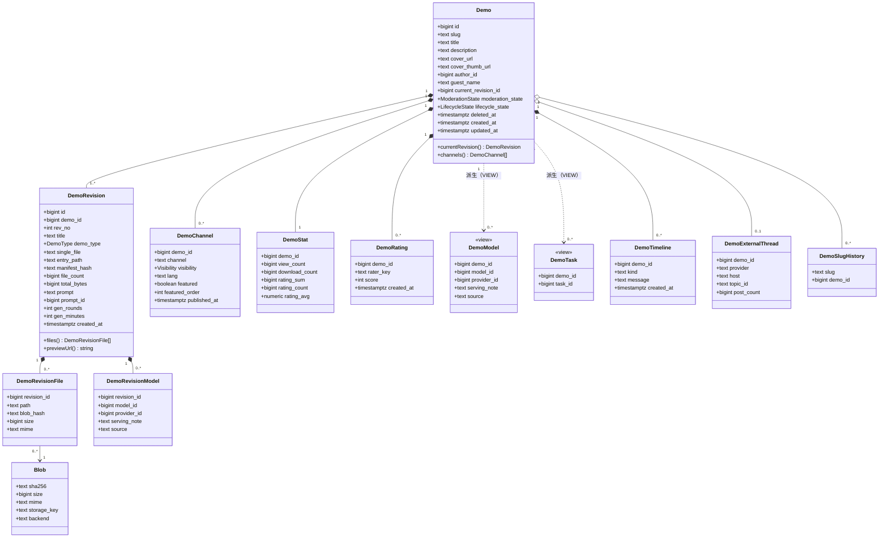

## 7. ER 图

### 7.1 作品与版本

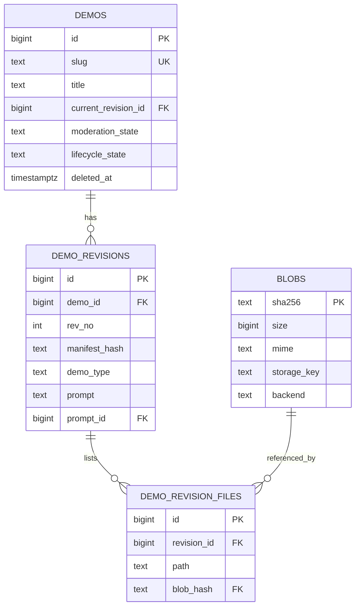

### 7.2 发布与统计

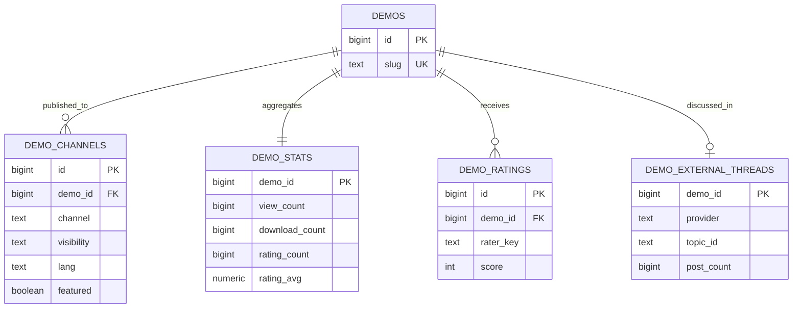

### 7.3 与模型域 / 题目的接缝

> 作品↔分类的关联表（`demo_classifications`）由**标签域**拥有；生成条件的真表在 revision 级（模型域 / 标签域拥有），demo 层同名表是视图（§5.2.1 / §5.8）。本图只画模型维度，其余四张见 §7.4。

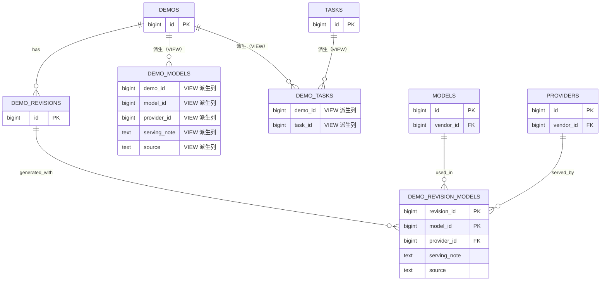

### 7.4 revision 的生成条件（余下四张，G18）

`platform` / `platform_config` / `skill` / `mcp` 与 `model` 同构：**真表在 revision 级**，目标侧实体（`platforms` / `platform_configs` / `skills` / `mcp_servers`）由标签域拥有、不在本图内；demo 层同名表是视图（§5.8）。

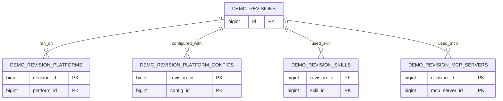

## 8. 状态机与状态规则

### 8.1 审核状态（全局一次）

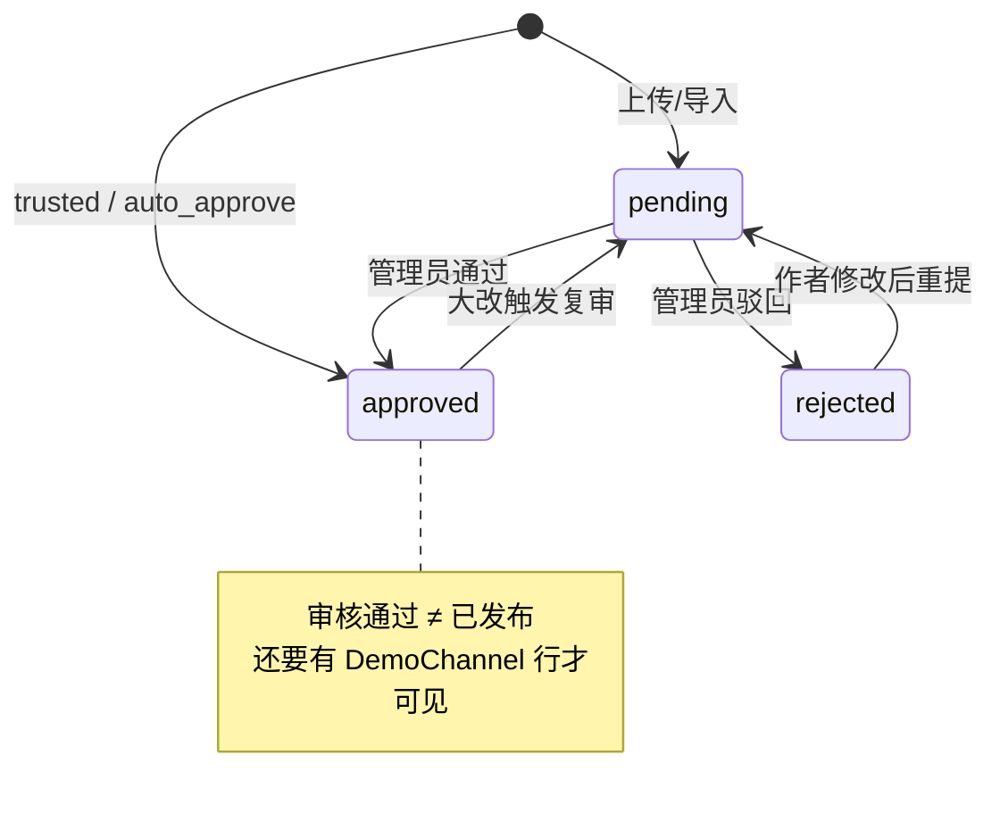

### 8.2 生命周期

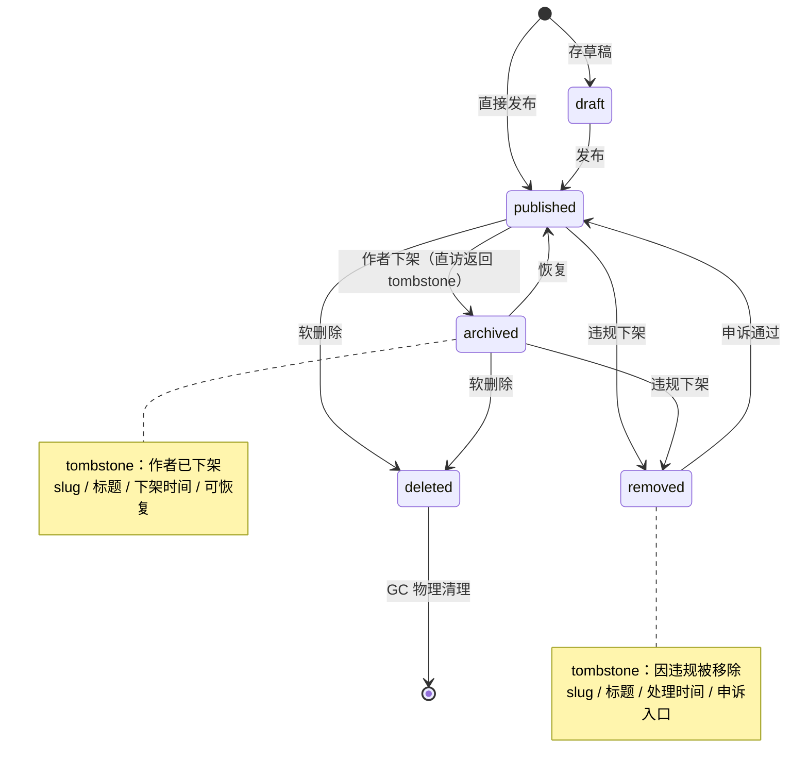

### 8.3 版本

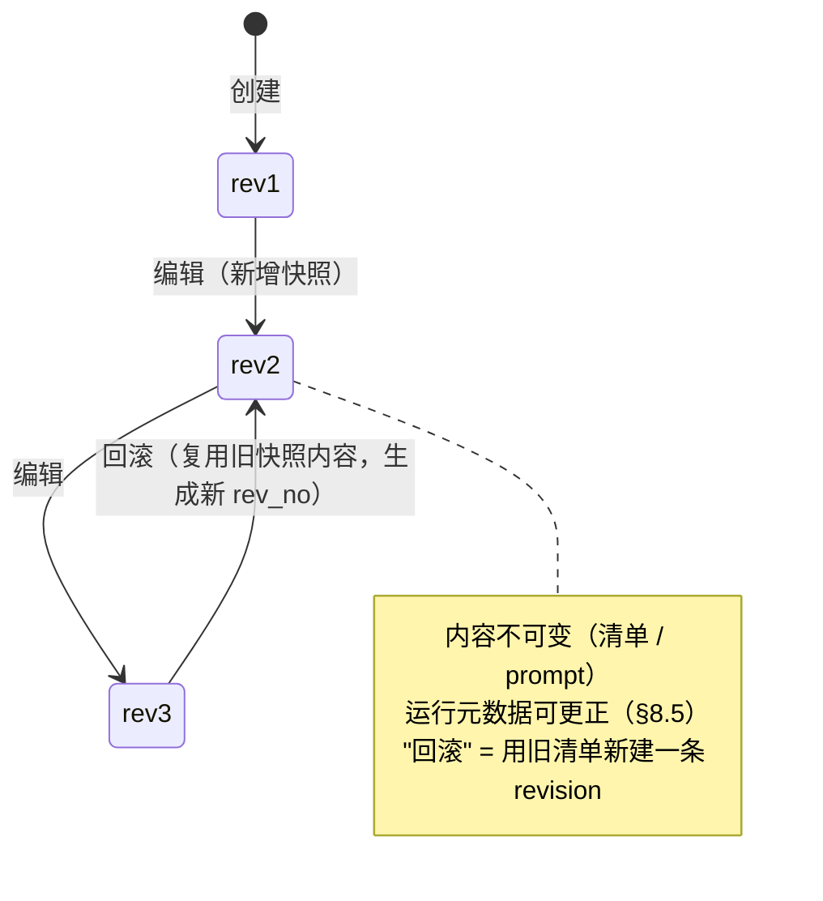

**回滚不删除历史**：`rev4.source='rollback'`，内容指向 `rev2` 的清单（同一批 blob，零拷贝）。

### 8.4 下架与 tombstone（G1）

`archived` 与 `removed` 都**不提供内容**：按 slug 直访返回 **HTTP 200 + tombstone 页**。

| 状态 | 触发 | 响应 | tombstone 内容 | 可执行动作 |
|---|---|---|---|---|
| `archived` | 作者主动下架 | 200 | slug / 标题 / 下架时间 / 「作者已下架该作品」 | 「查看作者其它作品」「返回列表」；作者本人另有「恢复发布」 |
| `removed` | 平台违规处置 | 200 | slug / 标题 / 处理时间 / 「该作品因违规被移除」/ 依据条款 | 「提交申诉」「查看社区规范」 |
| `pending` / `rejected` / `draft` | 未公开 | **404** | — | 作者本人与管理员走**带权限读路径**（不套公开谓词） |
| `deleted`（软删） | 作者/管理员删除 | 404 | — | GC 前管理员仍可查 |
| GC 之后 | 物理清理 | 404 | — | — |

**tombstone 页一律不出**：作品内容、预览 iframe、下载、评分、评论/讨论入口、会话日志、时间线。

**列表 / 计数**只算公开可见：`moderation_state='approved' AND lifecycle_state='published' AND deleted_at IS NULL` + 渠道 `visibility='listed'`（谓词定义见《实体域数据结构设计》§5.0，G1）。

**为什么两类 tombstone 必须不同**：`archived` 是作者自主行为（可恢复、无申诉），`removed` 是平台处置（有申诉、有条款依据）。合成一个页面会让用户既不知道能不能申诉，也不知道作品会不会回来。

### 8.5 运行元数据的更正（G11）

**规则：内容不可变，运行元数据可更正。**

| 列 | 可更正？ | 谁能改 |
|---|---|---|
| `manifest_hash` / `file_count` / `total_bytes` / `entry_path` / `demo_type` / `single_file` / `external_url` | ❌ 内容 | 改 = 新 revision |
| `title` / `description` / `cover_url` / `prompt` / `prompt_id`（版本快照） | ❌ 内容 | 改 = 新 revision |
| **`gen_rounds` / `gen_minutes` / `model_hint`** | ✅ **运行元数据** | 作者本人（管理端亦可） |

**为什么**：`gen_rounds` / `gen_minutes` 是「这一次生成跑了多少轮 / 多久」的**录入记录**，`model_hint`（兜底型号依据）同理，都不是内容本身。用户填错了，让它去新建一个「内容完全相同的 revision」是错的（版本号语义被污染）；而只让管理员改库则是漏设计——用户连自己填错的数字都改不了。

**平台维度同理**（同属录入事实），但它已由 `demo_revision_platforms` 关联表表达（G18），不在本节的列白名单内。

**约束**：

- 只允许改这 3 列的**白名单**，其余列一律拒绝（应用层校验；DB 层可选 trigger 兜底）；
- 每次更正写 `audit_log(action='update', entity_type='demo_revision', before, after)`；
- 更正**不触发重新审核**（不改内容，也不改可见性）；
- 更正后 `demos.updated_at` 显式赋值（列表排序依赖它）。

## 9. 时序

### 9.1 创建作品

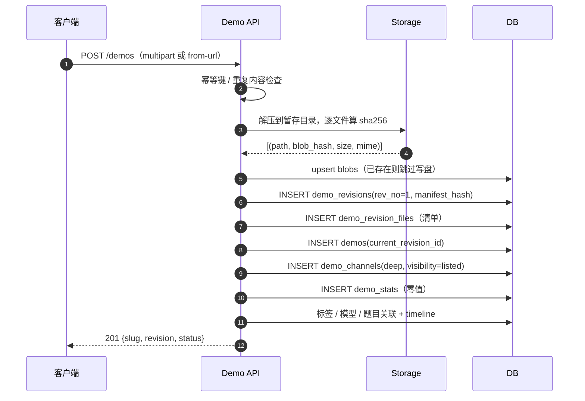

### 9.2 编辑（产生新版本）

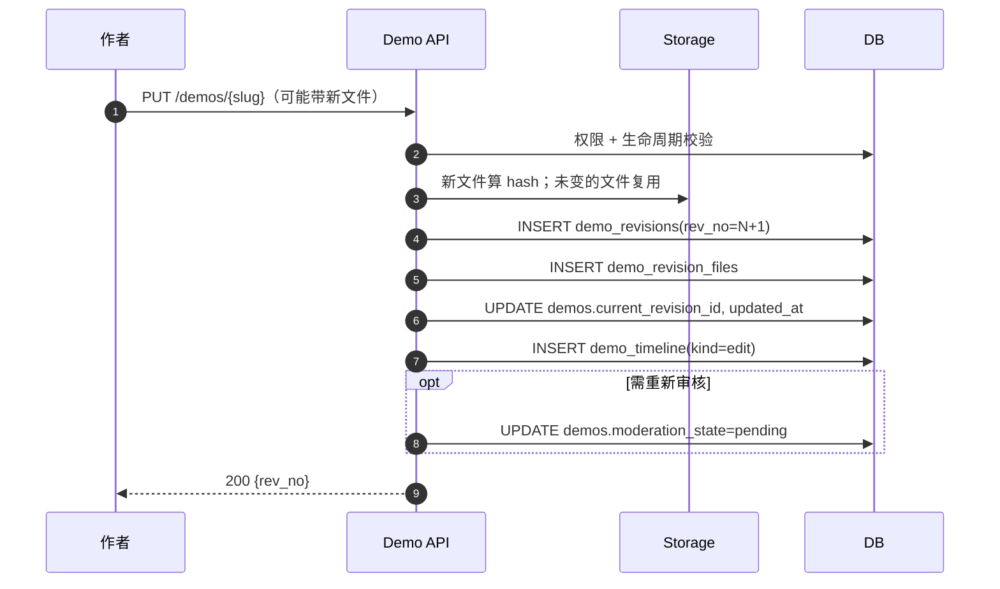

**零拷贝**：只改一个 `style.css` 时，其余文件的 `blob_hash` 不变，不写新 blob。

### 9.3 回滚

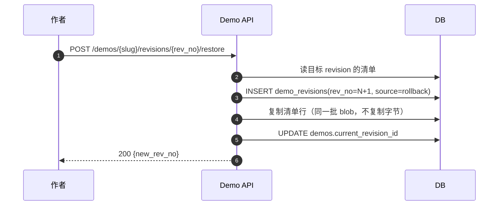

### 9.4 渠道发布（含 astra 策展）

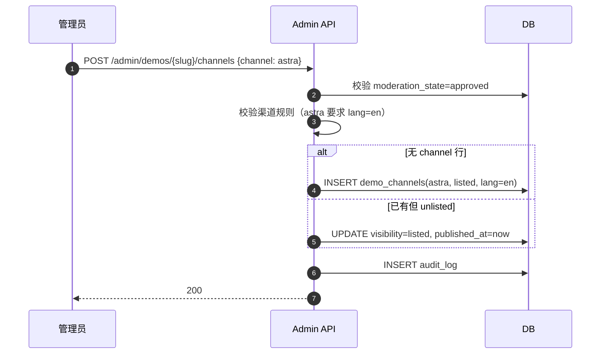

### 9.5 预览服务（内容寻址的解析）

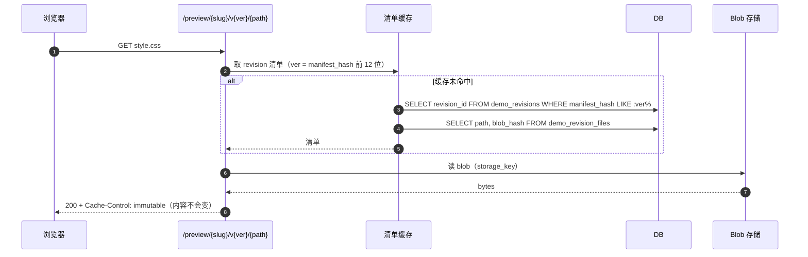

**`immutable` 是内容寻址带来的真实收益**：URL 里的 `v{manifest_hash}` 永久对应同一份字节，CDN 可以永不回源。

### 9.6 删除与 GC

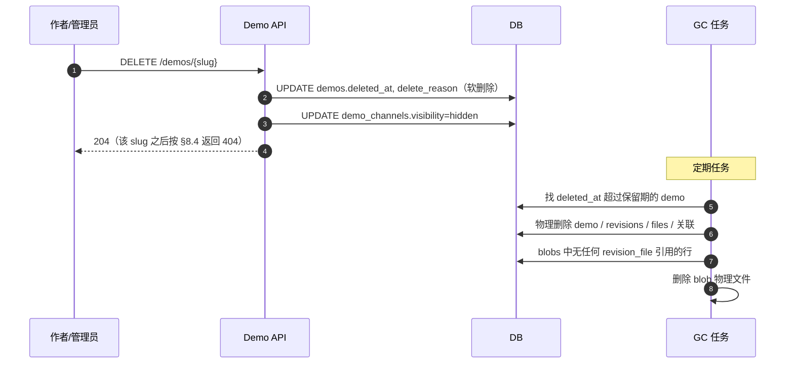

**可恢复**：软删除期间 `restore` 即可；只有过了保留期才真正消失。

## 10. 存储布局

```text
{STORAGE_DIR}/
├── blobs/
│   └── ab/cd/abcdef0123456789…      ← 内容块，无扩展名（mime 在 DB）
└── media/
    ├── covers/{hash}.webp
    │   ├── {hash}-thumb.webp
    │   └── {hash}-card.webp
    └── avatars/
```

## 11. 不变量

1. `DemoRevision` 一旦创建，任何字段不得 UPDATE（除后续追加的可空审计列）。
2. `Demo.current_revision_id` 必须指向属于该 demo 的 revision。
3. 每个 `Demo` 至少一条 revision（除建库瞬间）。
4. `rev_no` 在同一 demo 内从 1 连续递增，不跳号不复用。
5. `manifest_hash` 只由清单内容决定，与打包方式无关。
6. `DemoRevisionFile.blob_hash` 必须存在于 `Blob`。
7. `Blob` 不可变：同 sha256 永远同内容；写盘前必须校验。
8. `DemoChannel.(demo_id, channel)` 唯一；`visibility='listed'` 要求 `moderation_state='approved'`。
9. `DemoStat` 可随时从 `DemoRating` 重建；不得作为唯一数据源。
10. `Demo.slug` 永久唯一；改名写入 `DemoSlugHistory` 并 301。
11. 软删除的 `Demo` 不出现在任何公开查询；物理删除只由 GC 执行。
12. 生成条件（模型 / 平台 / 平台配置 / 技能 / MCP）是 **revision 级事实**：每个 revision 的关联行只描述该版本；**历史版本可追溯**。demo 层只提供「当前版本」（`current_revision_id`）的派生值，不得作为独立事实源（见 §1.3 / §5.2.1）。

## 12. 跨域接缝

| 模型域的概念 | Demo 域落点 |
|---|---|
| 作品 ↔ 模型的事实源 | **`demo_revision_models`（revision 级）**（G18）；demo 层 `demo_models` 是视图（§5.2.1 / §5.8） |
| `provider_id` 可空 | `DemoRevisionModel.provider_id`（同一模型经不同 provider 用过算一条） |
| `vendors` / `providers` | `DemoRevisionModel.provider_id` → `providers.id` |
| 第三方基准 | 与 Demo 无直接关系（按模型聚合） |

**唯一交叉点**：`DemoRevisionModel` 的写入由 `DemoModelWriter` 统一负责（模型域 T2），Demo 域不新增第二条写入路径。

**与论坛外置的衔接（G12）**：Demo 域**不新建** `external_events`（webhook 收件箱 → 论坛外置）与 `external_identities`（身份映射 → 身份域）。`DemoExternalThread` 与标签域 `external_threads` 是**同一张表的两份定义**——**G5 已定以标签域为准**（本域不重复定义）。

## 13. 明确不做

- **不改 `Demo` 这个名字**（`Work` 只是早期讨论代号）
- **不在本系统为帖子建模**：社区外置，只留 `DemoExternalThread`
- **不做多语言内容表**：`lang` 仍是渠道属性；真要做 i18n 内容另立设计
- **不做实时协同编辑**：版本是提交式的，不是 CRDT

## 附录 A 新旧章节对照

本文是目标态抽取版；完整版 [`../Demo域设计.md`](../Demo域设计.md) 还含**现状对照、迁移路线（D1–D5）、关键风险、待定项与过渡期结构**，需要那些内容时按下表回查。

| 本文 | 完整版 |
|---|---|
| §1 设计理念 | §1（现状问题）+ §2.2（方案对比）+ §12（明确不做） |
| §2 决策摘要 | §0 |
| §3 聚合与边界 | §2.1 |
| §4 DDL 约定 | §0.1 |
| §5 实体设计 | §3.1–§3.10（含 §3.2.1） |
| §6 全景类图 | §4 |
| §7 ER 图 | §5.1–§5.4 |
| §8 状态机与状态规则 | §6.1–§6.5 |
| §9 时序 | §7.1–§7.6 |
| §10 存储布局 | §8 |
| §11 不变量 | §9 |
| §12 跨域接缝 | §10 |
| §13 明确不做 | §12 |
| —（不收录） | §11 迁移路线 / 关键风险、§13 待定、§14 过渡期与退役 |
