# 模型域 · 目标设计

> **本文只描述目标态。** 现状诊断、迁移路线、验收回滚、风险与开放问题、过渡期结构见 [`../模型域设计.md`](../模型域设计.md)（完整版）。
> 本文与完整版的章节对应见[附录 B](#附录-b-新旧章节对照)。

**DDL 方言 = PostgreSQL 18**，统一约定见 [`DDL 约定`](../DDL约定.md)。

**范围内**：模型的身份（是谁）、档案（什么规格）、表现（做得多好）三件事，以及它们与作品的接缝。
**范围外**：作品与版本（Demo 域）、平台与标签（标签域）、账号与提案（实体域/身份域）——本文只写与它们的接缝。

## 1. 设计理念

模型域的设计可以压成五条，后面所有表与契约都从这里推出来。

### 1.1 表现分不写回身份表

表现是**测量结果**，身份是**事实**。把分数、作品数这类派生值写回 `models`，任何一次重算都会与写入路径打架——这是「编辑后数值回退」这类坑的根源。表现一律按需计算（社区分见 §7.2，第三方分见 §7.4），不落冗余列。

### 1.2 站内分与第三方分不混算

站内社区分是**本站观众喜好**，第三方基准分是**外部测量**。两者量纲、样本、偏差方向都不同，任何位置（列表、模型页、排序）都不合并成一个「总分」；要合看时并排展示，各自标注口径。

### 1.3 模型归属只有一个事实源

「这次生成用了什么模型」只能由 `DemoModelWriter` 写 `demo_revision_models`；demo 层看到的 `demo_models` 是**只读视图**（当前 revision 的投影）。这样做的理由是三个问题源：

- **双向双写**：过去标签与关联表各存一份、且能互相生成，任一路径漏一半就会被下一次编辑静默改回。
- **全删重建**：替换整份关联会让「编辑内容」意外重置模型归属。所以写入必须是**差集**（§6.2），不是删后重插。
- **多套写入语义**：上传、管理端、上游导入三个入口如果各写一半，事实源就不再唯一。入口可以多，**写入面只能一个**。

### 1.4 provider 是属性，不是身份

同一模型经不同 provider 提供（官方 / 聚合平台 / 自建），模型本身不变，因此 `provider_id` **不进主键**、只作属性：

- 用户裁决：同一模型经不同 provider 用过**算一条**；
- PG 的 `UNIQUE` 把 NULL 视为互不相等（`NULLS DISTINCT`），若把 `provider_id` 放进主键，`provider_id IS NULL` 时根本无法去重，只能造 `unknown` 哨兵实体——那等于把「未知」变成一个假数据。

### 1.5 上游是参考源，不是运行时依赖

models.dev 只提供整包 JSON、没有搜索接口，因此本地**镜像**它、并按**字段级**记录来源：手工录入（`source=manual`）或锁定（`locked`）的字段永不被上游覆盖；上游不可用时本站全部功能照常（详见 §6.6）。

## 2. 决策摘要

| 决策 | 结论 |
|---|---|
| 作品 ↔ 模型的事实源 | **`demo_revision_models`（revision 级）唯一权威**；`demo_models` 保留表名、改为**当前 revision 的只读视图**（G18）；`model:` 标签降级为兼容投影 |
| `model` 的多值 | **一个 revision 可记多个模型**（「多个模型接力完成」是常态）；PK `(revision_id, model_id)`，同一模型经不同 provider **算一条** |
| 厂商自报成绩 | **单独标注，不计入综合分** |
| models.dev 的角色 | **参考源 + 本地镜像**，不是运行时依赖；不可用时本站照常工作 |
| 目录刷新 | **手动刷新 + 可选定时**（默认关闭） |
| 上游覆盖策略 | **逐字段 diff，管理员勾选后应用**；`manual` / `locked` 字段不覆盖 |
| slug 生成 | **展示名走 `_slugify_unique`**；`canonical_model_id` 只做去重键，不进 URL |
| 厂商（lab） | **实体化为 `vendors`**；`slug` 取 `canonical_model_id` 前缀；`models.vendor_id` 指向它，官方 provider 判定靠 `vendor_id` 相等 |
| 聚合平台条目 | **默认只显官方 provider**；聚合条目只作 external_ref，不单独建模型 |
| provider 维度 | **每个 revision 的模型可标注服务方**（可空，只是属性、不进主键）；`providers` 独立实体表 |
| provider 与分数 | **只做分布展示，不拆分社区分/综合分** |
| 基准的 provider | **不记**；榜方注明服务方时只写 `note` |
| 跨榜归一化 | **尚未定**（百分位 / min-max / 原始分；决策跟踪见台账） |
| 基准数据落地方式 | **尚未定**（手工 JSON / 后台录入 / 抓取） |
| 社区分与第三方分 | **分开呈现，任何位置不混算** |
| 合并后的历史数据 | 榜分与链接**不搬迁**，查询时沿 `merged_into_id` 解析，保证 `unmerge` 可用 |

## 3. 领域边界

模型域要回答三件不同的事，混在一起就会算错：

| 子域 | 回答 | 数据 |
|---|---|---|
| **身份**（identity） | 这个模型是谁 | `models` / `model_aliases` / `demo_revision_models`（当前值经视图 `demo_models`） |
| **档案**（spec） | 它是什么样 | `model_specs`（模态、上下文、规模、价格…） |
| **表现**（evidence） | 它做得怎么样 | 站内：`demos` 评分聚合；站外：`benchmark_scores` |

两条硬规则：

1. 表现分不能写回 `models`（否则又造一个「编辑后回退」的坑）。
2. 站内社区分与第三方基准分不混算：前者是本站观众喜好，后者是外部测量。

## 4. DDL 约定

所有 DDL、字段表与图**统一遵循 [`DDL 约定`](../DDL约定.md)**——方言（PostgreSQL 18）、语义 → 类型映射、字段表写法、图与 DDL 的关系都在那一份里。**本域无偏差**。

本域只有一条跨域对齐：`demo_revision_models` 由本域拥有、Demo 域引用（列定义见 §7.3）。

## 5. 实体设计

### 5.1 实体关系

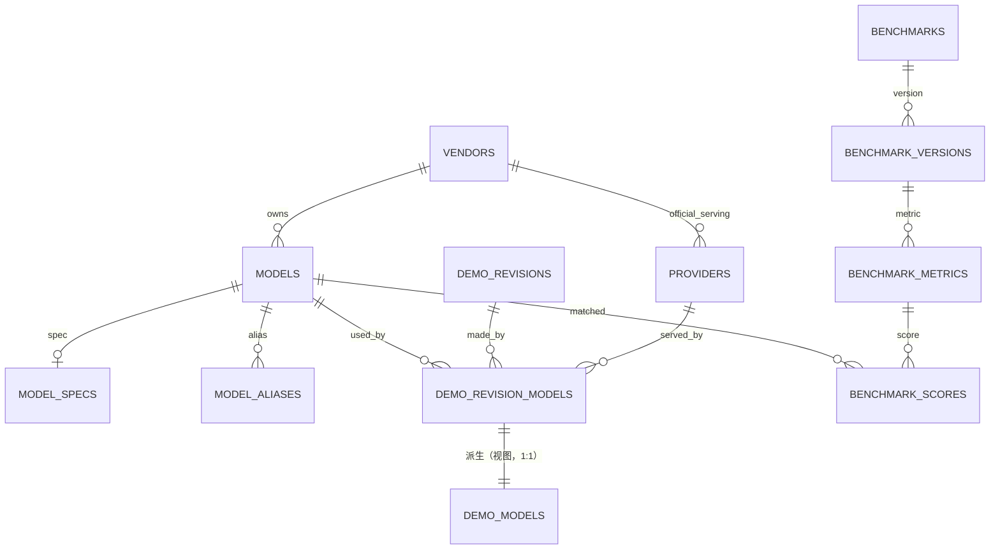

### 5.2 表清单（沿用与新增）

| 表 | 变化 |
|---|---|
| `models` | 语义：`id` 是唯一身份；`name` 是展示名；`slug` **创建后不可变**；加 `vendor_id` 指向 `vendors`（`vendor` 文本仅为展示缓存，权威是 `vendor_id`） |
| `model_aliases` | 唯一解析表；所有外部名/写法都落这里 |
| `demo_models` | **由表改为视图**（保留表名，语义 = 当前 revision 的投影）；业务列（`provider_id` / `serving_note` / `source` / `created_at`）落在 `demo_revision_models`（§5.3） |
| `vendors`（新） | 模型厂商 / lab；`slug` 取自 `canonical_model_id` 前缀 |
| `providers`（新） | 服务方实体：官方 / 聚合平台 / 自建，与 models.dev 的 `provider_id` 对齐 |
| `tags` / `demo_tags` | `key='model'` 的行在 S6 归档删除；其余键不受影响 |

`models.slug` 不可变的原因：它是公开 URL 与聚合主键。若将来要改名，另加 `model_slug_history` + 301，不在本期范围。

### 5.3 `demo_revision_models`（事实源）与 `demo_models`（视图）

**G18**：生成条件挂 revision。「这一次生成用了什么」是 revision 层事实；demo 层只保留「当前版本」的派生值，**不加冗余列**。`model` 因此从 demo 级下放到 revision 级。

**新表（模型域拥有，Demo 域引用）**：

> **DDL 见 [60-model.sql](../../db/schema/60-model.sql)**（本节涉及的 1 张表/视图：`demo_revision_models`）。表结构以 SQL 文件为准，文档不再复制。

**视图（沿用旧名，语义 = 当前 revision 的投影；只读）**：

> **DDL 见 [70-views.sql](../../db/schema/70-views.sql)**（本节涉及的 1 张表/视图：`demo_models`）。表结构以 SQL 文件为准，文档不再复制。

- 依赖 `demos.current_revision_id`（定义见《Demo域设计》§3.1）。**「当前」就是该列**：回滚后筛选与计数**跟着回滚**。
- **保留旧名**是为了让读路径 SQL 不用重写——与 G7 把 `demo_tasks` 由表改视图同构。
- 视图暴露 `demo_id` / `model_id` / `provider_id` 与 `serving_note` / `source`（作品卡要显示 `fp8` 这类服务差异）；**只有需要 `created_at` 等审计列时才直读 `demo_revision_models`**。读路径 SQL 一行不用改。
- **视图只读**：写入一律走 `DemoModelWriter` 写 `demo_revision_models`（§6.2）。

**主键是 `(revision_id, model_id)`，`provider_id` 只是属性、不进主键。** 原因：

1. **用户裁决（G18）**：同一模型经不同 provider 用过**算一条**；
2. PG 的 `UNIQUE` 默认也把 NULL 视为互不相等（`NULLS DISTINCT`），`(revision_id, model_id, provider_id)` 在 `provider_id IS NULL` 时**无法去重**，只能造 `unknown` 哨兵实体——那等于把「未知」变成一个假数据。

**每版只记本版**：数据模型层**不做继承 / 追加**——新 revision **不继承**上一版的模型列表；所谓「追加一个模型」是**前端在新建 revision 时预填**上一版数据后由用户改，**不是数据模型行为**（G18 用户裁决）。

`provider_id IS NULL` 表示「来源未标注」，UI 显式显示，不回填、不猜测。

`serving_note` 用于记录影响表现的服务差异（`fp8`、`free tier`、`context 32k`），**非空、默认空串**（`NOT NULL DEFAULT ''`，未标注就是空串），自由文本但限制 100 字符。

### 5.4 `vendors`（模型厂商 / lab；**跨域共享主数据**）

> **共享主数据（G10，2026-10-28）**：`vendors` 不只属于模型域——《标签域数据结构设计》§3.5 的 `platforms.vendor_id` 也指向这张表。**改本表结构前必须同时看那份文档**。理由：厂商是跨域概念（DeepSeek / 阿里 / 字节 / 智谱……），平台域若用自由文本存厂商，同一家会出现 `DeepSeek` / `deepseek` / `DS` 多种写法，统计口径立刻分裂——这正是本域把厂商实体化的同一个理由（见 §5.4 末尾「为什么必须实体化」）。

models.dev 的网站按 **lab** 组织（`/labs/deepseek`），其 API 里没有独立的 lab 集合，但 **`canonical_model_id` 的前缀就是 lab**（实测 77 个），且多数 lab 的 `provider_id` 与前缀同名（28 个，如 `deepseek`、`moonshotai`、`zhipuai`）。

| 字段 | 类型 | 空 | 默认 | 说明 |
|---|---|---|---|---|
| `id` | bigint PK | 否 | 自增 | |
| `slug` | text（≤64） | 否 | — | 唯一，`canonical` 前缀，如 `deepseek` |
| `name` | text（≤128） | 否 | — | 展示名，如 `DeepSeek` |
| `homepage_url` | text（≤500） | 否 | `''` | 官方主页 |
| `status` | text（≤16） | 否 | `active` | `active` / `hidden` |
| `source` | text（≤32） | 否 | `manual` | `models.dev` / `manual` |
| `created_at` / `updated_at` | timestamptz | 否 | now() | |

```text
UNIQUE (slug)
```

填充规则：

```text
1. 取 model_catalog_items.canonical_id 的前缀集合（77 个）
2. 展示名：若存在 provider_id == 前缀，用该 provider 的 name（如 moonshotai → "Moonshot AI"）
3. 否则把前缀人性化（`bytedance-seed` → `ByteDance Seed`），标 source='models.dev'
4. 已存在同名 vendor（source='manual'）时不覆盖 name / homepage_url
5. canonical 前缀里出现新 lab 时只新增，不删除旧 vendor
```

为什么必须实体化：

- 现在 `Model.vendor` 是自由文本（来自标签 group），同一个厂商会出现 `DeepSeek` / `deepseek` / `深度求索`；
- 「官方 provider」的判定需要一个稳定的厂商键（`provider.vendor_id == model.vendor_id`），靠字符串比对必然出错。

### 5.5 `providers`（服务方）

| 字段 | 类型 | 空 | 默认 | 说明 |
|---|---|---|---|---|
| `id` | bigint PK | 否 | 自增 | |
| `slug` | text（≤64） | 否 | — | 唯一，如 `deepseek`、`openrouter`、`self-hosted` |
| `name` | text（≤128） | 否 | — | 展示名 |
| `vendor_id` | bigint | 是 | NULL | FK → `vendors.id`；官方服务方指向其厂商，聚合平台为 NULL |
| `kind` | text（≤16） | 否 | `aggregator` | `official` / `aggregator` / `self_hosted` / `other` |
| `homepage_url` | text（≤500） | 否 | `''` | |
| `description` | text（≤500） | 否 | `''` | |
| `status` | text（≤16） | 否 | `active` | `active` / `hidden` |
| `source` | text（≤32） | 否 | `manual` | `models.dev` / `manual` |
| `created_at` / `updated_at` | timestamptz | 否 | now() | |

```text
UNIQUE (slug)
INDEX (vendor_id)
```

```python
PROVIDER_KINDS = ("official", "aggregator", "self_hosted", "other")
```

规则：

- **provider 是「谁提供服务」，vendor 是「谁做的模型」**，两者在官方服务方上重合，但不能合并成一个字段。
- 「官方」是**相对模型**的：`provider.vendor_id == model.vendor_id`（两者都非空）才算官方。聚合平台（OpenRouter / Bothub）的 `vendor_id` 为 NULL。
- 上传时只能选已存在的 provider（避免 `OpenRouter` / `openrouter` / `Open Router` 三种写法并存）；缺失时由管理员在后台新增。
- 从 models.dev 目录导入的 provider 自动落库（`source='models.dev'`）：`provider_id` 能匹配到 `vendors.slug` 时 `kind='official'` + 回填 `vendor_id`，否则 `kind='aggregator'`。

### 5.6 `model_specs`（档案，1:1）

| 字段 | 类型 | 空 | 默认 | 说明 |
|---|---|---|---|---|
| `model_id` | bigint PK | 否 | — | FK → `models.id`，CASCADE |
| `modalities_in` | text（≤64） | 否 | `''` | 逗号枚举，固定顺序序列化 |
| `modalities_out` | text（≤64） | 否 | `''` | 同上 |
| `context_window` | integer | 是 | NULL | token |
| `max_output` | integer | 是 | NULL | token |
| `param_total_b` | double precision | 是 | NULL | 总参数（十亿） |
| `param_active_b` | double precision | 是 | NULL | MoE 激活参数；非 MoE 留空 |
| `param_kind` | text（≤16） | 否 | `undisclosed` | `exact` / `estimate` / `undisclosed` |
| `param_note` | text（≤200） | 否 | `''` | 估算依据 |
| `release_date` | date | 是 | NULL | |
| `knowledge_cutoff` | text（≤7） | 是 | NULL | `YYYY-MM` |
| `open_weights` | integer | 是 | NULL | 三态：NULL 未知 / 0 / 1 |
| `cost_in` / `cost_out` | double precision | 是 | NULL | 每百万 token，美元 |
| `license` | text（≤64） | 是 | NULL | |
| `canonical_model_id` | text（≤128） | 是 | NULL | models.dev 规范名，供去重 |
| `source` | text（≤64） | 否 | `manual` | `models.dev` / `manual` / `vendor_doc` |
| `fetched_at` | timestamptz | 是 | NULL | |
| `note` | text（≤500） | 否 | `''` | |

```python
MODALITIES = ("text", "image", "audio", "video", "pdf", "file")
PARAM_KINDS = ("exact", "estimate", "undisclosed")
```

规则：

- `param_kind=undisclosed` ⇔ `param_total_b IS NULL`；**绝不用 0 表示未知**。
- `param_active_b` 仅 MoE 且 ≤ `param_total_b`。
- models.dev 提供 `modalities` / `limit` / `cost` / `open_weights` / `release_date` / `knowledge` / `canonical_model_id`，**不提供参数量**；参数量只能人工或从 canonical id 推断（推断记 `estimate`）。

**字段级来源**：`model_specs.source` 只表示「主要来源」，不参与覆盖判定。每个字段的实际来源与锁定状态存在 `model_spec_fields(model_id, field, source, locked)`：

- `source=manual`：管理员手工填过，同步不覆盖。
- `source=models.dev`：来自上游，可被后续 diff 更新（仍需勾选）。
- `locked=true`：显式钉住，任何同步都跳过。

只给行级来源不够：手工改了一个字段，就会导致整行都不再接收上游更新。

### 5.7 第三方基准（4 张表）

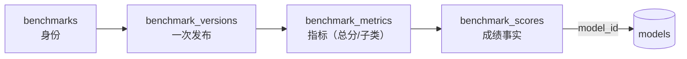

**`benchmarks`**（与版本无关）

| 字段 | 类型 | 说明 |
|---|---|---|
| `id` / `slug` unique / `name` / `publisher` / `homepage_url` | | 榜单身份 |
| `category` | text（≤64） | 多值逗号枚举，固定顺序；coding / math / agent / general / multimodal / safety / other；综合榜标多个（如 `coding,math`）；空串视为 `general` |
| `description` / `status` | | `active` / `retired` / `hidden` |
| `created_at` / `updated_at` | timestamptz | |

> 一个榜常同时覆盖多个方向（LiveBench 的 6 个子类就是 coding / math / reasoning 混合）。`category` 因此建模为**多值**：固定顺序序列化，如 `coding,math`；按 category 过滤/分组时，任一命中即归属该组。不设「复合榜」专用标签、不为凑单值丢弃具体方向，也不因多值在聚合时重复计权。

**`benchmark_versions`**（一次发布的快照）

| 字段 | 说明 |
|---|---|
| `benchmark_id` / `version` / `as_of` | `UNIQUE(benchmark_id, version)` |
| `source_type` | `leaderboard` / `independent` / `self_reported` |
| `coverage` | `full` / `partial`；partial 不参与归一化 |
| `participant_count` / `score_min` / `score_max` | **分布属性放版本**，不逐条存 |
| `status` | `active` / `superseded` |
| `source_url` / `retrieved_at` / `note` | 溯源 |

**`benchmark_metrics`**（版本内的指标）

| 字段 | 说明 |
|---|---|
| `version_id` / `key` / `label` | `UNIQUE(version_id, key)` |
| `metric_kind` | percent / pass_at_1 / pass_at_k / elo / usd / seconds / score / unknown |
| `unit` / `scale_min` / `scale_max` / `higher_is_better` | 量纲 |
| `is_primary` | 每版至多一个 true；综合分只用它 |
| `sort` / `note` | 展示 |

> 为什么要单独一张表：LiveBench 同时发布总分和 6 个子类。若把子类建成「榜」，同一发布方会被计 7 次权，去极值也救不回来。

**`benchmark_scores`**（成绩事实）

| 字段 | 说明 |
|---|---|
| `metric_id` | FK → metrics，CASCADE |
| `model_id` | FK → models，SET NULL；未匹配为空 |
| `external_name` / `external_name_key` | 原榜名 + 确定性规范化键 |
| `match_status` | `matched` / `unmatched` / `ignored` |
| `raw_score` / `rank` / `ranked` | 事实：分数、名次、是否进总排名 |
| `source_url` / `retrieved_at` / `note` | 溯源 |

```text
UNIQUE (metric_id, external_name_key)
INDEX  (model_id, metric_id)
INDEX  (metric_id, rank)
```

`external_name_key` 规范化：NFKC → trim → lower → 连续空白/下划线/斜杠/点号折叠为 `-`。不做厂商前缀模糊匹配（模糊匹配交给别名建议，人工确认）。

## 6. 写入契约

### 6.1 上传 / 编辑

```jsonc
// 推荐：字符串简写 = provider 未知
{ "models": ["glm-5"], "tags": ["type:game"] }

// 推荐：指定服务方
{
  "models": [
    { "ref": "dsv4-flash", "provider": "openrouter", "note": "fp8" }
  ],
  "tags": ["type:game"]
}

// 混合：同一作品用多个模型，各自带 provider
{
  "models": [
    "glm-5",
    { "ref": "dsv4-flash", "provider": "deepseek" }
  ]
}

// 兼容（agent 契约，provider 未知）
{ "tags": ["model:dsv4-flash", "type:game"] }
```

- `models` 元素支持两种形态：字符串（`ref`，provider 未知）或对象 `{ref, provider?, note?}`。
- `ref` 接受 slug / name / alias / 数字 id，统一走 `resolve_model_refs`。
- `provider` 接受 `providers.slug` 或数字 id；**必须是已存在的 provider**，未知返回 422 并提示管理员补充，不做自由文本落库。
- `note` 落 `demo_revision_models.serving_note`，最长 100 字符。
- 写入落在**本次生成对应的 revision** 上（新上传建新 revision、编辑内容建新 revision）；demo 层不存模型列表（G18）。
- `tags` 中 `model:` 项在入口剥离，转成 `{ref, provider:null}`，**不再写入 `demo_tags` 作为事实**。
- 两者同时出现取并集，按 `model_id` 去重；同一 `model_id` 出现两次但 provider 不同时，**保留先出现的**并记一条警告（不静默二选一但不报错）。
- 至少一个模型引用（含 `unspecified` / `<vendor>-unknown` 兜底），否则 422。
- 解析不到时自动建 `candidate`（灰测名 → `unverified`），但只建实体、不写标签。

### 6.2 差集写入（替换 `sync_demo_models`）

**写入目标表是 `demo_revision_models`（按 `revision_id`）；`demo_models` 是视图，永不直接写。**

```text
S        = resolve(revision)    # {(model_id, provider_id|NULL, note)}
current  = SELECT model_id, provider_id, serving_note
           FROM demo_revision_models WHERE revision_id = ?
INSERT   S - current            source='api'
UPDATE   provider_id / serving_note 变化的行
DELETE   current - S
```

- 差集按 `model_id` 比较；provider / note 变化视为该行更新，不新增行（同一模型经不同 provider 算一条）。
- 不再全删重建：未涉及的链接不受影响。
- **每版只记本版**：新 revision **不继承**上一版的模型列表；「追加」是前端预填，不是数据模型行为（§5.3 / G18）。
- 与 revision 的创建 / 切换**同一事务**：revision 未落库前不写关联。
- 写 `provider_id` 前校验其存在且 `status='active'`，否则整次写入 422。

### 6.3 唯一写入面

模型关联的唯一写入面是 `DemoModelWriter`（§6.2，写 `demo_revision_models`）；读路径只读 `demo_models` 视图。

### 6.4 合并 / 撤销 / 归属

| 动作 | 规则 |
|---|---|
| 合并 | 迁 `demo_revision_models`（按 `(revision_id, model_id)` 去重）→ 迁别名 → 源置 `deprecated` + `merged_into` → **只刷新受影响作品的投影** |
| 撤销 | 按审计快照恢复链接/别名/状态 → 重刷投影 |
| 归属 | **只改对应 revision 的 `demo_revision_models`**（差集 writer），视图与投影自动跟随；不再要求回写标签 |

### 6.5 基准导入

独立入口，不参与上面的双写链路：

```text
1. upsert benchmarks           by slug
2. upsert benchmark_versions   by (benchmark_id, version)；旧版本 superseded
3. upsert benchmark_metrics    by (version_id, key)
4. upsert benchmark_scores     by (metric_id, external_name_key)
5. 解析模型：alias → slug → name；未命中 → 收件箱
6. 整批事务；任何校验失败全部回滚
```

**基准不带 provider 维度**（已定）：`benchmark_scores` 只记 `model_id`。若榜方明确注明测的是某个 provider，写进 `note` 供人工参考，不参与计算。

### 6.6 models.dev 导入与同步

#### 6.6.1 原则

1. **上游是参考源，不是运行时依赖**：models.dev 不可用时，本站全部功能照常；导入后数据即我们的数据。
2. **本地镜像，不做实时查询**：models.dev 只提供整包 JSON（约 10MB），没有搜索接口；后台搜索查本地镜像。
3. **字段级来源**：是否被上游覆盖由 `model_spec_fields` 逐字段判定，不看行级 `source`。
4. **手工优先**：`source=manual` 或 `locked=true` 的字段永不被同步覆盖。
5. **默认只显官方条目**：`provider_id == canonical_id` 前缀才算官方；聚合平台条目默认折叠。

#### 6.6.2 新增表

| 表 | 作用 |
|---|---|
| `model_catalog_items` | 上游目录镜像（可搜索、离线可用） |
| `model_external_refs` | `(source, provider_id, external_id) → model_id` |
| `model_spec_fields` | 字段级来源与锁定 |
| `model_source_sync` | 目录刷新状态（一个来源一行） |

目录里的 `provider_id` / `provider_name` 会同步进 `providers` 表（`source='models.dev'`）：

```text
kind = (provider_id == canonical 前缀) ? 'official' : 'aggregator'
vendor_id = kind == 'official' ? vendors[slug=provider_id].id : NULL
```

已存在同名 provider 时不覆盖人工维护的 `name` / `homepage_url`（`source='manual'` 优先）。

DDL 见 §8.1。

#### 6.6.3 上游条目 → 本地实体

```text
canonical_id = "deepseek/deepseek-v4-flash"
vendor_slug  = canonical 前缀 "deepseek"
vendor       = vendors[slug='deepseek']（缺失时按 §5.4 规则新建）
is_official  = (provider_id == vendor_slug)
slug         = _slugify_unique(上游 name)
```

规则：

- 展示名去掉 `:free`、`(free)` 这类渠道标记；原文保留在 `external_id`。
- **无 `canonical_id` 时（8890 条里约 1300 条）：`vendor_id` 留空**，在 diff 里标「需人工确认厂商」，**不从 `provider_name` 建 vendor**——否则从 Bothub / OpenRouter 导入会造出「Bothub」这种假厂商。
- 同一 canonical 的多个 provider 条目**只建一个 `Model`**，其余全部记 `model_external_refs`。
- 若某 canonical 没有任何官方条目，搜索时退回显示聚合条目并标记「仅第三方收录」，仍可导入（`is_official=false`）。

上游还有三个可用字段（实测覆盖）：

| 字段 | 覆盖 | 用途 |
|---|---|---|
| `type` | 453/8890 | `image` / `embedding` / `video` / `speech` / `transcription` / `reranking` / `realtime` / `chat` → 落 **`model_catalog_items.model_type`**（镜像列），用于筛选与图标 |
| `status` | 977/8890 | `deprecated` / `beta` / `alpha` → 落 **`model_catalog_items.upstream_status`**，只在导入时提示，**不改我们的 `Model.status`** |
| `family` | 8458 | 模型家族（`deepseek-flash`）→ 落 **`model_catalog_items.family`**；是否进一步落业务侧**尚未定**（决策跟踪见台账） |

这三个字段只落**目录镜像** `model_catalog_items`（§8.1 的 `model_specs` 列集里没有它们）。

注意上游 `status=deprecated` 的条目有 904 条：导入默认过滤，需要时显式勾选「含上游已弃用」。这与我们的 `Model.status='deprecated'`（合并退役）是**两套语义**，不可混用。

#### 6.6.4 匹配链路

```text
1. model_external_refs(source, provider_id, external_id) 精确命中 → 同一模型
2. canonical_id 命中任意 ref                              → 同一模型（只加 ref）
3. ModelAlias 命中 external_id / canonical_id / name
4. Model.slug / Model.name 规范化命中
5. 仍未命中 → 返回候选（同厂商 + 名称相似），管理员选「关联 / 新建」
```

不静默建重复实体；「关联」等价于新增 external_ref + 别名。

#### 6.6.5 导入 vs 补全

| 模式 | 触发 | 写入 |
|---|---|---|
| **新建** | 未匹配 | `Model` + 选中字段写 `model_specs` + `model_spec_fields(source='models.dev')` + `model_external_refs` + 别名 + 审计 |
| **补全** | 已匹配 | 只写选中字段 + 新增 ref；不动 `manual` / `locked` |

差异视图逐字段给出：`字段 / 当前值 / 上游值 / 当前来源 / 是否锁定 / 勾选`。

- 值相同 → 不可勾选（no-op）。
- `manual` / `locked` → 默认不可勾选，需显式解锁。
- 应用后逐字段写 `model_spec_fields(source='models.dev')`。

#### 6.6.6 目录刷新

```text
手动：后台「刷新目录」按钮，随时可用
定时：modelsdev_sync_enabled=1 时按 interval 拉取（默认关闭）
```

- 拉取 → `payload_hash` 比较 → 变化才替换镜像（单事务）。
- 成功：`status=ok`、`last_success_at`、`item_count`。
- 失败：**保留旧镜像**，`status=stale` 并记 `error`；导入页显示「目录更新于 …」。
- 目录为空且从未成功 → 提示先刷新，不返回 500。

#### 6.6.7 后台交互

```text
/admin?tab=models&action=import
  [搜索] 名称 / id / canonical / 厂商
  [过滤] 仅官方（默认） | 含第三方收录 | 已导入 | 可补全
  结果行：名称 · 厂商 · 模态 · 上下文 · 价格 · 徽章（已导入 / 可补全 N 项）
  操作：查看差异 → 勾选字段 → 导入 / 补全
  批量：按厂商勾选多个未导入条目
```

模型详情（管理端）另有「从 models.dev 补全」入口，走同一 diff 组件。

#### 6.6.8 失败与降级

- 批量导入按条目独立事务：单条失败不影响已成功的，失败列表可重试。
- 上游字段消失 → **不清空本地值**，只在 diff 中标记「上游已移除」供人工判断。
- 上游改名 → canonical 不变即同一模型，只更新候选展示名，由管理员决定是否改 `Model.name`。

### 6.7 候选确认与手动新建

#### 6.7.1 状态与档案正交

**`status` 管生命周期，`model_specs` 管档案完整度，两者互不阻塞。**

| 组合 | 是否允许 | 说明 |
|---|---|---|
| `candidate` 有档案 | 允许 | 先导入档案、后确认 |
| `active` 无档案 | 允许 | 手动建的私有模型、上游没有的模型 |
| `active` 有档案 | 常态 | 从目录导入 |
| fallback 有档案 | **禁止** | 见 4.7.5 |

所以确认动作**不要求**先有档案；缺档案时用徽章提示，不拦上架、不拦展示。

#### 6.7.2 `candidate → active` 的确认流程

三个入口共用同一个确认面板：

1. 收件箱 `new_model` 批准
2. 管理端模型列表逐条确认
3. 管理端批量确认

面板内容：

```text
模型 Foo · candidate · 12 件作品 · 厂商 DeepSeek

[上游建议] 在 models.dev 找到 3 个候选（按名称 + 厂商实时搜索）
  ○ deepseek/deepseek-v4-flash    DeepSeek · 1M 上下文 · 官方
  ○ openrouter/deepseek-v4-flash  OpenRouter · 聚合
  ○ 跳过，稍后补档案

[操作] 关联并确认 | 仅确认（档案缺失） | 合并到已有模型 | 驳回
```

- 选条目 → 走 §6.6.5 的字段级 diff → 勾选 → 应用 → `status=active`。
- 选「仅确认」→ `status=active`，档案为空，列表加「档案缺失」徽章。
- 选「合并到已有」→ 转 `merge_model`（源 candidate 被合并，不保留）。
- 「驳回」只在该 candidate **没有任何作品引用**时才允许物理删除；有引用则只能合并或降级，避免孤儿链接。

**建议来源是实时查询**，不落表：对 `Model.name` 规范化后，在 `model_catalog_items` 按 `name` / `external_id` / `canonical_id` 模糊匹配，官方条目置顶。

#### 6.7.3 管理员手动新建

表单分两段，默认落在第一段：

| 段落 | 输入 | 结果 |
|---|---|---|
| **从目录选择**（默认） | 搜索目录 → 选条目 | 与「导入新建」完全同一条路径：`Model` + 档案 + `external_refs` + 别名 + 审计 |
| **手动新建** | `name` 必填；`vendor` 从下拉选择（可搜索 + 内联新建，写 `vendor_id`） | `slug` 自动生成；档案为空；状态默认 `active`（可改 `candidate`） |

规则：

- `vendor` **不是自由文本**：必须落到 `vendors` 表，避免再造 `DeepSeek` / `deepseek` / `深度求索` 三种写法。下拉里没有时可内联新建一条 vendor（写 `source='manual'`）。
- vendor 允许留空（未知），但列表会显示「厂商未标注」，且该模型不参与「官方 provider」判定。
- 手动新建时若名称命中目录条目，提示「发现同名上游条目，建议改用导入」，但**不阻止**——确实存在上游没有的私有模型。
- 手动新建的模型，详情页常驻「从 models.dev 补全」入口。
- 手动新建**不允许**直接选 `unspecified` / `<vendor>-unknown` 这类兜底名（它们由系统维护，见 4.7.5）。

#### 6.7.4 认领冲突

`model_external_refs` 的 `UNIQUE(source, provider_id, external_id)` 保证一个上游条目只能被一个 `Model` 认领。关联时若已被占用：

| 占用方状态 | 处理 |
|---|---|
| `candidate` / `unverified` | 提示「已由 X 认领」，给出合并入口；不允许第二个认领 |
| `active` | 拒绝，并给出对方模型链接 |
| `deprecated` | 拒绝，并指向其 `merged_into` 归宿 |

同理，**导入路径的匹配必须覆盖所有状态**（candidate / active / unverified），否则会造出「一个 active + 一个 candidate 指向同一上游条目」的重复。命中 `deprecated` 时报错，不自动复活。

#### 6.7.5 兜底实体（fallback）

`resolution ∈ {family, unknown, guess}` 的模型，包括 `unspecified` 与 `<vendor>-unknown`：

- **不得**有 `model_external_refs`，**不得**有 `model_specs`；
- 不参与目录匹配（导入搜索、确认建议都过滤掉）；
- 揭晓正确路径是 `attribute_demos` 把作品迁到真实型号 + 合并兜底实体，**不是**给它补档案。

这与现有 `attribute_demos` 要求目标 `resolution='exact'` 的约束一致。

#### 6.7.6 档案完整度（派生，不落库）

```text
missing  : 无 model_specs 行
partial  : 有行，但 context_window / modalities_in 任一为空
complete : 两者都有
```

用途：模型列表徽章、管理端筛选「档案缺失」、确认面板的默认提示。不参与排序或评分。

## 7. 读取契约

### 7.1 模型页

```text
模型页 = 档案（spec） + 站内表现（社区分/作品/题目） + 第三方基准（综合分/单榜）
```

三个区块独立取数、独立口径说明，不合并成一个「总分」。

**站内表现一律「按当前 revision」**（G18，与 G7 的题归属同构）：一件作品的模型归属取 `demos.current_revision_id` 对应的关联；历史 revision 用过的模型**不**参与统计。

### 7.2 站内社区分（已有口径，保持不变）

```text
s          = demo_stats（DemoStat；rating_* 已移出 demos，按 demo_id 1:1 取）
demo_count = COUNT(公开可见 demos)             # G1：moderation_state='approved' AND lifecycle_state='published' AND deleted_at IS NULL
votes      = SUM(s.rating_count)
wsum       = SUM(s.rating_avg * s.rating_count)
rating_avg = AVG(s.rating_avg)                  # 等权旧语义
score      = (wsum + m*C) / (votes + m)         # 贝叶斯收缩
C          = 全站票加权均分
m          = 各模型票数中位数（≥1）
```

排序键与展示值同源（SQL 里 `round(score, 2)`）。

**provider 不参与这条公式**：同一模型无论走哪个 provider，都计入同一个模型分。

**按当前 revision 计数**：`demo_count` / `votes` 的取数走 `demo_models` 视图（= 当前 revision 的投影）——「某模型的作品数」= **当前 revision 用了该模型**的作品数；换模型或回滚后跟着 `current_revision_id` 变。

### 7.2.1 provider 分布（只读展示）

模型页在社区分下方给一张分布表，**不改变上面的分数**：

```sql
-- 按当前 revision：demo_models 是视图（demos ⋈ demo_revision_models(current_revision_id)）
SELECT dm.provider_id,
       p.slug, p.name, p.kind,
       COUNT(DISTINCT dm.demo_id)           AS demos,
       AVG(NULLIF(s.rating_avg, 0))         AS avg_rating,
       SUM(s.rating_count)                  AS votes
FROM demo_models dm
JOIN demos d       ON d.id = dm.demo_id
LEFT JOIN demo_stats s ON s.demo_id = d.id
LEFT JOIN providers p  ON p.id = dm.provider_id
WHERE dm.model_id = :id
  AND d.moderation_state = 'approved'       -- G1 公开可见谓词
  AND d.lifecycle_state  = 'published'
  AND d.deleted_at IS NULL
GROUP BY dm.provider_id
ORDER BY demos DESC;
```

展示规则：

- `provider_id IS NULL` 归为一行「未标注」，永远排在最后。
- 分布里的 `avg_rating` 只做参考，**不参与排序**，也不进 `score`。
- 作品数少于 3 的行显示作品数、隐藏均分（样本太小）。
- 有 provider 的行可点进 `?model=<slug>&provider=<slug>` 的作品列表。

### 7.3 第三方归一化的参与条件

归一化方案（百分位 / min-max / 原始分）**尚未定**，决策跟踪见《设计决策台账》；本节只列**已定**的参与条件。

参与条件：`benchmark.status=active`、`version.status=active`、`coverage=full`、`source_type≠self_reported`、有 primary 指标、`ranked=true` 且有 `rank`、`K ≥ 3`。

未满足条件的版本不进入综合分（与 §9 不变量 #5 一致）。

### 7.4 综合分与偏离

```text
x(1) ≤ … ≤ x(N)

N ≥ 3 : composite = mean(x(2) .. x(N-1))     # 去 1 高 1 低
N == 2: composite = mean(x)                  # NOT_TRIMMED
N <= 1: composite = null                     # INSUFFICIENT

med = median(x); dev = x_i - med
N ≥ 4 且 |dev| ≥ 25 个百分位点 → strong / weak
MAD > 0 且 |0.6745*dev/MAD| ≥ 3.5 → 同样标记
```

- 基线用**中位数**，不用裁剪均值（否则循环论证）。
- 标记语义是「强项/弱项」，不是「榜单有错」。
- 被剔除的最高/最低必须展示（榜名 + 分数 + 方向）。

### 7.5 过滤与 facet

| 入口 | 目标 |
|---|---|
| `GET /demos?model=<slug>` | 唯一推荐路径，**按当前 revision** 走 `demo_models`（视图；回滚跟着回滚） |
| `GET /demos?model=<slug>&provider=<slug>` | 两者 AND；`provider` 缺省不过滤 |
| `GET /demos?provider=<slug>` | 单独按服务方过滤（跨模型） |
| `GET /demos?provider=none` | 只看「来源未标注」 |
| `GET /demos?tag=model:x` | 入口翻译为 `model=` |
| 作品库模型 facet | 读 `Model` 表，不读标签统计 |
| 作品库 provider facet | 读 `providers` 表，附带该 provider 的可选模型数 |
| 作品卡片 `models` | 只读实体，无标签兜底；provider 以徽章显示 |

> **口径统一（G18）**：`?model=` 筛选、「某模型的所有作品」、`model_counts` 计数一律**按当前 revision** 判定（与 G7 的题归属同构）；历史 revision 用过的模型**不进**这些结果。

## 8. 数据库对象与 DDL

### 8.1 新增表（12 张）

`vendors`、`providers`、`model_specs`、`benchmarks`、`benchmark_versions`、`benchmark_metrics`、`benchmark_scores`，models.dev 同步用的 `model_catalog_items`、`model_external_refs`、`model_spec_fields`、`model_source_sync`，以及 **`demo_revision_models`**（revision ↔ 模型；本域拥有、Demo 域引用）。参考 DDL：

> `demo_revision_models` 的 DDL 与配套视图 `demo_models` 见 **§5.3**（不在此重复，避免两处漂移）。

> **DDL 见 [60-model.sql](../../db/schema/60-model.sql)**（本节涉及的 11 张表/视图：`vendors` / `providers` / `model_specs` / `benchmarks` / `benchmark_versions` / `benchmark_metrics` / `benchmark_scores` / `model_catalog_items` / `model_external_refs` / `model_spec_fields` / `model_source_sync`）。表结构以 SQL 文件为准，文档不再复制。

### 8.2 改现有表

> **DDL 见 [70-views.sql](../../db/schema/70-views.sql)**（本节涉及的 1 张表/视图：`demo_models`）。表结构以 SQL 文件为准，文档不再复制。

注意：PG 的 `ALTER TABLE ... ADD COLUMN` 加 `REFERENCES` 时该列默认即可空（不写 `NOT NULL` 就是 NULL）。这与「provider 未知」的语义正好一致。

### 8.3 配置/状态键（**不建 `settings` 表**）

> **本节的 `settings` 表已作废**（2026-11-01）。全仓只有一套设置机制：
> [`设置域设计.md`](../设置域设计.md) 的 `setting_keys` + 两张值表，DDL 在
> [`db/schema/15-settings.sql`](../../db/schema/15-settings.sql)。本节原先自建的表从未建过，
> 且 `0` / `1` 的写法违反 [`DDL约定.md`](../DDL约定.md) §2「boolean 不用 0/1」。

| 原键 | 现在在哪 |
|---|---|
| `model_benchmark_scale` | **不进设置**。它决定综合分怎么算，改了要重算历史榜单——正是设置域 J2 要挡的。登记在 [`运行手册-可变常量.md`](../运行手册-可变常量.md) §6 |
| `modelsdev_sync_enabled` | 设置域 `modelsdev.sync_enabled`（site boolean，默认 `false`） |
| `modelsdev_sync_interval_hours` | 设置域 `modelsdev.sync_interval_hours`（site number，默认 `24`） |
| `modelsdev_search_official_only` | 设置域 `modelsdev.search_official_only`（site boolean，默认 `true`） |

### 8.4 不需要做的

- 不给 `models` 加 `demo_count` / `score` 等冗余列。
- 不改 `models` 主键；`demo_models` 已由表改为**视图**（不再有主键，G18）。
- 不动 `tags` / `tag_keys` 结构。
- 不物化社区分（等 `/benchmarks` 变热再评估）。
- **不删 `models.vendor` 文本列**：存量展示仍依赖它，`vendor_id` 才是权威。

## 9. 不变量

1. revision 与模型的关联（`demo_revision_models`）只能由 `DemoModelWriter` 写入；`demo_models` 是只读视图。
2. 任何业务逻辑不得从 `model:` 标签反推关联。
3. `match_status='matched'` ⇔ `model_id IS NOT NULL`。
4. 每个 `benchmark_version` 至多一个 `is_primary=true`。
5. `coverage='partial'` 或 `source_type='self_reported'` 的版本不进入综合分。
6. `param_kind` 与 `param_total_b` 的空值语义一致。
7. `models.slug` 不可变；改名只改 `name`。
8. `demo_models.provider_id` 为空表示未知，**不得回填推断值**；不得用哨兵实体冒充未知。
9. `provider_id` 非空时必须存在于 `providers` 且 `status='active'`。
10. provider **不改变**社区分与综合分的计算口径：分数仍按模型聚合，provider 只做分布展示。
11. 兜底实体（`resolution ∈ family/unknown/guess`）不得有 `model_external_refs` 或 `model_specs`。
12. 同一 `(source, provider_id, external_id)` 只能被一个 `Model` 认领。
13. `status` 与档案完整度正交：`active` 允许无档案，`candidate` 允许有档案。
14. `providers.vendor_id` 与 `models.vendor_id` 都非空且相等时，该 provider 才是该模型的官方服务方。
15. `vendors.slug` 来自 `canonical_model_id` 前缀，不得手改成自由文本。
16. 兜底实体与 fallback 服务方（`unspecified` 等）不参与 vendor 判定。
17. `demo_models` 是只读视图；`demos` 层**不得**冗余存「当前模型」列或模型计数（G18：demo 层纯派生，「当前」由 `current_revision_id` 决定）。

## 附录 A：UML 视图

### A.1 身份与档案（ER）

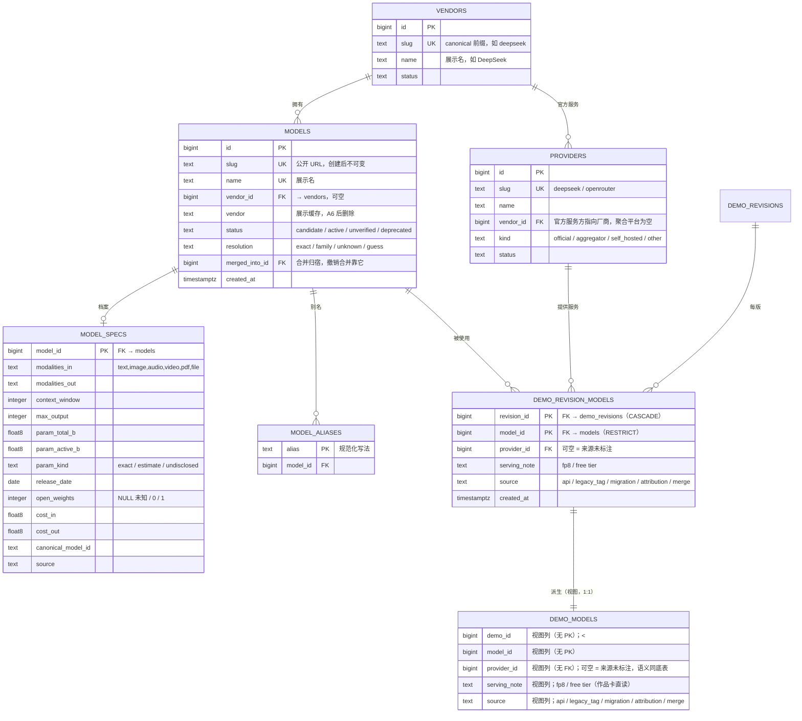

读数要点：

- 作品只通过 **revision** 的 `DEMO_REVISION_MODELS` 指向模型；`DEMO_MODELS` 是**当前 revision 的视图**（`<<view>>`），**不再看标签**。
- `DEMO_MODELS` 是 **1:1 派生视图**：视图行数 = 当前 revision 在 `DEMO_REVISION_MODELS` 里的行数（不聚合、不去重），所以 ER 基数写 `||--||`。**视图实体不标 PK / FK**（视图没有键约束，键语义只在底表上；跨三份文档统一此画法）。
- `MODEL_ALIASES` 只用于「外部名 → `model.id`」的解析，不参与关联存储。
- `MODEL_SPECS` 一行一个模型，未知值留 NULL + `param_kind`，不写 0。
- `DEMO_MODELS.provider_id` 可空：空 = 来源未标注，**不是**某个「未知 provider」实体。

### A.1.1 provider 选择与展示

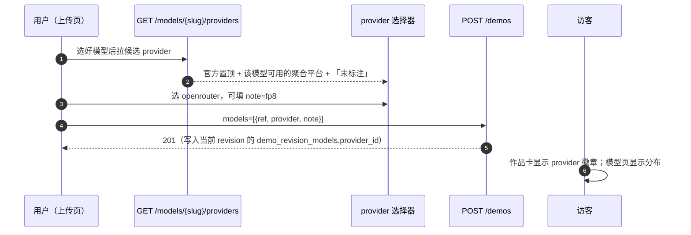

要点：

- 候选列表来源：`model_external_refs`（该模型在目录里出现过哪些 provider）+ 全部 `kind='official'` 且 `vendor_id` 匹配的条目。
- 没选 = `provider_id NULL`，UI 显示「来源未标注」，与「选了但不知道」区分开的是 **note**，不是空值。
- 一个模型若没有任何 external_ref（人工建的），选择器只给「官方（若有）+ 未标注」，不阻塞上传。

### A.1.2 候选确认

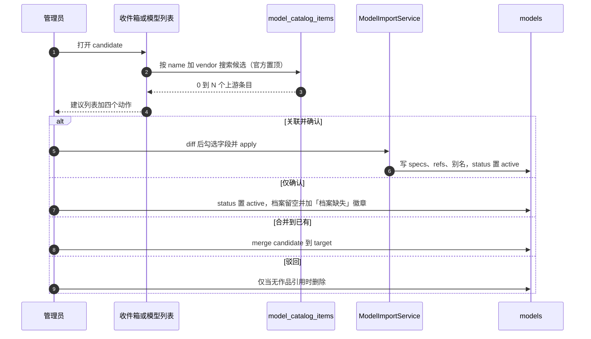

关键约束：

- 建议是**实时搜索**，不落「建议表」——候选改名后不会留下过期建议。
- 「仅确认」是一等公民，不是降级路径：私有模型合法存在。
- 「驳回」有作品引用时不可删除，只能合并。

### A.2 第三方基准（ER）

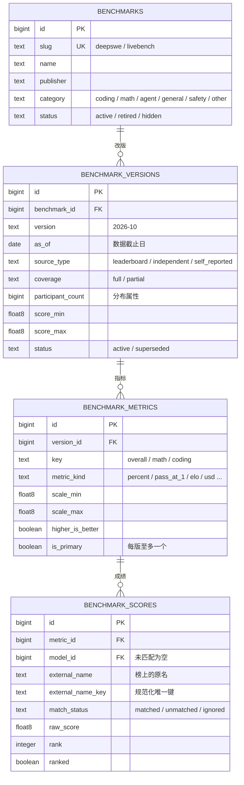

读数要点：

- 「榜」只有身份；「版本」才有量纲、参赛数、来源类型。
- 总分与子类分是同一版本下的不同 **metric**，综合分只取 `is_primary=true`。
- `self_reported` 版本照常入库，但不参与综合分。

### A.3 状态机

模型生命周期：

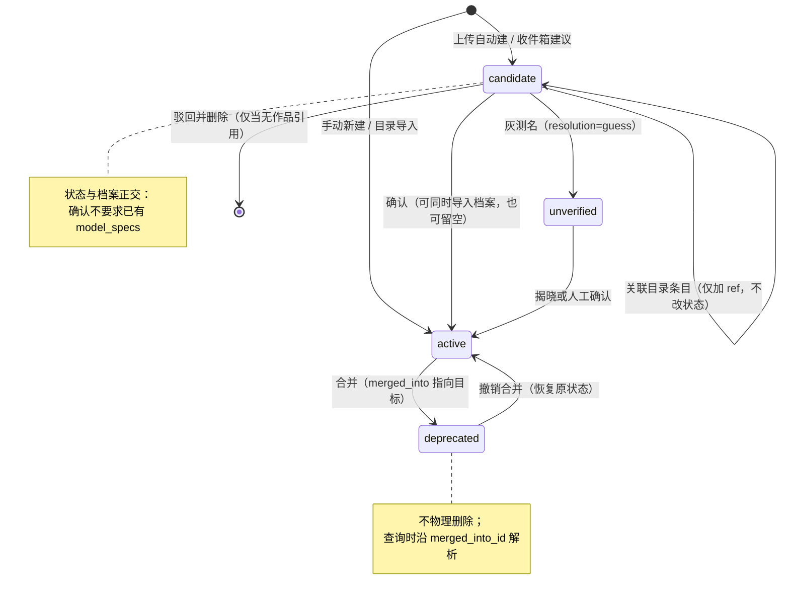

榜单与版本状态：

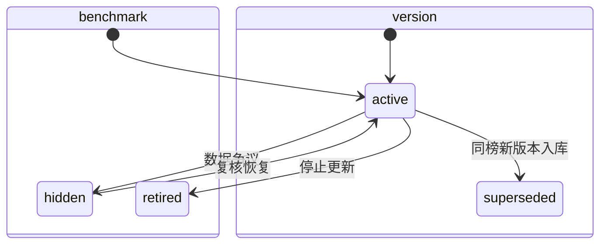

### A.4 写入时序（上传 / 编辑）

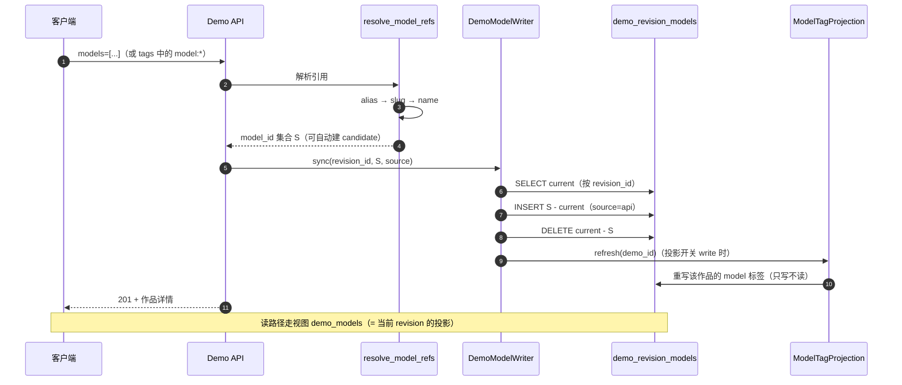

关键差异：**只有差集变化**，不再「先清空再重建」。

### A.5 合并时序

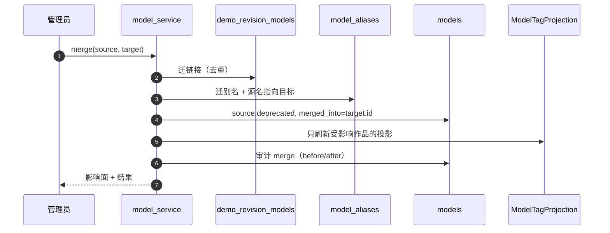

撤销合并按审计快照反向执行；榜分与历史链接不搬迁。

### A.6 写读职责矩阵

| 表 | 写入者 | 读取者 | 备注 |
|---|---|---|---|
| `models` | 上传自动建 / 管理端 / 收件箱 | 列表、详情、过滤、基准匹配 | `slug` 不可变 |
| `model_aliases` | 自动建、别名管理、合并 | 解析入口、搜索 | 唯一解析表 |
| `model_specs` | models.dev 脚本 / 管理端 | 模型页档案 | 未知留 NULL |
| `demo_revision_models` | **仅 `DemoModelWriter`** | 仅 `created_at` 等审计列时直读 | 唯一事实源（revision 级，PK `(revision_id, model_id)`） |
| `demo_models`（视图） | **无（只读）** | 列表、详情、facet、基准覆盖率、`serving_note` / `source` | 当前 revision 的投影（G18） |
| `benchmarks` | 导入脚本 | 基准页、模型页 | 与版本解耦 |
| `benchmark_versions` | 导入脚本 | 归一化、展示 | 新版入库旧版 superseded |
| `benchmark_metrics` | 导入脚本 | 综合分、画像 | 每版至多一个 primary |
| `benchmark_scores` | 导入脚本 | 归一化、展示 | 未匹配进收件箱 |
| `tags`（`key=model`） | 投影函数 | 兼容期 `?tag=model:x` | A6 后删除 |

### A.7 目标组件（写路径）

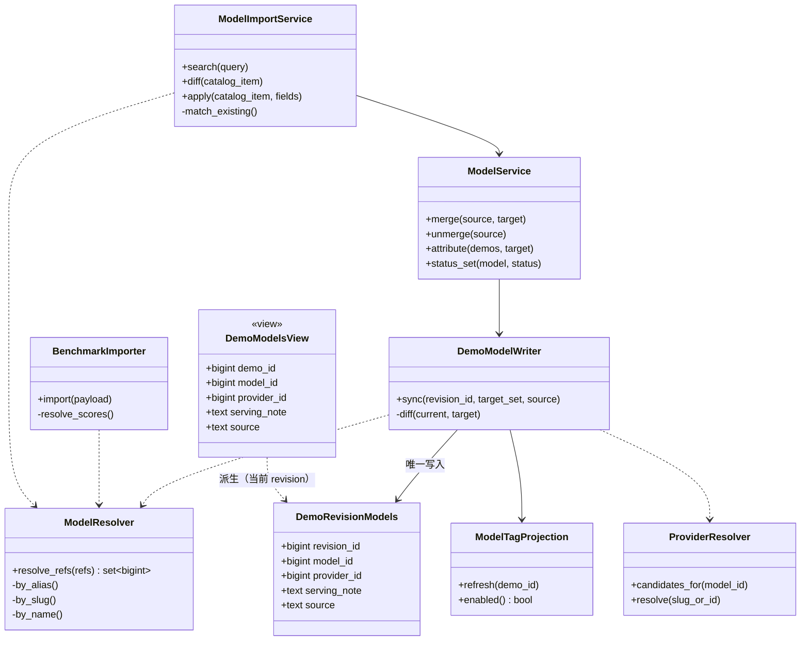

这**七个**组件是重构后**唯一**允许触碰模型关联的地方；路由与前端都不直接写表。`DemoModelsView` 只是读面（`<<view>>`），不构成写入方。`DemoModelWriter.sync()` 的 `target_set` 即 §6.2 / A.4 里解析出的 `S`。

### A.8 models.dev 导入与同步

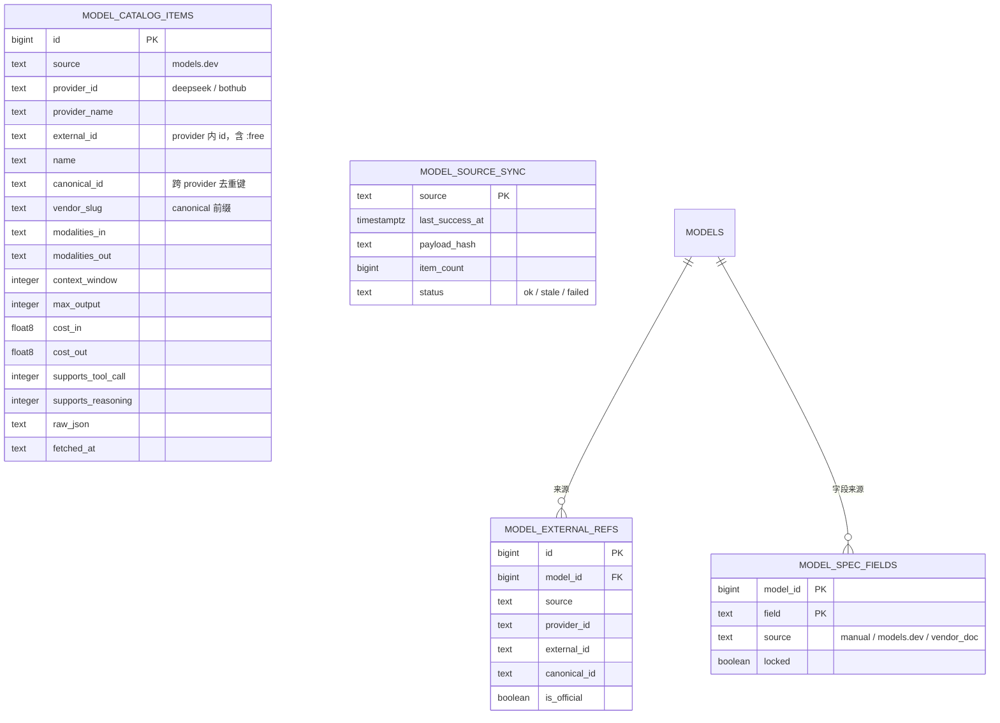

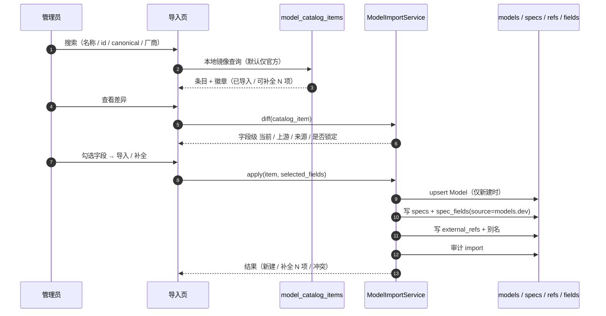

读数要点：

- `model_catalog_items` 是**上游镜像**，删掉也不影响本站数据；导入后数据在 `models` / `model_specs`。
- 一个 `canonical_id` 对应一个 `Model`，但可以有多个 `model_external_refs`（官方 + 聚合平台）。
- `model_spec_fields.locked=true` 或 `source=manual` 的字段，在 diff 里默认不可勾选。

## 附录 B 新旧章节对照

本文是目标态抽取版；完整版 [`../模型域设计.md`](../模型域设计.md) 还含现状诊断、迁移路线（Lane A/B/C）、验收与回滚、风险、开放问题与过渡期结构。

| 本文 | 完整版 |
|---|---|
| §1 设计理念 | §1 问题诊断（提炼）+ §2 两条硬规则 |
| §2 决策摘要 | §0 |
| §3 领域边界 | §2 |
| §4 DDL 约定 | 全仓《DDL 约定》 |
| §5 实体设计 | §3.1–§3.7 |
| §6 写入契约 | §4.1–§4.7 |
| §7 读取契约 | §5.1–§5.5（§5.3 只留已定的参与条件） |
| §8 数据库对象与 DDL | §6.1–§6.4 |
| §9 不变量 | §3.9 |
| 附录 A UML 视图 | 附录 A（A.x 标号未变） |
| —（不收录） | §1.1–§1.2 原文、§3.8、§7 迁移路线、§8 验收与回滚、§9 风险、§10 开放问题、§11 过渡期与退役、附录 B 变更记录 |
