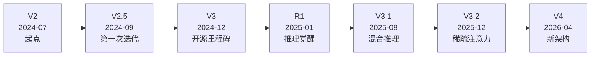
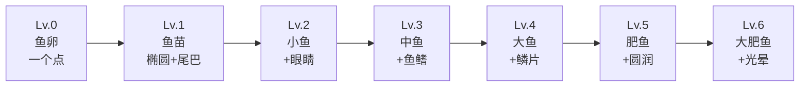
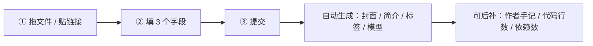

# 社区产品设计 v1.0

**适用范围**：本文定义社区的**产品形态**——定位、目标人群、等级系统、默认头像、内容形态、氛围机制。不含代码设计，不含论坛选型（见 [`论坛外置选型对比.md`](./论坛外置选型对比.md)），不含身份数据模型（见 [`身份服务模型设计.md`](./身份服务模型设计.md)）。

**本文要回答**：社区要做成什么样，才配得上「下一个类 b 站社区」这个野心。

---

## 0. 结论摘要

| 议题 | 结论 |
|---|---|
| 定位 | **程序作为内容**（program-as-content），不是「作品库」 |
| 目标人群 | 民间开发者（技术弱、能动性强）+ 普通访客（不写代码但爱看） |
| 等级命名 | **DeepSeek 版本号**（V2 → V2.5 → V3 → R1 → V3.1 → V3.2 → V4），双轨显示 `V3.1 · Lv.5` |
| 默认头像 | **原创「鱼」系列**（鱼卵 → 大肥鱼），程序化生成，零版权风险 |
| 经验分享 | 三层：作者手记（每个作品）/ 经验帖（论坛分类）/ 新人报到 |
| 有趣 demo | 三个榜：编辑精选 / 本周意外之作 / 「这也行？」榜 |
| 氛围机制 | ML 术语做社区黑话（开炉 / 收敛 / loss 爆炸），但**克制**，不做成梗图站 |
| 最大风险 | **商标**（DeepSeek 是深度求索的商标）+ **门槛**（民间开发者填不动表单） |

---

## 1. 定位：程序作为内容

### 1.1 目标人群

| 人群 | 特征 | 他们要什么 | 他们怕什么 |
|---|---|---|---|
| **民间开发者** | 技术实力不强，但主观能动性强；靠模型智能弥补 | 被看见、被认可、找到同类 | 被技术大佬俯视；填一堆表单；部署失败 |
| **普通访客** | 不写代码，但爱看有意思的东西 | 3 秒看懂、能玩、能分享 | 看不懂、要注册、要装环境 |

**关键洞察**：这两类人的共同点是——**都不想读 README**。

### 1.2 存在的意义

> 「未来程序开发和现在做视频差不多。程序可以变成一个内容来观赏了。程序水平不是一个主要的评价要素了，换成了创意。或许现在的 demo 站就是下一个类 b 站社区。」

这句话是整个设计的原点。它推出三个判断：

| 判断 | 含义 |
|---|---|
| **程序 = 内容** | 作品要被「消费」，不是被「使用」 |
| **创意 > 技术** | 评价维度从「代码质量」转向「想法 + 完成度」 |
| **观赏 > 运行** | 大多数人不会真的跑起来，他们要「看」 |

### 1.3 三个设计推论

#### 推论一：作品必须有「预告片」

如果程序是内容，那它需要内容的基本配置：

| 内容形态 | 对应物 | 现状 |
|---|---|---|
| 封面 | 缩略图 | 有 `cover_url` / `cover_thumb_url` |
| 预告片 | **15 秒动图 / 视频** | ❌ 缺 |
| 标题 | 作品名 | 有 |
| 简介 | 3 句话说清是什么 | 有 `description`，但常写成技术文档 |
| 正片 | 在线可运行 | ❌ 多数只有 GitHub 链接 |

**缺口最大的是「预告片」和「在线可运行」。**

#### 推论二：评价维度要显式声明

如果创意 > 技术，那评分维度必须体现这一点。否则用户还是会按「代码写得好不好」打分。

**设计**：评分拆成三个维度（详见 §5.2）：

| 维度 | 权重 | 说明 |
|---|---|---|
| **想法**（Idea） | 40% | 这个点子有意思吗 |
| **完成度**（Craft） | 35% | 做完整了吗，能跑吗 |
| **观赏性**（Show） | 25% | 看得懂吗，想分享吗 |

**注意**：不设「技术难度」维度。这是刻意的——技术难度会劝退民间开发者。

#### 推论三：门槛必须压到「3 步」

民间开发者的最大流失点是**表单**。旧栈的上传流程要填 20+ 字段（`demos` 表 34 列）。

**设计**：上传只需 3 步（详见 §7）：

1. 拖文件 / 贴链接
2. 填 3 个字段（标题、一句话灵感、分类）
3. 提交

其余字段（封面、简介、标签、模型）**自动生成 + 可后补**。

---

## 2. 等级系统

### 2.1 命名：DeepSeek 版本号

**为什么用版本号而不是 L0–L6**：

| 方案 | 优点 | 缺点 |
|---|---|---|
| `L0`–`L6` | 清晰、通用 | 无个性，和任何社区一样 |
| `青铜/白银/黄金` | 直观 | 俗套，游戏味太重 |
| **DeepSeek 版本号** | **有叙事感、有社区认同、和站点主题一致** | 商标风险、版本会过时、新人不认识 |

**核心设计：双轨显示**

```
V3.1 · Lv.5
```

- **主显示**：`V3.1`（有味道，老用户有认同感）
- **副显示**：`Lv.5`（清晰，新人能理解）

内部数据仍是 `level = 0..6`（见 [`身份服务模型设计.md`](./身份服务模型设计.md) §6.1 的 `accounts.level`）。**版本号只是展示层**，这样将来 DeepSeek 出 V5 时可以重命名顶级，不影响数据。

### 2.2 七级映射

按 DeepSeek 的**里程碑**（不是每个小版本）取 7 个：



| 等级 | 版本 | 经验阈值 | 一句话人设 | 解锁 |
|---|---|---|---|---|
| Lv.0 | **V2** | 0 | 「刚学会说话」 | 浏览、收藏 |
| Lv.1 | **V2.5** | 200 | 「开始有点想法」 | 上传作品、评分、评论 |
| Lv.2 | **V3** | 1,500 | 「能干活了」 | 创建公开收藏夹、关注他人 |
| Lv.3 | **R1** | 4,500 | 「会思考了」 | 发起讨论、举报 |
| Lv.4 | **V3.1** | 10,800 | 「边想边做」 | 申请精选位 |
| Lv.5 | **V3.2** | 28,800 | 「想得更快」 | 参与内容审核投票 |
| Lv.6 | **V4** | 64,800 | 「换了个脑子」 | 荣誉（无额外权限） |

**为什么顶级用 V4 而不是 V4.1**：

V4.1（2026-09）和 V4.1-Flash-1017（2026-10）太新，如果现在就用 V4.1 做顶级，半年后 V5 出来又要改。**留一级空间**，V4.1 / V5 发布后可作为新的顶级（类似游戏资料片加等级上限）。

**为什么 R1 插在 V3 和 V3.1 之间**：

按时间线，R1（2025-01）确实在 V3（2024-12）之后、V3.1（2025-08）之前。而且 R1 是 DeepSeek 的转折点（推理能力），放在中间作为「觉醒」节点，叙事上很顺。

### 2.3 经验值来源

沿用 [`论坛外置选型对比.md`](./论坛外置选型对比.md) §8.3 的设计，但**调整权重**以匹配「创意 > 技术」的定位：

| 行为 | 经验 | 每日上限 | 为什么这个权重 |
|---|---|---|---|
| 每日登录 | +5 | 5 | 基础活跃 |
| 浏览作品 | +1 | 20 | 鼓励消费内容 |
| **上传作品（过审）** | **+50** | 200 | **核心行为，权重最高** |
| 作品被收藏 | +2 | 100 | 他人认可 |
| 作品被评分 | +1 | 50 | 他人认可 |
| **写作者手记** | **+15** | 45 | **鼓励分享经验**（§4.1） |
| 发帖 | +10 | 50 | 论坛活跃 |
| 回帖 | +5 | 50 | 论坛活跃 |
| 帖子被赞 | +3 | 100 | 他人认可 |
| 举报被采纳 | +20 | 100 | 治理激励 |
| 违规被处罚 | −50 | — | 无下限 |

**关键调整**：

1. **上传作品 +50**（原设计 +50，保持）——这是社区的核心供给
2. **新增「写作者手记 +15」**——鼓励分享经验，这是「看你介绍和分享经验」的落地
3. **不设「代码行数」「技术难度」相关经验**——避免技术崇拜

### 2.4 等级特权

**原则：等级只解锁「参与」，不解锁「曝光」。**

| 等级 | 解锁 | 不解锁 |
|---|---|---|
| Lv.0 | 浏览、收藏 | — |
| Lv.1 | 上传、评分、评论 | — |
| Lv.2 | 公开收藏夹、关注 | — |
| Lv.3 | 发起讨论、举报 | — |
| Lv.4 | 申请精选位 | — |
| Lv.5 | 参与审核投票 | — |
| Lv.6 | 荣誉 | — |

**关键**：等级**不影响**作品在首页的排序。这是 b 站的做法（等级不影响视频推荐），也是避免「老用户垄断曝光」的关键。

**唯一的例外**：Lv.0 不能上传。这是反垃圾的最低门槛。

### 2.5 商标风险与替代方案

**风险**：DeepSeek（深度求索）是注册商标。用它的版本号做等级名，可能被理解为「官方关联」或「背书」。

**缓解**：

| 措施 | 说明 |
|---|---|
| 站内声明 | 页脚注明「本站与深度求索无隶属关系，版本号仅作等级命名」 |
| 不用官方 logo | 等级图标自己画（§3），不用 DeepSeek 的鲸鱼 logo |
| 不用「官方」「认证」字样 | 避免暗示 |
| 保留改名能力 | 版本号只在展示层，改起来是配置项 |

**替代方案**（如果商标方反对）：

| 方案 | 示例 | 优点 | 缺点 |
|---|---|---|---|
| **A. 模型规模隐喻** | `tiny` → `small` → `base` → `large` → `xl` → `ultra` → `frontier` | 无商标风险，通用 | 无社区特色 |
| **B. 训练阶段隐喻** | `init` → `pretrain` → `sft` → `rlhf` → `dpo` → `distill` → `emerge` | 有技术味 | 太专业，新人不懂 |
| **C. 自造版本号** | `v0.1` → `v0.5` → `v1.0` → `v1.5` → `v2.0` → `v2.5` → `v3.0` | 中性 | 平淡 |

**推荐**：先用 DeepSeek 版本号（有味道），同时把替代方案 A 做成配置项，随时可切。

---

## 3. 默认头像

### 3.1 版权问题

用户提到「默认头像用大肥鱼（注意版权）」。这个提醒是对的。

**三类风险**：

| 风险 | 说明 |
|---|---|
| **直接使用他人作品** | 网上的「大肥鱼」图多半有作者，不能直接用 |
| **二次创作** | 即使改了颜色/加了元素，仍可能侵犯改编权 |
| **商标/角色形象** | 如果「大肥鱼」是某 IP 的角色，商用风险更高 |

**结论**：**不能用现成的「大肥鱼」图**。要么拿到授权，要么原创。

### 3.2 原创方案：鱼系列

**设计**：7 个等级对应 7 种「鱼」的形态，从鱼卵到大肥鱼。全部自己画（SVG），零版权风险。



| 等级 | 形态 | 视觉特征 | 隐喻 |
|---|---|---|---|
| Lv.0 | 鱼卵 | 一个半透明圆点 | 还没开始 |
| Lv.1 | 鱼苗 | 椭圆 + 小尾巴 | 刚孵化 |
| Lv.2 | 小鱼 | + 眼睛 | 有意识了 |
| Lv.3 | 中鱼 | + 背鳍 + 腹鳍 | 能游了 |
| Lv.4 | 大鱼 | + 鳞片纹理 | 长大了 |
| Lv.5 | 肥鱼 | 更圆润 + 腮红 | 吃得好 |
| Lv.6 | 大肥鱼 | + 光晕 + 气泡 | 成精了 |

**为什么用鱼**：

1. 用户提到「大肥鱼」，说明团队喜欢这个意象
2. 鱼有「成长」的天然叙事（鱼卵 → 大鱼）
3. 鱼好画（几何形状少），程序化生成容易
4. 和 DeepSeek 的鲸鱼 logo 有呼应但不冲突（鲸鱼是哺乳动物，鱼是鱼）

### 3.3 生成规则

**目标**：每个用户的默认头像**独一无二**，但同一等级有共同特征。

**输入**：`hash(username)` → 一个 32 位整数

**输出**：一个 SVG，包含：

| 元素 | 由什么决定 | 取值范围 |
|---|---|---|
| 鱼的形态 | `level` | 7 种（§3.2） |
| 主色 | `hash % 360` | HSL 色相 0–359 |
| 饱和度 | `(hash >> 8) % 30 + 55` | 55%–85% |
| 明度 | `(hash >> 16) % 20 + 45` | 45%–65% |
| 花纹 | `(hash >> 24) % 4` | 无 / 斑点 / 条纹 / 渐变 |
| 朝向 | `(hash >> 28) % 2` | 左 / 右 |

**关键约束**：

| 约束 | 原因 |
|---|---|
| 纯 SVG，无位图 | 体积小（< 2 KB），任意缩放 |
| 无外部字体 | 避免字体加载失败 |
| 对比度 ≥ 4.5:1 | 无障碍（WCAG AA） |
| 同一 username 永远同一头像 | 幂等，可缓存 |
| 等级变化时形态变、配色不变 | 用户认得出「还是我」 |

**缓存策略**：`/avatars/default/{username_hash}/{level}.svg`，`Cache-Control: public, max-age=31536000, immutable`。

**用户上传头像后**：默认头像不再显示，但保留（用户删掉自定义头像后回落）。

---

## 4. 经验分享

用户提到「看你介绍和分享经验」。这是社区最容易被忽略、但最能建立认同的部分。

### 4.1 作者手记（每个作品附带）

**设计**：每个作品有 3 个固定问题，**必填但只需一句话**。

| 问题 | 字数 | 为什么问 |
|---|---|---|
| **为什么做这个？** | ≤ 100 字 | 动机比功能更打动人 |
| **怎么做的？** | ≤ 100 字 | 给同类人参考，不用写教程 |
| **踩了什么坑？** | ≤ 100 字 | 最有价值的部分，也最容易被搜索到 |

**为什么是「3 个固定问题」而不是「自由文本框」**：

| 自由文本框 | 3 个固定问题 |
|---|---|
| 大多数人写「一个 xxx 项目」 | 强制回答「为什么」，逼出故事 |
| 不知道写什么 | 有引导 |
| 长度不可控 | 可控（每项 ≤ 100 字） |
| 难以结构化展示 | 可以做成卡片 |

**展示位置**：作品详情页的「作者手记」区块，折叠状态显示第一问，展开显示全部。

**经验值**：写完 3 问 +15 经验（§2.3）。

### 4.2 经验帖（论坛分类）

**设计**：论坛的 `#经验` 分类，三个子标签：

| 标签 | 内容 | 例子 |
|---|---|---|
| `#踩坑` | 我遇到的坑 + 怎么解决的 | 「Vite 8 的 rolldown binding 在 Windows 上被占用」 |
| `#工具` | 我用的工具 / 我写的工具 | 「用这个脚本批量生成封面」 |
| `#思路` | 我的想法 / 我的方法论 | 「为什么我把 prompt 拆成 5 段」 |

**与作者手记的区别**：

| | 作者手记 | 经验帖 |
|---|---|---|
| 位置 | 作品详情页 | 论坛 |
| 长度 | ≤ 300 字 | 不限 |
| 关联 | 绑定一个作品 | 独立 |
| 目的 | 让作品被理解 | 让经验被复用 |

### 4.3 新人报到

**设计**：一个轻量的「报到」表单，3 个字段：

| 字段 | 必填 | 说明 |
|---|---|---|
| 一句话介绍自己 | ✅ | ≤ 50 字 |
| 你做过什么 | ❌ | 作品链接或一句话 |
| 你想做什么 | ❌ | 一句话 |

**展示**：报到帖自动发到论坛 `#报到` 分类，且**不进入首页推荐**（避免刷屏）。

**经验值**：+10（一次性）。

**为什么要有**：

1. 降低「第一次发言」的心理门槛
2. 让老用户能发现新人
3. 给新人一个「我存在」的仪式感

---

## 5. 有趣的 demo

用户提到「放一些有趣的 demo」。这是**策展**问题，不是**存储**问题。

### 5.1 三个榜

| 榜 | 谁选 | 频率 | 标准 | 目的 |
|---|---|---|---|---|
| **编辑精选** | 编辑（人工） | 每周 | 综合质量 | 树立标杆 |
| **本周意外之作** | 算法 | 每周 | 低门槛 + 高互动 | 奖励创意 |
| **「这也行？」榜** | 算法 + 编辑 | 每月 | 最出人意料的用法 | 制造话题 |

### 5.2 评分维度

**设计**：评分拆成三维（§1.3 推论二）：

| 维度 | 权重 | 问用户的问题 | 1 分 | 5 分 |
|---|---|---|---|---|
| **想法** | 40% | 这个点子有意思吗？ | 见过很多次 | 从没见过 |
| **完成度** | 35% | 做完整了吗？ | 半成品 | 能顺畅用 |
| **观赏性** | 25% | 想分享给别人吗？ | 不想 | 立刻转发 |

**综合分** = `0.4 × 想法 + 0.35 × 完成度 + 0.25 × 观赏性`

**关键**：**不设「技术难度」维度**。这是刻意的——技术难度会劝退民间开发者，也会让「用 10 行代码做出惊艳效果」的作品吃亏。

**与旧栈的对比**：

| | 旧栈 | 新设计 |
|---|---|---|
| 维度 | 单一总分（1–5） | 三维加权 |
| 匿名可评 | ✅（可刷票） | ❌（需登录，Lv.1+） |
| 展示 | 平均分 | 三维雷达图 + 综合分 |

**为什么改成需登录**：旧栈的匿名评分可刷票是「已记录的刻意取舍」（`docs/redesign-v3/02-需求与痛点.md:184`）。但既然要做「类 b 站社区」，评分的可信度就是核心资产，不能再牺牲。

### 5.3 「这也行？」榜的算法

**目标**：找出「技术门槛低但效果出人意料」的作品。

**信号**：

| 信号 | 权重 | 说明 |
|---|---|---|
| 收藏 / 浏览比 | 高 | 收藏率高 = 真的有用/有趣 |
| 评论数 / 浏览比 | 高 | 评论多 = 引发讨论 |
| 分享数 | 中 | 愿意转发 |
| **代码行数（少）** | 中 | 越少越「这也行」 |
| **依赖数（少）** | 中 | 越少越「这也行」 |
| 作者等级（低） | 低 | 新人做出好东西更惊喜 |

**公式**（示意）：

```
score = 0.3 × 收藏率 + 0.3 × 评论率 + 0.2 × 分享率
      + 0.1 × (1 - min(lines / 1000, 1))
      + 0.1 × (1 - min(deps / 20, 1))
```

**注意**：代码行数和依赖数是**可选字段**（作者填了才算），不填不影响其他信号。

### 5.4 精选位的申请制

**设计**：Lv.4+ 可以「申请精选位」，编辑审核。

**为什么是申请制而不是纯人工挑选**：

1. 编辑不可能看完所有作品
2. 申请制让作者主动表达「我觉得这个值得被看见」
3. 申请本身是一个信号（作者自己认为好）

**申请表单**：只需一句话「为什么它值得被精选」。

---

## 6. 有意思的小细节

用户提到「增加有意思的小细节」。这一节是**氛围层**——不影响功能，但决定「这个社区有没有味道」。

**总原则：克制。** 梗用多了会变成梗图站。目标是「会心一笑」，不是「哈哈哈」。

### 6.1 文案层（ML 术语做社区黑话）

| 场景 | 常规文案 | 社区文案 | 克制程度 |
|---|---|---|---|
| 上传作品 | 上传 | **开炉** | ✅ 有味道 |
| 审核通过 | 已通过 | **收敛** | ✅ |
| 审核拒绝 | 未通过 | **loss 爆炸** | ⚠️ 略重，可只在 tooltip 用 |
| 加载中 | 加载中… | **thinking…** | ✅ 很轻 |
| 404 | 页面不存在 | **token not found** | ✅ |
| 空列表 | 暂无内容 | **context is empty** | ✅ |
| 搜索无结果 | 无结果 | **no matching tokens** | ✅ |
| 浏览历史超限 | 已达上限 | **context window exceeded** | ✅ |
| 删除作品 | 删除 | **rollback** | ⚠️ 可能误解 |
| 恢复作品 | 恢复 | **checkpoint restored** | ✅ |

**取舍**：只保留 ✅ 的，⚠️ 的只在 tooltip / 二次确认里用，不放在主按钮上。

### 6.2 交互层

#### ① 首页「温度」滑块

**设计**：首页顶部一个滑块，标度 0.0–2.0，默认 0.7。

| 值 | 效果 |
|---|---|
| 0.0 | 纯按热度排序（确定性） |
| 0.7 | 默认，热度 + 一点随机 |
| 1.5 | 明显随机，能刷到冷门 |
| 2.0 | 完全随机 |

**为什么有意思**：把「推荐算法」这个黑箱变成一个可调的旋钮。用户能直观感受到「温度高 = 更意外」。

**技术含义**：对应 softmax 的 temperature 参数。0 = argmax，∞ = 均匀分布。

#### ② 作品卡的「一句话灵感」

**设计**：作品卡 hover 时，在封面下方浮出一行小字——作者手记的第一问（「为什么做这个？」）的**第一句**。

**为什么有意思**：让「动机」在列表页就能被看到，而不是点进去才知道。

#### ③ 升级动画

**设计**：等级提升时，全屏播放一个 3 秒动画：

```
[■■■■■■□□□□] 62%  →  [■■■■■■■□□□] 71%  →  ...  →  [■■■■■■■■■■] 100%
                                                      「V3.1 · Lv.4」
```

进度条 + 一个「loss 下降」的曲线（装饰性）。

**为什么有意思**：把「升级」这个抽象事件变成一个「训练完成」的仪式。

**克制**：只播一次，可跳过，不阻塞操作。

#### ④ 随机彩蛋

**设计**：1% 概率在页脚显示一句 DeepSeek 论文/公告里的话（带出处链接）。

**例子**：

> 「We believe scaling laws continue to hold.」
> —— DeepSeek-V3 Technical Report

**为什么有意思**：给技术型用户的小惊喜，且带出处（不侵权）。

**克制**：只在页脚，不弹窗，不打断。

### 6.3 仪式感（徽章）

| 徽章 | 触发 | 名字 |
|---|---|---|
| 第一次上传 | 首个作品过审 | **first forward pass** |
| 首个百收藏 | 任一作品收藏 ≥ 100 | **100 checkpoints saved** |
| 连续 30 天 | 连续登录 30 天 | **30 epochs completed** |
| 首个精选 | 首次进编辑精选 | **featured in the wild** |
| 首个「这也行」 | 首次进「这也行？」榜 | **wait, that works?** |
| 一年老用户 | 注册满 1 年 | **one year of training** |

**展示**：用户主页的徽章墙。**不影响等级**（徽章是荣誉，不是进度）。

---

## 7. 降低门槛（针对民间开发者）

这是**最重要但最不显眼**的一节。如果门槛压不下去，前面所有设计都是空的。

### 7.1 上传流程：3 步



**必填只有 3 个**：

| 字段 | 为什么必填 |
|---|---|
| 标题 | 没标题没法展示 |
| 一句话灵感 | 这是「内容」的核心（§1.3 推论一） |
| 分类 | 至少知道放哪个区 |

**其余全部自动或可选**：

| 字段 | 怎么处理 |
|---|---|
| 封面 | 从截图/代码里提取主色，生成渐变封面 |
| 简介 | 用「一句话灵感」+ 自动摘要生成，可改 |
| 标签 | 从标题/简介里抽关键词，可改 |
| 模型 | 从代码/配置里探测（`deepseek-*` 字符串），可改 |
| 作者手记 | 可后补（+15 经验激励） |
| 代码行数 / 依赖数 | 可选（只影响「这也行？」榜） |

### 7.2 托管

**问题**：民间开发者最怕「部署」。

**设计**：提供「一键托管」——上传 zip，平台跑起来，给一个 `xxx.deepdemos.xxx` 的子域。

**约束**：

| 约束 | 值 |
|---|---|
| 支持的类型 | 静态站（HTML/JS）、Python（FastAPI/Flask）、Node.js |
| 资源限制 | 0.5 CPU / 512 MB / 1 GB 磁盘 |
| 生命周期 | 30 天无访问自动休眠，访问时唤醒 |
| 安全 | 沙箱隔离，禁网（可选开） |

**为什么值得做**：这是「程序作为内容」的最后一公里。如果作品只能看截图，那还是「作品库」；如果能点开就玩，才是「内容」。

### 7.3 模板化 README

**问题**：民间开发者不会写 README。

**设计**：提供 3 个模板，填空即可：

| 模板 | 适用 |
|---|---|
| 「我做了个东西」 | 通用 |
| 「我解决了一个问题」 | 工具类 |
| 「我试了个疯狂的想法」 | 实验类 |

每个模板 5 个空，填完自动生成 Markdown。

---

## 8. 与现有设计的关系

### 8.1 对等级系统的修订

本文 §2 修订了 [`论坛外置选型对比.md`](./论坛外置选型对比.md) §8.2 的等级命名：

| | 原设计 | 本文 |
|---|---|---|
| 命名 | `L0`–`L6` | `V2` / `V2.5` / `V3` / `R1` / `V3.1` / `V3.2` / `V4` |
| 阈值 | 0 / 200 / 1,500 / 4,500 / 10,800 / 28,800 / 64,800 | **不变** |
| 特权 | 浏览 / 上传 / 收藏夹 / 讨论 / 精选 / 审核 / 荣誉 | **不变** |
| 经验来源 | 10 项 | **+1 项（作者手记 +15）** |

**数据层不变**：`accounts.level` 仍是 `0..6`（[`身份服务模型设计.md`](./身份服务模型设计.md) §6.1）。版本号只是展示层。

### 8.2 对评分系统的修订

本文 §5.2 修订了旧栈的单一总分：

| | 旧栈 | 本文 |
|---|---|---|
| 维度 | 1 个（总分 1–5） | 3 个（想法 / 完成度 / 观赏性） |
| 匿名 | ✅ | ❌（需 Lv.1+） |
| 聚合 | 平均分 | 加权 + 雷达图 |

**影响**：`DemoRating` 表需要加 3 个维度列（见 [`Demo域设计.md`](./Demo域设计.md) §3.7）。

### 8.3 对 Demo 域的修订

本文 §1.3 推论一提出「预告片」缺口：

| 新增字段 | 类型 | 说明 |
|---|---|---|
| `trailer_url` | text | 15 秒动图/视频 |
| `runnable_url` | text | 在线可运行地址（托管或自建） |
| `author_note_why` | text | 作者手记·为什么做 |
| `author_note_how` | text | 作者手记·怎么做的 |
| `author_note_pitfall` | text | 作者手记·踩了什么坑 |
| `code_lines` | integer | 可选，用于「这也行？」榜 |
| `dep_count` | integer | 可选，同上 |

**注意**：这些字段属于 `DemoRevision`（不可变快照），不是 `Demo`（见 [`Demo域设计.md`](./Demo域设计.md) §3.2）。

### 8.4 对论坛的依赖

本文 §4.2 的「经验帖」依赖论坛的 `#经验` 分类。需要在 Discourse 部署时建这个分类（[`论坛外置选型对比.md`](./论坛外置选型对比.md) §10 第 ③ 步的「建 6 个分类」要改成 7 个）。

---

## 9. 风险与待拍板

### 9.1 已识别风险

| # | 风险 | 影响 | 缓解 |
|---|---|---|---|
| 1 | **DeepSeek 商标** | 法律风险 | 页脚声明 + 保留改名能力（§2.5） |
| 2 | **默认头像版权** | 法律风险 | 原创 SVG，不用现成图（§3.2） |
| 3 | **梗用过头** | 社区变梗图站 | 克制原则（§6），只保留 ✅ 的文案 |
| 4 | **托管的安全** | 用户代码在服务器上跑 | 沙箱 + 资源限制 + 禁网（§7.2） |
| 5 | **三维评分增加摩擦** | 评分率下降 | 默认只填「想法」，另两维可跳过 |
| 6 | **「这也行？」榜被刷** | 榜单失真 | 需 Lv.1+ 才能收藏/评论；编辑复核 |
| 7 | **等级不影响曝光** | 老用户觉得没动力 | 用徽章 + 精选位补偿（§6.3、§5.4） |
| 8 | **新人报到刷屏** | 首页被占 | 报到帖不进首页推荐（§4.3） |
| 9 | **版本号过时** | V5 出来后顶级名尴尬 | 留一级空间（§2.2），可重命名 |
| 10 | **托管成本** | 服务器费用 | 30 天休眠 + 资源限制（§7.2） |

### 9.2 用户未考虑到的问题

| # | 问题 | 为什么重要 |
|---|---|---|
| 1 | **「普通访客」要不要注册** | 不注册能看能玩吗？如果要注册才能评分，会流失大量访客 |
| 2 | **作品的语言** | 中文站，但代码/README 可能是英文。要不要强制中文？ |
| 3 | **作品的时效性** | 一个 2024 年的作品，2026 年还能跑吗？要不要标「已失效」？ |
| 4 | **作者注销后作品怎么办** | 匿名化保留（[`身份服务模型设计.md`](./身份服务模型设计.md) §8.4）还是下架？ |
| 5 | **搬运/抄袭怎么处理** | 有人把别人的作品搬过来。举报流程？ |
| 6 | **AI 生成的作品算不算** | 如果作品本身就是「用 AI 生成的」，要不要标注？ |
| 7 | **作品的「可玩性」分级** | 有的能在线玩，有的只能看截图。要不要显式标注？ |
| 8 | **移动端体验** | 民间开发者做的作品多半是桌面端。手机上看不了怎么办？ |
| 9 | **社区的语言** | 中文为主，但要不要支持英文用户？ |
| 10 | **「类 b 站」的具体对标** | b 站有弹幕、有 UP 主、有充电。哪些要学，哪些不学？ |
| 11 | **冷启动** | 前 100 个作品从哪来？要不要官方先做一批？ |
| 12 | **编辑从哪来** | 「编辑精选」需要人。谁来做？志愿者？ |
| 13 | **「温度」滑块的默认值** | 0.7 是拍的。要不要 A/B 测？ |
| 14 | **徽章的持久性** | 徽章是永久的吗？违规会不会收回？ |

### 9.3 待拍板

| # | 问题 | 选项 | 推荐 |
|---|---|---|---|
| 1 | 等级命名 | **DeepSeek 版本号** / 模型规模隐喻 / 自造版本号 | DeepSeek 版本号（可切） |
| 2 | 默认头像 | **原创鱼系列** / 几何图形 / 首字母方块 | 鱼系列 |
| 3 | 评分维度 | **三维加权** / 单一总分 / 只保留「想法」 | 三维（默认只填想法） |
| 4 | 匿名评分 | 允许 / **禁止**（需 Lv.1+） | 禁止 |
| 5 | 是否做托管 | **做** / 不做（只存链接） | 做（这是「内容化」的关键） |
| 6 | 「温度」滑块 | **做** / 不做 | 做（成本低，话题性强） |
| 7 | 升级动画 | **做** / 不做 | 做（3 秒，可跳过） |
| 8 | 随机彩蛋 | **做** / 不做 | 做（1% 概率，页脚） |
| 9 | 新人报到 | **做** / 不做 | 做（不进首页） |
| 10 | 「这也行？」榜 | **做** / 不做 | 做（最能体现「创意 > 技术」） |
| 11 | 普通访客能否不注册浏览 | **能** / 不能 | 能（否则流失） |
| 12 | 作品语言 | 强制中文 / **不强制但建议** | 不强制 |

---

## 附录 A：DeepSeek 版本时间线（已核实）

| 日期 | 版本 | 里程碑 |
|---|---|---|
| 2024-07-25 | DeepSeek API Upgrade | V2 上线 |
| 2024-08-02 | Context Caching on Disk | 价格降一个数量级 |
| 2024-09-05 | **DeepSeek-V2.5** | 通用 + 编码合并 |
| 2024-11-20 | DeepSeek-R1-Lite-Preview | 推理预览 |
| 2024-12-10 | DeepSeek V2.5 Grand Finale | V2.5 收官 |
| 2024-12-26 | **DeepSeek-V3** | 开源里程碑 |
| 2025-01-15 | DeepSeek App | 官方 App |
| 2025-01-20 | **DeepSeek-R1** | 推理觉醒 |
| 2025-03-25 | DeepSeek-V3-0324 | V3 小版本 |
| 2025-05-28 | DeepSeek-R1-0528 | R1 小版本 |
| 2025-08-21 | **DeepSeek-V3.1** | 混合推理 |
| 2025-09-22 | DeepSeek-V3.1-Terminus | V3.1 收官 |
| 2025-09-29 | DeepSeek-V3.2-Exp | 稀疏注意力实验 |
| 2025-12-01 | **DeepSeek-V3.2** | 稀疏注意力正式 |
| 2026-04-24 | **DeepSeek V4 Preview** | 新架构预览 |
| 2026-08-13 | DeepSeek-V4-Pro GA | V4 正式 |
| 2026-09-10 | DeepSeek-V4.1-Flash | 多模态 |
| 2026-10-17 | DeepSeek-V4.1-Flash-1017 | 最新 |

**加粗**的是本文选作等级的 7 个里程碑。

**来源**：`api-docs.deepseek.com/news/*`（逐个核实 h1 标题）。

## 附录 B：文案对照表（完整）

| 场景 | 常规 | 社区 | 用在哪 |
|---|---|---|---|
| 上传作品 | 上传 | 开炉 | 主按钮 |
| 审核通过 | 已通过 | 收敛 | 状态标签 |
| 审核拒绝 | 未通过 | loss 爆炸 | 仅 tooltip |
| 加载中 | 加载中… | thinking… | 全局 loading |
| 404 | 页面不存在 | token not found | 404 页 |
| 空列表 | 暂无内容 | context is empty | 空状态 |
| 搜索无结果 | 无结果 | no matching tokens | 搜索结果 |
| 浏览历史超限 | 已达上限 | context window exceeded | 提示 |
| 删除作品 | 删除 | rollback | 仅二次确认 |
| 恢复作品 | 恢复 | checkpoint restored | 仅二次确认 |
| 等级提升 | 升级 | 训练完成 | 动画标题 |
| 首次上传 | 首次发布 | first forward pass | 徽章 |
| 连续登录 | 连续签到 | epochs completed | 徽章 |

## 附录 C：调研来源

| 事实 | 来源 |
|---|---|
| DeepSeek 版本时间线（18 个节点） | `api-docs.deepseek.com/news/*`，逐个核实 h1 |
| 当前模型 `deepseek-flash` = V4.1-Flash-1017 | `api-docs.deepseek.com/quick_start/pricing` |
| 旧栈评分是单一总分、匿名可评 | `main:backend/app/models.py` `DemoRating` |
| 旧栈匿名评分可刷票是刻意取舍 | `docs/redesign-v3/02-需求与痛点.md:184` |
| 旧栈上传要填 20+ 字段 | `main:backend/app/models.py` `demos` 34 列 |
| b 站等级不影响内容排序 | bilibili 等级制度公开说明 |
