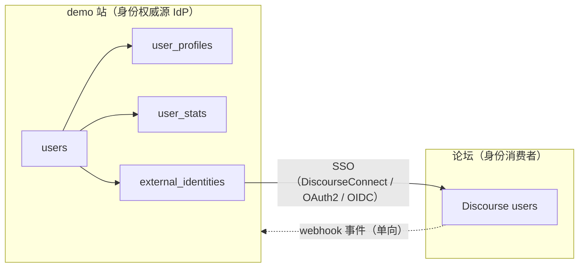
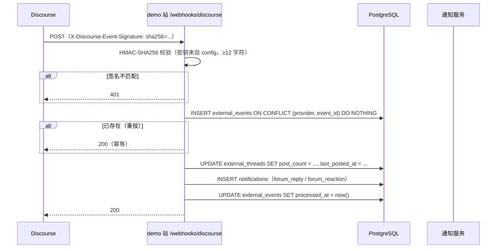
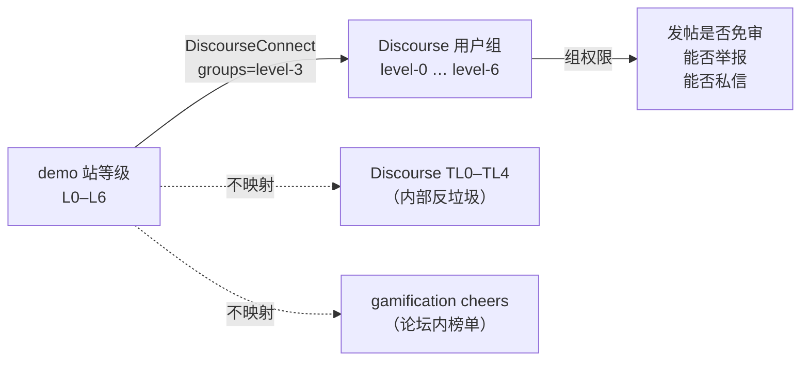
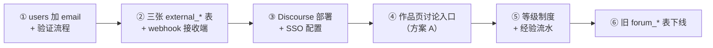

# 论坛外置选型对比 v1.0

**适用范围**：本文回答三件事——① 选哪个开源论坛系统；② demo 站与论坛的用户数据结构怎么接；③ 用什么统一层把耦合切干净。DDL 按 `dev` 的 Go + PostgreSQL 18 写。§8 的等级制度替代原「声望」，与选型无关，可独立落地。

**前置结论**（用户已拍板，本文按此展开）：

| 项 | 结论 |
|---|---|
| email | **加** `email` + 验证流程（论坛 SSO 的硬前置） |
| 论坛 | 本文给出对比与推荐，**待拍板** |
| 声望 | **废弃**，改为 bilibili 式等级制度（§8） |
| 作品页讨论入口 | 待定（§9.3 给三方案） |

---

## 0. 结论摘要

| 结论 | 内容 |
|---|---|
| **推荐** | **Discourse**（自托管，Docker） |
| **备选** | NodeBB（若「不能上 Docker / 内存 < 1 GB」成为硬约束） |
| **否决** | Flarum（生态小、无原生外链关联）、Apache Answer（Q&A 形态，不是论坛） |
| **决定性理由** | 只有 Discourse 原生支持 `external_id` + `embed_url`，能把「作品 ↔ 主题」的关联做成论坛侧的一等公民；其余三家都要自己写插件 |
| **身份方向** | **demo 站是 IdP，论坛是消费者**。不做双向同步，不做论坛为权威 |
| **耦合切法** | 三张 `external_*` 表 + 单向 webhook 事件流；demo 站**不存帖子内容**，只存计数与关联键 |
| **最大代价** | Discourse 只能 Docker 部署，最低 1 GB 内存（推荐 2 GB+） |

> **2026-10 修正**：Discourse 在 2025-07 把 30 个插件并入 core（`discourse-oauth2-basic` / `discourse-openid-connect` / `discourse-gamification` / `discourse-solved` / `discourse-reactions` 全部在内）。这意味着：
> - **不再必须用 DiscourseConnect**——标准 OAuth2 和 OIDC 开箱可用（§3.2）
> - **等级制度有原生实现**——`discourse-gamification` 的「cheers」就是行为累积积分（§3.6）
>
> 这两条把 Discourse 原本的两个「代价」变成了「优势」。详见 §3.2 与 §3.6。

---

## 1. 需求侧：demo 站对论坛的 12 条硬需求

从旧栈源码反推（`forum.py` / `forum_service.py` / `serializers.py` / `community_service.py`），论坛必须满足：

| # | 需求 | 源码依据 | 现状实现 |
|---|---|---|---|
| R1 | 作品页有讨论入口 | `forum_topics.demo_slug` | 同库 JOIN |
| R2 | 作品卡片显示评论数 | `serialize_demo` → `comment_count` | `SUM(forum_topics.reply_count) WHERE demo_slug` |
| R3 | 用户主页显示发帖/回帖数 | `UserProfileOut.topic_count` / `reply_count` | `COUNT(forum_topics)` / `COUNT(forum_replies)` |
| R4 | 排行榜含论坛活跃度 | `leaderboard` 的 4 个子查询 | 同库 |
| R5 | 站内通知含论坛事件 | `notifications.type` 6 值中 3 个 | 同库 |
| R6 | 6 个固定分类 | 前端硬编码 `['all','交流','分享','求助','demo','公告']` | `forum_topics.category` |
| R7 | 置顶 + 加精 | `pinned` / `sticky` | 两列（后端排序把两者都当置顶，是 bug） |
| R8 | 反应（赞 / 感谢） | `forum_reactions` | 多态表，无 FK |
| R9 | 举报 + 审核队列 | `forum_reports` | 多态表，无 FK |
| R10 | 封禁用户 | `POST /admin/users/{uid}/ban` | 改 `users.status` |
| R11 | 标签精确匹配 | `concat(',',tags,',') LIKE '%,tag,%'` | 逗号串，无法走索引 |
| R12 | 游客可读 | 无鉴权 GET | — |

**关键观察**：R1–R5 全部是「demo 站读论坛的数据」。**没有一条是论坛读 demo 站的数据**（除了登录）。这决定了耦合方向是单向的——demo 站是消费者，论坛是生产者。这一点直接推出 §7 的架构。

---

## 2. 候选画像

数据取自 GitHub API（2026-10-26）。

| | **Discourse** | **NodeBB** | **Flarum** | **Apache Answer** |
|---|---|---|---|---|
| 仓库 | `discourse/discourse` | `NodeBB/NodeBB` | `flarum/framework` | `apache/answer` |
| Stars | 48,015 | 15,244 | 6,763 | 15,701 |
| 语言 | Ruby (Rails) | JavaScript (Node.js) | PHP | **Go** |
| 许可证 | GPL-2.0 | GPL-3.0 | **MIT** | Apache-2.0 |
| 最近推送 | 2026-10-26 | 2026-10-25 | 2026-10-24 | 2026-10-21 |
| 形态 | 论坛 | 论坛 | 论坛 | **Q&A** |

**许可证说明**：GPL-2.0 / GPL-3.0 都没有 AGPL 的网络条款。自托管一个服务、不分发二进制，不触发开源义务。若将来要改 Discourse 源码并对外分发，才需要开源改动。**当前不构成障碍**。

---

## 3. 对比矩阵

### 3.1 部署与资源

| 维度 | Discourse | NodeBB | Flarum | Apache Answer |
|---|---|---|---|---|
| 部署形态 | **仅 Docker**（`discourse_docker`） | Docker / 裸机 | Docker / 裸机 | Docker / 裸机 |
| 运行时 | Ruby + Rails + Sidekiq | Node.js 22 LTS | PHP 8.3+ | Go 单二进制 |
| 数据库 | **仅 PostgreSQL** | MongoDB（默认）/ **PostgreSQL** / Redis | MySQL / MariaDB / SQLite / **PostgreSQL** | MySQL / PostgreSQL / SQLite |
| 必需中间件 | **Redis**（缓存 + Sidekiq） | Redis（可选，推荐） | 无 | 无 |
| 最低内存 | **1 GB（含 swap）** | ~512 MB | ~256 MB | ~256 MB |
| 推荐内存 | **2 GB+** | 1 GB | 512 MB | 512 MB |
| 最低磁盘 | 10 GB | 2 GB | 1 GB | 1 GB |
| 操作系统 | 64-bit Linux | Linux / macOS | Linux / Windows | 任意 |
| 升级方式 | `./launcher rebuild app`（整容器重建） | `git pull && ./nodebb upgrade` | `composer update` | 换二进制 |

**这一栏是 Discourse 唯一的硬伤**：不能裸机、必须 Redis、1 GB 起。如果部署目标是「一台 2 GB 的轻量云服务器同时跑 demo 站 + 论坛」，Discourse 会吃掉一半以上内存。

### 3.2 身份与 SSO

| 维度 | Discourse | NodeBB | Flarum | Apache Answer |
|---|---|---|---|---|
| 协议 | **DiscourseConnect**（专有）+ **OAuth2**（core）+ **OIDC**（core） | OAuth2 / OIDC / SAML | OAuth2（FoF OAuth） | OAuth2（connector 插件） |
| 官方实现 | ✅ 三种全内建 | ✅ `nodebb-plugin-sso-oauth2-multiple`（官方组织，15★） | ⚠️ 第三方 `FriendsOfFlarum/oauth`（54★） | ✅ `answer-plugins/connector-*` |
| 通用 OAuth2 支持 | ✅ **`discourse-oauth2-basic` 已并入 core**（2025-07） | ⚠️ **官方明示「仅测过 Auth0 / Okta，其他 provider 不保证」** | ✅ 通用 | ✅ 通用 |
| OIDC 支持 | ✅ **`discourse-openid-connect` 已并入 core** | ⚠️ 需插件 | ⚠️ 需扩展 | ⚠️ 需插件 |
| 必填字段 | DiscourseConnect：`nonce` + **`email`** + `external_id`<br/>OAuth2/OIDC：仅 `id` | `id` + 自定义 | `id` + 自定义 | `id` + 自定义 |
| 官方安全警告 | DiscourseConnect 路径有（email 未验证则「极度脆弱」）<br/>**OAuth2/OIDC 路径无此要求** | — | — | — |
| 启用后能否用论坛原生登录 | DiscourseConnect：❌<br/>OAuth2/OIDC：✅ 可共存 | ✅ 可共存 | ✅ 可共存 | ✅ 可共存 |
| 用户能否在论坛改密 | DiscourseConnect：❌<br/>OAuth2/OIDC：✅ | ✅ 能 | ✅ 能 | ✅ 能 |
| 反向查用户 API | `GET /u/by-external/{id}.json` | `GET /api/v3/plugins/oauth2-multiple/provider/{p}/user/{id}` | 无 | 无 |

**解读（2026-10 修正后）**：

- **Discourse 现在有三条 SSO 路径**，且全部内建：
  1. **DiscourseConnect**（专有）——强制 `email` + `external_id` + `nonce`，官方警告不验证 email 的后果。**功能最全**（能传 `groups` / `bio` / `title` / `location` / `avatar_url` / `admin` / `moderator`），但会完全接管认证。
  2. **OAuth2 Basic**（`discourse-oauth2-basic`，2025-07 并入 core）——标准 OAuth2，只需 `id`，`email` 可选。**可与论坛原生登录共存**，用户仍能在论坛改密。
  3. **OIDC**（`discourse-openid-connect`，2025-07 并入 core）——标准 OIDC，支持 discovery。

- **这改变了 §7 的设计前提**。原本「必须用 DiscourseConnect → 必须加 email + 验证」的推理链断了：走 OAuth2 Basic 就不强制 email。

  但**仍然建议加 email**，理由不是 Discourse 强制，而是：
  - 找回密码需要（旧栈完全没有，是已知缺陷）
  - 论坛通知邮件需要
  - 用户注销/数据导出需要
  - 将来换任何论坛系统都需要

  所以「加 email」从「被 Discourse 绑架」变成「本来就该做」。

- **NodeBB 的官方 OAuth2 插件虽然存在，但 README 明确写「Support for other OAuth2 providers is _explicitly not guaranteed_」**。我们要接的是自建 IdP，属于「其他 provider」，风险不可控。

- **Flarum 的 FoF OAuth 是通用 OAuth2，最灵活，但生态最小**（54★，其余扩展多在个位数）。

- **Apache Answer 的 connector 插件最干净**（Go 插件，编译进二进制），但形态不对。

**选哪条 Discourse SSO 路径？**

| | DiscourseConnect | OAuth2 Basic | OIDC |
|---|---|---|---|
| 传 `groups`（等级映射） | ✅ | ❌ | ⚠️ 需 claim 映射 |
| 传 `bio` / `title` / `location` | ✅ | ❌ | ⚠️ |
| 强制 email | ✅ | ❌ | ❌ |
| 与论坛原生登录共存 | ❌ | ✅ | ✅ |
| 实现复杂度（demo 站侧） | 中（HMAC + base64 + nonce） | **低**（标准 OAuth2 client） | 中（要出 discovery + JWKS） |

**推荐 DiscourseConnect**，理由：只有它能传 `groups`，而 `groups` 是 §8.5 等级映射的实现手段。代价是必须加 email + 验证——但这个代价本来就该付。

**若将来不想维护 HMAC/nonce 逻辑**，可切 OAuth2 Basic，代价是等级映射要改用 Discourse API 主动推组（`PUT /groups/{id}/members.json`），多一次 API 调用。

### 3.3 外链关联（决定性维度）

| 维度 | Discourse | NodeBB | Flarum | Apache Answer |
|---|---|---|---|---|
| 创建主题时带外部 ID | ✅ `POST /posts.json` 的 `external_id` | ❌ 无此字段 | ❌ | ❌ |
| 创建主题时带外部 URL | ✅ `embed_url` | ❌ | ❌ | ❌ |
| 按外部 ID 反查主题 | ✅ `GET /t/external_id/{id}.json`（301 → `/t/{topic_id}.json`） | ❌ | ❌ | ❌ |
| iframe 嵌入评论 | ✅ 官方 JS（`embed.js`） | ❌ | ❌ | ❌ |
| 自动建主题 | ✅ 首次嵌入自动创建 | ❌ | ❌ | ❌ |

**这是唯一一个「三家全空、一家全有」的维度。**

NodeBB 的 `POST /api/v3/topics/` 请求体只有 `cid` / `title` / `content` / `tags` / `timestamp`（已核对官方 OpenAPI `write/topics.yaml`），**没有 `external_id`**。要做等价能力，得自己写插件在 `topic.create` hook 里存映射表——等于把 §7 的统一层在论坛侧再实现一遍。

Flarum 和 Apache Answer 同理。

**结论**：如果「作品 ↔ 主题」的关联要可靠（而不是靠标题字符串匹配），Discourse 是唯一不需要写插件的选项。

### 3.4 事件与集成

| 维度 | Discourse | NodeBB | Flarum | Apache Answer |
|---|---|---|---|---|
| Webhook | ✅ 内建（`/admin/api/webhooks`） | ✅ 官方 `nodebb-plugin-webhooks`（4★，2026-09 更新） | ⚠️ 第三方 | ⚠️ 插件 |
| Webhook 签名 | ✅ `X-Discourse-Event-Signature: sha256=<hex>`（HMAC-SHA256，密钥 ≥12 字符） | ⚠️ 需自行校验 | — | — |
| Webhook 事件 ID | ✅ `X-Discourse-Event-Id`（可用于幂等） | ⚠️ | — | — |
| Webhook 重投 | ✅ 后台可重投（`redelivering_webhook_events`） | ⚠️ | — | — |
| REST API 文档 | ✅ OpenAPI 3.1，81 端点 | ✅ OpenAPI 3.0（read + write 两份） | ⚠️ 手写文档 | ✅ Swagger |
| API 版本 | v0（`/latest.json` 等） | **v3**（2020 起并入 core） | v1 | v1 |
| 批量导出 | `discourse backup` | `./nodebb export` | `php flarum export` | SQL dump |

**NodeBB 的 Write API 质量其实很高**——2020 年从 WebSocket 全面迁到 REST，OpenAPI 3.0 规范完整，`/api/v3` 覆盖 users / groups / categories / topics / posts / chats / admin。这是它相对 Flarum 的明显优势。

但 webhook 插件只有 4 星、由社区维护（虽然挂在 NodeBB 组织下），且没有签名机制。Discourse 的 webhook 是内建 + HMAC 签名，可靠性高一档。

### 3.5 治理与审核

| 维度 | Discourse | NodeBB | Flarum | Apache Answer |
|---|---|---|---|---|
| 举报队列 | ✅ flag + review queue | ✅ flags | ⚠️ 基础 | ⚠️ 基础 |
| 待审帖 | ✅ `approve_post` / `approve_user` | ✅ post queue | ⚠️ 需扩展 | ⚠️ |
| 封禁 | ✅ ban / suspend（带期限） | ✅ ban / mute | ⚠️ 基础 | ⚠️ |
| 禁言（可读不可写） | ✅ silence | ✅ mute | ❌ | ❌ |
| 匿名化（保留帖子抹身份） | ✅ `POST /admin/users/{id}/anonymize.json` | ⚠️ 需插件 | ❌ | ❌ |
| 合并用户 | ✅ `POST /admin/users/{id}/merge.json` | ⚠️ | ❌ | ❌ |
| 强制登出 | ✅ `POST /admin/users/{id}/log_out.json` | ✅ | ❌ | ❌ |
| 审计日志 | ✅ staff action log | ✅ | ⚠️ | ⚠️ |

**Discourse 的治理能力是四家里唯一「开箱即用覆盖全部场景」的**。旧栈自己实现的 `forum_reports` + `POST /admin/users/{uid}/ban` 在 Discourse 里都有对应物，且更完整（带期限、带匿名化）。

### 3.6 等级 / 信任体系（对应「声望改等级」）

| 维度 | Discourse | NodeBB | Flarum | Apache Answer |
|---|---|---|---|---|
| 内建等级 | ✅ **TL0–TL4**（5 级） | ⚠️ reputation（投票净分） | ❌ 无 | ⚠️ reputation（投票） |
| 升级依据 | **行为累积**（访问天数、读帖数、点赞给出/收到、发帖数…） | **他人评价**（upvote − downvote） | — | 他人评价 |
| 是否影响排序 | ❌ 不影响 | ✅ 影响（reputation 排序） | — | ✅ 影响 |
| 是否解锁功能 | ✅ TL1 才能发私信、TL2 才能邀请… | ⚠️ 部分 | — | ⚠️ |
| 可自定义阈值 | ✅ 后台可调 | ⚠️ | — | ⚠️ |
| **可自定义积分体系** | ✅ **`discourse-gamification` 已并入 core**（2025-07） | ❌ | ❌ | ❌ |
| 积分来源可配 | ✅ 10 种 scorables（见下） | — | — | — |
| 排行榜 | ✅ 多榜、可设起止日期、可设隐私 | ⚠️ 单一 | — | ⚠️ |

**`discourse-gamification` 的 10 种 scorables**（官方文档）：

| Scorable | 对应 demo 站行为 |
|---|---|
| Daily visits | 每日登录 |
| Posts read | 浏览作品 |
| Time read | 停留时长 |
| Topics created | 发帖 |
| Posts created | 回帖 |
| Likes given | 给出赞 |
| Likes received | 收到赞 |
| Flags accepted | 举报被采纳 |
| Solutions accepted | 采纳答案（需 `discourse-solved`） |
| User invites accepted | 邀请注册 |

**这一栏直接命中用户的需求**：

> 「声望系统不要了，改成类似 bilibili 的等级制度」

bilibili 等级的本质是**行为累积**（登录、观看、投币、分享、评论 → 经验值 → L0–L6），不是他人评价。

- **Discourse 的 TL0–TL4** 是同一个设计哲学，只是级数少两级、维度偏「阅读与社区参与」
- **`discourse-gamification` 的 cheers** 是更接近 bilibili 的版本——可配权重、可配每日上限、有排行榜
- **NodeBB 的 reputation** 恰恰是用户要砍掉的那种——**他人评价驱动、影响排序**

**所以「声望改等级」这条决策，本身就是 Discourse 的加分项，而且现在有原生实现。**

**但要注意**：`discourse-gamification` 只统计**论坛内**行为。demo 站的行为（上传作品、被收藏、被评分）它看不到。所以 §8 的设计仍然需要——demo 站侧要有自己的经验流水，论坛侧的经验通过 webhook 回传后**合并计算**。

两种做法：

| | **A：demo 站为唯一等级源** | **B：两边各算各的** |
|---|---|---|
| 做法 | demo 站算总经验，通过 `groups` 推给 Discourse | demo 站算 demo 经验，Discourse 算论坛经验 |
| 用户看到的等级 | 一个（demo 站） | 两个（会困惑） |
| 实现 | 需要 webhook 回传论坛行为 | 零成本 |
| 推荐 | ✅ | ❌ |

**推荐 A**。`discourse-gamification` 只用来做论坛内的「本周活跃榜」这类局部榜单，**不作为等级依据**。等级统一由 demo 站算（§8）。

### 3.7 其他

| 维度 | Discourse | NodeBB | Flarum | Apache Answer |
|---|---|---|---|---|
| 反应（赞/感谢） | ✅ `discourse-reactions` **已并入 core**（仓库 2025-07-10 归档） | ✅ 内建 upvote | ⚠️ 扩展 | ✅ 投票 |
| 已解决 / 采纳 | ✅ 官方 `discourse-solved` | ⚠️ 插件 | ⚠️ 扩展 | ✅ **原生**（Q&A 形态） |
| 全文搜索 | ✅ PG 全文 + 可选 pgvector 语义 | ✅ 内建 | ⚠️ 基础 | ✅ |
| 中文分词 | ⚠️ 需配 `pg_jieba` 或 `zhparser` | ⚠️ 需配 | ⚠️ | ⚠️ |
| 移动端 | ✅ 响应式 + PWA | ✅ 响应式 | ✅ 响应式 | ✅ 响应式 |
| 主题/插件生态 | **最大**（官方 + 社区数千） | 中（数百） | 小（数十） | 小 |
| 中文社区案例 | 少（Ruby 栈门槛） | 中 | 少 | 中 |
| 学习曲线（运维） | 高（Rails + Redis + Docker） | 中（Node.js） | 中（PHP） | **低**（Go 单二进制） |

---

## 4. 五个决定性维度

把 §3 收敛成五条，按权重排序：

### 4.1 外链关联 —— Discourse 独占

`external_id` + `embed_url` + `/t/external_id/{id}.json` 反查，是 Discourse 为「外部系统评论」专门做的能力。其余三家都要写插件。

**权重：最高。** 因为 R1–R5 五条需求全部依赖这个关联的可靠性。靠标题字符串匹配（`demo_slug` 塞进 title）会在用户改标题时断链。

### 4.2 身份统一 —— Discourse 三条路径全内建

Discourse 现在有三条 SSO 路径，全部内建（2025-07 起）：

| 路径 | 强制 email | 能传 groups | 与原生登录共存 |
|---|---|---|---|
| DiscourseConnect（专有） | ✅ | ✅ | ❌ |
| OAuth2 Basic（core） | ❌ | ❌ | ✅ |
| OIDC（core） | ❌ | ⚠️ | ✅ |

NodeBB 的官方 OAuth2 插件明示「只测过 Auth0 / Okta」，我们要接自建 IdP，属于不受支持的范围。

**权重：高。** 但代价可控——email 本来也该加（找回密码、通知邮件、数据导出都需要）。

### 4.3 等级体系 —— Discourse 原生命中，且有原生积分插件

用户要的 bilibili 式等级 = 行为累积。

- Discourse TL0–TL4 就是这个模型
- `discourse-gamification`（已并入 core）提供 10 种可配权重的 scorables + 多排行榜
- NodeBB 的 reputation 是用户明确要砍掉的模型（他人评价驱动）

**权重：高。** 这条让「声望改等级」从「要自己实现」变成「用论坛原生的 + demo 站侧补 demo 行为」。

### 4.4 部署运维 —— Discourse 最重

仅 Docker、必须 Redis、1 GB 起、升级要整容器重建。

**权重：中高。** 如果部署预算只有一台 2 GB 机器，这是真问题。

### 4.5 数据主权 —— 四家都可接受

都能导出（`discourse backup` / `./nodebb export` / SQL dump）。没有锁定风险。

**权重：低。** 不构成选型依据。

---

## 5. 三方案对比

在选具体产品之前，先确定「论坛要不要外置」。

| | **方案 A：全外置** | **方案 B：自建轻论坛** | **方案 C：混合** |
|---|---|---|---|
| 做法 | Discourse 独立部署，demo 站只留关联键 + 计数 | Go 侧自己写 `forum_topics` / `forum_replies` | Discourse 独立部署 + demo 站保留只读镜像表 |
| 开发量 | 低（对接 API + webhook） | **高**（重写 18 个端点 + 审核 + 通知） | 中（A 的量 + 镜像同步） |
| 功能完整度 | 高（Discourse 全量） | 低（要自己补搜索、审核、反垃圾） | 高 |
| 运维复杂度 | 中（多一个 Docker 服务） | 低（同一个 PG） | 高（多一套同步） |
| 数据一致性 | 最终一致（webhook） | 强一致（同库） | 最终一致 + 镜像延迟 |
| 反垃圾 | 强（Discourse 有 Akismet + TL 限制） | **弱**（要自己写） | 强 |
| 迁移成本 | 中（用户要重新注册/SSO） | 零 | 中 |
| 长期维护 | 跟上游升级 | **自己维护** | 跟上游 + 自己维护镜像 |

**推荐 A**。理由：

1. 方案 B 等于把旧栈的 18 个论坛端点重写一遍，还要补反垃圾、搜索、审核——这是**重复造轮子**，且旧栈的实现已知有 6 处缺陷（多态无 FK、标签逗号串、`pinned`/`sticky` 语义错、举报重复靠代码查、通知三重弱引用、`follow_counts` 不过滤已删用户）。
2. 方案 C 的「只读镜像」会引入双向同步问题——镜像过期时用户看到旧数据，比看不到更糟。
3. 方案 A 的唯一代价是「最终一致」，而 R1–R5 全部是**展示型**需求（评论数、发帖数、排行榜），秒级延迟完全可接受。

---

## 6. 推荐

### 6.1 主选：Discourse

**选它的理由**（按权重）：

1. `external_id` / `embed_url` 原生支持，作品↔主题关联是一等公民
2. **三条 SSO 路径全内建**（DiscourseConnect / OAuth2 Basic / OIDC），不依赖第三方插件
3. TL0–TL4 + `discourse-gamification` 原生就是 bilibili 式行为累积等级，直接替代声望
4. 治理能力（举报队列 / 封禁 / 禁言 / 匿名化 / 合并用户 / 强制登出）开箱即用
5. Webhook 内建 + HMAC 签名，事件流可靠
6. `discourse-reactions` / `discourse-solved` / `discourse-gamification` 全部已并入 core，无插件维护负担
7. 生态最大，长期维护有保障

**要接受的代价**：

| 代价 | 缓解 |
|---|---|
| 仅 Docker 部署 | 单机 `discourse_docker`，与 demo 站同机不同容器 |
| 最低 1 GB 内存 | 部署规格提到 4 GB（demo 站 Go 侧很轻） |
| 必须 Redis | 与 Discourse 同容器（`discourse_docker` 默认带） |
| DiscourseConnect 强制 email | 走 DiscourseConnect 才需要；或切 OAuth2 Basic 规避 |
| 走 DiscourseConnect 时用户不能在论坛改密 | 论坛侧隐藏改密入口，引导回 demo 站；或切 OAuth2 Basic |
| 中文分词要额外配 | 装 `zhparser` 或 `pg_jieba` 扩展 |

### 6.2 备选：NodeBB

**触发条件**（任一成立就切 NodeBB）：

- 部署环境不允许 Docker
- 内存预算 < 1 GB
- 团队完全不能接受 Ruby 栈（虽然运维上不需要碰 Ruby）

**切过去要补的**：

1. 写一个 NodeBB 插件，在 `topic.create` hook 里存 `demo_id ↔ tid` 映射（替代 `external_id`）
2. 用 `nodebb-plugin-webhooks` 做事件流，自己加 HMAC 校验
3. 自己实现等级制度（NodeBB 的 reputation 是投票净分，不是行为累积）
4. 接受 SSO 插件「只测过 Auth0/Okta」的风险，或自己 fork 一份

**净成本**：约 2–3 人周。这是备选的代价。

### 6.3 否决

| 项目 | 否决理由 |
|---|---|
| **Flarum** | 无原生外链关联；生态最小（OAuth 扩展 54★、其余多在个位数）；无等级体系；PHP 栈与团队技能不匹配 |
| **Apache Answer** | 形态是 **Q&A**（一问一答 + 采纳答案），不是论坛（多对多讨论）。R6 的 6 个分类、R7 的置顶加精、R8 的反应都映射不上。Go 栈虽然诱人，但形态不对是硬伤 |

---

## 7. 统一层设计（去耦）

### 7.1 方向：demo 站是 IdP，论坛是消费者



**为什么 demo 站必须是 IdP**：

1. demo 站有主数据（作品、收藏、浏览历史、模型关联），论坛只有讨论
2. 反向（论坛为 IdP）会让 demo 站被论坛绑架——换论坛就要迁移全部用户
3. DiscourseConnect / OAuth2 / OIDC 的设计意图都是「外部系统为权威」

**不做双向同步**。论坛侧的用户名、头像、简介改动不回写 demo 站。理由：双向同步的冲突解决成本远高于收益，且用户主要活动在 demo 站。

**SSO 路径选择**（详见 §3.2）：

| 路径 | 何时用 |
|---|---|
| **DiscourseConnect**（推荐） | 需要把 demo 站等级映射成 Discourse 用户组（§8.5） |
| OAuth2 Basic | 不想维护 HMAC/nonce 逻辑；等级映射改用 API 推组 |
| OIDC | 将来要接多个下游系统（论坛 + 其他），统一走 OIDC |

### 7.2 三张表

```sql
-- ① 身份映射：demo 站用户 ↔ 论坛用户
CREATE TABLE external_identities (
    local_user_id     bigint      NOT NULL REFERENCES users(id) ON DELETE CASCADE,
    provider          text        NOT NULL,              -- 'discourse' / 'nodebb' / ...
    external_id       text        NOT NULL,              -- 论坛侧 user_id（字符串化）
    external_username text        NOT NULL DEFAULT '',   -- 论坛侧用户名快照
    external_email    text,                              -- 发给论坛的 email 快照
    linked_at         timestamptz NOT NULL DEFAULT now(),
    last_synced_at    timestamptz,
    PRIMARY KEY (local_user_id, provider),
    UNIQUE (provider, external_id)
);
CREATE INDEX ix_ext_ident_email ON external_identities (provider, lower(external_email));

-- ② 主题映射：作品 ↔ 论坛主题
CREATE TABLE external_threads (
    demo_id           bigint      NOT NULL REFERENCES demos(id) ON DELETE CASCADE,
    provider          text        NOT NULL,
    external_topic_id text        NOT NULL,
    external_slug     text        NOT NULL DEFAULT '',
    url               text        NOT NULL,
    post_count        integer     NOT NULL DEFAULT 0,
    last_posted_at    timestamptz,
    synced_at         timestamptz,
    PRIMARY KEY (demo_id, provider),
    UNIQUE (provider, external_topic_id)
);

-- ③ 事件收件箱：webhook 幂等落库
CREATE TABLE external_events (
    id           bigint      GENERATED ALWAYS AS IDENTITY PRIMARY KEY,
    provider     text        NOT NULL,
    event_id     text        NOT NULL,          -- 论坛侧事件唯一 ID
    event_type   text        NOT NULL,          -- 'post_created' / 'post_destroyed' / ...
    payload      jsonb       NOT NULL,
    processed_at timestamptz,
    created_at   timestamptz NOT NULL DEFAULT now(),
    UNIQUE (provider, event_id)
);
CREATE INDEX ix_ext_events_pending ON external_events (provider, created_at)
    WHERE processed_at IS NULL;
```

**设计要点**：

| 要点 | 说明 |
|---|---|
| `external_id` 用 `text` 不用 `bigint` | 不同论坛的 ID 类型不同（Discourse 是整数，NodeBB 是整数，但将来可能接别的） |
| `external_email` 存快照 | 用户改 email 后，论坛侧还是旧的。存快照才能诊断「为什么论坛收不到信」 |
| `external_threads` 的 PK 是 `(demo_id, provider)` | 一个作品在一个论坛只有一个主题。换论坛时旧行保留（`provider` 不同） |
| `external_events` 的 `UNIQUE (provider, event_id)` | webhook 会重投，靠这个做幂等 |
| 部分索引 `WHERE processed_at IS NULL` | 收件箱只查未处理的，索引很小 |

### 7.3 事件流



**关键约束**：

1. **webhook 处理必须幂等**——Discourse 会重投（后台可手动重投，失败也会重试）。靠 `UNIQUE (provider, event_id)`，`event_id` 取 `X-Discourse-Event-Id` 头。
2. **webhook 处理必须快**——Discourse 有超时。重活（发通知、算统计）走异步队列，webhook 只做落库 + 更新计数。
3. **签名密钥不能进代码**——走 `config`，与 `jwt_secret` 同级。Discourse 侧要求密钥 ≥12 字符。
4. **签名算法**：`sha256=HMAC-SHA256(secret, raw_body)` 的 hex，前缀 `sha256=`。校验时用**常量时间比较**。

### 7.4 六个耦合点的替换

| 旧耦合点 | 旧实现 | 新实现 |
|---|---|---|
| `serialize_demo.comment_count` | `SUM(forum_topics.reply_count) WHERE demo_slug` | `external_threads.post_count`（webhook 维护） |
| `community_service` 声望/获赞/感谢 | `forum_reactions` 聚合 | **废弃**（改等级制，§8） |
| `user_profile.topic_count/reply_count` | `COUNT(forum_topics)` / `COUNT(forum_replies)` | 论坛侧 API 拉取，落 `user_stats`，定时刷新 |
| `leaderboard` 4 子查询 | 同库 JOIN | 去掉论坛维度，只按 demo 站数据排 |
| `notifications` 论坛类型 | 同库写 | webhook 触发写 |
| `forum_topics.demo_slug` | 同库列 | `external_threads` 反向映射 |

**注意第 3 条**：`topic_count` / `reply_count` 从「同库 COUNT」变成「跨系统拉取」，这是**唯一一个从强一致降级为最终一致的展示字段**。可接受——用户主页的发帖数延迟 5 分钟没人会注意。

**注意第 4 条**：排行榜去掉论坛维度是**简化**，不是损失。旧栈的排行榜 4 个子查询里 2 个是论坛的，去掉后查询从 4 个子查询降到 2 个，且不再有跨系统依赖。

### 7.5 作品页讨论入口（三方案，待拍板）

| | **A：只显示计数 + 跳转** | **B：iframe 嵌入** | **C：最新 3 条 + 跳转** |
|---|---|---|---|
| 实现 | `external_threads.post_count` + 链接 | Discourse `embed.js` | webhook 缓存最新 3 条 |
| 用户体验 | 点一下跳走 | 站内看，发帖仍要跳 | 站内看 3 条，看全部要跳 |
| 复杂度 | 最低 | 中（要配 Embeddable Hosts + Path Allowlists） | 中高（要缓存帖子内容） |
| 数据主权 | 不存帖子 | 不存帖子 | **存了帖子内容**（违反 §7.1 的「不存帖子」原则） |
| 风险 | 无 | CSP / 第三方 cookie / 样式冲突 | 缓存过期、内容审核责任 |

**倾向 A**。理由：C 会让 demo 站变成「半个论坛」，要承担内容审核责任，且缓存一致性是新问题。B 的 iframe 在移动端体验差，且 Discourse 官方明确说「发帖必须跳转到论坛」。

---

## 8. 等级制度（替代声望）

### 8.1 为什么废弃声望

旧栈的 `users.reputation` 是派生值：

```
reputation = 收到的赞 × w1 + 收到的感谢 × w2 + ...
```

问题：

1. **他人评价驱动**——新用户发再多好作品，没人点赞就是 0 分
2. **影响排序**——排行榜按 reputation 排，形成马太效应
3. **与论坛耦合**——`received_likes` / `received_thanks` 来自 `forum_reactions`，论坛外置后数据源断了

用户要的 bilibili 式等级是**行为累积**，不是他人评价。这解决了全部三个问题。

### 8.2 等级设计

**七级（L0–L6）**，参考 bilibili 结构：

| 等级 | 经验阈值 | 解锁 |
|---|---|---|
| L0 | 0 | 浏览、收藏 |
| L1 | 200 | 上传作品、评分、评论 |
| L2 | 1,500 | 创建收藏夹（公开）、关注他人 |
| L3 | 4,500 | 发起讨论、举报 |
| L4 | 10,800 | 申请精选位 |
| L5 | 28,800 | 参与内容审核投票 |
| L6 | 64,800 | 无额外权限（荣誉） |

**阈值按指数递增**（×3.3 左右），与 bilibili 的量级一致。具体数字待定，但**结构**是确定的。

### 8.3 经验来源

| 行为 | 经验 | 上限 | 说明 |
|---|---|---|---|
| 每日登录 | +5 | 5/天 | 防刷：按自然日去重 |
| 浏览作品 | +1 | 20/天 | 停留 > 10 秒才算 |
| 上传作品（过审） | +50 | 200/天 | 被拒不计 |
| 作品被收藏 | +2 | 100/天 | 按收藏者去重 |
| 作品被评分 | +1 | 50/天 | 按评分者去重 |
| 发帖 | +10 | 50/天 | 论坛 webhook 回传 |
| 回帖 | +5 | 50/天 | 同上 |
| 帖子被赞 | +3 | 100/天 | 同上 |
| 举报被采纳 | +20 | 100/天 | 治理激励 |
| 违规被处罚 | −50 | — | 无下限 |

**设计原则**：

1. **每日上限**——防止刷经验。这是 bilibili 的核心机制。
2. **正向为主**——负向只有违规处罚，不做「被踩扣分」（避免恶意踩人）。
3. **论坛行为计入**——通过 webhook 回传，保持「等级是全站统一」的语义。

### 8.4 表结构

```sql
-- 经验流水（只增不改，可重算）
CREATE TABLE user_exp_events (
    id         bigint      GENERATED ALWAYS AS IDENTITY PRIMARY KEY,
    user_id    bigint      NOT NULL REFERENCES users(id) ON DELETE CASCADE,
    source     text        NOT NULL,   -- 'login' / 'demo_approved' / 'forum_post' / ...
    amount     integer     NOT NULL,
    ref_type   text,                   -- 'demo' / 'external_thread' / NULL
    ref_id     bigint,
    day        date        NOT NULL,   -- 用于每日上限判定
    created_at timestamptz NOT NULL DEFAULT now()
);
CREATE INDEX ix_exp_user_day ON user_exp_events (user_id, day);
CREATE UNIQUE INDEX uq_exp_daily_login ON user_exp_events (user_id, day, source)
    WHERE source = 'login';

-- 等级快照（派生，可重建）
ALTER TABLE user_stats
    ADD COLUMN exp_total  integer NOT NULL DEFAULT 0,
    ADD COLUMN level      smallint NOT NULL DEFAULT 0 CHECK (level BETWEEN 0 AND 6);
```

**为什么流水表 + 快照表**：

- 流水表是**事实源**，可重算、可审计、可回滚
- 快照表是**读优化**，排行榜和权限判定直接读
- 每日上限靠 `(user_id, day, source)` 的聚合判定，不靠内存计数

### 8.5 与 Discourse 信任等级的映射

Discourse 有自己的 TL0–TL4，还有 `discourse-gamification` 的 cheers。三套等级并存会打架。

**方案：demo 站等级为准，Discourse TL 只做反垃圾，gamification 只做论坛内榜单**

| demo 站等级 | Discourse TL | 说明 |
|---|---|---|
| L0–L1 | TL0 | 新用户，帖子进审核队列 |
| L2–L3 | TL1 | 可正常发帖 |
| L4–L5 | TL2 | 可举报、可标记 |
| L6 | TL3 | 可信用户，帖子免审 |

**实现**：DiscourseConnect 的 payload 里带 `groups` 字段，把 demo 站等级映射成 Discourse 用户组（`level-0` … `level-6`），再用 Discourse 的组权限控制发帖是否需要审核。



**三套体系的分工**：

| 体系 | 谁看 | 用途 | 是否影响排序 |
|---|---|---|---|
| **demo 站等级 L0–L6** | 用户 | 全站统一等级、解锁功能 | ❌ |
| Discourse TL0–TL4 | 管理员 | 反垃圾（自动降级、限流） | ❌ |
| gamification cheers | 用户 | 论坛内「本周活跃榜」 | 仅榜内 |

**关键**：用户只感知一个等级（demo 站 L0–L6）。TL 和 cheers 是内部机制，不对外暴露。

**若走 OAuth2 Basic 而非 DiscourseConnect**（无法传 `groups`），改用 API 推组：

```
PUT /groups/{id}/members.json
{ "usernames": "icelily" }
```

在等级变化时调用。多一次 API 调用，但逻辑更直白（不依赖 SSO 时机）。

**注意**：`PUT /groups/{id}/members.json` 用的是**数字 id**，不是组名。`/groups/{name}/members.json` 只有 `GET`。所以要先 `GET /groups/{name}.json` 拿到 id 并缓存。

---

## 9. 风险与缓解

### 9.1 已识别风险

| # | 风险 | 影响 | 缓解 |
|---|---|---|---|
| 1 | Discourse 内存 1 GB 起 | 部署成本 | 规格提到 4 GB；demo 站 Go 侧很轻 |
| 2 | 仅 Docker | 运维习惯 | 接受；`discourse_docker` 是官方唯一路径 |
| 3 | DiscourseConnect 强制 email | 要加 email + 验证 | 已拍板 A |
| 4 | 用户不能在论坛改密 | 体验 | 论坛侧隐藏改密入口，引导回 demo 站 |
| 5 | 中文分词要额外配 | 搜索质量 | 装 `zhparser`；或先用 PG 默认分词 |
| 6 | webhook 最终一致 | 评论数延迟 | 可接受（展示型字段） |
| 7 | 论坛侧用户名与 demo 站不同步 | 用户困惑 | SSO 时同步一次；之后不同步，文档说明 |
| 8 | 用户注销后论坛账号残留 | 合规 | 调 `POST /admin/users/{id}/anonymize.json` |
| 9 | 论坛被攻击/灌水 | 可用性 | Discourse 自带 Akismet + TL 限制 + 速率限制 |
| 10 | 换论坛时数据迁移 | 锁定 | 三张 `external_*` 表按 `provider` 分，可并存 |

### 9.2 用户未考虑到的问题（补充）

上一轮列了 14 条，这里只列**仍然开放**的：

| # | 问题 | 为什么重要 |
|---|---|---|
| 1 | **论坛的 SEO 与 demo 站的关系** | 论坛内容会被搜索引擎收录。如果论坛是 `forum.example.com` 子域，权重会分散；如果是 `example.com/forum` 子路径，Discourse 不支持（必须独立域） |
| 2 | **论坛的备份与 demo 站备份是否同周期** | 两套系统两套备份策略。如果论坛备份落后 demo 站一周，恢复时会丢一周讨论 |
| 3 | **论坛的时区与语言** | Discourse 默认 UTC + 英文。中文站要改 `default_locale` + 时区 |
| 4 | **论坛的邮件发送** | Discourse 强依赖邮件（注册验证、通知、摘要）。要配 SMTP，且要处理退信 |
| 5 | **论坛的 CDN 与上传** | 用户上传的图片存 Discourse 本地还是 S3？如果本地，备份体积会涨 |
| 6 | **论坛的 robots.txt 与 sitemap** | 与 demo 站的 sitemap 要合并提交给搜索引擎 |
| 7 | **论坛的 GDPR / 个人信息保护** | 用户要求删除数据时，要同时删 demo 站和论坛两侧 |
| 8 | **论坛的搜索是否要跨系统** | 用户在 demo 站搜「dsv4」，要不要搜到论坛帖子？如果要，得建跨系统索引 |
| 9 | **论坛的移动端 App** | Discourse 有官方 App（Discourse Hub），但需要论坛在官方列表里 |
| 10 | **论坛的插件升级策略** | `discourse-reactions` 已并入 core，但其他插件（`discourse-solved` 等）要跟版本 |

### 9.3 待拍板

| # | 问题 | 选项 |
|---|---|---|
| 1 | 论坛选型 | **Discourse**（推荐）/ NodeBB（备选）/ 其他 |
| 2 | Discourse SSO 路径 | **DiscourseConnect**（推荐，能传 groups）/ OAuth2 Basic / OIDC |
| 3 | 作品页讨论入口 | **A 计数+跳转**（推荐）/ B iframe / C 最新 3 条 |
| 4 | 论坛域名 | `forum.deepdemos.xxx` / 独立域 |
| 5 | 等级阈值 | 本文 §8.2 的数字 / 另定 |
| 6 | 论坛行为是否计入等级 | **计入**（推荐）/ 不计入 |
| 7 | 是否保留 `topic_count` / `reply_count` 展示 | 保留（跨系统拉取）/ 去掉 |
| 8 | 是否启用 `discourse-gamification` | 只做论坛内榜单（推荐）/ 完全不用 / 作为等级依据 |

---

## 10. 落地顺序



**为什么这个顺序**：

1. email 是 SSO 的前置（走 DiscourseConnect 时强制），必须先做
2. `external_*` 表是 webhook 的落点，先建表再接
3. Discourse 部署完才能配 SSO
4. 讨论入口依赖 `external_threads` 有数据
5. 等级制度依赖论坛 webhook 回传经验
6. 旧表下线必须等新链路稳定

**第 ⑥ 步的注意**：旧 `forum_topics` / `forum_replies` / `forum_reactions` / `forum_reports` 四张表的数据要迁移到 Discourse（用 `discourse migrate` 或自己写脚本），迁移完才能下线。这是整个计划里**唯一不可逆**的一步。

**第 ③ 步的注意**：Discourse 部署后要立刻做的 5 件事：

| # | 事项 | 说明 |
|---|---|---|
| 1 | 改 `default_locale` 为 `zh_CN` | 默认英文 |
| 2 | 配 SMTP | Discourse 强依赖邮件（验证、通知、摘要） |
| 3 | 配 `zhparser` / `pg_jieba` | 中文分词，否则搜索质量差 |
| 4 | 配 Embeddable Hosts + Path Allowlists | 若走方案 B（iframe）才需要 |
| 5 | 建 6 个分类 | 对应旧栈的 `['交流','分享','求助','demo','公告']`（`all` 是虚拟分类） |

---

## 附录 A：Discourse 关键 API 速查

| 用途 | 端点 |
|---|---|
| 创建主题（带外链） | `POST /posts.json`（`external_id` + `embed_url`） |
| 按外链 ID 反查主题 | `GET /t/external_id/{external_id}.json` → 301 |
| 按外链 ID 查用户 | `GET /u/by-external/{external_id}.json` |
| 匿名化用户 | `POST /admin/users/{id}/anonymize.json` |
| 封禁 | `POST /admin/users/{id}/suspend.json` |
| 禁言 | `POST /admin/users/{id}/silence.json` |
| 强制登出 | `POST /admin/users/{id}/log_out.json` |
| 合并用户 | `POST /admin/users/{id}/merge.json` |
| 用户组 | `POST /admin/groups.json` / `GET /groups/{name}/members.json` |
| 推用户进组（OAuth2 路径用） | `PUT /groups/{id}/members.json`（body `{"usernames":"a,b"}`） |
| 移出组 | `DELETE /groups/{id}/members.json` |
| 搜索 | `GET /search.json` |
| 通知 | `GET /notifications.json` / `POST /notifications/mark-read.json` |
| 预签名上传 | `POST /uploads/generate-presigned-put.json` |

## 附录 B：DiscourseConnect payload 示例

```json
{
  "nonce": "a1b2c3d4e5f6",
  "external_id": "42",
  "email": "user@example.com",
  "username": "icelily",
  "name": "icelily",
  "avatar_url": "https://demo.example.com/media/avatars/42-abcd1234.webp",
  "bio": "做扩散模型推理优化",
  "groups": "level-3",
  "email_verified": true
}
```

**注意**：

- `nonce` 必须每次不同（防重放），30 分钟内有效，用后即焚
- `email` 必须是**已验证**的（官方警告）；未验证则必须设 `require_activation=true`
- `external_id` 是 demo 站的 `users.id` 字符串化，**永不变**
- `groups` 是**逗号分隔字符串**（不是数组），用于等级映射（§8.5）
- `avatar_url` 只在首次登录时同步，之后不同步（除非设 `avatar_force_update=true`）
- 签名：`HMAC-SHA256(base64_payload, discourse_connect_secret)` 的**小写 hex**

## 附录 B2：OAuth2 Basic 配置示例（备选路径）

```json
{
  "oauth2_enabled": true,
  "oauth2_client_id": "demo-showcase",
  "oauth2_client_secret": "<secret>",
  "oauth2_authorize_url": "https://demo.example.com/oauth/authorize",
  "oauth2_token_url": "https://demo.example.com/oauth/token",
  "oauth2_user_json_url": "https://demo.example.com/oauth/userinfo",
  "oauth2_json_user_id_path": "sub",
  "oauth2_json_username_path": "preferred_username",
  "oauth2_json_name_path": "name",
  "oauth2_json_email_path": "email",
  "oauth2_json_avatar_path": "picture",
  "oauth2_email_verified": true,
  "oauth2_scope": "openid profile email"
}
```

**与 DiscourseConnect 的差异**：

- 不强制 email（但建议传）
- 不能传 `groups` → 等级映射改用 `PUT /groups/{id}/members.json`
- 可与论坛原生登录共存
- 用户仍能在论坛改密（但会与 demo 站密码不一致，建议禁用）

## 附录 C：调研来源

| 事实 | 来源 |
|---|---|
| Discourse 最低 1 GB / 推荐 2 GB+ / 仅 Docker | `discourse/discourse` `docs/INSTALL-cloud.md` |
| DiscourseConnect 强制 email + 官方安全警告 | `meta.discourse.org/t/13045` |
| DiscourseConnect payload 全字段（`groups` / `bio` / `title` / `admin` / `moderator`） | `meta.discourse.org/t/13045` |
| DiscourseConnect 非 OAuth2 | `meta.discourse.org/t/13045`（官方明确「it is not OAuth2」） |
| Discourse `external_id` / `embed_url` | Discourse API 文档 `POST /posts.json` |
| Discourse 嵌入需跳转发帖 | `meta.discourse.org/t/31963` |
| **30 个插件并入 core（2025-07）** | `meta.discourse.org/t/373574` |
| `discourse-oauth2-basic` 已并入 core | 仓库 2025-07-14 归档 + README 首行 |
| `discourse-openid-connect` 已并入 core | 仓库 2025-07-14 归档 + README 首行 |
| `discourse-gamification` 已并入 core + 10 种 scorables | 仓库 2025-07-15 归档 + `meta.discourse.org/t/225916` |
| `discourse-solved` 已并入 core | 仓库 2025-07-22 归档 |
| `discourse-reactions` 已并入 core | 仓库 2025-07-10 归档 |
| **webhook 签名头 `X-Discourse-Event-Signature: sha256=<hex>`** | `app/jobs/regular/emit_web_hook_event.rb:142-146` |
| **webhook 事件 ID 头 `X-Discourse-Event-Id`** | 同上 `:136` |
| **webhook 密钥 ≥12 字符** | `app/models/web_hook.rb:19` |
| **`PUT /groups/{id}/members.json`（非 `{name}`）** | `docs.discourse.org/openapi.json` |
| **`POST /posts.json` 支持 `external_id` + `embed_url`** | `docs.discourse.org/openapi.json` |
| NodeBB 支持 PostgreSQL | `docs.nodebb.org/configuring/databases/postgres/` |
| NodeBB Write API v3 请求体无 `external_id` | `try.nodebb.org/assets/openapi/write/topics.yaml` |
| NodeBB OAuth2 插件「仅测过 Auth0/Okta」 | `NodeBB/nodebb-plugin-sso-oauth2-multiple` README |
| NodeBB webhook 插件 | `NodeBB/nodebb-plugin-webhooks`（4★，2026-09 更新） |
| Flarum 支持 PostgreSQL 10+ | `docs.flarum.org/install/` |
| Flarum FoF OAuth | `FriendsOfFlarum/oauth`（54★） |
| Apache Answer 插件编译进二进制 | `answer.apache.org/docs/plugins/` |
| 四家 stars / 许可证 / 最近推送 | GitHub API，2026-10-26 |
