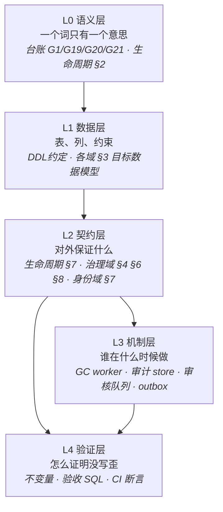
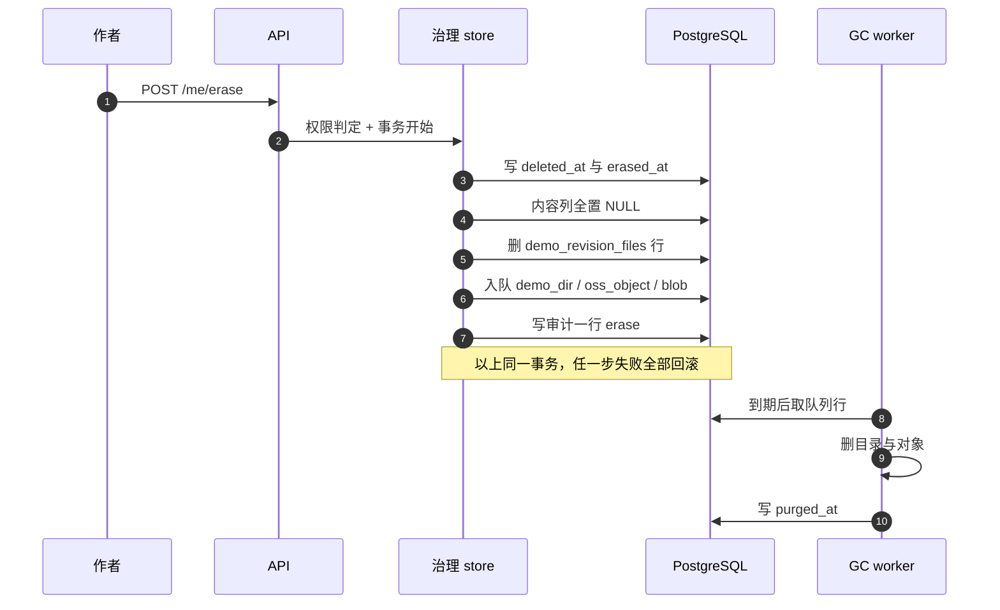

# 设计总纲：抽象与分层

版本：**v1.0 · 草案（2026-10-30）**

> **这份文档不是决策源。**
> 它把现有八份设计文档 + 一份台账压缩成一张可导航的图。任何与各域文档、`docs/设计决策台账.md` 冲突的地方，**以它们为准**，本文只负责指出「该去看哪一节、该动哪一处」。
> 它解决一个具体问题：**没人能同时记住 19000 行**。所以它只要求记住四样东西 —— 层、模板、原语、不变量，其余靠定位。

## 适用范围

覆盖目标态设计的现有文档：`docs/DDL约定.md`、`docs/数据生命周期设计.md`、`docs/治理域设计.md`、`docs/身份服务模型设计.md`、`docs/Demo域设计.md`、`docs/实体域数据结构设计.md`、`docs/标签域数据结构设计.md`、`docs/模型域设计.md`、`docs/设计决策台账.md`。

**不覆盖**尚未设计的域：设置、策展与运营、站内通知、关键词搜索、收藏与浏览历史、上传管道。它们在本文里只作为「将来的接入点」出现（见 §6.3、§9.2）。

---

## 0. 先看这一页

如果只记三句话：

1. **数据里只有三样东西在动 —— 行、字段、文件。行永远在，字段可以被清空，文件只能由队列删。**
2. **每个域只对外暴露一张窄接口；跨域只走接口，不读别人的表。**
3. **一次有外部后果的写 = 一个事务 = 一行审计；审计里不许有正文。**

如果只记一张图：

**箭头 = 允许的引用方向。** 上层可以引用下层，下层不许引用上层。数据层里出现「端点」，契约层里出现「worker 怎么重试」，是最常见的两种腐化。

---

## 1. 为什么需要这份文档

### 1.1 复杂度账

| 文档 | 行数 | 它真正管的东西 |
|---|---:|---|
| `docs/Demo域设计.md` | 1108 | 作品、版本、文件、频道、统计 |
| `docs/数据生命周期设计.md` | 1161 | 横切：删除、恢复、擦除、注销、GC、可见性 |
| `docs/治理域设计.md` | 1449 | 权限、审核、审计、GC 队列、用户状态操作 |
| `docs/身份服务模型设计.md` | 1504 | 账号、凭证、会话、档案、组、OIDC 联邦 |
| `docs/模型域设计.md` | 1674 | 模型档案与第三方基准 |
| `docs/标签域数据结构设计.md` | 2008 | 分类树、维度、绑定 |
| `docs/实体域数据结构设计.md` | 2173 | 提案、提示词、任务、工具链 |
| 三份 UML 图集 + `docs/DDL约定.md` | 4542 | 类图 / ER / 时序（人工同步）与方言约定 |
| 其余（旧栈现状、调研、roadmap、工作流） | 3537 | 背景资料，日常不读 |
| **合计** | **19156** | `wc -l docs/*.md` |

再加约 60 条已拍板决策（台账 G1–G21、治理域 D1–D8、Q1–Q17、身份域 Q1–Q31）。**没有人能把这个量级同时装进脑子**，包括写它的我。

### 1.2 复杂度只有三个来源

| 来源 | 表现 | 抽象的动作 |
|---|---|---|
| **同一个东西有多个名字** | 软删 / 归档 / 移除 / 擦除 / 注销 / 下架 / 隐藏 | 收敛成「行 × 字段 × 文件」三个维度上的坐标（生命周期 §2） |
| **同一件事散在多个域** | GC 在治理域、审计在治理域、可见性在生命周期、状态在 Demo 域 | 每件事指定**唯一落点**（§6 接口表） |
| **同一件事有多个落纸位置** | DDL、契约、注册表、验收 SQL、CI 断言 | 一份清单 + 生成，其余是派生物（§9.1） |

### 1.3 分层的目标

不是「写得整齐」，而是：**把「记住」换成「定位」。**

- 想知道「这条数据最后会怎样」→ 不读全文，查 §8.3 的时间轴。
- 想加一张内容表 → 不读生命周期，查 §10 的导航表，改注册表 + 该域 §3 + 验收 SQL。
- 想判断某个改法对不对 → 查 §5 的六条不变量，能违反哪一条。

---

## 2. 五层模型

| 层 | 回答的问题 | 谁拥有 | 允许引用 | 典型腐化 |
|---|---|---|---|---|
| **L0 语义** | 这个词是什么意思？ | `docs/设计决策台账.md`、生命周期 §2 | 无（它是根） | 同一个动作在不同文档里叫不同名字 |
| **L1 数据** | 表长什么样、列怎么约束？ | `docs/DDL约定.md` + 各域 §3 | L0 | 用 DDL 表达业务规则（例如「谁可以改」写成 `CHECK`） |
| **L2 契约** | 每个域对外保证什么？ | 生命周期 §7、治理域 §4/§6/§8、身份域 §7、各域 §4/§5 | L0 L1 | 契约里规定实现细节（重试次数、批大小写在 API 文档里） |
| **L3 机制** | 谁在什么时候执行？ | GC worker、审计 store、审核队列、`outbox_events`、CI 里的后台任务 | L0–L2 | 机制自己发明规则（worker 擅自改 `purge_after`） |
| **L4 验证** | 怎么证明没写歪？ | 各域 §7/§9 不变量、附录验收 SQL、CI 断言 | L0–L3 | 只断言「没崩」不断言「没漏」；或断言里写死行号 |

**一条判据**：写下任何一句需求时，先问它属于哪层。落在两层的（例如「擦除要在 10 分钟内删完文件」）必须拆开：契约层写「擦除后文件会被回收」，机制层写「10 分钟一批」，验证层写「30 分钟后 `purged_at` 非空」。

---

## 3. 七段式域模板

五份域文档（Demo / 实体 / 标签 / 模型 / 身份）**结构是同构的**。所以你不需要逐份记内容，只需要记模板 —— 想知道「这个域的读路径怎么定」，去任何一份的 §5；想知道「这个域不许做什么」，去 §2 的边界表。

| 段 | 名称 | 里面有什么 | 什么时候读 |
|---|---|---|---|
| §0 | 决策摘要 | 8–12 条，一句话一条 | 只想要结论 |
| §1 | 为什么 / 问题诊断 | 旧栈哪里不行、改的代价 | 怀疑方向时 |
| §2 | 领域边界 | 拥有什么 / 不拥有什么 / 接缝在哪 | **跨域改动前必读** |
| §3 | 目标数据模型 | DDL（PG 18 方言）、字段注释、约束 | 写代码、写迁移时 |
| §4 | 写入契约 | 谁能写、什么条件、事务边界 | 做接口时 |
| §5 | 读取契约 | 可见性、过滤、分页、索引 | 做页面时 |
| §6 / §7 | 状态机 / 时序 | 合法迁移、端到端步骤 | 讨论「能不能这样操作」 |
| §7 / §9 | 不变量 | 能直接写成断言或 CHECK 的句子 | **评审、CI** |
| §6 / §11 / §12 | 迁移路线 | expand → contract 几步，每步可回滚 | 动手迁移前 |
| 附录 A | 现状字段清单 | 旧栈逐列对照（描述现状，不是目标） | 迁移时核对 |

**读法**：先读 §0 和 §2（10 分钟能读完），需要动手再读 §3–§5，评审只看 §7 和 §2。§1 和附录 A 是背景，日常不用读。

---

## 4. 五个原语

全站所有「数据动作」都是这五个东西的组合。术语混乱本质上是因为大家在用第六个、第七个词描述同样的事。

| 原语 | 唯一判据 | 谁在管 | 典型载体 |
|---|---|---|---|
| **行 Row** | 表里的一条记录。**内容行与账号行永不物理删除** | 各域 §3 + 治理域 §9.2「恢复窗口」 | `demos` `demo_revisions` `proposals` `prompt_library_entries` `accounts` |
| **字段 Field** | 行里的一格。擦除 = 置 `NULL`（**不是**置 `''`，`''` 是内容） | 生命周期 §6.2「擦除在内容行上做什么」+ §11.1「逐表清单」 | `demos` 4 列 + `demo_revisions` 13 列……**清单唯一出处是 §6.2**，注册表与验收 SQL 必须与它逐列一致 |
| **文件 File** | 盘上的对象：目录 / OSS 对象 / `blobs` 行。**只由 GC 删** | 治理域 §9.3「GC 流程」+ 生命周期 §8「派生物与 GC」 | `gc_queue` 的三类 `kind`：`demo_dir` `oss_object` `blob` |
| **引用 Ref** | 指向别的实体的指针。**断引用，不删目标** | 生命周期 §6.2「共享实体不动」 | `demo_revision_files.blob_hash`、`demo_revisions.prompt_id`、`demo_classifications` |
| **动作 Action** | 一次有外部后果的写。落纸 = `audit_log` 一行 | 治理域 §8「审计」 | 25 个 `audit_actions`、13 个 `audit_entity_types` |

**把四个原语串起来，一句话**：动作改行 → 擦除清字段 → 清字段留下引用 → 引用没人要了进队列 → 队列删文件。

---

## 5. 六条不变量

不变量是「任何实现都必须满足、可以用一条 SQL 或一条 CI 断言验证」的句子。各域文档加起来有 40 多条，但**真正决定架构的只有六条**，其余都是它们的局部展开。

| # | 不变量 | 违反后的具体后果 | 出处 |
|---|---|---|---|
| **I1** | **行永不物理删除**（内容行与账号行） | 审计、外键、外部映射全部失去落点；「已删」变成不可举证的断言 | 治理域 Q11、Demo 域 §9「不变量」的「行永不物理删除」一条、生命周期 §10 |
| **I2** | **擦除 = 字段清空**；`erased_at IS NOT NULL ⇒ deleted_at IS NOT NULL 且内容列全 NULL` | 字段留着 → 假删除；`deleted_at` 没写 → 已擦除行仍被详情接口 200 返回 | 生命周期 §6.2、Demo 域 §9「不变量」的「`erased_at` 非空 ⟹ …」一条 |
| **I3** | **行管可见性，队列管文件** | 两者混在一起 → 恢复后作品变空壳（文件已删）或删不干净（字段清了文件还在） | 生命周期 §2.1、治理域 §9.1 |
| **I4** | **审计只记动作与掩码，不记正文**；审计与业务写同事务 | 审计变成 24 个月的内容备份，擦除失去意义；审计失败而业务提交 → 无痕操作 | 生命周期 §9、治理域 §8.2 |
| **I5** | **共享实体只断引用不删**；孤儿交由 GC 判 | 删 `prompts` 会连带其他作品的引用；判孤儿散落在业务代码里 → 版本一多就漏 | 实体域 §7 不变量、生命周期 §6.2 |
| **I6** | **状态机只有一个权威**：取值域（DDL 的 `CHECK`）归身份域，迁移规则归治理域，其余域只画图不定义 | 四份文档四套状态机，新注册账号的 `pending` 插不进去（真实发生过的 bug） | 治理域 §2.3「跨域债」、§7「用户与身份操作」、身份域 §6.1「身份域」 |

**用法**：评审时逐条问「这个改动会违反哪条」。答不出来就是没想清楚；答出多条就是改动太大，应拆。

---

## 6. 域接口表（封装）

### 6.1 一张表看清谁拥有什么

| 域 | 拥有（表） | 对外**只**暴露 | 依赖谁 | 谁能直接读它的表 |
|---|---|---|---|---|
| **身份** | `accounts` `credentials` `account_emails` `sessions` `account_marks` `auth_events` `profiles` `avatars` `username_history` `groups` `group_members` `exp_events` `clients` `consents` `external_links` `outbox_events` | `sub` 与 claims、状态机取值、`email_hmac` 核验 | 治理域（`role` 是真 FK） | **无人** —— 下游只认 claim |
| **治理** | `roles` `permissions` `role_permissions` `audit_log` `audit_actions` `audit_entity_types` `gc_queue` `gc_kinds` `review_kinds` | 权限判定、审计写入（`WithAudit`）、GC 队列、审核统一契约 | 身份域（`actor_id` 真 FK） | **无人** —— 只走 `store` 包 |
| **生命周期** | **无表** | 两列（`deleted_at` / `erased_at`）+ 五条契约 + 注册表 | 全部 | —— |
| **Demo** | `demos`、`demo_revisions` 与 5 张 `demo_revision_*` 从表、`blobs`、`demo_channels`、`demo_stats`、`demo_ratings`、`demo_classifications` | 作品读路径、版本不可变 | 生命周期、身份、模型、标签 | 只读视图 |
| **实体** | `proposals` `prompts` `prompt_library_entries` `tasks` `prompt_*`、工具链 | 提案作为审核来源、`prompts` 作为共享实体 | 身份（`users` 是 5 列投影） | demo 站只读 |
| **模型** | `model_catalog_items` 等 | 模型档案 | — | 只读 |
| **标签** | `classifications` `classification_dimensions` `demo_classifications` | 分类树与绑定 | — | 只读 |

### 6.2 跨域三条铁律

1. **不跨库 JOIN。** 跨库一律走 `sub` + 接口（判据见实体域 §2「领域边界」：两端在不在同一个 PG 实例里）。
2. **不共享事务**，除非两端在同一个 PG 实例里且已明确登记。
3. **不绕过 store**：裸 `tx.Commit()`、裸 `INSERT INTO audit_log` 由 CI 拦（治理域 §4.4、§8.2）。

### 6.3 接入一个新业务域要动哪些地方

固定六项，写死在治理域 §16「新业务域接入协议」：权限 key、审计动作、审计实体类型、GC kind、审核 kind、生命周期注册表行。**判据**：新域接入的 PR diff 里不应该出现 `docs/治理域设计.md` 与 `docs/数据生命周期设计.md` —— 出现就说明目录表没建全。

---

## 7. 三条端到端链路

同一套原语，在三个场景下的取值不同。

| 步骤 | 软删 / 恢复 | 擦除 | 注销 |
|---|---|---|---|
| 触发 | 作者点删除 | 作者点擦除 | 作者点注销 |
| 改什么 | `deleted_at`（+ 状态） | 先 `deleted_at`，再 `erased_at`，再清内容列 | `closed_at` + `status='deleted'` + `email_hmac` |
| 文件 | 入队，30 天后到期 | 入队，**10 分钟**内第一批 | 头像入队，30 天 |
| 可逆 | 30 天内可恢复（**删队列行**） | **不可逆** | **不可逆** |
| 审计 | 一行 `status_set` | 一行 `erase` | 一行 `status_set` |
| 对外 | 陌生人 404、作者 200 | 404 | 下游登录时收到注销 |

擦除是最复杂的一条，因为它同时动两个开关（行 + 字段）和三类文件：

**看清楚一件事**：链路上半段（事务）保证「看不到、查不到」，下半段（队列）保证「盘上没有」。两段之间允许有最长十分钟的窗口，这段时间里字段已空、文件还在 —— 这是**明确接受**的，不是 bug（生命周期 §6.7）。

---

## 8. 三张速查表

### 8.1 可见性六格（唯一出处：生命周期 §2.3）

| 数据 | 文件 | 可见性 | 用户看到 | 典型场景 |
|---|---|---|---|---|
| 完整 | 在 | 公开 | 200 全文 | 正常 |
| 完整 | 在 | 墓碑 | 200 墓碑页（不进列表） | 归档 / 移除 |
| 完整 | 在 | 仅作者 | 陌生人 404、作者 200 | 软删 |
| 完整 | 已删 | 仅作者 | 空壳（时间推进过去的） | 过期 GC 后的软删 |
| 清空 | 在 / 排队 | 无人 | 404 | 擦除 |

> 六格中 **② 与 ③ 在表里共用一行**：数据完全相同，差别只在触发者（作者归档 / 管理员移除）与申诉权。
> 真正非法的是「清空 + 公开/墓碑」这一列组合 —— 它会同时违反 I2 与生命周期 §7.3「规则 3：可见性必须三处同时生效」，应当写成断言。

### 8.2 谁能做什么（唯一出处：治理域 §4.3）

| 角色 | 权限条数 | 边界 |
|---|---:|---|
| `user` | **无权限行** | 只能操作自己拥有的资源，靠归属判定，**不查权限表** |
| `moderator` | 5 | 审核与下架，**不含**读审计、不含改权限 |
| `admin` | **19（全部）** | 含改角色、读审计、覆写内容；CI 断言「每个权限都在 `admin` 的绑定里」 |

### 8.3 什么时候真没了（时间轴）

| 东西 | 什么时候消失 | 出处 |
|---|---|---|
| 作品可见性 | 软删立即 | 生命周期 §7 |
| 作品内容字段 | 擦除立即（同事务） | 生命周期 §6.2 |
| 目录 / OSS 对象 / 无引用 blob | 到期后第一批 GC（10 分钟） | 治理域 §9.3 |
| 恢复窗口 | 30 天 | 治理域 §9.2「恢复窗口」、生命周期 §13「待拍板」的 L1 |
| 账号邮箱指纹 `email_hmac` | 核验通过即清空 | 身份域 §6.1 |
| 认证事件 `auth_events` | 90 天（分区丢弃） | 身份域 §12.1 |
| 审计 `audit_log` | 24 个月（分区丢弃） | 治理域 §8.4 |

---

## 9. 分层的代价与边界

### 9.1 三个代价，各有缓解

| 代价 | 表现 | 缓解 |
|---|---|---|
| **多一跳** | 每次写多一次审计插入、多一次队列 upsert | 同事务、无网络跳；审计行小（无正文）；实测瓶颈不在这 |
| **多一层** | 出问题要在 5 层之间找 | 每层有独立的验证：DDL 断言 → 契约 409/404 → 验收 SQL |
| **多一份** | 同一份清单在 DDL、注册表、验收 SQL 里各有一份 → 漂移 | 唯一清单 + 生成（注册表 `content_cols` 生成通用擦除与验收 SQL，生命周期 §11.4「结构层：ContentLifecycle 注册表」） |

### 9.2 明确不做

- 不做通用 ORM / 事件总线 / 微服务拆分。`outbox_events` + 轮询已经够用。
- 不引入消息队列。GC 与投影都是「表 + worker」。
- 不做多租户。
- 不追求「一份文档说清所有事」——那是这份总纲失败的样子。

### 9.3 什么时候该加一层

三条都满足才加：① 现有层无法表达（不是「写着麻烦」）；② 有可执行的验证手段；③ 有第二个使用方（只有一个调用方的抽象不是抽象，是包装）。

---

## 10. 我要改一个东西，该动哪

| 你想改 | 必须动 | 不要动 |
|---|---|---|
| 加一个业务域 | 治理域 §16 的六项 + 该域 §3 + 注册表行 | 生命周期正文、治理域正文 |
| 加一个权限 | 治理域 §4.3 + 后端常量 + CI 清单 | 前端硬编码菜单、`admin` 手工勾选 |
| 加一个审计动作 | `audit_actions` 种子 + 后端常量 | 表的 `CHECK` 约束 |
| 加一个内容列 | 该域 §3 + 生命周期 §6.2「擦除在内容行上做什么」+ 验收 SQL | 审计掩码（除非它含正文） |
| 改状态机 | 治理域 §7（迁移规则）+ 身份域 §6.1（取值） | 各域自画的状态图 |
| 改可见性谓词 | 生命周期 §7.3 + Demo 域读路径 + 台账 G1 | 各页面自己拼 `WHERE` |
| 加一处跨域引用 | 用 `§N.M「标题」` 形态 | **不要写行号**（AGENTS.md 硬规则） |

---

## 附录 A：文档地图

| 文档 | 管什么 | 什么时候读 |
|---|---|---|
| `docs/设计决策台账.md` | G1–G21 决策索引、域状态 | 找「这条为什么这么定」 |
| `docs/DDL约定.md` | 方言、类型映射、命名、生命周期列 | 写任何 DDL 前 |
| `docs/数据生命周期设计.md` | 删除 / 恢复 / 擦除 / 注销 / GC / 可见性 | 任何涉及「删」的需求 |
| `docs/治理域设计.md` | 权限、审核、审计、GC 队列、状态操作 | 任何涉及「谁能做」的需求 |
| `docs/身份服务模型设计.md` | 账号、登录、claim、下游同步 | 涉及登录/账号/下游的项目 |
| `docs/Demo域设计.md` | 作品与版本 | 作品相关功能 |
| `docs/实体域数据结构设计.md` | 提案、提示词、任务 | 投稿/提案/提示词 |
| `docs/标签域数据结构设计.md` | 分类树与绑定 | 分类、筛选 |
| `docs/模型域设计.md` | 模型档案与基准 | 模型信息展示 |
| `docs/论坛外置选型对比.md` | 论坛外置方案 | 社区相关 |
| 三份 UML 图集 | 类图 / ER / 时序（人工同步） | 需要看图说话时 |

## 附录 B：名词对照

同一个东西的多个名字，收敛到唯一坐标。

| 你可能会说 | 唯一坐标 | 说明 |
|---|---|---|
| 软删 / 下架 / 隐藏 / 归档 | 可见性「仅作者」或「墓碑」 | 差别在**曾经公开过没有**，不是两套数据 |
| 移除 / 强制下架 | 可见性「墓碑」+ 管理员触发 | 与作者归档同一格，差别是触发者与申诉权 |
| 擦除 / 彻底删除 / GDPR 删除 | 字段清空 + 文件入队 | 行还在 |
| 注销 / 销号 | 账号行 `closed_at` | 与内容擦除是两件事 |
| 恢复 | 删 `gc_queue` 行 + 清 `deleted_at` | 只在「仅作者」格可用 |
| 引用数 / 孤儿 | `blob` 的反查计数 | 只对 `blob` 成立；目录与 OSS 对象看队列，不看引用数 |

## 附录 C：变更记录

| 版本 | 日期 | 内容 |
|---|---|---|
| v1.0 | 2026-10-30 | 首版：五层模型、七段式模板、五个原语、六条不变量、域接口表、三条链路、三张速查表、导航表 |
