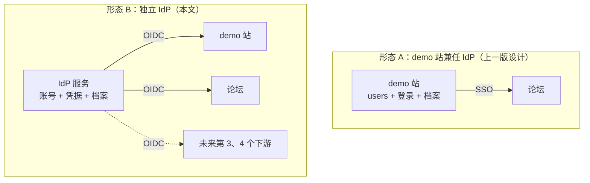
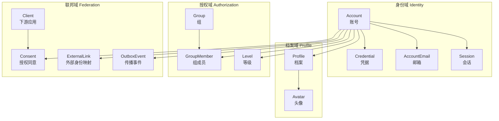
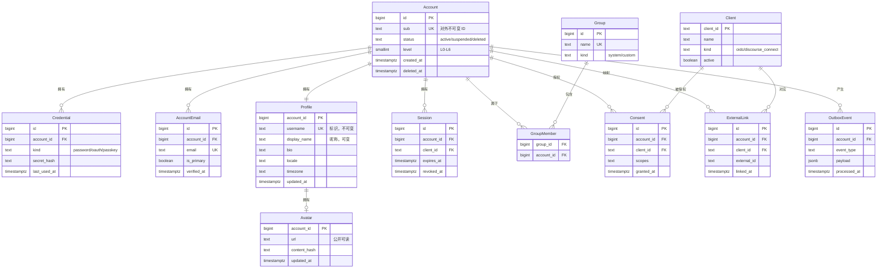
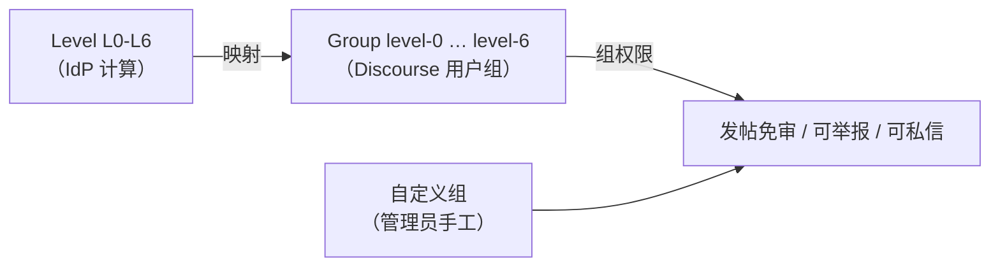
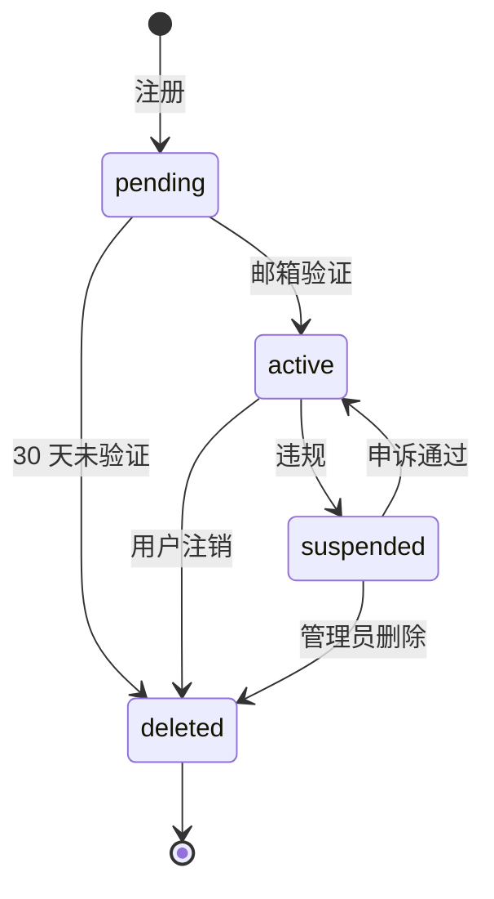
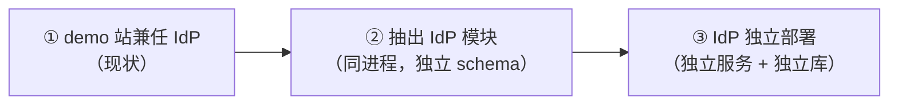

# 身份服务模型设计 v1.0

**适用范围**：本文只做**模型设计**——领域边界、实体、属性、关系、状态机、同步语义、Claim 契约。**不含代码设计**（无 Go 包结构、无 handler、无函数签名、无实现方案）。DDL 属于数据模型，保留。

**要回答的问题**：能不能做一个独立 IdP 服务，统一给 demo 站和 demo 论坛/社区提供身份服务，让 id / 昵称 / 头像跨平台同步。

**前置**：上一版 [`论坛外置选型对比.md`](./论坛外置选型对比.md) §7 的设计是「demo 站兼任 IdP」。本文改为「独立 IdP」，并说明这个改动带来的模型变化。

---

## 0. 结论摘要

| 问题 | 结论 |
|---|---|
| 能不能做 | **能**，且技术上没有障碍 |
| 该不该做 | **取决于下游数量**。2 个下游 → demo 站兼任更简单；≥3 个 → 独立 IdP 值得（§1） |
| 「同步」怎么做 | **只做「权威源 + 单向投影」**，不做双向同步（§2） |
| id 同步 | `sub` = IdP 内部不可变 ID，下游只存不解析 |
| 昵称同步 | **用户名与昵称必须分离**。用户名是标识（不可变、ASCII、≤20），昵称是展示（可变、Unicode）（§5.1） |
| 头像同步 | IdP 必须提供**公开可读的稳定 URL**，因为下游是「下载」不是「引用」（§5.2） |
| 最大风险 | **改名**。下游会跑自己的用户名规整逻辑，可能给出不同的名字（§5.3） |
| 最大未决 | **注销的传播语义**。IdP 删账号，下游是删、是匿名化、还是保留？（§8.4） |

---

## 1. 先回答「要不要独立 IdP」

### 1.1 两种形态



### 1.2 对比

| 维度 | 形态 A（demo 站兼任） | 形态 B（独立 IdP） |
|---|---|---|
| 下游数量 | 2 个（demo 站自己 + 论坛） | ≥3 个 |
| 新增服务 | 0 | 1（含独立数据库） |
| 身份与业务耦合 | **强**（`users` 表同时承载身份 + 业务外键） | 弱（身份独立，业务只存 `sub`） |
| 换论坛成本 | 中（要改 demo 站的 SSO 端点） | **低**（论坛换掉，IdP 不动） |
| 换 demo 站成本 | **高**（身份在 demo 站里） | 低 |
| 单点故障 | demo 站挂了，论坛也登不上 | IdP 挂了，全部登不上（**更集中**） |
| 运维复杂度 | 低 | 中（多一个服务 + 多一个库 + 多一套备份） |
| 数据一致性 | 强（同库） | 最终一致（事件传播） |
| 迁移成本 | 0 | 中（现有 `users` 要拆） |

### 1.3 判断

**关键变量是「下游数量」和「demo 站会不会被替换」。**

- 如果只有 demo 站 + 论坛两个下游，且 demo 站长期存在 → **形态 A 更划算**。独立 IdP 会引入「多一个服务、多一个库、多一套备份、多一个单点」四个成本，换来的只是「换论坛更容易」。
- 如果预期会有第 3、第 4 个下游（wiki、模型评测平台、CI、文档站），或者 demo 站本身可能被重写 → **形态 B 值得**。

**本文按形态 B 设计**（用户明确要求独立 IdP），但在 §9 给出「形态 A → 形态 B」的渐进路径，避免一次性大改。

### 1.4 独立 IdP 的额外收益（容易被忽略）

| 收益 | 说明 |
|---|---|
| **身份与业务解耦** | demo 站的 `users` 表可以瘦身成「`sub` + 业务字段」，身份逻辑全部外移 |
| **统一登出** | 现在 demo 站登出只清 cookie，token 7 天内仍有效（旧栈缺陷）。IdP 可以做真正的全局登出 |
| **统一凭据策略** | 密码强度、2FA、Passkey、登录限流只在一处实现 |
| **统一审计** | 谁在什么时候从哪个下游登录，一处可查 |
| **下游可插拔** | 新下游接入只需注册 client，不改 IdP 代码 |

---

## 2. 「同步」的三种语义（关键澄清）

用户说「跨平台同步」，但「同步」有三种完全不同的语义。**只有第一种该做。**

### 2.1 三种语义

| | **① 权威源 + 投影** | **② 双向同步** | **③ 联邦** |
|---|---|---|---|
| 定义 | IdP 是唯一权威，下游只读投影 | 下游改了回写 IdP | 各平台独立，互相引用 |
| 例子 | 改昵称 → IdP 改 → 下游下次登录更新 | 论坛改昵称 → 回写 IdP → demo 站也变 | 论坛显示「来自 demo 站的用户 X」 |
| 冲突 | **不存在**（只有一个写者） | **无解**（两边同时改，谁赢？） | 不适用 |
| 实现复杂度 | 低 | **高**（需要版本向量 / 时间戳 / 冲突合并） | 中 |
| 用户预期 | 一致 | 一致 | **困惑**（两个地方两个名字） |
| 该不该做 | ✅ **该做** | ❌ 不该做 | ❌ 不该做 |

### 2.2 为什么不做双向同步

双向同步的经典死结：

```
t1: 用户在 demo 站把昵称改成「小明」
t2: 用户在论坛把昵称改成「XiaoMing」
t3: 两边同步 → 谁赢？
```

三种解法都有问题：

| 解法 | 问题 |
|---|---|
| 最后写入者赢（LWW） | 依赖时钟，跨机器时钟漂移会导致「更早的改动覆盖更晚的」 |
| IdP 永远赢 | 论坛的改动被静默丢弃，用户会重复改 |
| 冲突时提示用户 | 需要在下游做冲突 UI，Discourse 不支持 |

**结论**：下游的昵称/头像字段设为**只读**（由 IdP 覆盖），用户要改就去 IdP 改。这是 Discourse 的 `auth_overrides_*` 系列设置的设计意图。

### 2.3 投影的时机

投影不是「实时推送」，而是**在下游的登录时机拉取**。原因：

1. 下游（Discourse）的 OIDC 实现只在登录时调 `after_authenticate` + `apply_user_attributes!`（已核实：`omniauth_callbacks_controller.rb:202`）
2. 实时推送需要下游提供「更新用户」的 webhook 接收端，Discourse 没有
3. 登录时拉取已经足够——用户改了昵称，下次登录就看到新的

**例外**：头像。Discourse 在每次登录时都会重新下载头像（`auth_overrides_avatar=true` 时），所以头像的投影延迟 = 登录间隔。可接受。

---

## 3. 领域边界

### 3.1 四个限界上下文



### 3.2 各上下文的职责

| 上下文 | 职责 | 不负责 |
|---|---|---|
| **身份域** | 账号存在性、凭据校验、邮箱验证、会话签发与撤销 | 展示信息、权限 |
| **档案域** | 昵称、头像、简介、语言、时区 | 登录、权限 |
| **授权域** | 组、组成员、等级 | 具体业务权限（下游自己判） |
| **联邦域** | 下游注册、授权同意、外部身份映射、变更传播 | 下游的业务数据 |

### 3.3 边界原则

1. **身份域不知道下游存在**。它只回答「这个凭据对不对」。
2. **档案域不知道谁在读**。它只回答「这个账号的展示信息是什么」。
3. **授权域只输出「组」和「等级」**，不输出「能不能发帖」——那是下游的判断。
4. **联邦域是唯一知道下游的地方**。所有跨系统逻辑集中在这里。

---

## 4. 核心模型

### 4.1 实体关系



### 4.2 五个核心实体

#### Account（账号）

**是什么**：一个「能登录的主体」的存在性证明。

**关键属性**：

| 属性 | 语义 | 可变 |
|---|---|---|
| `id` | 内部主键，不对外 | 否 |
| `sub` | **对外唯一标识**，OIDC 的 `sub` claim | **否，永不变** |
| `status` | `active` / `suspended` / `deleted` | 是 |
| `level` | L0–L6（bilibili 式等级） | 是（派生） |
| `deleted_at` | 软删除时间 | 是 |

**为什么 `sub` 要独立于 `id`**：

- `id` 是数据库实现细节，将来分库/迁移会变
- `sub` 是对外契约，一旦发给下游就**永不变**
- 下游（Discourse）把 `sub` 存成 `UserAssociatedAccount.provider_uid`，改了就对不上

**`sub` 的形态**：建议用 UUIDv7 或 `base32(随机 128 bit)`，不用自增数字。理由：自增数字会泄露用户总量，且迁移时容易撞。

#### Credential（凭据）

**是什么**：证明「我是这个账号」的手段。

**`kind` 的取值**：

| kind | 说明 | 现状 |
|---|---|---|
| `password` | 密码哈希 | 旧栈有（PBKDF2-SHA256，120k 迭代） |
| `oauth` | 第三方 OAuth（GitHub 等） | 旧栈有 `github_bound` 死列，从未实现 |
| `passkey` | WebAuthn | 无 |

**关键设计**：一个账号可以有多个凭据。这是「加 email 找回密码」和「将来加 Passkey」的基础。

#### AccountEmail（邮箱）

**是什么**：账号的联系邮箱，可多个，其中一个 primary。

**为什么独立成表**（而不是 `accounts.email` 一列）：

1. 支持多邮箱（主邮箱 + 备用）
2. 支持改邮箱的过渡期（旧邮箱验证 + 新邮箱验证）
3. 支持「同一邮箱不能注册两个账号」的唯一约束（`UNIQUE (lower(email))`）

**`verified_at` 是硬要求**：DiscourseConnect 官方警告「不验证 email 就发给 Discourse，你的站点会极度脆弱」。OIDC 路径虽然不强制，但 `email_verified` claim 会影响 `primary_email_verified?`，进而影响「能否用 email 匹配已有账号」。

#### Profile（档案）

**是什么**：账号的展示信息。

**关键设计：`username` 与 `display_name` 分离**（详见 §5.1）。

| 属性 | 语义 | 可变 | 约束 |
|---|---|---|---|
| `username` | **标识**，用于 URL、@提及、下游映射 | 极少（见 §5.3） | 唯一、ASCII、3–20 字符 |
| `display_name` | **昵称**，用于展示 | 随时 | 可重复、Unicode、≤50 字符 |
| `bio` | 简介 | 随时 | ≤500 字符 |
| `locale` | 语言偏好 | 随时 | BCP 47 |
| `timezone` | 时区 | 随时 | IANA |

#### Avatar（头像）

**是什么**：账号的头像。

**关键设计：存 URL + content_hash，不存二进制**（详见 §5.2）。

| 属性 | 语义 |
|---|---|
| `url` | **公开可读**的稳定 URL |
| `content_hash` | 内容哈希，用于判断「是否真的变了」 |

---

## 5. 五个关键取舍

### 5.1 用户名与昵称必须分离

**这是整个设计里最重要的一条。**

旧栈的问题：只有 `username`（唯一、ASCII、3–32），加了一个 `display_name` 但**半死**（只在设置页读写，零展示位）。

Discourse 的做法：`username`（唯一、3–20、默认 ASCII）+ `name`（全名/昵称，可重复、Unicode）。

**为什么必须分离**：

| 场景 | 只有 username | username + display_name |
|---|---|---|
| 用户想叫「小明」 | ❌ 不允许（ASCII only） | ✅ `display_name = 小明` |
| 两个用户都想叫「小明」 | ❌ 冲突 | ✅ 允许（`username` 不同） |
| 用户想改名 | ❌ 破坏所有 @提及和 URL | ✅ 只改 `display_name` |
| 下游映射 | 用 `username` | 用 `sub`（更稳） |

**约束设计**：

| 字段 | 唯一 | 字符集 | 长度 | 可变 |
|---|---|---|---|---|
| `username` | ✅ | `[a-zA-Z0-9_-]` | 3–20 | 极少（§5.3） |
| `display_name` | ❌ | 任意 Unicode | 1–50 | 随时 |

**为什么 `username` 上限是 20 而不是旧栈的 32**：

Discourse 的 `max_username_length` 默认 **20**（已核实 `site_settings.yml:1040`），`unicode_usernames` 默认 **false**（`:1045`）。如果 IdP 允许 32 字符，Discourse 会跑 `UserNameSuggester.suggest` 截断/改写，导致「同步」变成「下游自己改了个名」。

**所以 IdP 的 `username` 约束必须取所有下游的最严值**：3–20、ASCII。

### 5.2 头像必须公开可读

**这是最容易踩的坑。**

Discourse 的头像同步机制（已核实 `user_avatar.rb:118-137`）：

```ruby
def self.retrieve_for_associated_account(account, selection: :preserve)
  url = account.info["image"]        # ← 来自 OIDC 的 picture claim
  return unless user && url.present?
  ...
  Jobs.enqueue(:download_avatar_from_url, url: url, user_id: user.id, ...)
end
```

**关键**：Discourse 是**下载**头像，不是**引用**头像。

这意味着：

| 要求 | 原因 |
|---|---|
| URL 必须**公开可读**（无鉴权） | Discourse 的下载 job 不带用户凭据 |
| URL 必须**稳定**（不是临时签名 URL） | 下载是异步的，签名 URL 可能已过期 |
| URL 必须**幂等**（重复下载不产生副作用） | 每次登录都会重新下载 |
| 响应必须是**图片**（不是 302 到登录页） | 否则下载到的是 HTML |

**设计**：IdP 提供 `/avatars/{sub}/{content_hash}.webp`，无鉴权，`Cache-Control: public, max-age=31536000, immutable`。`content_hash` 变化即 URL 变化，天然缓存失效。

**为什么不用「下游引用 IdP 的 URL」**：

- Discourse 不支持（它只认下载）
- 引用会导致「IdP 挂了，所有下游头像全裂」
- 引用会让下游的 CDN 无法缓存

### 5.3 改名是最高风险操作

**为什么风险高**：

Discourse 在 `auth_overrides_username=true` 时，每次登录都会调 `UsernameChanger.override`（已核实 `username_changer.rb:15-30`）：

```ruby
def self.override(user, new_username)
  if user.username_equals_to?(new_username)
    UsernameChanger.change(user, new_username, user)
    true
  elsif user.username != UserNameSuggester.fix_username(new_username)
    suggested_username = UserNameSuggester.suggest(new_username, ...)
    UsernameChanger.change(user, suggested_username, user)   # ← 改成了 suggested，不是 new_username
    true
  else
    false
  end
end
```

**注意 `suggested_username`**：如果 IdP 给的 `preferred_username` 不满足 Discourse 的约束（长度、字符集、保留字、已被占用），Discourse 会**自己造一个名字**，而不是报错。

后果：IdP 显示「小明」，Discourse 显示「小明2」。用户困惑。

**缓解设计**：

| 措施 | 说明 |
|---|---|
| IdP 的 `username` 约束取下游最严值 | 3–20、ASCII、无保留字（§5.1） |
| 改名时**同步检查下游可用性** | 调 `GET /u/{username}.json` 看是否 404 |
| 改名**限频** | 30 天一次（Discourse 的 `username_change_period` 默认也是这个量级） |
| 改名**保留历史** | `username_history` 表，支持旧 URL 301 |
| 改名**不自动传播** | 只在下次登录时投影，不主动推 |

**更保守的方案**：`username` **永不可改**，只允许改 `display_name`。这是 GitHub 的做法（用户名可改但有限制），也是 Discourse 的默认（`username_change_period` 非零）。

**推荐**：`username` 不可改，`display_name` 随便改。理由：`username` 是标识，改了会破坏所有下游映射和 @提及；`display_name` 是展示，改了无副作用。

### 5.4 等级与组的关系

**等级（Level）**：L0–L6，行为累积，全站统一（详见 [`论坛外置选型对比.md`](./论坛外置选型对比.md) §8）。

**组（Group）**：Discourse 的用户组，用于权限控制。

**两者的关系**：



**设计**：

| 组类型 | 来源 | 谁维护 |
|---|---|---|
| `level-0` … `level-6` | IdP 的 `level` 派生 | IdP 自动 |
| `staff` / `moderator` | IdP 的 `role` 派生 | IdP 自动 |
| 自定义组 | 下游自己建 | 下游管理员 |

**关键**：IdP 只输出「组名列表」，不输出「权限」。权限是下游的事。

### 5.5 注销的传播语义

**这是最未决的一条**（§8.4 详述）。

三种下游行为：

| 下游 | 注销行为 | 语义 |
|---|---|---|
| demo 站 | 软删除（`deleted_at`），作品保留但作者显示「已注销」 | 保留内容，抹身份 |
| Discourse | `POST /admin/users/{id}/anonymize.json` | 保留帖子，抹身份 |
| 未来下游 | 未知 | 未知 |

**设计**：IdP 只发「账号已注销」事件，**不规定下游怎么处理**。下游自己决定删/匿名化/保留。

---

## 6. 数据模型

### 6.1 身份域

```sql
-- 账号
CREATE TABLE accounts (
    id          bigint      GENERATED ALWAYS AS IDENTITY PRIMARY KEY,
    sub         text        NOT NULL UNIQUE,          -- 对外不可变 ID（UUIDv7 或 base32）
    status      text        NOT NULL DEFAULT 'active'
                            CHECK (status IN ('active', 'suspended', 'deleted')),
    role        text        NOT NULL DEFAULT 'user'
                            CHECK (role IN ('user', 'moderator', 'admin')),
    level       smallint    NOT NULL DEFAULT 0 CHECK (level BETWEEN 0 AND 6),
    exp_total   integer     NOT NULL DEFAULT 0,
    created_at  timestamptz NOT NULL DEFAULT now(),
    updated_at  timestamptz NOT NULL DEFAULT now(),
    deleted_at  timestamptz
);
CREATE INDEX ix_accounts_status ON accounts (status) WHERE deleted_at IS NULL;

-- 凭据（一个账号可多个）
CREATE TABLE credentials (
    id           bigint      GENERATED ALWAYS AS IDENTITY PRIMARY KEY,
    account_id   bigint      NOT NULL REFERENCES accounts(id) ON DELETE CASCADE,
    kind         text        NOT NULL CHECK (kind IN ('password', 'oauth', 'passkey')),
    identifier   text        NOT NULL DEFAULT '',     -- oauth 的 provider、passkey 的 credential_id
    secret_hash  text        NOT NULL DEFAULT '',     -- password 的哈希；passkey 为空
    metadata     jsonb       NOT NULL DEFAULT '{}',   -- oauth 的 provider 数据
    created_at   timestamptz NOT NULL DEFAULT now(),
    last_used_at timestamptz,
    UNIQUE (account_id, kind, identifier)
);

-- 邮箱（可多个，一个 primary）
CREATE TABLE account_emails (
    id          bigint      GENERATED ALWAYS AS IDENTITY PRIMARY KEY,
    account_id  bigint      NOT NULL REFERENCES accounts(id) ON DELETE CASCADE,
    email       text        NOT NULL,
    is_primary  boolean     NOT NULL DEFAULT false,
    verified_at timestamptz,
    created_at  timestamptz NOT NULL DEFAULT now()
);
CREATE UNIQUE INDEX uq_account_emails_email ON account_emails (lower(email));
CREATE UNIQUE INDEX uq_account_emails_primary ON account_emails (account_id)
    WHERE is_primary;

-- 会话（支持真正的登出）
CREATE TABLE sessions (
    id          bigint      GENERATED ALWAYS AS IDENTITY PRIMARY KEY,
    account_id  bigint      NOT NULL REFERENCES accounts(id) ON DELETE CASCADE,
    client_id   text        NOT NULL,
    user_agent  text        NOT NULL DEFAULT '',
    ip_hash     text        NOT NULL DEFAULT '',      -- 不存明文 IP
    created_at  timestamptz NOT NULL DEFAULT now(),
    expires_at  timestamptz NOT NULL,
    revoked_at  timestamptz
);
CREATE INDEX ix_sessions_account ON sessions (account_id) WHERE revoked_at IS NULL;
```

**设计要点**：

| 要点 | 说明 |
|---|---|
| `sub` 独立于 `id` | 对外契约，永不变；`id` 是内部实现 |
| `role` 在 `accounts` 而非 `profile` | 权限不是展示信息 |
| `level` / `exp_total` 在 `accounts` | 派生值，但读频繁，放主表 |
| `credentials` 独立成表 | 支持多凭据（密码 + Passkey + OAuth） |
| `account_emails` 独立成表 | 支持多邮箱 + 改邮箱过渡期 |
| `sessions` 独立成表 | **这是旧栈最大的缺陷修复**：旧栈无 session 表，登出只清 cookie，token 7 天内仍有效 |
| `ip_hash` 不存明文 | 隐私；且旧栈的 `client_ip.py` 已经证明 IP 解析链路复杂 |

### 6.2 档案域

```sql
CREATE TABLE profiles (
    account_id   bigint      PRIMARY KEY REFERENCES accounts(id) ON DELETE CASCADE,
    username     text        NOT NULL,                -- 标识，不可变
    display_name text        NOT NULL DEFAULT '',     -- 昵称，可变
    bio          text        NOT NULL DEFAULT '',
    locale       text        NOT NULL DEFAULT 'zh-CN',
    timezone     text        NOT NULL DEFAULT 'Asia/Shanghai',
    updated_at   timestamptz NOT NULL DEFAULT now()
);
CREATE UNIQUE INDEX uq_profiles_username ON profiles (lower(username));

CREATE TABLE avatars (
    account_id   bigint      PRIMARY KEY REFERENCES accounts(id) ON DELETE CASCADE,
    url          text        NOT NULL,                -- 公开可读的稳定 URL
    content_hash text        NOT NULL,                -- sha256 前 16 位
    width        smallint    NOT NULL DEFAULT 512,
    height       smallint    NOT NULL DEFAULT 512,
    updated_at   timestamptz NOT NULL DEFAULT now()
);

-- 用户名历史（改名后旧 URL 301）
CREATE TABLE username_history (
    id         bigint      GENERATED ALWAYS AS IDENTITY PRIMARY KEY,
    account_id bigint      NOT NULL REFERENCES accounts(id) ON DELETE CASCADE,
    username   text        NOT NULL,
    changed_at timestamptz NOT NULL DEFAULT now()
);
CREATE UNIQUE INDEX uq_username_history ON username_history (lower(username));
```

**设计要点**：

| 要点 | 说明 |
|---|---|
| `username` 唯一（`lower()`） | 大小写不敏感唯一，避免 `Alice` / `alice` 并存 |
| `display_name` 不唯一 | 允许重名 |
| `username` 约束 3–20 ASCII | 取下游最严值（§5.1） |
| `avatars.url` 含 `content_hash` | URL 变化即缓存失效（§5.2） |
| `username_history` 唯一 | 防止「A 改成 B，C 又改成 A」导致旧 URL 指向错人 |

### 6.3 授权域

```sql
CREATE TABLE groups (
    id         bigint      GENERATED ALWAYS AS IDENTITY PRIMARY KEY,
    name       text        NOT NULL UNIQUE,
    kind       text        NOT NULL DEFAULT 'custom'
                           CHECK (kind IN ('system', 'custom')),
    created_at timestamptz NOT NULL DEFAULT now()
);

CREATE TABLE group_members (
    group_id   bigint      NOT NULL REFERENCES groups(id) ON DELETE CASCADE,
    account_id bigint      NOT NULL REFERENCES accounts(id) ON DELETE CASCADE,
    granted_at timestamptz NOT NULL DEFAULT now(),
    PRIMARY KEY (group_id, account_id)
);

-- 经验流水（等级的事实源，可重算）
CREATE TABLE exp_events (
    id         bigint      GENERATED ALWAYS AS IDENTITY PRIMARY KEY,
    account_id bigint      NOT NULL REFERENCES accounts(id) ON DELETE CASCADE,
    source     text        NOT NULL,                  -- 'login' / 'demo_approved' / 'forum_post' / ...
    amount     integer     NOT NULL,
    ref_type   text,
    ref_id     text,
    day        date        NOT NULL,
    created_at timestamptz NOT NULL DEFAULT now()
);
CREATE INDEX ix_exp_account_day ON exp_events (account_id, day);
CREATE UNIQUE INDEX uq_exp_daily_login ON exp_events (account_id, day, source)
    WHERE source = 'login';
```

**设计要点**：

| 要点 | 说明 |
|---|---|
| `groups.kind = 'system'` | `level-0` … `level-6`、`staff`、`moderator` 由 IdP 自动维护 |
| `groups.kind = 'custom'` | 下游自己建，IdP 不管 |
| `exp_events` 是事实源 | `accounts.exp_total` / `level` 是派生，可重算 |
| `uq_exp_daily_login` | 每日登录经验去重（防刷） |

### 6.4 联邦域

```sql
-- 下游应用注册
CREATE TABLE clients (
    client_id      text        PRIMARY KEY,
    client_secret  text        NOT NULL DEFAULT '',   -- 公开客户端为空
    name           text        NOT NULL,
    kind           text        NOT NULL
                               CHECK (kind IN ('oidc', 'discourse_connect')),
    redirect_uris  text[]      NOT NULL DEFAULT '{}',
    scopes         text[]      NOT NULL DEFAULT '{openid,profile,email}',
    active         boolean     NOT NULL DEFAULT true,
    created_at     timestamptz NOT NULL DEFAULT now()
);

-- 授权同意（用户授权某下游读取哪些 claim）
CREATE TABLE consents (
    id         bigint      GENERATED ALWAYS AS IDENTITY PRIMARY KEY,
    account_id bigint      NOT NULL REFERENCES accounts(id) ON DELETE CASCADE,
    client_id  text        NOT NULL REFERENCES clients(client_id) ON DELETE CASCADE,
    scopes     text[]      NOT NULL,
    granted_at timestamptz NOT NULL DEFAULT now(),
    revoked_at timestamptz,
    UNIQUE (account_id, client_id)
);

-- 外部身份映射（下游侧的 user id）
CREATE TABLE external_links (
    id          bigint      GENERATED ALWAYS AS IDENTITY PRIMARY KEY,
    account_id  bigint      NOT NULL REFERENCES accounts(id) ON DELETE CASCADE,
    client_id   text        NOT NULL REFERENCES clients(client_id) ON DELETE CASCADE,
    external_id text        NOT NULL,                 -- 下游的 user id
    linked_at   timestamptz NOT NULL DEFAULT now(),
    UNIQUE (account_id, client_id),
    UNIQUE (client_id, external_id)
);

-- 传播事件（outbox 模式）
CREATE TABLE outbox_events (
    id           bigint      GENERATED ALWAYS AS IDENTITY PRIMARY KEY,
    account_id   bigint      NOT NULL REFERENCES accounts(id) ON DELETE CASCADE,
    event_type   text        NOT NULL,                -- 'profile.updated' / 'avatar.updated' / 'account.deleted'
    payload      jsonb       NOT NULL,
    created_at   timestamptz NOT NULL DEFAULT now(),
    processed_at timestamptz
);
CREATE INDEX ix_outbox_pending ON outbox_events (created_at) WHERE processed_at IS NULL;
```

**设计要点**：

| 要点 | 说明 |
|---|---|
| `clients.kind` | 区分 OIDC 和 DiscourseConnect（两者协议不同） |
| `consents` | 用户可见「哪些应用能读我的信息」，合规需要 |
| `external_links` | 替代上一版的 `external_identities`，但方向反过来：**IdP 记录下游的 id**，而不是 demo 站记录论坛的 id |
| `outbox_events` | 事务性 outbox，保证「改档案」和「发事件」原子 |

### 6.5 与上一版 `external_identities` 的关系

| | 上一版（demo 站兼任 IdP） | 本文（独立 IdP） |
|---|---|---|
| 表名 | `external_identities` | `external_links` |
| 位置 | demo 站 | IdP |
| 方向 | demo 站用户 → 论坛用户 | IdP 账号 → 下游用户 |
| 主键 | `(local_user_id, provider)` | `(account_id, client_id)` |
| 用途 | demo 站查「这个用户在论坛是谁」 | IdP 查「这个账号在下游是谁」 |

**demo 站侧仍需保留一张表**：`account_links`（`sub` → demo 站 `user_id`）。因为 demo 站的业务表（作品、收藏）外键指向 demo 站的 `users.id`，不能直接改成 `sub`。

---

## 7. Claim 契约

### 7.1 标准 claim

| Claim | 来源 | 必需 | 说明 |
|---|---|---|---|
| `sub` | `accounts.sub` | ✅ | 永不变 |
| `preferred_username` | `profiles.username` | ✅ | 3–20 ASCII |
| `name` | `profiles.display_name` | ✅ | 昵称，Unicode |
| `picture` | `avatars.url` | ✅ | 公开可读 |
| `email` | `account_emails`（primary） | ✅ | 已验证 |
| `email_verified` | `account_emails.verified_at IS NOT NULL` | ✅ | boolean |
| `locale` | `profiles.locale` | ❌ | BCP 47 |
| `zoneinfo` | `profiles.timezone` | ❌ | IANA |
| `updated_at` | `profiles.updated_at` | ❌ | 用于下游判断是否需要更新 |

### 7.2 自定义 claim

| Claim | 来源 | 说明 |
|---|---|---|
| `groups` | `groups` + `group_members` | 组名数组，含 `level-N` |
| `level` | `accounts.level` | L0–L6 |
| `role` | `accounts.role` | `user` / `moderator` / `admin` |

### 7.3 各下游的 claim 消费能力

**Discourse OIDC**（已核实 `omniauth_open_id_connect.rb:207-220`）：

| Discourse 字段 | 读哪个 claim | 备注 |
|---|---|---|
| `uid` | `sub` | 存成 `UserAssociatedAccount.provider_uid` |
| `nickname` → `username` | `preferred_username` | 受 `max_username_length=20` 约束 |
| `name` | `given_name` + `family_name`，回落 `name` | 受 `enable_names` 控制 |
| `image` → 头像 | `picture` | **下载**，不是引用 |
| `email` | `email`（可配 `openid_connect_email_claim`） | 受 `email_verified` 影响 |
| `groups` | `openid_connect_groups_claim` 指定的 claim | 默认空，需显式配置 |
| 自定义字段 | `openid_connect_user_field_mappings` | 映射到 Discourse user field |

**关键限制**：

1. Discourse 的 `info` 块**只读 6 个 claim**：`name` / `email` / `given_name` / `family_name` / `preferred_username` / `picture`。其他 claim 只能通过 `openid_connect_claims` 或 `user_field_mappings` 间接使用。
2. `groups` 需要显式配置 `openid_connect_groups_claim`，且值必须是**数组或逗号分隔字符串**（已核实 `openid_connect_authenticator.rb:52-56`）。
3. `bio` 读的是 `description`（已核实 `managed_authenticator.rb` 的 `retrieve_profile`），不是标准 claim。

**demo 站**：全认，无限制。

### 7.4 同步开关

Discourse 的 `auth_overrides_*` 默认**全部 false**（已核实 `site_settings.yml:874-886`）：

| 设置 | 默认 | 要同步必须 |
|---|---|---|
| `auth_overrides_username` | false | ✅ 开 |
| `auth_overrides_name` | false | ✅ 开 |
| `auth_overrides_avatar` | false | ✅ 开 |
| `auth_overrides_email` | false | ✅ 开 |
| `openid_connect_overrides_email` | false | 可选（更细粒度） |

**注意**：`apply_user_attributes!` 在**每次登录**都跑（已核实 `omniauth_callbacks_controller.rb:202`），但只有 `auth_overrides_*` 为 true 时才真的覆盖。所以「同步」= 「开这些开关」。

**副作用**：开了 `auth_overrides_username` 后，用户在 Discourse 里**不能自己改用户名**（`can_edit_username` 返回 false）。这是设计意图，但要在 UI 上说明「请去 IdP 改」。

---

## 8. 生命周期与传播

### 8.1 状态机



### 8.2 各动作的传播

| 动作 | IdP 内部 | 传播到下游 | 时机 |
|---|---|---|---|
| 注册 | 建 `accounts` + `profiles` + `account_emails`（未验证） | 无 | — |
| 邮箱验证 | `account_emails.verified_at` | 无 | — |
| 首次登录下游 | 建 `external_links` + `consents` | 下游建账号 | 登录时 |
| 改 `display_name` | 更新 `profiles` | `outbox_events` → 下次登录投影 | 登录时 |
| 改 `bio` | 更新 `profiles` | 同上 | 登录时 |
| 改头像 | 更新 `avatars`（新 `content_hash`） | 同上 | 登录时 |
| 改 `username` | 更新 `profiles` + `username_history` | 同上（**高风险**，§5.3） | 登录时 |
| 改邮箱 | 更新 `account_emails` | 同上 | 登录时 |
| 升级 | 更新 `accounts.level` + `group_members` | 同上 | 登录时 |
| 封禁 | `accounts.status = 'suspended'` | 下游应拒绝登录 | **立即**（需主动推） |
| 注销 | `accounts.status = 'deleted'` + `deleted_at` | 下游自行决定删/匿名化 | **立即**（需主动推） |

**关键区分**：

- **展示信息**（昵称、头像、简介）→ **登录时投影**，延迟可接受
- **安全状态**（封禁、注销）→ **必须立即推**，不能等下次登录

### 8.3 封禁的传播

**问题**：用户在 IdP 被封禁，但已经在 Discourse 登录了。Discourse 的 session 还有效。

**设计**：

| 层 | 措施 |
|---|---|
| IdP | `accounts.status = 'suspended'`，拒绝签发新 token |
| IdP | 撤销该账号所有 `sessions`（`revoked_at = now()`） |
| IdP | 发 `account.suspended` 事件 |
| 下游 | 收到事件后调 `POST /admin/users/{id}/suspend.json`（Discourse） |
| 下游 | 或在下游的 token 校验里查 IdP 的 introspection 端点 |

**注意**：Discourse 的 OIDC 插件**不支持 back-channel logout**（已核实 `plugin.rb` 只有 RP-initiated logout，即前端跳转）。所以「立即踢下线」只能靠下游主动调 API。

### 8.4 注销的传播（未决）

**三种语义**：

| 语义 | demo 站 | Discourse | 用户预期 |
|---|---|---|---|
| **A. 硬删** | 删所有数据 | `DELETE /admin/users/{id}.json` | 「我的数据全没了」 |
| **B. 匿名化** | 软删 + 作品作者显示「已注销」 | `POST /admin/users/{id}/anonymize.json` | 「内容还在，但不是我」 |
| **C. 保留** | 只标记 `deleted` | 不动 | 「我注销了但还能搜到我」 |

**推荐 B**（匿名化）。理由：

1. 社区内容的价值在于「讨论的连续性」，硬删会让帖子变成孤儿
2. 匿名化满足「抹掉身份」的合规要求
3. Discourse 原生支持（`anonymize.json`）
4. demo 站的软删除已经是这个语义

**但要注意**：匿名化后，`external_links` 里的 `external_id` 会失效（Discourse 的 user id 还在，但 username 变了）。所以 `external_links` 要保留，不能删。

### 8.5 登出

**旧栈的缺陷**：无 session 表，登出只清 cookie，JWT 7 天内仍有效。

**IdP 的修复**：

| 层 | 措施 |
|---|---|
| IdP | `sessions.revoked_at = now()` |
| IdP | token 里带 `sid`（session id），校验时查 `sessions` |
| IdP | 提供 `end_session_endpoint`（OIDC RP-initiated logout） |
| 下游 | Discourse 支持 RP-initiated logout（已核实 `plugin.rb:23-70`） |

**注意**：Discourse 的 RP-initiated logout 需要 discovery document 里有 `end_session_endpoint`，且要开 `openid_connect_rp_initiated_logout`。

---

## 9. 与现有设计的关系

### 9.1 对 `users` 表的影响

**上一版设计**（[`论坛外置选型对比.md`](./论坛外置选型对比.md) §7）的 `users` 表：

```sql
users (id, username, password_hash, role, status, trust_level, token_version, created_at, deleted_at)
user_profiles (user_id, display_name, bio, avatar_url, history_enabled, updated_at)
user_stats (user_id, reputation, received_likes, ...)
```

**独立 IdP 后**：

| 原表 | 去向 |
|---|---|
| `users.username` | → IdP `profiles.username` |
| `users.password_hash` | → IdP `credentials` |
| `users.role` | → IdP `accounts.role` |
| `users.status` | → IdP `accounts.status` |
| `users.trust_level` | → IdP `accounts.level`（语义变了：从「论坛信任」变成「全站等级」） |
| `users.token_version` | → IdP `sessions`（更细粒度） |
| `user_profiles.display_name` | → IdP `profiles.display_name` |
| `user_profiles.bio` | → IdP `profiles.bio` |
| `user_profiles.avatar_url` | → IdP `avatars.url` |
| `user_profiles.history_enabled` | **留在 demo 站**（这是 demo 站的业务偏好，不是身份） |
| `user_stats.*` | **留在 demo 站**（这是 demo 站的业务统计） |

**demo 站侧的新 `users` 表**：

```sql
CREATE TABLE users (
    id          bigint      GENERATED ALWAYS AS IDENTITY PRIMARY KEY,
    sub         text        NOT NULL UNIQUE,          -- IdP 的 sub
    history_enabled boolean NOT NULL DEFAULT true,
    created_at  timestamptz NOT NULL DEFAULT now(),
    deleted_at  timestamptz
);
```

**只剩 5 列**。所有身份信息外移。

### 9.2 渐进路径（形态 A → 形态 B）

一次性拆 `users` 风险高。建议三步：



| 步 | 做什么 | 风险 |
|---|---|---|
| ① | 现状：`users` 表承载一切 | — |
| ② | 把身份相关表移到独立 schema（`identity.*`），demo 站通过 `sub` 关联 | 低（同库，事务仍原子） |
| ③ | 把 `identity.*` 迁到独立库，加 OIDC 端点 | 中（跨库，需 outbox） |

**关键**：第 ② 步就能拿到「身份与业务解耦」的 80% 收益，且不需要新服务。如果下游只有 2 个，**停在 ② 就够了**。

### 9.3 与 `external_threads` 的关系

上一版的 `external_threads`（作品 ↔ 论坛主题）**不受影响**。它属于 demo 站的业务数据，不属于身份。

---

## 10. 风险与待拍板

### 10.1 已识别风险

| # | 风险 | 影响 | 缓解 |
|---|---|---|---|
| 1 | IdP 成为单点故障 | 全部下游登不上 | 多副本 + 健康检查 + 降级（下游缓存 token 校验结果） |
| 2 | 多一个库要备份 | 运维成本 | 与 demo 站同周期备份 |
| 3 | 改名导致下游名字不一致 | 用户困惑 | `username` 不可改（§5.3） |
| 4 | 头像 URL 不可达 | 下游头像裂 | 公开可读 + CDN + 监控 |
| 5 | 封禁不能立即生效 | 违规用户继续发言 | 主动推 + 下游调 API（§8.3） |
| 6 | 注销语义未定 | 合规风险 | 推荐匿名化（§8.4） |
| 7 | 迁移期双写 | 数据不一致 | 用 outbox + 幂等（§9.2） |
| 8 | Discourse 的 `groups` claim 需显式配置 | 等级映射失效 | 部署时配 `openid_connect_groups_claim` |
| 9 | Discourse 的 `auth_overrides_*` 默认全 false | 「同步」看起来没生效 | 部署时全开（§7.4） |
| 10 | `username` 20 字符上限 | 旧栈 32 字符的用户名要截断 | 迁移时统一规整 + 记录映射 |

### 10.2 用户未考虑到的问题

| # | 问题 | 为什么重要 |
|---|---|---|
| 1 | **IdP 的域名** | `id.example.com`？还是 `auth.example.com`？影响 cookie 作用域和 SSO 体验 |
| 2 | **IdP 的 cookie 策略** | 跨子域的 SSO 需要 `Domain=.example.com`；但 `SameSite` 和 `Secure` 要配合 |
| 3 | **IdP 挂了怎么办** | 下游是否缓存 token 校验结果？缓存多久？这是可用性 vs 安全性的取舍 |
| 4 | **IdP 的密码策略** | 旧栈是 8–128 无强度要求。要不要加强度检查？要不要查泄露库（HIBP）？ |
| 5 | **IdP 的 2FA** | 现在没有。加了之后下游怎么感知？（OIDC 的 `acr` / `amr` claim） |
| 6 | **IdP 的登录限流** | 旧栈是 IP + 用户名双维度 10 次/5 分钟。IdP 要更严（它是所有下游的入口） |
| 7 | **IdP 的审计日志** | 谁在什么时候从哪个下游登录、改了什么。保留多久？ |
| 8 | **IdP 的数据导出** | 合规要求「用户可导出自己的数据」。导出什么格式？ |
| 9 | **IdP 的迁移** | 现有 `users` 表的数据怎么迁？密码哈希能直接搬吗？（PBKDF2 可以，但要确认参数） |
| 10 | **IdP 的测试环境** | 下游（Discourse）要连测试 IdP，需要独立的 client 和回调地址 |
| 11 | **`sub` 的生成策略** | UUIDv7？还是 `base32(随机)`？前者有序（利于索引），后者不泄露时间 |
| 12 | **多账号合并** | 用户用 GitHub 登录建了账号 A，又用密码建了账号 B，怎么合并？ |
| 13 | **邮箱变更的过渡期** | 改邮箱时，旧邮箱要不要保留一段时间？期间两个邮箱都能登录吗？ |
| 14 | **下游的「本地账号」** | Discourse 允许本地账号（非 SSO）。要不要禁用？不禁用会有「绕过 IdP 的账号」 |

### 10.3 待拍板

| # | 问题 | 选项 | 推荐 |
|---|---|---|---|
| 1 | 要不要独立 IdP | 形态 A（demo 站兼任）/ **形态 B（独立）** / 先做 ② 再决定 | 先做 ②（§9.2） |
| 2 | `username` 可否改 | **不可改** / 可改（限频 30 天） | 不可改 |
| 3 | 注销语义 | 硬删 / **匿名化** / 保留 | 匿名化 |
| 4 | 封禁是否立即踢下线 | **是**（主动推）/ 否（等 token 过期） | 是 |
| 5 | `sub` 形态 | **UUIDv7** / base32 随机 / 自增 | UUIDv7 |
| 6 | 是否禁用下游本地账号 | **禁用** / 允许 | 禁用 |
| 7 | 是否加 2FA | 现在加 / **以后加** | 以后（先留 `acr` claim 位） |
| 8 | 密码强度 | 保持 8–128 / **加强度检查** / 加 HIBP | 加强度检查 |
| 9 | IdP 域名 | `id.` / `auth.` / 独立域 | `id.` |
| 10 | 迁移期是否双写 | **是**（outbox）/ 否（停机迁移） | 是 |

---

## 附录 A：已核实的事实

| 事实 | 来源 |
|---|---|
| Discourse OIDC 的 `info` 只读 6 个 claim（`name` / `email` / `given_name` / `family_name` / `preferred_username` / `picture`） | `plugins/discourse-openid-connect/lib/omniauth_open_id_connect.rb:207-220` |
| `uid` 取 `id_token_info["sub"]` | 同上 `:207` |
| `groups` claim 需显式配置，值可为数组或逗号串 | `plugins/discourse-openid-connect/lib/openid_connect_authenticator.rb:52-56` |
| `auth_overrides_username` / `_name` / `_avatar` / `_email` 默认全 false | `config/site_settings.yml:874-886` |
| `apply_user_attributes!` 每次登录都跑 | `app/controllers/users/omniauth_callbacks_controller.rb:202` |
| `max_username_length` 默认 20 | `config/site_settings.yml:1040` |
| `min_username_length` 默认 3 | `config/site_settings.yml:1035` |
| `unicode_usernames` 默认 false | `config/site_settings.yml:1045` |
| 头像靠**下载**（`download_avatar_from_url`），不是引用 | `app/models/user_avatar.rb:118-137` |
| `auth_overrides_avatar=true` 时每次登录都重下头像 | 同上 `:124-136` |
| `UsernameChanger.override` 会跑 `UserNameSuggester.suggest`，可能给出不同的名字 | `app/services/username_changer.rb:15-30` |
| `result.username = info[:nickname]`（即 `preferred_username`） | `lib/auth/managed_authenticator.rb:106` |
| `result.name` 取 `first_name + last_name`，回落 `info[:name]` | 同上 `:102` |
| `bio` 读 `description`，不是标准 claim | 同上 `retrieve_profile` |
| Discourse 支持 RP-initiated logout（需 discovery 有 `end_session_endpoint`） | `plugins/discourse-openid-connect/plugin.rb:23-70` |
| Discourse **不支持** back-channel logout | 同上（只有前端跳转） |
| 旧栈密码哈希是 PBKDF2-SHA256 / 120k 迭代 | `main:backend/app/security.py:16-20` |
| 旧栈 `username` 约束 `^[a-zA-Z0-9_]+$` / 3–32 | `main:backend/app/schemas.py` `RegisterRequest` |
| 旧栈无 session 表，登出只清 cookie | `main:backend/app/security.py` + `auth.py` |
