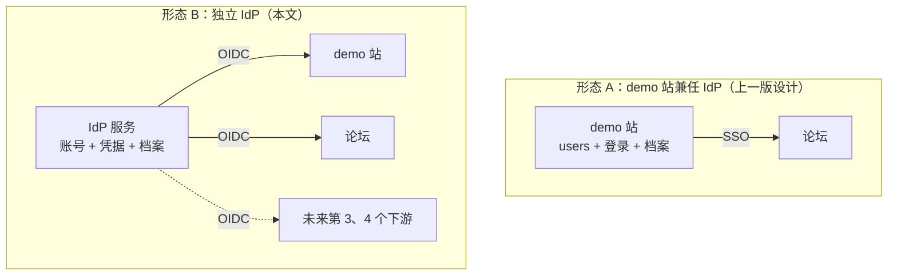
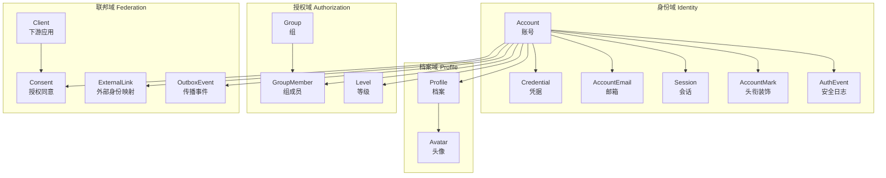
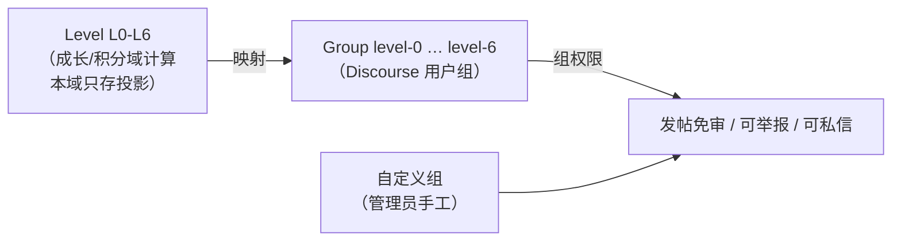
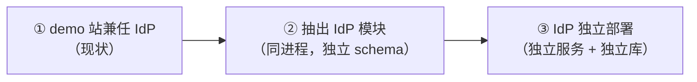

# 身份服务模型设计 v1.5

**本版变更（v1.5，2026-10-30）：外部审计核对后的第一批修正（不引入新取舍）。** 一份独立审计对本文与治理域做了交叉审查，以下各条经复核成立，且都属于「照已定口径补齐」，不需要新决策：

1. **`accounts.role` 由 `CHECK` 改真 FK**（`REFERENCES roles(key)`）—— 这是治理域 §2.3 与 §12 第 3 步早就列明的跨域债，值域不变，只是把三值 `CHECK` 换成真外键。
2. **`consents` 唯一性改部分唯一索引**（`WHERE revoked_at IS NULL`）—— 原写法让「撤销后再授权」必然撞唯一键（PG 18.6 实测 `duplicate key`）。
3. **`profiles.username` / `display_name` 的长度与字符集落成 `CHECK`** —— 此前只写在 §5.1 / §6.2 的散文里，DDL 拦不住。
4. **`sessions` 加 `acr` / `amr` 一致性 `CHECK`** —— `acr='aal2'` 却只有 `pwd` 这种自相矛盾的行此前能写进去。
5. **`clients.redirect_uris` / `scopes` 补校验契约** —— https、精确匹配、禁通配；请求 `scope` 必须 ⊆ 客户端注册的 scope。缺了这两条，OAuth 授权端点就是开放重定向 + 越权取 scope。
6. **`ip_hash` 明确为键控 HMAC** —— 裸 SHA-256 对 IPv4 只有 2³² 种输入，可枚举反推。
7. **§12.3 补迁移期不变量**：改 `username` 必须同事务同步 `credentials.identifier`（登录名是两处存的）。
8. **§11.2 的「21 个 permission」改 19** —— 治理域 v1.5 已裁到 19 条。

**本版变更（v1.4，2026-10-30）：Q14–Q31 全部落纸。** §10.2 的 14 条「用户未考虑到的问题」与 §10.3 的 10 条待拍板至此**全部闭环**，原先散在决策账里的决定一次性写进正文，并新增两节：**§11 部署与运行**（域名与 cookie 拓扑、会话校验与降级、登录限流、密码哈希、认证新鲜度与 2FA 预留）、**§12 数据、审计与迁移**（安全日志的读与保留、用户自助导出、旧栈迁移、UGC 能力令牌的归属）。几个关键改变：会话加 `acr` / `amr` / `auth_time` 三列；`account_emails` 加 `primary_requested_at`（提为 primary 需 **48 小时冷静期**，取代原先的「即时生效 + 30 天冷却」）；`auth_events` 的读口径与「查他人要记审计」定案（治理域审计动作 **25 → 26**，新增 `auth_event.read`）；**旧栈 `users` 表从无邮箱**，故迁移必须以「首次登录补填」为主路径。

**本版变更（v1.3，2026-10-30）：决策账里的 Q5–Q13 落进文档。** 这批决定早就拍了，但一直只记在决策账里没落纸，DDL 与结论已经对不上，本版一次补齐：**Q5** 等级/经验的**事实源搬去「成长/积分域」**（该域尚未设计）——`exp_events` 整表删除、`accounts.exp_total` 删除、`accounts.level` 降级为**投影镜像**（claim 照发）；**Q6** 删掉「上一版 `external_identities`」的对照段并明确**不建 `account_links`**（demo 站的 `users.sub` 一列就够），`external_links` 补 `external_username` / `external_email` / `last_synced_at`；**Q7** `clients` 补 `provider` / `host` / `base_url`（IdP 要**主动调下游**，光有 `client_id` 定位不到人）；**Q8** `sub` 定为 `base32(128 bit)` 26 字符；**Q9 / Q11 / Q13** 新增 §8.6 / §8.7；**Q10** 新增 §5.6「实现载体」；**Q12** `auth_events` 补 `client_id`（FK 在 §6.4 补）并改为按月分区。另修 **Q11 附带的一个漏洞**：`credentials` 原来只保证「同一账号不重复」，挡不住同一个 GitHub id 绑到两个账号。

**本版变更（v1.2，2026-10-30）：L1 / L2 / L3 定案落地。** 三条都落在本文：**L1 = 软删恢复窗口 30 天**（默认值，与治理域 §9.2 一致，本文无需改）；**L2 = 注销后仍受理擦除**，故 `accounts` 加 **`email_hmac`**（`HMAC-SHA256(服务端密钥, lower(trim(email)))`，密钥不入库，核验通过即清空）；**L3 = `accounts.deleted_at` 改名 `closed_at`**。另修一处欠账：《数据生命周期设计》§5.2 的 11 张表清单引用了 `account_marks` 与 `auth_events`，本文 v1.1 **根本没有这两张表**——本版补上 DDL 与约束（`account_marks` 注销时全删、`auth_events` 保留 90 天）。

**本版变更（v1.1，2026-10-30）：`accounts.status` 与治理域对齐（3 值 → 5 值 + `previous_status`）。** 起因：治理域 §7.1 的迁移表需要 `pending`（注册未验证）与 `banned`（长期封禁），而本文 §6.1 的 DDL 只有 `active/suspended/deleted`——**注册流程插不进去**；同时本文 §8.1 自画了一张 4 态图，里面 `suspended → deleted: 管理员删除` 与治理域 D2「`deleted` 只能本人自删」直接冲突。本版：① DDL 改 5 值 + `previous_status` + `ck_accounts_previous_status`，`DEFAULT` 由 `'active'` 改 `'pending'`；② **删掉 §8.1 的自绘图**，改为一行指针（取值域与迁移规则以治理域 §7.1 为唯一权威）；③ §8.2 的「封禁」由 `suspended` 改 `banned`（`suspended` 是暂停）；④ §2.4 类图与 §6.1 字段表同步。**未动的部分**：`accounts.deleted_at` 改名 `closed_at` 仍待 **L3** 拍板，`email_hmac` 待 **L2**。

**适用范围**：本文只做**模型设计**——领域边界、实体、属性、关系、状态机、同步语义、Claim 契约。**不含代码设计**（无 Go 包结构、无 handler、无函数签名、无实现方案）。DDL 属于数据模型，保留。

> **DDL 约定**：[`DDL约定.md`](./DDL约定.md)——方言（PostgreSQL 18）、语义 → 类型映射、字段表写法、图与 DDL 的关系（含「视图不标 PK/FK」「mermaid ER 用单 token 类型」）。本域无偏差。

**要回答的问题**：能不能做一个独立 IdP 服务，统一给 demo 站和 demo 论坛/社区提供身份服务，让 id / 昵称 / 头像跨平台同步。

**前置**：上一版 [`论坛外置选型对比.md`](./论坛外置选型对比.md) §7 的设计是「demo 站兼任 IdP」。本文改为「独立 IdP」，并说明这个改动带来的模型变化。

---

## 0. 结论摘要

| 问题 | 结论 |
|---|---|
| 能不能做 | **能**，且技术上没有障碍 |
| 该不该做 | **取决于下游数量**。2 个下游 → demo 站兼任更简单；≥3 个 → 独立 IdP 值得（§1） |
| 「同步」怎么做 | **只做「权威源 + 单向投影」**，不做双向同步（§2） |
| id 同步 | `sub` = IdP 内部不可变 ID，下游只存不解析 |
| 昵称同步 | **用户名与昵称必须分离**。用户名是标识（不可变、ASCII、≤20），昵称是展示（可变、Unicode）（§5.1） |
| 头像同步 | IdP 必须提供**公开可读的稳定 URL**，因为下游是「下载」不是「引用」（§5.2） |
| 最大风险 | **改名**。下游会跑自己的用户名规整逻辑，可能给出不同的名字（§5.3） |
| 最大未决 | ~~注销的传播语义~~ **已定**：账号行只关闭、不删除；内容行保留、身份抹掉；下游由各自的 `account.deleted` 处理（§8.4 + 生命周期 §2）。仍开放的是 §10.2 的工程项（域名、cookie、限流、导出…） |

---

## 1. 先回答「要不要独立 IdP」

### 1.1 两种形态



### 1.2 对比

| 维度 | 形态 A（demo 站兼任） | 形态 B（独立 IdP） |
|---|---|---|
| 下游数量 | 2 个（demo 站自己 + 论坛） | ≥3 个 |
| 新增服务 | 0 | 1（含独立数据库） |
| 身份与业务耦合 | **强**（`users` 表同时承载身份 + 业务外键） | 弱（身份独立，业务只存 `sub`） |
| 换论坛成本 | 中（要改 demo 站的 SSO 端点） | **低**（论坛换掉，IdP 不动） |
| 换 demo 站成本 | **高**（身份在 demo 站里） | 低 |
| 单点故障 | demo 站挂了，论坛也登不上 | IdP 挂了，全部登不上（**更集中**） |
| 运维复杂度 | 低 | 中（多一个服务 + 多一个库 + 多一套备份） |
| 数据一致性 | 强（同库） | 最终一致（事件传播） |
| 迁移成本 | 0 | 中（现有 `users` 要拆） |

### 1.3 判断

**关键变量是「下游数量」和「demo 站会不会被替换」。**

- 如果只有 demo 站 + 论坛两个下游，且 demo 站长期存在 → **形态 A 更划算**。独立 IdP 会引入「多一个服务、多一个库、多一套备份、多一个单点」四个成本，换来的只是「换论坛更容易」。
- 如果预期会有第 3、第 4 个下游（wiki、模型评测平台、CI、文档站），或者 demo 站本身可能被重写 → **形态 B 值得**。

**本文按形态 B 设计**（用户明确要求独立 IdP），但在 §9 给出「形态 A → 形态 B」的渐进路径，避免一次性大改。

### 1.4 独立 IdP 的额外收益（容易被忽略）

| 收益 | 说明 |
|---|---|
| **身份与业务解耦** | demo 站的 `users` 表可以瘦身成「`sub` + 业务字段」，身份逻辑全部外移 |
| **统一登出** | 现在 demo 站登出只清 cookie，token 7 天内仍有效（旧栈缺陷）。IdP 可以做真正的全局登出 |
| **统一凭据策略** | 密码强度、2FA、Passkey、登录限流只在一处实现 |
| **统一审计** | 谁在什么时候从哪个下游登录，一处可查 |
| **下游可插拔** | 新下游接入只需注册 client，不改 IdP 代码 |

---

## 2. 「同步」的三种语义（关键澄清）

用户说「跨平台同步」，但「同步」有三种完全不同的语义。**只有第一种该做。**

### 2.1 三种语义

| | **① 权威源 + 投影** | **② 双向同步** | **③ 联邦** |
|---|---|---|---|
| 定义 | IdP 是唯一权威，下游只读投影 | 下游改了回写 IdP | 各平台独立，互相引用 |
| 例子 | 改昵称 → IdP 改 → 下游下次登录更新 | 论坛改昵称 → 回写 IdP → demo 站也变 | 论坛显示「来自 demo 站的用户 X」 |
| 冲突 | **不存在**（只有一个写者） | **无解**（两边同时改，谁赢？） | 不适用 |
| 实现复杂度 | 低 | **高**（需要版本向量 / 时间戳 / 冲突合并） | 中 |
| 用户预期 | 一致 | 一致 | **困惑**（两个地方两个名字） |
| 该不该做 | ✅ **该做** | ❌ 不该做 | ❌ 不该做 |

### 2.2 为什么不做双向同步

双向同步的经典死结：

```
t1: 用户在 demo 站把昵称改成「小明」
t2: 用户在论坛把昵称改成「XiaoMing」
t3: 两边同步 → 谁赢？
```

三种解法都有问题：

| 解法 | 问题 |
|---|---|
| 最后写入者赢（LWW） | 依赖时钟，跨机器时钟漂移会导致「更早的改动覆盖更晚的」 |
| IdP 永远赢 | 论坛的改动被静默丢弃，用户会重复改 |
| 冲突时提示用户 | 需要在下游做冲突 UI，Discourse 不支持 |

**结论**：下游的昵称/头像字段设为**只读**（由 IdP 覆盖），用户要改就去 IdP 改。这是 Discourse 的 `auth_overrides_*` 系列设置的设计意图。

### 2.3 投影的时机

投影不是「实时推送」，而是**在下游的登录时机拉取**。原因：

1. 下游（Discourse）的 OIDC 实现只在登录时调 `after_authenticate` + `apply_user_attributes!`（已核实：`omniauth_callbacks_controller.rb:202`）
2. 实时推送需要下游提供「更新用户」的 webhook 接收端，Discourse 没有
3. 登录时拉取已经足够——用户改了昵称，下次登录就看到新的

**例外**：头像。Discourse 在每次登录时都会重新下载头像（`auth_overrides_avatar=true` 时），所以头像的投影延迟 = 登录间隔。可接受。

---

## 3. 领域边界

### 3.1 四个限界上下文



### 3.2 各上下文的职责

| 上下文 | 职责 | 不负责 |
|---|---|---|
| **身份域** | 账号存在性、凭据校验、邮箱验证、会话签发与撤销、头衔装饰、安全日志 | 展示信息（昵称/头像/简介）、权限 |
| **档案域** | 昵称、头像、简介、语言、时区 | 登录、权限 |
| **授权域** | 组、组成员 | 等级的计算、具体业务权限（下游自己判）。**等级的事实源在「成长/积分域」（尚未设计），本域只存 `accounts.level` 作投影镜像**（Q5） |
| **联邦域** | 下游注册、授权同意、外部身份映射、变更传播 | 下游的业务数据 |

### 3.3 边界原则

1. **身份域不知道下游存在**。它只回答「这个凭据对不对」。
2. **档案域不知道谁在读**。它只回答「这个账号的展示信息是什么」。
3. **授权域只输出「组」和「等级」**，不输出「能不能发帖」——那是下游的判断。
4. **联邦域是唯一知道下游的地方**。所有跨系统逻辑集中在这里。

---

## 4. 核心模型

### 4.1 实体关系

```mermaid
erDiagram
    Account ||--o{ Credential : "拥有"
    Account ||--o{ AccountEmail : "拥有"
    Account ||--o{ AccountMark : "佩戴"
    Account ||--o{ AuthEvent : "产生"
    Account ||--|| Profile : "拥有"
    Account ||--o{ Session : "拥有"
    Account ||--o{ GroupMember : "属于"
    Account ||--o{ Consent : "授权"
    Account ||--o{ ExternalLink : "映射"
    Account ||--o{ OutboxEvent : "产生"
    Profile ||--o| Avatar : "拥有"
    Group ||--o{ GroupMember : "包含"
    Client ||--o{ Consent : "被授权"
    Client ||--o{ ExternalLink : "对应"

    Account {
        bigint id PK
        text sub UK "对外不可变 ID"
        text status "pending/active/suspended/banned/deleted"
        text previous_status "suspended/banned 时记恢复目标"
        smallint level "L0-L6"
        text email_hmac "L2：注销时留的邮箱键控哈希"
        timestamptz created_at
        timestamptz closed_at "注销时刻（不是内容软删）"
    }
    Credential {
        bigint id PK
        bigint account_id FK
        text kind "password/oauth/passkey"
        text secret_hash
        timestamptz last_used_at
    }
    AccountEmail {
        bigint id PK
        bigint account_id FK
        text email UK
        boolean is_primary
        timestamptz verified_at
    }
    AccountMark {
        bigint id PK
        bigint account_id FK
        text kind "badge/frame/title"
        text label
        timestamptz expires_at
    }
    AuthEvent {
        bigint id PK
        bigint account_id FK
        text event_type
        text ip_hash
        timestamptz created_at
    }
    Profile {
        bigint account_id PK
        text username UK "标识，不可变"
        text display_name "昵称，可变"
        text bio
        text locale
        text timezone
        timestamptz updated_at
    }
    Avatar {
        bigint account_id PK
        text url "公开可读"
        text content_hash
        timestamptz updated_at
    }
    Session {
        bigint id PK
        bigint account_id FK
        text client_id FK
        timestamptz expires_at
        timestamptz revoked_at
    }
    Client {
        text client_id PK
        text name
        text kind "oidc/discourse_connect"
        boolean active
    }
    Consent {
        bigint id PK
        bigint account_id FK
        text client_id FK
        text scopes
        timestamptz granted_at
    }
    Group {
        bigint id PK
        text name UK
        text kind "system/custom"
    }
    GroupMember {
        bigint group_id FK
        bigint account_id FK
    }
    ExternalLink {
        bigint id PK
        bigint account_id FK
        text client_id FK
        text external_id
        timestamptz linked_at
    }
    OutboxEvent {
        bigint id PK
        bigint account_id FK
        text event_type
        jsonb payload
        timestamptz processed_at
    }
```



### 4.2 五个核心实体

#### Account（账号）

**是什么**：一个「能登录的主体」的存在性证明。

**关键属性**：

| 属性 | 语义 | 可变 |
|---|---|---|
| `id` | 内部主键，不对外 | 否 |
| `sub` | **对外唯一标识**，OIDC 的 `sub` claim | **否，永不变** |
| `status` | `pending` / `active` / `suspended` / `banned` / `deleted`（5 态；**迁移规则以治理域 §7.1 为唯一权威**） | 是 |
| `previous_status` | 只在 `suspended` / `banned` 时有值：解除限制后回到哪（`suspended` 时必为 `active`；`banned` 时可以是 `active` 或 `suspended`） | 是（与 `status` 同一次写入） |
| `level` | L0–L6（bilibili 式等级）。**投影镜像**：事实源在「成长/积分域」（尚未设计），本域只读它来发 claim 与映射 `level-N` 组，不在这里算经验 | 是（由成长/积分域回写） |
| `email_hmac` | **L2 用**：注销时留下的**邮箱键控哈希**（`HMAC-SHA256(服务端密钥, lower(trim(email)))`，密钥在环境变量/密钥管理里，**不入库**）。唯一用途是「注销后申请擦除」时验明本人；**核验通过立即置 `NULL`**（一次性凭据） | 是（只会被清空，不会被改写） |
| `closed_at` | **注销时刻**。原名 `deleted_at`（v1.2 改名）——因为它与内容行的 `deleted_at`（软删）同名不同义，混进同一个 JOIN 会写错谓词（生命周期 §5.2 的坑）。账号行**永不物理删除**，这一列只记「什么时候关的」 | 否（写一次） |

**为什么 `sub` 要独立于 `id`**：

- `id` 是数据库实现细节，将来分库/迁移会变
- `sub` 是对外契约，一旦发给下游就**永不变**
- 下游（Discourse）把 `sub` 存成 `UserAssociatedAccount.provider_uid`，改了就对不上

**`sub` 的形态**（Q8 已定）：**`base32(128 bit 随机)`，26 个字符**（小写、无填充）。

- 不用自增数字：泄露用户总量，迁移时容易撞
- 不用 UUIDv7：它前 48 bit 是毫秒时间戳，等于把注册时间编进对外 ID；而这里「有序」**没有收益**——`sub` 只有一个 UNIQUE 索引，任何 join 都不按它排序
- 要展示时间用 `accounts.created_at`

#### Credential（凭据）

**是什么**：证明「我是这个账号」的手段。

**`kind` 的取值**：

| kind | 说明 | 现状 |
|---|---|---|
| `password` | 密码哈希 | 旧栈有（PBKDF2-SHA256，120k 迭代） |
| `oauth` | 第三方 OAuth（GitHub 等） | 旧栈有 `github_bound` 死列，从未实现 |
| `passkey` | WebAuthn | 无 |

**关键设计**：一个账号可以有多个凭据。这是「加 email 找回密码」和「将来加 Passkey」的基础。

#### AccountEmail（邮箱）

**是什么**：账号的联系邮箱，可多个，其中一个 primary。

**为什么独立成表**（而不是 `accounts.email` 一列）：

1. 支持多邮箱（主邮箱 + 备用）
2. 支持改邮箱的过渡期（旧邮箱验证 + 新邮箱验证）
3. 支持「同一邮箱不能注册两个账号」的唯一约束（`UNIQUE (lower(email))`）

**`verified_at` 是硬要求**：DiscourseConnect 官方警告「不验证 email 就发给 Discourse，你的站点会极度脆弱」。OIDC 路径虽然不强制，但 `email_verified` claim 会影响 `primary_email_verified?`，进而影响「能否用 email 匹配已有账号」。

#### Profile（档案）

**是什么**：账号的展示信息。

**关键设计：`username` 与 `display_name` 分离**（详见 §5.1）。

| 属性 | 语义 | 可变 | 约束 |
|---|---|---|---|
| `username` | **标识**，用于 URL、@提及、下游映射 | 极少（见 §5.3） | 唯一、ASCII、3–20 字符 |
| `display_name` | **昵称**，用于展示 | 随时 | 可重复、Unicode、≤50 字符 |
| `bio` | 简介 | 随时 | ≤500 字符 |
| `locale` | 语言偏好 | 随时 | BCP 47 |
| `timezone` | 时区 | 随时 | IANA |

#### Avatar（头像）

**是什么**：账号的头像。

**关键设计：存 URL + content_hash，不存二进制**（详见 §5.2）。

| 属性 | 语义 |
|---|---|
| `url` | **公开可读**的稳定 URL |
| `content_hash` | 内容哈希，用于判断「是否真的变了」 |

---

## 5. 五个关键取舍

### 5.1 用户名与昵称必须分离

**这是整个设计里最重要的一条。**

旧栈的问题：只有 `username`（唯一、ASCII、3–32），加了一个 `display_name` 但**半死**（只在设置页读写，零展示位）。

Discourse 的做法：`username`（唯一、3–20、默认 ASCII）+ `name`（全名/昵称，可重复、Unicode）。

**为什么必须分离**：

| 场景 | 只有 username | username + display_name |
|---|---|---|
| 用户想叫「小明」 | ❌ 不允许（ASCII only） | ✅ `display_name = 小明` |
| 两个用户都想叫「小明」 | ❌ 冲突 | ✅ 允许（`username` 不同） |
| 用户想改名 | ❌ 破坏所有 @提及和 URL | ✅ 只改 `display_name` |
| 下游映射 | 用 `username` | 用 `sub`（更稳） |

**约束设计**：

| 字段 | 唯一 | 字符集 | 长度 | 可变 |
|---|---|---|---|---|
| `username` | ✅ | `[a-zA-Z0-9_-]` | 3–20 | 极少（§5.3） |
| `display_name` | ❌ | 任意 Unicode | 1–50 | 随时 |

**为什么 `username` 上限是 20 而不是旧栈的 32**：

Discourse 的 `max_username_length` 默认 **20**（已核实 `site_settings.yml:1040`），`unicode_usernames` 默认 **false**（`:1045`）。如果 IdP 允许 32 字符，Discourse 会跑 `UserNameSuggester.suggest` 截断/改写，导致「同步」变成「下游自己改了个名」。

**所以 IdP 的 `username` 约束必须取所有下游的最严值**：3–20、ASCII。

### 5.2 头像必须公开可读

**这是最容易踩的坑。**

Discourse 的头像同步机制（已核实 `user_avatar.rb:118-137`）：

```ruby
def self.retrieve_for_associated_account(account, selection: :preserve)
  url = account.info["image"]        # ← 来自 OIDC 的 picture claim
  return unless user && url.present?
  ...
  Jobs.enqueue(:download_avatar_from_url, url: url, user_id: user.id, ...)
end
```

**关键**：Discourse 是**下载**头像，不是**引用**头像。

这意味着：

| 要求 | 原因 |
|---|---|
| URL 必须**公开可读**（无鉴权） | Discourse 的下载 job 不带用户凭据 |
| URL 必须**稳定**（不是临时签名 URL） | 下载是异步的，签名 URL 可能已过期 |
| URL 必须**幂等**（重复下载不产生副作用） | 每次登录都会重新下载 |
| 响应必须是**图片**（不是 302 到登录页） | 否则下载到的是 HTML |

**设计**：IdP 提供 `/avatars/{sub}/{content_hash}.webp`，无鉴权，`Cache-Control: public, max-age=31536000, immutable`。`content_hash` 变化即 URL 变化，天然缓存失效。

**为什么不用「下游引用 IdP 的 URL」**：

- Discourse 不支持（它只认下载）
- 引用会导致「IdP 挂了，所有下游头像全裂」
- 引用会让下游的 CDN 无法缓存

### 5.3 改名是最高风险操作

**为什么风险高**：

Discourse 在 `auth_overrides_username=true` 时，每次登录都会调 `UsernameChanger.override`（已核实 `username_changer.rb:15-30`）：

```ruby
def self.override(user, new_username)
  if user.username_equals_to?(new_username)
    UsernameChanger.change(user, new_username, user)
    true
  elsif user.username != UserNameSuggester.fix_username(new_username)
    suggested_username = UserNameSuggester.suggest(new_username, ...)
    UsernameChanger.change(user, suggested_username, user)   # ← 改成了 suggested，不是 new_username
    true
  else
    false
  end
end
```

**注意 `suggested_username`**：如果 IdP 给的 `preferred_username` 不满足 Discourse 的约束（长度、字符集、保留字、已被占用），Discourse 会**自己造一个名字**，而不是报错。

后果：IdP 显示「小明」，Discourse 显示「小明2」。用户困惑。

**缓解设计**：

| 措施 | 说明 |
|---|---|
| IdP 的 `username` 约束取下游最严值 | 3–20、ASCII、无保留字（§5.1） |
| 改名时**同步检查下游可用性** | 调 `GET /u/{username}.json` 看是否 404 |
| 改名**限频** | 30 天一次（Discourse 的 `username_change_period` 默认也是这个量级） |
| 改名**保留历史** | `username_history` 表，支持旧 URL 301 |
| 改名**不自动传播** | 只在下次登录时投影，不主动推 |

**更保守的方案**：`username` **永不可改**，只允许改 `display_name`。这是 GitHub 的做法（用户名可改但有限制），也是 Discourse 的默认（`username_change_period` 非零）。

**推荐**：`username` 不可改，`display_name` 随便改。理由：`username` 是标识，改了会破坏所有下游映射和 @提及；`display_name` 是展示，改了无副作用。

### 5.4 等级与组的关系

**等级（Level）**：L0–L6，行为累积，全站统一（详见 [`论坛外置选型对比.md`](./论坛外置选型对比.md) §8）。

**组（Group）**：Discourse 的用户组，用于权限控制。

**两者的关系**：



**设计**：

| 组类型 | 来源 | 谁维护 |
|---|---|---|
| `level-0` … `level-6` | `accounts.level` 派生（**值来自成长/积分域**，本域不重算） | IdP 自动 |
| `staff` / `moderator` | IdP 的 `role` 派生 | IdP 自动 |
| 自定义组 | 下游自己建 | 下游管理员 |

**关键**：IdP 只输出「组名列表」，不输出「权限」。权限是下游的事。

### 5.5 注销的传播语义（已定）

**已定（Q14，与生命周期 §2 同口径）**：**本站立即、下游不立即；内容行保留、账号行只关闭**。

| 层 | 注销后发生什么 |
|---|---|
| IdP | `status='deleted'`、`closed_at` 写一次、`email_hmac` 留一次性凭据、**`account_marks` 全删**、`sessions` 全撤销、`outbox_events` 落 `account.deleted`（与上面同一个事务） |
| demo 站 | 作品行**不删**；作者显示「已注销」（墓碑）。内容字段清到哪一步不在这里决定，见生命周期 §6 |
| Discourse | 用官方 `anonymize.json` 抹身份、保留帖子 |
| 未来下游 | 由它自己按 `account.deleted` 决定 |

**为什么不再有「硬删 / 匿名化 / 保留」三选一**：A 硬删会把讨论变成孤儿，C 保留满足不了合规，而 B（匿名化）在**本站**已经由「行保留 + 身份抹掉 + 墓碑」实现、在**下游**由各下游自己实现。本域只负责发事件——它不知道下游有哪些内容，规定不了。

### 5.6 实现载体：协议用库，数据自持

**问题**：独立 IdP 要不要直接上 Keycloak / Zitadel / Ory Kratos 这类整套产品？

**结论（Q10）**：**协议层用库，数据模型自持**。

| 层 | 选择 | 理由 |
|---|---|---|
| OIDC 协议层 | 库（候选 Ory Hydra / fosite、`zitadel/oidc` v3），选型留到实施阶段 | token 签发、discovery、PKCE、`end_session_endpoint` 这些细节不该自己写 |
| 数据模型 | **自己拥有**：`accounts` / `profiles` / `credentials` / `account_marks` / `consents` 全是本域的表 | 这些表要与 demo 站、治理域、生命周期**同库同事务**；一旦交给外部产品托管，跨库就回不去了 |
| 会话 | 自己的 `sessions` 表 | 登出、封禁立即踢、单设备下线都要求本域能直接写 |

**为什么不用整套产品**：Keycloak / Zitadel 会把用户、会话、consent 搬进它自己的库，本域的表就变成「它们的投影」。而本文的设计——`previous_status` 与治理域状态机对齐、`email_hmac`、`sub` 形态、`account_marks`、90 天 `auth_events`、注销后仍受理擦除——**每一条都要求这些表能被本域直接读写**。整套产品适合「身份就是它的、你没有别的服务要接」的场景，我们不是。

**选型判据**（实施阶段）：OIDC 完整度（PKCE / `end_session_endpoint` / introspection）> Discourse 插件实测连通 > 维护活跃度 > 是否可只用协议层。

---

## 6. 数据模型

### 6.1 身份域

```sql
-- 账号
CREATE TABLE accounts (
    id          bigint      GENERATED ALWAYS AS IDENTITY PRIMARY KEY,
    sub         text        NOT NULL UNIQUE,          -- 对外不可变 ID：base32(128 bit)，26 字符（Q8）
    status      text        NOT NULL DEFAULT 'pending'
                            CHECK (status IN ('pending', 'active', 'suspended', 'banned', 'deleted')),
    previous_status text    CHECK (previous_status IN ('active', 'suspended')),
    role        text        NOT NULL DEFAULT 'user'
                            REFERENCES roles(key),   -- v1.5：三值 CHECK → 真 FK。取值域由治理域定义（`roles` 表，§2.3）；
                                                     -- 前提是两域同库（治理域 §12 第 3 步）。拆独立库（形态 C）时退回应用层校验。
    level       smallint    NOT NULL DEFAULT 0 CHECK (level BETWEEN 0 AND 6),  -- 投影镜像（事实源在成长/积分域）
    created_at  timestamptz NOT NULL DEFAULT now(),
    updated_at  timestamptz NOT NULL DEFAULT now(),
    email_hmac  text,                                   -- L2：注销时留的邮箱键控哈希；密钥不入库，核验后清空
    closed_at   timestamptz,                            -- 注销时刻（不是内容软删；账号行永不物理删除）

    -- `previous_status` 只在「当前受限」时有值，见治理域 §7.1 尾注。
    -- 注意：`suspended` 行的 `previous_status` 必须**精确等于** 'active'，不能用 `= 'active'` 直写——
    -- 它是 NULL 时结果是 NULL，而 CHECK 只在 FALSE 时拒绝，等于把 NULL 放过去（三值逻辑坑，
    -- 同治理域 §5.4 `cardinality()` 那个）。所以用 `IS NOT DISTINCT FROM`，并把 banned 的 NULL 显式挡掉。
    CONSTRAINT ck_accounts_previous_status CHECK (
        CASE status
            WHEN 'active'    THEN previous_status IS NULL
            WHEN 'suspended' THEN previous_status IS NOT DISTINCT FROM 'active'
            WHEN 'banned'    THEN previous_status IS NOT NULL
                              AND previous_status IN ('active', 'suspended')
            ELSE previous_status IS NULL
        END
    )
);
CREATE INDEX ix_accounts_status ON accounts (status) WHERE closed_at IS NULL;
CREATE UNIQUE INDEX uq_accounts_email_hmac ON accounts (email_hmac)
    WHERE email_hmac IS NOT NULL;

-- 凭据（一个账号可多个）
CREATE TABLE credentials (
    id           bigint      GENERATED ALWAYS AS IDENTITY PRIMARY KEY,
    account_id   bigint      NOT NULL REFERENCES accounts(id) ON DELETE CASCADE,
    kind         text        NOT NULL CHECK (kind IN ('password', 'oauth', 'passkey')),
    identifier   text        NOT NULL DEFAULT '',     -- oauth 的 provider、passkey 的 credential_id
    secret_hash  text        NOT NULL DEFAULT '',     -- password 的哈希；passkey 为空
    metadata     jsonb       NOT NULL DEFAULT '{}',   -- oauth 的 provider 数据
    created_at   timestamptz NOT NULL DEFAULT now(),
    last_used_at timestamptz,
    UNIQUE (account_id, kind, identifier)
);
-- 上面那条只保证「同一账号不重复」，挡不住「同一个 GitHub id 绑到两个账号」——
-- 第三方身份天然全局唯一，所以单独约束（Q11 附带修的漏洞）。
CREATE UNIQUE INDEX uq_credentials_external_identifier ON credentials (kind, identifier)
    WHERE kind IN ('oauth', 'passkey');

-- 邮箱（可多个，一个 primary）
CREATE TABLE account_emails (
    id          bigint      GENERATED ALWAYS AS IDENTITY PRIMARY KEY,
    account_id  bigint      NOT NULL REFERENCES accounts(id) ON DELETE CASCADE,
    email       text        NOT NULL,
    is_primary  boolean     NOT NULL DEFAULT false,
    verified_at timestamptz,
    primary_requested_at timestamptz,   -- 申请提为 primary 的时刻；48 小时后生效（§8.7）
    created_at  timestamptz NOT NULL DEFAULT now()
);
CREATE UNIQUE INDEX uq_account_emails_email ON account_emails (lower(email));
CREATE UNIQUE INDEX uq_account_emails_primary ON account_emails (account_id)
    WHERE is_primary;

-- 会话（支持真正的登出）
CREATE TABLE sessions (
    id          bigint      GENERATED ALWAYS AS IDENTITY PRIMARY KEY,
    account_id  bigint      NOT NULL REFERENCES accounts(id) ON DELETE CASCADE,
    client_id   text        NOT NULL,
    user_agent  text        NOT NULL DEFAULT '',
    ip_hash     text        NOT NULL DEFAULT '',      -- 不存明文 IP；v1.5 定为**键控 HMAC-SHA256(服务端密钥, ip)**，
                                                     -- 与 `email_hmac` 同规格——裸 SHA-256 对 IPv4 只有 2³² 种输入，可枚举反推
    acr         text        NOT NULL DEFAULT 'aal1',   -- 认证保证等级（Q28）：本期恒 aal1，TOTP 上线后可为 aal2
    amr         text[]      NOT NULL DEFAULT '{pwd}',  -- 认证方法：pwd / oauth:github / totp / recovery_code
    auth_time   timestamptz NOT NULL DEFAULT now(),    -- 最后一次证明「你是你」的时刻（敏感操作按它判定，§11.5）
    created_at  timestamptz NOT NULL DEFAULT now(),
    expires_at  timestamptz NOT NULL,
    revoked_at  timestamptz,

    -- v1.5：`acr` 与 `amr` 必须自洽——aal2 不能只有密码一个因子，aal1 也不能声称用过 totp。
    CONSTRAINT ck_sessions_acr_amr CHECK (
        (acr = 'aal1' AND NOT ('totp' = ANY (amr)))
     OR (acr = 'aal2' AND 'totp' = ANY (amr))
    )
);
CREATE INDEX ix_sessions_account ON sessions (account_id) WHERE revoked_at IS NULL;

-- 头衔 / 装饰（展示物；注销时**全删**，见生命周期 §5.2 第 6 行）
CREATE TABLE account_marks (
    id          bigint      GENERATED ALWAYS AS IDENTITY PRIMARY KEY,
    account_id  bigint      NOT NULL REFERENCES accounts(id) ON DELETE CASCADE,
    kind        text        NOT NULL
                            CHECK (kind IN ('title', 'frame', 'badge')),  -- 头衔 / 装饰框 / 徽章
    label       text        NOT NULL DEFAULT '',      -- 展示文案或资源 key
    granted_at  timestamptz NOT NULL DEFAULT now(),
    expires_at  timestamptz,                          -- 限时头衔；NULL = 永久
    UNIQUE (account_id, kind, label)                  -- 同一枚只能挂一次
);
CREATE INDEX ix_account_marks_account ON account_marks (account_id);

-- 安全日志（保留 90 天；注销后**不删**，见生命周期 §5.2 第 11 行）
-- 按月分区：保留期是「按月丢」，分区是最省事的删法（DELETE 大表会胀 WAL 与 vacuum）。
-- 分区表的主键必须含分区键，所以是 (id, created_at)，不是单列 id。
CREATE TABLE auth_events (
    id          bigint      GENERATED ALWAYS AS IDENTITY,
    account_id  bigint      NOT NULL REFERENCES accounts(id) ON DELETE CASCADE,
    client_id   text,                                 -- 从哪个下游来的（Q12）；FK 见 §6.4
    event_type  text        NOT NULL
                            CHECK (event_type IN ('login_ok', 'login_fail', 'logout',
                                                  'password_change', 'email_change',
                                                  'session_revoke', 'status_change',
                                                  'data_export')),   -- data_export：自助导出（§12.2）
    ip_hash     text        NOT NULL DEFAULT '',      -- 同 sessions：不存明文 IP
    user_agent  text        NOT NULL DEFAULT '',
    created_at  timestamptz NOT NULL DEFAULT now(),
    PRIMARY KEY (id, created_at)
) PARTITION BY RANGE (created_at);

CREATE TABLE auth_events_default PARTITION OF auth_events DEFAULT;
-- 月度分区（auth_events_p2026_11 …）由定时任务提前建，与治理域 audit_log 同一套做法。

CREATE INDEX ix_auth_events_account_time ON auth_events (account_id, created_at DESC);
CREATE INDEX ix_auth_events_retention ON auth_events (created_at);   -- 90 天清理用
CREATE INDEX ix_auth_events_ip ON auth_events (ip_hash, created_at)
    WHERE event_type = 'login_fail';                                 -- 限流滑动窗口用（§11.3）
```

**设计要点**：

| 要点 | 说明 |
|---|---|
| `sub` 独立于 `id` | 对外契约，永不变；`id` 是内部实现 |
| `role` 在 `accounts` 而非 `profile` | 权限不是展示信息 |
| `level` 在 `accounts` | **投影镜像**（Q5：事实源在成长/积分域）。放主表是因为每次发 claim、每次映射 `level-N` 组都要读；`exp_total` 已随之搬走 |
| `credentials` 独立成表 | 支持多凭据（密码 + Passkey + OAuth） |
| `account_emails` 独立成表 | 支持多邮箱 + 改邮箱过渡期 |
| `sessions` 独立成表 | **这是旧栈最大的缺陷修复**：旧栈无 session 表，登出只清 cookie，token 7 天内仍有效 |
| `ip_hash` 不存明文 | 隐私；且旧栈的 `client_ip.py` 已经证明 IP 解析链路复杂 |
| `account_marks` 独立成表 | 头衔/装饰是**可枚举、可过期、可多枚**的展示物；挂在 `profiles` 上会让「挂了几枚」变成 JSON 数组，无法建唯一约束 |
| `auth_events` 与 `sessions` 分开 | `sessions` 是**当前活着的会话**（撤销即失效）；`auth_events` 是**发生过什么**（登录失败、改密、封禁）。混一张表就分不清「这条是让人下线」还是「这条是留个记录」 |
| `email_hmac` 只在注销那一刻写 | 它存在的唯一理由是「注销后还能验明本人」（L2）。平时不写，核验通过即置 `NULL`——**留着一个能反查身份的哈希，比不留更危险** |

### 6.2 档案域

```sql
CREATE TABLE profiles (
    account_id   bigint      PRIMARY KEY REFERENCES accounts(id) ON DELETE CASCADE,
    username     text        NOT NULL                 -- 标识，不可变
                             CHECK (username ~ '^[A-Za-z0-9_-]{3,20}$'),   -- v1.5：约束落 CHECK（原先只在 §5.1 / §6.2 散文里）
    display_name text        NOT NULL DEFAULT ''      -- 昵称，可变
                             CHECK (char_length(display_name) <= 50),       -- 允许空串（= 展示时回退到 username）
    bio          text        NOT NULL DEFAULT '',
    locale       text        NOT NULL DEFAULT 'zh-CN',
    timezone     text        NOT NULL DEFAULT 'Asia/Shanghai',
    updated_at   timestamptz NOT NULL DEFAULT now()
);
CREATE UNIQUE INDEX uq_profiles_username ON profiles (lower(username));

CREATE TABLE avatars (
    account_id   bigint      PRIMARY KEY REFERENCES accounts(id) ON DELETE CASCADE,
    url          text        NOT NULL,                -- 公开可读的稳定 URL
    content_hash text        NOT NULL,                -- sha256 前 16 位
    width        smallint    NOT NULL DEFAULT 512,
    height       smallint    NOT NULL DEFAULT 512,
    updated_at   timestamptz NOT NULL DEFAULT now()
);

-- 用户名历史（改名后旧 URL 301）
CREATE TABLE username_history (
    id         bigint      GENERATED ALWAYS AS IDENTITY PRIMARY KEY,
    account_id bigint      NOT NULL REFERENCES accounts(id) ON DELETE CASCADE,
    username   text        NOT NULL,
    changed_at timestamptz NOT NULL DEFAULT now()
);
CREATE UNIQUE INDEX uq_username_history ON username_history (lower(username));
```

**设计要点**：

| 要点 | 说明 |
|---|---|
| `username` 唯一（`lower()`） | 大小写不敏感唯一，避免 `Alice` / `alice` 并存 |
| `display_name` 不唯一 | 允许重名 |
| `username` 约束 3–20 ASCII | 取下游最严值（§5.1） |
| `avatars.url` 含 `content_hash` | URL 变化即缓存失效（§5.2） |
| `username_history` 唯一 | 防止「A 改成 B，C 又改成 A」导致旧 URL 指向错人 |

### 6.3 授权域

```sql
CREATE TABLE groups (
    id         bigint      GENERATED ALWAYS AS IDENTITY PRIMARY KEY,
    name       text        NOT NULL UNIQUE,
    kind       text        NOT NULL DEFAULT 'custom'
                           CHECK (kind IN ('system', 'custom')),
    created_at timestamptz NOT NULL DEFAULT now()
);

CREATE TABLE group_members (
    group_id   bigint      NOT NULL REFERENCES groups(id) ON DELETE CASCADE,
    account_id bigint      NOT NULL REFERENCES accounts(id) ON DELETE CASCADE,
    granted_at timestamptz NOT NULL DEFAULT now(),
    PRIMARY KEY (group_id, account_id)
);

-- 经验流水 `exp_events` 已在 Q5 里整表搬去「成长/积分域」（尚未设计），本域不再有这张表。
```

**设计要点**：

| 要点 | 说明 |
|---|---|
| `groups.kind = 'system'` | `level-0` … `level-6`、`staff`、`moderator` 由 IdP 自动维护 |
| `groups.kind = 'custom'` | 下游自己建，IdP 不管 |
| **等级的事实源不在本域** | **Q5**：经验流水与等级计算整体搬到「**成长/积分域**」（尚未设计）。本域只保留 `accounts.level` 投影，用来发 claim 与映射 `level-N` 组 |
| 为什么不把 `exp_events` 放这里 | 「登录算不算经验」「作审给多少」是成长/积分域的规则。同一张表挂在两个域里，最后一定有两个事实源 |

### 6.4 联邦域

```sql
-- 下游应用注册
CREATE TABLE clients (
    client_id      text        PRIMARY KEY,
    client_secret  text        NOT NULL DEFAULT '',   -- 公开客户端为空
    name           text        NOT NULL,
    kind           text        NOT NULL
                               CHECK (kind IN ('oidc', 'discourse_connect')),
    provider       text        NOT NULL DEFAULT '',   -- 'discourse' / 'demo' / …（Q7：决定调哪套 API）
    host           text        NOT NULL DEFAULT '',   -- 下游 host（不含协议），如 forum.example.com
    base_url       text        NOT NULL DEFAULT '',   -- 调下游 API 的根，如 https://forum.example.com
    redirect_uris  text[]      NOT NULL DEFAULT '{}',
    scopes         text[]      NOT NULL DEFAULT '{openid,profile,email}',
    active         boolean     NOT NULL DEFAULT true,
    created_at     timestamptz NOT NULL DEFAULT now()
);
-- v1.5：`redirect_uris` / `scopes` 的校验规则（DDL 表达不了，作为实现契约写在这里）：
--   · redirect_uri 必须 **https**（本机调试只允许显式登记的 `http://127.0.0.1:<port>`）、
--     **精确字符串匹配**（不做前缀 / 后缀匹配）、**禁止通配符**（含 `*` 一律拒绝）；
--   · 授权请求里的 `scope` 必须 **⊆ `clients.scopes`**，否则直接 `invalid_scope`。
--   缺这两条，授权端点就是开放重定向 + 越权取 scope。

-- `auth_events.client_id` 的 FK 只能在这里加：§6.1 建表时 `clients` 还不存在。
-- 下游被删时把事件行的 client_id 置空——事件是历史，不跟着下游一起消失。
ALTER TABLE auth_events
    ADD CONSTRAINT fk_auth_events_client FOREIGN KEY (client_id)
    REFERENCES clients (client_id) ON DELETE SET NULL;

-- 授权同意（用户授权某下游读取哪些 claim）
CREATE TABLE consents (
    id         bigint      GENERATED ALWAYS AS IDENTITY PRIMARY KEY,
    account_id bigint      NOT NULL REFERENCES accounts(id) ON DELETE CASCADE,
    client_id  text        NOT NULL REFERENCES clients(client_id) ON DELETE CASCADE,
    scopes     text[]      NOT NULL,
    granted_at timestamptz NOT NULL DEFAULT now(),
    revoked_at timestamptz
);
-- v1.5：唯一性只在「未撤销」时成立。原来写表级 UNIQUE (account_id, client_id)，
-- 撤销后再授权必然撞唯一键（PG 18.6 实测 duplicate key）——撤销过的行不该继续占位。
CREATE UNIQUE INDEX uq_consents_active ON consents (account_id, client_id)
    WHERE revoked_at IS NULL;

-- 外部身份映射（下游侧的 user id）
CREATE TABLE external_links (
    id          bigint      GENERATED ALWAYS AS IDENTITY PRIMARY KEY,
    account_id  bigint      NOT NULL REFERENCES accounts(id) ON DELETE CASCADE,
    client_id   text        NOT NULL REFERENCES clients(client_id) ON DELETE CASCADE,
    external_id text        NOT NULL,                 -- 下游的 user id
    external_username text  NOT NULL DEFAULT '',      -- 下游侧用户名的快照（Q6）
    external_email    text  NOT NULL DEFAULT '',      -- 只有用户在下游授权过 email 才有
    last_synced_at    timestamptz,                    -- 最近一次把 profile 推给该下游的时间
    linked_at   timestamptz NOT NULL DEFAULT now(),
    UNIQUE (account_id, client_id),
    UNIQUE (client_id, external_id)
);

-- 传播事件（outbox 模式）
CREATE TABLE outbox_events (
    id           bigint      GENERATED ALWAYS AS IDENTITY PRIMARY KEY,
    account_id   bigint      NOT NULL REFERENCES accounts(id) ON DELETE CASCADE,
    event_type   text        NOT NULL,                -- 'profile.updated' / 'avatar.updated' / 'account.deleted'
    payload      jsonb       NOT NULL,
    created_at   timestamptz NOT NULL DEFAULT now(),
    processed_at timestamptz
);
CREATE INDEX ix_outbox_pending ON outbox_events (created_at) WHERE processed_at IS NULL;
```

**设计要点**：

| 要点 | 说明 |
|---|---|
| `clients.kind` | 区分 OIDC 和 DiscourseConnect（两者协议不同） |
| `clients.provider` / `host` / `base_url` | **Q7**：IdP 要**主动调下游**（封禁立即踢、匿名化、推 profile），光有 `client_id` 定位不到人。`provider` 决定调哪套 API（Discourse 的 `/admin/users/{id}/suspend.json` 和自研站不一样），`base_url` 是调用根 |
| `consents` | 用户可见「哪些应用能读我的信息」，合规需要；唯一性只在未撤销时成立（v1.5 改部分唯一索引） |
| `clients.redirect_uris` / `scopes` | v1.5 补校验契约：https + 精确匹配 + 禁通配；请求 scope 必须 ⊆ 注册 scope |
| `external_links` | **IdP 记录下游的 id**（方向与上一版的 `external_identities` 相反，见 §6.5） |
| 为什么留 `external_username` 快照 | 排查「IdP 改了名、下游没跟上」时不用登下游。匿名化之后 `external_id` 还活着、用户名已经变了，这列就是**当时的样子** |
| `outbox_events` | 事务性 outbox，保证「改档案」和「发事件」原子 |

### 6.5 为什么不再需要 `external_identities` / `account_links`

上一版（demo 站兼任 IdP）在 demo 站侧建 `external_identities`（demo 站用户 → 论坛用户）。独立 IdP 之后方向反过来了：

| | 上一版 | 本文 |
|---|---|---|
| 表名 | `external_identities` | `external_links` |
| 位置 | demo 站 | IdP |
| 方向 | demo 站用户 → 论坛用户 | IdP 账号 → 下游用户 |
| 主键 | `(local_user_id, provider)` | `(account_id, client_id)` |

**Q6 定：demo 站侧不建 `account_links`。** 那张表要解决的是「demo 站的 `user_id` 怎么认回 IdP 账号」，而 demo 站的新 `users` 表已经有 `sub` 一列（§9.1，只剩 5 列）——`id ⇄ sub` 的映射就是这一列。再建一张 `account_links` 等于把同一件事写两遍：多一次 join、多一处能不一致的地方。**多下游的映射只存在 IdP 侧的 `external_links` 里。**

---

## 7. Claim 契约

### 7.1 标准 claim

| Claim | 来源 | 必需 | 说明 |
|---|---|---|---|
| `sub` | `accounts.sub` | ✅ | 永不变 |
| `preferred_username` | `profiles.username` | ✅ | 3–20 ASCII |
| `name` | `profiles.display_name` | ✅ | 昵称，Unicode |
| `picture` | `avatars.url` | ✅ | 公开可读 |
| `email` | `account_emails`（primary） | ✅ | 已验证 |
| `email_verified` | `account_emails.verified_at IS NOT NULL` | ✅ | boolean |
| `locale` | `profiles.locale` | ❌ | BCP 47 |
| `zoneinfo` | `profiles.timezone` | ❌ | IANA |
| `updated_at` | `profiles.updated_at` | ❌ | 用于下游判断是否需要更新 |
| `auth_time` | `sessions.auth_time` | ✅ | 最后一次认证的时刻；配合请求参数 `max_age` 实现敏感操作重认证（§11.5） |
| `acr` | `sessions.acr` | ❌ | 认证保证等级，本期恒 `aal1`；上 TOTP 后可为 `aal2` |
| `amr` | `sessions.amr` | ❌ | 认证方法数组，本期 `["pwd"]` 或 `["oauth:github"]` |

**为什么现在就发这三个 claim**：`auth_time` 本期就要用（敏感操作要求 5 分钟内重新认证），不是为 2FA 预留的空位；`acr` / `amr` 是它的自然伴随——现在填固定值，将来加 TOTP 只改写入值，**判定入口一处都不动**。

### 7.2 自定义 claim

| Claim | 来源 | 说明 |
|---|---|---|
| `groups` | `groups` + `group_members` | 组名数组，含 `level-N` |
| `level` | `accounts.level`（投影自成长/积分域） | L0–L6 |
| `marks` | `account_marks` | 头衔 / 装饰 / 徽章数组（Q5）。下游可只认前 3 个 |
| `role` | `accounts.role` | `user` / `moderator` / `admin` |

### 7.3 各下游的 claim 消费能力

**Discourse OIDC**（已核实 `omniauth_open_id_connect.rb:207-220`）：

| Discourse 字段 | 读哪个 claim | 备注 |
|---|---|---|
| `uid` | `sub` | 存成 `UserAssociatedAccount.provider_uid` |
| `nickname` → `username` | `preferred_username` | 受 `max_username_length=20` 约束 |
| `name` | `given_name` + `family_name`，回落 `name` | 受 `enable_names` 控制 |
| `image` → 头像 | `picture` | **下载**，不是引用 |
| `email` | `email`（可配 `openid_connect_email_claim`） | 受 `email_verified` 影响 |
| `groups` | `openid_connect_groups_claim` 指定的 claim | 默认空，需显式配置 |
| 自定义字段 | `openid_connect_user_field_mappings` | 映射到 Discourse user field |

**关键限制**：

1. Discourse 的 `info` 块**只读 6 个 claim**：`name` / `email` / `given_name` / `family_name` / `preferred_username` / `picture`。其他 claim 只能通过 `openid_connect_claims` 或 `user_field_mappings` 间接使用。
2. `groups` 需要显式配置 `openid_connect_groups_claim`，且值必须是**数组或逗号分隔字符串**（已核实 `openid_connect_authenticator.rb:52-56`）。
3. `bio` 读的是 `description`（已核实 `managed_authenticator.rb` 的 `retrieve_profile`），不是标准 claim。

**demo 站**：全认，无限制。

### 7.4 同步开关

Discourse 的 `auth_overrides_*` 默认**全部 false**（已核实 `site_settings.yml:874-886`）：

| 设置 | 默认 | 要同步必须 |
|---|---|---|
| `auth_overrides_username` | false | ✅ 开 |
| `auth_overrides_name` | false | ✅ 开 |
| `auth_overrides_avatar` | false | ✅ 开 |
| `auth_overrides_email` | false | ✅ 开 |
| `openid_connect_overrides_email` | false | 可选（更细粒度） |

**注意**：`apply_user_attributes!` 在**每次登录**都跑（已核实 `omniauth_callbacks_controller.rb:202`），但只有 `auth_overrides_*` 为 true 时才真的覆盖。所以「同步」= 「开这些开关」。

**副作用**：开了 `auth_overrides_username` 后，用户在 Discourse 里**不能自己改用户名**（`can_edit_username` 返回 false）。这是设计意图，但要在 UI 上说明「请去 IdP 改」。

**本域不管的另一套令牌**：用户 demo（UGC 页面）想「知道当前访客是谁」时用的**不是**本文的 OIDC——那是一套平台内部的能力令牌（`aud = demo:{slug}`、`caps` 数组、由宿主页 `postMessage` 下发），见 [`Demo运行能力契约`](./Demo运行能力契约.md)。两者**不共用** `clients` / `consents` / `external_links`：OIDC 面向跨信任域的第三方应用，UGC 是我们自己平台上的代码。

---

## 8. 生命周期与传播

### 8.1 状态机（本域不重新定义）

**`accounts.status` 的取值域（5 态）与全部迁移规则以 [`治理域设计.md`](./治理域设计.md) §7.1 为唯一权威**，本文不再画第二张图——两张图就是两份事实源，迟早有一张停在旧版本上（v1.0 那张就停了：缺 `banned`、缺 `previous_status`，还多一条 `suspended → deleted: 管理员删除`，与治理域 **D2**「`deleted` 只能本人自删、修旧栈 P12」直接冲突）。

本文只说 **IdP 侧要多做的那一部分**：

| 事件 | 谁触发 | IdP 侧做什么 | 时间 |
|---|---|---|---|
| 注册 | 本人 | 建 `accounts`（`status='pending'`）+ `profiles` + `account_emails`（未验证） | 即时 |
| 邮箱验证 | 本人（`POST /me/verify-email`） | 写 `account_emails.verified_at`，`accounts.status→'active'` | 即时 |
| 30 天未验证 | 系统任务 | `status→'deleted'` + `closed_at`（治理域 §7.1 的 `pending → deleted`） | 定时 |
| 注销 | 本人 | `status→'deleted'` + `closed_at`（**唯一由本人进入 `deleted` 的路径**）；若 **L2=B**，同事务写 `email_hmac` | 即时 |
| 暂停 / 封禁 | 管理员（治理域端点） | **不写 `status`**（治理域写）；IdP 负责让会话立即失效 + 推下游 | 即时 |

**`pending` 账号的权限边界**：不能登录任何下游（IdP 自己也不发 token），不能发言、不能投稿、不能改资料（除补验证邮箱）；`level` 固定 L0（经验值已不在本域，Q5）。

### 8.2 各动作的传播

| 动作 | IdP 内部 | 传播到下游 | 时机 |
|---|---|---|---|
| 注册 | 建 `accounts` + `profiles` + `account_emails`（未验证） | 无 | — |
| 邮箱验证 | `account_emails.verified_at` | 无 | — |
| 首次登录下游 | 建 `external_links` + `consents` | 下游建账号 | 登录时 |
| 改 `display_name` | 更新 `profiles` | `outbox_events` → 下次登录投影 | 登录时 |
| 改 `bio` | 更新 `profiles` | 同上 | 登录时 |
| 改头像 | 更新 `avatars`（新 `content_hash`） | 同上 | 登录时 |
| 改 `username` | 更新 `profiles` + `username_history` | 同上（**高风险**，§5.3） | 登录时 |
| 改邮箱 | 更新 `account_emails` | 同上 | 登录时 |
| 升级 | 更新 `accounts.level` + `group_members` | 同上 | 登录时 |
| 封禁 | `accounts.status = 'banned'`（暂停用 `suspended`） | 下游应拒绝登录 | **立即**（需主动推） |
| 注销 | `accounts.status = 'deleted'` + `closed_at` | 下游自行决定删/匿名化 | **立即**（需主动推） |

**关键区分**：

- **展示信息**（昵称、头像、简介）→ **登录时投影**，延迟可接受
- **安全状态**（封禁、注销）→ **必须立即推**，不能等下次登录

### 8.3 封禁的传播

**问题**：用户在 IdP 被封禁，但已经在 Discourse 登录了。Discourse 的 session 还有效。

**设计**：

| 层 | 措施 |
|---|---|
| IdP | `accounts.status = 'banned'`（暂停则是 `'suspended'`），拒绝签发新 token |
| IdP | 撤销该账号所有 `sessions`（`revoked_at = now()`） |
| IdP | 发 `account.banned` 事件（暂停发 `account.suspended`） |
| 下游 | 收到事件后调 `POST /admin/users/{id}/suspend.json`（Discourse） |
| 下游 | 或在下游的 token 校验里查 IdP 的 introspection 端点 |

**注意**：Discourse 的 OIDC 插件**不支持 back-channel logout**（已核实 `plugin.rb` 只有 RP-initiated logout，即前端跳转）。所以「立即踢下线」只能靠下游主动调 API。

### 8.4 注销的传播（已定）

**本域的动作（同步，一个事务）**：

| 步骤 | 动作 |
|---|---|
| 1 | `accounts.status='deleted'`、`closed_at=now()`、`email_hmac=HMAC(email)` |
| 2 | `DELETE FROM account_marks WHERE account_id=?` |
| 3 | `UPDATE sessions SET revoked_at=now() WHERE account_id=?` |
| 4 | `outbox_events` 插入 `account.deleted` |

四步同事务：事件写不出去，整个注销就回滚——否则下游永远收不到这条通知。

**下游的动作**：消费 `account.deleted`，各自决定。Discourse 用 `POST /admin/users/{id}/anonymize.json`（保留帖子、抹身份）；自研下游按自己的内容策略处理。语义分歧落在下游，不在本域（§5.5）。

**一条不能动的**：`external_links` 不能删。匿名化后 `external_id` 还活着（Discourse 的 user id 没变），只是用户名变了；删了这条映射，同一个自然人下次登录会被当成新用户。

### 8.5 登出

**旧栈的缺陷**：无 session 表，登出只清 cookie，JWT 7 天内仍有效。

**IdP 的修复**：

| 层 | 措施 |
|---|---|
| IdP | `sessions.revoked_at = now()` |
| IdP | token 里带 `sid`（session id），校验时查 `sessions` |
| IdP | 提供 `end_session_endpoint`（OIDC RP-initiated logout） |
| 下游 | Discourse 支持 RP-initiated logout（已核实 `plugin.rb:23-70`） |

**注意**：Discourse 的 RP-initiated logout 需要 discovery document 里有 `end_session_endpoint`，且要开 `openid_connect_rp_initiated_logout`。

### 8.6 注册与账号绑定

**Q9：第三方登录不自动建号。** 用 GitHub 登录时，若 provider 返回的邮箱**已验证**且命中已有账号，**拒绝自动建号**，提示「先登录原账号，再在设置里绑定 GitHub」。理由：邮箱相同不等于同一个人（家人共用邮箱、邮箱换手），自动合并等于把两个账号的内容一次性交给对方。**不做自动合并**——合并只能由用户在已登录原账号的前提下主动发起（本期不做合并流程，只拒绝）。

**Q11：允许无密码账号。** 一个账号可以有 0 个 `password` 凭据 + N 个 `oauth` / `passkey` 凭据。两条约束：

| 约束 | 为什么 |
|---|---|
| 账号**至少 1 个凭据**（应用层拒绝删最后一个） | 否则账号变成谁都进不去的僵尸，还占着 `sub` 与 `username` |
| **必须有已验证邮箱** | 它是唯一的逃生通道：凭据全丢时靠邮箱重置 |

**本期登录方式**：邮箱 + 密码、GitHub OAuth。`passkey` 只在 `credentials.kind` 里留位，二期再做（DDL 已支持，但现在不给入口）。

**Q11 附带修的漏洞**：原来只有 `UNIQUE (account_id, kind, identifier)`，它只保证「同一账号内不重复」，挡不住**同一个 GitHub id 绑到两个账号**——那会变成两个账号共享一个第三方身份。已补 `uq_credentials_external_identifier ON credentials (kind, identifier) WHERE kind IN ('oauth','passkey')`。

**Q31：做「绑定」，不做「合并」。** §8.6 上面那句「先登录原账号，再在设置里绑定 GitHub」承诺了一个端点，本版把它补上；而「两个账号都已存在、要把它们并成一个」**本期不做**。

| 项 | 定案 |
|---|---|
| 绑定入口 | 已登录状态下「账号设置 → 登录方式 → 绑定 GitHub」 |
| 前置条件 ① | 已登录 + **5 分钟内重新认证过**（`max_age=300`，§11.5） |
| 前置条件 ② | OAuth 返回的邮箱**已验证**，且与账号的**已验主邮箱一致** |
| 前置条件 ③ | 成功后**发邮件通知**（「你的账号新绑定了 GitHub 登录」），并允许解绑 |
| 不变量 | **解绑不得清空登录方式**——至少留一种凭据，否则账号锁死（与 Q11「账号至少 1 个凭据」同一条） |

**前置条件 ② 是安全要害**：绑定等于给账号装一扇永久侧门——即使以后改密码、撤销全部会话，那个 GitHub 身份仍能登进来。若允许绑定任意 GitHub 账号，攻破账号的人就能挂上自己的 GitHub 长期潜伏。

**两个账号已经存在怎么办（本期不合并）**：各自独立，用户自己选一个用。自助合并要动 `sub` 稳定性（下游 `external_links` 绑在旧 `sub` 上，论坛那边是 Discourse 用户记录的 `external_id`）、要迁作品归属、要发 outbox 事件——**不是身份域一家能定的**，列为将来事项。管理员也不提供手工合并（旧栈那种手工补数据正是要消灭的）。

### 8.7 改邮箱：加邮箱即时、提为 primary 延迟 48 小时

把「加一个邮箱」和「把某个邮箱提为主邮箱」拆成两件不同的事——前者不影响找回密码，后者直接决定谁能重置密码。

| 阶段 | 做什么 | 时长 |
|---|---|---|
| ① 加邮箱 | 验密码（`max_age=300`）+ 给**新**邮箱发验证信 | 24 小时内点完，否则作废 |
| ② 验证 | 写 `verified_at`，成为**已验证的非主邮箱**；若账号还没有 primary，则同时置为 primary | 即时 |
| ③ 申请提为 primary | 写 `primary_requested_at = now()`，**48 小时后生效**；期间旧 primary 仍是 primary、仍可登录、收到带**一键撤销**链接的邮件 | **48 小时** |
| ④ 生效 | 新邮箱变 primary；旧邮箱降级为普通已验证邮箱，**保留 30 天**（只收安全通知、仍可登录）；**撤销该账号其他所有会话** | 定时任务 |
| ⑤ 释放 | 30 天后删旧行，该邮箱可被他人注册 | — |

**为什么提为 primary 要延迟 48 小时**：改邮箱是账号被接管后的第一动作（攻击者改成自己的邮箱 → 点「忘记密码」锁死原主）。延迟期内**主邮箱没变**，所以「忘记密码」仍然发到原主手里；原主还有 48 小时用旧邮箱登录并一键撤销。这比「即时生效 + 事后后悔」强，也比「30 天冷却但已经生效」安全——**在生效前拦住，而不是生效后补救**。

**为什么旧邮箱还要留 30 天**：生效瞬间若真有攻击者，原主可能正在睡觉。30 天窗口里旧邮箱仍能登录，等于给了「事后翻盘」的第二道门；同时也避免「旧邮箱刚释放就被别人注册，反手用来注册同名账号」的抢注。

**防抖**：两次「申请提为 primary」至少间隔 24 小时；改邮箱必须验密码，不能凭已登录会话直接改。

**与注销的关系**：`email_hmac` 用的是**注销那一刻的 primary 邮箱**。冷静期内注销，`email_hmac` 取**旧 primary**（因为新邮箱还没生效）——这条要写进实现，否则核验凭据与用户认知不一致。

---

## 9. 与现有设计的关系

### 9.1 对 `users` 表的影响

**上一版设计**（[`论坛外置选型对比.md`](./论坛外置选型对比.md) §7）的 `users` 表：

```sql
users (id, username, password_hash, role, status, trust_level, token_version, created_at, deleted_at)
user_profiles (user_id, display_name, bio, avatar_url, history_enabled, updated_at)
user_stats (user_id, reputation, received_likes, ...)
```

**独立 IdP 后**：

| 原表 | 去向 |
|---|---|
| `users.username` | → IdP `profiles.username` |
| `users.password_hash` | → IdP `credentials` |
| `users.role` | → IdP `accounts.role` |
| `users.status` | → IdP `accounts.status` |
| `users.trust_level` | **不直接搬**。论坛信任等级留在论坛侧；`accounts.level` 是**全站等级**（投影自成长/积分域），旧值只作迁移参考 |
| `users.token_version` | → IdP `sessions`（更细粒度） |
| `user_profiles.display_name` | → IdP `profiles.display_name` |
| `user_profiles.bio` | → IdP `profiles.bio` |
| `user_profiles.avatar_url` | → IdP `avatars.url` |
| `user_profiles.history_enabled` | **留在 demo 站**（这是 demo 站的业务偏好，不是身份） |
| `user_stats.*` | **留在 demo 站**（这是 demo 站的业务统计） |

**demo 站侧的新 `users` 表**：

```sql
CREATE TABLE users (
    id          bigint      GENERATED ALWAYS AS IDENTITY PRIMARY KEY,
    sub         text        NOT NULL UNIQUE,          -- IdP 的 sub
    history_enabled boolean NOT NULL DEFAULT true,
    created_at  timestamptz NOT NULL DEFAULT now(),
    deleted_at  timestamptz
);
```

**只剩 5 列**。所有身份信息外移。

### 9.2 渐进路径（形态 A → 形态 B）

一次性拆 `users` 风险高。建议三步：



| 步 | 做什么 | 风险 |
|---|---|---|
| ① | 现状：`users` 表承载一切 | — |
| ② | 把身份相关表移到独立 schema（`identity.*`），demo 站通过 `sub` 关联 | 低（同库，事务仍原子） |
| ③ | 把 `identity.*` 迁到独立库，加 OIDC 端点 | 中（跨库，需 outbox） |

**关键**：第 ② 步就能拿到「身份与业务解耦」的 80% 收益，且不需要新服务。如果下游只有 2 个，**停在 ② 就够了**。

### 9.3 与 `external_threads` 的关系

`external_threads`（作品 ↔ 论坛主题）**不在本域**——它归标签域 §3.8（台账 G5），且已泛化成 7 类主体。本域只与它有一处耦合：它的 `client_id` 指向本文 §6.4 的 `clients`（**Q7** 定：用 `client_id` 标识下游，不再用 `provider` / `host` 字符串）。跨域**逻辑引用**，不开 FK；拆库之后也不开，靠巡检校验。

---

## 10. 风险与待拍板

### 10.1 已识别风险

| # | 风险 | 影响 | 缓解 |
|---|---|---|---|
| 1 | IdP 成为单点故障 | 全部下游登不上 | 多副本 + 健康检查 + 降级（下游缓存 token 校验结果） |
| 2 | 多一个库要备份 | 运维成本 | 与 demo 站同周期备份 |
| 3 | 改名导致下游名字不一致 | 用户困惑 | `username` 不可改（§5.3） |
| 4 | 头像 URL 不可达 | 下游头像裂 | 公开可读 + CDN + 监控 |
| 5 | 封禁不能立即生效 | 违规用户继续发言 | 主动推 + 下游调 API（§8.3） |
| 6 | ~~注销语义未定~~ **已定** | — | 账号行只关闭不删除；内容行保留、身份抹掉（§5.5 / §8.4 + 生命周期 §2） |
| 7 | 迁移期双写 | 数据不一致 | 用 outbox + 幂等（§9.2） |
| 8 | Discourse 的 `groups` claim 需显式配置 | 等级映射失效 | 部署时配 `openid_connect_groups_claim` |
| 9 | Discourse 的 `auth_overrides_*` 默认全 false | 「同步」看起来没生效 | 部署时全开（§7.4） |
| 10 | `username` 20 字符上限 | 旧栈 32 字符的用户名要截断 | 迁移时统一规整 + 记录映射 |

### 10.2 用户未考虑到的问题

| # | 问题 | 为什么重要 |
|---|---|---|
| 1 | **IdP 的域名** | `id.example.com`？还是 `auth.example.com`？影响 cookie 作用域和 SSO 体验 |
| 2 | **IdP 的 cookie 策略** | 跨子域的 SSO 需要 `Domain=.example.com`；但 `SameSite` 和 `Secure` 要配合 |
| 3 | **IdP 挂了怎么办** | 下游是否缓存 token 校验结果？缓存多久？这是可用性 vs 安全性的取舍 |
| 4 | **IdP 的密码策略** | 旧栈是 8–128 无强度要求。要不要加强度检查？要不要查泄露库（HIBP）？ |
| 5 | **IdP 的 2FA** | 现在没有。加了之后下游怎么感知？（OIDC 的 `acr` / `amr` claim） |
| 6 | **IdP 的登录限流** | 旧栈是 IP + 用户名双维度 10 次/5 分钟。IdP 要更严（它是所有下游的入口） |
| 7 | **IdP 的审计日志** | 谁在什么时候从哪个下游登录、改了什么。保留多久？ |
| 8 | **IdP 的数据导出** | 合规要求「用户可导出自己的数据」。导出什么格式？ |
| 9 | **IdP 的迁移** | 现有 `users` 表的数据怎么迁？密码哈希能直接搬吗？（PBKDF2 可以，但要确认参数） |
| 10 | **IdP 的测试环境** | 下游（Discourse）要连测试 IdP，需要独立的 client 和回调地址 |
| 11 | ~~**`sub` 的生成策略**~~ **已定：`base32(128 bit)` 26 字符**（Q8） | 为什么不用 UUIDv7：前 48 bit 是时间戳，等于把注册时间编进对外 ID；而 `sub` 没有范围查询，有序性零收益 |
| 12 | **多账号合并** | 用户用 GitHub 登录建了账号 A，又用密码建了账号 B，怎么合并？ |
| 13 | **邮箱变更的过渡期** | 改邮箱时，旧邮箱要不要保留一段时间？期间两个邮箱都能登录吗？ |
| 14 | **下游的「本地账号」** | Discourse 允许本地账号（非 SSO）。要不要禁用？不禁用会有「绕过 IdP 的账号」 |

**14 条至此全部闭环**（2026-10-30，Q14–Q31）：

| # | 落点 |
|---|---|
| 1 域名 | **§11.1**：`id.deepdemos.top`，apex `deepdemos.top` 为正主 |
| 2 cookie | **§11.1**：`__Host-` 前缀、不设 `Domain`；原文「跨子域需要 `Domain=.example.com`」**是错的**，已改正 |
| 3 IdP 挂了 | **§11.2**：本地会话表 + 24 小时有界降级 |
| 4 密码策略 | **§11.4**：argon2id `m=64MiB t=3 p=2`、并发 4、rehash-on-login、加强度检查 |
| 5 2FA | **§11.5**：本期不做，`acr`/`amr`/`auth_time` 已落地；敏感操作先用 `max_age=300` |
| 6 登录限流 | **§11.3**：三层，账号维度用验证码不硬锁 |
| 7 审计日志 | **§12.1**：保留 90 天；本人可查自己 20 条；管理员走 `audit.read`；查他人记第 26 个动作 |
| 8 数据导出 | **§12.2**：中等范围、30 天一次、邮件一次性链接 |
| 9 迁移 | **§12.3**：停机窗口、PBKDF2 原位迁移、首次登录补邮箱 |
| 10 测试环境 | **§12.3 末行**：staging 用独立 IdP 实例 + 独立库 |
| 11 `sub` 形态 | Q8：`base32(128 bit)` 26 字符 |
| 12 多账号合并 | **§8.6**：做绑定、不做合并 |
| 13 邮箱变更 | **§8.7**：加邮箱即时、提为 primary **延迟 48 小时**、旧邮箱保留 30 天 |
| 14 下游本地账号 | **§11.1**：`enable_local_logins = false`，不留常驻 break-glass |

### 10.3 待拍板

| # | 问题 | 选项 | 推荐 |
|---|---|---|---|
| 1 | 要不要独立 IdP | 形态 A（demo 站兼任）/ **形态 B（独立）** / 先做 ② 再决定 | 先做 ②（§9.2） |
| 2 | `username` 可否改 | **不可改** / 可改（限频 30 天） | 不可改 |
| 3 | 注销语义 | 硬删 / **匿名化** / 保留 | 匿名化 |
| 4 | 封禁是否立即踢下线 | **是**（主动推）/ 否（等 token 过期） | 是 |
| 5 | `sub` 形态 | UUIDv7 / **base32 随机** / 自增 | ~~UUIDv7~~ → **base32(128 bit)**（Q8） |
| 6 | 是否禁用下游本地账号 | **禁用** / 允许 | 禁用 |
| 7 | 是否加 2FA | 现在加 / **以后加** | 以后（先留 `acr` claim 位） |
| 8 | 密码强度 | 保持 8–128 / **加强度检查** / 加 HIBP | 加强度检查 |
| 9 | IdP 域名 | `id.` / `auth.` / 独立域 | `id.` |
| 10 | 迁移期是否双写 | **是**（outbox）/ 否（停机迁移） | 是 |

**状态**：

| # | 状态 |
|---|---|
| 1 | **已定 = 形态 B**（独立 IdP，2026-10-30 拍板） |
| 2 | **已定 = `username` 不可自助改**（Q3：管理员凭工单代改 + `username_history` 永久占位） |
| 3 | **已定 = 匿名化**（Q14：内容行保留、身份抹掉、墓碑，§5.5） |
| 4 | 已实现但未单独拍板：§8.3 的「撤销 sessions + 发事件 + 下游调 API」就是「立即踢」 |
| 5 | **已定 = `base32(128 bit)`**（Q8，**与上表推荐列相反**，按 Q8 执行） |
| 6 | **已定 = 禁用**（Q18：`enable_local_logins=false`；紧急用 CLI 重置 + 临时开，事后必关） |
| 7 | **已定 = 以后加**（Q28：本期留 `acr`/`amr`/`auth_time`，敏感操作先用 `max_age=300`） |
| 8 | **已定 = 加强度检查**（Q16：argon2id + 禁弱口令；HIBP 列为可选后续） |
| 9 | **已定 = `id.deepdemos.top`**（Q23 / §11.1） |
| 10 | **已定 = 停机迁移，不做双写**（Q19，§12.3） |
| 11 | **已定 = 绑定做、合并不做**（Q31，§8.6） |

---

## 11. 部署与运行

这一节的每一条都来自 §10.2 里的一个「用户没考虑到的问题」——从 v1.4 起它们不再是问题。

### 11.1 域名与 cookie 拓扑

域名：**`deepdemos.top`**。

| 域名 | 角色 | cookie | 备注 |
|---|---|---|---|
| `deepdemos.top` | 主站（demo 站） | `__Host-demo_session` | **apex 是正主**，`www` 永久 301 过来 |
| `id.deepdemos.top` | IdP（issuer） | `__Host-id_session` | 登录页 `frame-ancestors 'none'` |
| `forum.deepdemos.top` | 论坛（Discourse） | `_forum_session`（它自己管） | `enable_local_logins = false` |
| `cdn.deepdemos.top` | 静态资源 + 头像 | **不设任何 cookie** | 公开、可缓存、`immutable` |
| `*.sandbox.deepdemos.top` | UGC demo 运行域 | **不设任何 cookie** | 每个 demo 一个子域（沙箱域待设计） |

**管理后台不另开域名**：走 `deepdemos.top/admin` 路径。

三条规矩：

1. **apex 与 `www` 只活一个**：两个都活着会出现「在 `www` 登录、跳到 apex 掉登录态」（cookie 默认 host-only，不跨 origin）。
2. **IdP 的 cookie 不设 `Domain`**：

```http
Set-Cookie: __Host-id_session=<不透明随机串>; Path=/; Secure; HttpOnly; SameSite=Lax
```

`__Host-` 前缀由浏览器强制三条：必须 `Secure`、必须 `Path=/`、**禁止 `Domain`**。它保证这个 cookie 只可能由 `id.deepdemos.top` 自己设置，任何子域都覆盖不了也读不到（防 cookie tossing / session fixation）。

3. **OIDC 的 SSO 不靠共享 cookie**：靠的是「每次都真的跳到 IdP 去一次」——跳过去之后浏览器眼里它已是第一方，`SameSite=Lax` 足够。**不要设 `Domain=.deepdemos.top`**：那等于把 IdP 会话暴露给 `cdn.` / `*.sandbox.` / 将来随手加的任何一个子域，一个子域被接管即全局身份失守。

**发信**：`.top` 后缀在部分邮件服务商信誉偏低，验证信与封禁通知**必须**走正规发信服务（SES / Postmark 之类）并配齐 `SPF`、`DKIM`、`DMARC`，不要自建 SMTP。

### 11.2 会话校验与降级

**受保护请求只查本地会话表，不每次回 IdP。** 每个下游（demo 站、论坛）自己持有一份会话：

```sql
-- demo 站本地（RP 侧）。字段是 IdP 数据的快照，不是事实源
CREATE TABLE web_sessions (
    id             text PRIMARY KEY,            -- cookie 里的不透明串，不是 JWT
    account_sub    text NOT NULL,               -- IdP 的 sub
    username       text NOT NULL,
    display_name   text NOT NULL DEFAULT '',
    avatar_url     text NOT NULL DEFAULT '',
    role           text NOT NULL,               -- user | moderator | admin（快照）
    status         text NOT NULL,               -- active | suspended | banned | deleted（快照）
    verified_at    timestamptz NOT NULL,        -- 上次成功向 IdP 校验的时刻
    expires_at     timestamptz NOT NULL DEFAULT now() + interval '30 days',
    revoked_at     timestamptz,
    created_at     timestamptz NOT NULL DEFAULT now()
);
CREATE INDEX ix_web_sessions_sub ON web_sessions (account_sub) WHERE revoked_at IS NULL;
```

四条规则：

| # | 规则 |
|---|---|
| 1 | 受保护请求**只查 `web_sessions`**，不查 IdP、不做 introspection |
| 2 | 每次 refresh（默认 6 小时静默续期、30 天绝对上限）才回 IdP，顺手更新快照与 `verified_at` |
| 3 | **有界降级 24 小时**：`now() - verified_at > 24h` 且 IdP 不可达 → 会话失效、强制重登；IdP 可达则续期成功、用户无感 |
| 4 | **治理事件优先于降级**：`account.suspended` / `account.banned` / `account.deleted` 到达时**立即**删该 `account_sub` 的全部本地会话，不等 24 小时 |

**必须说清的边界**：IdP 与 outbox **同时**不可用时，封禁最多延迟 **24 小时**生效。正常运维下不会发生（IdP 多副本 + 5 分钟内告警），但它是设计的一部分，不假装没有。

**缓存里不放**：email（只在 IdP，发信由 IdP 代发 `POST /internal/notify`）、`refresh_token` 原文（加密存 IdP，本地只存引用）、权限明细（19 个 permission 由治理域判定，不在这里缓存）。

**形态 ② 阶段天然抗故障**：IdP 与主站同库时，IdP 进程挂了 `identity.sessions` 与 `web_sessions` 都还在，校验照跑。所以这套结构在 §9.2 的第 ③ 步（拆独立库）**不需要重构**。

### 11.3 登录限流

旧栈是「IP + 用户名双维度 10 次/5 分钟硬锁」——有洞：**任何人都能拿你的邮箱把账号刷到锁定**。本版改为三层，**账号维度用验证码而不是锁定**：

| 维度 | 阈值 | 处置 | 挡什么 |
|---|---|---|---|
| 账号 + IP | 10 次失败 / 10 分钟 | **429，锁 15 分钟** | 同一个人对同一账号试密码 |
| 账号（不分 IP） | 5 次失败 / 10 分钟 | **不锁**，要求**邮箱验证码**继续（码 5 分钟有效、发送 1 次/分钟） | 分布式撞库定向打一个账号 |
| IP | 50 次失败 / 10 分钟 | 该 IP 登录延迟 2s + 要求验证码；**200 次/小时 → 429 一小时** | 一个出口 IP 扫多账号 |

细节：

1. **账号维度不硬锁**——验证码是「证明你是这个邮箱主人」，攻击者拿不到，而本人只多点一次。
2. **文案与耗时恒定**：一律「邮箱或密码不对」；账号不存在时也跑一次 dummy argon2 校验，避免用响应时间探测。
3. **成功登录清零账号维度计数**（IP 维度不清，防「试 50 次、成功一次、再试 50 次」）。
4. **存储不引 Redis**：用 `auth_events` 做滑动窗口（已有 `login_fail` 事件），补一条 `ix_auth_events_ip (ip_hash, created_at) WHERE event_type = 'login_fail'` 即可；多实例天然一致。
5. **本期不上 CAPTCHA**（多一个外部依赖 + 无障碍问题，邮箱验证码已承担「区分人与机器」）。

### 11.4 密码哈希

| 项 | 定案 |
|---|---|
| 算法 | **argon2id**：`m = 64 MiB`、`t = 3`、`p = 2` |
| 并发 | 同时在算的校验**最多 4 路**（超出排队）——64 MiB × 4 = 256 MiB 峰值，防止一波登录打满内存 |
| 迁移 | 登录成功且旧格式校验通过 → **立即用 argon2id 重算覆盖**（rehash-on-login），`credentials.secret_hash` 带算法前缀 |
| 旧格式 | `pbkdf2$<b64 salt>$<b64 dk>`（sha256 / 120k / 16 字节盐），**格式自带算法前缀**，按前缀分派校验 |
| 长度 | 8–128，**加强度检查**（禁常见弱口令、禁与用户名/邮箱相似）；HIBP 查询列为可选后续 |
| 失败 | 一律 401「邮箱或密码不对」，不区分「账号不存在」「密码错」「账号已禁用」（禁用态在通过校验后单独判，避免探测） |

### 11.5 认证新鲜度与 2FA 预留

三个时间概念不要混：**会话有效期**（`sessions.expires_at`）、**令牌有效期**（`access_token.exp`）、**认证新鲜度**（`sessions.auth_time`）。第三条是 2FA 的地基，而且**不需要 2FA 就能用**。

**本期就用**：敏感操作要求 `now() - auth_time <= 300`（5 分钟），不满足则跳一次「重新输密码」。

| 操作 | 要求 |
|---|---|
| 改密码 / 改邮箱（含提为 primary） | ✅ `max_age=300` |
| 注销账号 | ✅ |
| 删除自己的作品 | ✅ |
| 导出自己的数据（§12.2） | ✅ |
| 绑定 / 解绑登录方式（§8.6） | ✅ |
| 管理端危险操作（治理域 `confirm: true` 那批） | ✅ 再叠一层 |

**为什么现在就做**：若每个端点各写一句「请重输密码」，迟早漏一个。`auth_time` + `max_age` 把它变成**一个统一判定**。

**2FA 本期不做，但插座留好**（`acr` / `amr` 两列 + 三个 claim 已在本版落地）。将来上 TOTP 时只改两处：登录流程多一步、写入 `sessions.acr='aal2'` 与 `amr=['pwd','totp']`；**判定入口一处不动**。恢复码用 `credentials.kind='recovery_code'`（一次性、哈希存），「禁用 2FA」本身也走 `max_age=300`。

---

## 12. 数据、审计与迁移

### 12.1 安全日志的读与保留

`auth_events` 保留 **90 天**（按月分区，`ix_auth_events_retention` 供清理）。**读口径**：

| 谁能读 | 范围 | 约束 |
|---|---|---|
| 本人 | 自己的最近 **20 条** | 脱敏：时间 / 事件 / 下游 / 「系统 · 浏览器」/ 结果；**不回 `ip_hash` 原文**（哈希对用户没意义，还暗示我们能关联设备） |
| 管理员 | 任意账号 | 走治理域 `audit.read`（只有 `admin` 有），不新增权限 key |
| 查他人 | — | **记审计**：治理域 `audit_actions` **25 → 26**，新增 `('auth_event.read', '查他人安全日志')` |

第 26 条动作的代价要说清：**两步**——migration 里 `INSERT` 一行 + 后端常量/CI 清单同步（漏第二步 CI 会红）。这是 D6「可枚举的都建目录表」的既定成本。

### 12.2 用户自助导出

没有导出，注销就是让人裸奔离场。导出包内容：

| 装 | 不装 |
|---|---|
| `profile.json`：用户名、昵称、简介、头像地址、注册时间 | 密码哈希（任何形式） |
| `emails.json`：邮箱、是否已验证、加/改时间 | `ip_hash` |
| `auth_events.json`：90 天内登录历史（脱敏后） | 他人内容（只留被评论对象的 id） |
| `demos.json`：作品 + 每个版本元数据 + 状态 | 治理审计全文（只给「谁对我做过什么」的摘要） |
| `interactions.json`：我给的评分 / 评论 / 收藏 | 会话与令牌 |
| `proposals.json`、`consents.json`、`marks.json` | 内部备注、风控标记 |
| `files.json`：作品文件清单 + 每项**7 天有效**的签名下载地址 | **文件二进制不打包** |

| 项 | 做法 |
|---|---|
| 触发 | 「导出我的数据」，要求 `max_age=300` |
| 生成 | 异步任务生成 ZIP（通常几秒） |
| 交付 | 邮件发**一次性链接**（24 小时有效、下载即失效）+ 站内页显示「最近一次导出」 |
| 频率 | **30 天一次** |
| 记录 | 写 `auth_events.event_type='data_export'`，**不进治理审计**（用户自助行为，不是管理员动作） |
| 清理 | ZIP 7 天后删（派生物，走 GC） |

**为什么不打包文件**：作品文件在 OSS，可能几百 MB 到 GB。打包等于用平台带宽给用户做冷备份，还会撑爆临时磁盘。给带签名的清单，用户自己按需拉，与「文件走预签名直传」的整体设计一致。

### 12.3 旧栈迁移

**决定性事实：旧栈从来没有邮箱。** `../legacy-main/backend/app/models.py:27-52` 的 `users` 表 16 列里没有 email；整个 `backend/app/` 里 `email` 出现 **0 次**。注册只要用户名 + 密码（`schemas.py:15-16`，`^[a-zA-Z0-9_]+$`，3–32），登录也是用户名 + 密码（`routers/auth.py:43-57`）。

三个后果：

1. `account_emails` 迁出来**是空的**——不是迁得不好，是源数据不存在。
2. 用户**首次登录后必须补填邮箱并验证**，否则找回密码、封禁通知、擦除核验（`email_hmac`）全部不可用。
3. **旧论坛帖子不迁**（已定）：Discourse 从零开始，所以**不造占位邮箱、不预建 Discourse 账号**。老用户首次登录进入**受限态**（能逛、能改资料，不能发作品/发帖），补完邮箱验证后解锁，论坛账号在首次 SSO 时新建。

| 项 | 定案 |
|---|---|
| 切换方式 | **一次短停机窗口**（停写 → 全量导出 → 导入 → 切流量），目标 30–60 分钟；**不做双写** |
| 密码 | **原位迁移**：`pbkdf2$<salt>$<dk>` 自带算法前缀，逐字进 `credentials.secret_hash`；登录成功即 rehash 成 argon2id |
| 登录标识 | `credentials(identifier = username)`，用户无感；邮箱是后补的 |
| `username` 收敛 | 超过 20 字符或含 Discourse 不接受字符者，**首次登录时强制一次性改名**，写 `username_history` + 301 |
| 状态映射 | 旧 `active/suspended/banned/deleted` → 同名 4 态（`deleted` 另写 `closed_at`）；旧 `role=user/admin` → 同名 |
| 无法迁移 | `token_version`、JWT 会话（所有人重新登录）；`history_enabled` 与 `user_stats.*` 留在 demo 站 |
| 测试环境 | staging 用**独立 IdP 实例 + 独立库**，不往生产 `accounts` 写测试账号（账号行永不物理删除，占位删不掉） |

**迁移期不变量（v1.5 补）**：`username` 是**两处存**的——`profiles.username`（标识与 URL）与 `credentials.identifier`（`kind='password'` 时的登录名，见上表「登录标识」行）。**任何改名都必须在同一事务里同步这两处**：漏了前者是「改完名登录失败」，漏了后者是「能登录但名字对不上」。这条同时约束 §5.3 的改名限频路径与 §12.3 的「超长用户名强制改名」。

### 12.4 UGC demo 的能力令牌（不是本文的 OIDC）

用户 demo（UGC 页面）要「知道当前访客是谁」时，用的**不是**本文的 OIDC，而是另一套平台内部令牌（`aud = demo:{slug}`、`caps` 数组、宿主页 `postMessage` 下发）。设计见 [`Demo运行能力契约`](./Demo运行能力契约.md)。

两者**不共用** `clients` / `consents` / `external_links`：OIDC 面向跨信任域的第三方应用，UGC 是我们自己平台上的代码。本期 UGC 只拿身份快照（`identity.read`），令牌与排行榜能力均为后续形态。

---

## 附录 A：已核实的事实

| 事实 | 来源 |
|---|---|
| Discourse OIDC 的 `info` 只读 6 个 claim（`name` / `email` / `given_name` / `family_name` / `preferred_username` / `picture`） | `plugins/discourse-openid-connect/lib/omniauth_open_id_connect.rb:207-220` |
| `uid` 取 `id_token_info["sub"]` | 同上 `:207` |
| `groups` claim 需显式配置，值可为数组或逗号串 | `plugins/discourse-openid-connect/lib/openid_connect_authenticator.rb:52-56` |
| `auth_overrides_username` / `_name` / `_avatar` / `_email` 默认全 false | `config/site_settings.yml:874-886` |
| `apply_user_attributes!` 每次登录都跑 | `app/controllers/users/omniauth_callbacks_controller.rb:202` |
| `max_username_length` 默认 20 | `config/site_settings.yml:1040` |
| `min_username_length` 默认 3 | `config/site_settings.yml:1035` |
| `unicode_usernames` 默认 false | `config/site_settings.yml:1045` |
| 头像靠**下载**（`download_avatar_from_url`），不是引用 | `app/models/user_avatar.rb:118-137` |
| `auth_overrides_avatar=true` 时每次登录都重下头像 | 同上 `:124-136` |
| `UsernameChanger.override` 会跑 `UserNameSuggester.suggest`，可能给出不同的名字 | `app/services/username_changer.rb:15-30` |
| `result.username = info[:nickname]`（即 `preferred_username`） | `lib/auth/managed_authenticator.rb:106` |
| `result.name` 取 `first_name + last_name`，回落 `info[:name]` | 同上 `:102` |
| `bio` 读 `description`，不是标准 claim | 同上 `retrieve_profile` |
| Discourse 支持 RP-initiated logout（需 discovery 有 `end_session_endpoint`） | `plugins/discourse-openid-connect/plugin.rb:23-70` |
| Discourse **不支持** back-channel logout | 同上（只有前端跳转） |
| 旧栈密码哈希是 PBKDF2-SHA256 / 120k 迭代 | `main:backend/app/security.py:16-20` |
| 旧栈 `username` 约束 `^[a-zA-Z0-9_]+$` / 3–32 | `main:backend/app/schemas.py` `RegisterRequest` |
| 旧栈无 session 表，登出只清 cookie | `main:backend/app/security.py` + `auth.py` |
